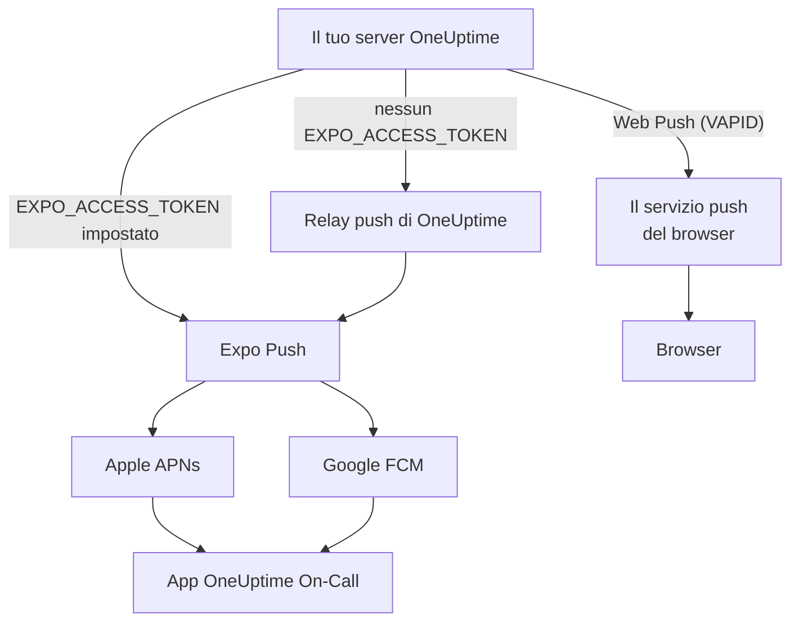

# Notifiche push

OneUptime avvisa le persone sul telefono tramite l'app mobile **OneUptime On-Call**, e nel browser tramite Web Push. I push mobili si basano su **Expo Push**: un'istanza self-hosted li invia per impostazione predefinita tramite il relay push di OneUptime, quindi le serve l'accesso di rete in uscita verso il relay e nessuna credenziale propria di Expo, Apple o Google.

:::cards
- [Scegli come inviare i push](#configurazione-self-hosted): Il relay push, oppure il tuo token di accesso Expo.
- [Apri il firewall](#accesso-di-rete): Gli indirizzi raggiunti dal tuo server e dai dispositivi delle tue persone.
- [Suona anche in modalità silenziosa](#avvisi-critici-di-reperibilità-superare-la-modalità-silenziosa): Fai suonare gli avvisi di reperibilità su un telefono silenziato.
- [Ripara i push che non arrivano mai](#risoluzione-dei-problemi): Che cosa significa ciascun errore di Expo.
:::

## Come funziona



L'app mobile di OneUptime registra un token Expo Push presso il backend. Il backend invia le notifiche tramite il relay push di OneUptime, oppure direttamente a Expo quando `EXPO_ACCESS_TOKEN` è configurato. Expo inoltra i messaggi ad Apple APNs o a Google FCM per la consegna al dispositivo.

Le notifiche Web Push continuano a usare le chiavi VAPID e il protocollo Web Push.

## Configurazione self-hosted

Con l'app mobile ufficiale e il relay predefinito, sul server non servono credenziali Expo. Per la consegna diretta tramite Expo, configura `EXPO_ACCESS_TOKEN` con credenziali adatte al progetto Expo della tua app. Il Web Push richiede `VAPID_PUBLIC_KEY`, `VAPID_PRIVATE_KEY` e `VAPID_SUBJECT`.

| Variabile | Valore Helm | Predefinito | Che cosa fa |
| --- | --- | --- | --- |
| `PUSH_NOTIFICATION_RELAY_URL` | `pushNotification.relayUrl` | `https://oneuptime.com/api/notification/push-relay/send` | Dove vanno i push mobili finché `EXPO_ACCESS_TOKEN` non è impostato. |
| `EXPO_ACCESS_TOKEN` | `expo.accessToken` | Vuoto | Invia i push mobili direttamente a Expo, con il token del tuo progetto Expo. |
| `VAPID_PUBLIC_KEY` | `vapid.publicKey` | Vuoto | La metà pubblica della coppia di chiavi con cui si iscrivono i browser. |
| `VAPID_PRIVATE_KEY` | `vapid.privateKey` | Vuoto | La metà privata, che firma ogni Web Push. |
| `VAPID_SUBJECT` | `vapid.subject` | `mailto:support@oneuptime.com` | Un indirizzo di contatto a cui i servizi push dei browser possono raggiungerti. |

Genera una coppia di chiavi VAPID una sola volta con `npx web-push generate-vapid-keys` e conservala: i browser che si sono iscritti con una coppia di chiavi smettono di ricevere push quando cambia.

:::tabs
@tab Docker Compose
```bash title="config.env"
VAPID_PUBLIC_KEY=your-public-key
VAPID_PRIVATE_KEY=your-private-key
VAPID_SUBJECT=mailto:oncall@example.com
# Leave unset to send mobile pushes through the push relay.
EXPO_ACCESS_TOKEN=
```
@tab Kubernetes
```yaml title="values.yaml"
vapid:
  publicKey: your-public-key
  privateKey: your-private-key
  subject: mailto:oncall@example.com
# Leave empty to send mobile pushes through the push relay.
expo:
  accessToken:
```
:::

## Accesso di rete

| Direzione | Destinazione | Protocollo / porta | Quando serve |
| --- | --- | --- | --- |
| OneUptime → relay push predefinito | `https://oneuptime.com/api/notification/push-relay/send`, `https://oneuptime.com/api/notification/push-relay/receipts` | HTTPS / TCP 443 | Push mobile quando `EXPO_ACCESS_TOKEN` non è impostato. |
| OneUptime → Expo | `https://exp.host/--/api/v2/push/send`, `https://exp.host/--/api/v2/push/getReceipts` | HTTPS / TCP 443 | Push mobile diretto quando `EXPO_ACCESS_TOKEN` è impostato. |
| OneUptime → servizio push del browser | L'endpoint HTTPS memorizzato nell'iscrizione push del browser | HTTPS / di norma TCP 443 | Web Push. |
| App mobile o browser → OneUptime | Il tuo nome host di OneUptime | HTTPS / TCP 443 | Accedere, registrare il dispositivo e aprire i link delle notifiche. |

Se modifichi `PUSH_NOTIFICATION_RELAY_URL`, consenti il suo nome host di destinazione e la porta configurata. Un relay personalizzato deve implementare l'API di relay di OneUptime. Questi valori predefiniti e il passaggio tra relay e consegna diretta sono definiti nella [configurazione di OneUptime](https://github.com/OneUptime/oneuptime/blob/master/config.example.env) e nel [servizio push](https://github.com/OneUptime/oneuptime/blob/master/packages/Common/Server/Services/PushNotificationService.ts). Le richieste dirette a Expo usano l'endpoint documentato nella [guida all'invio di Expo](https://docs.expo.dev/push-notifications/sending-notifications/). OneUptime legge le ricevute di consegna dal relay allo stesso indirizzo, con `/receipts` al posto di `/send`. Un relay senza quella route consegna comunque i push; un dispositivo la cui app è stata rimossa viene allora notato solo quando un push successivo verso di esso viene rifiutato.

Per il Web Push, consenti gli host effettivi degli endpoint di iscrizione dei browser usati dal tuo team. OneUptime accetta `fcm.googleapis.com`, `android.googleapis.com`, `push.services.mozilla.com`, `notify.windows.com` e `push.apple.com`, compresi i loro sottodomini. Esempi tipici sono `updates.push.services.mozilla.com` e `web.push.apple.com`. L'[iscrizione push del browser](https://developer.mozilla.org/en-US/docs/Web/API/PushSubscription) fornisce la destinazione; consentire solo Expo o il relay di OneUptime non abilita il Web Push.

Consenti la risoluzione DNS e il TLS in uscita dal processo di OneUptime che invia le notifiche. Il suo trust store deve convalidare il certificato della destinazione, e i proxy devono lasciar passare le richieste API senza autenticazione interattiva. I provider di push non chiamano alcun webhook sul tuo server OneUptime, quindi il server può restare privato se i dispositivi degli utenti vi accedono tramite VPN o un'altra connessione privata. Un server senza accesso al suo relay o ai servizi push esterni non può consegnare queste notifiche.

La connettività dei dispositivi è un requisito a parte. I dispositivi iOS hanno bisogno di accedere ad APNs, di solito su TCP 5223 con ripiego su TCP 443; consulta i [requisiti di rete attuali di Apple](https://support.apple.com/en-us/102266) per gli intervalli di destinazione. I dispositivi Android hanno bisogno di accedere a FCM su TCP 5228–5230 e 443; usa le [indicazioni attuali di Google su host e firewall](https://firebase.google.com/docs/cloud-messaging/network-configuration). Queste porte dei dispositivi non devono essere aperte in ingresso su OneUptime, e il flusso lato server usa il relay o Expo invece di collegarsi direttamente ad APNs/FCM.

:::steps
1. Controlla DNS e HTTPS dal container o dal pod che invia le notifiche verso la destinazione della tua modalità di consegna: il relay, Expo o il servizio push di un browser.
2. Invia un test da **Impostazioni utente > Metodi di notifica > Push Notifications** con **Notifica di test**, e verifica che arrivi su un dispositivo registrato. Per il Web Push, prova ogni browser separatamente.
3. Controlla gli errori del relay, di Expo o del Web Push nei log di OneUptime; un invio riuscito all'API non conferma da solo la consegna al dispositivo.
:::

Per i push mobili, OneUptime legge anche la ricevuta di consegna di Expo circa 15 minuti dopo ogni push: un push che non ha mai raggiunto il dispositivo compare allora come non consegnato nel registro dei push e, per un avviso di reperibilità, nella cronologia della reperibilità.

## Avvisi critici di reperibilità (superare la modalità silenziosa)

Per impostazione predefinita una notifica push obbedisce al telefono: un telefono in silenzioso resta in silenzio, e Non disturbare trattiene la notifica. Per chi è reperibile è il comportamento sbagliato alle 3 di notte, quindi l'app mobile offre un'impostazione per dispositivo – **Settings > Notifications > Critical On-Call Alerts** – che permette *solo agli avvisi di reperibilità* di emettere un suono nonostante entrambi.

L'ambito è volutamente ristretto. Possono farlo solo gli avvisi prodotti da una regola di notifica della reperibilità. Le iscrizioni dei proprietari, gli avvisi di note pubblicate, gli aggiornamenti di cambio di stato e le notifiche dei monitor non vengono mai elevati, qualunque cosa dica questa impostazione.

```mermaid title="Quando un avviso di reperibilità suona in modalità silenziosa"
flowchart TB
    Page["Un avviso di reperibilità"]
    Device{"Critical On-Call Alerts<br/>attivo su questo dispositivo?"}
    OS{"Il sistema del telefono<br/>consente gli avvisi critici?"}
    Loud["Emette un suono nonostante la<br/>modalità silenziosa e Non disturbare"]
    Quiet["Consegnato in silenzio,<br/>come ogni altro push"]
    Page --> Device
    Device -->|"sì"| OS
    Device -->|"no"| Quiet
    OS -->|"sì"| Loud
    OS -->|"no"| Quiet
```

Perché un avviso superi la modalità silenziosa devono essere vere tre condizioni. Se ne manca anche una, l'avviso viene comunque consegnato – solo in silenzio.

1. **La persona l'ha attivato per quel dispositivo.** Memorizzato per dispositivo, disattivato per impostazione predefinita, in `UserPush.isCriticalAlertEnabled`. Il telefono e il tablet di una stessa persona sono decisioni separate.
2. **Il server contrassegna l'avviso come critico.** Invia il payload del suono critico di APNs più `interruptionLevel: critical` per iOS, e punta al canale di notifica `oncall_critical` per Android.
3. **Il sistema operativo lo consente**, ed è qui che le due piattaforme differiscono.

:::tabs
@tab iOS
Gli avvisi critici su iOS richiedono l'entitlement `com.apple.developer.usernotifications.critical-alerts`, che Apple concede per account sviluppatore, su richiesta, alle app che avvisano le persone di eventi urgenti. Richiedilo tramite il [modulo di richiesta Critical Alerts di Apple](https://developer.apple.com/contact/request/notifications-critical-alerts-entitlement/).

L'app ufficiale **OneUptime On-Call** dell'App Store ha l'entitlement dalla **versione 1.5.0**. Le versioni precedenti non ce l'hanno, e iOS non offre mai loro gli avvisi critici, quindi aggiorna l'app prima di attivare l'impostazione.

Se compili l'app da solo, l'entitlement è facoltativo. Un profilo di provisioning non può portare un entitlement che non è stato concesso al team, e una build che ne dichiara uno che non può portare **non si firma**. Solo il profilo `production` in `packages/MobileApp/eas.json` lo attiva, perché Apple l'ha concesso al team che pubblica l'app ufficiale. Un fork che firma con il proprio team Apple deve rimuovere quella voce `env` finché Apple non concede l'entitlement anche a quel team. Una volta concesso, attivalo durante la build:

```bash
EXPO_IOS_CRITICAL_ALERTS_ENTITLEMENT=true npx expo prebuild
```

oppure aggiungi `EXPO_IOS_CRITICAL_ALERTS_ENTITLEMENT: "true"` al blocco `env` del profilo di build in `packages/MobileApp/eas.json`.

Sul dispositivo, attiva **Settings > Notifications > Critical On-Call Alerts** nell'app e consenti gli avvisi critici quando iOS lo chiede. iOS aggiunge un interruttore **Critical Alerts** per l'app, in **Settings > Notifications > OneUptime On-Call** nelle impostazioni di iOS, solo dopo che l'app ha chiesto il permesso, quindi quell'interruttore non c'è prima che tu attivi l'impostazione nell'app. Se rifiuti la richiesta, puoi consentire gli avvisi critici più tardi con quell'interruttore nelle impostazioni di iOS.

Su una build senza l'entitlement, iOS non mostra né la richiesta né l'interruttore, e la schermata delle impostazioni dell'app dice che questa versione dell'app non può ricevere avvisi critici. Non manda la persona a cercare un interruttore che iOS non mostra.
@tab Android
Android non prevede un passaggio di approvazione del produttore, ma l'esclusione da Non disturbare viene concessa dall'utente in una schermata di sistema invece che tramite una richiesta nell'app. Quando una persona attiva l'impostazione, l'app le apre **Settings > Notifications > Do Not Disturb access** e ricontrolla al suo ritorno.

Entrano in gioco due meccanismi, che coprono casi diversi:

- Il canale di notifica `oncall_critical` richiede `bypassDnd`, che copre Non disturbare e ha bisogno dell'accesso descritto sopra.
- Lo stesso canale usa il flusso audio **sveglia**, udibile su un telefono con la suoneria semplicemente silenziata. Questa metà non ha bisogno di alcun permesso.

Android congela le impostazioni di un canale quando il canale viene creato per la prima volta, quindi non si possono cambiare con un aggiornamento dell'app – solo distribuendo un nuovo id di canale.
:::

Per verificare che funzioni, invia una notifica di test al dispositivo da **Impostazioni utente > Metodi di notifica > Push Notifications**. Se il dispositivo ha gli avvisi critici attivi, anche il test viene inviato come avviso critico – quindi metti prima il telefono in silenzioso, e sentirai se un avviso vero ti raggiungerebbe.

## Risoluzione dei problemi

### Le notifiche push non arrivano

- Assicurati che l'app mobile sia stata compilata con EAS Build (Expo Go non supporta le notifiche push)
- Verifica che il dispositivo sia registrato nella tabella `UserPush` del tuo database
- Controlla i log del server OneUptime per gli errori dell'API Expo Push
- Conferma che il dispositivo abbia una connessione internet attiva e i permessi di notifica abilitati
- Controlla **Impostazioni utente > Metodi di notifica > Push Notifications**: un dispositivo contrassegnato come **Non riceve notifiche** ha smesso di riceverle e va registrato di nuovo (vedi sotto)

### Nessun interruttore Critical Alerts nelle impostazioni di iOS

- Aggiorna OneUptime On-Call dall'App Store. Le versioni precedenti alla 1.5.0 sono state compilate senza l'entitlement degli avvisi critici di Apple, e iOS non mostra alcun interruttore Critical Alerts per loro
- Attiva **Settings > Notifications > Critical On-Call Alerts** nell'app. iOS aggiunge l'interruttore alle proprie impostazioni solo dopo che l'app ha chiesto il permesso, e l'app lo chiede quando questa impostazione viene attivata
- Rimuovere e aggiungere di nuovo regole di notifica della reperibilità o dispositivi push non cambia nulla. L'impostazione appartiene all'app sul dispositivo, non a una regola

### Gli avvisi critici non superano la modalità silenziosa

- Controlla che l'interruttore sia attivo per **quel** dispositivo – l'impostazione è per dispositivo, e una reinstallazione o un nuovo telefono configurato da zero crea una nuova registrazione del dispositivo (un telefono configurato da un backup del vecchio subentra nella registrazione del vecchio telefono non appena questo non riceve più notifiche, con l'impostazione che aveva l'app)
- **iOS**: conferma che la build abbia l'entitlement degli avvisi critici di Apple (vedi sopra), e che Critical Alerts sia consentito in iOS Settings > Notifications > OneUptime On-Call
- **Android**: conferma che l'app abbia l'accesso a Non disturbare in Settings > Notifications > Do Not Disturb access
- La schermata delle impostazioni indica quale di questi manca; legge lo stato attuale dal sistema operativo invece di fidarsi di quanto l'app ha richiesto l'ultima volta

### Push contrassegnati come «non consegnati»

Che Expo accetti un push non significa che abbia raggiunto il dispositivo: Apple o Google possono ancora rifiutarlo. OneUptime legge la ricevuta di consegna di ogni push mobile circa 15 minuti dopo l'invio, tramite il relay push quando `EXPO_ACCESS_TOKEN` non è impostato. Quando la ricevuta segnala un errore, il registro dei push e la cronologia della reperibilità dell'avviso passano da inviato a **Push notification not delivered**, con il codice di errore di Expo:

- `DeviceNotRegistered`: l'app mobile è stata rimossa dal dispositivo, oppure il suo token push non è più valido. Vedi la sezione successiva.
- `MessageRateExceeded`: al dispositivo sono state inviate troppe notifiche in poco tempo. I push successivi verso di esso vengono inviati come di consueto.
- `MessageTooBig`: la notifica era più grande di quanto accettino i servizi push. OneUptime accorcia le notifiche perché ci stiano, quindi non dovrebbe succedere; segnalalo se succede.
- `InvalidCredentials` o `MismatchSenderId`: le credenziali push del progetto Expo che ha inviato il push non sono valide. Con `EXPO_ACCESS_TOKEN`, controlla le credenziali push del tuo progetto Expo; con il relay predefinito, contatta il supporto di OneUptime.

Quando Expo rifiuta subito un push, il registro dei push ne riporta immediatamente il motivo. Tramite il relay push funziona allo stesso modo: il relay trasmette il codice di errore di Expo invece di rispondere con un errore del server.

### Errori «DeviceNotRegistered» nei log

Expo segnala `DeviceNotRegistered` quando l'app mobile è stata rimossa dal dispositivo o il token push del dispositivo non è più valido. Di solito lo indica nella ricevuta di consegna di un push, che OneUptime legge circa 15 minuti dopo il push, e a volte rifiuta subito il push. In entrambi i casi OneUptime smette di inviare a quel dispositivo. Viene contrassegnato come non più in grado di ricevere notifiche invece di essere eliminato, quindi le sue regole di notifica restano, e il registro dei push e la cronologia della reperibilità dell'avviso non arrivato ne indicano il motivo. **Impostazioni utente > Metodi di notifica > Push Notifications** lo mostra come **Non riceve notifiche**. Gli altri dispositivi e metodi di notifica del suo proprietario continuano a ricevere gli avvisi.

Per recuperare il dispositivo, aprici l'app mobile con l'accesso effettuato. L'app si registra di nuovo, il che rinnova il suo token push presso Expo, e il dispositivo torna a ricevere le notifiche con le sue regole. Se l'app è stata rimossa, reinstallala ed effettua l'accesso. Una ricevuta per un push inviato prima che l'app si registrasse di nuovo non contrassegna il dispositivo. Quando un'app mobile aggiornata viene configurata su un nuovo telefono da un backup del vecchio, comunica a OneUptime il token push che aveva prima; se il dispositivo del vecchio telefono non riceve più notifiche, il nuovo telefono subentra con le sue regole.

Tramite il relay push (senza `EXPO_ACCESS_TOKEN`) funziona allo stesso modo: il relay segnala `DeviceNotRegistered` quando invia un push, e legge le ricevute di consegna che la tua istanza gli chiede.

Se nulla di tutto questo aiuta, scrivici a [hello@oneuptime.com](mailto:hello@oneuptime.com) con gli errori dei tuoi log di OneUptime.

## Passaggi successivi

:::cards
- [App mobili](/docs/mobile-desktop-apps/index): Installa l'app OneUptime On-Call ed effettua l'accesso.
- [Risoluzione dei problemi dell'app mobile](/docs/mobile-desktop-apps/faq-troubleshooting): Risolvi i problemi di accesso e di notifica sul telefono.
- [Regole di escalation](/docs/on-call/escalation-rules): Decidi chi viene avvisato, e quando.
- [Accesso alla rete privata](/docs/self-hosted/private-network-access): Che cosa può raggiungere il tuo server nella tua rete.
:::
