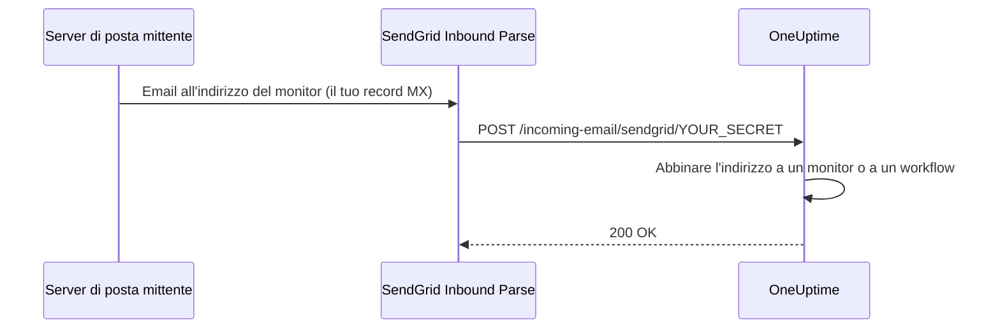

# Email in arrivo SendGrid

L'**Incoming Email Monitor** di OneUptime ti permette di creare e risolvere avvisi in base alle email inviate a indirizzi univoci, specifici di ogni monitor. È utile per integrare sistemi legacy, strumenti di allerta o qualsiasi servizio in grado di inviare email.

La stessa configurazione permette anche ai workflow di ricevere email: un workflow con il trigger **Incoming Email** ottiene un proprio indirizzo sullo stesso dominio, e ogni email inviata a quell'indirizzo avvia il workflow. Vedi [Trigger](/docs/workflows/triggers#incoming-email).

Questa guida spiega come configurare SendGrid Inbound Parse per inoltrare le email in arrivo alla tua istanza self-hosted di OneUptime. OneUptime Cloud non ne ha bisogno: i suoi indirizzi funzionano subito.

:::cards
- [Prima di iniziare](#prerequisiti): Un account SendGrid, un dominio e un indirizzo HTTPS pubblico.
- [Configurazione](#istruzioni-di-configurazione): Sette passaggi, dal record MX a un'email di prova.
- [Variabili d'ambiente](#riferimento-delle-variabili-dambiente): Le tre impostazioni e i loro valori predefiniti.
- [Risoluzione dei problemi](#risoluzione-dei-problemi): Email che non arrivano mai e webhook che falliscono.
:::

## Come funziona



1. Crei un **Incoming Email Monitor** in OneUptime
2. OneUptime genera un indirizzo email univoco per quel monitor (ad es. `monitor-abc123@inbound.yourdomain.com`)
3. Quando un'email viene inviata a quell'indirizzo, SendGrid la riceve e la inoltra a OneUptime tramite webhook
4. OneUptime valuta l'email in base ai criteri che hai configurato per creare o risolvere gli avvisi

## Prerequisiti

- Un account SendGrid con accesso a Inbound Parse
- Un dominio che controlli, con accesso alle impostazioni DNS
- Un endpoint HTTPS pubblico che inoltri i webhook di SendGrid alla tua istanza di OneUptime

## Accesso di rete

Con Inbound Parse è SendGrid ad aprire la connessione verso OneUptime. Consentire a OneUptime solo l'accesso a internet in uscita non basta.

| Direzione | Destinazione | Protocollo / porta | Scopo |
| --- | --- | --- | --- |
| SendGrid → OneUptime | `https://your-oneuptime-domain.com/incoming-email/sendgrid/YOUR_SECRET` | HTTPS / TCP 443 | Consegnare l'email analizzata come POST multipart. |
| Server di posta mittenti → SendGrid | `mx.sendgrid.net`, scelto dal record MX pubblico del tuo dominio di ricezione | SMTP / TCP 25 | Ricevere l'email presso SendGrid; questa connessione non arriva al tuo server OneUptime. |
| OneUptime → SendGrid, solo se l'invio di email tramite il provider SendGrid è configurato a parte | `api.sendgrid.com` | HTTPS / TCP 443 | Inviare le email di notifica tramite la Mail Send API. |

Pubblica il DNS del nome host del webhook e servi un certificato considerato attendibile dai client pubblici. Un deployment privato di OneUptime può esporre solo il percorso del webhook tramite un reverse proxy o un gateway pubblici in grado di raggiungere OneUptime internamente. Conserva percorso, secret, tipo di contenuto e corpo multipart della richiesta, e lascia passare il POST senza accesso interattivo né challenge del browser. Il server OneUptime non ha bisogno di un listener SMTP in ingresso. Vedi [la configurazione di Inbound Parse di SendGrid](https://www.twilio.com/docs/sendgrid/for-developers/parsing-email/setting-up-the-inbound-parse-webhook).

Imposta `INBOUND_EMAIL_WEBHOOK_SECRET` su un valore casuale robusto e sostituisci `YOUR_SECRET` nell'URL con quel valore. La route richiede l'ultimo segmento del percorso. OneUptime ne controlla il valore quando il secret è configurato; lasciare vuota la variabile disattiva il controllo. Mantieni riservati l'URL completo e gli indirizzi email dei monitor, anche nei log dei proxy. Al momento OneUptime non convalida le intestazioni Inbound Parse firmate di SendGrid né i token OAuth. Se ti servono questi meccanismi, configura un gateway che li convalidi prima di inoltrare a OneUptime, seguendo [la documentazione di SendGrid sulla sicurezza dei webhook](https://www.twilio.com/docs/sendgrid/for-developers/parsing-email/securing-your-parse-webhooks).

SendGrid non fornisce un elenco affidabile di IP sorgente statici per Inbound Parse. I suoi IP di invio email e gli indirizzi risolti per `mx.sendgrid.net` non sono una allowlist per il webhook. Segui [le indicazioni di SendGrid sui firewall](https://support.sendgrid.com/hc/en-us/articles/44375457225371-How-to-Configure-Firewall-Settings-for-SendGrid-Webhook-and-Inbound-Parse-IPs) invece di fissare un risultato DNS attuale.

Inbound Parse è separato dall'invio di email in uscita. Ricevere le email dei monitor non richiede che OneUptime chiami l'API di SendGrid. Se scegli SendGrid anche per inviare le notifiche, consenti la risoluzione DNS e l'HTTPS in uscita verso `api.sendgrid.com`; [Mail Send](https://www.twilio.com/docs/sendgrid/api-reference/mail-send/mail-send) non ha bisogno di alcun callback in ingresso per l'invio. Se invece usi SMTP, consenti il server e la porta SMTP configurati in OneUptime.

## Istruzioni di configurazione

:::steps
### Scegli il tuo dominio per le email in arrivo

Scegli un sottodominio dedicato alla ricezione delle email per OneUptime, come `inbound.yourdomain.com`, `email.yourdomain.com` o `monitor.yourdomain.com`. Serve solo per le email destinate ai monitor e ai workflow di OneUptime, quindi nessuna tua casella di posta vi risiede.

### Fai puntare il suo record MX a SendGrid

Aggiungi un record MX che instradi verso SendGrid le email del sottodominio:

| Tipo | Host/Nome | Priorità | Valore |
| --- | --- | --- | --- |
| MX | inbound | 10 | mx.sendgrid.net |

Se il tuo dominio è `example.com` e usi `inbound.example.com`, il record è:

```text
inbound.example.com.  IN  MX  10  mx.sendgrid.net.
```

Le modifiche DNS possono richiedere fino a 48 ore per propagarsi, ma di solito si completano in poche ore.

### Autentica il dominio in SendGrid

Il dominio di ricezione deve appartenere a uno dei tuoi [domini autenticati in SendGrid](https://www.twilio.com/docs/sendgrid/ui/account-and-settings/inbound-parse). Nella [dashboard di SendGrid](https://app.sendgrid.com), vai su **Settings** > **Sender Authentication**, fai clic su **Authenticate Your Domain** e aggiungi i record DNS richiesti (record CNAME per DKIM).

### Aggiungi il webhook di Inbound Parse

Nella dashboard di SendGrid, vai su **Settings** > **Inbound Parse** e fai clic su **Add Host & URL**. Compila il modulo come indicato sotto, poi fai clic su **Add**:

| Campo | Valore |
| --- | --- |
| **Receiving Domain** | Il tuo sottodominio di ricezione (ad es. `inbound.yourdomain.com`) |
| **Destination URL** | `https://your-oneuptime-domain.com/incoming-email/sendgrid/YOUR_SECRET` |
| **Check incoming emails for spam** | Facoltativo: attivalo se vuoi |
| **Send raw, full MIME message** | Lascia deselezionato (non richiesto) |
| **POST the raw, full MIME message** | Lascia deselezionato (non richiesto) |

### Configura OneUptime

Imposta le variabili per le email in arrivo, con lo stesso secret della Destination URL:

:::tabs
@tab Docker Compose
```bash title="config.env"
INBOUND_EMAIL_PROVIDER=SendGrid
INBOUND_EMAIL_DOMAIN=inbound.yourdomain.com
INBOUND_EMAIL_WEBHOOK_SECRET=replace-with-a-strong-random-secret
```
@tab Kubernetes
```yaml title="values.yaml"
inboundEmail:
  provider: "SendGrid"
  domain: "inbound.yourdomain.com"
  webhookSecret: "replace-with-a-strong-random-secret"
```
:::

Poi applicale: esegui `npm run start` con Docker Compose, che ricrea i container con i nuovi valori, oppure aggiorna la release Helm su Kubernetes.

### Crea un monitor Incoming Email

[Crea un monitor Incoming Email](/docs/monitor/incoming-email-monitor#creare-un-monitor-di-email-in-arrivo). La sua pagina **Panoramica** mostra il suo indirizzo, ad esempio `monitor-abc123def456@inbound.yourdomain.com`, e i suoi criteri decidono quali email creano un avviso e quali lo risolvono.

I workflow usano lo stesso dominio. Aggiungi il trigger **Incoming Email** a un workflow e fai clic su di esso: il suo indirizzo (`workflow-…@inbound.yourdomain.com`) è in cima alle sue impostazioni. Finché le variabili per le email in arrivo qui sopra non sono impostate, il trigger indica che il server non è configurato per ricevere email.

### Invia un'email di prova

Invia un'email all'indirizzo del monitor, con un oggetto che corrisponda ai suoi criteri. Il riepilogo del monitor mostra l'email, e viene creato un avviso quando i criteri corrispondono.
:::

## Riferimento delle variabili d'ambiente

| Variabile | Valore Helm | Descrizione | Obbligatoria | Predefinito |
| --- | --- | --- | --- | --- |
| `INBOUND_EMAIL_PROVIDER` | `inboundEmail.provider` | Il provider delle email in arrivo. SendGrid è l'unico. | No | `SendGrid` |
| `INBOUND_EMAIL_DOMAIN` | `inboundEmail.domain` | Il sottodominio configurato per le email in arrivo. Le email in arrivo sono disattivate finché non è impostato. | Sì | Vuoto |
| `INBOUND_EMAIL_WEBHOOK_SECRET` | `inboundEmail.webhookSecret` | Secret confrontato con l'ultimo segmento dell'URL del webhook: `/incoming-email/sendgrid/YOUR_SECRET`. Configuralo per gli endpoint pubblici; un valore vuoto disattiva la convalida. | Consigliata | Vuoto |

Su che cosa può basarsi un monitor Incoming Email – l'oggetto, il mittente, il corpo, il destinatario e se un'email è arrivata in tempo – è spiegato in [Tipi di filtro disponibili](/docs/monitor/incoming-email-monitor#tipi-di-filtro-disponibili).

## Risoluzione dei problemi

:::details Le email non vengono ricevute
1. **Controlla la propagazione DNS:** `dig MX inbound.yourdomain.com` dovrebbe restituire `mx.sendgrid.net`.
2. **Verifica le impostazioni di Inbound Parse in SendGrid:** nella dashboard di SendGrid, in **Settings** > **Inbound Parse**, controlla il tuo dominio e l'URL del webhook.
3. **Controlla i log di OneUptime:** cerca le richieste del webhook delle email in arrivo, ed eventuali errori, nei log del servizio `app` di OneUptime. SendGrid non conserva log dettagliati di Inbound Parse, quindi questi log sono la traccia di ciò che è arrivato.
:::

:::details I webhook falliscono
1. **Controlla la route pubblica del webhook:** l'URL completo, secret compreso, deve raggiungere OneUptime da internet. L'URL senza il suo ultimo segmento secret non corrisponde alla route.
2. **Controlla le regole del firewall:** consenti le richieste HTTPS POST al percorso del webhook senza reindirizzamenti di accesso né challenge del browser, e non usare gli IP di invio email di SendGrid come allowlist delle sorgenti del webhook.
3. **Verifica il certificato SSL:** usa per il nome host del webhook un certificato valido e pubblicamente attendibile, e includi la sua catena di certificati.
:::

:::details Il monitor non crea avvisi
1. **Verifica i criteri:** controlla che i tuoi criteri di creazione degli avvisi corrispondano al contenuto dell'email, e prova prima con stringhe esatte prima di usare i pattern.
2. **Controlla il monitor:** assicurati che non sia disattivato e che il suo tipo sia Incoming Email.
3. **Rivedi il riepilogo del monitor:** controlla se l'email è stata ricevuta ed elaborata, e leggi i log di valutazione per vedere come hanno corrisposto i criteri.
:::

:::details Il trigger indica che il server non è configurato per ricevere email
`INBOUND_EMAIL_DOMAIN` è vuota sul server. Impostala, applica la modifica e riapri il trigger del workflow.
:::

## Buone pratiche di sicurezza

1. **Usa HTTPS:** usa sempre HTTPS per l'endpoint del tuo webhook
2. **Secret del webhook:** configura `INBOUND_EMAIL_WEBHOOK_SECRET` e includilo nell'URL del tuo webhook (ad es. `/incoming-email/sendgrid/your-secret`) come convalida aggiuntiva
3. **Verifica del dominio:** verifica il tuo dominio in SendGrid per una migliore sicurezza delle email
4. **Limita l'accesso:** crea monitor solo per sorgenti di email attendibili
5. **Monitora i log:** controlla regolarmente i log delle email in arrivo alla ricerca di attività sospette

## Passaggi successivi

:::cards
- [Incoming Email Monitor](/docs/monitor/incoming-email-monitor): Criteri, formati degli indirizzi ed esempi.
- [Trigger dei workflow](/docs/workflows/triggers): Avvia un workflow da un'email.
- [Accesso alla rete privata](/docs/self-hosted/private-network-access): Che cosa può raggiungere il tuo server nella tua rete.
- [Architettura](/docs/self-hosted/architecture): Dove arriva il webhook in un'installazione self-hosted.
:::
