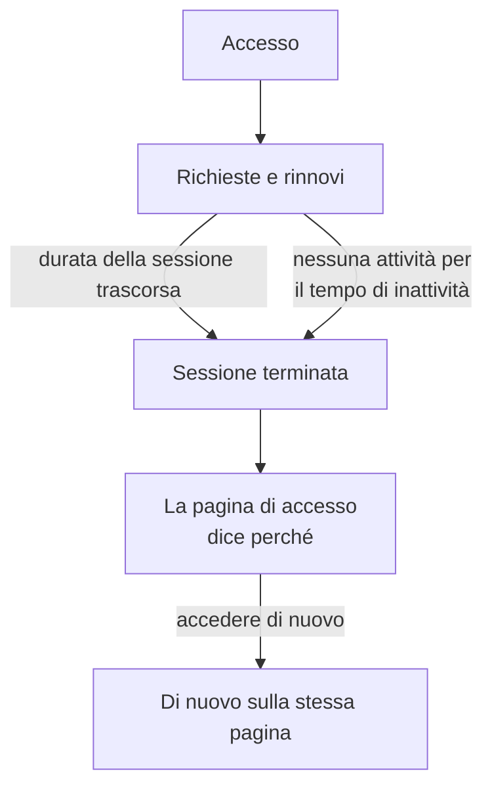

# Durata della sessione

Scegliete per quanto tempo le persone restano connesse a OneUptime prima di accedere di nuovo: un tempo fisso dopo l'accesso, un periodo senza utilizzo, o entrambi. Vale per ogni accesso alla dashboard, all'Admin Dashboard e all'app mobile, con password, passkey, accesso con Microsoft o single sign-on. Gli accessi SSO possono avere durate proprie.

> [!NOTE]
> La durata della sessione fa parte di [OneUptime Enterprise Edition](/docs/self-hosted/enterprise). La Community Edition non ha la pagina **Durata della sessione**, e ogni accesso dura come descritto in [Nessun limite](#nessun-limite).

:::cards
- [Impostare una durata della sessione](#impostare-una-durata-della-sessione): Due impostazioni nell'Admin Dashboard.
- [Come finisce una sessione](#come-finisce-una-sessione): Cosa conta il server, e quando.
- [Accessi SSO](#accessi-sso): Durate proprie per il single sign-on.
- [Cosa non è un accesso](#cosa-non-è-un-accesso): Chiavi API, connessioni MCP e lettori delle pagine di stato.
:::

## Nessun limite

Finché non impostate una durata, un accesso non ne ha. Il suo token di accesso dura 15 minuti e viene rinnovato in background con un token di aggiornamento, che dura 30 giorni e ricomincia ogni volta che viene usato. Chi apre OneUptime almeno una volta ogni 30 giorni resta connesso; chi non lo fa accede di nuovo.

## Impostare una durata della sessione

:::steps
### Aprire Durata della sessione
Nell'Admin Dashboard, aprite **Impostazioni**, poi **Durata della sessione** nel menu laterale.

### Scegliere le durate
- **Disconnetti le persone dopo**: quanto dura un accesso dal momento in cui una persona accede, per quanto sia attiva.
- **Disconnetti le persone dopo un’inattività di**: per quanto tempo una persona può restare senza fare clic, digitare o scorrere in OneUptime.

Ogni scelta viene salvata appena la fate.

### Confermare chi viene disconnesso
Una durata più breve vale per tutti quelli connessi ora. Quando disconnette subito delle persone, OneUptime indica prima quante, e se ne fate parte. Selezionate **Salva e disconnettili** per procedere.
:::

| Impostazione | Scelte | Predefinito |
| --- | --- | --- |
| **Disconnetti le persone dopo** | Da 1 ora a 90 giorni | **Nessun limite** |
| **Disconnetti le persone dopo un’inattività di** | Da 15 minuti a 14 giorni | 30 giorni, il massimo possibile |

Tramite l'API, `sessionLengthInMinutes` accetta qualsiasi numero intero di minuti da 15 a 525600 (un anno) e `sessionIdleTimeoutInMinutes` da 15 a 43200 (30 giorni), nella configurazione globale del server. Vuoto è il valore predefinito.

## Come finisce una sessione

- Il server conta entrambe le durate dalla sessione stessa: quando è stato fatto l'accesso, e quando la sua persona è stata attiva l'ultima volta. Le controlla a ogni richiesta, a ogni rinnovo e a ogni aggiornamento in tempo reale, e non lascia mai la disconnessione al browser.
- Il tempo di inattività conta dall'ultimo clic, tasto premuto o scorrimento in una qualsiasi scheda della dashboard o dell'Admin Dashboard. Una scheda lasciata aperta non tiene in vita una sessione.
- L'app mobile conta come attiva ogni volta che viene usata.
- Quando una sessione finisce, il browser passa alla pagina di accesso, che dice perché. Dopo aver effettuato di nuovo l'accesso, la persona torna alla pagina in cui si trovava.

| Modifica | Cosa succede alle persone connesse ora |
| --- | --- |
| Una durata della sessione o un tempo di inattività più breve | Tutti quelli che l'hanno superato vengono disconnessi subito, gli altri quando lo raggiungono |
| Uno più lungo, o nessuno | Nessuno viene disconnesso, e le sessioni durano di più dal loro prossimo rinnovo |

## Accessi SSO

Gli accessi tramite single sign-on seguono le stesse due impostazioni. Per dare loro durate proprie, aprite **Altre impostazioni** nella pagina **Durata della sessione** e attivate **Durate separate per gli accessi SSO**. Le due impostazioni sottostanti valgono allora per gli accessi tramite il provider SAML o OpenID Connect di un progetto, o tramite l'[SSO globale](/docs/identity/global-sso) del server, e le due in cima alla pagina per tutti gli altri accessi.

Un progetto che richiede l'SSO, inoltre, lascia entrare una sessione solo finché dura il suo accesso SSO, che non è mai più lungo della durata seguita dagli accessi SSO.

Tramite l'API, l'interruttore è `useSeparateSsoSessionLengths`, e le durate degli accessi SSO sono `ssoSessionLengthInMinutes` e `ssoSessionIdleTimeoutInMinutes`, con gli stessi intervalli.

## Cosa non è un accesso

- **Le chiavi API** mantengono la scadenza che date loro.
- **Le connessioni MCP**, assistenti IA collegati con OAuth, mantengono la propria durata. In un progetto che richiede l'SSO, una connessione non dura mai più dell'accesso SSO con cui è stata approvata.
- **Le pagine di stato private** hanno una durata propria per i loro lettori: vedete [Utenti privati](/docs/status-pages/index#utenti-privati).

## Senza licenza

Dopo la prova o il periodo di tolleranza, senza una licenza valida o con una che non include le durate della sessione, le durate non possono essere impostate né modificate. Quelle già impostate continuano a disconnettere le persone, e potete ancora rimuoverle. Con l'immagine della Community Edition non si applica nessuna durata: i valori restano nel database e tornano ad applicarsi quando tornate indietro.

## Passi successivi

:::cards
- [SSO](/docs/identity/sso): Fate accedere le persone con il vostro provider di identità.
- [SSO globale](/docs/identity/global-sso): Un solo provider di identità per tutto il server.
- [Enterprise Edition](/docs/self-hosted/enterprise): Cosa aggiunge l'Enterprise Edition, e la sua licenza.
:::
