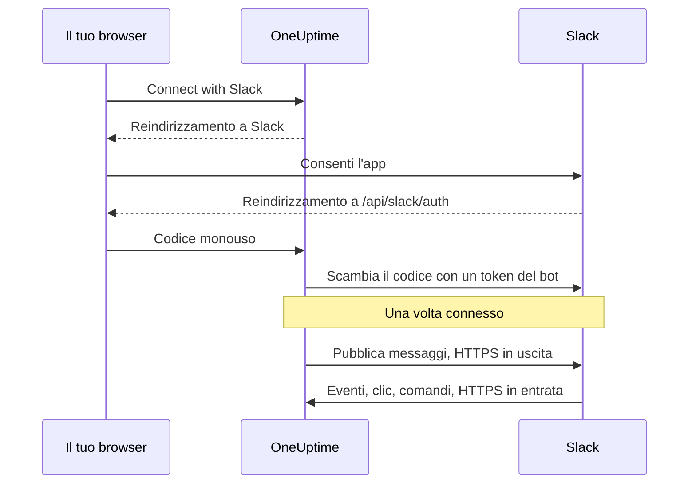

# Integrazione Slack

Connetti il tuo OneUptime self-hosted a Slack. Crei un'app Slack dal manifest generato dal tuo server, dai a OneUptime le credenziali dell'app e connetti ogni progetto a un'area di lavoro. OneUptime pubblica poi incidenti, avvisi e manutenzioni programmate nei tuoi canali, e il tuo team agisce su di essi da Slack.

Questa pagina è per chi gestisce il server OneUptime. Una volta connesso Slack, le regole di notifica si configurano per progetto: vedi [Slack](/docs/workspace-connections/slack).

:::cards
- [Configurare l'app Slack](#configurare-lapp-slack): Crea l'app dal tuo manifest e connetti un progetto.
- [Variabili d'ambiente](#variabili-dambiente): I tre valori di cui OneUptime ha bisogno dall'app.
- [Accesso di rete](#accesso-di-rete-per-le-installazioni-self-hosted): I callback che Slack deve poter raggiungere.
- [Risoluzione dei problemi](#risoluzione-dei-problemi): Cosa significano i messaggi della pagina Slack e cosa fare.
:::

## Come funziona

L'app Slack è tua: è installata nella tua area di lavoro e parla solo con il tuo server. Il traffico scorre in entrambe le direzioni, e ogni direzione ha bisogno del proprio accesso di rete.



- **In uscita**: OneUptime chiama la Web API di Slack per pubblicare messaggi, creare canali e caricare immagini.
- **In entrata**: Slack chiama quattro route sul tuo server per eventi, clic sui pulsanti, menu e comandi slash. Ogni richiesta è firmata con il signing secret dell'app. OneUptime rifiuta una richiesta la cui firma non corrisponde o il cui timestamp ha più di cinque minuti.

## Prima di iniziare

- Un'area di lavoro Slack in cui puoi creare e installare app.
- Un nome host HTTPS pubblico per OneUptime che Slack possa raggiungere. Vedi [Accesso di rete](#accesso-di-rete-per-le-installazioni-self-hosted).
- Accesso alla configurazione del server: `config.env` per Docker Compose, o i tuoi values di Helm per Kubernetes.
- Per connettere un progetto, il ruolo **Project Owner**, **Project Admin** o **Project Member** in quel progetto.

## Configurare l'app Slack

:::steps
### Imposta l'URL pubblico

OneUptime costruisce il manifest dell'app e ogni URL di callback da `HOST` e `HTTP_PROTOCOL`. Impostali sul nome host che Slack chiamerà, in HTTPS:

:::tabs
@tab Docker Compose
```bash title="config.env"
HOST=oneuptime.example.com
HTTP_PROTOCOL=https
```
@tab Kubernetes
```yaml title="values.yaml"
host: oneuptime.example.com
httpProtocol: https
```
:::

Questi valori generano solo URL. Non creano record DNS, certificati né regole del firewall.

### Copia il manifest dell'app

Apri **Impostazioni del progetto > Area di lavoro > Slack**. Finché Slack non è configurato sul server, la pagina mostra **Integrating Slack with your OneUptime Project** con il manifest generato per il tuo nome host. È servito anche su `https://oneuptime.example.com/api/slack/app-manifest`.

Controlla che ogni URL del manifest inizi con il tuo nome host pubblico. Se non è così, correggi prima `HOST` e `HTTP_PROTOCOL` e applica la modifica.

### Crea l'app Slack

Su [api.slack.com/apps](https://api.slack.com/apps), crea una nuova app da un manifest, scegli la tua area di lavoro e incolla il manifest. Usa sempre il manifest generato dal tuo server, così che i suoi URL corrispondano al tuo nome host.

### Copia le credenziali dell'app

Nella pagina **Basic Information** dell'app, sotto **App Credentials**, copia **Client ID**, **Client Secret** e **Signing Secret**.

### Aggiungi le credenziali a OneUptime

:::tabs
@tab Docker Compose
```bash title="config.env"
SLACK_APP_CLIENT_ID=YOUR_SLACK_APP_CLIENT_ID
SLACK_APP_CLIENT_SECRET=YOUR_SLACK_APP_CLIENT_SECRET
SLACK_APP_SIGNING_SECRET=YOUR_SLACK_APP_SIGNING_SECRET
```
@tab Kubernetes
```yaml title="values.yaml"
slackApp:
  clientId: "YOUR_SLACK_APP_CLIENT_ID"
  clientSecret: "YOUR_SLACK_APP_CLIENT_SECRET"
  signingSecret: "YOUR_SLACK_APP_SIGNING_SECRET"
```

Per tenere i valori in un Secret di Kubernetes gestito da te, imposta invece `slackApp.existingSecret`: il suo `name` e le chiavi `clientIdKey`, `clientSecretKey` e `signingSecretKey`.
:::

### Applica la configurazione

:::tabs
@tab Docker Compose
```bash
npm run start
```

Questo ricrea i container con il nuovo `config.env`. `docker compose restart` non lo rilegge.
@tab Kubernetes
```bash
helm upgrade my-oneuptime oneuptime/oneuptime -f values.yaml
```
:::

Quando OneUptime è di nuovo attivo, **Impostazioni del progetto > Area di lavoro > Slack** mostra un pulsante **Connect with Slack** al posto del manifest.

### Verifica l'URL di richiesta degli eventi

Nelle **Event Subscriptions** dell'app Slack, verifica l'URL di richiesta. OneUptime risponde alla challenge di Slack solo dopo che il signing secret è impostato, quindi riprova se la verifica non è riuscita mentre creavi l'app.

### Connetti il progetto

In **Impostazioni del progetto > Area di lavoro > Slack**, seleziona **Connect with Slack** e consenti l'app in Slack. Slack ti riporta alla stessa pagina, che ora mostra il nome della tua area di lavoro.

### Connetti il tuo account Slack

Pulsanti, moduli e comandi agiscono come l'utente OneUptime collegato all'account Slack che li usa. Ogni persona apre **Impostazioni utente > Area di lavoro > Slack** e seleziona **Connect my account with Slack**. Chi non ha connesso un account riceve dall'app un messaggio diretto che glielo chiede.
:::

## Variabili d'ambiente

| Docker Compose (`config.env`) | Helm (`values.yaml`) | Obbligatoria | Valore |
| --- | --- | --- | --- |
| `SLACK_APP_CLIENT_ID` | `slackApp.clientId` | Sì | Il **Client ID** dell'app. Senza di esso, la pagina Slack mostra la guida alla configurazione invece di **Connect with Slack**. |
| `SLACK_APP_CLIENT_SECRET` | `slackApp.clientSecret` | Sì | Il **Client Secret** dell'app, usato per scambiare con un token il codice restituito da Slack. |
| `SLACK_APP_SIGNING_SECRET` | `slackApp.signingSecret` | Sì | Il **Signing Secret** dell'app. Ogni richiesta di Slack viene verificata con esso. |
| `HOST` | `host` | Sì | Il tuo nome host pubblico, senza lo schema. |
| `HTTP_PROTOCOL` | `httpProtocol` | Sì | `https`. Slack chiama solo URL HTTPS. |

## Cosa può fare l'app

Il manifest configura queste funzionalità. Ognuna raggiunge il tuo server sulla route indicata, quindi funziona solo quando Slack può raggiungere quella route.

| Funzionalità | Cosa fa | Route |
| --- | --- | --- |
| `/incident` e la scorciatoia **Create New Incident** | Dichiarare un incidente da Slack | `POST /api/slack/interactive` |
| `/maintenance` e la scorciatoia **Create Scheduled Event** | Programmare una manutenzione da Slack | `POST /api/slack/interactive` |
| `/oneuptime` | Chiedere a OneUptime AI dei tuoi log, trace, metriche, incidenti e monitor | `POST /api/slack/command` |
| Pulsanti e moduli nei messaggi di OneUptime | Prendere in carico, risolvere, aggiungere una nota, cambiare lo stato, eseguire una policy di reperibilità | `POST /api/slack/interactive` e `POST /api/slack/options-load` |
| Eventi | Menzioni, messaggi, reazioni e pin, per esempio per salvare un messaggio come nota | `POST /api/slack/events` |

### Immagini nei messaggi

Le descrizioni di incidenti e avvisi possono contenere screenshot, per esempio quello di un monitor sintetico (vedi [Monitor sintetico](/docs/monitor/incident-alert-templating#monitor-sintetico)). OneUptime li mostra nei messaggi Slack caricando ciascuno nella tua area di lavoro come file privato, il che richiede lo scope del bot `files:write`. Il manifest generato lo include.

Se hai creato la tua app Slack da un manifest più vecchio, aggiungi `files:write` in **OAuth & Permissions > Bot Token Scopes** (o aggiorna l'app dal manifest attuale). Poi seleziona di nuovo **Connect with Slack** in **Impostazioni del progetto > Area di lavoro > Slack**, perché il nuovo scope venga concesso. Fino ad allora, ogni screenshot viene mostrato come il suo testo alternativo.

## Accesso di rete per le installazioni self-hosted

### Direzione del traffico ed endpoint

| Traffico | Accesso necessario |
| --- | --- |
| Da OneUptime a Slack | DNS e HTTPS in uscita su TCP 443 verso `slack.com` per le chiamate alla Web API e lo scambio del token OAuth; `hooks.slack.com` per gli URL di risposta dei comandi e le notifiche tramite incoming webhook, quando usati |
| Da Slack a OneUptime | HTTPS pubblico su TCP 443 verso le quattro route POST qui sotto, per l'integrazione completa |
| Dal browser dell'utente a OneUptime | Accesso alla dashboard e reindirizzamenti OAuth verso `/api/slack/auth/:projectId/:userId` e `/api/slack/auth/:projectId/:userId/user`; possono restare accessibili tramite la VPN dell'utente |

I domini in uscita descrivono l'integrazione Slack di OneUptime, non una allowlist esaustiva per i client Slack o per ogni funzionalità di Slack. Un *incoming webhook* di Slack è ospitato da Slack: OneUptime gli invia messaggi, quindi non è un endpoint in entrata sul tuo server. Vedi la [guida agli incoming webhook](https://docs.slack.dev/messaging/sending-messages-using-incoming-webhooks/) di Slack.

Inoltra questi callback a OneUptime tramite il suo ingress:

| Metodo e percorso | Scopo |
| --- | --- |
| `POST /api/slack/events` | Verifica della Events API, reazioni, pin, menzioni e messaggi |
| `POST /api/slack/interactive` | Pulsanti, scorciatoie, invii di modali, `/incident` e `/maintenance` |
| `POST /api/slack/options-load` | Richieste di opzioni dei menu interattivi |
| `POST /api/slack/command` | Comando `/oneuptime` |

OAuth è un [reindirizzamento del browser seguito da uno scambio del token lato server](https://docs.slack.dev/authentication/installing-with-oauth/). Il manifest registra `/api/slack/auth` come prefisso dell'URL di reindirizzamento, e OneUptime aggiunge i percorsi del progetto e dell'utente quando avvia l'autorizzazione. Il solo accesso dal browser non permette a Slack di consegnare eventi o clic sui pulsanti.

### Installazioni private e sicurezza dei callback

```mermaid title="Pubblicare i callback di Slack da un'installazione privata"
flowchart LR
    Slack["Slack"] -->|HTTPS 443| GW["Gateway pubblico"]
    GW -->|"/api/slack/* solo POST"| ING["Ingress di OneUptime"]
    Users["Dipendenti in VPN"] --> ING
    ING --> App["App OneUptime"]
```

Usa un DNS pubblico e un gateway con un certificato HTTPS attendibile pubblicamente, una catena di certificati completa e una route privata verso il tuo ingress di OneUptime. Consenti il TCP 443 in entrata verso il gateway e inoltra solo le quattro route di callback qui sopra. Un `ClusterIP` privato, un nome DNS interno o la connessione VPN di un dipendente non sono raggiungibili da Slack. Con il DNS split, la dashboard e le route OAuth possono restare private sotto lo stesso nome host.

Rigenera il manifest e aggiorna l'app Slack dopo un cambio di nome host.

Attraverso il gateway, conserva:

- il metodo, il percorso, la query string e il body originale;
- `Content-Type`, `X-Slack-Signature` e `X-Slack-Request-Timestamp`;
- l'host pubblico e lo schema HTTPS, tramite header di proxy attendibili.

Escludi le route di callback dal SSO del browser, dai CAPTCHA e dalle pagine di accesso del proxy, e mantieni i controlli di OneUptime sul signing secret e sul timestamp. Tieni sincronizzato l'orologio del server: una richiesta sfasata di più di cinque minuti viene rifiutata. Slack documenta la [verifica della firma delle richieste](https://docs.slack.dev/authentication/verifying-requests-from-slack/); un controllo dell'IP di origine non la sostituisce.

### Verificare l'accesso e capire i limiti

:::steps
1. Nelle **Event Subscriptions** dell'app Slack, verifica l'URL di richiesta. Slack invia una [challenge POST e controlla il TLS](https://docs.slack.dev/apis/events-api/using-http-request-urls/).
2. Invia una notifica di prova, esegui un comando slash, premi un pulsante in un messaggio di incidente e attiva un evento sottoscritto.
3. Controlla i log del gateway e di OneUptime per le consegne non riuscite, senza registrare segreti.
:::

Slack si aspetta conferme rapide, tra cui [una risposta entro tre secondi per le interazioni](https://docs.slack.dev/interactivity/handling-user-interaction/). Un GET dal browser o un messaggio in uscita riuscito non verificano questi callback POST.

> [!WARNING]
> Se ogni connessione in entrata è vietata, un'app già autorizzata può ancora inviare messaggi tramite HTTPS in uscita, ma eventi, pulsanti, scorciatoie e comandi non possono funzionare. Il manifest di OneUptime usa callback HTTP e disattiva il Socket Mode; attivare il Socket Mode di Slack non è un sostituto supportato di queste route.

Le [impostazioni di accesso alla rete privata](/docs/self-hosted/private-network-access) controllano le richieste in uscita verso destinazioni private. Non espongono i callback a Slack.

## Risoluzione dei problemi

### La connessione non è stata completata

Quando Slack ti rimanda indietro e la connessione non è stata fatta, la pagina Slack da cui sei partito (**Impostazioni del progetto > Area di lavoro > Slack**, o le tue **Impostazioni utente > Area di lavoro > Slack** se stavi connettendo il tuo account) mostra **Slack non è stato connesso**, con una frase nella tua lingua che spiega il motivo. Il resto della pagina si carica come sempre, quindi puoi riconnetterti lì stesso. Non mostra mai cosa ha risposto Slack: quello è nel log del server OneUptime, con il motivo.

| La pagina dice | Cosa fare |
| --- | --- |
| **"Questo link di connessione non è valido, è scaduto o è già stato usato. Ricomincia."** | Il link funziona una volta, per 15 minuti, nel browser che l'ha avviato. Ricomincia dalla pagina Slack e completa in Slack entro 15 minuti, nello stesso browser. |
| **"Non hai l'autorizzazione per connettere questo progetto a Slack."** | Installare OneUptime in Slack richiede **Project Owner**, **Project Admin** o **Project Member**. Viene verificato di nuovo quando Slack ti rimanda indietro, quindi un ruolo tolto nel frattempo chiude la connessione anche qui. |
| **"Non sei più membro di questo progetto."** | Per connettere il tuo account Slack devi essere membro del progetto quando Slack ti rimanda indietro. |
| **"Questo progetto non è ancora connesso a nessuno spazio di lavoro Slack."** | Installa prima OneUptime in Slack da **Impostazioni del progetto > Area di lavoro > Slack**, poi connetti il tuo account. |
| **"Hai effettuato l'accesso a uno spazio di lavoro Slack diverso da quello a cui è connesso questo progetto."** | Connetti il tuo account mentre hai effettuato l'accesso all'area di lavoro Slack in cui è installato il progetto. |
| **"La connessione è stata annullata, quindi non è stato modificato nulla."** | La richiesta non è stata consentita in Slack. Ricomincia e consentila. |
| **"Slack non è configurato su questo server OneUptime."** | Imposta `SLACK_APP_CLIENT_ID` e `SLACK_APP_CLIENT_SECRET` (vedi [Variabili d'ambiente](#variabili-dambiente)) e riavvia OneUptime. |
| **"OneUptime non è riuscito a completare la connessione. Riprova."** | Slack ha risposto con un errore, oppure una richiesta o una scrittura non è riuscita durante il completamento. Il log del server OneUptime dice quale. Riprova; se continua a succedere, controlla il log e le impostazioni dell'app Slack. |

### Altri problemi

:::details Slack non riesce a verificare l'URL di richiesta degli eventi
OneUptime risponde alla challenge di Slack solo quando `SLACK_APP_SIGNING_SECRET` è impostato e la richiesta lo raggiunge. Imposta il signing secret, applica la configurazione e riprova la verifica. Se non riesce ancora, controlla che `POST /api/slack/events` sia raggiungibile da Internet con un certificato attendibile pubblicamente.
:::

:::details Pulsanti e comandi slash non fanno nulla, ma le notifiche arrivano
Le notifiche sono in uscita, quindi funzionano senza accesso in entrata. Pulsanti, scorciatoie e comandi sono in entrata: controlla che Slack possa raggiungere `POST /api/slack/interactive` e `POST /api/slack/command`, e che il gateway conservi il body e gli header `X-Slack-Signature` e `X-Slack-Request-Timestamp`.
:::

:::details L'app dice che il mio account Slack non è connesso a OneUptime
Pulsanti, moduli e comandi richiedono che il tuo account Slack sia collegato al tuo utente OneUptime. Apri **Impostazioni utente > Area di lavoro > Slack** e seleziona **Connect my account with Slack**. Se sei stato rimosso dal progetto, l'app te lo dice invece, e le azioni da Slack vengono rifiutate.
:::

:::details Gli screenshot appaiono come testo
All'app Slack manca lo scope `files:write`. Vedi [Immagini nei messaggi](#immagini-nei-messaggi).
:::

## Passi successivi

:::cards
- [Slack](/docs/workspace-connections/slack): Crea regole di notifica e riepiloghi per il progetto.
- [Integrazione Microsoft Teams](/docs/self-hosted/microsoft-teams-integration): Configura anche il bot di Teams sul tuo server.
- [Accesso alla rete privata](/docs/self-hosted/private-network-access): Permetti a workflow e webhook di raggiungere gli strumenti interni.
:::
