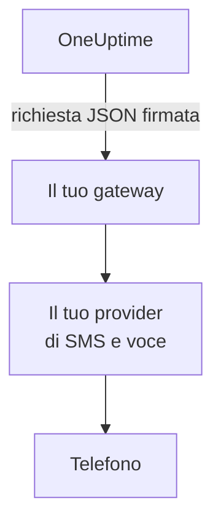

# Gateway per SMS e chiamate

OneUptime può inviare i suoi SMS e le sue chiamate tramite un gateway che gestisci tu, invece che tramite Twilio. Usalo quando le tue regole richiedono che ogni messaggio passi dal tuo provider di SMS e voce, o da un sistema che lo controlla prima che esca dalla tua rete. OneUptime invia ogni SMS e ogni chiamata al tuo gateway come richiesta JSON firmata, e il tuo gateway la consegna.

:::cards
- [Configurare il gateway](#configurare-il-gateway): Un URL e un segreto di firma creato per te.
- [Cosa riceve il tuo gateway](#cosa-riceve-il-tuo-gateway): Una richiesta JSON firmata per ogni SMS o chiamata.
- [Agire su un avviso](#agire-su-un-avviso): Riconoscere, escalare o risolvere da una chiamata o da una risposta.
- [Consegna e nuovi tentativi](#consegna-e-nuovi-tentativi): Cosa succede quando il tuo gateway non è raggiungibile.
:::

## Come funziona



Il gateway prende il posto dell'account Twilio del server per tutto ciò che passerebbe da esso: avvisi di reperibilità, notifiche, codici di verifica e SMS agli iscritti delle pagine di stato. I progetti che aggiungono una propria configurazione Twilio, nella scheda **Configurazione Twilio** in **Impostazioni del progetto > Notifiche > Impostazioni notifiche**, continuano a inviare tramite quella configurazione. Gli interruttori di SMS e chiamate di ogni progetto, e il suo saldo dove la fatturazione è attiva, vengono controllati come per Twilio.

## Configurare il gateway

:::steps
1. Nell'Admin Dashboard, vai in **Impostazioni > Chiamate e SMS** e fai clic su **Edit Provider** nella scheda **SMS and Call Provider**.
2. Scegli **Your own gateway** e inserisci il **Gateway URL**. Il gateway può trovarsi nella tua rete privata.
3. Salva. OneUptime crea un segreto di firma per te. Copialo dalla scheda nel tuo gateway.
4. Fai clic su **Send Test**. Il tuo gateway dovrebbe rispondere con uno stato 2xx e non inviare nulla.
:::

Per sostituire il segreto, svuota **Signing Secret** in **Altri campi** e salva: OneUptime ne crea uno nuovo. Per tornare a Twilio, scegli **Twilio** e salva.

## Cosa riceve il tuo gateway

Ogni SMS e ogni chiamata è una richiesta `POST` con un corpo JSON e queste intestazioni:

| Intestazione | Valore |
| --- | --- |
| `Content-Type` | `application/json` |
| `X-OneUptime-Event` | `sms`, `call` o `test` |
| `X-OneUptime-Signature` | `sha256=` seguito dall'HMAC-SHA256 del corpo in esadecimale, calcolato con il segreto di firma come chiave |
| `User-Agent` | `OneUptime-CallAndSmsGateway/1.0` |

```json title="An on-call page by SMS"
{
  "version": 1,
  "event": "sms",
  "id": "7c5b0d0e-3e5f-4d1a-9a4f-2b8e6c1d9f00",
  "sentAt": "2026-10-27T09:30:00.000Z",
  "to": "+15551234567",
  "message": "OneUptime: A new alert has been created. Alert #42: Database is down…",
  "isSensitive": false,
  "project": {
    "id": "0f6b8c3a-1d2e-4f5a-8b9c-0d1e2f3a4b5c",
    "name": "Production"
  },
  "actions": {
    "acknowledge": "https://oneuptime.example.com/api/custom-notification-channel/page/5f2c…/acknowledge?token=…",
    "escalate": "https://oneuptime.example.com/api/custom-notification-channel/page/5f2c…/escalate?token=…",
    "resolve": "https://oneuptime.example.com/api/custom-notification-channel/page/5f2c…/resolve?token=…"
  }
}
```

| Campo | Che cos'è |
| --- | --- |
| `version` | Sempre `1` per questa forma. Vi si aggiungono soltanto campi. |
| `event` | `sms`, `call` o `test`, come in `X-OneUptime-Event`. |
| `id` | Unico per questo messaggio, e lo stesso in ogni tentativo di consegnarlo: usalo per ignorare un messaggio che hai già inviato. |
| `sentAt` | Quando OneUptime l'ha inviato, in ISO 8601. |
| `to` | Il numero di telefono, in formato E.164. `null` in un test. |
| `message` | L'SMS, o ciò che dice la chiamata. Un SMS ha al massimo 1.600 caratteri, e il testo di una chiamata al massimo 16.384. Un testo più lungo viene tagliato e termina con una nota che indica che il resto è in OneUptime. |
| `isSensitive` | `true` per un codice di verifica. Tieni il messaggio fuori dai tuoi log. |
| `project` | L'`id` e il `name` del progetto, oppure `null` quando nessun progetto l'ha inviato. |
| `actions` | Per un avviso di reperibilità, i link che agiscono su di esso. `null` negli altri casi. |

Una chiamata viene descritta invece che sceneggiata: `message` è ciò che dice, senza il «premi 1 per riconoscere» di Twilio. Offri le azioni a modo tuo, ad esempio con la pressione di tasti, e chiama il link corrispondente.

### Verificare la firma

Calcola l'HMAC del corpo grezzo della richiesta, prima di analizzarlo, e confrontalo con l'intestazione. La verifica è la stessa di un [canale personalizzato](/docs/self-hosted/custom-notification-channels#verificare-la-firma), quindi un solo verificatore serve per entrambi:

```javascript title="Node.js"
const crypto = require("crypto");

function isFromOneUptime(rawBody, signatureHeader, secret) {
  const expected =
    "sha256=" + crypto.createHmac("sha256", secret).update(rawBody).digest("hex");
  const received = String(signatureHeader || "");

  return (
    received.length === expected.length &&
    crypto.timingSafeEqual(Buffer.from(received), Buffer.from(expected))
  );
}
```

## Agire su un avviso

Quando la persona risponde durante una chiamata o con una risposta, il tuo gateway invia una richiesta `POST` al link corrispondente in `actions`. I link funzionano come quelli di un canale personalizzato: non richiedono una chiave API, ognuno porta un token valido 7 giorni solo per quell'avviso, e l'azione viene registrata come compiuta dalla persona avvisata. Vedi [Agire su un avviso](/docs/self-hosted/custom-notification-channels#agire-su-un-avviso) per ogni azione e la risposta.

```bash title="Acknowledge a page"
curl -X POST "https://oneuptime.example.com/api/custom-notification-channel/page/5f2c…/acknowledge?token=…"
```

## Consegna e nuovi tentativi

Una richiesta è considerata consegnata quando il tuo gateway risponde con uno stato 2xx entro 10 secondi. Una richiesta a cui non ha risposto, o a cui ha risposto con 408, 429 o uno stato 5xx, viene inviata di nuovo dopo 1 secondo e dopo altri 4 secondi: tre tentativi in tutto. Con qualsiasi altro stato 4xx non viene inviata di nuovo.

Il registro degli SMS o delle chiamate, e per un avviso di reperibilità il registro di reperibilità della persona, riporta `Sent to the SMS and call gateway (HTTP 200).` o il motivo per cui il messaggio non è stato consegnato, mai l'URL. OneUptime non sa se il messaggio ha raggiunto il telefono, quindi un SMS risulta inviato non appena il tuo gateway lo accetta, e il numero da cui è partito resta vuoto.

## Richieste di test

**Send test** invia una richiesta con `event` impostato a `test`, e `to`, `project` e `actions` impostati a `null`. Rispondi con uno stato 2xx e non inviare nulla.

## Passaggi successivi

:::cards
- [Canali di notifica personalizzati](/docs/self-hosted/custom-notification-channels): Avvisare le persone tramite la tua app.
- [Notifiche push](/docs/self-hosted/push-notifications): Disattivare i push per l'intero server.
- [Integrazione Twilio](/docs/self-hosted/twilio-integration): Inviare invece tramite Twilio.
- [Accesso alla rete privata](/docs/self-hosted/private-network-access): Cosa può raggiungere il tuo server nella tua rete.
:::
