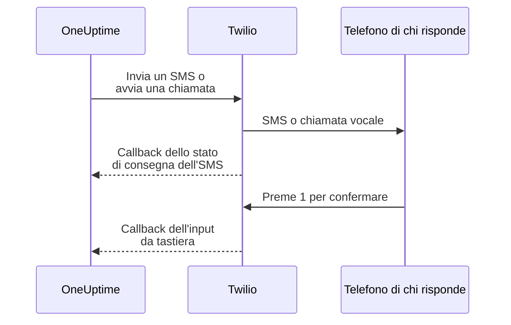

# Integrazione Twilio

OneUptime self-hosted invia gli avvisi via SMS e voce tramite il tuo account Twilio, e paghi Twilio direttamente. Le credenziali Twilio si salvano nella dashboard di OneUptime, non in variabili d'ambiente: l'invio delle notifiche legge la configurazione salvata, e il chart Helm non ha valori per le credenziali Twilio.

> [!NOTE]
> Una vecchia migrazione ha importato `TWILIO_ACCOUNT_SID`, `TWILIO_AUTH_TOKEN` e `TWILIO_PHONE_NUMBER`; modificare quelle variabili non è il modo di aggiornare le credenziali di un'installazione esistente.

:::cards
- [Preparare l'account Twilio](#1-preparare-laccount-twilio): Credenziali, un numero di telefono e i limiti dell'account.
- [Salvare le credenziali](#2-salvare-le-credenziali-in-oneuptime): Per un progetto, o per l'intera installazione.
- [Configurare l'accesso alla rete](#3-configurare-laccesso-alla-rete): Cosa Twilio deve raggiungere sul tuo server, e quando.
- [Verificare i numeri di telefono](#5-verificare-i-numeri-di-telefono-dei-membri-del-team): Come vengono verificati i numeri dei membri del team.
:::

## 1. Preparare l'account Twilio

:::steps
### Copia le tue credenziali

Apri la [Twilio Console](https://console.twilio.com/) e copia il tuo **Account SID** e il tuo **Auth Token**.

### Procurati un numero di telefono

Procurati un numero di telefono Twilio con le funzionalità SMS e/o voce che ti servono; la Twilio Console mostra che cosa può fare ogni numero. Usa il formato E.164, con il prefisso internazionale, per i numeri del mittente e del destinatario. Dove nessun numero fa entrambe le cose, procuratene uno per le chiamate e uno per gli SMS: vedi [Numeri separati per chiamate e SMS](#numeri-separati-per-chiamate-e-sms).

### Controlla i limiti dell'account

Controlla il saldo dell'account, i permessi dei paesi di destinazione e i requisiti di registrazione dei mittenti applicabili. Gli account di prova hanno restrizioni sui destinatari, geografiche e di altro tipo che possono impedire il funzionamento degli avvisi reali di OneUptime; prima di provare, consulta la [documentazione di Twilio su account e prova gratuita](https://www.twilio.com/docs/usage/tutorials/how-to-use-your-free-trial-account). In produzione usa un account aggiornato.
:::

## 2. Salvare le credenziali in OneUptime

Salva le credenziali per un progetto, oppure una sola volta per l'intera installazione:

| | Configurazione del progetto | Configurazione dell'installazione |
| --- | --- | --- |
| Dove | La scheda **Configurazione Twilio** in **Impostazioni del progetto > Notifiche > Impostazioni notifiche** | **Admin Dashboard > Impostazioni > Chiamate e SMS** |
| Chi può impostarla | **Proprietario del progetto**, **Amministratore del progetto**, oppure **Create Call and SMS** in un ruolo personalizzato | Un amministratore principale |
| Chi può leggerne l'Auth Token | **Proprietario del progetto**, **Amministratore del progetto**, oppure **Read Call and SMS** in un ruolo personalizzato. Gli altri che vedono la configurazione ne vedono il resto; il token è salvato cifrato | Un amministratore principale |
| Usata per | SMS e chiamate ai membri del progetto finché è la predefinita del progetto, le pagine di stato a cui è assegnata e le policy delle chiamate in arrivo che la usano | SMS e chiamate ai membri di qualsiasi progetto che non ha una configurazione predefinita |

Per aggiungere una configurazione di progetto:

:::steps
1. Vai su **Impostazioni del progetto > Notifiche > Impostazioni notifiche**.
2. In **Configurazione Twilio**, seleziona **Crea configurazione Twilio**.
3. Inserisci un nome e scegli in **Usa questo account per** che cosa invia l'account: **Chiamate e SMS**, **Solo SMS** o **Solo chiamate**. Poi inserisci **SID dell'account Twilio**, **Token di autenticazione Twilio** e il numero che la scelta richiede: **Numero di telefono principale Twilio** per le chiamate, oppure **Numeri di telefono SMS Twilio** per **Solo SMS**. In **Altri campi**, se vuoi, inserisci **Numeri di telefono secondari Twilio** separati da virgole per altri paesi, e **Numeri di telefono SMS Twilio** se i tuoi numeri non possono inviare SMS.
4. **Imposta come predefinito del progetto** è attivo per la prima configurazione del progetto, quindi SMS e chiamate ai membri del progetto, notifiche di reperibilità comprese, passano da lì appena salvi. Disattivalo se questo account serve solo per le pagine di stato o le chiamate in arrivo. Una configurazione aggiunta dopo parte con l'interruttore disattivato: attivalo, oppure scegli **Imposta come predefinito del progetto** dal menu della riga della configurazione, per spostarvi quei messaggi. Una richiesta API che omette `isProjectDefault` viene trattata allo stesso modo.
5. Salva. Solo una configurazione può essere la predefinita del progetto. Le pagine di stato usano la configurazione assegnata esplicitamente a ciascuna di esse.

> [!IMPORTANT]
> **SMS** e **Chiamate telefoniche** partono disattivati in ogni progetto, e finché non sono attivi nessuno nel progetto può aggiungere un numero di telefono per loro. Un proprietario del progetto, un **Amministratore della fatturazione** o chi ha **Manage Billing** li attiva nella scheda **Canali di notifica** della stessa pagina.
:::

Per una configurazione predefinita valida per l'intera installazione, un amministratore può invece aprire **Admin Dashboard > Impostazioni > Chiamate e SMS**, scegliere che cosa invia l'account, modificare le credenziali e i numeri di telefono Twilio e salvare. Le notifiche dei membri usano questa configurazione globale quando il loro progetto non ne ha una predefinita. Mantieni riservato l'Auth Token.

### Numeri separati per chiamate e SMS

Un numero Twilio può effettuare chiamate e inviare SMS, oppure solo una delle due cose, e in alcuni paesi nessun numero fa entrambe: i numeri nazionali possono essere solo vocali, mentre gli SMS richiedono un numero mobile. Una configurazione, quella di un progetto o quella dell'installazione, può elencare numeri per gli SMS in **Altri campi**:

| Campo | Che cosa parte da qui |
| --- | --- |
| **Numero di telefono principale Twilio** | Le chiamate, e gli SMS finché non sono elencati numeri per gli SMS |
| **Numeri di telefono secondari Twilio** | Le chiamate, e gli SMS finché non sono elencati numeri per gli SMS, ai destinatari nel paese di ciascun numero |
| **Numeri di telefono SMS Twilio** | Ogni SMS, una volta elencati: dal numero del paese del destinatario, altrimenti dal primo |

Se il tuo numero può solo effettuare chiamate, tienilo come **Numero di telefono principale Twilio** e inserisci un numero che può inviare SMS, come un numero mobile, in **Numeri di telefono SMS Twilio**. Quando una configurazione elenca numeri per gli SMS, nessun SMS parte più dai suoi altri numeri: elenca quindi ogni numero che deve inviare SMS.

Una configurazione senza numeri per gli SMS invia gli SMS dagli stessi numeri delle chiamate, come prima. **Invia SMS di prova** e **Invia chiamata di prova** partono dal numero da cui partirebbe un vero SMS o una vera chiamata allo stesso destinatario. Se Twilio rifiuta un SMS con l'errore 21606, il numero non può inviare SMS: aggiungine uno che può farlo in **Numeri di telefono SMS Twilio**.

> [!NOTE]
> Quali numeri possono inviare SMS, e se un mittente deve prima essere registrato, cambia da paese a paese: dove la registrazione è obbligatoria, un SMS da un numero non registrato può essere bloccato o segnalato come spam. Prima di fare affidamento su un numero, consulta [le linee guida SMS di Twilio](https://www.twilio.com/en-us/guidelines/sms) per ogni paese a cui invii.

### Un account solo per gli SMS, o solo per le chiamate

Un account che usi solo per gli SMS, o solo per le chiamate, non ha bisogno di numeri per l'altro uso. Sceglilo in **Usa questo account per**, e il modulo chiede solo i numeri che servono a quella scelta:

| Scelta | Numeri che richiede | Che cosa non invia mai |
| --- | --- | --- |
| **Chiamate e SMS** | **Numero di telefono principale Twilio** | Niente |
| **Solo SMS** | **Numeri di telefono SMS Twilio** | Chiamate |
| **Solo chiamate** | **Numero di telefono principale Twilio** | SMS |

Ciò che una configurazione non invia parte come partirebbe senza di essa: quando la configurazione predefinita del progetto è impostata su **Solo SMS**, le chiamate ai membri del progetto passano dalla configurazione dell'intera installazione. Se nessuna configurazione può inviare un messaggio, il log del messaggio dice che la configurazione del progetto non è usata per quello, e chi può cambiarlo.

Le pagine di stato propongono solo le configurazioni che inviano SMS, e **Invia SMS di prova** e **Invia chiamata di prova** compaiono solo per ciò che una configurazione invia. Ogni configurazione esistente è impostata su **Chiamate e SMS**, come prima. Tramite l'API e Terraform, la scelta è il campo `usedFor`, e una configurazione senza i numeri che la sua scelta richiede viene rifiutata.

## 3. Configurare l'accesso alla rete

L'invio funziona con il solo accesso in uscita. Gli aggiornamenti di consegna, la conferma da tastiera e le chiamate in arrivo richiedono che Twilio raggiunga il tuo server.

Un'installazione privata ha bisogno della risoluzione DNS e di HTTPS in uscita su TCP 443 verso Twilio per inviare SMS e chiamate. Twilio consiglia di consentire l'HTTPS in uscita verso `*.twilio.com` perché gli indirizzi delle sue API sono dinamici; vedi [gli indirizzi IP di Twilio](https://help.twilio.com/articles/115015934048-All-About-Twilio-IP-Addresses). Applicalo al traffico in uscita del carico di lavoro dell'applicazione OneUptime, comprese le NetworkPolicy di Kubernetes e i firewall esterni.

L'accesso in entrata dipende dalla funzionalità:

| Funzionalità | Twilio deve raggiungere OneUptime? |
| --- | --- |
| Invio di SMS | No. Gli aggiornamenti dello stato di consegna però richiedono un callback. |
| Una semplice chiamata vocale di prova | No. OneUptime fornisce le istruzioni vocali insieme alla richiesta API in uscita. |
| Premere 1 per confermare un avviso di reperibilità | Sì. Twilio invia l'input da tastiera a OneUptime. |
| Policy delle chiamate in arrivo | Sì. Twilio chiede le istruzioni della chiamata e riporta i risultati della composizione. |

Questi sono i percorsi esterni, attraverso il gateway Nginx di OneUptime. I segnaposto cambiano a ogni notifica:

| Metodo | Percorso | Scopo |
| --- | --- | --- |
| POST | `/notification/sms/status-callback/:smsLogId/:token` | Stato di consegna dell'SMS |
| POST | `/api/user-notification-log-timeline/call/gather-input/:itemId?token=...` | Conferma da tastiera |
| POST | `/notification/incoming-call/voice` | Istruzioni facoltative per le chiamate in arrivo |
| POST | `/notification/incoming-call/dial-status/:callLogId/:callLogItemId` | Risultati facoltativi dell'instradamento delle chiamate in arrivo |

OneUptime genera automaticamente gli URL degli SMS e della conferma. Non sostituire i loro token con un URL di webhook statico. Per le chiamate in arrivo, segui [le policy delle chiamate in arrivo](/docs/on-call/incoming-call-policy), che configurano il webhook del numero quando lo colleghi.

Twilio richiede [URL di webhook raggiungibili pubblicamente](https://www.twilio.com/docs/usage/webhooks/webhooks-overview). Usa un certificato TLS pubblicamente attendibile e preserva attraverso i proxy l'host, il protocollo, il percorso, i parametri di query, il corpo e l'header `X-Twilio-Signature` originali. I gestori delle chiamate in arrivo convalidano le firme di Twilio; la consegna degli SMS usa un token nell'URL per ogni messaggio, e la conferma da tastiera un token di query firmato. Non esporre i token in log condivisi o screenshot. Vedi [la sicurezza dei webhook di Twilio](https://www.twilio.com/docs/usage/webhooks/webhooks-security).

### Pubblicare i callback da un'installazione privata

:::steps
1. Pubblica il DNS del nome host di OneUptime, per esempio `oneuptime.example.com`, puntandolo a un reverse proxy o a un load balancer esposto su Internet. Consenti il TCP 443 in entrata e configura un certificato pubblicamente attendibile con la catena completa. Un IP privato, un DNS solo interno o la connessione VPN di un amministratore non danno connettività a Twilio.
2. Dai a quel gateway un percorso di rete verso l'ingress privato di OneUptime, direttamente o tramite la tua VPN site-to-site o il tuo collegamento privato. Consenti la porta del servizio upstream. Un servizio Kubernetes `ClusterIP` richiede un ingress raggiungibile o un altro percorso dal gateway. Mantieni privati i database e gli altri servizi interni.
3. Pubblica solo i percorsi di callback della tabella sopra che usi. Inoltrali tramite il gateway Nginx di OneUptime, che mappa il prefisso esterno `/notification` sull'applicazione. Mantieni `/api` sul percorso della conferma da tastiera. Preserva il metodo HTTP e i dati della richiesta; non reindirizzare a un altro URL. Preserva l'`Host` pubblico e imposta sul tuo proxy header di inoltro attendibili per l'host pubblico e lo schema HTTPS.
4. Escludi questi percorsi dall'SSO del browser, dai CAPTCHA e dalle pagine di accesso del proxy. Mantieni attiva l'autenticazione dei callback di OneUptime. Limita l'accesso all'origine privata al gateway e ai client interni autorizzati.
5. Imposta `HOST=oneuptime.example.com` e `HTTP_PROTOCOL=https` nel `config.env` di Docker Compose, oppure `host: oneuptime.example.com` e `httpProtocol: https` nei valori Helm. Applica la modifica all'installazione e attendi il riavvio dell'applicazione. Queste impostazioni generano URL; non creano DNS, certificati né regole del firewall. OneUptime non ha un'impostazione separata per il nome host dei callback di Twilio. Se il nome host cambia, aggiorna anche il webhook dei numeri di telefono Twilio esistenti.
:::

La dashboard può restare su un ingress privato: con un DNS separato, i dipendenti risolvono lo stesso nome host verso quell'ingress tramite la rete aziendale o la VPN, mentre Twilio lo risolve verso il gateway. Servi su entrambi i percorsi un certificato valido per quel nome host. Le [impostazioni di accesso alle reti private](/docs/self-hosted/private-network-access) di OneUptime regolano le richieste in uscita verso i servizi interni; `ALLOW_PRIVATE_NETWORK_WEBHOOKS` non pubblica un endpoint in entrata.

### Restrizioni sugli IP e installazioni senza accesso in entrata

Gli indirizzi di origine ordinari dei webhook di Twilio cambiano, quindi non usare gli intervalli IP SIP o multimediali come allowlist dei callback. Le edizioni di Twilio idonee offrono [Static Proxy for Webhooks](https://www.twilio.com/docs/iam/twilio-editions/twilio-static-proxy). Verifica che la tua edizione sia idonea e quali prodotti supporta, e configura il firewall con gli intervalli pubblicati attualmente da Twilio; continua a convalidare i callback anche quando lo usi.

> [!WARNING]
> Se una policy vieta le connessioni in entrata, l'invio di SMS e la semplice riproduzione vocale incorporata possono funzionare con l'HTTPS in uscita. Gli aggiornamenti di consegna degli SMS, la conferma da tastiera e l'instradamento delle chiamate in arrivo non possono funzionare senza callback raggiungibili. Un'installazione completamente isolata non può usare Twilio.

Per lo sviluppo, la [guida ai test dei webhook](https://www.twilio.com/docs/usage/webhooks/webhook-testing) di Twilio descrive l'uso di un tunnel pubblico: inoltralo a un proxy che consenta solo i percorsi necessari, configura il nome host risultante come sopra e fermalo dopo i test. Anche un tunnel espone un accesso in entrata.

## 4. Verificare separatamente consegna e callback

:::steps
1. Da fuori della rete aziendale e della VPN, verifica che il nome host dei callback si risolva nel gateway pubblico e presenti un certificato TLS valido. Un GET dal browser non mette alla prova questi callback POST.
2. Usa **Invia SMS di prova** e **Invia chiamata di prova** sulla configurazione Twilio del progetto. Conferma la ricezione sul telefono di destinazione. Entrambi richiedono il permesso di aggiungere configurazioni Twilio: **Proprietario del progetto**, **Amministratore del progetto**, oppure **Create Call and SMS** e **Read Call and SMS** in un ruolo personalizzato.
3. Configura per l'utente un contatto SMS o di chiamata verificato e le regole di notifica, poi fai scattare un avviso di reperibilità controllato. Premi 1 e conferma la presa in carico in OneUptime. Se usi le policy delle chiamate in arrivo, chiama il numero configurato e controlla l'instradamento e il registro delle chiamate.
4. Verifica lo stato di consegna degli SMS in OneUptime e nei log dei messaggi di Twilio. Un invio accettato non è una prova di consegna; [Twilio segnala i cambi di stato successivi tramite callback](https://www.twilio.com/docs/messaging/guides/track-outbound-message-status).
:::

| Sintomo | Dove guardare |
| --- | --- |
| Non viene inviato nulla | Credenziali, funzionalità del numero, restrizioni dell'account e connettività in uscita. |
| Twilio rifiuta gli SMS con l'errore 21606 | Il numero non può inviare SMS. Aggiungine uno che può farlo in **Numeri di telefono SMS Twilio**: vedi [Numeri separati per chiamate e SMS](#numeri-separati-per-chiamate-e-sms). |
| Chiamate o SMS passano da un account diverso da quello del progetto | La configurazione predefinita del progetto è impostata su **Solo SMS** o **Solo chiamate**: vedi [Un account solo per gli SMS, o solo per le chiamate](#un-account-solo-per-gli-sms-o-solo-per-le-chiamate). |
| L'SMS o la chiamata arriva, ma lo stato o la conferma non si aggiornano | L'URL di callback e i log dell'ingress pubblico. La [guida di Twilio sugli errori di recupero HTTP](https://www.twilio.com/docs/api/errors/11200) aiuta a diagnosticare callback irraggiungibili, problemi TLS ed errori HTTP. |

Una chiamata di prova riuscita, da sola, non dimostra che i callback siano raggiungibili.

## 5. Verificare i numeri di telefono dei membri del team

Aggiungere un numero di telefono per SMS o chiamate invia subito il suo codice di verifica, e si apre la finestra di verifica. Mostra quando è stato inviato il codice e fino a quando è valido, e invia un nuovo codice su richiesta, al massimo una volta al minuto. Prima di verificare non serve inviare di nuovo nulla.

Quando non è possibile inviare alcun codice, la finestra spiega il motivo invece di dichiarare che un codice è stato inviato: per esempio, che non è configurato alcun account Twilio, finché non esiste né una configurazione predefinita del progetto né la configurazione dell'installazione descritta sopra. Un numero il cui primo codice non può essere inviato non viene aggiunto, e il modulo ne mostra il motivo, come un paese di destinazione rifiutato da Twilio.

Un numero verificato per gli SMS è verificato anche per le chiamate, senza un secondo codice. La verifica tramite chiamata non verifica gli SMS, perché un numero che riceve chiamate, come un fisso, non sempre può ricevere messaggi di testo. Se Twilio accetta un codice che non arriva mai, il log SMS del progetto ne mostra lo stato di consegna.

## Passaggi successivi

:::cards
- [Policy delle chiamate in arrivo](/docs/on-call/incoming-call-policy): Far raggiungere i tuoi ingegneri reperibili da chi chiama tramite un numero Twilio.
- [Regole di escalation](/docs/on-call/escalation-rules): Decidere chi viene avvisato a ogni livello, via SMS, chiamata o qualsiasi altro metodo.
- [SMTP](/docs/emails/smtp): Inviare anche le email tramite il tuo server di posta.
- [Accesso alle reti private](/docs/self-hosted/private-network-access): Consentire a workflow e webhook di raggiungere strumenti interni.
:::
