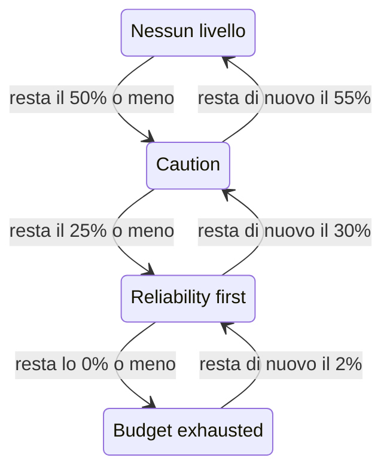

# Policy del budget di errore

Una policy del budget di errore mette per iscritto cosa il tuo team ha concordato di fare mentre il budget di errore di uno SLO si esaurisce, per esempio rivedere le modifiche rischiose quando ne è stata spesa la metà, o congelare i rilasci quando è stato speso tutto. OneUptime mette lo SLO nel livello della policy raggiunto dal suo budget, mostra l'accordo del team per quel livello nelle pagine dello SLO, può generare un avviso o dichiarare un incidente quando lo SLO entra in un livello, pubblica ogni cambio di livello nei canali Slack, Microsoft Teams o Mattermost che scegli, e dice alle tue pipeline CI/CD se trattenere i rilasci. È la pratica della policy del budget di errore del [Google SRE Workbook](https://sre.google/workbook/error-budget-policy/).

:::cards
- [Come funzionano i livelli](#come-funzionano-i-livelli): Quale livello si applica e quando lo SLO lo lascia.
- [Configurare una policy](#configurare-una-policy): Parti dalla policy consigliata o scrivi i tuoi livelli.
- [Avvisi e incidenti](#avvisi-e-incidenti): Avvisa il tuo team quando lo SLO entra in un livello.
- [Pubblicare in Slack, Microsoft Teams e Mattermost](#pubblicare-in-slack-microsoft-teams-e-mattermost): Informa un canale quando uno SLO entra in un livello, senza avvisare nessuno.
- [Gate delle distribuzioni](#gate-delle-distribuzioni): Trattieni i rilasci in CI/CD finché un livello congela le distribuzioni.
- [Leggere il livello dall'API](#leggere-il-livello-dallapi): Controlla il livello da CI e script.
:::

## Come funzionano i livelli

Una policy è un insieme di livelli. Ogni livello ha tre campi:

| Campo | Cosa contiene |
| --- | --- |
| **Nome** | Come il team chiama il livello, per esempio "Reliability first". |
| **Soglia di budget rimasto (%)** | La quota di budget di errore rimanente pari o inferiore alla quale il livello si applica. Da 0 a 100, decimali ammessi. Ogni livello di uno SLO ha una soglia tutta sua. |
| **Cosa facciamo** | Cosa il team ha concordato di fare mentre lo SLO è nel livello, in Markdown. Obbligatorio, fino a 10.000 caratteri. |

Un livello si applica finché il budget rimanente è pari o inferiore alla sua soglia, quindi un livello allo 0% è quello di un budget esaurito. Quando si applicano più livelli, lo SLO è in quello con la soglia più bassa: il più grave. Quando non se ne applica nessuno, lo SLO non è in nessun livello. Con livelli al 50%, al 25% e allo 0%, uno SLO a cui resta il 30% del budget è nel livello del 50%, e uno a cui resta il 10% è nel livello del 25%.

Un livello può anche congelare le distribuzioni finché lo SLO ci si trova: vedi [Gate delle distribuzioni](#gate-delle-distribuzioni).

### Entrare in un livello e uscirne

Il livello segue il budget rimanente come fa lo stato dello SLO:

- L'ingresso in un livello è immediato: la valutazione che trova il budget pari o inferiore alla soglia di un livello mette lo SLO in quel livello. Un budget che scende sotto più soglie in una volta passa direttamente al livello più grave.
- L'uscita da un livello verso uno meno grave aspetta che il budget sia chiaramente tornato. Un livello allo 0% viene lasciato quando resta di nuovo il 2% del budget. Ogni altro livello viene lasciato quando il budget è 5 punti sopra la sua soglia.

Così un livello allo 0% si muove con lo stato **Budget esaurito**, e un livello alla soglia a rischio dello SLO si muove con **A rischio**: vedi [Cambi di stato e soglia a rischio](/docs/slo/error-budget#cambi-di-stato-e-soglia-a-rischio). Una finestra mobile che oscilla attorno a una soglia non fa andare avanti e indietro il livello.



## Configurare una policy

Ti serve l'autorizzazione per creare livelli della policy del budget di errore degli SLO.

:::steps
### Aprire Policy del budget di errore

Apri lo SLO e vai su **Policy del budget di errore** nella sezione **Regole** del suo menu laterale. La pagina elenca i livelli dello SLO, ognuno con il suo nome, il budget rimanente a cui si applica e cosa fa il team.

### Partire dalla policy consigliata

Finché lo SLO non ha livelli, la pagina offre **Usa la policy consigliata**. Fai clic, controlla i tre livelli che elenca e conferma. Poi adatta il testo di ogni livello all'accordo del tuo team.

### Oppure aggiungere un livello da te

Fai clic su **Crea: Livello della policy del budget di errore dello SLO**. Inserisci un **Nome** e un **Soglia di budget rimasto (%)**, e scrivi l'accordo del team in **Cosa facciamo**. Attiva **Congela le distribuzioni** se le pipeline devono trattenere i rilasci finché lo SLO è nel livello.

### Scegliere cosa genera il livello

Un livello registra e mostra l'accordo. Per avvisare anche qualcuno quando lo SLO ci entra, apri le impostazioni chiuse di avviso e incidente e attiva un avviso, un incidente o entrambi. Entrambi sono disattivati per impostazione predefinita. Vedi [Avvisi e incidenti](#avvisi-e-incidenti).
:::

Aggiungere, modificare o eliminare un livello ha effetto subito: OneUptime valuta di nuovo lo SLO entro circa un minuto. Se il budget è già pari o inferiore alla soglia di un livello, lo SLO entra allora in quel livello, e il livello genera ciò che è impostato per generare. Disattivare un livello o eliminarlo risolve ciò che ha generato, e lo SLO passa al livello in cui si trova il suo budget. Disattivare l'avviso o l'incidente di un livello risolve quell'avviso o quell'incidente.

### La policy consigliata

**Usa la policy consigliata** aggiunge tre livelli, a metà del budget, a un quarto e a zero, con questo testo in inglese:

| Livello | Si applica con | Cosa fa il team | Distribuzioni |
| --- | --- | --- | --- |
| **Caution** | 50% rimanente o meno | Half of the error budget is spent. Review risky changes before they ship, and find out what has been spending the budget. | Consentite |
| **Reliability first** | 25% rimanente o meno | Reliability comes first. Only reliability improvements and critical fixes ship until the budget recovers. | Consentite |
| **Budget exhausted** | 0% rimanente o meno | The error budget is spent. Freeze non-critical releases: only fixes for this SLO's reliability and security fixes ship until the budget is back. | Congelate |

Nessuno di loro genera un avviso o dichiara un incidente finché non lo attivi. **Budget exhausted** congela le distribuzioni, come dice il suo accordo, e la conferma lo indica: vedi [Gate delle distribuzioni](#gate-delle-distribuzioni). I livelli aggiunti prima che il gate esistesse non congelano niente finché non attivi il congelamento. Vengono aggiunti solo i livelli che lo SLO non ha: un livello con lo stesso nome, o con la stessa soglia, conta come presente, che sia attivo o no. Chiederlo due volte, da una seconda scheda o tramite l'API, quindi non aggiunge niente due volte. Se uno dei livelli non si può aggiungere, non ne viene aggiunto nessuno: lo SLO resta com'era e puoi riprovare. Ogni livello aggiunto così viene registrato nei registri di audit dello SLO come aggiunto da te.

## Dove compare il livello

- La **Panoramica** dello SLO mostra il livello in cui si trova e cosa il team ha concordato di fare lì, così chiunque apra lo SLO vede l'accordo che vale adesso. Finché il livello congela le distribuzioni, un badge rosso sotto il suo nome dice da quando.
- Il grafico **Burn-down del budget di errore** traccia una linea con etichetta alla soglia di ogni livello, accanto a quella della soglia a rischio.
- Il **Feed** dello SLO pubblica ogni cambio di livello: il livello che lo SLO ha lasciato e quello in cui è entrato, il budget rimanente, cosa il team ha concordato di fare nel nuovo livello, e se il cambio ha congelato le distribuzioni o le ha di nuovo consentite.
- I canali Slack, Microsoft Teams e Mattermost indicati dalle tue regole ricevono lo stesso messaggio: vedi [Pubblicare in Slack, Microsoft Teams e Mattermost](#pubblicare-in-slack-microsoft-teams-e-mattermost).
- I **Registri di audit** dello SLO registrano ogni cambio di livello, e ogni volta che le distribuzioni vengono congelate o di nuovo consentite, come una modifica fatta da OneUptime stesso, quindi li mostrano solo con **Memorizza eventi di sistema** attivo: vedi [Attivare i registri di audit](/docs/slo/feed-and-audit-logs#attivare-i-registri-di-audit). L'aggiunta, la modifica e la rimozione di un livello vengono registrate a nome della persona che le ha fatte.
- L'API di lettura dello SLO restituisce il livello, e se le distribuzioni sono consentite: vedi [Leggere il livello dall'API](#leggere-il-livello-dallapi) e [Gate delle distribuzioni](#gate-delle-distribuzioni).

## Avvisi e incidenti

Ogni livello può generare un avviso, dichiarare un incidente o entrambe le cose quando lo SLO ci entra. Hanno le opzioni dell'avviso e dell'incidente di una regola del tasso di consumo: gravità, policy di reperibilità, modelli di titolo, descrizione e note di risoluzione, privacy, risoluzione automatica, etichette, team e utenti proprietari, e l'aggiunta dei proprietari dello SLO come proprietari. Vedi [Cosa dichiara una regola](/docs/slo/burn-rate-alerts#cosa-dichiara-una-regola). Entrambi sono disattivati per impostazione predefinita, quindi un livello non avvisa nessuno finché non ne attivi uno.

- Entrare in un livello più grave risolve ciò che ha generato il livello precedente, qualunque sia la sua impostazione di risoluzione automatica, perché il nuovo livello lo sostituisce. Così sono aperti al massimo l'avviso e l'incidente di un solo livello alla volta, e appartengono al livello in cui si trova lo SLO.
- Tornare a un livello meno grave, o uscire da ogni livello, li risolve quando la risoluzione automatica del livello è attiva, come è per impostazione predefinita. Con la risoluzione automatica disattivata restano aperti finché qualcuno non li risolve.
- Non c'è soppressione dei nuovi scatti. Un livello genera di nuovo solo dopo che lo SLO lo ha chiaramente lasciato e ci è rientrato, quindi non può oscillare. Se qualcuno risolve a mano ciò che ha generato mentre lo SLO è ancora nel livello, resta risolto.
- Finché un monitor dello SLO è in manutenzione programmata, i livelli non generano niente. Il livello in sé cambia comunque, e ciò che è aperto continua a essere risolto. Se lo SLO è ancora nel livello quando la manutenzione finisce, il livello genera allora ciò che è impostato per generare.

Come per una regola del tasso di consumo, un avviso o un incidente generato da un livello elenca lo SLO sotto **Risorse interessate**, e un incidente non compare mai nelle pagine di stato. Il feed dello SLO pubblica ognuno di essi, e quando viene risolto.

### Cosa dicono

Il titolo, la descrizione e le note di risoluzione di un livello accettano variabili di modello, come quelli di una regola: vedi [Cosa dice ogni avviso e incidente](/docs/slo/burn-rate-alerts#cosa-dice-ogni-avviso-e-incidente). I campi di un livello offrono le variabili dello SLO e del suo budget, e tre proprie del livello: `{{sloName}}`, `{{sloId}}`, `{{sloLink}}`, `{{sloStatus}}`, `{{policyTier}}`, `{{policyTierThresholdPercentage}}`, `{{policyTierWhatWeDo}}`, `{{targetPercentage}}`, `{{currentSliPercentage}}`, `{{errorBudgetRemainingPercentage}}`, `{{errorBudgetRemaining}}`, `{{errorBudgetRemainingMinutes}}` e `{{windowDescription}}`. Le variabili proprie di una regola, come `{{ruleName}}` e i tassi di consumo, non sono offerte e restano vuote nei modelli di un livello.

Le tre variabili del livello funzionano anche nei modelli delle regole del tasso di consumo:

| Variabile | Cosa contiene |
| --- | --- |
| `{{policyTier}}` | Il nome del livello in cui si trova lo SLO dopo la valutazione, o `None` quando non è in nessun livello. |
| `{{policyTierThresholdPercentage}}` | La soglia di quel livello, per esempio `25`. Vuota quando lo SLO non è in nessun livello. |
| `{{policyTierWhatWeDo}}` | Cosa il team ha concordato di fare in quel livello. Vuoto quando lo SLO non è in nessun livello. |

Un livello il cui titolo resta vuoto usa il titolo predefinito:

```text
SLO error budget policy: {{sloName}} — {{policyTier}}
```

La descrizione predefinita nomina il livello, confronta il budget rimanente con la soglia del livello e dice cosa il team ha concordato di fare in esso.

## Pubblicare in Slack, Microsoft Teams e Mattermost

Una regola può pubblicare ogni modifica della policy del budget di errore di uno SLO nei canali Slack, Microsoft Teams o Mattermost che il tuo team legge, senza avvisare nessuno: quando lo SLO entra in un livello, torna a uno meno grave o esce da tutti i livelli, e quando le sue distribuzioni vengono congelate o di nuovo consentite. Ogni regola sceglie gli SLO e le modifiche che pubblica. Prima collega il workspace al progetto: vedi [Slack](/docs/workspace-connections/slack), [Microsoft Teams](/docs/workspace-connections/microsoft-teams) o [Mattermost](/docs/workspace-connections/mattermost).

:::steps
### Aprire la sezione Area di lavoro degli SLO

Vai in **SLOs** → **Area di lavoro** → **Slack**, **Microsoft Teams** o **Mattermost**. La sezione **Area di lavoro** elenca solo gli spazi di chat che il tuo progetto ha collegato.

### Creare una regola

Fai clic su **Crea: Regola di notifica degli SLO** e inserisci un nome in **Nome della regola**. In **Quali SLO**, lascia **Tutti gli SLO**, oppure scegli **Solo gli SLO che soddisfano le condizioni** e aggiungi le condizioni: vedi [A cosa si applica una regola](#a-cosa-si-applica-una-regola).

### Scegliere dove pubblica

In **Poi, in Slack**, indica i canali in cui la regola pubblica. In Microsoft Teams, scegli un team e i suoi canali, oppure chat a cui è stata aggiunta l'app di OneUptime. Uno SLO non ha un canale tutto suo, quindi una regola pubblica solo in canali e chat che hai già.
:::

Il messaggio descrive la modifica con le parole del **Feed** dello SLO: il livello che lo SLO ha lasciato e quello in cui è entrato, come sono cambiate le distribuzioni, il budget di errore rimanente, la soglia del nuovo livello e cosa il team ha concordato di fare lì, così come il team l'ha scritto. Una menzione in quell'accordo, come `<!channel>`, viene pubblicata come testo e non notifica nessuno.

- Una modifica viene pubblicata una sola volta, dopo che la valutazione che l'ha prodotta è stata salvata. Una valutazione che non viene salvata non pubblica niente, e la successiva pubblica la modifica.
- Non viene pubblicato niente finché lo SLO resta nel suo livello, per quanto a lungo il budget oscilli attorno a una soglia: vedi [Entrare in un livello e uscirne](#entrare-in-un-livello-e-uscirne).
- Attivare o disattivare **Congela le distribuzioni** per il livello in cui si trova lo SLO pubblica un messaggio a sé.
- Uno SLO in pausa, configurato male, disabilitato o archiviato mantiene il suo livello e non pubblica niente.
- Un messaggio che non può essere inviato viene registrato nei log, e la valutazione, il feed dello SLO e ciò che il livello genera vanno avanti senza di esso.

### A cosa si applica una regola

| Condizione | A cosa si applica |
| --- | --- |
| **SLOs** | Gli SLO che scegli, o tutti gli SLO tranne quelli. |
| **Etichette dello SLO** | Le etichette dello SLO: una qualsiasi di quelle che scegli, tutte o nessuna. |
| **Nome dello SLO** | Il nome dello SLO: uguale al tuo testo o no, che lo contiene o no, che inizia o finisce con esso. |
| **Modifica della policy del budget di errore** | Cosa è cambiato: **Entrato in un livello più grave**, **Tornato a un livello meno grave**, **Uscito da tutti i livelli**, **Distribuzioni congelate** o **Distribuzioni di nuovo consentite**. |
| **Proprietario dello SLO** | Le persone e i team registrati come proprietari dello SLO: uno qualsiasi di quelli che scegli, o nessuno. Far parte di un team proprietario dello SLO non conta. |

Un cambio di livello che ha congelato le distribuzioni, o le ha di nuovo consentite, è un solo messaggio che contiene entrambe le modifiche. Quindi una regola per **Distribuzioni congelate** pubblica anche il cambio con cui lo SLO entra in un livello che le congela: un canale dei rilasci viene a sapere di ogni congelamento.

## Quando il budget non viene misurato

- Uno SLO **In pausa** o **Configurato male** non misura alcun budget, quindi il suo livello resta dov'era, e ciò che il livello ha generato resta aperto finché la misurazione non riprende. Le regole del tasso di consumo invece risolvono allora ciò che hanno aperto.
- Disattivare la valutazione dello SLO, o archiviare lo SLO, risolve ciò che hanno generato i suoi livelli. Il livello in cui si trova lo SLO resta com'era.
- Eliminare lo SLO elimina i suoi livelli e risolve ciò che hanno generato.
- In ognuno di questi casi lo SLO mantiene la risposta che dava sulle distribuzioni, perché mantiene il suo livello: vedi [Gate delle distribuzioni](#gate-delle-distribuzioni).

## Gate delle distribuzioni

Un livello può congelare le distribuzioni. Finché lo SLO è in un livello con **Congela le distribuzioni** attivo, il campo `deploymentsAllowed` dello SLO è `false`, quindi una pipeline CI/CD che lo controlla prima di un rilascio trattiene il rilascio. Altrimenti è `true`: quando lo SLO non ha una policy, finché il suo budget è sopra ogni livello, e in un livello che non congela le distribuzioni. Il livello **Budget exhausted** della policy consigliata congela le distribuzioni.

:::steps
### Attivare Congela le distribuzioni

Apri la **Policy del budget di errore** dello SLO, modifica il livello, attiva **Congela le distribuzioni** e salva. Nella tabella, la colonna **Distribuzioni** del livello dice **Congelate**.

### Dare una chiave alla pipeline

Crea una [chiave API](/docs/api-reference/api-reference) del progetto che possa leggere lo SLO, e salvala come segreto della pipeline con il nome `ONEUPTIME_API_KEY`.

### Controllare lo SLO prima del rilascio

Aggiungi il controllo qui sotto come passo prima di quello che esegue la distribuzione, con l'ID dello SLO al posto di `<slo-id>`.
:::

:::tabs
@tab Shell
```bash
ALLOWED=$(curl -sS -X POST 'https://oneuptime.com/api/service-level-objective/<slo-id>/get-item' \
  -H "ApiKey: $ONEUPTIME_API_KEY" \
  -H 'Content-Type: application/json' \
  -d '{ "select": { "deploymentsAllowed": true } }' | jq -r '.deploymentsAllowed')
[ "$ALLOWED" = "true" ]
```
@tab GitHub Actions
```yaml title=".github/workflows/deploy.yml"
name: Deploy
on:
  push:
    branches: [main]

jobs:
  deploy:
    runs-on: ubuntu-latest
    steps:
      - uses: actions/checkout@v4
      - name: Stop while the error budget policy freezes deployments
        env:
          ONEUPTIME_API_KEY: ${{ secrets.ONEUPTIME_API_KEY }}
          SLO_ID: <slo-id>
        run: |
          SLO=$(curl -sS -X POST "https://oneuptime.com/api/service-level-objective/$SLO_ID/get-item" \
            -H "ApiKey: $ONEUPTIME_API_KEY" \
            -H 'Content-Type: application/json' \
            -d '{ "select": { "deploymentsAllowed": true, "currentErrorBudgetPolicyTierName": true } }')
          if [ "$(echo "$SLO" | jq -r '.deploymentsAllowed')" != "true" ]; then
            echo "Not deploying: $SLO"
            exit 1
          fi
      - name: Deploy
        run: ./deploy.sh
```
@tab GitLab CI
```yaml title=".gitlab-ci.yml"
error-budget-gate:
  stage: test
  image: alpine:3.20
  variables:
    SLO_ID: <slo-id>
  before_script:
    - apk add --no-cache curl jq
  script:
    - >
      SLO=$(curl -sS -X POST "https://oneuptime.com/api/service-level-objective/$SLO_ID/get-item"
      -H "ApiKey: $ONEUPTIME_API_KEY"
      -H 'Content-Type: application/json'
      -d '{ "select": { "deploymentsAllowed": true, "currentErrorBudgetPolicyTierName": true } }')
    - echo "$SLO"
    - test "$(echo "$SLO" | jq -r '.deploymentsAllowed')" = "true"
```
:::

Il controllo passa solo quando la risposta è `true`. Uno SLO congelato, una risposta senza il campo (la chiave non può leggere lo SLO, o l'ID è sbagliato) e l'assenza di qualsiasi risposta fermano ciascuno il passo, quindi una pipeline non rilascia mai sulla base di una risposta che non ha ricevuto. In GitLab CI il job gira nello stage test, quindi uno SLO congelato ferma lo stage deploy che lo segue; aggiungi `ONEUPTIME_API_KEY` come variabile CI/CD mascherata. Su un'installazione self-hosted, usa il suo indirizzo invece di oneuptime.com.

Lo SLO risponde con due campi, letti con l'autorizzazione di lettura dello SLO stesso:

| Campo | Cosa contiene |
| --- | --- |
| `deploymentsAllowed` | `false` finché lo SLO è in un livello che congela le distribuzioni, `true` altrimenti. |
| `deploymentsFrozenAt` | Quando le distribuzioni sono state congelate. Vuoto finché sono consentite. |

Come cambia la risposta:

- Le distribuzioni vengono congelate dalla valutazione che mette lo SLO in un livello che le congela, e di nuovo consentite da quella che lo fa uscire, con i margini di uscita propri del livello: vedi [Entrare in un livello e uscirne](#entrare-in-un-livello-e-uscirne). Da un livello che congela a un altro restano congelate, e `deploymentsFrozenAt` mantiene il suo orario.
- Attivare o disattivare **Congela le distribuzioni** per il livello in cui si trova lo SLO ha effetto entro circa un minuto. Per rilasciare prima che il budget si riprenda, disattivalo: la modifica viene registrata a tuo nome nei registri di audit dello SLO.
- Uno SLO **In pausa** o **Configurato male** mantiene la risposta che aveva, come mantiene il suo livello: una finestra di manutenzione che mette in pausa ogni monitor non toglie un congelamento né ne avvia uno. Uno SLO disabilitato o archiviato non viene valutato affatto, quindi anche lui mantiene la sua risposta.
- Finché le distribuzioni sono congelate, la **Panoramica** dello SLO mostra da quando, e il suo **Feed** dice quando vengono congelate e di nuovo consentite.

## Leggere il livello dall'API

L'API di lettura dello SLO stesso restituisce il livello in cui si trova, così un job di CI o uno script può controllarlo prima di agire, per esempio prima di un rilascio. Tutti e tre i campi sono vuoti finché lo SLO non è in nessun livello:

| Campo | Cosa contiene |
| --- | --- |
| `currentErrorBudgetPolicyTierId` | L'ID del livello. |
| `currentErrorBudgetPolicyTierName` | Il nome del livello. |
| `currentErrorBudgetPolicyTierEnteredAt` | Quando lo SLO è entrato nel livello. |

Si leggono con l'autorizzazione di lettura dello SLO stesso, la stessa che serve anche per il suo budget. Per esempio, con una [chiave API](/docs/api-reference/api-reference) del progetto:

```bash
curl -X POST 'https://oneuptime.com/api/service-level-objective/<slo-id>/get-item' \
  -H "ApiKey: $ONEUPTIME_API_KEY" \
  -H 'Content-Type: application/json' \
  -d '{ "select": { "name": true, "errorBudgetRemainingPercentage": true, "currentErrorBudgetPolicyTierName": true, "currentErrorBudgetPolicyTierEnteredAt": true } }'
```

I livelli stessi sono una risorsa a sé, `/api/service-level-objective-error-budget-policy-tier`, con le richieste di elenco, lettura, creazione, modifica ed eliminazione che ha ogni risorsa. Altre due richieste servono la policy consigliata. Entrambe ricevono `{ "serviceLevelObjectiveId": "..." }` e rispondono con i livelli in `tiers`:

| Richiesta | Cosa fa |
| --- | --- |
| `POST /api/service-level-objective-error-budget-policy-tier/recommended-policy` | Elenca i livelli consigliati che mancano allo SLO. Non scrive niente. |
| `POST /api/service-level-objective-error-budget-policy-tier/recommended-policy/add` | Li aggiunge ed elenca ciò che ha aggiunto. Chiederlo di nuovo non aggiunge niente. |

## Autorizzazioni

| Autorizzazione | Permette a un ruolo di |
| --- | --- |
| **Read SLO Error Budget Policy Tier** | Vedere i livelli di uno SLO. |
| **Create SLO Error Budget Policy Tier** | Aggiungere livelli, a mano o con **Usa la policy consigliata**. |
| **Edit SLO Error Budget Policy Tier** | Modificare i livelli, e attivarli o disattivarli. |
| **Delete SLO Error Budget Policy Tier** | Rimuovere livelli. |

Queste autorizzazioni sono nel gruppo SLO di un ruolo. I ruoli Project Owner e Project Admin le hanno tutte, e i ruoli Project Member e Viewer possono leggere i livelli.

## Non ancora disponibile

Alcune parti di una policy del budget di errore non sono ancora disponibili: un trigger di workflow dedicato a ogni livello, una policy condivisa da più SLO, la presa in carico di un livello o la concessione di un'eccezione, e livelli basati sull'autonomia del budget invece che sul budget rimanente. OneUptime non ferma un rilascio da solo: lo fa una pipeline che controlla `deploymentsAllowed`, come mostra [Gate delle distribuzioni](#gate-delle-distribuzioni).

## Passi successivi

:::cards
- [Budget di errore](/docs/slo/error-budget): Cos'è il budget e come lo stato lo segue.
- [Avvisi e incidenti di tasso di consumo](/docs/slo/burn-rate-alerts): Avvisa il tuo team quando il budget si consuma troppo in fretta.
- [Feed e registri di audit degli SLO](/docs/slo/feed-and-audit-logs): Ogni cambio di livello e ciò che hanno generato i livelli.
:::
