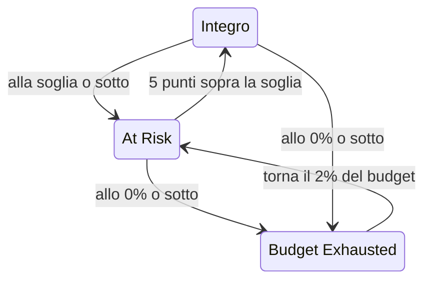

# Budget di errore

Il budget di errore è l'inattività che l'obiettivo di uno SLO consente. Un obiettivo del 99,9% non significa «non andare mai giù»: significa «puoi restare fuori servizio fino a 43 minuti in 30 giorni, quindi spendili bene». Questa pagina spiega come OneUptime conta il budget, quanto dura, come torna disponibile e chi ne viene informato.

:::cards
- [Come si calcola il budget](#come-si-calcola-il-budget): La formula e il budget degli obiettivi più comuni.
- [Autonomia del budget](#autonomia-del-budget): Quanto dura il budget al ritmo attuale.
- [Come si recupera il budget](#come-si-recupera-il-budget): Finestre mobili e mesi di calendario.
- [Notifiche ai proprietari](#notifiche-ai-proprietari): Chi viene informato quando il budget scarseggia.
:::

## Come si calcola il budget

Il budget totale è la parte della finestra che il tuo obiettivo non promette:

```text
total budget = (100% − target) × window length
```

| Obiettivo | Finestra di 7 giorni | Finestra di 28 giorni | Finestra di 30 giorni | Finestra di 90 giorni |
| --- | --- | --- | --- | --- |
| 99% | 1h 40m 48s | 6h 43m 12s | 7h 12m | 21h 36m |
| 99.5% | 50m 24s | 3h 21m 36s | 3h 36m | 10h 48m |
| 99.9% | 10m 5s | 40m 19s | 43m 12s | 2h 9m 36s |
| 99.95% | 5m 2s | 20m 10s | 21m 36s | 1h 4m 48s |
| 99.99% | 1m 0s | 4m 2s | 4m 19s | 12m 58s |

La pagina **Impostazioni** dello SLO mostra il budget che il suo obiettivo consente accanto all'obiettivo, per esempio «43m 12s di inattività per finestra di 30 giorni».

### Il budget di uno SLO con più monitor

In modalità **Any Monitor Down** il budget è `(100% − target) × window`, qualunque sia il numero di monitor che lo SLO misura: la finestra è una sola cronologia.

In modalità **Monitor Seconds Average** il budget si conta in secondi-monitor, sommati su tutti i monitor, quindi cresce con il numero di monitor: uno SLO con tre monitor al 99,9% su 30 giorni ha circa 129 minuti di budget invece di 43. Le percentuali (SLI, budget rimanente, tasso di consumo) significano la stessa cosa; cambiano solo le durate.

### Il budget di un mese di calendario

Uno SLO a mese di calendario ha il budget di tutto il mese fin dal primo giorno: uno SLO al 99,9% in un mese di 31 giorni ha tutti i suoi 44m 38s il giorno 1. Il budget non è calcolato in proporzione alla parte di mese trascorsa, quindi un'interruzione di un minuto la mattina del giorno 1 spende un minuto del budget del mese.

## Budget rimanente

Man mano che l'inattività si accumula, la **Panoramica** mostra il budget rimanente nel suo riquadro **Error budget left**:

- come percentuale del totale, che decide anche lo stato dello SLO e riempie la barra. La barra ha un segno alla soglia a rischio dello SLO;
- come durata, per esempio "31m 4s left of 43m 12s".

Quando il budget è finito, il riquadro mostra **No budget left**. Quando l'inattività lo supera, il riquadro mostra **Budget exceeded** e lo sforamento come tempo, per esempio "4d 23m over budget · 5m 47s allowed": lo SLO ha usato tutti i 5 minuti e 47 secondi del suo budget, e altri 4 giorni e 23 minuti. La barra resta vuota e rossa.

Il budget rimanente viene conservato come numero con segno per i calcoli e i grafici della cronologia, quindi lì un budget superato appare come percentuale negativa. Una percentuale molto negativa significa che lo sforamento è grande rispetto al budget; non è la quota di tempo in cui il servizio era fuori servizio.

Quali secondi contano come inattività lo decidono gli stati di inattività dello SLO e, per uno SLO con più monitor, la sua modalità multi-monitor, entrambi in **Impostazioni** → **Downtime Calculation**. Vedi [Panoramica degli SLO](/docs/slo/introduction).

## Autonomia del budget

Il riquadro **Budget runway** della **Panoramica** risponde a «se va avanti così, quando finiamo il budget?». Divide il budget rimanente per il tasso di consumo degli ultimi 60 minuti:

```text
runway = budget left ÷ (burn rate × (100% − target))
```

| Il riquadro mostra | Cosa significa |
| --- | --- |
| Una durata, come **~2d 5h** | Al ritmo attuale il budget finisce in circa questo tempo. In ambra, e in rosso quando manca un giorno o meno. **Under 1m** significa meno di un minuto. |
| **Not burning** | Negli ultimi 60 minuti non è stato speso budget. |
| **Sustainable** | Solo finestre mobili: l'autonomia è di almeno una finestra intera, quindi il budget non si spende più in fretta di quanto la vecchia inattività esca dalla finestra. A questo ritmo non può finire. |
| **Lasts until reset** | Solo mesi di calendario: il budget si azzera all'inizio del mese successivo prima di finire. |
| **Overspent** | Il budget è già speso. Il riquadro dice di quanto è stato superato. |

Per gli SLO a mese di calendario, il riquadro dice anche quando il budget si azzera.

L'autonomia è una proiezione in linea retta. Su una finestra mobile, la vecchia inattività che esce dalla finestra restituisce budget, cosa che la proiezione ignora: leggila come il tempo minimo che ti resta. Non viene mostrata prima della prima valutazione, né per gli SLO in modalità **Monitor Seconds Average**, il cui budget si conta in secondi-monitor e non in tempo reale.

## Consumo del budget di errore

Il grafico **Error budget burn-down** della **Panoramica** traccia il budget rimanente, in percentuale, lungo la finestra di conformità attuale:

- Una linea allo 0% indica dove il budget è esaurito, e una linea tratteggiata indica la soglia a rischio dello SLO.
- Per gli SLO a mese di calendario, una linea tenue scende in modo regolare da un budget pieno a inizio mese a uno vuoto all'azzeramento. Sotto quella linea, il mese spende il suo budget troppo in fretta.
- A ogni valutazione, ogni 5 minuti, viene registrato un punto, quindi il grafico di un nuovo SLO resta vuoto fino alla sua prima valutazione.
- Trascina sul grafico per ingrandire una parte della finestra. Fai doppio clic, o clic su **Reset zoom**, per tornare a vedere tutta la finestra.

**Open metrics** apre la pagina **Metriche** dello SLO, la cui scheda **Error Budget History** risale fino a 400 giorni. Vedi [Metriche e dashboard degli SLO](/docs/slo/metrics).

## Come si recupera il budget

Come torna il budget dipende dal tipo di finestra dello SLO:

:::tabs
@tab Rolling
Una finestra mobile guarda sempre indietro della stessa distanza a partire da adesso, quindi l'inattività prima o poi ne esce: un'interruzione smette di contare esattamente una finestra dopo essere avvenuta. Un'interruzione di 30 minuti il 1° giugno esce dai conti di uno SLO di 30 giorni il 1° luglio, e il budget torna poco a poco, man mano che ogni secondo di inattività lascia la finestra, non tutto insieme.

Quindi il recupero si guadagna, non si programma. Se continuano a esserci piccole interruzioni, la vecchia inattività esce mentre entra quella nuova, e il budget resta fermo invece di recuperare.
@tab Calendar Month
Uno SLO a mese di calendario si azzera a mezzanotte del primo giorno di ogni mese, nel suo fuso orario. Tutto il budget torna in un colpo e il mese precedente si chiude. Niente passa da un mese all'altro, in nessuna direzione: un mese pessimo non intacca il successivo, e un mese ottimo non gli dà margine.
:::

### SLO giovani

Uno SLO con finestra mobile più giovane della sua finestra si misura sui dati che esistono finora, e il suo budget totale cresce con essi: uno SLO di 30 giorni creato una settimana fa ha per ora un budget di 7 giorni. Finché la finestra non è piena, la **Panoramica** mostra quanto lo è, con un indicatore **Window 23% full** e la stessa nota nel riquadro **Error budget left**. Aspettati che i numeri si stabilizzino man mano che la finestra si riempie.

## Cambi di stato e soglia a rischio

Il budget rimanente decide lo stato dello SLO:

| Stato | Quando |
| --- | --- |
| **Integro** | Resta più budget della soglia a rischio. |
| **At Risk** | Il budget rimanente è alla soglia a rischio o sotto: il 20% per impostazione predefinita. |
| **Budget Exhausted** | Il budget rimanente è a zero o sotto. |

Imposta la soglia a rischio in **Impostazioni** → **Objective**.

Le finestre mobili recuperano un secondo alla volta, quindi uno SLO vicino a un limite potrebbe saltare avanti e indietro tra due stati. Perché ogni cambio di stato abbia un significato, uno SLO lascia uno stato solo quando ha superato chiaramente il limite:



Con la soglia predefinita del 20%, uno SLO a rischio torna integro al 25% di budget rimanente, e uno SLO con il budget esaurito torna a rischio al 2%. Ogni cambio di stato compare nel **Feed** dello SLO, con lo SLI, il budget e il tasso di consumo che lo spiegano.

## Notifiche ai proprietari

Quando uno SLO passa a **At Risk** o **Budget Exhausted**, OneUptime avvisa i suoi proprietari:

- I proprietari sono gli utenti e i membri dei team nella pagina **Proprietari** dello SLO che sono ancora membri del progetto. Uno SLO senza proprietari avvisa invece i proprietari del progetto.
- Ogni proprietario riceve un'e-mail per impostazione predefinita, e la notifica su ogni altro canale che attiva per **SLO status changed** in **Impostazioni utente** → **Impostazioni notifiche** → **Monitoraggio**.
- L'oggetto dell'e-mail nomina lo stato e lo SLO, per esempio `[SLO At Risk] API Availability`.

Perché uno SLO vicino a un limite non avvisi di continuo, i suoi proprietari ricevono al massimo una notifica all'ora. Un passaggio a **Budget Exhausted** viene sempre inviato, anche entro quell'ora.

> [!TIP]
> Le notifiche ai proprietari dicono ai responsabili di uno SLO che il suo budget è in difficoltà. Per avvisare il tuo team di reperibilità tramite le politiche di escalation, usa gli [Avvisi e incidenti di tasso di consumo](/docs/slo/burn-rate-alerts). Una regola del tasso di consumo può anche aggiungere i proprietari dello SLO a ogni avviso e incidente che crea.

## Passi successivi

:::cards
- [Avvisi e incidenti di tasso di consumo](/docs/slo/burn-rate-alerts): Avvisa il tuo team quando il budget si consuma troppo in fretta.
- [Metriche e dashboard degli SLO](/docs/slo/metrics): Rappresenta il budget nel tempo.
- [Panoramica degli SLO](/docs/slo/introduction): Obiettivi, finestre e stati di inattività.
:::
