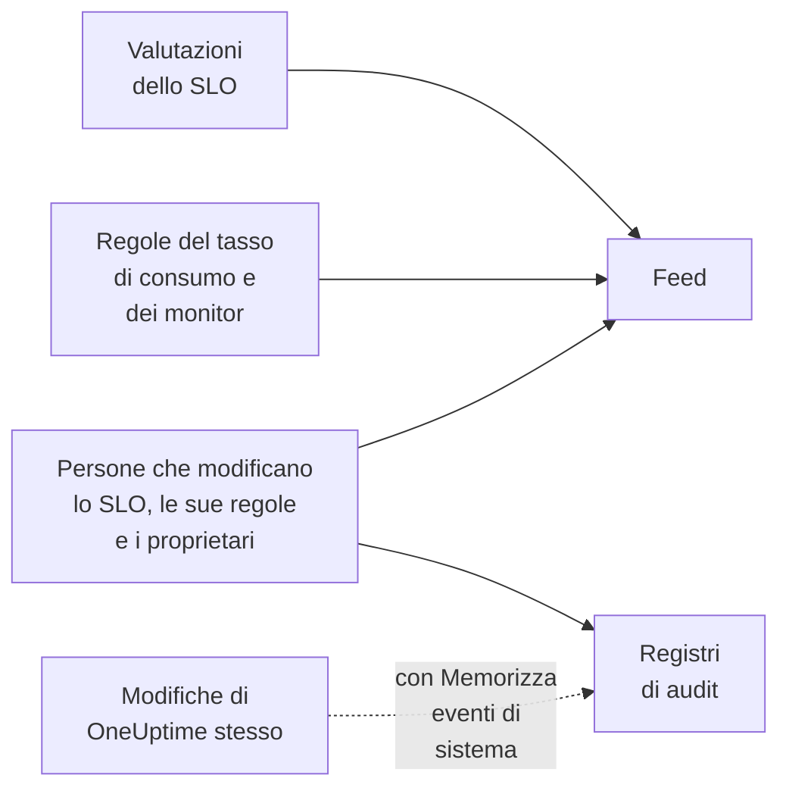

# Feed e registri di audit degli SLO

Uno SLO tiene due registrazioni della sua storia, e rispondono a domande diverse. Il **Feed** risponde a «cosa è successo a questo SLO?», scritto per le persone che se ne occupano. I **Registri di audit** rispondono a «chi ha cambiato cosa, esattamente?», campo per campo, per revisioni e conformità.

## Feed o registri di audit?

| | **Feed** | **Registri di audit** |
| --- | --- | --- |
| Risponde a | Cosa è successo allo SLO | Chi ha cambiato cosa, e quando |
| Registra | Cambi di stato, avvisi e incidenti di tasso di consumo, e modifiche allo SLO, alle sue regole, ai monitor e ai proprietari | Ogni modifica fatta dalle persone allo SLO, alle sue regole del tasso di consumo, alle regole dei monitor e ai proprietari, con il valore vecchio e quello nuovo |
| Include il lavoro di OneUptime stesso | Sì: le valutazioni e le regole dei monitor che collegano monitor | Solo con **Memorizza eventi di sistema** attivo |
| Piani | Tutti i piani | Il piano Enterprise su OneUptime Cloud, o la Enterprise Edition su un'installazione self-hosted |
| Conservazione | Tre anni su OneUptime Cloud | 7 giorni per impostazione predefinita, fino a 180 |

## Il feed dello SLO

Il feed si trova nella pagina **Feed** dello SLO, e i suoi ultimi elementi in **Recent activity** nella **Panoramica** dello SLO. Gli elementi rimandano allo SLO, ai monitor, agli avvisi e agli incidenti che citano, e la maggior parte ha una sezione **More Information** con i numeri o i valori vecchi e nuovi.

| Evento | Pubblicato quando |
| --- | --- |
| SLO creato | Lo SLO viene creato. Elenca il suo obiettivo, la finestra di conformità, lo SLI, la soglia a rischio, la descrizione e le regole del tasso di consumo predefinite con cui è partito. |
| SLO aggiornato | Cambiano il nome, la descrizione, le etichette, l'obiettivo, la finestra di conformità, il fuso orario, la soglia a rischio, la modalità multi-monitor o gli stati di inattività. Mostra ogni valore vecchio e nuovo. |
| SLO abilitato o disabilitato | La valutazione viene attivata o disattivata. |
| SLO archiviato o ripristinato | Lo SLO viene archiviato o tolto dall'archivio. |
| Stato cambiato | Una valutazione porta lo SLO a un nuovo stato. Mostra lo SLI, il budget di errore, il tasso di consumo e la soglia a rischio che lo spiegano, e il motivo per **In pausa** o **Misconfigured**. |
| Avviso di tasso di consumo generato | Una regola del tasso di consumo crea un avviso. Rimanda all'avviso e mostra i tassi di consumo che l'hanno fatto scattare. |
| Incidente di tasso di consumo dichiarato | Una regola del tasso di consumo dichiara un incidente. Rimanda all'incidente e mostra i tassi di consumo che l'hanno fatto scattare. |
| Avviso o incidente di tasso di consumo risolto | L'avviso o l'incidente di una regola si chiude: risolto automaticamente, o a mano mentre la risoluzione automatica era disattivata. |
| Regola del tasso di consumo aggiunta, modificata o rimossa | Qualcuno crea, modifica o elimina una regola del tasso di consumo. Le regole predefinite di un nuovo SLO compaiono invece nel suo elemento «SLO creato». |
| Regola dei monitor aggiunta, modificata o rimossa | Qualcuno crea, modifica o elimina una regola dei monitor. Un salvataggio che non cambia nulla di rilevante non viene pubblicato. |
| Monitor collegati o scollegati | Dei monitor vengono aggiunti allo SLO o rimossi, a mano o da una regola dei monitor. Gli elenchi lunghi nominano i primi monitor «e altri N». |
| Proprietario aggiunto o rimosso | Un utente o un team viene aggiunto ai proprietari dello SLO o rimosso. |
| Regola delle etichette applicata | Una regola delle etichette ha collegato etichette allo SLO, alla sua creazione o quando qualcuno ha eseguito la regola. Nomina le regole che hanno trovato corrispondenza. Vedi [Regole per etichette e proprietari](/docs/slo/label-and-owner-rules). |
| Regola del proprietario applicata | Una regola del proprietario ha aggiunto proprietari allo SLO. Nomina le regole che hanno trovato corrispondenza; ogni proprietario aggiunto riceve anche un suo elemento «Proprietario aggiunto». |

Alcuni dettagli:

- Gli elementi dicono chi ha fatto una modifica quando è stata una persona. Le modifiche che OneUptime fa da solo, come una valutazione o una regola dei monitor che collega un monitor, e le modifiche fatte tramite l'API o un'automazione non hanno un utente.
- Un avviso o un incidente che una regola riprende perché era ancora aperto non viene pubblicato due volte.
- Per un avviso o un incidente privato, l'elemento omette titolo, numero e link, perché chiunque possa leggere lo SLO può leggerne il feed. Dice comunque che è stato creato un record privato, e mostra i tassi di consumo che l'hanno fatto scattare.
- Nessuno può modificare o eliminare gli elementi del feed. Su OneUptime Cloud, gli elementi più vecchi di tre anni vengono rimossi.

## Registri di audit

La pagina **Registri di audit** dello SLO elenca le modifiche fatte a:

- lo SLO stesso: i suoi dettagli, le impostazioni, le etichette, i monitor e l'archiviazione;
- le sue regole del tasso di consumo;
- le sue regole dei monitor;
- i suoi utenti proprietari e i suoi team proprietari.

Le modifiche alle regole e ai proprietari vengono registrate sulla regola o sul proprietario e raccolte nello SLO, così la sua pagina mostra tutta la sua storia in un unico posto, e ogni voce rimanda alla pagina a cui appartiene. Gli elementi collegati, come etichette e monitor, vengono registrati con il loro nome, non solo con il loro ID.

Restano fuori due cose:

- **I risultati delle valutazioni.** SLI, budget di errore, tasso di consumo, stato e orari di valutazione cambiano ogni pochi minuti. La loro cronologia si trova nella **Panoramica**, nella pagina **Metriche** e nel **Feed**.
- **Le modifiche che OneUptime fa da solo**, come una regola dei monitor che collega o scollega un monitor, a meno che **Memorizza eventi di sistema** non sia attivo per il progetto. Il **Feed** registra comunque i collegamenti e gli scollegamenti dei monitor.

### Attivare i registri di audit

I registri di audit sono una funzione Enterprise: richiedono il piano **Enterprise** su OneUptime Cloud, o la Enterprise Edition su un'installazione self-hosted. Negli altri piani, la pagina **Registri di audit** dello SLO spiega come ottenerla. Su un'installazione self-hosted, la registrazione di audit smette di registrare senza una licenza valida (dopo la prova di 14 giorni, o 30 giorni dopo la scadenza di una licenza), e riprende appena una licenza viene attivata (vedi [When a license expires or is missing](/docs/self-hosted/enterprise#quando-una-licenza-scade-o-manca)). Le pagine **Registri di audit** indicano quando non sta registrando.

I registri di audit sono anche disattivati per impostazione predefinita in ogni progetto. Per attivarli:

:::steps
### Aprire le impostazioni dei registri di audit

Vai a **Impostazioni del progetto**, apri **Registri di audit** nel menu laterale e fai clic su **Impostazioni**.

### Modificare le impostazioni

Fai clic su **Edit Audit Log Settings** e attiva **Abilita log di controllo**.

### Scegliere cosa conservare

Imposta **Conservazione (giorni)**, da 7 (il valore predefinito) a 180, e attiva **Memorizza eventi di sistema** per registrare anche le modifiche che OneUptime fa da solo. Salva. La modifica si applica in circa un minuto.
:::

Mentre la registrazione di audit è disattivata, la pagina **Registri di audit** dello SLO mostra **Audit logging is off**, con un link per attivarla. Le voci registrate prima della disattivazione restano visibili. Il registro di audit completo del progetto, per ogni risorsa, si trova in **Impostazioni del progetto** → **Registri di audit** → **Registri di audit**.

## Passi successivi

:::cards
- [Panoramica degli SLO](/docs/slo/introduction): Ogni pagina che ha uno SLO.
- [Monitor e regole dei monitor](/docs/slo/monitor-rules): Cosa collega e scollega i monitor.
- [Avvisi e incidenti di tasso di consumo](/docs/slo/burn-rate-alerts): Cosa genera e risolve gli avvisi e gli incidenti del feed.
- [Regole per etichette e proprietari](/docs/slo/label-and-owner-rules): Cosa aggiunge etichette e proprietari automaticamente.
:::
