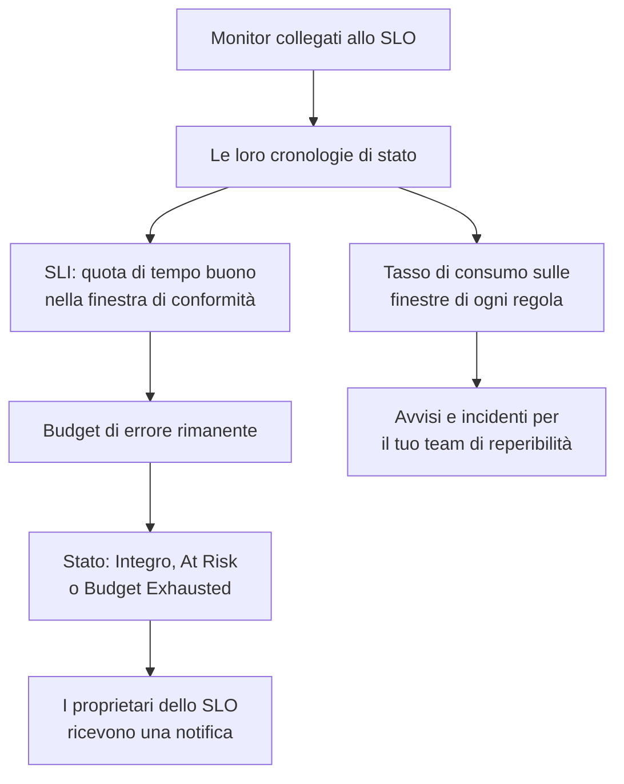

# Panoramica degli SLO

Un obiettivo del livello di servizio (SLO) è un obiettivo di affidabilità per ciò che monitori, come «disponibile il 99,9% del tempo su 30 giorni mobili». OneUptime misura ogni SLO rispetto al suo obiettivo ogni 5 minuti: invece di «funziona in questo momento?» puoi rispondere a «siamo stati abbastanza affidabili, su una finestra che conta per i nostri utenti, e quanto margine di errore ci resta?».

:::cards
- [Creare uno SLO](#creare-uno-slo): Un nome e un obiettivo. Tutto il resto parte da un valore predefinito.
- [Monitor e regole dei monitor](/docs/slo/monitor-rules): Scegli i monitor che uno SLO misura.
- [Budget di errore](/docs/slo/error-budget): Quanta inattività consente un obiettivo e come torna disponibile.
- [Avvisi e incidenti di tasso di consumo](/docs/slo/burn-rate-alerts): Avvisa il tuo team quando il budget si consuma troppo in fretta.
:::

## Come funziona

Uno SLO legge le cronologie di stato dei monitor collegati: gli stessi dati che mostrano le tue pagine di stato. Da queste OneUptime calcola quanta parte della finestra di conformità è stata tempo buono, quanto resta del budget di errore e con che velocità si consuma.

## Concetti chiave

| Termine | Significato |
| --- | --- |
| **SLI** (indicatore del livello di servizio) | La misura: la percentuale della finestra di conformità in cui i monitor dello SLO erano disponibili. |
| **SLO** (obiettivo del livello di servizio) | Un obiettivo per lo SLI, per esempio «almeno il 99,9% negli ultimi 30 giorni». |
| **Budget di errore** | L'inattività che l'obiettivo consente: `(100% − target) × window`. Al 99,9% su 30 giorni sono 43 minuti e 12 secondi. |
| **Tasso di consumo** | La velocità con cui si spende il budget rispetto a un ritmo regolare. Con un tasso di consumo di 1, il budget finisce esattamente alla fine della finestra. |

Un budget di errore trasforma l'affidabilità in qualcosa che puoi spendere. Se ne resta molto, rilascia più in fretta e prenditi dei rischi; se ne resta poco, rallenta e investi nella stabilità. Lo SLO dà a questa discussione un numero che tutti vedono.

## Creare uno SLO

Ti serve un ruolo che possa creare SLO: Project Owner, Project Admin o un ruolo personalizzato con il permesso Create Service Level Objective.

:::steps
### Aprire gli SLO

Apri **SLOs** dal menu **Prodotti** nella barra in alto. Si trova nel primo gruppo, accanto a monitor e incidenti. Fai clic su **Crea: Service Level Objective**.

### Dargli un nome e fissare un obiettivo

Inserisci un **Nome**, per esempio «API Availability», e un **Target (%)**: la quota di tempo in cui i suoi monitor devono essere disponibili. L'obiettivo parte da `99.9`. Deve essere maggiore di 0 e al massimo 99,999, perché un obiettivo del 100% non lascia alcun budget di errore da seguire.

### Controllare i valori predefiniti in Altri campi

**Altri campi** è chiuso, con una riga che dice cosa fanno i suoi valori predefiniti: lo SLO si misura su una finestra mobile di 30 giorni e diventa a rischio quando resta meno del 20% del suo budget di errore. Aprilo per cambiare uno dei campi della tabella qui sotto.

### Salvare lo SLO

Fai clic su **Crea: Service Level Objective**. OneUptime apre il nuovo SLO. La sua **Panoramica** mostra **Choose what this SLO measures**, perché un nuovo SLO non ha ancora monitor.

### Collegare i monitor

Fai clic su **Create a monitor rule** per collegare ogni monitor che corrisponde, ora e in futuro, oppure su **Add monitors** per sceglierli a mano. Vedi [Monitor e regole dei monitor](/docs/slo/monitor-rules).

### Vedere arrivare i primi numeri

OneUptime valuta gli SLO abilitati ogni 5 minuti. Lo SLI, il budget di errore e il grafico di consumo compaiono dopo la prima valutazione che ha dei monitor da misurare.
:::

I campi in **Altri campi**:

| Campo | Cosa imposti | Predefinito |
| --- | --- | --- |
| **Descrizione** | A cosa serve lo SLO. | Vuoto |
| **Soglia a rischio (%)** | La quota del budget di errore rimanente alla quale lo SLO passa a **At Risk**. Un numero intero da 0 a 100. | 20 |
| **Window Type** | **Rolling**: gli ultimi N giorni, che si recuperano man mano che la vecchia inattività esce dalla finestra. **Calendar Month**: ogni mese a sé, azzerato il giorno 1. | **Rolling** |
| **Window (Days)** | Solo finestre mobili: quanti giorni guardare indietro, da 1 a 366. Di solito 28 o 30. | 30 |
| **Fuso orario** | Solo mesi di calendario: il fuso orario in cui ogni mese inizia e finisce. | UTC |
| **Etichette** | Etichette per organizzare e filtrare gli SLO. | Nessuna |

Tutto ciò che decide come misura lo SLO parte da un valore predefinito che cambi in seguito:

| Impostazione | Un nuovo SLO parte con | Dove cambiarla |
| --- | --- | --- |
| Monitor | Nessuno | **Monitor** o **Monitor Rules** |
| Stati di inattività | Tutti gli stati non operativi del progetto | **Impostazioni** → **Downtime Calculation** |
| Modalità multi-monitor | **Any Monitor Down** | **Impostazioni** → **Downtime Calculation** |
| Valutazione | Attiva | **Impostazioni** → **Valutazione** |
| Regole del tasso di consumo | Una regola **Fast burn** e una regola **Slow burn**, adattate alla finestra | **Burn Rate Rules** |

## Di cosa è fatto uno SLO

| Parte | Cosa decide |
| --- | --- |
| Monitor | Da dove viene lo SLI. Collegali a mano o con le regole dei monitor: vedi [Monitor e regole dei monitor](/docs/slo/monitor-rules). |
| Obiettivo | La quota di tempo buono che lo SLO promette, maggiore di 0 e al massimo 99,999. |
| Finestra di conformità | Il periodo su cui si misurano SLI e budget: una finestra mobile da 1 a 366 giorni, oppure un mese di calendario. |
| Soglia a rischio | La quota di budget rimanente alla quale lo SLO passa a **At Risk**. |
| Stati di inattività | Quali stati dei monitor contano come inattività. |
| Modalità multi-monitor | Come si combina l'inattività di più monitor. |

### Quali stati contano come inattività

Ogni SLO ha il suo elenco di stati dei monitor che contano come inattività. Un nuovo SLO parte con tutti gli stati del progetto che non sono contrassegnati come operativi, come Degraded e Offline, come fanno le tue pagine di stato. Cambia l'elenco in **Impostazioni** → **Downtime Calculation**. Lascialo vuoto per contare tutti gli stati non operativi, compresi quelli aggiunti al progetto in seguito.

> [!TIP]
> Misura gli stessi monitor in due modi con due SLO: uno SLO di disponibilità rigoroso in cui contano sia Degraded sia Offline, e uno SLO di interruzione totale più permissivo in cui conta solo Offline.

### Finestre di conformità

| Tipo di finestra | Come si comporta |
| --- | --- |
| **Rolling** | Guarda indietro di un numero fisso di giorni a partire da adesso. La vecchia inattività esce dalla finestra, quindi il budget torna poco a poco. |
| **Calendar Month** | Misura dal primo del mese, nel fuso orario dello SLO (UTC per impostazione predefinita). Tutto il budget torna all'inizio di ogni mese. |

### Più monitor su uno SLO

Quando uno SLO misura più di un monitor, la sua **Multi Monitor Mode** decide come si combina la loro inattività. Un nuovo SLO usa **Any Monitor Down**.

| Modalità | Come conta l'inattività | Usala quando |
| --- | --- | --- |
| **Any Monitor Down** | Ogni momento in cui almeno un monitor è fuori servizio conta come inattività per tutto lo SLO. Le interruzioni sovrapposte contano una volta sola. | I monitor insieme sono un solo servizio: se uno qualsiasi cade, gli utenti se ne accorgono. |
| **Monitor Seconds Average** | L'inattività di ogni monitor conta per conto suo, in media su tutto il tempo monitorato: SLI = 1 − (secondi di inattività di tutti i monitor ÷ secondi monitorati di tutti i monitor). | I monitor sono una flotta di risorse simili e un impatto parziale deve contare parzialmente. |

Per esempio, il monitor A è fuori servizio dalle 10:00 alle 11:00 mentre il monitor B resta disponibile. **Any Monitor Down** registra 60 minuti di inattività; **Monitor Seconds Average** registra l'equivalente di 30 minuti, perché uno dei due monitor è stato fuori servizio per un'ora. In quella modalità anche il budget si conta in secondi-monitor: vedi [Budget di errore](/docs/slo/error-budget).

## Stato dello SLO

OneUptime assegna uno stato a ogni SLO valutato:

| Stato | Cosa significa |
| --- | --- |
| **Integro** | Resta più budget della soglia a rischio. |
| **At Risk** | Il budget rimanente è sceso alla soglia a rischio o sotto: il 20% per impostazione predefinita. |
| **Budget Exhausted** | Il budget è stato speso tutto, o superato. |
| **Misconfigured** | Lo SLO non si può misurare: non ha monitor, i suoi monitor non esistono più o non hanno ancora registrato uno stato nella sua finestra, oppure il suo obiettivo è fuori intervallo. |
| **In pausa** | Ogni monitor che misura è archiviato o ha il monitoraggio attivo disattivato, a mano, da un incidente manuale o da una manutenzione pianificata. Riprende da solo appena uno di essi torna a essere monitorato. |

Uno SLO disattivato o archiviato non viene valutato, quindi il suo stato resta com'era; l'elenco degli SLO mostra invece un'etichetta **Disabilitato** o **Archiviato**. I proprietari di uno SLO ricevono una notifica quando lo stato passa a **At Risk** o **Budget Exhausted**: vedi [Budget di errore](/docs/slo/error-budget).

## L'elenco degli SLO

La pagina **SLOs** elenca ogni SLO non archiviato, con stato, SLI, budget rimanente, tasso di consumo, obiettivo, finestra, monitor, etichette e proprietari.

- I riquadri sopra l'elenco contano gli SLO per stato: **Integro**, **At Risk**, **Budget Exhausted**, **Misconfigured**, **In pausa** e **Disabilitato**. Fai clic su un riquadro per vedere solo quegli SLO, e di nuovo per vederli tutti.
- Seleziona degli SLO per aggiungere o togliere etichette e proprietari, archiviarli o eliminarli, tutti insieme.
- La sezione **Impostazioni** del menu laterale contiene **Regole etichette** e **Regole del proprietario**, che etichettano i nuovi SLO e assegnano loro dei proprietari: vedi [Regole per etichette e proprietari](/docs/slo/label-and-owner-rules).
- La sezione **Avanzato** del menu laterale contiene **Archiviato**, l'elenco degli SLO archiviati.

## Le pagine di uno SLO

Apri uno SLO per vedere le sue pagine nel menu laterale:

| Pagina | Cosa mostra |
| --- | --- |
| **Panoramica** | Lo stato, i numeri principali, il consumo del budget di errore, l'attività recente, gli avvisi e gli incidenti aperti e le regole del tasso di consumo. |
| **Metriche** | Le metriche `oneuptime.slo.*` dello SLO, la cronologia a lungo termine del suo budget di errore e le metriche degli incidenti e degli avvisi che lo riguardano. Vedi [Metriche e dashboard degli SLO](/docs/slo/metrics). |
| **Incidenti** | Gli incidenti dichiarati dalle sue regole del tasso di consumo. Il badge conta quelli aperti. |
| **Avvisi** | Gli avvisi generati dalle sue regole del tasso di consumo. Il badge conta quelli aperti. |
| **Feed** | Cosa è successo allo SLO, come cronologia. Vedi [Feed e registri di audit degli SLO](/docs/slo/feed-and-audit-logs). |
| **Monitor** | I monitor che misura, e se ognuno è stato collegato da una persona o da una regola. |
| **Monitor Rules** | Le regole che collegano i monitor corrispondenti. |
| **Burn Rate Rules** | Le regole che generano avvisi e dichiarano incidenti quando il budget si consuma troppo in fretta. |
| **Proprietari** | Gli utenti e i team che vengono a sapere dei suoi cambi di stato. |
| **Impostazioni** | L'obiettivo, il periodo di conformità, il calcolo dell'inattività, l'interruttore di valutazione e la scheda di archiviazione. |
| **Registri di audit** | Chi ha cambiato lo SLO, le sue regole e i suoi proprietari, e quando. |
| **Delete SLO** | Elimina lo SLO definitivamente e risolve gli avvisi e gli incidenti di tasso di consumo che aveva aperti. |

**Monitor**, **Monitor Rules** e **Burn Rate Rules** si trovano in una sezione **Configurazione**, e **Proprietari**, **Impostazioni**, **Registri di audit** e **Delete SLO** in una sezione **Management**. Entrambe partono chiuse, come una sezione **Sviluppatori** per gestire lo SLO dal codice: fai clic sul titolo di una sezione per aprirla.

Quando qualcosa impedisce a uno SLO di misurare, un banner in cima a ciascuna delle sue pagine dice cosa non va e rimanda alla pagina che lo risolve: vedi [Risoluzione dei problemi](#risoluzione-dei-problemi).

### La panoramica

La **Panoramica** risponde a «siamo dentro il budget?», dall'alto in basso:

- **Il riepilogo**: lo stato, una frase su cosa significa e la descrizione. Accanto ci sono **Aggiorna** e quando lo SLO è stato valutato l'ultima volta. Sotto ci sono l'obiettivo, la **Compliance window** (con un indicatore di riempimento mentre una giovane finestra mobile si riempie: vedi [SLO giovani e l'indicatore di riempimento della finestra](#slo-giovani-e-lindicatore-di-riempimento-della-finestra)), il numero di monitor e i proprietari.
- **I numeri principali**:
  - **SLI**: la quota di tempo buono nella finestra, e quanto è sopra o sotto l'obiettivo.
  - **Error budget left**: una percentuale, una durata come "12m 30s left of 43m 12s" e una barra con un segno alla soglia a rischio. Quando il budget è superato mostra **Budget exceeded** e di quanto.
  - **Burn rate**: con che velocità si spende il budget negli ultimi 60 minuti, il periodo usato dalla regola di consumo rapido predefinita. Diventa ambra sopra 1× e rossa, con **Rule threshold reached**, alla soglia più bassa delle regole del tasso di consumo abilitate dello SLO.
  - **Budget runway**: quanto dura il budget a questo ritmo. Vedi [Budget di errore](/docs/slo/error-budget#autonomia-del-budget).
- **Error budget burn-down**: il budget rimanente lungo la finestra attuale. Vedi [Budget di errore](/docs/slo/error-budget#consumo-del-budget-di-errore).
- **Recent activity**: gli ultimi elementi del feed dello SLO.
- **SLO Details**: nome, descrizione ed etichette, le sole impostazioni modificate nella panoramica.
- **Open alerts & incidents**: cosa hanno aperto adesso le regole del tasso di consumo.
- **Burn rate rules**: la soglia di ogni regola abilitata accanto al tasso di consumo attuale, e cosa dichiara la regola.

### Impostazioni

La pagina **Impostazioni** raccoglie come misura uno SLO, una scheda per ciascuna cosa:

| Scheda | Cosa cambi | Da sapere |
| --- | --- | --- |
| **Objective** | **Target (%)** e **Soglia a rischio (%)**, con **Edit Objective**. | Mostra l'inattività che l'obiettivo consente, per esempio «43m 12s di inattività per finestra di 30 giorni». |
| **Compliance Period** | **Window Type**, **Window (Days)** e **Fuso orario**, con **Edit Period**. | Le regole del tasso di consumo mantengono le loro soglie quando cambia la finestra, quindi rivedile dopo. |
| **Downtime Calculation** | **Multi Monitor Mode** e **Stati del monitor per i tempi di inattività**, con **Edit Downtime Calculation**. | Senza stati si contano tutti gli stati non operativi, compresi quelli aggiunti dopo. |
| **Valutazione** | L'interruttore **Valuta questo SLO**, che salva appena lo sposti. | Disattivarlo chiede conferma, perché risolve anche gli avvisi e gli incidenti di tasso di consumo aperti dello SLO. |
| **Archive SLO** | **Archivia** o **Annulla archiviazione**. | Vedi [Archiviare uno SLO](#archiviare-uno-slo). |

Dopo una modifica all'obiettivo, al periodo o al calcolo dell'inattività, OneUptime rivaluta lo SLO all'esecuzione successiva.

## Archiviare uno SLO

Archivia uno SLO che non misuri più ma vuoi conservare, come un servizio dismesso o l'obiettivo dell'anno scorso. Archivialo da **Impostazioni** → **Archive SLO**, oppure seleziona degli SLO nell'elenco e scegli **Archivia**.

Uno SLO archiviato:

- è nascosto dall'elenco degli SLO, dai suoi riquadri di stato e dai selettori ed elenchi di SLO delle dashboard;
- non viene valutato: i suoi numeri restano quelli dell'ultima valutazione, le sue regole del tasso di consumo non scattano e non invia metriche;
- ha i suoi avvisi e incidenti di tasso di consumo aperti risolti;
- conserva impostazioni, cronologia, regole e proprietari. Le sue regole dei monitor tengono aggiornato l'elenco dei monitor, così riprende con i monitor giusti.

Gli SLO archiviati sono elencati nella pagina **Archiviato**, in **Avanzato** nel menu laterale dell'elenco degli SLO. Selezionali lì e scegli **Annulla archiviazione** per riportarli indietro: vengono valutati di nuovo all'esecuzione successiva, con SLI e budget ricalcolati dalla cronologia dei loro monitor.

Archiviare e disattivare la valutazione sono interruttori separati. Uno SLO disattivato prima di essere archiviato resta disattivato quando annulli l'archiviazione: riattivalo con **Attiva la valutazione** nel suo banner, oppure con **Valuta questo SLO** in **Impostazioni** → **Valutazione**.

| Vuoi | Fai questo |
| --- | --- |
| Smettere di misurare per un po', tenendolo nell'elenco | Disattiva la valutazione |
| Ritirarlo, ma tenere la sua cronologia e le impostazioni | Archivialo |
| Toglierlo per sempre | Eliminalo |

## Gli SLO su avvisi, incidenti e monitor

Ogni avviso e incidente creato da una regola del tasso di consumo è collegato al suo SLO:

- La pagina dell'avviso o dell'incidente elenca lo SLO in **Risorse interessate**, con un link.
- Gli elenchi di avvisi e incidenti mostrano lo SLO tra le risorse interessate, e il filtro **Risorse interessate** limita un elenco a uno SLO.
- Le pagine **Avvisi** e **Incidenti** dello SLO li elencano, e i loro badge nel menu laterale contano quelli aperti.

OneUptime crea questo collegamento quando una regola crea l'avviso o l'incidente; non puoi aggiungerlo a mano, e modificare l'avviso o l'incidente non lo rimuove mai.

Anche il menu laterale di un monitor ha una pagina **SLOs**: gli SLO che misurano quel monitor, così sai quali obiettivi dipendono da lui prima di metterlo in pausa o cambiarlo.

## SLO giovani e l'indicatore di riempimento della finestra

Uno SLO con finestra mobile più giovane della sua finestra si misura sui dati che esistono finora: uno SLO di 30 giorni creato ieri ha un giorno di dati. Il suo budget di errore parte piccolo e cresce man mano che la finestra si riempie, quindi i suoi primi numeri si muovono più di quanto faranno dopo.

Finché è così, la **Panoramica** lo dice: il riepilogo mostra un indicatore **Window 23% full** (**Window under 1% full** il primo giorno), e il riquadro **Error budget left** lo ripete sotto il suo numero. Entrambi spariscono quando la finestra è piena. Gli SLO a mese di calendario non li mostrano mai, perché il loro budget copre tutto il mese fin dal primo giorno, e nemmeno gli SLO in modalità **Monitor Seconds Average**, il cui budget si conta su tutti i monitor.

## Risoluzione dei problemi

Un banner in cima alle pagine dello SLO dice cosa gli impedisce di misurare:

| Banner | Cosa significa | Cosa fare |
| --- | --- | --- |
| **No monitors attached** | Lo SLO non ha monitor, quindi non c'è niente da misurare. | Collega dei monitor o crea una regola dei monitor. |
| **Waiting for SLO evaluation** | Ci sono monitor collegati, ma l'ultima valutazione non aveva dati di stato da loro. | Controlla che i monitor vengano verificati. I numeri compaiono dopo la prossima valutazione con dati. |
| **Measurement is paused** | Ogni monitor che misura è archiviato o ha il monitoraggio attivo disattivato. | Riattiva il monitoraggio di almeno un monitor, oppure aspetta la fine della manutenzione. |
| **The target is out of range** | L'obiettivo non è maggiore di 0 e minore di 100. | Imposta un obiettivo come 99,9 in **Impostazioni** → **Objective**. |
| **This SLO is disabled** | La valutazione è disattivata. | Fai clic su **Attiva la valutazione**. |
| **This SLO is archived** | Lo SLO è archiviato. | Annulla l'archiviazione in **Impostazioni**. |
| **Not evaluated yet** | Lo SLO è appena stato creato. | Aspetta la prima valutazione, al massimo qualche minuto. |

## Passi successivi

:::cards
- [Monitor e regole dei monitor](/docs/slo/monitor-rules): Collega i monitor a mano o con le regole.
- [Budget di errore](/docs/slo/error-budget): Il calcolo del budget, l'autonomia e come torna il budget.
- [Avvisi e incidenti di tasso di consumo](/docs/slo/burn-rate-alerts): Avvisa il tuo team di reperibilità quando il budget si consuma troppo in fretta.
- [Metriche e dashboard degli SLO](/docs/slo/metrics): Rappresenta gli SLO in grafici e crea una dashboard di SLO.
:::
