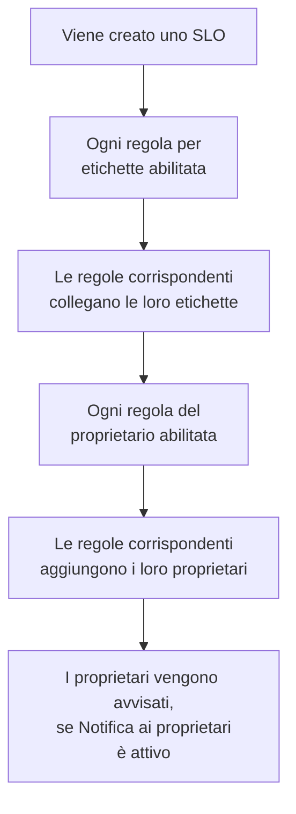

# Regole per etichette e proprietari

Le regole per etichette e le regole del proprietario organizzano i tuoi SLO al posto tuo. Una **regola per etichette** collega etichette a ogni nuovo SLO che le corrisponde, e una **regola del proprietario** gli aggiunge utenti e team proprietari, così un nuovo SLO di checkout riceve l'etichetta _Checkout_ e appartiene al team di checkout senza che nessuno debba ricordarsene. Entrambe funzionano come le regole per etichette e proprietari di ogni altro prodotto: vedi [Regole per etichette e proprietari](/docs/configuration/label-and-owner-rules) per ciò che hanno in comune.

## Come funziona

Le regole vengono eseguite quando si crea uno SLO, dalla dashboard o tramite l'API. Le regole per etichette vengono eseguite per prime, così una regola del proprietario può corrispondere a un'etichetta che una regola per etichette ha appena collegato.

Entrambi i tipi valgono per tutto il progetto. Li trovi nel menu laterale dell'elenco degli SLO, in **Impostazioni**: **Regole etichette** e **Regole del proprietario**. La sezione **Impostazioni** parte chiusa; fai clic sul suo titolo per aprirla.

## Creare una regola

:::steps
### Aprire l'elenco delle regole

Apri **SLOs**, poi **Impostazioni** → **Regole etichette** o **Impostazioni** → **Regole del proprietario** nel menu laterale, e fai clic su **Crea: SLO Label Rule** o **Crea: SLO Owner Rule**.

### Scegliere a cosa corrisponde la regola

Nel passo **Corrispondenza**, fai clic su **Aggiungi condizione** per ogni condizione che uno SLO deve soddisfare (vedi [Criteri di corrispondenza](#criteri-di-corrispondenza)). Con due o più, scegli **Soddisfa tutte** o **Soddisfa almeno una**. Una regola senza condizioni corrisponde a ogni nuovo SLO.

### Scegliere cosa aggiunge la regola

Il secondo passo di una regola per etichette è **Etichette**, dove scegli le **Etichette da aggiungere**. Quello di una regola del proprietario è **Proprietari**, dove scegli i **Proprietari** da aggiungere — persone e team, scelti da un solo elenco con **Aggiungi proprietario**. Una regola deve aggiungere almeno un'etichetta o un proprietario.

### Controllare il nome e i campi chiusi

Il **Nome** viene compilato a partire da ciò che scegli, come _Aggiungi Checkout, Production_ o _Aggiungi Checkout team come proprietari_, e segue le tue scelte finché non scrivi un nome tuo. **Altri campi** contiene la **Descrizione** facoltativa e, in una regola del proprietario, **Notifica ai proprietari**.

### Salvare la regola

Fai di nuovo clic su **Crea: SLO Label Rule** o **Crea: SLO Owner Rule** nell'ultimo passo. La regola parte abilitata.
:::

**Notifica ai proprietari** (in **Altri campi**) è attivo per impostazione predefinita: i proprietari che una regola del proprietario aggiunge ricevono la stessa notifica «sei stato aggiunto come proprietario» di un proprietario aggiunto a mano. Disattivalo per aggiungere i proprietari senza avvisarli.

Per mettere in pausa una regola senza eliminarla, disattiva **Abilitato** nel suo modulo di modifica. Il modulo di modifica non pretende mai etichette o proprietari: una regola più vecchia che non aggiunge nulla si può comunque rinominare, disattivare o eliminare, e l'elenco la segna con **Non aggiunge nulla**.

Quando una regola corrisponde a uno SLO:

- Una regola per etichette collega ogni etichetta in **Etichette da aggiungere**. Le etichette che lo SLO ha già non vengono aggiunte due volte, e quando corrispondono più regole, lo SLO riceve tutte le loro etichette.
- Una regola del proprietario aggiunge come proprietario ogni utente e team della regola. I proprietari che lo SLO ha già vengono saltati, e quando corrispondono più regole, lo SLO riceve tutti i loro proprietari. Un utente che non è più membro del progetto, o un team di un altro progetto, non viene mai aggiunto; gli altri proprietari della regola sì.

I proprietari di uno SLO sono le persone che vengono informate dei suoi cambi di stato: vedi [Budget di errore](/docs/slo/error-budget).

## Criteri di corrispondenza

Ogni condizione confronta un campo dello SLO:

| Campo | Confrontato con | Operatori |
| --- | --- | --- |
| **Etichette dello SLO** | Le etichette dello SLO. | **Ha uno qualsiasi di**, **Ha tutti i**, **Non ha nessuno di** |
| **Nome dello SLO** | Il nome dello SLO. | **Contiene**, **Non contiene**, **Uguale a**, **Diverso da**, **Inizia con**, **Termina con**, **Corrisponde al pattern**, **Non corrisponde al pattern** |
| **Descrizione dello SLO** | La descrizione dello SLO. | Gli stessi di **Nome dello SLO** |

Una nuova condizione sul nome o sulla descrizione parte da **Contiene**. Un pattern è un'espressione regolare, come `^checkout-.*`, o un carattere jolly `*`, come `*checkout*`, e non distingue maiuscole e minuscole. Un pattern che non è né l'uno né l'altro, come `checkout-(01`, viene rifiutato al salvataggio invece di non corrispondere a nulla in silenzio.

| Vuoi | Condizioni |
| --- | --- |
| Ogni SLO del servizio di checkout | **Nome dello SLO** contiene `checkout` |
| Ogni SLO di produzione | **Etichette dello SLO** ha uno qualsiasi di _Production_ |
| Gli SLO di checkout, ma non quelli di staging | **Soddisfa tutte**: **Nome dello SLO** contiene `checkout`, e **Etichette dello SLO** non ha nessuno di _Staging_ |

## Quando vengono eseguite le regole

- **Quando si crea uno SLO**, dalla dashboard o tramite l'API: ogni regola per etichette abilitata, poi ogni regola del proprietario abilitata.
- **Quando esegui una regola** con **Run Now**: vedi sotto.

Modificare uno SLO non applica di nuovo le regole, e una regola non rimuove mai nulla: né etichette o proprietari che qualcuno ha aggiunto a mano, né quelli che ha aggiunto lei stessa. Una regola disattivata non fa nulla.

## Applicare una regola agli SLO esistenti

Una regola che scrivi oggi si applica agli SLO creati dopo. Per applicarla agli SLO che hai già, fai clic su **Run Now** nella riga della regola, oppure su **Visualizza** e poi su **Run Now** nella pagina della regola. Puoi anche selezionare più regole ed eseguirle dalle azioni di massa della tabella.

Un'esecuzione controlla ogni SLO del progetto, compresi quelli archiviati, e riporta a quanti ha trovato corrispondenza e quanti ne ha cambiati. I proprietari aggiunti da un'esecuzione vengono avvisati solo se scegli di avvisarli nella finestra di esecuzione e la regola ha **Notifica ai proprietari** attivo. Vedi [Eseguire le regole sulle risorse esistenti](/docs/configuration/run-rules-now).

Le regole per etichette si possono anche copiare tra progetti: vedi [Importare ed esportare regole per etichette](/docs/configuration/label-rule-import-export).

## Cronologia

Ogni volta che una regola cambia uno SLO, il **Feed** dello SLO registra quali regole l'hanno fatto. Ogni proprietario aggiunto da una regola riceve anche un suo elemento del feed «aggiunto come proprietario», così il feed dice chi è stato aggiunto e perché. Vedi [Feed e registri di audit degli SLO](/docs/slo/feed-and-audit-logs).

## Permessi

| Per | Ti serve |
| --- | --- |
| Lavorare con le regole per etichette | **Create SLO Label Rule**, **Edit SLO Label Rule**, **Delete SLO Label Rule** o **Read SLO Label Rule** |
| Lavorare con le regole del proprietario | **Create SLO Owner Rule**, **Edit SLO Owner Rule**, **Delete SLO Owner Rule** o **Read SLO Owner Rule** |
| Eseguire una regola per etichette | **Edit SLO Label Rule** e **Edit Service Level Objective** |
| Eseguire una regola del proprietario | **Edit SLO Owner Rule**, **Edit Service Level Objective**, **Create SLO User Owner** e **Create SLO Team Owner** |

Questi permessi si trovano nel gruppo SLO di un ruolo, e i ruoli Project Owner e Project Admin li hanno tutti. Un'esecuzione cambia ogni SLO del progetto, quindi un permesso limitato ad alcune etichette, o agli SLO di cui sei proprietario, non basta per eseguire una regola.

## Passi successivi

:::cards
- [Regole per etichette e proprietari](/docs/configuration/label-and-owner-rules): Come funzionano le regole per etichette e proprietari di ogni prodotto.
- [Eseguire le regole sulle risorse esistenti](/docs/configuration/run-rules-now): Come funziona Run Now per ogni tipo di regola.
- [Panoramica degli SLO](/docs/slo/introduction): Ogni pagina che ha uno SLO, e l'elenco degli SLO.
:::
