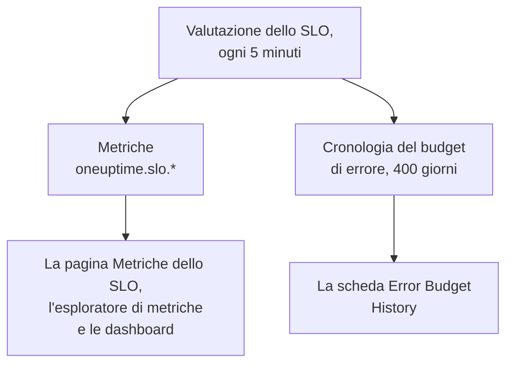

# Metriche e dashboard degli SLO

Ogni volta che OneUptime valuta uno SLO, ogni 5 minuti, scrive i risultati come metriche chiamate `oneuptime.slo.*`. Si trovano nello stesso archivio di metriche delle metriche dei tuoi monitor, quindi puoi rappresentare uno SLO nella sua pagina **Metriche**, aprirlo nell'esploratore di metriche e metterlo in qualsiasi dashboard, filtrato e raggruppato come qualsiasi altra serie.

:::cards
- [Le metriche](#le-metriche): Sei serie, le loro unità e come aggregarle.
- [La pagina Metriche](#la-pagina-metriche): I grafici, la cronologia e le metriche di incidenti e avvisi di uno SLO.
- [Gli SLO nelle dashboard](#gli-slo-nelle-dashboard): Il widget SLO e il modello SLO Dashboard.
:::

## Come funziona

## Le metriche

| Metrica | Unità | Aggregazione | Cosa contiene |
| --- | --- | --- | --- |
| `oneuptime.slo.sli.percent` | `%` | Avg | Lo SLI sulla finestra di conformità dello SLO: la quota del tempo misurato che è stata buona. |
| `oneuptime.slo.target.percent` | `%` | Avg | L'obiettivo dello SLO, pubblicato a ogni valutazione perché un grafico possa disegnarlo sopra lo SLI. |
| `oneuptime.slo.error.budget.remaining.percent` | `%` | Avg | Quota del budget di errore non ancora spesa nella finestra. Negativa quando il budget è superato. |
| `oneuptime.slo.error.budget.remaining.seconds` | `seconds` | Avg | Inattività che lo SLO può ancora assorbire prima di essere violato. Negativa quando il budget è superato. |
| `oneuptime.slo.burn.rate` | `x` | Max | Quanto in fretta si spende il budget, negli ultimi 60 minuti. 1x spende il budget esattamente lungo la finestra. |
| `oneuptime.slo.status` | — | Max | Lo stato dello SLO a ogni valutazione: `0` è Integro, `1` è At Risk, `2` è Budget Exhausted. |

L'aggregazione è il modo in cui i grafici dello SLO e il modello SLO Dashboard combinano i punti che cadono in uno stesso intervallo del grafico. Percentuali e durate vengono mediate. Tasso di consumo e stato prendono il massimo, così un breve picco di consumo o un passaggio rapido in Budget Exhausted non si perde nella media.

Per uno SLO in modalità **Monitor Seconds Average**, `oneuptime.slo.error.budget.remaining.seconds` conta secondi-monitor sommati su tutti i suoi monitor, come il suo budget di errore: vedi [Budget di errore](/docs/slo/error-budget).

### Quando non viene scritto nessun punto

- Uno SLO disattivato o archiviato non viene valutato, quindi non pubblica nulla.
- Uno SLO **In pausa** o **Misconfigured** non misura nulla, quindi pubblica solo `oneuptime.slo.target.percent`, che è configurazione e non una misura. I suoi grafici di SLI, budget, tasso di consumo e stato mostrano un vuoto.
- Un valore che non è un numero reale, come un tasso di consumo su una finestra senza dati, viene saltato, mai scritto come 0.

### Attributi

Ogni punto porta questi attributi:

| Attributo | Valore |
| --- | --- |
| `sloId` | ID dello SLO. Le pagine dello SLO filtrano su di esso, quindi rinominare uno SLO non divide mai i suoi grafici. |
| `sloName` | Nome dello SLO quando il punto è stato scritto. |
| `projectId` | ID del progetto. |
| `oneuptime.label.<key>` | Un attributo per ogni etichetta dello SLO. Un'etichetta chiamata `Tier 1` diventa `oneuptime.label.tier_1` = `true`, e un'etichetta chiamata `product:checkout` diventa `oneuptime.label.product` = `checkout`. Le chiavi sono in minuscolo, con spazi e punteggiatura trasformati in `_`. |

Le serie appartengono allo SLO, non a uno dei suoi monitor, e non contano come utilizzo di telemetria.

Le metriche di incidenti e avvisi portano due attributi corrispondenti, `serviceLevelObjectiveIds` e `serviceLevelObjectiveNames`: elenchi separati da virgole degli SLO che l'incidente o l'avviso riguarda.

### Conservazione

Le metriche `oneuptime.slo.*` vengono conservate quanto le metriche dei monitor: **30 giorni** per impostazione predefinita. In un'installazione self-hosted, un amministratore principale può cambiarlo con **Monitor Metric Retention (Days)** nelle impostazioni **Conservazione dei dati** dell'Admin Dashboard.

Questo non limita la scheda **Error Budget History** della pagina **Metriche** dello SLO. Quella cronologia viene archiviata a parte e conservata per 400 giorni.

## La pagina Metriche

La pagina **Metriche** di uno SLO ha quattro schede:

| Scheda | Cosa mostra |
| --- | --- |
| **SLO Metrics** | Le serie `oneuptime.slo.*` in tre riquadri che condividono un intervallo di tempo, l'ultimo giorno per impostazione predefinita: **Objective** (lo SLI con l'obiettivo sopra, e il budget rimanente), **Burn** (tasso di consumo e tempo di budget rimanente) e **Stato**. |
| **Error Budget History** | SLI, budget rimanente e tasso di consumo sulla cronologia di lungo periodo, con linee all'obiettivo, ai limiti di rischio e di esaurimento, e alla soglia di ogni regola del tasso di consumo abilitata. |
| **Metriche di incidente** | Il numero, il tempo di presa in carico, il tempo di risoluzione e la durata degli incidenti che riguardano questo SLO, l'ultima settimana per impostazione predefinita. Sono inclusi gli incidenti dichiarati dalle sue regole del tasso di consumo. |
| **Metriche di avviso** | Lo stesso per gli avvisi. Sono inclusi gli avvisi generati dalle sue regole del tasso di consumo. |

Le schede **SLO Metrics**, **Metriche di incidente** e **Metriche di avviso** leggono l'archivio di metriche, il che richiede il permesso di leggere la telemetria. Un ruolo personalizzato che può leggere gli SLO ma non la telemetria vede quelle schede vuote, mentre **Error Budget History** funziona comunque.

## Gli SLO nelle dashboard

### Rappresentare qualsiasi metrica di SLO

:::steps
#### Aggiungere un grafico

Nella modalità di modifica di una dashboard, aggiungi un widget di grafico o di valore e scegli una delle metriche `oneuptime.slo.*`.

#### Raggruppare o filtrare

Raggruppa per `sloName` e `sloId` per avere una linea per SLO; `sloId` tiene separati due SLO con lo stesso nome. Oppure filtra su `sloName`, o su un attributo `oneuptime.label.*`.

#### Scegliere l'aggregazione

Usa l'aggregazione della tabella qui sopra: Avg per percentuali e durate, Max per tasso di consumo e stato.
:::

### Il widget SLO

Il [widget SLO](/docs/dashboards/widgets#slo) mostra lo SLI, il budget rimanente o il tasso di consumo di uno SLO come riquadro o grafico. Ottiene il suo SLO in uno di due modi:

| Impostazione | Come si comporta |
| --- | --- |
| **Service Level Objective** | Fissa il widget a uno SLO. Il selettore elenca gli SLO non archiviati. |
| **Follow SLO Variable** | Mostra lo SLO scelto in una variabile della dashboard: una variabile **Telemetry Attribute** sulla chiave `sloName`. Ignorato finché uno SLO è fissato. |

In una [dashboard pubblica](/docs/dashboards/sharing), un widget che segue una variabile permette ai visitatori di scegliere per nome qualsiasi SLO non archiviato del progetto. Un widget fissato mostra sempre e solo il suo SLO, e continua a mostrare gli ultimi numeri di uno SLO archiviato in seguito.

### Il modello SLO Dashboard

Quando crei una dashboard, scegli il modello **SLO Dashboard** per avere una dashboard pronta con tutti gli SLO del progetto, in tre fasce:

1. **Service Level Objectives**: un elenco di ogni SLO non archiviato, con il suo stato, lo SLI rispetto all'obiettivo, la barra del budget e il tasso di consumo, e un conteggio degli SLO per stato. Gli SLO abilitati vengono prima, quello con meno budget per primo; uno SLO disattivato viene per ultimo come **Disabilitato**, con gli ultimi numeri in grigio.
2. **Error Budget & Burn Rate**: i riquadri **Lowest Error Budget Remaining**, **Least Error Budget Time Left** e **Peak Burn Rate**, e i grafici **Error Budget Remaining by SLO** e **Burn Rate by SLO** con una linea per SLO, raggruppati per `sloName` e `sloId`.
3. **Selected SLO**: i riquadri **SLI**, **Error Budget Remaining** e **Burn Rate** e i grafici **SLI History**, **Error Budget History** e **Burn Rate History** di uno SLO.

Una variabile SLO nella barra degli strumenti delimita l'intera dashboard. È una variabile Telemetry Attribute su `sloName`, quindi le sue opzioni sono i nomi degli SLO trovati nelle metriche. Scegliere uno SLO restringe l'elenco a quello, delimita i grafici e i riquadri della fascia e compila i widget di **Selected SLO**, che seguono la variabile. Finché non ne scegli uno, ti chiedono di scegliere uno SLO nella barra degli strumenti.

## Risoluzione dei problemi

:::details Uno SLO manca dal selettore SLO della barra degli strumenti
Il selettore elenca i nomi degli SLO pubblicati nell'ultimo giorno. Un nuovo SLO compare dopo la sua prima valutazione; uno SLO **In pausa** o **Misconfigured** resta selezionabile perché pubblica ancora il suo obiettivo; uno SLO disattivato o archiviato sparisce circa un giorno dopo il suo ultimo punto.
:::

:::details Scegliendo un nome compaiono due SLO
Due SLO hanno quel nome. L'elenco e i grafici li mostrano entrambi, e i widget di **Selected SLO** dicono che il nome è ambiguo. Dai agli SLO nomi diversi.
:::

:::details La scheda SLO Metrics è vuota
Il tuo ruolo non può leggere la telemetria, oppure lo SLO non è stato ancora valutato. **Error Budget History** legge lo SLO stesso e funziona comunque.
:::

## Passi successivi

:::cards
- [Widget della dashboard](/docs/dashboards/widgets): Ogni widget, compreso il widget SLO.
- [Variabili della dashboard](/docs/dashboards/variables): Delimita un'intera dashboard con un solo selettore.
- [Budget di errore](/docs/slo/error-budget): Cosa significano i numeri del budget.
:::
