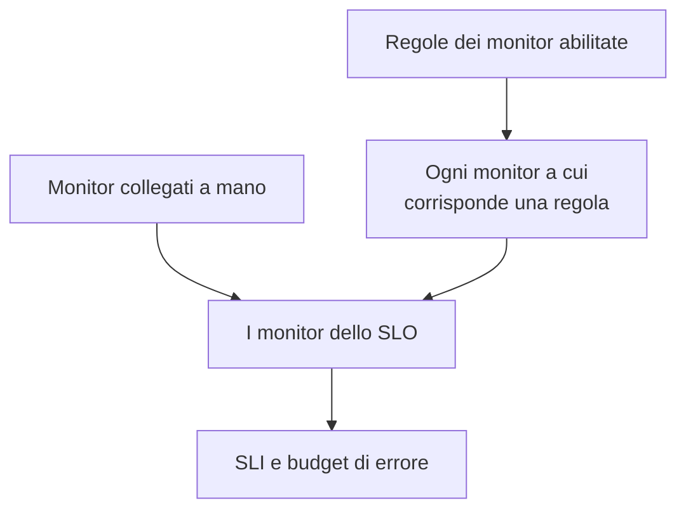

# Monitor e regole dei monitor

Uno SLO misura la disponibilità dei monitor collegati. Collegali a mano, lascia che le regole dei monitor colleghino ogni monitor che corrisponde, oppure fai entrambe le cose. Questa pagina tratta le pagine **Monitor** e **Monitor Rules** di uno SLO, entrambe in **Configurazione** nel suo menu laterale.

:::cards
- [Scegliere i monitor a mano](#collegare-i-monitor-a-mano): Ideale per un insieme piccolo e fisso.
- [Collegare i monitor con una regola](#collegare-i-monitor-con-una-regola): «Ogni monitor etichettato Production», tenuto aggiornato per te.
- [Criteri di corrispondenza](#criteri-di-corrispondenza): I campi e gli operatori su cui può basarsi una regola.
:::

## Quali monitor misura uno SLO

Uno SLO misura l'unione dei monitor che hai collegato a mano e di ogni monitor a cui corrisponde almeno una delle sue regole dei monitor abilitate.

Un nuovo SLO non ha monitor, perché il modulo di creazione non li chiede. Finché non ne ha uno non può essere valutato: le sue pagine mostrano **No monitors attached**, e la sua **Panoramica** offre entrambi i modi per collegare i monitor.

## Collegare i monitor a mano

Ti serve il permesso di modificare lo SLO.

:::steps
### Aprire la pagina Monitor

Apri lo SLO e vai a **Monitor**.

### Scegliere i monitor

Fai clic su **Add Monitors** e scegli i monitor del progetto. Sono elencati solo i monitor non ancora collegati.

### Salvare l'elenco

Fai clic su **Add Monitors**. I monitor compaiono nell'elenco con l'origine **Manual** e contano per lo SLI dalla valutazione successiva.
:::

Per togliere un monitor dallo SLO, fai clic su **Rimuovi** nella sua riga. Il monitor in sé non cambia; smette solo di contare per lo SLI e il budget di errore dello SLO.

La pagina **Monitor** mostra, per ogni monitor:

| Colonna | Cosa mostra |
| --- | --- |
| **Stato attuale** | Lo stato attuale del monitor, oppure **Archiviato**, **Disabilitato**, **Sonde non abilitate**, **Sonde disconnesse** o **Sconosciuto** quando non viene controllato o non ha ancora segnalato nulla. |
| **Origine** | **Rule** se l'ha collegato una delle regole dei monitor dello SLO, **Manual** se qualcuno l'ha collegato a mano. |
| **Etichette** | Le etichette del monitor. |

## Collegare i monitor con una regola

Una regola dei monitor descrive i monitor che uno SLO deve misurare, come «ogni monitor etichettato Production» o «ogni monitor il cui nome inizia con api-». Ogni monitor che corrisponde viene collegato, ora e ogni volta che si creano o cambiano dei monitor, così nessuno deve ricordarsi del monitor che qualcuno aggiungerà il mese prossimo.

:::steps
### Aprire Monitor Rules

Apri lo SLO, vai a **Monitor Rules** e fai clic su **Crea: SLO Monitor Rule**.

### Dare un nome alla regola

In **Informazioni di base**, inserisci un **Nome** e, se vuoi, una **Descrizione** del perché questi monitor appartengono a questo SLO.

### Scegliere a cosa corrisponde

In **Criteri di corrispondenza**, fai clic su **Aggiungi condizione**, scegli un campo e un operatore, e inserisci o scegli il valore. Con due o più condizioni, scegli **Soddisfa tutte** o **Soddisfa almeno una**. Una regola dei monitor ha bisogno di almeno una condizione.

### Salvare la regola

Fai clic su **Crea: SLO Monitor Rule**. La regola parte abilitata e i monitor dello SLO vengono rivalutati subito: ogni monitor che corrisponde viene collegato con l'origine **Rule**.
:::

La tabella delle regole mostra per ogni regola il nome, i criteri di corrispondenza a parole e se è abilitata. Per mettere in pausa una regola, disattiva **Abilitato** nel suo modulo di modifica. **View Monitors** apre la pagina **Monitor** dello SLO.

### Criteri di corrispondenza

Ogni condizione confronta un campo di un monitor:

| Campo | Confrontato con | Operatori |
| --- | --- | --- |
| **Etichette del monitor** | Le etichette del monitor. | **Ha uno qualsiasi di**, **Ha tutti i**, **Non ha nessuno di** |
| **Tipo di monitor** | Il tipo del monitor, scelto dall'elenco dei tipi. | **Uguale a**, **Diverso da** |
| **Nome del monitor** | Il nome del monitor. | **Contiene**, **Non contiene**, **Uguale a**, **Diverso da**, **Inizia con**, **Termina con**, **Corrisponde al pattern**, **Non corrisponde al pattern** |
| **Descrizione del monitor** | La descrizione del monitor. | Gli stessi di **Nome del monitor** |

Un pattern è un'espressione regolare, come `^api-.*`, oppure un carattere jolly `*`, come `*checkout*`, e non distingue maiuscole e minuscole. Un pattern che non è né l'uno né l'altro, come `api-(01`, viene rifiutato al salvataggio invece di non corrispondere a nulla in silenzio. Per collegare ogni monitor del progetto, aggiungi una condizione su **Nome del monitor** che corrisponde al pattern `.*`.

| Vuoi | Condizioni |
| --- | --- |
| Ogni monitor di produzione | **Etichette del monitor** ha uno qualsiasi di _Production_ |
| Ogni monitor di API | **Tipo di monitor** uguale a _API_ |
| Ogni monitor tranne quelli manuali | **Tipo di monitor** diverso da _Manual_ |
| Ogni monitor il cui nome inizia con api- | **Nome del monitor** corrisponde al pattern `^api-` |
| I monitor di checkout, ma non quelli di staging | **Soddisfa tutte**: **Nome del monitor** corrisponde al pattern `*checkout*`, e **Etichette del monitor** non ha nessuno di _Staging_ |

### Quando vengono eseguite le regole

- Quando crei, modifichi, attivi, disattivi o elimini una regola, i monitor dello SLO vengono rivalutati subito.
- Quando si crea un monitor, o cambiano le sue etichette, il suo nome o la sua descrizione, ogni regola dei monitor del progetto lo controlla, comprese le etichette che gli danno le tue regole delle etichette dei monitor.
- Quando si elimina un'etichetta, gli SLO le cui regole la usavano vengono rivalutati.
- Le regole tengono aggiornato l'elenco dei monitor di uno SLO anche mentre lo SLO è disattivato o archiviato, così riprende con i monitor giusti.

Le regole si risincronizzano a ogni salvataggio, quindi **Run Now** serve a recuperare ciò che è sfuggito allo SLO. Si trova in ogni riga, nella pagina della regola (**Visualizza**) e nelle azioni di massa della tabella. Eseguire una regola rivaluta insieme tutte le regole dei monitor abilitate dello SLO, e poi la finestra di dialogo dice quanti monitor sono stati collegati e scollegati. Eseguire una regola richiede il permesso di modificare le regole dei monitor degli SLO. Vedi [Eseguire le regole sulle risorse esistenti](/docs/configuration/run-rules-now).

### Quali monitor appartengono a una regola

- Un monitor resta collegato finché una regola abilitata gli corrisponde, e viene scollegato appena nessuna lo fa più.
- Disattivare o eliminare una regola scollega solo i monitor a cui nessun'altra regola abilitata corrisponde ancora.
- Le regole scollegano solo i monitor collegati da una regola. Un monitor collegato a mano non viene mai preso da una regola che gli corrisponde per caso, né scollegato quando smette di corrispondere. La sua origine resta **Manual**.

## Scegliere a mano mentre le regole sono attive

Finché almeno una regola è abilitata, sono le regole a gestire i monitor dello SLO:

- non si possono aggiungere monitor a mano: **Add Monitors** è disattivato, e un banner dice **This SLO's monitors are managed by its monitor rules**, con un link **Manage Monitor Rules**;
- i monitor collegati da una regola non si possono togliere a mano, perché la regola li ricollegherebbe: il loro pulsante **Rimuovi** è bloccato e il suo suggerimento spiega perché;
- i monitor collegati a mano prima che le regole fossero attivate si possono ancora togliere.

Questo vale anche per l'API. Disattiva tutte le regole per tornare a scegliere i monitor tu stesso.

## Gli SLO per cui conta un monitor

La pagina di un monitor elenca gli SLO che lo misurano: apri il monitor e vai a **SLOs** nel suo menu laterale. Controllala prima di mettere in pausa o cambiare un monitor, per vedere quali obiettivi dipendono da lui. Gli SLO archiviati non compaiono, perché non vengono valutati.

## Se arrivi da Auto-Add Monitors With Labels

Le versioni precedenti avevano un'impostazione **Auto-Add Monitors With Labels** nel modulo dello SLO. Con l'aggiornamento, ogni SLO che la usava riceve una regola dei monitor abilitata chiamata **Auto-add monitors with labels** che corrisponde alle stesse etichette, così continua a misurare esattamente gli stessi monitor. Il campo `monitorLabels` dell'API degli SLO è deprecato: usa invece le regole dei monitor degli SLO.

:::details E se qualcosa salva ancora la vecchia impostazione?
Una scheda della dashboard aperta prima dell'aggiornamento, oppure un client API o un workflow scritto per la versione precedente, può ancora salvare la vecchia impostazione. Perché uno SLO non perda monitor in silenzio in questo modo:

- **Uno SLO senza regole dei monitor** trasforma le etichette salvate in una regola **Auto-add monitors with labels**, e i suoi monitor vengono rivalutati subito. Salvare un elenco vuoto scollega i monitor collegati dall'impostazione, come prima.
- **Uno SLO che ha regole dei monitor**, attive o no, ignora le etichette salvate tramite la vecchia impostazione, perché sono le sue regole a decidere cosa misura.
- **Creare la prima regola dei monitor** di uno SLO i cui monitor erano stati collegati dalla vecchia impostazione converte prima l'impostazione in una regola, così la nuova regola si aggiunge accanto invece di sostituirla.

Una regola convertita che elimini resta eliminata, a meno che i suoi monitor siano ancora collegati dopo, per esempio perché un server che esegue ancora la versione precedente li ha ricollegati durante l'aggiornamento: la modifica di monitor successiva o la nuova regola successiva converte di nuovo le etichette. Elimina di nuovo quella regola quando l'aggiornamento è finito.
:::

## Cronologia

Ogni collegamento e scollegamento, e ogni regola creata, modificata o eliminata, compare nel **Feed** dello SLO. Le modifiche alle regole vengono registrate anche nei suoi **Registri di audit**. Vedi [Feed e registri di audit degli SLO](/docs/slo/feed-and-audit-logs).

## Risoluzione dei problemi

:::details Add Monitors è disattivato
Almeno una delle regole dei monitor dello SLO è abilitata, quindi sono le regole a gestire i suoi monitor. Cambia le regole, oppure disattivale tutte per scegliere i monitor a mano.
:::

:::details Il pulsante Rimuovi di un monitor è bloccato
Una regola dei monitor ha collegato quel monitor e lo ricollegherebbe. Cambia o disattiva la regola che gli corrisponde.
:::

:::details Un monitor a cui una regola dovrebbe corrispondere non è collegato
Controlla che la regola sia abilitata e che ogni condizione sia soddisfatta con **Soddisfa tutte**. Contano anche le etichette che aggiunge una regola delle etichette dei monitor. Fai clic su **Run Now** sulla regola per risincronizzare lo SLO.
:::

:::details Il salvataggio di una regola fallisce con un errore di pattern
Il valore non è né un'espressione regolare né un carattere jolly `*`, per esempio per una parentesi non chiusa. Correggi il pattern, oppure usa **Contiene**.
:::

## Passi successivi

:::cards
- [Panoramica degli SLO](/docs/slo/introduction): Come si combina l'inattività di più monitor.
- [Budget di errore](/docs/slo/error-budget): Cosa consuma l'inattività dei monitor.
- [Eseguire le regole sulle risorse esistenti](/docs/configuration/run-rules-now): Come funziona Run Now per ogni tipo di regola.
:::
