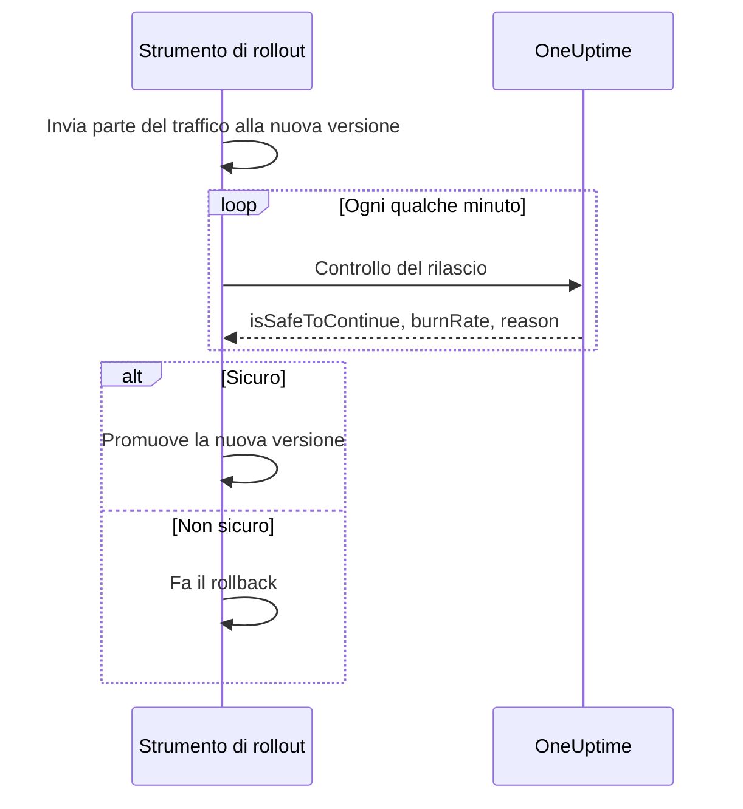

# Controlli dei rilasci

Un controllo del rilascio chiede a uno SLO «è sicuro continuare a distribuire questo rilascio?» mentre il rilascio è in corso, e risponde in base a quanto in fretta lo SLO ha consumato il suo budget di errore negli ultimi minuti. Argo Rollouts, Flagger o una pipeline di distribuzione lo interrogano mentre una versione canary riceve traffico, e fanno il rollback del rilascio quando la risposta è no. OneUptime non distribuisce niente da solo: il tuo strumento di rollout continua a gestire il rollout, e OneUptime gli dice come sta andando il rilascio.

:::cards
- [Interrogare il controllo](#interrogare-il-controllo): Una richiesta con una chiave API, e cosa risponde.
- [Argo Rollouts](#argo-rollouts): Un'analisi che interrompe il rollout.
- [Flagger](#flagger): Un webhook che ferma il canary.
- [GitHub Actions](#github-actions): Un passo che fa il rollback dopo una distribuzione.
:::

## Come funziona

Il [gate delle distribuzioni](/docs/slo/error-budget-policy#gate-delle-distribuzioni) risponde prima di un rilascio, in base al budget di errore dell'intera finestra di conformità. Un rilascio che rompe qualcosa, nei suoi primi dieci minuti, ha speso quasi niente del budget di un mese, quindi il controllo del rilascio legge ciò che il rilascio cambia: il tasso di consumo degli ultimi minuti.



Il controllo risponde con uno di tre verdetti:

| Verdetto | Quando | `isSafeToContinue` |
| --- | --- | --- |
| `Pass` | La finestra ha consumato il budget di errore a `maxBurnRate` o più lentamente. | `true` |
| `Fail` | L'ha consumato più in fretta, oppure la policy del budget di errore dello SLO congela le distribuzioni. | `false` |
| `NotEnoughData` | La finestra aveva meno richieste di `minimumRequestCount`, oppure i monitor dello SLO non vi hanno registrato alcuno stato. Troppo poco per dire che il rilascio è sicuro. | `false` |

Con un tasso di consumo di 1 la finestra ha rispettato esattamente l'obiettivo dello SLO, quindi il `maxBurnRate` predefinito di `1` boccia un rilascio che fa peggio dell'obiettivo.

Cosa legge il controllo dipende da cosa misura lo SLO:

- Uno [SLO di richieste](/docs/slo/request-slos) viene giudicato dalle richieste dei suoi servizi nella finestra, lette dai loro span man mano che arrivano. Aggiungi `serviceVersion` per giudicare solo le richieste della nuova versione: OneUptime lo confronta con l'attributo di risorsa `service.version` degli span, che un SDK di OpenTelemetry imposta a partire da `OTEL_RESOURCE_ATTRIBUTES=service.version=1.4.2`. Così il canary viene giudicato sulle proprie richieste, senza che quelle della vecchia versione lo diluiscano.
- Uno [SLO di metrica](/docs/slo/request-slos#slo-basati-su-una-metrica) viene giudicato dagli eventi della sua metrica nella finestra, contati come li conta il suo SLI, quindi `minimumRequestCount`, `goodRequestCount` e `totalRequestCount` sono eventi. Con `serviceVersion` contano solo i punti della metrica il cui attributo di risorsa `service.version` ha quel valore: un SDK di OpenTelemetry lo imposta sulle sue metriche come sui suoi span.
- Uno SLO di disponibilità dei monitor viene giudicato dalle cronologie di stato dei suoi monitor nella finestra. `minimumRequestCount` non vale per questi SLO, e un controllo con `serviceVersion` viene rifiutato: i monitor non hanno versioni.

## Prima di iniziare

Ti serve uno SLO che misuri ciò su cui il rilascio incide. Uno SLO di richieste del servizio che rilasci è quello che giudica meglio un canary, perché legge le richieste di quel servizio.

## Configurare un controllo del rilascio

:::steps
### Dare una chiave al rollout

Crea una [chiave API](/docs/api-reference/api-reference) del progetto il cui ruolo possa leggere gli SLO, e salvala come segreto del tuo strumento di rollout o della tua pipeline.

### Copiare l'ID dello SLO

Apri lo SLO e copia il suo ID dall'indirizzo: `/slos/<slo-id>`.

### Interrogare il controllo una volta a mano

Esegui la richiesta di [Interrogare il controllo](#interrogare-il-controllo) con la chiave e l'ID. Risponde con `isSafeToContinue` e un `reason`.

### Aggiungerlo al tuo rollout

Interroga il controllo da [Argo Rollouts](#argo-rollouts), [Flagger](#flagger) o [GitHub Actions](#github-actions), e fai il rollback quando `isSafeToContinue` è `false`.
:::

## Interrogare il controllo

Il controllo è una richiesta `GET` o `POST` all'indirizzo `release-check` dello SLO. Invia le opzioni nella query string, oppure come corpo JSON con `POST`:

```bash
curl -sS "https://oneuptime.com/api/service-level-objective/<slo-id>/release-check?windowInMinutes=10&serviceVersion=1.4.2" \
  -H "ApiKey: $ONEUPTIME_API_KEY"
```

Risponde prima con il verdetto, poi con i dati da cui l'ha ricavato:

```json
{
  "isSafeToContinue": false,
  "verdict": "Fail",
  "reason": "The last 10 minutes burned the error budget at 3.2x, faster than the 1x this check allows (SLI 99.68% against the 99.9% target).",
  "sloId": "<slo-id>",
  "sloName": "Checkout requests",
  "sliType": "Request Success",
  "targetPercentage": 99.9,
  "windowInMinutes": 10,
  "maxBurnRate": 1,
  "burnRate": 3.2,
  "sliPercentage": 99.68,
  "deploymentsAllowed": true,
  "errorBudgetPolicyTier": null,
  "sloStatus": "Healthy",
  "checkedAt": "2026-11-15T12:00:00.000Z",
  "goodRequestCount": 2492,
  "totalRequestCount": 2500,
  "minimumRequestCount": 1,
  "serviceVersion": "1.4.2"
}
```

Le opzioni:

| Opzione | Predefinito | Cosa fa |
| --- | --- | --- |
| `windowInMinutes` | `10` | Quanto indietro guarda il controllo, in minuti interi da 1 a 360. |
| `maxBurnRate` | `1` | Il tasso di consumo più alto che passa. `2` consente alla finestra di consumare il budget due volte più in fretta di quanto l'obiettivo consenta. |
| `minimumRequestCount` | `1` | SLO di richieste: il numero minimo di richieste che il controllo giudica. Con `0`, una finestra senza richieste passa. |
| `serviceVersion` | Nessuno | SLO di richieste: giudica solo le richieste i cui span portano questo `service.version`. |
| `includeDeploymentGate` | `true` | Fallisce finché la policy del budget di errore dello SLO congela le distribuzioni. Con `false`, decide solo il tasso di consumo. |
| `failWithStatusCode` | `false` | Risponde a un no con lo stato HTTP 412 invece di 200, per gli strumenti che leggono solo il codice di stato. |

I campi della risposta:

| Campo | Cosa contiene |
| --- | --- |
| `isSafeToContinue` | `true` per proseguire con il rollout, `false` per farne il rollback. |
| `verdict` | `Pass`, `Fail` o `NotEnoughData`. |
| `reason` | Una frase per il log del rollout, che dice cosa è stato misurato e perché il controllo ha risposto così. |
| `burnRate` e `sliPercentage` | Quanto in fretta la finestra ha consumato il budget di errore, e lo SLI sulla finestra. |
| `goodRequestCount` e `totalRequestCount` | SLO di richieste: le richieste contenute nella finestra, e quante di esse erano buone. |
| `deploymentsAllowed` e `errorBudgetPolicyTier` | Se la policy del budget di errore dello SLO consente le distribuzioni, e il livello in cui si trova lo SLO. |
| `checkedAt` | Quando è stata fatta la misura del controllo. |

A uno SLO che non si può misurare (uno SLO di richieste senza servizi, uno SLO di latenza senza soglia, uno SLO di metrica senza una metrica che possa contare, uno SLO di disponibilità dei monitor senza monitor) si risponde con HTTP 400 e con ciò che va corretto, così un rollout si ferma su un errore chiaro invece che su un'ipotesi. Su un'installazione self-hosted, usa il suo indirizzo invece di oneuptime.com.

## Argo Rollouts

Un'analisi con una metrica `web` interroga il controllo a ogni passo di un canary, e quando il controllo fallisce Argo Rollouts interrompe il rollout e riduce le repliche del canary. Prima salva la chiave API come segreto:

```bash
kubectl create secret generic oneuptime --from-literal=api-key="$ONEUPTIME_API_KEY"
```

Poi aggiungi il template ed eseguilo dopo il primo passo del canary:

:::tabs
@tab AnalysisTemplate
```yaml title="oneuptime-release-check.yaml"
apiVersion: argoproj.io/v1alpha1
kind: AnalysisTemplate
metadata:
  name: oneuptime-release-check
spec:
  args:
    - name: version
    - name: api-key
      valueFrom:
        secretKeyRef:
          name: oneuptime
          key: api-key
  metrics:
    - name: slo-burn-rate
      interval: 2m
      count: 5
      failureLimit: 0
      successCondition: result == true
      provider:
        web:
          url: "https://oneuptime.com/api/service-level-objective/<slo-id>/release-check?windowInMinutes=10&serviceVersion={{args.version}}"
          headers:
            - key: ApiKey
              value: "{{args.api-key}}"
          jsonPath: "{$.isSafeToContinue}"
```
@tab Rollout
```yaml title="rollout.yaml"
apiVersion: argoproj.io/v1alpha1
kind: Rollout
metadata:
  name: checkout
spec:
  strategy:
    canary:
      steps:
        - setWeight: 10
        - analysis:
            templates:
              - templateName: oneuptime-release-check
            args:
              - name: version
                value: "1.4.2"
        - setWeight: 50
        - pause: { duration: 10m }
```
:::

L'analisi interroga il controllo cinque volte, a due minuti di distanza, e il primo no interrompe il rollout. Passa la stessa versione che i pod del canary impostano in `OTEL_RESOURCE_ATTRIBUTES`. Se il canary potrebbe non ricevere traffico al suo primo peso, aggiungi `&minimumRequestCount=0` all'indirizzo, altrimenti un canary senza traffico fa fallire l'analisi con `NotEnoughData`.

## Flagger

Flagger chiama un webhook `rollout` a ogni passo della sua analisi, e ferma il canary e ne fa il rollback quando il webhook continua a fallire. I webhook di Flagger non inviano intestazioni, quindi interroga il controllo attraverso il load tester di Flagger, che esegue un comando per il webhook:

```yaml title="canary.yaml"
apiVersion: flagger.app/v1beta1
kind: Canary
metadata:
  name: checkout
spec:
  analysis:
    interval: 1m
    threshold: 2
    maxWeight: 50
    stepWeight: 10
    webhooks:
      - name: oneuptime-release-check
        type: rollout
        url: http://flagger-loadtester.test/
        timeout: 30s
        metadata:
          type: bash
          cmd: "curl -sSf -H \"ApiKey: $ONEUPTIME_API_KEY\" 'https://oneuptime.com/api/service-level-objective/<slo-id>/release-check?windowInMinutes=5&failWithStatusCode=true'"
```

Con `failWithStatusCode=true`, un no è HTTP 412, quindi `curl -f` esce con un errore e il webhook fallisce. Passa la chiave al load tester come `ONEUPTIME_API_KEY` nel suo ambiente, da un secret di Kubernetes. Quando sono falliti `threshold` controlli, Flagger fa il rollback del canary.

## GitHub Actions

Una pipeline che distribuisce tutto in una volta può comunque tenere d'occhio il rilascio: distribuisci, interroga il controllo qualche volta, e fai il rollback quando risponde no.

```yaml title=".github/workflows/deploy.yml"
name: Deploy
on:
  push:
    branches: [main]

jobs:
  deploy:
    runs-on: ubuntu-latest
    steps:
      - uses: actions/checkout@v4
      - name: Deploy
        run: ./deploy.sh
      - name: Watch the release against the SLO
        env:
          ONEUPTIME_API_KEY: ${{ secrets.ONEUPTIME_API_KEY }}
          SLO_ID: <slo-id>
          VERSION: ${{ github.sha }}
        run: |
          for attempt in 1 2 3 4 5; do
            sleep 120
            CHECK=$(curl -sS "https://oneuptime.com/api/service-level-objective/$SLO_ID/release-check?windowInMinutes=10&serviceVersion=$VERSION" \
              -H "ApiKey: $ONEUPTIME_API_KEY")
            echo "$CHECK" | jq -r '.reason'
            if [ "$(echo "$CHECK" | jq -r '.isSafeToContinue')" != "true" ]; then
              exit 1
            fi
          done
      - name: Roll back
        if: failure()
        run: ./rollback.sh
```

Il passo fallisce a un no, e a qualsiasi risposta senza `isSafeToContinue: true` (un ID sbagliato, una chiave che non può leggere lo SLO, nessuna risposta), quindi la pipeline non prosegue mai sulla base di una risposta che non ha ricevuto. Imposta `service.version` al commit (`${{ github.sha }}`) all'avvio del servizio, così il controllo giudica solo la nuova versione.

## Passi successivi

:::cards
- [SLO di richieste e latenza](/docs/slo/request-slos): Misura le richieste di un servizio, lo SLI che giudica meglio un canary.
- [Policy del budget di errore](/docs/slo/error-budget-policy): Congela le distribuzioni finché il budget è basso.
- [Avvisi e incidenti di tasso di consumo](/docs/slo/burn-rate-alerts): Avvisa il tuo team quando il budget si consuma troppo in fretta.
:::
