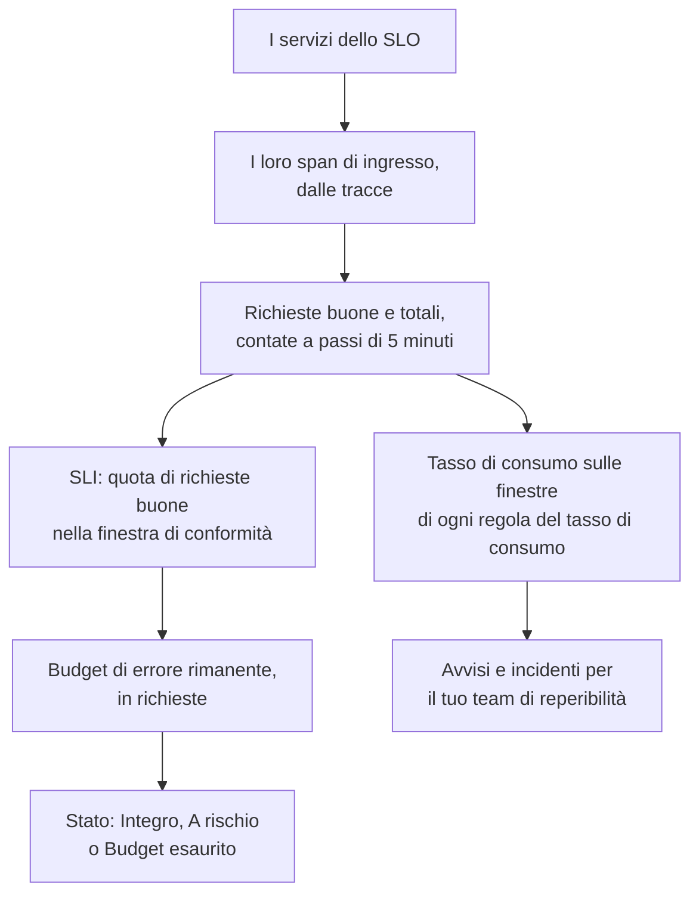

# SLO di richieste e latenza

Uno SLO di richieste misura ciò che i tuoi utenti ottengono da un servizio: la quota delle sue richieste che vanno a buon fine, o che vengono servite abbastanza in fretta. OneUptime le conta dalle tracce che i tuoi servizi inviano già, quindi non c'è nessun monitor da configurare: scegli i servizi e un obiettivo, e OneUptime li misura ogni 5 minuti.

:::cards
- [Creare uno SLO di richieste](#creare-uno-slo-di-richieste): I servizi, una soglia per la latenza e un obiettivo.
- [Come si contano le richieste](#come-si-contano-le-richieste): Quali span contano, e quando.
- [Controlli dei rilasci](/docs/slo/release-checks): Fai il rollback di un rilascio che consuma il budget di errore.
:::

## Successo e latenza delle richieste

| Cosa misura | Una richiesta è cattiva quando | Il suo budget di errore conta |
| --- | --- | --- |
| **Successo delle richieste** | Lo stato del suo span è `Error`. Uno span senza stato conta come buono, nel senso che gli dà OpenTelemetry. | Le richieste fallite |
| **Latenza delle richieste** | Ha impiegato più della **Soglia di latenza (ms)** dello SLO, qualunque sia il suo stato. | Le richieste lente |

Lo SLI è la quota di richieste buone nella finestra di conformità, e il budget di errore sono le richieste cattive che l'obiettivo consente: al 99,9%, una ogni 1.000. Uno SLO di latenza conta come buona una richiesta che è fallita in fretta, quindi misura un servizio importante in entrambi i modi: uno SLO per dire che funziona, e uno per dire che è veloce.

## Come funziona

Una richiesta è uno span di ingresso di uno dei servizi dello SLO: lo span in cui una richiesta o un messaggio entra nel servizio, cioè quelli che l'elenco delle [Tracce](/docs/telemetry/traces-explorer#tracce-e-span) mostra per impostazione predefinita. Una richiesta che passa per due dei servizi dello SLO conta una volta in ciascuno.

Per il resto uno SLO di richieste funziona come qualsiasi altro. Il suo stato, le regole del tasso di consumo, la policy del budget di errore, i proprietari e le notifiche sono gli stessi, con il budget di errore espresso in richieste invece che in minuti.

## Prima di iniziare

- I servizi inviano tracce a OneUptime: vedi [OpenTelemetry](/docs/telemetry/open-telemetry). Ognuno compare nel [catalogo servizi](/docs/telemetry/services) con il suo `service.name`.
- Un ruolo che possa creare SLO: Project Owner, Project Admin o un ruolo personalizzato con il permesso Create Service Level Objective.

## Creare uno SLO di richieste

:::steps
### Aprire gli SLO

Apri **SLOs** dal menu **Prodotti** nella barra in alto e fai clic su **Crea: Service Level Objective**.

### Scegliere cosa misura

In **Cosa misura**, scegli **Successo delle richieste** o **Latenza delle richieste**, poi i **Servizi** di cui contare le richieste. Per **Latenza delle richieste**, imposta anche la **Soglia di latenza (ms)**: una richiesta servita entro questo tempo conta come abbastanza veloce, per esempio `300`. Fai clic su **Avanti**.

### Dargli un nome e fissare un obiettivo

Inserisci un **Nome**, per esempio «Checkout requests», e un **Obiettivo (%)**: la quota di richieste che devono essere buone. Fai clic su **Crea: Service Level Objective**.

### Vedere arrivare i primi numeri

La prima valutazione, entro 5 minuti, conta le richieste delle ultime 6 ore, così lo SLO ha subito dei numeri. Le valutazioni successive contano anche le richieste più vecchie, finché la finestra di conformità non è coperta.
:::

Per cambiare in seguito cosa misura uno SLO, i suoi servizi o la sua soglia, apri le sue **Impostazioni** e fai clic su **Modifica cosa misura**.

## Come si contano le richieste

OneUptime conta le richieste buone e totali di ogni SLO a passi di 5 minuti e conserva i conteggi, così lo SLO legge la sua finestra dai propri conteggi invece di rileggere ogni volta tutti gli span:

- Un passo viene contato 2 minuti dopo la sua fine, così include gli span arrivati in ritardo, e la valutazione successiva conta di nuovo gli ultimi due passi per gli span che arrivano ancora più tardi.
- Un nuovo SLO parte dalle ultime 6 ore. Ogni valutazione successiva conta fino a un giorno di richieste più vecchie, a partire dalle più recenti, finché la finestra non è coperta.
- Si possono contare solo le richieste ancora entro la [conservazione della telemetria](/docs/telemetry/data-retention#per-quanto-tempo-viene-conservata-la-telemetria). I passi contati vengono conservati per 400 giorni, più di qualsiasi finestra di conformità, quindi una finestra più lunga della conservazione si riempie man mano che lo SLO invecchia.
- Cambiare cosa misura lo SLO, i suoi servizi o la sua soglia di latenza fa ricontare le sue richieste dall'inizio. Una finestra di conformità più lunga si riempie contando più indietro nel tempo.

Finché i conteggi coprono solo una parte della finestra di conformità, la **Panoramica** lo dice con un indicatore **Finestra piena al 23%**, e il riquadro **Budget di errore rimasto** lo ripete sotto il suo numero. Entrambi spariscono quando i conteggi coprono tutta la finestra.

## Il budget di errore in richieste

Il budget sono le richieste cattive che l'obiettivo consente tra quelle contate nella finestra, quindi cresce con il traffico: al 99,9%, una finestra di 2.000.000 di richieste ne consente 2.000 fallite. Nella **Panoramica**:

- **Budget di errore rimasto** dice quante richieste cattive restano e su quante, oppure di quante richieste lo SLO ha superato il budget.
- **Autonomia del budget** dice quanto dura il budget al tasso di consumo attuale, purché il traffico resti com'era.
- Il riepilogo conta i servizi dello SLO, e uno SLO di latenza indica la sua soglia sotto l'obiettivo.

Anche gli avvisi di tasso di consumo, le notifiche e il feed esprimono il budget in richieste. La metrica `oneuptime.slo.error.budget.remaining.seconds` non viene inviata per uno SLO di richieste: usa invece `oneuptime.slo.error.budget.remaining.percent` nei grafici.

Uno SLO di richieste riceve le stesse regole **Fast burn**, **Slow burn** e **Slow leak** di ogni nuovo SLO. In un'ora tranquilla con una manciata di richieste basta un solo errore per consumare in fretta, quindi una regola può ignorare le finestre con troppo poche richieste: imposta il `minimumSampleCount` della regola tramite l'API, e la regola salta una finestra lunga che ha meno richieste di quel numero.

## Risoluzione dei problemi

:::details Lo SLO mostra Waiting for requests
Nessuno dei suoi servizi ha ancora servito una richiesta nella finestra. Controlla che i servizi inviino tracce a OneUptime e che i loro span includano span di ingresso: un servizio i cui span sono tutti interni non ha richieste da contare.
:::

:::details Lo SLI è cambiato dopo che ho cambiato i servizi
Cambiare cosa misura lo SLO, i suoi servizi o la sua soglia di latenza fa ricontare le sue richieste, a partire dalle ultime 6 ore, quindi lo SLI e il budget ripartono da lì. L'indicatore **Finestra piena al 23%** mostra quanta parte della finestra è stata contata finora.
:::

## Passi successivi

:::cards
- [Controlli dei rilasci](/docs/slo/release-checks): Lascia che Argo Rollouts, Flagger o una pipeline facciano il rollback di un rilascio che consuma il budget.
- [Avvisi e incidenti di tasso di consumo](/docs/slo/burn-rate-alerts): Avvisa il tuo team quando il budget si consuma troppo in fretta.
- [Policy del budget di errore](/docs/slo/error-budget-policy): Concorda cosa fa il team mentre il budget si esaurisce.
:::
