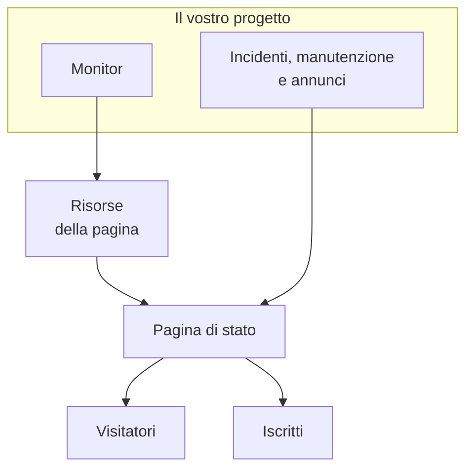

# Panoramica delle pagine di stato

Una pagina di stato è il volto pubblico di tutto ciò che monitorate: un unico URL che i vostri clienti possono aprire invece di scrivervi per chiedere se il problema è solo loro. Mostra lo stato attuale dei servizi che scegliete di esporre, gli incidenti su cui state lavorando, la manutenzione che avete pianificato e qualsiasi annuncio vogliate fissare in cima.

Quando qualcosa si rompe alle 2 di notte, la pagina di stato è la prima cosa a cui rimanda la vostra coda di supporto. È anche da lì che vengono notificati i vostri iscritti, quindi conviene configurarla prima di averne bisogno, non nel mezzo del disservizio.

:::cards
- [Creare una pagina di stato](#creare-una-pagina-di-stato): Due campi per iniziare, tutto il resto dopo.
- [Scegliere che cosa mostra](#scegliere-che-cosa-compare-sulla-pagina): Incidenti, episodi, annunci, manutenzione e uptime, in un'unica scheda.
- [Decidere chi può vederla](#limitare-chi-può-vedere-la-pagina): Chiunque abbia il link, solo chi accede o chiunque abbia la password.
- [Archiviare una pagina di stato](#archiviare-una-pagina-di-stato): Mettere offline una pagina senza eliminarla.
:::

## Come funziona

Le pagine di stato si trovano in **Pagine di stato**, nel menu **Prodotti** della barra superiore, tra gli elementi essenziali. Tutto ciò che è in questa pagina vale per singola pagina di stato: un progetto può averne quante ne vuole — una pubblica per i clienti, una privata per un pubblico interno, una per regione per un mercato specifico.

La pagina mostra come risorse i monitor che vi inserite. Gli incidenti e la manutenzione programmata vi arrivano attraverso quei monitor, mentre gli annunci vi vengono pubblicati direttamente. I visitatori leggono la pagina, e gli iscritti ricevono notizia di ogni cambiamento sui canali che hanno scelto.

## In sintesi

- **Si crea con due campi.** Una nuova pagina di stato chiede solo **Nome** e **Descrizione**. Risorse, branding e domini si configurano dopo.
- **Le risorse sono ciò che vedono i visitatori.** Ogni riga della pagina è una **Pagina di stato Risorsa**: un monitor (o gruppo di monitor) con un proprio nome visualizzato, un tooltip e opzioni di uptime. I gruppi dividono una pagina lunga in sezioni e si possono annidare.
- **Un URL di anteprima fin dal primo giorno.** Ogni pagina di stato riceve un link di anteprima, così potete vederla prima che esista un dominio personalizzato.
- **I percorsi per i visitatori dipendono dalle impostazioni.** Incidenti, episodi, annunci ed eventi pianificati compaiono solo finché il loro interruttore in **Cosa mostra la tua pagina di stato** (in **Impostazioni avanzate**) è attivo, e la pagina di iscrizione solo finché lo è **Mostra pagina iscritti**.
- **Chi può vederla è una sola scelta.** Chiunque abbia il link, solo chi accede (utenti privati, SSO SAML o OIDC) o chiunque abbia la password, nella schermata **Accesso** della pagina, con una lista di IP consentiti facoltativa in **Altre impostazioni**.
- **Gli iscritti vengono notificati automaticamente.** Iscritti via email, SMS, Slack, Microsoft Teams e webhook possono seguire una pagina, ogni canale dietro il proprio interruttore.

## Termini chiave

| Termine | Che cosa significa |
| --- | --- |
| **Pagina di stato** | Una pagina pubblica (o privata), con branding, domini, risorse e iscritti propri. Il modello `StatusPage`. |
| **Risorsa** | Una riga che vedono i visitatori: un monitor o un gruppo di monitor mostrato sulla pagina con un nome visualizzato e opzioni di uptime. |
| **Gruppo** | Una sezione con un nome che contiene risorse. I gruppi si annidano dentro altri gruppi, e ogni livello riassume lo stato di tutto ciò che sta sotto. |
| **Annuncio** | Un messaggio che pubblicate su una o più pagine di stato, con un'ora di inizio e un'ora di fine facoltativa. |
| **Iscritto** | Qualcuno (o qualcosa) che segue la pagina via email, SMS, Slack, Microsoft Teams o un webhook. |
| **Dominio personalizzato** | Un vostro dominio, `status.example.com`, che punta alla pagina con un record CNAME. OneUptime ne emette il certificato SSL gratuitamente e lo rinnova. |
| **Utente privato** | Un account che può accedere a una pagina di stato privata. Separato dagli utenti del vostro progetto OneUptime. |

## Creare una pagina di stato

:::steps
### Aprire il modulo di creazione

Aprite **Pagine di stato → Tutte le pagine di stato** e fate clic su **Crea pagina di stato**.

### Dare un nome alla pagina

Nella finestra **Crea: Pagina di stato**, compilate **Nome** (obbligatorio, almeno due caratteri) e, se volete, **Descrizione**, poi fate clic su **Crea pagina di stato**.

Questo è tutto il modulo. L'elenco a cui tornate mostra **Nome**, **Descrizione**, **Etichette** e **Proprietari**, e si può filtrare per **ID della pagina di stato**, **Nome** e **Descrizione**.

### Aprire la nuova pagina

Aprite la nuova pagina e arriverete alla sua schermata **Panoramica**, che ha due schede: **Status Page Preview URL**, con un link alla pagina vera e propria, e **Dettagli della pagina di stato**, dove potete modificare il nome, la descrizione e le etichette appena impostati. Quando il progetto ha campi personalizzati delle pagine di stato, segue una scheda **Campi personalizzati**.
:::

Una pagina creata con l'API o con Terraform è soggetta agli stessi piani delle impostazioni descritte più sotto. Su OneUptime Cloud, creare una pagina con un'impostazione attiva che il vostro piano non include (per esempio privata, un elenco nascosto, HTML, CSS o JavaScript personalizzati, report via email, iscritti via SMS, Slack, Microsoft Teams o webhook, una lista di IP consentiti) viene rifiutato con `402 Payment Required`, e il messaggio indica il piano. Il piano di ogni impostazione è indicato accanto a essa più sotto. Le impostazioni lasciate al valore predefinito, come le lascia questo modulo, funzionano su tutti i piani.

Poi, più o meno in ordine di utilità:

- Aggiungete risorse perché la pagina mostri qualcosa: vedete [Risorse e gruppi della pagina di stato](/docs/status-pages/resources-and-groups).
- Impostate il titolo della pagina, la favicon, il logo e l'immagine di copertina, poi collegate un dominio personalizzato: vedete [Branding e domini della pagina di stato](/docs/status-pages/branding-and-domains).
- Decidete su quali canali ci si può iscrivere: vedete [Iscritti e annunci](/docs/status-pages/subscribers).
- Regolate ciò che compare sulla pagina in **Impostazioni avanzate**.

## Dove si trova ogni cosa

Una volta aperta una pagina di stato, il suo menu laterale sinistro è raggruppato in nove sezioni. Usatelo come mappa per il resto di questa parte della documentazione.

| Sezione | Che cosa contiene |
| --- | --- |
| **Base** | **Panoramica**, **Annunci**, **Proprietari**. |
| **Risorse** | Un'unica schermata **Risorse** (i gruppi a sinistra, i monitor del gruppo selezionato a destra) e **Monitor Rules**. |
| **Iscritti** | **Iscritti email**, **Iscritti SMS**, **Iscritti Slack**, **Iscritti MS Teams**, **Iscritti webhook**, **Impostazioni iscritti**. |
| **Registri di notifica** | **Registri di notifica**: ciò che è stato inviato agli iscritti. |
| **Branding** | **Branding** (logo, titolo, favicon, link, piè di pagina, colori e lingue, in un'unica pagina), **Domini personalizzati**, **HTML, CSS e JavaScript**. |
| **Sicurezza** | **Accesso** (chi può vedere la pagina), **Utenti privati**, **SSO**, **OIDC**, **SCIM**. |
| **IA** | **MCP**. |
| **Sviluppatori** | **Terraform**, **API**, **Assistenti IA**: la pagina come codice. |
| **Avanzato** | **Stato incorporato**, **Report**, **Campi personalizzati**, **Impostazioni avanzate**, **Registri di audit**, **Elimina pagina di stato**. |

Solo **Base** e **Risorse**, ciò che la pagina mostra, partono aperte. Tutte le altre sezioni partono chiuse, come le sezioni poco usate di ogni menu di OneUptime: fate clic sul titolo di una sezione per mostrarne le pagine. Una sezione si apre da sola quando vi trovate su una delle sue pagine, come **Impostazioni avanzate** o **Iscritti email**.

Due particolarità dei nomi da conoscere prima di cercare:

- La voce **Risorse** si chiama **Risorse** solo quando il progetto ha attivato i gruppi di monitor. Altrimenti si chiama **Monitor**. È la stessa schermata in entrambi i casi.
- Non c'è una pagina dei gruppi separata. Gruppi e risorse sono stati uniti, e il vecchio percorso `/groups` ora reindirizza alla schermata delle risorse.

Al di fuori di una singola pagina, la sezione **Pagine di stato** stessa elenca **Tutte le pagine di stato**, e una sezione **Altro** contiene **Annunci**. Una sezione **Impostazioni** chiusa contiene **Modelli di annunci**, **Modelli iscritti**, **Campi personalizzati**, **Regole del proprietario** e **Regole etichette**, che valgono per tutto il progetto e sono condivisi da tutte le pagine di stato. Una sezione **Avanzato** chiusa contiene **Archiviato**: le pagine di stato che avete messo offline (vedete [Archiviare una pagina di stato](#archiviare-una-pagina-di-stato)).

**Regole etichette** e **Regole del proprietario** etichettano le nuove pagine di stato e assegnano loro dei proprietari. Una regola ha due passi (**Corrispondenza**, le condizioni che una pagina di stato deve soddisfare, poi **Etichette** o **Proprietari**, ciò che la regola aggiunge) e il suo **Nome** viene compilato da ciò che scegliete. Una nuova regola deve aggiungere almeno un'etichetta o un proprietario; in modifica non si insiste mai, e l'elenco contrassegna con **Non aggiunge nulla** una vecchia regola che non aggiunge niente. Vedete [Regole per etichette e proprietari](/docs/configuration/label-and-owner-rules).

## Che cosa vedono i visitatori

La pagina pubblica è un'applicazione a sé, con un piccolo insieme di percorsi:

- `/`: la **Panoramica**.
- `/incidents` e `/incidents/:id`: l'elenco degli incidenti e un singolo incidente.
- `/announcements` e `/announcements/:id`.
- `/scheduled-events` e `/scheduled-events/:id`.
- `/subscribe/email`, `/subscribe/sms`, `/subscribe/slack`, `/subscribe/microsoft-teams`, `/subscribe/webhooks`.
- `/confirm-subscription/:id`, `/update-subscription/:id` e `/unsubscribe/:token`: i link dei messaggi che ricevono gli iscritti.
- `/rss`: il feed.
- `/login`, `/sso` e `/master-password`: rilevanti solo su una pagina privata.

La barra di navigazione in alto mostra sempre **Panoramica**; il resto compare solo quando è attivo. **Incidenti**, **Annunci** ed **Eventi pianificati** hanno bisogno ciascuno del proprio interruttore; **Iscriviti** ha bisogno sia di **Mostra pagina iscritti** sia di almeno un canale di iscrizione attivo. Una pagina privata ha anche una voce **Esci**.

Un singolo incidente, episodio, annuncio o evento pianificato si apre solo se la pagina lo elencherebbe, qualunque sia la sua finestra di cronologia: un incidente o un episodio privato, uno nascosto dalle pagine di stato, un evento pianificato nascosto dalle pagine di stato o un annuncio programmato per più avanti non si trova nemmeno tramite il suo link.

### La pagina di panoramica

La panoramica è la pagina che vede la maggior parte dei visitatori. Dall'alto in basso mostra:

1. **Gli annunci in corso**: gli annunci la cui ora di inizio è passata e la cui ora di fine no.
2. **Un banner dello stato generale**: una sola riga che riassume se sono interessate tutte le risorse o solo alcune.
3. **Una percentuale di uptime complessiva**, se l'avete attivata: alla fine del banner dello stato generale, finché tutte le risorse sono operative. Disattivata per impostazione predefinita.
4. **I gruppi di risorse**, ciascuno con le sue risorse, il loro stato attuale e le barre della cronologia di uptime.
5. **Incidenti attivi**, con gli episodi attivi.
6. **Eventi di manutenzione pianificata**.

Una pagina appena creata senza contenuti mostra uno stato vuoto che vi invita ad aggiungere risorse dalla dashboard, il segnale per andare alla schermata **Risorse**.

La panoramica che vede un visitatore ha al massimo 15 secondi, e tutto ciò che togliete dalla pagina ne sparisce in meno di un secondo: un incidente, un episodio o un evento pianificato che nascondete dalle pagine di stato, rendete privato, limitate ad altre pagine o eliminate, un annuncio che terminate, rinviate o eliminate, una nota pubblica che eliminate, e una risorsa, un gruppo o un monitor che togliete dalla pagina o eliminate. Altre modifiche, come un nuovo titolo, compaiono entro quei 15 secondi.

Per sapere che cosa porta un incidente su questa pagina e che cosa lo toglie, vedete [Stati e gravità degli incidenti](/docs/incidents/states-and-severities).

## Scegliere che cosa compare sulla pagina

Ciò che vedono i visitatori si imposta in un'unica scheda: **Cosa mostra la tua pagina di stato**, in **Pagine di stato → la vostra pagina → Avanzato → Impostazioni avanzate**. Ha una riga per ogni elenco che la pagina può mostrare, poi **Cronologia uptime** (con la percentuale di uptime complessiva e gli stati che contano come inattività) e la riga "Powered by OneUptime". Non c'è un pulsante di modifica: un interruttore si salva appena lo cambiate, un numero di giorni quando uscite dalla sua casella o premete Invio, e una scelta da un elenco appena la fate.

- **Mostra incidenti** (`showIncidentsOnStatusPage`): attivo per impostazione predefinita. Sotto, **Mostra … giorni di cronologia** (`showIncidentHistoryInDays`, 14 per impostazione predefinita) indica fin dove arriva l'elenco degli incidenti, e **Mostra etichette degli incidenti** (`showIncidentLabelsOnStatusPage`) è disattivato per impostazione predefinita.
- **Mostra solo gli incidenti limitati a questa pagina** (`onlyShowScopedIncidents`): anch'esso nella riga degli incidenti, disattivato per impostazione predefinita. Attivatelo e la pagina mostra, e notifica ai suoi iscritti, solo gli incidenti limitati a essa con **Limita a queste pagine di stato**. Gli incidenti non limitati ad alcuna pagina, compresi quelli che aprono da soli un monitor, Slack, Microsoft Teams, l'API o l'IA, non vi arrivano mai finché qualcuno non aggiunge loro la pagina. Decide anche quali incidenti portano i loro episodi sulla pagina, per questo resta disponibile quando **Mostra incidenti** è disattivato. Per pagine che condividono monitor ma servono pubblici diversi, vedete [Una pagina di stato per pubblico](/docs/status-pages/one-status-page-per-audience).
- **Mostra episodi** (`showEpisodesOnStatusPage`): attivo per impostazione predefinita, con **Mostra … giorni di cronologia** (`showEpisodeHistoryInDays`, 14 per impostazione predefinita) e **Mostra etichette degli episodi** (`showEpisodeLabelsOnStatusPage`, disattivato per impostazione predefinita). Gli episodi sono un modello a sé con i propri endpoint, non una vista degli incidenti.
- **Mostra annunci** (`showAnnouncementsOnStatusPage`): attivo per impostazione predefinita, con **Mostra … giorni di cronologia** (`showAnnouncementHistoryInDays`, 14 per impostazione predefinita).
- **Mostra eventi di manutenzione programmata** (`showScheduledMaintenanceEventsOnStatusPage`): attivo per impostazione predefinita, con **Mostra … giorni di cronologia** (`showScheduledEventHistoryInDays`, 14 per impostazione predefinita) e **Mostra etichette degli eventi** (`showScheduledEventLabelsOnStatusPage`, disattivato per impostazione predefinita).
- **Cronologia uptime**: tutto ciò che riguarda l'uptime della pagina, in una riga:
  - **Mostra … giorni di cronologia** (`showUptimeHistoryInDays`) è la lunghezza della barra di uptime accanto a ogni risorsa. È 90 per impostazione predefinita e deve essere tra 1 e 90. Tutte le opzioni **Mostra % di uptime** e **Mostra grafico cronologia stato** di una risorsa o di un gruppo leggono questo numero, come la percentuale di uptime complessiva.
  - **Mostra percentuale di uptime complessiva** (`showOverallUptimePercentOnStatusPage`): disattivato per impostazione predefinita. Attivatelo e il banner dello stato generale termina con una percentuale di uptime per l'intera pagina, la media delle sue risorse e dei suoi gruppi, finché tutto è operativo. Mentre è attivo, **Precisione** (`overallUptimePercentPrecision`) sceglie quanti decimali mostra: `99%`, `99.9%`, `99.99%` (il predefinito) o `99.999%`. Ogni risorsa e ogni gruppo ha la propria precisione.
  - **Conta come inattività** (`downtimeMonitorStatuses`): gli stati dei monitor il cui tempo conta contro ogni percentuale di uptime della pagina: quella di ogni risorsa, quella di ogni gruppo e quella complessiva. Ogni stato è un'etichetta del proprio colore. Aggiungetene uno dall'elenco o toglietene uno con la sua **×**, e la modifica si salva subito. Una nuova pagina di stato parte con tutti gli stati del progetto che non sono operativi. Resta sempre almeno uno stato: l'ultimo non si può togliere, perché senza alcuno stato ogni uptime della pagina segnerebbe 100%.
- **Mostra il marchio Powered By OneUptime**: attivo per impostazione predefinita, quindi il piè di pagina per i visitatori dice "Powered by OneUptime". Disattivatelo per nascondere la riga. La colonna lo memorizza al contrario, come `hidePoweredByOneUptimeBranding`.

**Un elenco disattivato** sparisce dalla pagina, insieme alla sua voce nella barra di navigazione se ne ha una; il suo endpoint pubblico rifiuta la richiesta, e gli iscritti della pagina non ricevono notizia di quel tipo di evento. La sua riga mostra allora solo il proprio interruttore: fin dove arriva un elenco nascosto, e se mostra etichette, non cambia nulla.

**Piani.** Su OneUptime Cloud, un'impostazione che il vostro piano non può cambiare mostra accanto il piano di cui ha bisogno. I quattro interruttori degli elenchi, i tre delle etichette e la cronologia degli episodi richiedono **Growth**; mostrare la percentuale di uptime complessiva e nascondere la riga "Powered by OneUptime" richiedono **Scale**. Le altre finestre di cronologia, **Cronologia uptime**, **Precisione**, **Conta come inattività** e **Mostra solo gli incidenti limitati a questa pagina** si possono cambiare su tutti i piani, e ciascuna si salva per conto proprio: una pagina la cui percentuale di uptime complessiva è già attiva può cambiarne la precisione su qualsiasi piano. Riportare un'impostazione com'è su una pagina nuova (mostrare di nuovo un elenco, nascondere le etichette o la percentuale di uptime complessiva, mostrare la riga "Powered by OneUptime", riportare a 14 giorni la cronologia degli episodi) funziona su tutti i piani, quindi nulla di ciò che una prova ha cambiato resta così per mancanza di piano: l'interruttore indica che può ancora tornare indietro, e quale piano serve per cambiarlo di nuovo.

Se la pagina mostra una voce **Iscriviti** (**Mostra pagina iscritti**, `showSubscriberPageOnStatusPage`, attivo per impostazione predefinita) e su quali canali i visitatori possono iscriversi non si imposta in questa schermata: entrambe le cose sono nella scheda **Canali** di **Iscritti → Impostazioni iscritti** (vedete [Canali di iscrizione](/docs/status-pages/subscribers#canali-di-iscrizione)).

Sotto la scheda ci sono **Esporta come JSON: Pagina di stato**, che scarica le impostazioni proprie della pagina di stato in un file che potete importare di nuovo, e **Archive status page** (vedete [Archiviare una pagina di stato](#archiviare-una-pagina-di-stato)). La percentuale di uptime complessiva e gli stati di inattività erano prima due schede a sé qui, ciascuna dietro un pulsante **Modifica**; ora sono righe della scheda.

**Dove sono i colori.** I colori delle barre di uptime non sono qui: il **Colore predefinito della barra** e le regole di colore delle barre si trovano in **Altre impostazioni** in **Pagine di stato → la vostra pagina → Branding → Branding**. Non esiste alcuna impostazione di tema o di colore del marchio; tutto ciò che va oltre quei controlli si fa con il **CSS personalizzato**.

## Vedere l'anteprima prima di andare in produzione

La schermata **Panoramica** di ogni pagina di stato ha una scheda **Status Page Preview URL** con un link diretto alla pagina. Usatela mentre state ancora aggiungendo risorse e prima che esista un dominio personalizzato.

Dietro le quinte, ogni percorso pubblico ha un gemello di anteprima in `/status-page/{statusPageId}/...`: una panoramica di anteprima, un elenco degli incidenti di anteprima, una pagina di iscrizione di anteprima e così via. Per questo un URL o uno screenshot presi dall'anteprima della dashboard non corrisponderanno a ciò che vede un cliente una volta collegato un dominio personalizzato, quindi verificate ogni link che incollate in un runbook o in un'email.

## Limitare chi può vedere la pagina

Non tutte le pagine di stato sono per il pubblico. Chi può vedere una pagina è una sola scelta, la prima scheda di **Pagine di stato → la vostra pagina → Sicurezza → Accesso**, **Chi può vedere questa pagina di stato**:

- **Chiunque abbia il link**: la pagina è pubblica. Ogni nuova pagina di stato parte da qui.
- **Solo chi accede**: i visitatori arrivano su `/login` e accedono come utente privato, oppure con il vostro provider SSO o OIDC (vedete sotto). Sotto la scelta, la scheda elenca l'accesso configurato per la pagina (quanti utenti privati ha e se SSO e OIDC sono attivi, ciascuno con un link alla propria schermata) e, finché è la scelta in vigore, avvisa quando ancora nessuno può accedere.
- **Chiunque abbia la password**: i visitatori arrivano su `/master-password` e sbloccano la pagina con una password che condividete voi. Nessuno ha bisogno di un account. Sceglierla chiede la password nella stessa finestra se la pagina non ne ha una; se ne ha già una, potete tenerla o digitarne un'altra. Dopo, **Cambia password** sotto la scelta la sostituisce. La password è salvata come hash e non può essere mostrata di nuovo, e chi ha inserito quella vecchia può continuare a vedere la pagina fino a 7 giorni.

Scegliere un'opzione chiede conferma, indicando che cosa cambia per i visitatori, e si salva subito. Non c'è un pulsante di modifica.

**Immagini.** Un'immagine in ciò che la pagina mostra (una nota pubblica, un annuncio, una descrizione) si apre al proprio indirizzo lungo e impossibile da indovinare, che funziona senza accesso, così che anche le email dei vostri iscritti possano mostrarla. La pagina stessa continua a chiedere l'accesso o la password.

**Che cosa viene salvato.** La scelta è fatta di tre colonne, che l'API e Terraform leggono e scrivono come prima: `isPublicStatusPage`, `enableMasterPassword` e `masterPassword`. La password viene chiesta ai visitatori solo su una pagina che non è pubblica, con `enableMasterPassword` attivo e una password impostata; una pagina privata con l'interruttore attivo ma senza password è una pagina di accesso. Scegliere **Chiunque abbia il link** disattiva anche `enableMasterPassword`, perché una pagina pubblica non la chiede mai. La schermata **Accesso** scrive solo le colonne che una scelta cambia.

**Piani.** Su OneUptime Cloud, rendere privata una pagina richiede il piano **Growth**: su un piano inferiore, le due opzioni private mostrano il piano di cui hanno bisogno e non si possono scegliere. Renderla di nuovo pubblica (**Chiunque abbia il link**) funziona su tutti i piani, quindi una pagina rimasta privata alla fine di una prova, o dopo un passaggio a un piano inferiore, si può sempre riaprire; la finestra indica che renderla di nuovo privata richiede **Growth**. Passare da **Solo chi accede** a **Chiunque abbia la password** funziona su tutti i piani, come **Cambia password**.

### Utenti privati

Aggiungete le persone che possono accedere in **Pagine di stato → la vostra pagina → Sicurezza → Utenti privati**. C'è un'azione **Aggiungi in blocco**: incollate un elenco di indirizzi email e ciascuno riceve un'email di invito. Gli utenti privati hanno un proprio flusso di password dimenticata e di reimpostazione, separato dagli account del vostro progetto OneUptime.

**Utenti privati e password non si sommano.** Finché **Chiunque abbia la password** è la scelta in vigore, gli utenti privati non possono accedere (inseriscono anche loro la password), e la schermata **Utenti privati** lo dice, con un link per tornare ad **Accesso**.

### SSO e OIDC

Per una pagina privata collegata al vostro provider di identità, **Pagine di stato → la vostra pagina → Sicurezza → SSO** configura SAML: inserite l'URL di accesso, l'emittente e il certificato x509, e i metodi di firma e di digest si compilano in **Altri campi**. **Pagine di stato → la vostra pagina → Sicurezza → OIDC** configura OpenID Connect: inserite l'emittente, l'ID client e il secret, e l'URL di discovery, gli scope e i nomi dei claim si compilano in **Altri campi**. **SCIM** fornisce automaticamente utenti privati dall'IdP. Su OneUptime Cloud, tutti e tre richiedono il piano Scale o superiore. In un'installazione self-hosted, SSO e OIDC fanno parte di ogni edizione, e SCIM richiede l'[Edizione Enterprise](/docs/self-hosted/enterprise).

Disattivare o eliminare il provider SSO o OIDC di una pagina di stato disconnette gli utenti privati che ha fatto accedere: le loro sessioni terminano alla richiesta successiva, e riattivare il provider non le recupera; accedono di nuovo tramite esso. Un nuovo certificato o un nuovo secret client, altri URL o un nuovo nome mantengono tutti connessi. Su una pagina che richiede l'SSO, disattivare il suo ultimo provider lascia tutti senza accesso finché non ne riattivate uno o non disattivate **Richiedi l'SSO per l'accesso**; per passare a un altro provider, configurate e provate quello nuovo prima di disattivare quello vecchio.

Sotto i provider, la scheda **Impostazioni SSO** contiene l'interruttore **Richiedi l'SSO per l'accesso** (`requireSsoForLogin`, disattivato per impostazione predefinita), che si salva appena lo cambiate. Attivarlo chiede prima conferma, perché da quel momento gli utenti privati non possono accedere con email e password: solo le persone che il vostro provider SSO o OIDC lascia entrare possono vedere la pagina. Provate l'SSO con il link di quella schermata prima di attivarlo. Conta solo finché **Solo chi accede** è la scelta in vigore, e la schermata **Accesso** lo mostra come **SSO obbligatorio** sotto quella scelta. Mentre è attivo, anche un utente privato che ha effettuato l'accesso con email e password viene disconnesso alla richiesta successiva: contano solo le sessioni avviate da un provider SSO o OIDC. Su OneUptime Cloud, attivarlo richiede il piano **Scale**, e disattivarlo funziona su tutti i piani. Una pagina che richiede ancora l'SSO dopo la fine di una prova di Scale, o dopo un passaggio a un piano inferiore, continua a richiederlo finché qualcuno non lo disattiva: le sue pagine **SSO** e **OIDC** mostrano l'interruttore sotto l'offerta del piano.

### Lista IP consentiti

In **Altre impostazioni** di **Accesso**, la sezione **Lista IP consentiti** (la colonna `ipWhitelist`) limita una pagina a reti note. Si applica qualunque sia il pubblico della pagina: un visitatore da qualsiasi altro indirizzo viene rifiutato, anche con la password o un account utente privato. Scrivete una voce per riga: un indirizzo IPv4 o IPv6, o un intervallo IPv4 come `10.0.0.0/8`; una riga che non è né l'uno né l'altro viene rifiutata al salvataggio. Lasciatela vuota per consentire tutti gli indirizzi. Mentre la lista è in vigore, l'intestazione chiusa **Altre impostazioni** mostra **Lista IP consentiti** con il numero di voci che contiene. Su OneUptime Cloud, cambiarla richiede il piano **Scale**; svuotarla funziona su tutti i piani.

## Il badge incorporabile e il feed RSS

Due modi per mostrare lo stato altrove rispetto alla pagina stessa.

**Badge di stato incorporato.** In **Pagine di stato → la vostra pagina → Avanzato → Stato incorporato**, attivate **Abilita badge di stato incorporato** (`enableEmbeddedOverallStatus`, disattivato per impostazione predefinita), poi fate clic su **Rigenera token** nella scheda **Token di sicurezza** per dare al badge il suo token (`embeddedOverallStatusToken`). Il badge è servito da `/api/status-page/badge/<status-page-id>?token=<token>`, e la schermata lo mostra in **Anteprima del badge** con frammenti da copiare, così potete mettere lo stato generale attuale nella vostra documentazione, nel piè di pagina della vostra app o in una pagina di marketing.

**Feed RSS.** Ogni pagina di stato serve `/rss`: un feed intitolato "{titolo della pagina} Updates", con il **Titolo della pagina** impostato in **Branding**, o il suo nome se non ne ha uno, e le cui voci iniziano con `Incident: `, `Announcement: ` e `Scheduled Maintenance: `. Utile per chi preferisce portare i vostri aggiornamenti in un lettore o in un chatbot invece di iscriversi via email.

Se preferite recuperare i dati voi stessi, la pagina di stato si basa su endpoint pubblici di lettura per la panoramica, gli incidenti, gli eventi di manutenzione programmata, gli annunci e gli episodi: vedete [API pubblica](/docs/status-pages/public-api).

## Archiviare una pagina di stato

Archiviate una pagina di stato per metterla offline senza eliminarla. Una pagina di stato archiviata:

- **È offline.** Il suo URL, i suoi domini personalizzati, il suo badge incorporato, la sua API pubblica e il suo server MCP rispondono come se la pagina non esistesse ("Status Page not found"), così un visitatore non può distinguere una pagina archiviata da una che non è mai esistita. Anche il link di anteprima della dashboard smette di funzionare.
- **Non invia nulla ai suoi iscritti.** Nessuna notifica di incidenti, episodi, manutenzione o annunci, nessun report e nessuna conferma di iscrizione. Nessuno può iscriversi.
- **Esce dall'elenco delle pagine di stato.** La trovate in **Pagine di stato → Avanzato → Archiviato**.
- **Conserva tutto.** Le sue risorse, i gruppi, il branding, i domini, gli utenti privati e gli iscritti vengono conservati, quindi annullare l'archiviazione rimette la pagina online esattamente com'era.

Per archiviare una pagina di stato, apritela e andate in **Avanzato → Impostazioni avanzate → Archive status page**. Per archiviarne diverse, selezionatele nell'elenco **Pagine di stato** e scegliete **Archivia**. Per recuperarne una, aprite **Pagine di stato → Avanzato → Archiviato**, selezionatela e scegliete **Annulla archiviazione**, oppure apritela e fate clic su **Annulla archiviazione** nel banner in cima alle sue pagine.

## Prossimi passi

:::cards
- [Risorse e gruppi della pagina di stato](/docs/status-pages/resources-and-groups): Mettere monitor sulla pagina e organizzarli in sezioni.
- [Branding e domini della pagina di stato](/docs/status-pages/branding-and-domains): Il vostro logo e i vostri colori, e la pagina sul vostro dominio.
- [Iscritti e annunci](/docs/status-pages/subscribers): I cinque canali di iscrizione e la pubblicazione degli annunci.
- [Una pagina di stato per pubblico](/docs/status-pages/one-status-page-per-audience): Una pagina per cliente, sede o regione, e quali ricevono notizia di ogni incidente.
:::
