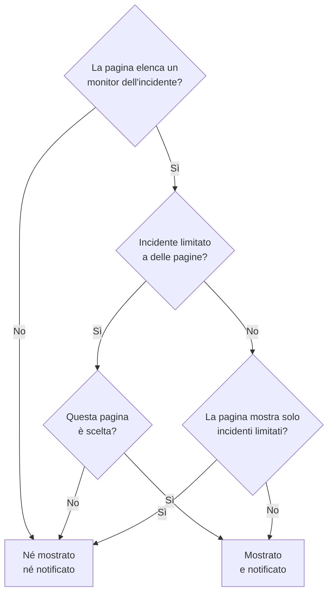

# Una pagina di stato per pubblico

Persone diverse hanno bisogno di notizie diverse. Un cliente non vuole sapere del disservizio di un altro cliente, e il personale di una sede non vuole un'email ogni volta che un'altra sede perde la rete. In OneUptime l'unità di pubblico è la pagina di stato: ognuna ha i propri iscritti, il proprio branding e la propria privacy. Quindi date a ogni pubblico una pagina propria, e decidete incidente per incidente quali pagine ne vengono avvisate.

L'infrastruttura condivisa rendeva tutto questo difficile. Un incidente raggiunge una pagina di stato tramite i suoi monitor, quindi un monitor condiviso da dieci pagine di sede avvisava tutte e dieci le sedi di un disservizio che ne colpiva due. L'unica soluzione era una pagina, o un monitor, per ogni combinazione di sedi. Questa pagina copre le impostazioni che risolvono il problema:

- **Limita a queste pagine di stato** su un incidente, così viene mostrato, e notificato, solo sulle pagine che scegliete.
- **Mostra solo gli incidenti limitati a questa pagina** su una pagina di stato, così un incidente che nessuno ha ancora limitato non raggiunge nessuna di queste pagine finché qualcuno non decide. Questo include gli incidenti che aprono da soli un monitor, Slack, Microsoft Teams, l'API o l'IA.
- Un registro delle pagine a cui è stato detto che un incidente è stato creato, così una pagina che aggiungete dopo viene avvisata una volta e le altre non vengono avvisate di nuovo.
- Un riepilogo **Verranno notificati** che mostra chi verrà avvisato di un incidente prima che lo dichiariate o pubblichiate una nota pubblica, e **Anteprima**, che mostra che cosa riceveranno gli iscritti di ogni pagina.

:::cards
- [Configurarlo](#configurare-una-pagina-per-pubblico): Una pagina per pubblico, e l'interruttore che tiene lontani gli incidenti non limitati.
- [Limitare un incidente](#limitare-un-incidente-a-pagine-di-stato): Scegliete le pagine quando lo dichiarate, o dopo.
- [Aggiungere o togliere pagine](#aggiungere-e-togliere-pagine-di-stato): Chi viene avvisato di una pagina che aggiungete, e che cosa ritira toglierne una.
- [Che cosa porta ogni messaggio](#che-cosa-porta-ogni-messaggio): I valori che riceve ogni pagina, e che cosa dicono a ogni pubblico.
:::

## Quando usarlo

- **Un managed service provider** con una pagina di stato per cliente, su monitor che i clienti condividono.
- **Un'organizzazione con sedi, stabilimenti o regioni**, ciascuna con il proprio personale da avvisare.
- **L'IT interno** con una pagina per reparto o edificio.

Se al vostro pubblico va bene scegliere da sé, può bastare una sola pagina: lasciate che gli iscritti scelgano le risorse che interessano loro (vedete [Iscritti e annunci](/docs/status-pages/subscribers)). Usate una pagina per pubblico quando la scelta la fate voi per loro, incidente per incidente, o quando un pubblico non deve vedere affatto gli incidenti di un altro.

## Come un incidente raggiunge una pagina di stato

Un incidente raggiunge una pagina di stato tramite i suoi monitor. Una pagina mostra un incidente, e ne avvisa i suoi iscritti, quando una delle risorse della pagina è uno dei monitor dell'incidente, direttamente o tramite un gruppo di monitor sulla pagina. Due impostazioni lo restringono:

- **Limita a queste pagine di stato** sull'incidente (`statusPages`). Se resta vuoto, l'incidente raggiunge ogni pagina che elenca i suoi monitor, come è sempre stato. Con delle pagine scelte, raggiunge solo le pagine scelte **tra** quelle che elencano i suoi monitor.
- **Mostra solo gli incidenti limitati a questa pagina** sulla pagina di stato (`onlyShowScopedIncidents`, disattivato per impostazione predefinita). Quando è attivo, la pagina non mostra mai un incidente non limitato a pagine di stato specifiche, né ne avvisa mai nessuno.



Per una pagina che elenca uno dei monitor dell'incidente:

| L'incidente è | Pagina con **Mostra solo gli incidenti limitati a questa pagina** disattivato | Pagina con l'opzione attiva |
| --- | --- | --- |
| Non limitato ad alcuna pagina di stato | Mostrato e notificato | Né mostrato né notificato |
| Limitato a pagine di stato, e questa pagina è scelta | Mostrato e notificato | Mostrato e notificato |
| Limitato a pagine di stato, ma non a questa | Né mostrato né notificato | Né mostrato né notificato |

Una pagina che non elenca nessuno dei monitor dell'incidente non lo mostra mai, qualunque cosa scegliate, e un incidente senza monitor non avvisa alcun iscritto di pagine di stato. Le regole consuete continuano a valere: l'incidente deve essere **Visibile sulla pagina di stato** e non privato, la pagina deve avere **Mostra incidenti** attivo, e un iscritto che ha scelto solo alcune risorse o alcuni tipi di evento riceve solo ciò che ha scelto.

Le stesse regole decidono tutto ciò che dipende da quali pagine raggiunge un incidente:

- gli elenchi degli incidenti, la panoramica e la pagina dell'incidente stesso sulla pagina di stato pubblica, e l'[API pubblica](/docs/status-pages/public-api) della pagina di stato;
- i messaggi email, SMS, Slack, Microsoft Teams e webhook inviati quando l'incidente viene creato, cambia stato, riceve una nota pubblica o riceve un post-mortem;
- i conteggi degli incidenti nei report delle pagine di stato inviati via email, che contano solo gli incidenti che la pagina mostra.

Un episodio di incidente raggiunge una pagina quando la raggiunge almeno uno dei suoi incidenti. Le sue notifiche vanno a ogni pagina che i suoi incidenti raggiungono, e la sua pagina su una pagina di stato che nessuno di essi raggiunge non viene trovata. Un incidente privato non raggiunge alcuna pagina, quindi non vi porta mai il suo episodio, e un episodio privato non viene mostrato su nessuna pagina.

## Configurare una pagina per pubblico

:::steps
### Creare una pagina di stato per ogni pubblico

Create una pagina per pubblico, per esempio da `Site 01` a `Site 10`. Rendetele private se il pubblico è interno (vedete [Limitare chi può vedere la pagina](/docs/status-pages/index#limitare-chi-può-vedere-la-pagina)). Gli iscritti di una pagina privata possono comunque annullare l'iscrizione senza accedere, tramite il link in ogni messaggio (vedete [Gestire e annullare un'iscrizione](/docs/status-pages/subscribers#gestire-e-annullare-uniscrizione)). Date loro etichette come `Region East`, così il selettore può aggiungere con un clic ogni pagina che porta un'etichetta.

### Mettere il monitor condiviso su ogni pagina

Aggiungete il monitor condiviso a ogni pagina come risorsa (vedete [Risorse e gruppi della pagina di stato](/docs/status-pages/resources-and-groups)). Una regola in **Risorse → Monitor Rules** può farlo per voi a partire dalle etichette del monitor.

### Attivare Mostra solo gli incidenti limitati a questa pagina

Su ciascuna di quelle pagine, attivatelo. Si trova nella scheda **Cosa mostra la tua pagina di stato** in **Pagine di stato → la vostra pagina → Avanzato → Impostazioni avanzate**, sotto **Mostra incidenti**, e si salva appena lo cambiate. Da quel momento nulla raggiunge la pagina di una sede a meno che qualcuno non la scelga.

### Aggiungere gli iscritti di ogni pubblico

Per il personale, usate **Aggiungi in blocco** in **Iscritti email**, e preferite l'indirizzo personale di ogni persona a una mailing list come `site03-all@`: chiunque sia nella lista può disiscriverla per tutti quelli che vi sono. Se un iscritto che avete aggiunto annulla l'iscrizione, ricevono un'email i proprietari della pagina e chi lo ha aggiunto (vedete [Indirizzi condivisi e mailing list](/docs/status-pages/subscribers#indirizzi-condivisi-e-mailing-list)).

### Lasciare che i soccorritori leggano le pagine di stato

Il selettore elenca solo le pagine di stato che la persona può leggere, e i ruoli degli incidenti non possono leggere le pagine di stato. Date ai soccorritori il ruolo **Status Page Viewer** accanto al loro ruolo per gli incidenti; si può limitare alle pagine con determinate etichette. Senza di esso il selettore è vuoto.

### Decidere che cosa dice ogni messaggio

In **Incidenti → Impostazioni → Campi personalizzati**, definite i campi personalizzati degli incidenti a cui il vostro team risponde ogni volta, per esempio `Impact` (un menu a tendina), `Expected Resolution` (una data e ora) e `Acknowledgement` (un interruttore sì/no). Trascinateli nell'**Ordine** in cui volete che vengano chiesti ed elencati, e attivate **Mostra alla creazione** perché il modulo di dichiarazione li chieda, **Obbligatorio alla creazione** dove una risposta è indispensabile, e **Includi nelle notifiche agli iscritti** per quelli che ogni pubblico può leggere. Saranno così nell'email predefinita di ogni pagina. Vedete [Campi personalizzati](/docs/incidents/settings#campi-personalizzati).

### Personalizzare l'email di ogni pagina (facoltativo)

Sul piano **Scale**, date a ogni pagina una **Configurazione SMTP personalizzata** e collegate modelli personalizzati per gli eventi degli incidenti; possono inserire qualsiasi campo con `{{incident.customFields.<key>}}`. Mentre scrivete un modello, **Anteprima dal vivo** sotto di esso lo mostra compilato con valori di esempio. Vedete [Che cosa serve a un modello personalizzato](/docs/status-pages/subscribers#che-cosa-serve-a-un-modello-personalizzato), e [Che cosa porta ogni messaggio](#che-cosa-porta-ogni-messaggio) prima di usare `{{affectedStatusPages}}`.

### Salvare modelli di incidente con le pagine scelte (facoltativo)

Un modello `Region East outage` può portare le pagine delle sedi dell'est, e risposte predefinite per i campi personalizzati.

### Controllare l'email di ogni pagina prima del primo disservizio

Avviate **Dichiara incidente** con il monitor condiviso e due delle pagine di sede scelte, e nel riepilogo prima dell'invio aprite **Anteprima**, accanto a **Sì**: mostra l'email che riceverebbero gli iscritti di ogni pagina, e quale modello usa e perché. **Inviami un test** ne invia una alla vostra casella. A nessun altro viene inviato nulla finché non dichiarate l'incidente, quindi alla fine lasciate il modulo senza inviarlo. Vedete [Chi verrà avvisato](#chi-verrà-avvisato).
:::

## Limitare un incidente a pagine di stato

### Quando lo dichiarate

In **Incidenti → Tutti gli incidenti → Dichiara incidente**, il passo **Risorse interessate** ha **Limita a queste pagine di stato** in **Altri campi**, dopo i monitor e le altre risorse. Il suo testo di esempio, **Tutte le pagine di stato che elencano i monitor**, è ciò che significa lasciarlo vuoto. Scegliete le pagine per nome, oppure aprite la scheda **Etichette** del selettore e scegliete un'etichetta per aggiungere ogni pagina che la porta.

Il modulo vi avverte:

- quando una pagina scelta non elenca nessuno dei monitor dell'incidente, o non è collegato alcun monitor. L'incidente non verrà mostrato su quella pagina né avviserà i suoi iscritti;
- quando impostate anche **Cambia lo stato del monitor in**, subito sotto i monitor nello stesso passo. Vedete [Lo stato del monitor è condiviso](#lo-stato-del-monitor-è-condiviso);
- quando spuntate anche **Incidente privato**, in **Altri campi** del passo **Dettagli dell'incidente**. Gli incidenti privati sono nascosti da tutte le pagine di stato, comprese quelle che avete scelto.

Il passo **Dettagli**, subito dopo **Risorse interessate**, chiede i campi personalizzati degli incidenti contrassegnati con **Mostra alla creazione** (vedete [Dichiarare un incidente](/docs/incidents/declaring-incidents)). Le sue risposte vanno a ogni pagina che l'incidente raggiunge: i valori dei campi personalizzati appartengono all'incidente, non a una pagina di stato.

**Crea da modello** compila il campo dal modello. Le pagine di un modello si impostano nel suo passo **Risorse interessate** quando lo create, e poi nella sua scheda **Ambito delle pagine di stato** (**Incidenti → Impostazioni → Modelli di incidenti**). Come per gli altri campi del modello, un elenco che impostate voi prevale. Le pagine di un modello vengono compilate anche per un soccorritore che non può leggere le pagine di stato: chi ha configurato il modello le ha scelte per tutti quelli che dichiarano a partire da esso.

### Chi verrà avvisato

Sotto **Notifica gli iscritti alla pagina di stato**, subito sotto il selettore in **Altri campi** del passo **Risorse interessate**, e di nuovo nel riepilogo prima dell'invio, il modulo mostra chi raggiungerà l'incidente:

> Verranno notificati:
>
> - Site 03 (fino a 41 via email)
> - Site 07 (fino a 18 via email)

Sotto, in **Non notificati:**, elenca le pagine che elencano i monitor ma non verranno avvisate, e perché: non è una delle pagine a cui l'incidente è limitato, è una pagina che mostra solo gli incidenti limitati a essa, o è una pagina che non mostra incidenti.

Quando nessuno verrà avvisato, il riepilogo non mostra nulla: l'incidente non ha monitor, nessuna pagina di stato li elenca, le pagine non hanno ancora iscritti, **Notifica gli iscritti alla pagina di stato** è disattivato, o l'incidente è privato. Avverte solo quando il motivo è l'ambito delle pagine di stato, e nomina le pagine che lascia fuori: l'incidente non è limitato e le pagine che elencano i suoi monitor mostrano solo gli incidenti limitati a esse, è limitato ad altre pagine, o le pagine a cui è limitato non elencano nessuno dei suoi monitor. Nel riepilogo, **Notifica gli iscritti alla pagina di stato** dice **Sì** o **No** come ogni altra casella, con **Anteprima** accanto a **Sì**; non viene offerta finché la casella è disattivata, l'incidente è privato o non è collegato alcun monitor.

Lo stesso riepilogo compare sotto **Notifica gli iscritti alla pagina di stato** quando scrivete una nota nella pagina **Note pubbliche** dell'incidente, per l'incidente così com'è. Lì dice anche quando l'incidente è nascosto dalle pagine di stato, dato che allora non verrà inviato nulla.

I conteggi sono «fino a». Contano per canale gli iscritti confermati di ogni pagina che non hanno annullato l'iscrizione, e un iscritto che ha scelto solo alcune risorse o alcuni tipi di evento potrebbe non ricevere questo messaggio. Le pagine che non potete leggere non vengono nominate. Vengono contate come «altre pagine di stato a cui non hai accesso».

**Anteprima**, accanto a **Sì** nel riepilogo e accanto alla casella della nota, mostra che cosa riceveranno: scegliete una pagina per vederne l'email come la riceveranno i suoi iscritti, con l'oggetto, e quale modello usa e perché, per esempio che il modello personalizzato di una pagina non viene usato perché la pagina non ha una **Configurazione SMTP personalizzata**. **Inviami un test** invia l'email della pagina all'email del vostro account, e a nessun altro. Le pagine che non potete leggere vengono contate ma non mostrate in anteprima. Vedete [Vedere l'anteprima dell'email prima dell'invio](/docs/status-pages/subscribers#vedere-lanteprima-dellemail-prima-dellinvio).

### Dopo la dichiarazione

Aprite l'incidente e andate in **Avanzato → Impostazioni**. La scheda **Ambito delle pagine di stato** elenca le pagine a cui l'incidente è limitato, e **Modifica ambito delle pagine di stato** le cambia. La **Panoramica** dell'incidente mostra lo stesso elenco come **Ambito delle pagine di stato**, in sola lettura, con un link **Modifica nelle impostazioni**.

In **Incidenti → Tutti gli incidenti**, il filtro **Pagina di stato** trova gli incidenti limitati alle pagine che scegliete, o quelli non limitati ad alcuna pagina.

### Tramite l'API

`statusPages` è un elenco di id di pagine di stato, su `POST /api/incident` e sugli aggiornamenti di un incidente, e sui modelli di incidente. Ogni pagina deve appartenere al progetto dell'incidente; una pagina di un altro progetto viene rifiutata. Ogni pagina che aggiungete deve anche essere una che potete leggere, come nel selettore, altrimenti la richiesta viene rifiutata. Le pagine che l'incidente o il modello ha già vengono mantenute che possiate leggerle o no, e una pagina di un modello di incidente che potete leggere può essere scelta quando dichiarate un incidente. Ne derivano altre due colonne, e nessuna delle due spetta a voi impostarla:

- `isScopedToStatusPages` viene calcolato da `statusPages`. Qualsiasi valore inviate per esso viene ignorato.
- `statusPagesNotifiedOnCreation` è il registro delle pagine a cui è stato detto che l'incidente è stato creato. Vedete [Aggiungere pagine di stato](#aggiungere-pagine-di-stato).

Per vedere chi raggiungerebbe un incidente senza inviare nulla, chiamate l'endpoint del pubblico:

```bash
curl -X POST https://oneuptime.com/api/incident/subscriber-audience \
  -H "apikey: $ONEUPTIME_API_KEY" \
  -H "Content-Type: application/json" \
  -d '{
    "monitorIds": ["<monitor-id>"],
    "statusPageIds": ["<status-page-id>"]
  }'
```

Inviate invece `{"incidentId": "<incident-id>"}` per un incidente che esiste già. La risposta elenca ogni pagina che verrà avvisata con un conteggio per canale (`email`, `sms`, `slack`, `microsoftTeams`, `webhook`), le pagine lasciate fuori e perché, e `hiddenStatusPageCount` per le pagine che il chiamante non può leggere. Non restituisce mai un indirizzo.

## Incidenti che nessuno ha ancora limitato

I criteri dei monitor, Slack, Microsoft Teams, l'API e l'IA possono tutti aprire un incidente da soli, e nessuno di loro sa quali sedi colpisce un guasto su un monitor condiviso. Un incidente del genere non è limitato ad alcuna pagina, quindi ogni pagina che elenca il monitor lo mostrerebbe, e ne avviserebbe gli iscritti, entro circa un minuto. Una volta inviata un'email a un iscritto, non si può ritirare.

**Mostra solo gli incidenti limitati a questa pagina** è ciò che lo impedisce. Una pagina con l'opzione attiva ignora ogni incidente non limitato. L'incidente viene comunque aperto, le policy di reperibilità avvisano comunque i soccorritori, e i suoi proprietari vengono comunque informati, ma nessuna di queste pagine ne viene avvisata. Un soccorritore capisce poi chi è colpito e aggiunge quelle pagine nella scheda **Impostazioni** dell'incidente, con **Invia la notifica di creazione dell'incidente alle pagine appena aggiunte** spuntato. I loro iscritti vengono avvisati entro circa un minuto.

## Aggiungere e togliere pagine di stato

### Aggiungere pagine di stato

Gli iscritti di una pagina vengono avvisati una sola volta che un incidente è stato creato. Quindi quando aggiungete pagine nella scheda **Ambito delle pagine di stato**, il modulo di modifica offre **Invia la notifica di creazione dell'incidente alle pagine appena aggiunte**, spuntato per impostazione predefinita:

- Spuntato, la notifica di «creato» dell'incidente viene rimessa in coda, e va solo alle pagine non ancora avvisate. L'incidente tiene un registro delle pagine avvisate, così le altre non la ricevono due volte.
- Non spuntato, le pagine aggiunte iniziano a mostrare l'incidente, e vengono avvisate di tutto da qui in avanti, ma non viene detto loro che è stato creato.

La casella compare solo quando spuntarla invierebbe qualcosa: almeno una pagina che aggiungete non è ancora stata avvisata, e l'incidente è stato dichiarato con **Notifica gli iscritti alla pagina di stato** attivo, è visibile sulle pagine di stato e non è privato. Alcuni casi sono gestiti per voi:

- **La notifica è ancora in coda, o in corso di invio proprio ora.** Un invio in coda legge le pagine quando parte, e un invio in corso le rilegge quando finisce e poi avvisa le pagine aggiunte nel frattempo. Quindi non c'è casella: le pagine che aggiungete vengono avvisate in ogni caso. (Se quell'invio non riesce, le pagine aggiunte nel frattempo sono tra quelle a cui invia il suo **Riprova**.)
- **Ogni pagina che aggiungete è già stata avvisata**, per esempio una pagina che avete tolto e aggiungete di nuovo, o un incidente che ha raggiunto ogni sede e ora è ristretto a due di esse. Nessuno viene avvisato di nuovo, quindi non c'è casella.
- **L'incidente non è mai stato annunciato.** Quando è stato pubblicato senza **Notifica agli iscritti che questo incidente è stato creato**, o dichiarato senza monitor, nessuno è stato avvisato. Spuntare la casella avvisa solo le pagine che aggiungete, non le pagine a cui era già limitato.
- **L'incidente è stato dichiarato prima del rilascio di questa funzione.** La sua notifica di «creato» è partita verso ogni pagina che elencava i suoi monitor, e non c'è un registro di quelle pagine. Aggiungere pagine non la invia di nuovo, quindi la casella non viene offerta.
- **L'incidente è nascosto.** Non viene inviato nulla finché è nascosto. Quando riattivate **Visibile sulla pagina di stato**, la scheda **Impostazioni incidente** offre **Notifica agli iscritti che questo incidente è stato creato** per le pagine del suo ambito che non sono mai state avvisate, come quelle aggiunte mentre era nascosto.

Una pagina aggiunta dopo viene avvisata di ciò che succede in seguito: le note pubbliche successive, i cambi di stato e il post-mortem. Non le vengono inviati le note e i cambi di stato partiti prima che fosse aggiunta. Se deve mettersi in pari, pubblicate una nota pubblica.

Lo stesso registro fa sì che **Riprova** su una notifica di «creato» non riuscita riprenda da dove si era fermata: le pagine già avvisate vengono saltate. Una pagina conta come avvisata solo quando a tutti i suoi iscritti è stato inviato il messaggio; una pagina in cui un messaggio non è riuscito, o in cui l'invio si è fermato a metà, lo riceve di nuovo per intero. Il registro viene scritto man mano che ogni pagina finisce, quindi questo vale anche per un invio che è stato interrotto. È conservato per pagina, non per iscritto: gli iscritti di una pagina in cui l'invio si è fermato a metà e a cui il messaggio era già stato inviato lo ricevono una seconda volta.

Per ricominciare da capo invece, per esempio dopo aver corretto un modello o un'impostazione SMTP, spuntate **Inviarla di nuovo a ogni pagina di stato, comprese le pagine già raggiunte** nella conferma di **Riprova**: il pulsante diventa **Invia di nuovo a tutte le pagine**, il registro viene svuotato, e ogni pagina che l'incidente raggiunge ora la riceve di nuovo. Dopo una notifica partita per intero, lo **Stato notifica iscritto** nella **Panoramica** dell'incidente offre **Invia di nuovo**, che fa lo stesso. Entrambe le conferme elencano le pagine che raggiungerebbe ora, o dicono che non raggiungerebbe nessuno; la semplice conferma di **Riprova** elenca le pagine già raggiunte come non inviate di nuovo, dato che le salta. Nessuno dei due viene offerto per una notifica saltata, o ancora in coda o in corso di invio, né a chi non può modificare l'incidente.

Tramite l'API, inviate `"miscDataProps": {"notifyAddedStatusPagesOfIncidentCreated": true}` con l'aggiornamento che cambia `statusPages`. Riportare voi stessi `subscriberNotificationStatusOnIncidentCreated` a `Pending` invia ancora di nuovo la notifica di «creato» a ogni pagina che l'incidente raggiunge, come ha sempre fatto: il registro viene svuotato insieme. Dopo un errore, invece, riprende da dove si era fermato l'invio non riuscito. Per inviarla a ogni pagina anche dopo un errore, aggiungete `"miscDataProps": {"resendIncidentCreatedToAllStatusPages": true}` a quell'aggiornamento. Quella richiesta viene rifiutata per una notifica saltata, o in coda o in corso di invio.

Scrivere `shouldStatusPageSubscribersBeNotifiedOnIncidentCreated` non è uno di questi casi. Si sceglie quando l'incidente viene dichiarato, e nessun ruolo di progetto può cambiarlo in seguito tramite l'API. Un workflow, che scrive come il sistema, e l'amministratore principale di un'istanza possono farlo, ma questo salva soltanto il nuovo valore. Riscriverlo invariato, come fa un workflow che copia l'intero incidente, non invia di nuovo nulla, e attivarlo più tardi non invia la notifica di «creato» senza la quale l'incidente è stato dichiarato. Disattivato prima che quella notifica sia partita, viene saltata.

### Togliere pagine di stato

Togliere una pagina non ritira nulla. La pagina smette di mostrare l'incidente, e i suoi iscritti non ne sanno più nulla, nemmeno che è stato risolto. Quando togliete una pagina che era già stata avvisata dell'incidente, il modulo di modifica vi avverte e suggerisce una nota pubblica di chiusura. Pubblicate prima quella nota, mentre la pagina è ancora nell'elenco, e poi togliete la pagina.

Svuotare l'intero elenco è diverso dal togliere pagine: l'incidente non è più limitato affatto. Viene di nuovo mostrato, e notificato, su ogni pagina che elenca i suoi monitor, tranne le pagine che mostrano solo gli incidenti limitati a esse. Il modulo vi avverte anche di questo.

### Quando una pagina di stato scelta viene eliminata

Eliminare una pagina di stato la toglie da ogni incidente che era limitato a essa. Un incidente le cui pagine scelte sono state tutte eliminate resta limitato, a niente: è nascosto da ogni pagina di stato invece di essere mostrato su ogni pagina che elenca i suoi monitor. La scheda **Ambito delle pagine di stato** lo dice. Scegliete altre pagine, o svuotate l'elenco, per mostrarlo di nuovo.

I modelli di incidente funzionano allo stesso modo. Un modello le cui pagine sono state tutte eliminate resta limitato: un incidente che un [modulo](/docs/forms/on-submit#il-modello-di-incidente) o il passo **Create One Incident** di un workflow dichiara da esso è nascosto da ogni pagina di stato, la scheda **Ambito delle pagine di stato** del modello vi avverte, e **Dichiara incidente** parte senza alcuna pagina scelta e vi chiede di scegliere le pagine a cui è destinato l'incidente. Scegliete altre pagine nel modello, o salvate il suo elenco vuoto per smettere di limitare gli incidenti dichiarati da esso.

## Un'email per persona

Per un incidente limitato a pagine di stato specifiche, un indirizzo email o un numero di telefono iscritto su più di una di quelle pagine riceve un'email o un SMS per invio, non uno per pagina. Le pagine vengono percorse in ordine di nome, quindi il modello, il branding e il link di disiscrizione della prima pagina sono quelli che riceve quella persona.

I messaggi webhook, Slack e Microsoft Teams non vengono mai uniti. I loro payload indicano la pagina di stato a cui sono destinati, e un'integrazione che ascolta per pagina deve vedere ogni pagina.

Questo vale solo all'interno di un invio. Qualcuno iscritto su `Site 03` e `Site 05` che ha ricevuto l'email di «creato» tramite `Site 03` la riceve di nuovo quando `Site 05` viene aggiunta in seguito. Un incidente non limitato ad alcuna pagina invia un messaggio per iscrizione, come è sempre stato.

## Che cosa porta ogni messaggio

Ogni pagina che l'incidente raggiunge riceve gli stessi valori: appartengono all'incidente, non a una pagina di stato.

- **Campi personalizzati nei messaggi predefiniti.** I campi personalizzati degli incidenti con **Includi nelle notifiche agli iscritti** attivo sono elencati nei messaggi di creazione, cambio di stato, nota pubblica e post-mortem di ogni pagina, nel loro **Ordine**: email, Slack, Microsoft Teams e webhook, ma non SMS. Non serve né il piano Scale né un SMTP personalizzato. Vedete [Campi personalizzati degli incidenti nelle notifiche](/docs/status-pages/subscribers#campi-personalizzati-degli-incidenti-nelle-notifiche).
- **Aggiornamenti.** Cambiare un campo personalizzato da solo non avvisa nessuno. La nota pubblica o il cambio di stato successivo porta i valori attuali, quindi per dire alle sedi che `Expected Resolution` si è spostata, cambiate il campo e poi pubblicate una nota pubblica.
- **Modelli di nota.** Scegliere un modello di nota compila segnaposto come `{{incident.title}}` e `{{incident.customFields.<key>}}` con i valori attuali dell'incidente, e potete comunque modificare la nota prima di pubblicarla. Vedete [Modelli di nota](/docs/incidents/settings#modelli-di-note).
- **I nomi degli altri pubblici.** `{{affectedStatusPages}}` in un modello personalizzato per gli iscritti, e `{{incident.affectedStatusPages}}` in un modello di nota, elencano le pagine che l'incidente raggiunge, e chiunque riceva il messaggio legge l'elenco: gli iscritti di `Site 03` scoprono che anche `Site 07` è colpita. Tra le sedi di una stessa organizzazione può essere ciò che volete. Tra clienti, rivela un cliente a un altro, quindi lasciate entrambi fuori dai modelli e dalle note che quelle pagine ricevono.

## In che cosa differisce dalla manutenzione programmata

Anche gli eventi di manutenzione programmata hanno un elenco **Pagine di stato**, ma funziona diversamente:

- **La manutenzione programmata sostituisce.** L'evento viene mostrato esattamente sulle pagine del suo elenco, che elenchino o no i suoi monitor.
- **Un incidente restringe.** Il suo elenco sceglie solo tra le pagine che elencano già i suoi monitor. Scegliere una pagina che non ne elenca nessuno non fa nulla, e il modulo lo dice. Mettete prima il monitor su quella pagina.

Così una scelta sbagliata non può mettere un incidente su una pagina che parla di tutt'altro. Significa anche che un incidente senza monitor non raggiunge alcuna pagina di stato, per quante ne scegliate.

## Lo stato del monitor è condiviso

Un monitor ha un solo stato, e ogni pagina di stato che elenca il monitor lo mostra. Limitare un incidente non cambia questo. Se l'incidente imposta **Cambia lo stato del monitor in**, o il monitor va giù da solo, il monitor diventa rosso su ogni pagina che lo elenca, comprese le pagine a cui l'incidente non è limitato e le pagine che mostrano solo gli incidenti limitati a esse. Il modulo di dichiarazione vi avverte quando combinate un cambio di stato con delle pagine scelte.

**Quando ogni sede ha bisogno di uno stato proprio, date a ogni sede un monitor manuale.** Create un [Monitor manuale](/docs/monitor/manual-monitor) per sede, per esempio `Site 03 network`, ed elencatelo solo sulla pagina di quella sede. Collegate all'incidente i monitor manuali delle sedi colpite, con **Cambia lo stato del monitor in** se volete che il loro stato cambi, e lasciate il monitor condiviso alle pagine che devono vederlo. L'incidente raggiunge così esattamente le sedi di cui porta i monitor, e un cambio di stato compare solo sulle loro pagine.

## Che cosa viene registrato

- **Il feed dell'incidente.** La voce di «creato» di un incidente limitato elenca le pagine a cui è limitato. Ogni modifica dell'elenco aggiunge una voce che elenca le pagine aggiunte e tolte, e se alle pagine aggiunte verrà inviata la notifica di «creato».
- **Ogni notifica agli iscritti.** La voce **Notifica agli iscritti inviata** nel feed dell'incidente ha un pannello **More Information** che elenca ogni pagina a cui è andato l'invio: quanti messaggi sono stati inviati e quanti non sono riusciti su ogni canale, e l'oggetto con cui è partita la sua email. Elenca anche le pagine che ha saltato e perché (già avvisate, o che non mostrano incidenti), le pagine lasciate fuori dall'ambito, e se email e SMS sono stati inviati una volta per indirizzo. Quando l'invio ha messo valori di campi personalizzati in un messaggio, il pannello termina con essi, sotto **Custom fields sent**.
- **Lo stato della notifica.** Il messaggio di stato di ogni notifica dice, per ogni pagina, quanti messaggi sono stati inviati e quanti non sono riusciti su ogni canale, e dopo un errore che cosa farà **Riprova**. Un invio interrotto a metà, perché il suo server si è riavviato o ha smesso di rispondere, viene contrassegnato come non riuscito con un messaggio che inizia con `Interrupted:`, invece di restare in corso. Vedete [Verificare che cosa è stato inviato](/docs/status-pages/subscribers#verificare-che-cosa-è-stato-inviato).
- **Registri di notifica** su ogni pagina di stato mostrano ogni messaggio inviato da quella pagina.

Vedete [Note, proprietari e feed degli incidenti](/docs/incidents/notes-owners-and-feed) per il feed stesso.

## Permessi

- **Scegliere una pagina di stato richiede l'accesso in lettura a essa.** Le pagine di stato si leggono con i ruoli delle pagine di stato, non con i ruoli degli incidenti, e una pagina di stato può essere limitata per etichetta. Date ai soccorritori **Status Page Viewer**, limitato a delle etichette se volete. Senza di esso il selettore è vuoto, e l'API rifiuta una pagina che il chiamante non può leggere, sugli incidenti come sui modelli di incidente.
- **Le pagine che chi modifica non può vedere vengono mantenute.** Chi modifica e può leggere solo alcune delle pagine di un incidente vede solo quelle nel selettore, e il salvataggio mantiene le pagine che non può vedere.
- **Le pagine a cui è limitato un incidente fanno parte dell'incidente.** Come i suoi monitor, chiunque possa leggere l'incidente ne vede i nomi, nella scheda **Ambito delle pagine di stato**, nella panoramica e nel feed dell'incidente, che possa leggere o no quelle pagine di stato.
- **Anche ciò che un invio ha raggiunto fa parte dell'incidente.** Una volta partita una notifica, il suo messaggio di stato e la sua voce nel feed nominano ogni pagina di stato a cui è andata, con ciò che è stato inviato e ciò che non è riuscito su ciascuna, e chiunque possa leggere l'incidente li vede, che possa leggere o no quelle pagine di stato. Solo il riepilogo e l'anteprima qui sotto, che guardano avanti, si limitano alle pagine che la persona può leggere.
- **Il riepilogo del pubblico** è aperto ai ruoli che possono dichiarare o modificare un incidente o pubblicarvi una nota pubblica. Nomina solo le pagine che la persona può leggere. Le altre pagine che l'incidente avviserà vengono contate come «altre pagine di stato a cui non hai accesso», e non mostra mai indirizzi.
- **Anteprima** è aperta agli stessi ruoli, e mostra in anteprima solo le pagine che la persona può leggere, al massimo sessanta volte ogni dieci minuti. Come il riepilogo, non mostra mai un indirizzo. **Inviami un test** invia solo all'email dell'account della persona, una volta verificata, al massimo dieci volte ogni 15 minuti.
- **Inviare di nuovo una notifica** richiede il permesso di modificare l'incidente, per la sua notifica di «creato», e sia il permesso di modificare le note pubbliche sia il permesso di pubblicare note pubbliche che avvisano gli iscritti, per una nota; e lo stesso vale per avvisare gli iscritti di una modifica a una nota. Nessuna di queste richieste viene accettata mentre quella notifica è in corso di invio.

## Aggiornare un server self-hosted

I worker che inviano le notifiche agli iscritti sono ciò che mantiene un incidente sulle pagine a cui è limitato. Mentre viene distribuito un aggiornamento a una versione con questa funzione, un worker ancora sulla versione precedente invia le notifiche che prende in carico come ha sempre fatto: a ogni pagina di stato che elenca i monitor dell'incidente, comprese le pagine che mostrano solo gli incidenti limitati a esse. Quindi lasciate che il deployment dei worker finisca il rollout, o scalate a zero i vecchi worker, prima che qualcuno limiti un incidente a pagine di stato o attivi **Mostra solo gli incidenti limitati a questa pagina**. Con Helm, `migrate.hook: true` esegue anche le migrazioni del database prima che parta qualsiasi nuovo pod.

## Prossimi passi

:::cards
- [Iscritti e annunci](/docs/status-pages/subscribers): I canali degli iscritti, e che cosa invia ogni evento.
- [Dichiarare un incidente](/docs/incidents/declaring-incidents): Il modulo di dichiarazione, passo per passo.
- [Stati e gravità degli incidenti](/docs/incidents/states-and-severities): Che cos'altro tiene un incidente lontano da una pagina di stato.
- [Monitor manuale](/docs/monitor/manual-monitor): Monitor di cui impostate voi lo stato.
:::
