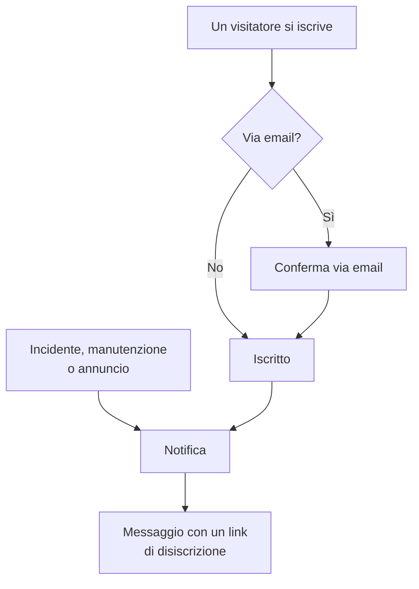

# Iscritti e annunci

Una pagina di stato è un posto in cui la gente va. Gli iscritti sono quelli che preferirebbero non doverci andare: vi danno una volta un indirizzo email, un numero di telefono, un webhook di Slack o un endpoint HTTP, e da quel momento i vostri aggiornamenti arrivano a loro.

Gli annunci sono l'altra metà dello stesso lavoro. Un monitor può dire ai vostri visitatori che il checkout restituisce errori 500; nessun monitor può dire loro che sabato migrate i database, che un fornitore esterno sta avendo una brutta giornata o che l'incidente di cui hanno letto ieri è del tutto chiuso. Gli annunci sono il canale a testo libero per tutto ciò che i vostri controlli non possono vedere, e arrivano allo stesso elenco di iscritti.

Questa pagina copre entrambi: i cinque canali di iscrizione e come si iscrivono i visitatori, di che cosa gli iscritti possono scegliere di essere avvisati, i flussi di doppia conferma e di annullamento dell'iscrizione, il report via email che gli iscritti possono ricevere ogni mese, e come si scrivono, si pianificano e si trasformano in modelli gli annunci.

:::cards
- [Canali di iscrizione](#canali-di-iscrizione): I canali su cui i visitatori possono iscriversi, e la pagina su cui si iscrivono.
- [Che cosa viene detto agli iscritti](#di-che-cosa-vengono-avvisati-gli-iscritti): Annunci, manutenzione, incidenti ed episodi, e le loro modifiche.
- [Verificare che cosa è stato inviato](#verificare-che-cosa-è-stato-inviato): Lo stato di ogni notifica, e Riprova e Invia di nuovo.
- [Annunci](#annunci): Pubblicare un avviso su una o più pagine di stato.
:::

## Come funziona



Ogni pagina di stato ha i propri iscritti. Un visitatore si iscrive nella pagina **Iscriviti** della pagina di stato, dove un indirizzo email conferma con un link prima di ricevere qualsiasi cosa, oppure lo aggiunge il vostro team nella dashboard. Da quel momento ogni incidente, evento di manutenzione programmata e annuncio che raggiunge la pagina notifica i suoi iscritti, ciascuno sul canale con cui si è iscritto, e ogni messaggio porta il link che annulla l'iscrizione.

## Canali di iscrizione

Una pagina di stato supporta cinque canali. Questi, e la pagina su cui si iscrivono i visitatori, si attivano in un solo posto: la scheda **Canali** in **Pagine di stato → la vostra pagina → Iscritti → Impostazioni iscritti**. Ogni interruttore si salva appena lo cambiate:

- **Mostra pagina iscritti** (`showSubscriberPageOnStatusPage`) — attivo per impostazione predefinita. Mette la voce **Iscriviti** nella barra di navigazione della pagina di stato, dove i visitatori si iscrivono sui canali qui sotto.
- **E-mail** (`enableEmailSubscribers`) — attivo per impostazione predefinita. Tutto il resto è disattivato finché non lo attivate.
- **SMS** (`enableSmsSubscribers`) — disattivato per impostazione predefinita. Su OneUptime Cloud ogni SMS viene pagato con il credito SMS e chiamate del progetto, a meno che la pagina non abbia una propria **Configurazione Twilio** (vedete [più sotto](#piè-di-pagina-delle-email-smtp-personalizzato-e-twilio)). Attivarlo richiede anche che **SMS** sia attivo per il progetto, nella scheda **Canali di notifica** di **Impostazioni del progetto > Notifiche > Impostazioni notifiche**, cosa che può fare un proprietario del progetto, un **Billing Admin** o qualcuno con **Manage Billing**.
- **Slack** (`enableSlackSubscribers`) — disattivato per impostazione predefinita.
- **Microsoft Teams** (`enableMicrosoftTeamsSubscribers`) — disattivato per impostazione predefinita.
- **Webhook** (`enableWebhookSubscribers`) — disattivato per impostazione predefinita.

Gli interruttori decidono come i visitatori possono iscriversi da soli, e la pagina di stato rifiuta un'iscrizione su un canale disattivato. Non fermano le notifiche: gli iscritti che il vostro team aggiunge nella dashboard, con l'API o tramite un workflow ricevono gli aggiornamenti qualunque canale sia attivo.

Su OneUptime Cloud, un interruttore che il vostro piano non include mostra accanto il nome del piano: **Growth** per **SMS** e **Mostra pagina iscritti**, **Scale** per **Slack**, **Microsoft Teams** e **Webhook**. Disattivare un canale funziona su tutti i piani, quindi un canale attivato durante una prova si può sempre disattivare di nuovo; l'interruttore lo dice sotto.

Ogni canale ha anche il proprio elenco nel menu laterale della pagina di stato, sotto **Iscritti**: **Iscritti email**, **Iscritti SMS**, **Iscritti Slack**, **Iscritti MS Teams** e **Iscritti webhook**. È lì che guardate chi è iscritto, aggiungete qualcuno a mano o vi lasciate una voce **Note** (`internalNote`) su un determinato iscritto. Finché un canale è disattivato, la parte alta del suo elenco lo dice, con l'interruttore del canale proprio lì, così potete attivarlo senza lasciare l'elenco.

**Un interruttore non basta.** La voce **Iscriviti** nella barra di navigazione della pagina di stato compare solo quando **Mostra pagina iscritti** è attivo *e* almeno un canale è attivo. Se attivate **E-mail** ma lasciate disattivato **Mostra pagina iscritti**, i visitatori non hanno modo di raggiungere il modulo.

## Che cosa vede un visitatore nella pagina di iscrizione

La pagina **Iscriviti** ha un sottomenu con una scheda per ogni canale attivo. Ogni scheda chiede il minimo indispensabile:

| Scheda | Indirizzo | Titolo | Che cosa chiede |
| --- | --- | --- | --- |
| **E-mail** | `/subscribe/email` | **Iscriviti via e-mail** | **La tua e-mail**, con l'esempio `subscriber@company.com`. |
| **SMS** | `/subscribe/sms` | **Iscriviti via SMS** | **Il tuo numero di telefono**, con l'esempio `+11234567890`. |
| **Slack** | `/subscribe/slack` | **Iscriviti via Slack** | **Nome dell'area di lavoro Slack** (usato per la convalida) e **URL del webhook in entrata Slack**, con l'esempio `https://hooks.slack.com/services/...`. |
| **MS Teams** | `/subscribe/microsoft-teams` | **Iscriviti via Microsoft Teams** | **Nome dell'area di lavoro Microsoft Teams** e **URL del webhook in entrata Microsoft Teams**, con l'esempio `https://outlook.office.com/webhook/...`. |
| **Webhooks** | `/subscribe/webhooks` | **Iscriviti tramite webhook** | **URL del webhook**, con l'esempio `https://example.com/webhook`. A ogni evento della pagina di stato vi viene inviata una richiesta JSON `POST`. |

Il pulsante di invio dice **Iscriviti**. Un'iscrizione via SMS, Slack, Microsoft Teams o webhook mostra *Iscrizione effettuata con successo.* Un'iscrizione via email dice che è stato inviato un link di conferma e di controllare la cartella spam se non arriva (vedete [Doppia conferma per le email](#doppia-conferma-per-le-email)). Le schede **E-mail**, **SMS**, **Slack** e **MS Teams** hanno anche la divisione **Nuova iscrizione** / **Gestisci iscrizione esistente**, così chi è già iscritto può tornare alle proprie preferenze senza cercare un vecchio messaggio.

## Lasciare che gli iscritti scelgano risorse e tipi di evento

Per impostazione predefinita un iscritto riceve tutto ciò che c'è sulla pagina. Due interruttori nella scheda **Impostazioni avanzate degli iscritti** lo cambiano:

- **Consenti agli iscritti di scegliere le risorse** (`allowSubscribersToChooseResources`) — disattivato per impostazione predefinita. Attivatelo e il modulo di iscrizione guadagna un interruttore **Iscriviti a tutte le risorse**; disattivatelo e compare **Seleziona le risorse a cui iscriverti**, così il visitatore può scegliere singole risorse.
- **Consenti agli iscritti di scegliere i tipi di evento** (`allowSubscribersToChooseEventTypes`) — disattivato per impostazione predefinita. Stessa forma: un interruttore **Iscriviti a tutti i tipi di eventi**, e **Seleziona i tipi di eventi a cui iscriverti** sotto quando è disattivato.

Con uno dei due attivo, il modulo di iscrizione resta una sola pagina. Sotto la destinazione degli aggiornamenti (l'indirizzo email, il numero di telefono, l'area di lavoro o il webhook) viene **Preferenze**, chiuso su una riga che dice che cosa riceverà il visitatore. Ogni risorsa e ogni tipo di evento sono già scelti, quindi parte con «Riceverai tutti gli aggiornamenti di questa pagina di stato.», e un visitatore che vuole tutto preme **Iscriviti** senza aprirlo. Gli altri aprono **Preferenze** e restringono le risorse o i tipi di evento; una volta richiuso, la riga segue la loro scelta («Riceverai solo gli aggiornamenti sulle risorse che hai scelto.»). Con entrambi disattivati non c'è **Preferenze**: il modulo è la destinazione degli aggiornamenti, poi **Iscriviti**.

La pagina **Aggiorna iscrizione** (vedete sotto) mostra le stesse scelte aperte, dato che cambiarle è il motivo per cui un iscritto ci va.

I tipi di evento sono `Incident`, `Announcement` e `Scheduled Event`.

**Un gruppo di monitor rappresenta ogni monitor che contiene.** Una risorsa della pagina è un monitor o un gruppo di monitor, e un iscritto che sceglie un gruppo di monitor viene avvisato degli incidenti, degli eventi di manutenzione programmata (comprese le loro note) e degli annunci su qualsiasi monitor del gruppo, esattamente come se avesse scelto quel monitor, ed è anche così che li mostra la pagina di stato. Chi ha scelto solo altre risorse non viene avvisato, e chi ha scelto un monitor e il gruppo che lo contiene riceve una notifica, non due.

Le scelte finiscono nel record dell'iscritto come **Is Subscribed to All Resources** (`isSubscribedToAllResources`, vero per impostazione predefinita), **Is Subscribed to All Event Types** (`isSubscribedToAllEventTypes`, vero per impostazione predefinita), **Subscribed to Resources** e **Subscribed to Event Types**.

**Un iscritto sceglie tra le risorse della propria pagina.** **Subscribed to Resources** indica risorse della pagina di stato dell'iscritto stesso, chiunque lo scriva: un visitatore sulla pagina, un collega nella dashboard, una chiave API o un workflow. Un visitatore sceglie tra ciò che la pagina gli mostra, quindi una risorsa il cui monitor è archiviato, e che la pagina nasconde, non è una che possa scegliere. Una risorsa di un'altra pagina di stato, o una che la pagina nasconde a un visitatore, viene rifiutata con il `400` che indica il campo e l'ID, come un ID che non corrisponde a nulla. Una modifica chiede solo delle risorse che aggiunge, quindi un'iscrizione conserva una risorsa che indica già, come una il cui monitor è stato archiviato dopo che è stata scelta. Un iscritto viene avvisato di un evento solo tramite risorse della propria pagina.

Utile per: una pagina che copre diversi prodotti. Un cliente che usa solo la vostra API non vuole un avviso ogni volta che il sito di marketing vacilla: lasciate che restringa l'elenco da solo invece di vederlo annullare del tutto l'iscrizione.

La stessa scheda contiene anche **Fusi orari abbonati**.

## Doppia conferma per le email

Gli iscritti via email confermano sempre. Quando un iscritto viene creato con un indirizzo email e non è stato creato già confermato, **Is Subscription Confirmed** (`isSubscriptionConfirmed`) viene forzato a `false` e viene generato un **Subscription Confirmation Token** di sei cifre. OneUptime invia poi un link di conferma della forma `{statusPageUrl}/confirm-subscription/{statusPageSubscriberId}?verification-token={token}`. Il visitatore arriva su una pagina **Conferma iscrizione** e, una volta completata, vede *Iscrizione confermata con successo*.

Gli iscritti via SMS, Slack, Microsoft Teams e webhook saltano questo passaggio: vengono creati con `isSubscriptionConfirmed` già impostato a `true`. Lo stesso vale per gli iscritti email che il vostro team aggiunge in **Iscritti email**: lì **Non inviare il link di conferma** è attivo per impostazione predefinita. Disattivatelo perché l'indirizzo confermi come in un'iscrizione.

**Non confermato significa silenzioso.** La query che recupera gli iscritti per una notifica filtra su `isUnsubscribed: false` e `isSubscriptionConfirmed: true`. Un indirizzo email che non ha mai cliccato il link resterà nel vostro elenco **Iscritti email** senza ricevere nulla. Se qualcuno giura di essere iscritto ma non riceve nulla, controllate prima quella colonna.

Non esiste un interruttore per disattivare la conferma via email: è incondizionata per chiunque si iscriva tramite la pagina di stato. Una colonna separata per iscritto, **Send You Have Subscribed Message** (`sendYouHaveSubscribedMessage`, vero per impostazione predefinita), controlla l'email «vi siete iscritti» che parte una volta confermato un iscritto.

## Gestire e annullare un'iscrizione

Ogni messaggio che riceve un iscritto porta un link di disiscrizione della forma `{statusPageUrl}/unsubscribe/{statusPageSubscriberId}-{token}`: in fondo a un'email, nel testo di un SMS o di un messaggio Slack o Microsoft Teams, e come `unsubscribeUrl` nel payload di un webhook. Il token è un segreto casuale che appartiene a quell'unica iscrizione, quindi il link funziona senza accesso. Questo vale anche per una pagina di stato privata, dove tutto il resto richiede un visitatore che ha effettuato l'accesso.

L'unica eccezione è un SMS inviato da una pagina di stato **public**, che porta invece il link **Aggiorna iscrizione** dell'iscritto (vedete sotto). Quella pagina funziona su una pagina di stato pubblica senza accesso, e il suo link è più corto di 57 caratteri. Un SMS viene fatturato per segmento di 160 caratteri, quindi il link più lungo farebbe passare la maggior parte dei testi predefiniti a un segmento in più. Il `{{unsubscribeUrl}}` di un modello SMS personalizzato segue la stessa regola. Un SMS inviato da una pagina di stato privata porta il link di disiscrizione.

Il registro degli SMS (la scheda **SMS** di **Registri di notifica**, sulla pagina di stato e nelle impostazioni del progetto) conserva il testo di ogni SMS, e più membri del progetto possono leggerlo di quanti possono gestire gli iscritti. Per questo il registro mostra un link di disiscrizione con il token sostituito da `[redacted]`, per esempio `{statusPageUrl}/unsubscribe/{statusPageSubscriberId}-[redacted]`. Solo il telefono dell'iscritto riceve il link funzionante. Nemmeno l'API restituisce mai il token di un nuovo iscritto, neppure nella risposta alla richiesta che lo ha creato.

**Aprire il link non cambia nulla.** La pagina mostra il nome e il logo della pagina di stato e l'iscrizione a cui appartiene il link: un indirizzo email per intero, un numero di telefono mascherato tranne le ultime quattro cifre, il nome di un'area di lavoro Slack o Microsoft Teams, o l'host di un webhook. Chiede *Vuoi smettere di ricevere notifiche da questa pagina di stato?* e solo premere **Annulla iscrizione** annulla l'iscrizione, quindi gli scanner di posta e le anteprime dei link che aprono ogni link di un messaggio non possono disiscrivere nessuno. Nient'altro della pagina viene mostrato, e nessuno dei suoi JavaScript personalizzati viene eseguito. Confermare due volte, o aprire il link di un'iscrizione già annullata, dice solo che è annullata. Su una pagina di stato pubblica, la pagina di disiscrizione rimanda anche alla pagina **Aggiorna iscrizione** dell'iscritto, per scegliere invece quali notifiche ricevere.

La pagina **Aggiorna iscrizione**, `{statusPageUrl}/update-subscription/{statusPageSubscriberId}`, si intitola **Aggiorna iscrizione** e dice al visitatore che lì può aggiornare le proprie preferenze o annullare l'iscrizione. Contiene:

- I selettori di risorse e di tipi di evento che la pagina consente.
- Un interruttore **Annulla iscrizione**, descritto come annullamento dell'iscrizione a tutte le risorse. Scrive **È disiscritto** (`isUnsubscribed`, falso per impostazione predefinita).
- Un pulsante di invio che dice **Aggiorna iscrizione**; il salvataggio mostra *Le tue modifiche sono state salvate.*

Su una pagina di stato privata richiede un visitatore che ha effettuato l'accesso, come il resto della pagina. Chi ha perso il link usa **Gestisci iscrizione esistente** nella pagina **Iscriviti** e preme **Invia link di gestione**. Il link va all'iscrizione stessa (il suo indirizzo email, il suo numero di telefono o il suo canale Slack o Microsoft Teams), mai a un indirizzo della richiesta, e la pagina risponde allo stesso modo che un'iscrizione corrisponda o no, quindi non si può usare per scoprire chi è iscritto. Quel messaggio rimanda alla pagina **Aggiorna iscrizione**, e passa a un modello personalizzato entrambi i link: `manageSubscriptionUrl` e `unsubscribeUrl`.

Gli endpoint dietro tutto questo sono `POST .../subscribe/:statusPageId`, `POST .../manage-subscription/:statusPageId`, `POST .../get-subscription/:statusPageId/:subscriberId`, `PUT .../update-subscription/:statusPageId/:subscriberId`, e `GET` e `POST .../unsubscribe/:statusPageId/:subscriberId/:token`. Il `GET` di disiscrizione descrive soltanto il link. Il `POST` annulla l'iscrizione qualunque sia il suo corpo, compreso il corpo `List-Unsubscribe=One-Click` di una richiesta di disiscrizione con un clic. Entrambi danno la stessa risposta per un token errato, un iscritto eliminato e un iscritto di un'altra pagina di stato, quindi non si possono usare per scoprire chi è iscritto.

Annullare l'iscrizione cambia un flag invece di eliminare una riga, quindi il record resta nell'elenco del canale con **È disiscritto** impostato: utile quando dovete spiegare più tardi perché un certo indirizzo ha smesso di ricevere posta. Registra anche **Iscrizione annullata il** (`unsubscribedAt`), chiunque abbia annullato l'iscrizione: l'iscritto tramite il link o la pagina **Aggiorna iscrizione**, o un collega nella dashboard o tramite l'API. Ogni elenco di iscritti ha una colonna e un filtro **Iscrizione annullata il**. Disattivare di nuovo **È disiscritto** lo cancella. Le iscrizioni annullate prima che OneUptime registrasse questo dato non hanno data.

I link nei messaggi inviati prima che esistesse la pagina di disiscrizione continuano a funzionare: un link **Aggiorna iscrizione** apre ancora quella pagina. I messaggi molto vecchi portavano `/api/status-page-subscriber/unsubscribe/{statusPageSubscriberId}`, che un tempo annullava l'iscrizione appena aperto. Ora non cambia più nulla: porta alla pagina di disiscrizione, che dice che il link è scaduto e di usare quello di un messaggio recente.

### Indirizzi condivisi e mailing list

Chiunque possa leggere una casella di posta può disiscriverla. Per un indirizzo che qualcuno ha iscritto da sé, è proprio lo scopo. Per uno aggiunto dal vostro team, come la mailing list di una sede, per esempio `site03-all@`, significa che un solo lettore può togliere dalla pagina tutti quelli della lista prima del prossimo disservizio. Quindi:

- **Aggiungete le persone con i loro indirizzi personali, quando potete.** Il modulo **Aggiungi in blocco** e il modulo dell'iscritto email lo dicono, nella descrizione del campo email.
- **Il team viene informato.** Un iscritto aggiunto dal vostro team è uno aggiunto dalla dashboard, con una chiave API (la REST API, Terraform, uno script) o tramite un workflow; l'API lo legge come **Is Added By Team** (`isAddedByTeam`). Quando uno annulla l'iscrizione, tramite il suo link o la pagina **Aggiorna iscrizione**, i proprietari della pagina di stato (i suoi utenti proprietari e i membri dei suoi team proprietari) ricevono ciascuno un'email che nomina l'iscritto, con un link all'elenco degli iscritti della pagina. La riceve anche il collega che lo ha aggiunto, quando lo ha aggiunto un collega. Una pagina senza proprietari invia l'email solo a quel collega, quindi un iscritto che una chiave API o un workflow ha aggiunto a una pagina senza proprietari non viene segnalato. Le persone che si sono iscritte da sé sulla pagina di stato non vengono mai segnalate. Gli iscritti che una chiave API o un workflow ha aggiunto prima che OneUptime registrasse questo dato non si possono distinguere dalle iscrizioni, e non vengono segnalati neppure loro.
- **Gli elenchi degli iscritti lo mostrano.** Sopra ogni elenco, un avviso nomina gli iscritti aggiunti dal vostro team che hanno annullato l'iscrizione negli ultimi 30 giorni.

La pagina di disiscrizione avverte il lettore di un'iscrizione simile prima che confermi: se è un indirizzo condiviso, annullare l'iscrizione ferma le notifiche per tutti quelli che le ricevono, e il team verrà informato.

## Di che cosa vengono avvisati gli iscritti

Gli iscritti vengono avvisati dei tre tipi di evento qui sopra, ma ogni sorgente ha il proprio interruttore, quindi nulla viene inviato per sbaglio.

### Notifiche degli annunci

L'annuncio stesso porta **Should subscribers be notified?** (`shouldStatusPageSubscribersBeNotified`), esposto nel modulo di creazione come la casella **Notifica gli iscritti alla pagina di stato** in **Pianificazione e notifiche**, e attivo per impostazione predefinita. Gli iscritti vengono avvisati una volta, quando l'annuncio inizia a essere mostrato, quindi questo si decide alla creazione dell'annuncio; una modifica non può cambiarlo. Un workflow che lo scrive dopo si limita a salvarlo: riscriverlo invariato non invia mai di nuovo l'annuncio, attivarlo non lo invia, e disattivarlo prima che la notifica sia partita salta la notifica. Se l'annuncio indica dei monitor in **Monitor interessati**, la notifica è limitata a quei monitor: su una pagina dove gli iscritti scelgono le risorse, va agli iscritti di quei monitor, dei gruppi di monitor che li contengono e di tutte le risorse. Lasciatelo vuoto e vengono notificati tutti gli iscritti. Su una pagina di stato che non elenca nessuno di quei monitor, né direttamente né tramite un gruppo, l'annuncio è per chiunque legga quella pagina, quindi viene notificato ogni suo iscritto che riceve gli annunci.

### Eventi di manutenzione programmata

Un evento di manutenzione programmata ha un proprio insieme di colonne per gli iscritti: **Should subscribers be notified when event is created?**, **Should subscribers be notified when event is changed to ongoing?**, **Should subscribers be notified when event is changed to ended?**, più **Subscriber notifications before the event** e **Next subscriber notification before the event at?** per gli avvisi anticipati. **Pagine di stato** sull'evento decide su quali pagine compare, e **Should be visible on status page?** decide se compare affatto.

**Crea evento di manutenzione programmata** procede in due passi, poi una revisione, come fa **Dichiara incidente**:

1. **Evento** — **Titolo**, **Descrizione**, **Inizia il** e **Termina il**. Un nuovo evento inizia alla prossima ora piena del vostro orologio e dura un'ora; cambiate gli orari solo quando sono sbagliati. Spostare **Inizia il** sposta con sé **Termina il**, così la finestra mantiene la sua durata, e l'evento deve terminare dopo essere iniziato. **Proprietari** ed **Etichette** aspettano in **Altri campi**.
2. **Risorse interessate** — prima **Monitor**, poi **Cambia lo stato del monitor in** subito sotto una volta scelto un monitor: i monitor passano a quello stato quando l'evento inizia, e tornano operativi quando termina. Poi **Altre risorse interessate**: gli host, i cluster, gli host di container, i database, le flotte IoT, i siti di rete e i servizi toccati dalla manutenzione. Poi **Mostra evento su queste pagine di stato**, poi **Notifiche agli iscritti**, chiuso su una riga che dice che cosa succederà. Per impostazione predefinita dice «Gli iscritti alle pagine di stato dell'evento vengono notificati quando viene pianificato, quando inizia e quando termina.» Apritelo per cambiare **Quando l'evento viene pianificato**, **Quando l'evento inizia**, **Quando l'evento termina** e **Promemoria prima dell'evento**; la riga segue ciò che spuntate, e anche il passo di revisione la mostra.

Dalla scheda **Manutenzione programmata** di un host, di un cluster Kubernetes, Proxmox, Ceph o Docker Swarm, di un host Docker o Podman, di un vCenter, di uno storage array, di una flotta IoT, di un database, di un servizio o di un sito di rete, **Crea evento di manutenzione programmata** (e **Crea da modello**) apre lo stesso modulo con quella risorsa già scelta in **Altre risorse interessate**, e le breadcrumb tornano a quella scheda. La scheda **Manutenzione programmata** di un elemento dell'inventario sceglie l'host, il servizio o il cluster Kubernetes a cui punta l'elemento, e le breadcrumb tornano attraverso la scheda di quella risorsa.

Va digitato solo il titolo: tutto il resto ha un valore predefinito, quindi **Avanti** percorre gli altri passi senza chiedere nulla, e **Crea evento di manutenzione programmata** è nella revisione alla fine. Nessuno viene avvisato finché non scegliete una pagina di stato. Le tre impostazioni **Quando l'evento…** si scelgono alla creazione dell'evento, e un workflow che scrive **Quando l'evento viene pianificato** più tardi si limita a salvarlo: riscritto invariato o attivato, non invia nulla, e disattivato prima che la notifica di «pianificato» sia partita, quella notifica viene saltata. Il pulsante **Modifica** della scheda **Maintenance Details** dell'evento cambia il titolo, la finestra e le etichette (**Evento**) e le pagine di stato e i promemoria (**Pagine di stato**). Il pulsante **Modifica** della sua scheda **Risorse interessate** chiede allo stesso modo del modulo: **Monitor**, poi **Cambia lo stato del monitor in** quando c'è un monitor, poi **Altre risorse interessate**, e la scheda mostra lo stato sotto i monitor. Chiunque possa modificare l'evento può cambiarne lo stato dei monitor finché l'evento non inizia. Quando inizia (alla sua ora di inizio, o quando qualcuno lo porta a mano in uno stato in corso, da Slack o Microsoft Teams o tramite l'API), i suoi monitor passano allo stato che ha in quel momento, e così i monitor aggiunti mentre è in corso. Portarlo da **Scheduled** direttamente a uno stato vostro posto tra **Ongoing** ed **Ended**, come "Verifying", lo avvia allo stesso modo: i suoi monitor passano al suo stato, come farebbero in **Ongoing**, e tornano operativi quando termina. Da quel momento lo stato non si può più cambiare: il **Modifica** della scheda lo mostra in sola lettura, con «L'evento è iniziato, quindi non può più essere modificato.», e l'API rifiuta una modifica con "Change Monitor Status to can no longer be changed: this event has already started." Riscrivere lo stato che l'evento ha già è comunque accettato. I modelli di manutenzione programmata (**Impostazioni → Modelli di eventi**) usano gli stessi passi, con il nome del modello davanti e la sua pianificazione ricorrente alla fine. Un modello chiede **Cambia lo stato del monitor in** che indichi o no dei monitor, perché il suo stato si applica anche ai monitor scelti quando da esso si pianifica un evento. La scheda **Risorse interessate** di un modello esistente chiede allo stesso modo e mostra lo stato che il modello sceglie, oppure **I monitor mantengono il loro stato.** quando non ne sceglie nessuno; chiunque possa modificare il modello può cambiarlo lì.

**Quali pagine di stato?** Appena l'evento indica dei monitor, le pagine di stato che li mostrano vengono suggerite sotto **Mostra evento su queste pagine di stato**: «Pagine di stato che mostrano i monitor interessati:» seguito dal nome di ogni pagina. Fate clic su un nome per aggiungere quella pagina, o su **Aggiungi tutte** per aggiungerle tutte. Una pagina conta quando elenca uno dei monitor, direttamente o tramite un gruppo di monitor. Vengono suggerite solo le pagine di stato che potete vedere, e le pagine archiviate e quelle che non mostrano gli eventi di manutenzione programmata restano escluse. Nulla viene scelto al posto vostro: una pagina di stato che scegliete mostra l'evento e, con le notifiche predefinite, ne avvisa gli iscritti, quindi la scelta resta vostra. Il passo **Pagine di stato** del **Modifica** dell'evento e i moduli di un modello di manutenzione programmata suggeriscono allo stesso modo, a partire dai monitor dell'evento o del modello.

**Stati vostri.** Un evento è in corso in **Ongoing** e in ogni stato vostro posto tra **Ongoing** ed **Ended**, per esempio un passo "Verifying". Uno stato vostro posto prima di **Ongoing** non è ancora iniziato, e uno posto dopo **Ended** ("Reviewing") è concluso. Tutto ciò che chiede se un evento è in corso applica questa unica regola. Un evento del genere è elencato come in corso sulle sue pagine di stato (nella panoramica, nella pagina dell'evento stesso e nel feed RSS) e negli elenchi **Ongoing** sotto **Manutenzione programmata** e **Home**, nei loro badge del menu e nel riquadro **Manutenzione in corso** di **Home**, e l'app Microsoft Teams lo elenca come manutenzione in corso. I suoi monitor restano in manutenzione, i siti di rete e le serie di telemetria che copre restano silenziati, e gli avvisi di burn rate degli SLO sui suoi monitor vengono trattenuti. Al suo **Termina il** viene concluso come un evento in corso, e i suoi iscritti vengono avvisati se **Quando l'evento termina** è attivo. Portarlo da **Ongoing** o "Verifying" direttamente a uno stato vostro posto dopo **Ended** lo conclude come fa **Ended**: i suoi monitor tornano operativi, e l'intestazione dell'evento mostra quanto è durato. Portarlo da **Ongoing** a "Verifying", o da **Ended** a "Reviewing", non avvia né conclude nulla di nuovo. Il posto di uno stato è il suo posto nell'elenco della pagina **Stato evento**, sotto **Manutenzione programmata → Impostazioni**.

**In attesa di iniziare, concluso e completato.** Lo stesso posto dice il resto. Un evento attende il suo **Inizia il** in **Scheduled** e in ogni stato vostro posto tra **Scheduled** e **Ongoing**, per esempio un passo "Confirmed". Alla sua ora di inizio parte da lì come parte da **Scheduled**: passa a **Ongoing**, i suoi monitor passano al suo **Cambia lo stato del monitor in**, i suoi proprietari vengono informati e anche i suoi iscritti se **Quando l'evento inizia** è attivo. Fino ad allora è elencato tra gli eventi in arrivo (nella panoramica, nella pagina degli eventi pianificati e nel feed RSS delle sue pagine di stato, e quando qualcuno chiede all'app Microsoft Teams la manutenzione programmata), e i promemoria prima dell'evento partono comunque verso i suoi iscritti. Il suo feed e la cronologia della sua pagina di stato mostrano uno stato simile con l'orologio che mostrano per **Scheduled**. Uno stato vostro posto prima di **Scheduled** (una "Draft" o un passo di approvazione) non è iniziato nemmeno lui, ma aspetta una persona: lì nulla avvia un evento alla sua ora, e non è elencato tra quelli in arrivo. Un evento è concluso in **Ended**, in **Completed** e in ogni stato vostro posto dopo **Ended**, e la **Panoramica** dell'evento lo tratta ovunque come concluso: la sua intestazione, la sua scheda **Misurazioni** e la cronologia che mostra. È completato in **Completed** e in ogni stato vostro posto dopo di esso ("Archived"): è ciò che ferma i promemoria ai suoi proprietari (**Remind until event is Completed**), ciò per cui Slack e Microsoft Teams rifiutano **Mark as Complete**, e ciò che il suo feed e la cronologia della sua pagina di stato segnano come fatto. In **Ended**, o in "Reviewing" tra **Ended** e **Completed**, è concluso ma non ancora completato.

**I siti di rete seguono ogni cambio di stato.** I siti di rete coperti da un evento smettono di contare il suo disservizio pianificato contro i siti sopra di loro finché è in corso. Ogni cambio di stato dell'evento ricalcola subito il loro stato, in entrambe le direzioni, anche quando torna indietro, come accade quando dalla sua **Cronologia stato** viene eliminata la voce dello stato in cui si trova: riportato da "Verifying" a **Scheduled**, smette subito di silenziarli invece che al passaggio successivo, che continua a girare ogni cinque minuti come rete di sicurezza.

**Che cosa registra il feed per una modifica.** Una modifica aggiunge una voce **Scheduled Maintenance was updated.** al **Pianificato Manutenzione Feed** dell'evento (pubblicata anche nei suoi canali Slack e Microsoft Teams) con una riga per ogni cosa cambiata: il titolo, **Inizia il**, **Termina il**, la descrizione, i promemoria prima dell'evento, ciò che l'evento interessa, **Cambia lo stato del monitor in**, le pagine di stato su cui è mostrato e le sue etichette, ciascuna con il nuovo valore. Un valore salvato com'era non ha riga, quindi salvare la scheda **Maintenance Details** senza cambiare nulla (invia ogni volta il titolo, la finestra, le etichette, le pagine di stato e i promemoria), o un client API, un workflow o Terraform che riscrive l'evento così com'è, non aggiunge alcuna voce. Un orario è lo stesso quando indica lo stesso istante, comunque sia scritto (uno scritto senza fuso orario è UTC, come viene salvato), e i promemoria, le pagine di stato, le risorse interessate e le etichette sono lo stesso insieme in qualsiasi ordine. Togliere tutti i promemoria, tutte le pagine di stato o tutte le etichette viene registrato come "No reminders before the event.", "Not shown on any status page." o "All labels removed.", e togliere l'ultima risorsa interessata oltre ai monitor (l'ultimo host, cluster o servizio, per esempio) come "No other affected resources.". La regola di promemoria dell'evento viene riabbinata, e l'attesa del suo prossimo promemoria ricomincia, solo quando cambiano le sue etichette o viene cambiato il suo interruttore **Invia promemoria**. Una regola di promemoria (**Manutenzione programmata → Regole → Reminder Rules**) con **Remind While Event is Scheduled** disattivato conta il primo promemoria dall'inizio dell'evento, quindi spostare **Inizia il** a un altro orario sposta con sé quel promemoria finché l'inizio è ancora davanti; i promemoria di una regola che ricorda mentre l'evento è pianificato restano dove sono. Il feed di un monitor registra allo stesso modo una modifica del suo nome, della sua descrizione e delle sue etichette.

Se un evento viene creato con **Quando l'evento viene pianificato** disattivato (in **Notifiche agli iscritti**, nel passo **Risorse interessate** del modulo di creazione), le nuove note pubbliche su di esso partono con **Notify status page subscribers** disattivato, con una riga sotto la casella che spiega perché. Questo vale nella pagina **Note pubbliche** dell'evento e in **Add Public Note** del **Pianificato Manutenzione Feed**, che apre lo stesso compositore di note. Le note pubblicate senza una scelta esplicita seguono la stessa impostazione **Quando l'evento viene pianificato**: le note da Slack e Microsoft Teams, i workflow e le richieste API che omettono `shouldStatusPageSubscribersBeNotifiedOnNoteCreated`. Un `true` o `false` esplicito viene sempre mantenuto. **Quando l'evento viene pianificato** disattiva solo l'annuncio inviato alla creazione dell'evento. I promemoria (**Subscriber notifications before the event**, impostati con **Promemoria prima dell'evento** nel modulo di creazione) e le notifiche impostate da **Quando l'evento inizia** e **Quando l'evento termina** sono impostazioni separate e partono comunque. Se gli iscritti hanno già saputo dell'evento in quel modo, per esempio da un promemoria o dalla notifica di inizio, spuntate la casella per avvisarli della nota.

La finestra **Segna la manutenzione programmata come `<state name>`**, aperta dai pulsanti in cima alla pagina **Panoramica** dell'evento, ha un'unica casella **Notifica gli iscritti alla pagina di stato** che copre sia il cambio di stato sia la **Nota pubblica** della finestra (chiusa sotto **Aggiungi una nota pubblica**). Su un evento creato con **Quando l'evento viene pianificato** attivo, parte attiva, come prima. Su un evento creato con l'impostazione disattivata, parte disattiva, con la stessa riga sotto, tranne in due casi in cui parte attiva, in linea con ciò che annuncerebbe il cambio di stato automatico:

- Portate l'evento nel suo stato in corso, o da uno stato in cui non è iniziato a uno stato vostro posto tra **Ongoing** ed **Ended** (inizia), e **Quando l'evento inizia** è attivo.
- Portate l'evento in uno stato concluso o completato, o da uno stato in cui è in corso a uno stato vostro posto dopo **Ended** (termina), e **Quando l'evento termina** è attivo.

**Una nota inviata con un cambio di stato è l'unico messaggio.** Scrivete una **Nota pubblica** in quella finestra (o nell'azione in blocco **Cambia stato**) con **Notifica gli iscritti alla pagina di stato** attivo, e gli iscritti ricevono la nota, su ogni canale, invece di un messaggio separato per il cambio di stato: un messaggio, non due. Il cambio di stato mostra **Notifiche inviate**, e il suo messaggio di stato dice che lo ha portato la nota. La nota viene pubblicata una volta salvato il cambio di stato: segue il cambio nel feed dell'evento e in Slack e Microsoft Teams, e un cambio di stato non salvato non pubblica alcuna nota e non avvisa nessuno. Una nota fatta solo di spazi non viene pubblicata, e gli iscritti ricevono il messaggio del cambio di stato. Con la casella disattivata, né il cambio di stato né la sua nota avvisano nessuno. Tramite l'API, la nota va con il cambio di stato in `"miscDataProps": {"publicNote": "..."}` su `POST /api/scheduled-maintenance-state-timeline`, e `shouldStatusPageSubscribersBeNotified` decide per entrambi (se omesso, il cambio di stato notifica e la sua nota no). Gli incidenti funzionano allo stesso modo; vedete [Stati e gravità degli incidenti](/docs/incidents/states-and-severities#informare-gli-iscritti-alla-pagina-di-stato-di-un-cambio-di-stato).

**La nota indica il nuovo stato.** Poiché è l'unico messaggio, una nota inviata con un cambio di stato dice com'è ora l'evento, su ogni canale, come faceva il messaggio del cambio di stato: l'oggetto dell'email è `[Ongoing Scheduled Maintenance] <title>` e i suoi dettagli mostrano una riga **Stato**, l'SMS dice `Maintenance <title> on <status page> is Ongoing.`, i messaggi Slack e Microsoft Teams portano una riga `**Status:** Ongoing`, e il payload `ScheduledMaintenanceNoteCreated` del webhook porta `scheduledMaintenanceState` in `data`. Una nota pubblicata da sola si legge come sempre. Pubblicare la nota richiede **Create Scheduled Maintenance Status Page Note** (i ruoli predefiniti di manutenzione programmata e di progetto ce l'hanno): a chi non ce l'ha non viene offerto **Aggiungi una nota pubblica**, e un cambio di stato che invia con una nota viene rifiutato, quindi l'evento mantiene il suo stato invece di cambiare senza che nessuno venga avvisato.

Il modulo manuale della pagina **Cronologia stato** dell'evento e l'azione in blocco **Cambia stato** nell'elenco della manutenzione programmata non guardano queste impostazioni: la loro casella **Notifica gli iscritti alla pagina di stato** parte sempre attiva.

Gli eventi creati da un modello prendono **Quando l'evento viene pianificato** dal modello, insieme alle sue altre impostazioni per gli iscritti. **Crea da modello** compila il modulo di creazione con i valori del modello, e gli eventi ricorrenti pianificati da un modello in **Impostazioni → Modelli di eventi** li copiano.

### Incidenti

`Incident` è il terzo tipo di evento. Che cosa fa arrivare un incidente su una pagina di stato in primo luogo (quali risorse tocca e quali stati lo mantengono visibile) è trattato in [Stati e gravità degli incidenti](/docs/incidents/states-and-severities). Le note pubbliche su un incidente dichiarato senza notificare gli iscritti partono con **Notifica gli iscritti alla pagina di stato** disattivato; vedete [Note, proprietari e feed degli incidenti](/docs/incidents/notes-owners-and-feed#pubblicare-una-nota-pubblica).

I messaggi di un incidente (creato, cambio di stato, nota pubblica e post-mortem) vanno agli iscritti di ogni pagina di stato che elenca uno dei suoi monitor. Due impostazioni li restringono. **Limita a queste pagine di stato** sull'incidente lo mantiene sulle pagine che scegliete tra quelle, e **Mostra solo gli incidenti limitati a questa pagina** su una pagina di stato tiene lontano ogni incidente non limitato a essa. Per un incidente limitato a pagine specifiche, un indirizzo email o un numero di telefono iscritto su più di esse riceve un'email o un SMS per invio, non uno per pagina; i messaggi webhook, Slack e Microsoft Teams non vengono mai uniti. Il modulo di dichiarazione e la pagina **Note pubbliche** mostrano chi verrà avvisato prima che venga inviato qualcosa. Vedete [Una pagina di stato per pubblico](/docs/status-pages/one-status-page-per-audience).

#### Il post-mortem

Gli iscritti vengono avvisati del post-mortem di un incidente una volta, quando viene pubblicato: la prima volta che la pagina di stato lo mostra. La pagina di stato mostra un post-mortem quando **Pubblica nella pagina di stato** è attivo e il post-mortem ha una nota; i suoi allegati sono mostrati con la nota, mai senza. Quindi attivare la pubblicazione su una nota scritta lo pubblica, e lo stesso fa scrivere la nota di un post-mortem attivo. **Notifica agli iscritti**, nello stesso modulo, decide se vengono avvisati del tutto. Dopo di che:

- **Salvarlo di nuovo non avvisa nessuno.** Il modulo **Modifica nota post mortem** invia l'intero post-mortem a ogni salvataggio, e un client API, Terraform o un workflow può riscrivere l'intero incidente; ciò che era già pubblicato non è una notizia.
- **Modificare un post-mortem pubblicato non avvisa nessuno nemmeno lui.** La pagina di stato mostra subito la nuova nota, e il feed dell'incidente la registra una volta, come **Postmortem Note updated**, ma gli iscritti sono già stati avvisati. Gli spazi intorno alla nota non contano come modifica.
- **Toglierlo dalla pagina di stato non avvisa nessuno, e pubblicarlo di nuovo li avvisa di nuovo**: lo hanno visto sparire. Svuotare la nota di un post-mortem pubblicato lo toglie anche dalla pagina di stato.
- **Un post-mortem attivo senza nota non mostra nulla**, quindi nessuno viene avvisato finché la sua nota non è scritta.
- **Un post-mortem pubblicato mentre il suo incidente è nascosto viene inviato quando l'incidente diventa visibile.** La pagina di stato mostra un post-mortem solo su un incidente che mostra (**Visibile sulla pagina di stato** attivo, e l'incidente non privato), quindi nessuno viene avvisato finché l'incidente è nascosto, e lo stato della notifica dice **Non ancora inviato: incidente nascosto dalle pagine di stato**. Attivare **Visibile sulla pagina di stato** lo invia, una volta (per un incidente privato, insieme alla disattivazione di **Incidente privato**), e l'interruttore nella pagina **Impostazioni** dell'incidente ve lo dice prima del salvataggio. Nascondere l'incidente e mostrarlo di nuovo non invia nient'altro, e mostrare un incidente il cui post-mortem è già stato inviato, o non è pubblicato, non invia nulla. Un post-mortem che una versione precedente ha saltato in questo modo viene inviato allo stesso modo se il suo incidente era ancora nascosto quando avete aggiornato; uno il cui incidente è stato reso visibile nel frattempo resta non inviato, perché da allora la pagina di stato lo ha mostrato.
- **Notifica agli iscritti viene letto quando parte la notifica.** Un post-mortem pubblicato con l'opzione disattivata non viene annunciato, e attivarla dopo non invia la notifica senza la quale è stato pubblicato.

Lo stato della notifica si trova nella pagina **Post-mortem** dell'incidente; una notifica non riuscita offre **Riprova** (vedete [Riprovare e inviare di nuovo](#riprovare-e-inviare-di-nuovo)). Tramite l'API, scrivere `showPostmortemOnStatusPage` come `true` su un `postmortemNote` scritto lo pubblica, anche quando la richiesta riscrive l'intero incidente, compreso lo stato della sua notifica così com'è, e rendere visibile un incidente nascosto (scrivere `isVisibleOnStatusPage` come `true`, e `isPrivate` come `false` per uno privato) invia un post-mortem che lo aspetta. Scrivere `subscriberNotificationStatusOnPostmortemPublished` come `Pending` lo invia di nuovo. Una notifica già in attesa o in corso di invio non viene accodata una seconda volta, e un post-mortem pubblicato mentre una notifica era in preparazione viene comunque annunciato una volta. La bozza automatica di post-mortem dell'IA non viene mai scritta in un post-mortem attivo, quindi una bozza non revisionata non raggiunge mai gli iscritti.

#### Vedere l'anteprima dell'email prima dell'invio

**Anteprima** è un piccolo link accanto al valore di cui mostra l'anteprima: accanto a **Sì** sotto **Notifica gli iscritti alla pagina di stato** nell'ultimo passo di **Dichiara nuovo incidente**, e accanto alla casella **Notifica gli iscritti alla pagina di stato** mentre scrivete una nota pubblica. Apre **Anteprima della notifica**, che mostra l'email che riceveranno gli iscritti di ogni pagina di stato, costruita e resa dallo stesso codice, dallo stesso modello e dalle stesse impostazioni con cui viene inviata la notifica, quindi ciò che vedete è ciò che ricevono:

- scegliete una pagina di stato per vederne l'email, con l'oggetto e i conteggi «fino a» per canale;
- una riga dice quale modello viene usato e perché, per esempio che il modello personalizzato della pagina non viene usato perché la pagina non ha una **Configurazione SMTP personalizzata**;
- quando non verrà inviato nulla (nessun monitor, un incidente privato o nascosto, **Notifica gli iscritti alla pagina di stato** disattivato, o nessuna pagina di stato che mostri l'incidente) lo dice invece di mostrare un'email.

Vengono mostrate in anteprima solo le pagine di stato che potete vedere; le altre vengono contate. L'email è mostrata in un riquadro isolato che non esegue script. Il suo link di disiscrizione è un esempio, perché l'email di ogni iscritto porta il proprio.

**Inviami un test** invia l'email della pagina mostrata all'email del vostro account, con `[Test]` all'inizio dell'oggetto, tramite la **Configurazione SMTP personalizzata** della pagina quando ne ha una. Non la invia mai a nessun altro indirizzo, richiede che l'email del vostro account sia verificata, e ogni persona può inviare dieci email di prova ogni 15 minuti.

#### Campi personalizzati degli incidenti nelle notifiche

I campi personalizzati degli incidenti con **Includi nelle notifiche agli iscritti** attivo (in **Incidenti → Impostazioni → Campi personalizzati**) partono con i messaggi dell'incidente: creato, cambio di stato, nota pubblica pubblicata o aggiornata, e post-mortem. Funziona su ogni piano che ha i campi personalizzati; non richiede né un modello personalizzato né un SMTP personalizzato.

- **E-mail** li elenca nel riquadro dei dettagli, sotto le righe proprie dell'incidente, nell'**Ordine** dei campi. Un campo per cui l'incidente non ha valore viene omesso. Un campo sì/no dice **Sì** o **No**, una data è il giorno scelto (lo stesso giorno per ogni destinatario, ovunque si trovi, per una data scelta in qualsiasi fuso orario da UTC−10:59 a UTC+13), una data e ora è mostrata nei fusi orari degli iscritti della pagina di stato, il testo lungo mantiene le sue righe, e il rich text è mostrato formattato, con le stesse regole per i link delle note. Le sue immagini incorporate vengono rese visibili alle persone a cui viene inviato, quando parte il primo messaggio che lo contiene.
- **Slack** e **Microsoft Teams** li elencano allo stesso modo, uno per riga.
- I payload **Webhook** li portano in `data.customFields`, con la **Variabile del modello** di ogni campo come chiave: `{ "name": ..., "type": ..., "value": ... }`, con il valore così come è salvato (`null` quando l'incidente non ne ha). Le chiavi non cambiano quando un campo viene rinominato.
- **SMS** li omette. Un messaggio di testo viene fatturato per segmento e quello predefinito ne occupa già quasi uno; un modello SMS personalizzato può inserire qualsiasi campo con `{{incident.customFields.<key>}}`.
- Le notifiche di **Incident episode** non portano campi personalizzati: un episodio raggruppa incidenti che hanno ciascuno i propri valori. Le notifiche di ciascun incidente membro portano i suoi campi.

La voce **Notifica agli iscritti inviata** nel feed dell'incidente elenca, sotto **Custom fields sent**, i valori che ogni invio ha messo in un messaggio. Gli iscritti di solito sono esterni al vostro team, quindi attivate l'impostazione solo per campi che si possono condividere con loro senza problemi.

La sezione **Registri di notifica** nel menu laterale della pagina di stato (`{id}/notification-logs`) è dove andate quando dovete vedere che cosa ha effettivamente inviato la pagina.

### Episodi degli incidenti

Un episodio di incidente registra in `shouldStatusPageSubscribersBeNotifiedOnEpisodeCreated` se gli iscritti sono stati avvisati della sua creazione. Gli episodi creati con il pulsante **Crea episodio** o dalle **Regole di raggruppamento** lo hanno attivo; una richiesta API può crearne uno con il valore `false`.

Su un episodio creato con il valore `false`, le nuove note pubbliche partono con **Notify status page subscribers** disattivato, con una riga sotto che spiega perché, nella pagina **Note pubbliche** dell'episodio e in **Add Public Note** del **Feed episodio**, che apre lo stesso compositore di note. Potete comunque spuntarla. Le note pubblicate senza una scelta esplicita seguono la stessa impostazione: le note da Slack, i workflow e le richieste API che omettono `shouldStatusPageSubscribersBeNotifiedOnNoteCreated`. Un `true` o `false` esplicito viene sempre mantenuto. Conta solo questa impostazione: a differenza di un incidente, rendere privato un episodio non cambia da dove parte la casella.

Questo riguarda solo le note pubbliche. I cambi di stato dell'episodio (**Riconosci**, **Risolvi** e la risoluzione automatica) notificano comunque gli iscritti, perché né la finestra di cambio di stato dell'episodio né il modulo della sua pagina **Cronologia stato** hanno una casella **Notifica gli iscritti alla pagina di stato**.

Un episodio creato in uno stato successivo (con **Stato iniziale** nel modulo **Crea episodio**, o con uno stato inviato tramite l'API) viene annunciato una volta, dalla sua notifica di creazione: il suo primo stato non viene mai inviato da solo come cambio di stato, qualunque esso sia, e un episodio creato con `shouldStatusPageSubscribersBeNotifiedOnEpisodeCreated` impostato a `false` non lo annuncia affatto. La prima riga della sua cronologia degli stati registra quella notifica come saltata, con il motivo.

### Avvisare gli iscritti di una modifica

Gli iscritti vengono avvisati di un annuncio o di una nota pubblica una volta, quando viene pubblicato. Modificarlo dopo cambia ciò che mostra la pagina di stato ma non avvisa nessuno, a meno che non lo chiediate in quella modifica.

Il modulo di modifica di un annuncio, e di una nota pubblica su un incidente, un evento di manutenzione programmata o un episodio di incidente, ha una casella **Notifica gli iscritti di questo aggiornamento**. Parte non spuntata ogni volta, così la correzione di un refuso resta silenziosa; spuntatela quando la modifica conta: una nuova finestra di manutenzione, un impatto rivisto, un aggiornamento corretto per i clienti. Non è nei moduli di creazione, che hanno la propria scelta **Notifica gli iscritti alla pagina di stato**. Su un annuncio si trova nel passo **Annuncio**, subito sotto la descrizione.

Quando salvate con la casella spuntata, gli iscritti ricevono il contenuto modificato contrassegnato come aggiornamento invece che come nuova pubblicazione:

- **E-mail** usa un proprio modello: per esempio l'oggetto `[Announcement Updated] <title>` e il titolo `Announcement Updated: <title>`, o **Updated Note** nel riquadro dei dettagli dell'email di una nota.
- **SMS**, **Slack** e **Microsoft Teams** dicono che l'annuncio o la nota è stato aggiornato.
- Gli iscritti **Webhook** ricevono `AnnouncementUpdated`, `IncidentNoteUpdated`, `ScheduledMaintenanceNoteUpdated` o `EpisodeNoteUpdated` come `eventType`, con il contenuto più recente in `data`.

L'aggiornamento va alle stesse persone che l'originale raggiungerebbe oggi: gli stessi interruttori dei canali, le stesse preferenze di risorse e tipi di evento, e gli stessi controlli di visibilità (un incidente nascosto o una pagina con **Mostra annunci** disattivato continua a non inviare nulla).

Due casi non inviano nulla di proposito, e registrano perché:

- **La notifica originale non è ancora partita.** Se un annuncio o una nota attende ancora di essere annunciato, quella notifica legge l'elemento quando viene inviata e porta già la vostra modifica, quindi un messaggio separato di «aggiornato» confonderebbe solo le persone. Se l'originale è in corso di invio in quel momento, l'aggiornamento invece attende e parte quando l'originale ha finito: quell'invio ha letto l'elemento prima della vostra modifica, quindi agli iscritti potrebbe essere stato inviato il testo di prima.
- **L'annuncio è programmato per più avanti.** Finché non passa **Inizia a mostrare l'annuncio alle**, non è su nessuna pagina di stato, e chi viene avvisato quando va online vede la versione modificata.

L'elemento modificato mostra uno **Stato notifica aggiornamento** accanto a quello originale, con gli stessi stati (**Sending Soon**, **Notifiche inviate**, **Non riuscito** e così via). **Riprova** su una notifica di aggiornamento non riuscita invia di nuovo l'aggiornamento, mai il messaggio originale di «pubblicato». Ogni pagina di stato può personalizzare questi messaggi con i tipi di evento dei modelli **Subscriber Announcement Updated**, **Subscriber Incident Note Updated**, **Subscriber Scheduled Maintenance Note Updated** e **Subscriber Episode Note Updated**; senza un modello personalizzato si usa la formulazione di aggiornamento predefinita.

Tramite l'API, inviate la scelta accanto ai campi che cambiate, in `miscDataProps`:

```json
{
  "data": {
    "description": "The maintenance now starts on Sunday at 02:00 UTC."
  },
  "miscDataProps": {
    "notifySubscribersOfUpdate": true
  }
}
```

come corpo di `PUT /api/status-page-announcement/<announcement-id>` (o di `incident-public-note`, `scheduled-maintenance-public-note`, `incident-episode-public-note`). Omettete `miscDataProps` e la modifica resta silenziosa, come prima.

## Verificare che cosa è stato inviato

Ogni notifica agli iscritti ha un proprio stato, accanto a ciò di cui parla. Per un incidente, è la sua notifica di «creato» nella **Panoramica** dell'incidente, ogni riga della sua **Cronologia stato**, ogni nota pubblica e il suo **Post-mortem**. Gli eventi di manutenzione programmata e gli annunci mostrano i loro allo stesso modo, e gli episodi di incidente sulle loro note pubbliche. Fate clic sullo stato per leggerne il messaggio, che dice che cosa è successo. Le note pubbliche mostrano lo stato come un badge con una formulazione propria:

| Stato | Su una nota pubblica | Che cosa significa |
| --- | --- | --- |
| **Sending Soon** | **Notifying subscribers soon** | In coda. Il job che lo invia gira ogni minuto. |
| **Notifications Being Sent** | **Notifying subscribers** | Il job sta scorrendo gli iscritti. |
| **Notifiche inviate** | **Subscribers notified** | È partita. Vedete sotto che cosa significa. |
| **Non riuscito** | **Notification failed** | Non è stata inviata a tutti gli iscritti, o l'invio si è fermato. Il messaggio dice che cosa è stato inviato e che cosa fa **Riprova**. |
| **Notifications skipped.** | **Subscribers not notified** | Non c'era nulla da inviare, per esempio perché l'incidente è nascosto dalle pagine di stato. Il messaggio dice perché. |

### Come si conta un invio

Le notifiche degli incidenti e degli episodi di incidente (creato, cambio di stato, nota pubblica pubblicata o aggiornata, e post-mortem) vengono contate messaggio per messaggio:

- **Un messaggio conta come inviato** una volta che il server di posta o il provider SMS lo ha preso in carico, o una volta che l'endpoint Slack, Microsoft Teams o webhook ha risposto. «Inviato» è quanto OneUptime riesce a vedere: un server di posta può comunque respingere un'email più tardi.
- **Un messaggio conta come non riuscito** quando viene rifiutato, quando l'invio va in errore, o quando non riceve risposta entro 4 minuti. Un solo errore rende la notifica **Non riuscito**; agli altri iscritti viene comunque inviata.
- **Ogni iscritto viene raggiunto.** Gli iscritti di una pagina di stato vengono letti 10.000 alla volta fino all'ultimo, con 20 messaggi in volo contemporaneamente. Una notifica smette di avviare nuovi messaggi 20 minuti dopo l'inizio: le pagine di stato e gli iscritti che non ha raggiunto entro allora sono elencati come non inviati, ed è contrassegnata come **Non riuscito**.
- **I conteggi sono registrati per pagina di stato.** Il messaggio di stato elenca, per ogni pagina di stato, quanti messaggi sono stati inviati e quanti non sono riusciti su ogni canale, per esempio `Site 03: 41 email sent. Site 07: 16 email, 2 SMS sent; 2 email failed.` La voce **Notifica agli iscritti inviata** nel feed dell'incidente elenca gli stessi conteggi con l'oggetto con cui è partita l'email di ogni pagina. **Registri di notifica** su ogni pagina di stato mostra ogni messaggio.

Le notifiche della manutenzione programmata e degli annunci non vengono ancora contate così. I loro messaggi vengono passati ai mittenti senza aspettare una risposta, quindi **Notifiche inviate** significa che sono stati passati, e un invio raggiunge al massimo 10.000 iscritti di ogni pagina di stato.

### Invii interrotti

Un invio il cui server si riavvia o smette di rispondere a metà non può finire, e nient'altro lo concluderebbe. Per questo una notifica ancora in **Notifications Being Sent** dopo 40 minuti, più di quanto qualsiasi invio possa durare, viene contrassegnata come **Non riuscito**, con un messaggio che inizia con `Interrupted:` e dice che cosa farà **Riprova**. Questo riguarda tutte le notifiche qui sopra, comprese la manutenzione programmata e gli annunci. Il controllo gira ogni 5 minuti.

### Riprovare e inviare di nuovo

**Riprova** viene offerto su una notifica **Non riuscito**. Rimette la notifica in coda, e la prossima esecuzione del job di invio, entro un minuto, la invia di nuovo. Su un incidente viene offerto anche un nuovo invio dopo che una notifica è partita: **Invia di nuovo la notifica** su una nota pubblica, e **Invia di nuovo** sulla notifica di «creato» dell'incidente, nella sua **Panoramica**. Entrambi chiedono prima conferma, elencando le pagine di stato che raggiungerebbe ora con un conteggio «fino a» per canale. Nessuno di questi viene offerto su una notifica saltata, o finché una è ancora in coda o in corso di invio. Vedete [Note, proprietari e feed degli incidenti](/docs/incidents/notes-owners-and-feed#quando-una-nota-pubblica-raggiunge-davvero-gli-iscritti).

Una notifica inviata di nuovo viene inviata secondo la situazione di quando parte: alle pagine di stato che raggiunge allora, e ai loro iscritti di allora. Per un incidente, significa che contano le pagine aggiunte al suo ambito o tolte da esso nel frattempo, e anche le persone che si sono iscritte o disiscritte nel frattempo.

**L'avanzamento è conservato per pagina di stato, non per iscritto.**

- **La notifica di «creato» dell'incidente** registra ogni pagina di stato una volta che a tutti i suoi iscritti è stata inviata, e **Riprova** salta quelle pagine. Una pagina in cui un messaggio non è riuscito, o in cui l'invio si è fermato a metà, la riceve di nuovo per intero, quindi gli iscritti di quella pagina che l'avevano già ricevuta la ricevono una seconda volta. Per inviarla di nuovo a tutte le pagine, usate **Invia di nuovo a tutte le pagine** (vedete [Aggiungere pagine di stato](/docs/status-pages/one-status-page-per-audience#aggiungere-pagine-di-stato)).
- **Ogni altra notifica** (un cambio di stato, una nota pubblica, un post-mortem, e quelle di episodi, eventi di manutenzione programmata e annunci) non conserva un registro del genere. **Riprova** la invia di nuovo a ogni pagina di stato, compresi gli iscritti che l'avevano già ricevuta.

Per un incidente limitato a pagine di stato specifiche, la regola di un'email o un SMS per persona si applica all'interno di ogni invio, quindi un nuovo tentativo, che è un invio a sé, può raggiungere qualcuno che ha ricevuto il primo. Vedete [Un'email per persona](/docs/status-pages/one-status-page-per-audience#unemail-per-persona).

## Report via email

Una pagina di stato può inviare per email ai suoi iscritti un report secondo una pianificazione: per ogni risorsa della pagina, il suo uptime, la sua inattività e i suoi incidenti in un certo periodo. Si imposta nella scheda **Report via email** in **Pagine di stato → la vostra pagina → Avanzato → Report**.

- **Invia report via email** attiva e disattiva i report, e si salva appena lo cambiate. Non c'è nulla da compilare in nessun caso.
- **La prima volta che i report vengono attivati**, la pagina riceve una pianificazione: un report il 1° di ogni mese alle 09:00, a partire dal prossimo 1° del mese, ciascuno sull'intero mese di calendario precedente, quindi il report inviato il 1° novembre copre ottobre. Le 09:00 sono nel fuso orario del report, che è UTC a meno che non lo cambiate.
- **Mentre i report sono attivi**, la scheda dice quando parte il prossimo report e le date che copre, ogni quanto partono i report, che cosa copre ciascuno e il fuso orario. **Modifica pianificazione** li cambia in un'unica pagina: **Ogni quanto**, e **Primo report il**, a cui ogni report successivo segue secondo la frequenza con cui li inviate, alla stessa ora del giorno. In **Altri campi** ci sono il **Fuso orario del report** e il **Periodo del report**: l'intero periodo di calendario precedente (un report settimanale copre da lunedì a domenica) o un numero mobile di giorni che termina quando il report viene inviato. Il prossimo report e le sue date vengono calcolati mentre modificate, prima del salvataggio. Se la scheda dice **Non ancora pianificato** mentre i report sono attivi, salvate la pianificazione con **Modifica pianificazione**: questo calcola quando parte il prossimo report.
- **Disattivare i report** conserva la pianificazione. Riattivati, i report ripartono secondo quella dalla sua prossima data, quindi una pagina rimasta disattivata per un mese non invia il report che ha saltato.
- **Invia report di prova**, sotto la scheda, invia per email un report a un indirizzo che indicate, così vedete che cosa ricevono gli iscritti, che i report siano attivi o no. Richiede ciò che richiede attivare i report: il permesso di modificare la pagina e, su OneUptime Cloud, il piano **Growth**.

I report vanno agli iscritti email della pagina; gli iscritti SMS, Slack, Microsoft Teams e webhook non li ricevono. Un modello **Subscriber Report** collegato alla pagina sostituisce l'email predefinita quando la pagina ha una **Configurazione SMTP personalizzata** (vedete [Personalizzare i modelli di notifica](#personalizzare-i-modelli-di-notifica)). Su OneUptime Cloud, attivare i report richiede il piano **Growth** o superiore, e su un piano inferiore l'interruttore mostra accanto il nome del piano. Disattivarli funziona su tutti i piani, quindi una pagina che una prova ha lasciato a inviare report può sempre fermarli: l'interruttore lo dice sotto, e riattivare i report richiede **Growth**.

**Tramite l'API o Terraform**, attivare `isReportEnabled` senza `reportStartDateTime` o `reportRecurringInterval` dà alla pagina la stessa pianificazione predefinita, invece di lasciare i report attivi senza nulla di pianificato. Una pianificazione che inviate insieme viene mantenuta, e così quella che la pagina ha già. Inviate `reportRecurringInterval` senza `reportStartDateTime` e il primo report parte alle 09:00 all'inizio del prossimo periodo di quell'intervallo: il giorno dopo per una pianificazione giornaliera, il lunedì successivo per una settimanale, il 1° del mese successivo per una mensile e il 1° gennaio per una annuale; una pianificazione oraria inizia alla prossima ora piena. Il server calcola `sendNextReportBy`, l'ora in cui parte il prossimo report, e rifiuta un `reportStartDateTime` o un `reportRecurringInterval` che non riesce a leggere.

## Personalizzare i modelli di notifica

La scheda **Modelli di notifica** di **Impostazioni iscritti** elenca i modelli che questa pagina di stato usa, con le colonne **Nome del modello**, **Tipo di evento** e **Metodo di notifica**, così potete variare la formulazione per tipo di evento e per canale invece di accettare un unico messaggio standard per tutto.

I modelli di tutto il progetto si trovano un livello più su, in **Pagine di stato → Impostazioni → Modelli iscritti**, accanto a **Modelli di annunci**.

### Che cosa serve a un modello personalizzato

Su OneUptime Cloud, i modelli di notifica per gli iscritti sono una funzione del piano **Scale**; le installazioni self-hosted non hanno limiti di piano. Un modello viene usato solo una volta collegato a una pagina di stato nella scheda **Modelli di notifica** di quella pagina, e due canali richiedono inoltre che la pagina invii tramite un vostro provider:

| Canale | Un modello collegato viene usato quando la pagina ha |
| --- | --- |
| **E-mail** | una **Configurazione SMTP personalizzata** (vedete [più sotto](#piè-di-pagina-delle-email-smtp-personalizzato-e-twilio)) |
| **SMS** | una **Configurazione Twilio** |
| **Slack** e **Microsoft Teams** | nient'altro |

Senza di esse la pagina invia la sua email o il suo SMS predefinito. Quando un modello Email o SMS collegato non può essere usato per questo motivo, la scheda **Modelli di notifica** lo dice con **I modelli personalizzati richiedono configurazione**. Le configurazioni SMTP personalizzate e Twilio richiedono il piano **Growth** o superiore. Gli iscritti webhook ricevono sempre il payload JSON standard.

Nulla di tutto questo serve per mettere i campi personalizzati degli incidenti nei messaggi. I campi contrassegnati con **Includi nelle notifiche agli iscritti** sono nei messaggi predefiniti email, Slack, Microsoft Teams e webhook su ogni piano che ha i campi personalizzati (vedete [Campi personalizzati degli incidenti nelle notifiche](#campi-personalizzati-degli-incidenti-nelle-notifiche)). Un modello personalizzato serve per posizionarli voi stessi, ovunque nel vostro layout.

### Variabili degli incidenti

I modelli dei cinque tipi di evento degli incidenti (**Subscriber Incident Created**, **Subscriber Incident State Changed**, **Subscriber Incident Note Created**, **Subscriber Incident Note Updated** e **Subscriber Incident Postmortem Published**) possono usare queste, oltre alle proprie variabili:

| Variabile | Compilata con |
| --- | --- |
| `{{incidentLabels}}` | Le etichette dell'incidente, separate da virgole. |
| `{{affectedStatusPages}}` | I nomi di tutte le pagine di stato su cui è mostrato l'incidente, separati da virgole. |
| `{{incident.customFields.<key>}}` | Il valore di un campo personalizzato dell'incidente, in base alla **Variabile del modello** del campo, che il campo sia o no contrassegnato con **Includi nelle notifiche agli iscritti**. |

La chiave è la **Variabile del modello** del campo, che non cambia quando il campo viene rinominato; il modulo dei modelli elenca i campi personalizzati degli incidenti del progetto, ciascuno con la sua variabile, sotto il corpo del modello (vedete [Inserire le variabili](#inserire-le-variabili)). I modelli salvati con il vecchio `{{customFields.<key>}}` vengono compilati allo stesso modo. Un campo per cui l'incidente non ha valore resta vuoto. Nel corpo di un'email un campo semplice viene sottoposto a escape come qualsiasi altro valore, mentre un campo rich text, di testo lungo o di data e ora entra come HTML: Markdown formattato, le sue righe, o una riga per fuso orario degli iscritti. Le immagini incorporate di un campo rich text vengono rese visibili alle persone a cui viene inviato.

**Due di esse sono dati interni.** `{{affectedStatusPages}}` nomina ogni pubblico che l'incidente raggiunge: con [una pagina di stato per pubblico](/docs/status-pages/one-status-page-per-audience), gli iscritti di una sede scoprono quali altre sedi sono interessate, e un cliente scopre i nomi di altri. Un campo personalizzato può contenere note pensate per il vostro team. Inseritele solo nei modelli i cui iscritti possono vederle.

**Inserire etichette e campi personalizzati richiede l'accesso agli incidenti.** `{{incidentLabels}}` e `{{incident.customFields.<key>}}` leggono i record degli incidenti del vostro team, che la pagina di stato non mostra. Per questo un modello che li inserisce può essere salvato solo da chi può leggere ogni incidente e i suoi campi personalizzati: **Project Owner**, **Project Admin**, **Project Member** o **Viewer**, oppure **Incident Admin**, **Incident Member** o **Incident Viewer**, senza un limite ad alcune etichette o agli incidenti di cui è proprietario. **Status Page Admin** e **Status Page Member** da soli possono scrivere modelli, ma non aggiungere questi segnaposto; possono comunque modificare il resto di un modello che li contiene già. `{{affectedStatusPages}}` non richiede più di quanto richieda il modello.

### Lo stato nei modelli delle note

I modelli di **Subscriber Incident Note Created** e **Subscriber Scheduled Maintenance Note Created** possono indicare lo stato dell'evento con `{{incidentState}}` e `{{scheduledMaintenanceState}}`. Per una nota pubblicata con un cambio di stato, è lo stato a cui è passato il cambio, anche se l'evento è andato avanti quando il messaggio viene inviato; per qualsiasi altra nota, è lo stato dell'evento quando il messaggio viene inviato. I modelli **Note Updated** ricevono lo stato dell'evento quando viene inviato l'aggiornamento. Un modello email personalizzato senza un oggetto proprio ripiega, per una nota pubblicata con un cambio di stato, sull'oggetto del cambio di stato: `[Incident Resolved] <title>` o `[Scheduled Maintenance Ongoing] <title>`.

### Inserire le variabili

Non dovete mai digitare il nome di una variabile. Sotto il corpo del modello (e sotto l'oggetto di un modello email), **Variabili del modello** elenca ogni variabile che l'evento del modello può usare, con ciò con cui viene compilata: quelle della pagina di stato, quelle dell'evento stesso e, per un evento di incidente, i campi personalizzati degli incidenti del progetto per nome. Resta chiusa finché non la aprite, e un clic su una variabile la inserisce dove si trova il cursore. L'editor HTML di un modello email ha anche **Inserisci variabile** nella barra degli strumenti, e in uno qualsiasi di questi campi digitare `{{` apre l'elenco sotto il cursore: continuate a digitare per restringerlo, scegliete con i tasti freccia e premete Invio o Tab. Per un modello di report, l'elenco termina con ciò che raggiungono i suoi cicli, come `{{this.resourceName}}` dentro `{{#each report.resources}}`. La pagina di un modello conserva il **Riferimento variabili modello** completo.

### Valori nei modelli

Il corpo di un modello **E-mail** viene inviato come HTML, quindi i valori che OneUptime vi inserisce vengono sottoposti a escape: un titolo, un nome, una gravità o uno stato e un URL si leggono come i caratteri che contengono, e il markup al loro interno (un incidente intitolato `<a href="...">`, per esempio) viene mostrato come testo invece di diventare un link. Descrizioni, note, il post-mortem e `{{resourcesAffected}}` sono già HTML ed entrano così come sono. L'HTML del modello stesso viene inviato come l'avete scritto. Un oggetto e un SMS mostrano il testo così com'è scritto, quindi ricevono ogni valore semplice invariato, e descrizioni, note, il post-mortem e i campi rich text come testo semplice: la loro formattazione Markdown sparisce, e così i tag e i commenti HTML, come `<b>`, `</p>` o `<!-- draft -->`. Un `<` che non ne apre uno, come in `p99 < 200 ms`, resta. Per conservare le parentesi angolari, mettete il testo in uno span di codice inline, come in `Map<String, Integer>` tra singoli backtick: un blocco di codice delimitato viene omesso, e così tutto ciò che sta dentro un commento. Un messaggio Slack o Microsoft Teams è Markdown, quindi in ogni messaggio agli iscritti (quello di un incidente, di un episodio di incidente, di un evento di manutenzione programmata o di un annuncio, e i messaggi di benvenuto e di prova) ogni valore semplice (un titolo, il nome della pagina di stato, una gravità o uno stato, le risorse interessate, il testo di un campo personalizzato) viene sottoposto a escape per il Markdown, nei messaggi predefiniti come nei vostri modelli: si legge come i caratteri che contiene, su una sola riga, e parentesi, `<` o una menzione come `<!channel>` al suo interno vengono mostrate come testo invece di diventare un link, un'immagine o una notifica. Descrizioni e note sono già Markdown ed entrano così come sono.

I link e le immagini in Markdown che raggiungono un'email (descrizioni, note, annunci) vengono mantenuti solo per indirizzi `http`, `https` e `mailto` (`http` e `https` per le immagini); qualsiasi altro link viene mostrato come il suo testo.

### Anteprima dal vivo

Mentre scrivete un modello, **Anteprima dal vivo** sotto il corpo del modello lo compila con valori di esempio, come ogni notifica viene compilata con valori reali. Un modello email viene mostrato come apparirebbe l'email, in un riquadro isolato, con i valori HTML come HTML e ogni altro valore sottoposto a escape; gli altri canali mostrano il testo che invierebbero. I segnaposto che l'evento del modello non offre sono elencati sotto l'anteprima: vengono inviati così come sono scritti. I modelli di report non hanno anteprima, perché vengono compilati con i dati del report stesso quando viene inviato.

## Piè di pagina delle email, SMTP personalizzato e Twilio

Altre tre schede in **Impostazioni iscritti** controllano come i messaggi agli iscritti lasciano il vostro progetto:

- **Impostazioni piè di pagina email** — **Abilita testo personalizzato per il piè di pagina email** e **Testo del piè di pagina delle notifiche email per gli abbonati** mettono un vostro piè di pagina nelle email agli iscritti.
- **SMTP personalizzato** — **Configurazione SMTP personalizzata** invia le email agli iscritti tramite il vostro server di posta invece di quello predefinito.
- **Configurazione Twilio** — **Configurazione Twilio** è l'account Twilio usato per gli iscritti SMS.

Conviene configurare presto l'SMTP personalizzato se avete iscritti email: la posta che parte dal vostro dominio ha molte meno probabilità di essere filtrata, e molte più probabilità di ottenere la fiducia del cliente che la legge alle 2 di notte.

## Annunci

Un annuncio è un record a livello di progetto (il modello `StatusPageAnnouncement`) che distribuite su una o più pagine di stato, facoltativamente limitato a monitor specifici, con una finestra durante la quale viene mostrato.

Lo create da **Pagine di stato → Altro → Annunci**, o da **Annunci** nel menu laterale di una singola pagina di stato. Creato da una pagina di stato, quella pagina è già scelta, quindi chiede solo un titolo e una descrizione: **Avanti** percorre il resto, e **Crea annuncio**, nella revisione, vi riporta all'elenco **Annunci** della pagina (o all'elenco del progetto, se strada facendo avete tolto quella pagina). Il modulo di creazione ha due passi, poi una revisione:

1. **Annuncio** — **Titolo** (obbligatorio, almeno due caratteri) e **Descrizione** (Markdown, obbligatoria: è il testo che la gente legge sulla pagina di stato). **Allegati**, per i file che devono essere disponibili con l'annuncio sulla pagina di stato, aspettano in **Altri campi**.
2. **Pagine di stato** — **Mostra annuncio su queste pagine di stato**, una selezione multipla obbligatoria (un annuncio può puntare a più pagine contemporaneamente), e **Monitor interessati**: se non ne scegliete nessuno, vengono notificati tutti gli iscritti. Una volta scelti i monitor, le pagine di stato che li mostrano vengono suggerite sotto il selettore delle pagine di stato («Pagine di stato che mostrano i monitor interessati:», poi il nome di ogni pagina). Fate clic su un nome per aggiungere quella pagina, o su **Aggiungi tutte**; nulla viene scelto al posto vostro. Sotto, **Pianificazione e notifiche** è chiuso su una riga che dice che cosa succederà: «Viene mostrato subito e resta visibile finché non lo termini. Gli iscritti vengono notificati quando inizia a essere mostrato.» Apritelo per cambiare **Inizia a mostrare l'annuncio alle** (predefinito: adesso), **Termina la visualizzazione dell'annuncio il** (vuoto: l'annuncio resta finché non impostate una fine) o **Notifica gli iscritti alla pagina di stato** (attivo per impostazione predefinita). La riga segue le vostre risposte. La fine deve venire dopo l'inizio e, su un nuovo annuncio, essere ancora nel futuro: uno già concluso non verrebbe mai mostrato.

Il passo di revisione mostra la stessa riga. **Crea da modello** compila il modulo da un modello; creato da una pagina di stato, le pagine di stato del modello vengono mantenute accanto a quella pagina.

La pagina dell'annuncio lo modifica negli stessi due passi. **Notifica gli iscritti di questo aggiornamento** si trova sotto la descrizione (vedete [Avvisare gli iscritti di una modifica](#avvisare-gli-iscritti-di-una-modifica)), e **Pianificazione** contiene l'inizio e la fine. Impostare una fine già passata è il modo per ritirare un annuncio.

I visitatori leggono gli annunci su `/announcements`, divisi in **Annunci attivi** e **Annunci passati**, ciascuno con l'indicazione **Annunciato il**. Gli annunci attualmente attivi sono anche fissati in cima alla pagina di panoramica. Quando non c'è nulla da mostrare, la pagina dice *Nessun annuncio* con la nota che finora non ne è stato pubblicato nessuno.

Gli allegati sono serviti da `GET {statusPageCrudPath}/status-page-announcement/attachment/:statusPageId/:announcementId/:fileId`, dietro lo stesso controllo di lettura della pagina di stato stessa, quindi un allegato su una pagina privata resta privato.

## Come funziona la pianificazione degli annunci

**Show At** (`showAnnouncementAt`) ed **End At** (`endAnnouncementAt`) determinano tutto, ma la pagina di panoramica e l'elenco degli annunci si pongono domande diverse, e la differenza trae in inganno.

- **La pagina di panoramica** mostra un annuncio quando `showAnnouncementAt` è nel passato e `endAnnouncementAt` è nel futuro o vuoto.
- **L'elenco `/announcements`** mostra gli annunci il cui `showAnnouncementAt` cade nella finestra di cronologia degli annunci (`showAnnouncementHistoryInDays`, 14 per impostazione predefinita), poi li divide lato client in attivi e passati.

Due conseguenze di cui tenere conto:

- **Un annuncio senza data di fine non scade mai.** Lasciate vuoto **Termina la visualizzazione dell'annuncio il** e resta fissato alla pagina di panoramica a tempo indeterminato. Impostate una data di fine per tutto ciò che ha una durata.
- **Un annuncio vecchio ma ancora attivo può sparire dall'elenco.** Se è iniziato più di `showAnnouncementHistoryInDays` giorni fa, esce da `/announcements` pur restando nella panoramica. Allargate la finestra di cronologia se mantenete avvisi di lunga durata.

**Le immagini seguono l'annuncio.** Un'immagine nella descrizione di un annuncio si apre per tutti da **Inizia a mostrare l'annuncio alle** in poi, non prima. Finché un annuncio è programmato per più avanti, le sue immagini si aprono solo per i membri del vostro progetto, così come l'annuncio stesso si vede solo nella dashboard. Appena inizia a essere mostrato, le sue immagini si aprono per tutti, sulla pagina di stato e nelle email che ricevono gli iscritti. Restano così anche dopo la fine, perché le sue pagine di stato lo elencano ancora in **Annunci passati** e il suo link continua a funzionare. Spostate un annuncio a un orario successivo e le sue immagini tornano private fino ad allora.

Se gli annunci compaiono o no si imposta nella scheda **Cosa mostra la tua pagina di stato** di **Impostazioni avanzate**: **Mostra annunci** (`showAnnouncementsOnStatusPage`, vero per impostazione predefinita) e, sotto, **Mostra … giorni di cronologia** (`showAnnouncementHistoryInDays`, 14 per impostazione predefinita). Con **Mostra annunci** disattivato, l'endpoint degli annunci rifiuta la richiesta senza mezzi termini.

## Modelli di annunci

Se pubblicate ripetutamente lo stesso tipo di avviso (un preavviso mensile di manutenzione, un degrado ricorrente di un fornitore esterno), preparatelo in anticipo. **Pagine di stato → Impostazioni → Modelli di annunci** memorizza il modello `StatusPageAnnouncementTemplate`. Il suo modulo passa per **Informazioni del modello** (**Nome del modello**, **Descrizione del modello**), poi per i passi dell'annuncio stesso: **Annuncio** (**Titolo**, **Descrizione**) e **Pagine di stato** (**Mostra annuncio su queste pagine di stato**, **Monitor interessati** e **Notifica gli iscritti alla pagina di stato**, attivo per impostazione predefinita), così la distribuzione e la decisione di notificare si prendono una volta sola invece che ogni volta. Un modello non contiene pianificazione: un annuncio creato da esso inizia a essere mostrato quando viene creato, a meno che non lo cambiate in **Pianificazione e notifiche**.

## Iscritti webhook e protezione SSRF

Gli iscritti webhook ricevono una richiesta JSON `POST` a ogni evento della pagina di stato, il che li rende il modo più semplice per portare gli aggiornamenti della pagina di stato in un vostro sistema: un chatbot, una dashboard interna, una coda di ticket. I payload degli incidenti includono `data.customFields`, i campi personalizzati dell'incidente contrassegnati con **Includi nelle notifiche agli iscritti** (vedete [Campi personalizzati degli incidenti nelle notifiche](#campi-personalizzati-degli-incidenti-nelle-notifiche)).

Poiché iscriversi è un'operazione pubblica su una pagina pubblica, OneUptime protegge la destinazione:

- Un **URL del webhook** generico viene convalidato prima di essere accettato, e gli indirizzi privati, di loopback, link-local e dei metadati cloud vengono rifiutati. Non potete puntare un'iscrizione a qualcosa all'interno della rete dell'installazione OneUptime stessa.
- Un **URL del webhook in entrata Slack** deve iniziare con `https://hooks.slack.com/services/`.
- Un **URL del webhook in entrata Microsoft Teams** deve essere un indirizzo `https` su `office.com`, `office365.com`, `logic.azure.com` o `environment.api.powerplatform.com`, o su un loro sottodominio.

Se un'iscrizione webhook viene rifiutata al momento dell'iscrizione, un URL interno o malformato è la prima cosa da controllare.

## Prossimi passi

:::cards
- [Panoramica delle pagine di stato](/docs/status-pages/index): Che cos'è una pagina di stato, e come è fatta.
- [Risorse e gruppi della pagina di stato](/docs/status-pages/resources-and-groups): I monitor e i gruppi tra cui scelgono gli iscritti.
- [Una pagina di stato per pubblico](/docs/status-pages/one-status-page-per-audience): Limitare un incidente alle pagine i cui iscritti devono esserne avvisati.
- [Branding e domini della pagina di stato](/docs/status-pages/branding-and-domains): L'aspetto della pagina a cui rimandano i vostri messaggi.
:::
