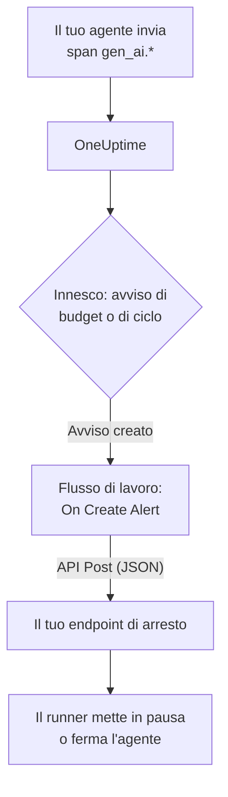

# Circuit breaker per agenti IA

Un agente IA raramente si guasta andando in crash. Si guasta andando avanti: riprova uno strumento rotto, ripianifica lo stesso passo o avvia altri sotto-agenti, mentre ogni giro fattura altri token. Questa pagina costruisce un circuit breaker per questo caso con pezzi che OneUptime ha già: un avviso che nota l'agente fuori controllo e un flusso di lavoro che chiama un tuo endpoint per fermarlo.

:::cards
- [Scegli un innesco](#scegli-un-innesco): Avvisa sulla spesa, o su uno strumento chiamato di continuo.
- [Costruisci l'endpoint di arresto](#costruisci-lendpoint-di-arresto): Il piccolo servizio che mette in pausa il tuo agente.
- [Costruisci il flusso di lavoro](#costruisci-il-flusso-di-lavoro): Da un nuovo avviso a una chiamata al tuo endpoint.
- [Prova il circuit breaker](#prova-il-circuit-breaker): Fallo scattare a mano, poi sul serio.
:::

## Come funziona



Il circuit breaker osserva l'OpenTelemetry che il tuo agente invia già, direttamente o [tramite un gateway](/docs/telemetry/ai-gateways), e agisce accanto al percorso delle richieste, non al suo interno. Non si aggiunge nulla a ogni chiamata al modello, e cambiare provider, SDK o gateway non lo rompe.

Il prezzo è la velocità: ferma un agente fuori controllo in minuti, non in millisecondi. Tieni i limiti di passi e i timeout nell'agente stesso, e lascia che il circuit breaker fermi ciò che sfugge.

| Innesco | Cosa rileva | Tempo fino all'avviso |
| --- | --- | --- |
| Un avviso di budget, da un monitor di metriche | Una spesa che continua a salire, qualunque ne sia la causa | Fino a 15 minuti, più un minuto per il monitor |
| Un avviso di ciclo, da un monitor di tracce | Lo stesso strumento chiamato di continuo | Da 1 a 5 minuti |

## Prima di iniziare

- Il tuo agente invia span GenAI a OneUptime. Vedi [Osservabilità IA / LLM](/docs/telemetry/ai-llm-observability).
- Un endpoint HTTPS in grado di mettere in pausa o fermare il runner del tuo agente, raggiungibile da OneUptime. Lo costruisci in [Costruisci l'endpoint di arresto](#costruisci-lendpoint-di-arresto).
- Il permesso di creare monitor e flussi di lavoro nel progetto.

## Scegli un innesco

I due inneschi finiscono allo stesso modo: un monitor crea un avviso, e il nuovo avviso avvia il flusso di lavoro. Puoi configurarli entrambi: al flusso di lavoro non importa quale sia scattato.

### Un avviso di budget

La spesa è il segnale più sicuro di un agente fuori controllo. Un budget somma ogni 15 minuti la spesa IA del giorno e la pubblica come due metriche, `oneuptime.llm.budget.spend.usd` e `oneuptime.llm.budget.percent.used`, ciascuna con l'ID del budget in `oneuptime.llm.budget.id`.

:::steps
1. Apri **Prodotti → AI / LLM → Budget** e fai clic su **Crea: LLM Cost Budget**. Imposta un **Budget giornaliero (USD)** e scegli il servizio dell'agente in **Servizio (facoltativo)**, così il budget sorveglia solo quell'agente.
2. Nel menu della riga del nuovo budget, scegli **Mostra ID** e copia l'ID.
3. Crea un [monitor di metriche](/docs/monitor/metrics-monitor) su `oneuptime.llm.budget.percent.used`, filtrato per l'attributo `oneuptime.llm.budget.id` con l'ID che hai copiato, e imposta il suo **Intervallo di tempo** su **Past 30 Minutes**.
4. Aggiungi un criterio **Greater Than Or Equal To** `100` che crei un avviso, e dagli un **Titolo dell'avviso** che nomini l'agente, come `LLM budget exceeded: support-bot`. Il flusso di lavoro e il tuo endpoint leggono entrambi quel titolo.
:::

Filtra per ID, non per nome: rinominare un budget rinomina la sua serie, e un monitor filtrato sul vecchio nome smetterebbe di corrispondere senza avvisare. Tieni l'intervallo a 30 minuti: un budget pubblica un punto ogni 15 minuti, quindi un intervallo più breve non trova nulla tra due punti e l'avviso si apre e si risolve di continuo.

Un secondo criterio a `80` con una gravità più bassa avvisa prima una persona, tramite la politica di reperibilità dell'avviso, prima che il circuit breaker scatti a `100`.

### Un avviso di ciclo

Un agente bloccato lascia una traccia riconoscibile: lo stesso span di strumento, di continuo. Un'esecuzione sana non chiama uno strumento decine di volte in pochi minuti, quindi un conteggio rileva il ciclo molto prima del budget.

:::steps
1. Apri **Monitor**, fai clic su **Crea monitor** e scegli **Tracce** in **Altri tipi di monitor**.
2. In **Altri campi**, imposta **Filtra per servizio di telemetria** sul servizio dell'agente e **Filtra per attributi** su `gen_ai.tool.name` uguale allo strumento su cui ti aspetti il ciclo, come `search_web`. Se la tua strumentazione dà un nome allo span di ogni strumento, metti invece quel nome in **Nome dello span**.
3. Imposta **Tracce del monitor per (time)** su **Ultimi 5 minuti**.
4. Aggiungi un criterio **Span Count** **Greater Than** un numero che nessuna esecuzione sana raggiunge in cinque minuti, come `50`, che crei un avviso intitolato ad esempio `Agent loop: support-bot`.
:::

Un secondo monitor di tracce con **Filtra per stato dello span** su **Errore** e un conteggio più basso rileva le tempeste di tentativi: uno strumento che continua a fallire e un agente che continua a riprovarlo.

## Costruisci l'endpoint di arresto

Il flusso di lavoro invia un `POST` con un corpo JSON a un endpoint che gestisci tu. Cosa significhi «fermare» lo decidi tu. Dall'effetto più piccolo al più grande:

| Azione | Effetto |
| --- | --- |
| Fermare il lavoro nuovo | Il runner non avvia nuove esecuzioni per quell'agente |
| Annullare le sue esecuzioni | Le esecuzioni in corso di quell'agente vengono annullate |
| Mettere in pausa il pool | Ogni worker si svuota finché qualcuno non riarma il circuit breaker |

Un endpoint minimo in Express che fa scattare un circuit breaker per agente:

```typescript title="circuit-breaker.ts"
import express from "express";

const app = express();
app.use(express.json());

const tripped = new Set<string>(); // agents whose breaker is open

app.post("/circuit-breaker", (req, res) => {
  if (req.headers["authorization"] !== `Bearer ${process.env.KILL_TOKEN}`) {
    return res.status(401).end();
  }

  const alertTitle: string = req.body.alertTitle ?? "";

  // "LLM budget exceeded: support-bot" -> "support-bot"
  const agent: string = alertTitle.split(": ").pop() ?? "unknown";

  tripped.add(agent); // your run loop checks this set
  abortActiveRuns(agent); // cancel that agent's runs in flight

  // Answer fast; do the slow cleanup in the background.
  return res.status(200).json({ tripped: agent });
});
```

Costruiscilo secondo queste regole:

- Rendi lo scatto idempotente. Un preavviso e un superamento, o un avviso di budget e uno di ciclo insieme, possono farlo scattare più di una volta, e un secondo scatto non deve cambiare nulla.
- Rispondi entro un secondo o due e fai la pulizia in background. Il flusso di lavoro considera un successo qualsiasi risposta 2xx.
- Richiedi un segreto. Chiunque possa chiamare l'endpoint può fermare i tuoi agenti, quindi verifica un token bearer, che il flusso di lavoro invia da una variabile globale segreta.
- Riarma a mano. Un circuit breaker scattato resta scattato finché qualcuno non ha esaminato l'esecuzione: apri la conversazione dell'agente in **Prodotti → AI / LLM → Conversazioni** per leggere o riprodurre quello che ha fatto.

La richiesta parte da OneUptime. Su OneUptime Cloud, il tuo endpoint deve essere raggiungibile da internet. Un'installazione self-hosted rifiuta gli indirizzi di rete privati a meno che un amministratore non li consenta: vedi [Accesso di rete in uscita](/docs/workflows/configuration#accesso-alla-rete-in-uscita).

## Costruisci il flusso di lavoro

Per prima cosa salva il token dell'endpoint dove il flusso di lavoro può usarlo senza mostrarlo: apri **Flussi di lavoro → Variabili globali**, fai clic su **Crea: Flusso di lavoro Variabile**, chiamala `AGENT_KILL_TOKEN`, metti il token in **Contenuto** e attiva **Segreto**. Un valore segreto viene rimosso dai registri delle esecuzioni e dalle tracce dei passi.

:::steps
### Crea il flusso

Apri **Prodotti → Flussi di lavoro** e fai clic su **Crea flusso di lavoro**. Fai clic su **Parti da zero**, chiamalo `AI agent circuit breaker` e fai clic su **Crea flusso di lavoro**. Si apre nel **Costruttore**, disattivato.

### Aggiungi il trigger

Fai clic sul blocco tratteggiato **Choose what starts this workflow** e scegli **On Create Alert** nel pannello **Add Trigger**. Fai clic sul trigger, spunta il titolo e la descrizione in **Select Fields** e fai clic su **Salva**. L'ID sul blocco, `alert-on-create-1`, è il modo in cui i blocchi successivi vi fanno riferimento.

### Controlla il titolo

Fai clic su **Aggiungi componente**, scegli **If / Else** e collega a esso il punto **Success** del trigger. Imposta **Value to check** sul titolo dell'avviso (fai clic su **{ }** e sceglilo), **Comparison** su **contiene** e **Compare with** sull'inizio comune ai titoli dei tuoi inneschi, come `LLM budget exceeded`.

### Chiama il tuo endpoint

Aggiungi **API Post (JSON)** e collega a esso il punto **Yes** dell'**If / Else**. Imposta il suo **URL** sul tuo endpoint, come `https://agents.example.com/circuit-breaker`, e compila le intestazioni e il corpo qui sotto.

### Segnala un errore

Aggiungi **Send Message to Slack**, o **Send Email**, e collega a esso il punto **Error** del blocco API. Un circuit breaker che non riesce a scattare è proprio l'avviso che una persona deve vedere.

### Attivalo

Attiva **Abilitato** in cima al **Costruttore**.
:::

Le **Request Headers** del blocco API:

```json title="Request Headers"
{
  "Authorization": "Bearer {{global.variables.AGENT_KILL_TOKEN}}",
  "Content-Type": "application/json"
}
```

Il suo **Request Body**:

```json title="Request Body"
{
  "source": "oneuptime-circuit-breaker",
  "alertId": "{{local.components.alert-on-create-1.returnValues.model._id}}",
  "alertTitle": "{{local.components.alert-on-create-1.returnValues.model.title}}",
  "alertDescription": "{{local.components.alert-on-create-1.returnValues.model.description}}"
}
```

Per reagire a più inneschi, fai iniziare tutti i loro titoli allo stesso modo, o concatena altri blocchi **If / Else** dal punto **No**. Vedi [Creare un flusso di lavoro](/docs/workflows/authoring) per la tela e [Variabili](/docs/workflows/variables) per i riferimenti `{{…}}`.

## Prova il circuit breaker

:::steps
1. Fallo scattare a mano. Apri **Avvisi**, fai clic su **Crea avviso** e creane uno intitolato `LLM budget exceeded: test`. L'esecuzione compare in **Flussi di lavoro → Registri → Esecuzioni**, e il tuo endpoint riceve la chiamata.
2. Fallo scattare sul serio. Crea un budget con un limite minuscolo, come `0.01` USD, sul servizio di un agente di prova, punta un monitor di budget su di esso e lascia girare l'agente: la percentuale supera 100, l'avviso si apre, il flusso di lavoro si esegue e il circuit breaker scatta. Per l'avviso di ciclo, dai a un agente di prova uno strumento che fallisce sempre.
3. Fallo scattare due volte. Crea di nuovo lo stesso avviso: il tuo endpoint deve accettare il secondo scatto senza cambiare nulla.
:::

## Come si comporta il circuit breaker nel tempo

- Il flusso di lavoro si esegue quando viene creato un avviso, quindi un innesco fa scattare il circuit breaker una volta per avviso, non una volta per valutazione.
- Un budget conta il giorno UTC, quindi la sua percentuale riparte da 0 a mezzanotte UTC. Un avviso di budget può quindi risolversi, e il giorno storto successivo apre un nuovo avviso che fa scattare di nuovo il circuit breaker.
- Un monitor tiene aperto il suo avviso finché i suoi criteri sono soddisfatti. Con **Risoluzione automatica dell'avviso** attiva, l'avviso si risolve quando smettono di esserlo, e il superamento successivo apre un nuovo avviso.
- Riarmare è una decisione di una persona, da entrambe le parti: risolvi l'avviso in OneUptime e riarma il circuit breaker nel tuo runner.
- Ogni nuovo avviso del progetto avvia il flusso di lavoro. È l'**If / Else** a tenere gli altri avvisi lontani dal circuit breaker: non toglierlo.

## Risoluzione dei problemi

:::details Il flusso di lavoro non si esegue
Controlla che **Abilitato** sia attivo in cima al **Costruttore**: i flussi di lavoro vengono creati disattivati. Poi controlla che l'avviso sia stato creato dopo aver attivato il flusso di lavoro: il trigger avvia un'esecuzione solo per un avviso nuovo.
:::

:::details Il flusso di lavoro si esegue, ma prende sempre il ramo No
Il titolo è vuoto o non corrisponde. Un campo non spuntato in **Select Fields** del trigger arriva vuoto, quindi spunta il titolo. Poi confronta il titolo dell'avviso con **Compare with**: **contiene** deve trovarvi esattamente quel testo.
:::

:::details Il tuo endpoint risponde 401
L'intestazione `Authorization` non corrisponde al token che il tuo endpoint si aspetta. Controlla il nome in `{{global.variables.AGENT_KILL_TOKEN}}` e il valore salvato nella variabile globale. Il valore di una variabile segreta non si può rileggere, quindi nel dubbio riscrivilo con **Update Content**.
:::

:::details L'avviso di budget si apre e si risolve di continuo
L'**Intervallo di tempo** del monitor è più breve dei 15 minuti tra due punti del budget. Impostalo su **Past 30 Minutes**.
:::

:::details La richiesta non raggiunge mai il tuo endpoint
Apri l'esecuzione in **Flussi di lavoro → Registri → Esecuzioni** e il passo **API Post (JSON)**: dice perché la richiesta è fallita. Su OneUptime Cloud, l'endpoint deve essere raggiungibile da internet; un'installazione self-hosted rifiuta gli indirizzi di rete privati a meno che un amministratore non li consenta.
:::

## Passaggi successivi

:::cards
- [Osservabilità IA / LLM](/docs/telemetry/ai-llm-observability): Budget, costi e gli span che il circuit breaker sorveglia.
- [Monitor di tracce](/docs/monitor/traces-monitor): Filtri sugli span e criteri nel dettaglio.
- [Flussi di lavoro](/docs/workflows/index): Trigger, componenti, variabili ed esecuzioni.
- [Gateway IA](/docs/telemetry/ai-gateways): Le chiamate al modello di tutti gli agenti con un solo export.
:::
