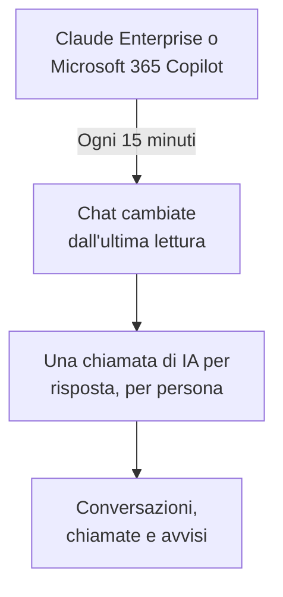

# Strumenti di IA aziendali

Guarda cosa chiedono le tue persone agli strumenti di IA che la tua azienda paga, come conversazioni per persona. Collega Claude Enterprise o Microsoft 365 Copilot con una credenziale che può solo leggere, e OneUptime porta ogni nuova chat in **Conversazioni** ogni 15 minuti. Solo i proprietari e gli amministratori del progetto possono leggerle, a meno che tu non decida diversamente.

:::cards
- [Avvisa prima le tue persone](#avvisa-prima-le-tue-persone): Le loro chat sono parole loro.
- [Collegare uno strumento](#collegare-uno-strumento): Incolla la credenziale, scegli chi può leggere, provala e collega.
- [Privacy](#privacy): Chi può leggere le conversazioni, e se le parole vengono conservate.
- [Altri strumenti di IA](#altri-strumenti-di-ia): ChatGPT Enterprise, Gemini, Open WebUI, LibreChat e assistenti di programmazione.
:::

## Avvisa prima le tue persone

> [!IMPORTANT]
> Sono le parole delle tue persone. Prima di collegare uno strumento, di' loro che le loro chat con esso vengono conservate e chi può leggerle, e verifica con il tuo ufficio legale o HR cosa chiedono le vostre policy e la legge locale.

## Come funziona

Ogni 15 minuti, OneUptime chiede allo strumento le chat cambiate dalla sua ultima lettura. Ogni risposta diventa una chiamata di IA della persona che ha chiesto, con le domande fatte dalla risposta precedente, e ogni chat diventa una conversazione.

Le chat arrivano come le chiamate di IA delle tue app, quindi regole di scrub, filtri di scarto, conservazione e avvisi di IA si applicano anche a loro. Gli strumenti si pagano per postazione, quindi queste chiamate non portano né token né costi. Una domanda senza risposta per un'ora arriva da sola, così anche una chat a cui l'IA non ha mai risposto compare.

## Prima di iniziare

- Il ruolo Project Owner o Project Admin. Solo loro possono collegare, modificare o rimuovere uno strumento.
- Un amministratore dello strumento, per creare la credenziale: la sezione di ogni strumento, più sotto, dice quale.
- Le tue persone avvisate, e la risposta del tuo ufficio legale o HR.

## Collegare uno strumento

:::steps
### Apri Collega

Apri **Prodotti → AI / LLM → Collega**. In **Gli strumenti di IA della tua azienda**, fai clic sul riquadro dello strumento.

### Incolla la credenziale

In **Credenziali**, compila ciò che lo strumento chiede. I segreti sono salvati cifrati e non vengono mai più mostrati.

### Scegli chi può leggere

In **Privacy**, imposta **Chi può leggere le conversazioni** e **Conserva ciò che è stato scritto**, come spiega [Privacy](#privacy).

### Provala

In **Test**, fai clic su **Testa la connessione**. OneUptime conta le chat degli ultimi 7 giorni: niente di ciò che qualcuno ha scritto viene letto, mostrato o conservato.

### Collega

Fai clic su **Collega**. La prima lettura parte entro un minuto e porta gli ultimi 7 giorni.
:::

## Claude Enterprise

OneUptime legge ogni chat di claude.ai della tua organizzazione tramite la Compliance API: chi ha chiesto, cosa è stato chiesto a Claude, cosa ha risposto e quale modello ha usato. Una chat che riceve un nuovo messaggio viene riletta, e le risposte già portate vengono riconosciute e saltate.

:::steps
### Attiva la Compliance API

Il proprietario principale della tua organizzazione apre Organization settings, API in claude.ai e attiva la Compliance API.

### Crea una chiave di accesso di conformità

Lì, crea una chiave con lo scope `read:compliance_user_data`. Inizia con `sk-ant-api01-`.

### Collega Claude Enterprise

Incolla la chiave come **Chiave di accesso di conformità**.
:::

## Microsoft 365 Copilot

OneUptime legge la cronologia delle interazioni con Copilot di ogni persona da Microsoft Graph: cosa ha chiesto a Copilot in Teams, Outlook, Word, Excel, PowerPoint, Loop o Copilot Chat, cosa ha risposto e in quale app. Un prompt e le sue risposte diventano una chiamata di IA, e una sessione di Copilot una conversazione. Un tenant grande viene letto a parti, riprendendo da dove si è fermata l'ultima lettura.

:::steps
### Registra un'app

In Microsoft Entra ID, registra un'app e crea un segreto client per essa.

### Concedi le autorizzazioni

Dai all'app le autorizzazioni applicative `AiEnterpriseInteraction.Read.All` e `User.Read.All` di Microsoft Graph, e concedi il consenso amministratore.

### Collega Copilot

Compila **ID directory (tenant)**, **ID applicazione (client)** e **Segreto client**. Per leggere solo alcune persone, metti l'ID oggetto di un gruppo in **Solo le persone di questo gruppo**, in **Altri campi**, e dai all'app anche `GroupMember.Read.All`. Per Azure Government, cambia lì **Cloud**.
:::

## Privacy

| Impostazione | Cosa fa |
| --- | --- |
| **Chi può leggere le conversazioni** | **Proprietari e amministratori del progetto**, il valore predefinito: nessun altro nel progetto vede queste conversazioni, né le chiamate di IA di cui sono fatte, in nessun punto di OneUptime. **Tutti coloro che possono leggere le chiamate IA**: chiunque possa leggere le tracce del progetto. |
| **Conserva ciò che è stato scritto** | Attivo, il valore predefinito: le domande e le risposte vengono conservate. Disattivo: OneUptime conserva chi ha chiesto, quando, con quale modello e in quale app, ma non le parole. |

Una modifica di chi può leggere si applica entro un minuto. Disattivare **Conserva ciò che è stato scritto** vale per le chat lette dopo; ciò che è stato conservato prima resta fino alla fine della sua conservazione.

Per conservare le parole ma mascherarne delle parti, come indirizzi email o numeri di carta, usa **Regole di mascheramento** in **Tracce → Impostazioni**: si applicano prima che qualcosa venga salvato. Le conversazioni restano finché il servizio della connessione conserva le sue tracce: vedi [Conservazione dei dati](/docs/telemetry/data-retention). Rimuovere una connessione ferma le sue letture; ciò che ha letto resta, leggibile dalle stesse persone, fino alla fine della sua conservazione.

## Altri strumenti di IA

Questi strumenti non hanno un'API con cui OneUptime possa leggere le chat delle persone, o richiedono un'altra strada.

### ChatGPT Enterprise

OpenAI apre la sua Compliance API a un workspace solo su richiesta e non pubblica cosa contengono i suoi record, quindi OneUptime non può ancora leggere le chat di ChatGPT Enterprise. Collegare la tua organizzazione OpenAI come [account del provider](/docs/telemetry/ai-provider-accounts#openai) mostra il suo utilizzo e costo API, che non includono ChatGPT.

### Gemini per Google Workspace

Google non offre alcuna API per leggere le chat di Gemini delle persone. Google Vault le conserva per l'eDiscovery.

### Assistenti di programmazione

Claude Code, Codex, Gemini CLI, GitHub Copilot e Cursor inviano il proprio OpenTelemetry: vedi [Assistenti di programmazione IA](/docs/telemetry/ai-coding-assistants).

### Open WebUI e LibreChat

Le app di chat self-hosted chiamano i modelli tramite un'API che imposti tu. Metti un proxy LiteLLM davanti ai modelli e invia le sue tracce a OneUptime come mostra [Gateway IA](/docs/telemetry/ai-gateways#litellm-proxy): i prompt e le risposte di ogni chat arrivano come chiamate di IA. Una chiave virtuale per persona dice chi ha chiesto; una chiave condivisa da tutti non indica nessuno. L'esportazione OpenTelemetry propria di Open WebUI traccia le sue richieste web e le chiamate al database, non le chat.

## Risoluzione dei problemi

:::details Il test non trova chat
Nessuno ha usato lo strumento negli ultimi 7 giorni, oppure la credenziale appartiene a un'altra organizzazione o a un altro tenant. Per Copilot, controlla che il gruppo in **Solo le persone di questo gruppo** sia quello che intendi.
:::

:::details La credenziale funziona, ma non può leggere ciò che serve alla connessione
Per Copilot, concedi il consenso amministratore per le autorizzazioni Graph dell'app, e anche `GroupMember.Read.All` quando indichi un gruppo. Per Claude Enterprise, crea la chiave con lo scope `read:compliance_user_data`.
:::

:::details Qualcuno non vede le conversazioni
**Chi può leggere le conversazioni** è impostato su **Proprietari e amministratori del progetto**. Un proprietario o un amministratore può cambiarlo con **Modifica** nella riga della connessione.
:::

:::details Le conversazioni mostrano chi ha chiesto, ma non le parole
**Conserva ciò che è stato scritto** era disattivo quando sono state lette. Attivarlo vale per le chat lette dopo.
:::

## Passi successivi

:::cards
- [Osservabilità IA / LLM](/docs/telemetry/ai-llm-observability): Leggi e riproduci le conversazioni, e scopri quando le risposte vanno storte.
- [Account dei provider di IA](/docs/telemetry/ai-provider-accounts): Utilizzo e costo dei tuoi account OpenAI, Anthropic, Azure, Bedrock e Vertex AI.
- [Assistenti di programmazione IA](/docs/telemetry/ai-coding-assistants): Spesa per ingegnere degli strumenti di programmazione.
- [Conservazione dei dati](/docs/telemetry/data-retention): Per quanto tempo restano le conversazioni.
:::
