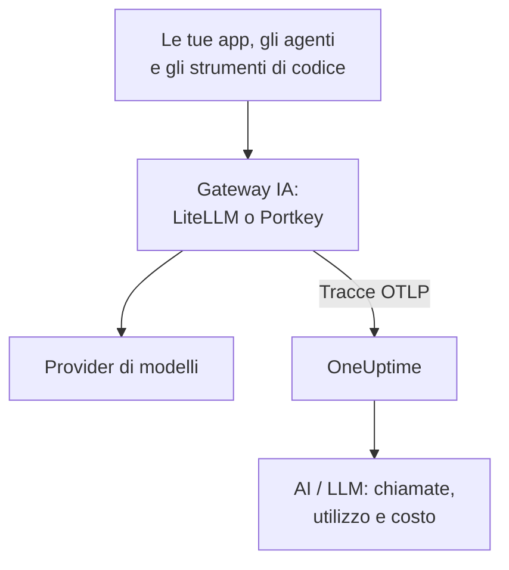

# Gateway IA (LiteLLM, Portkey)

Un gateway IA sta tra le tue app e i provider di modelli, quindi ogni chiamata al modello passa da lì. Invia una volta l'OpenTelemetry del gateway a OneUptime, e ogni chiamata che c'è dietro arriva in [AI / LLM](/docs/telemetry/ai-llm-observability) con modello, token, costo e, a meno che tu non lo disattivi, il prompt e la risposta, senza strumentare ogni app.

:::cards
- [LiteLLM Proxy](#litellm-proxy): Export integrato, impostato con tre variabili.
- [Chi ha speso cosa](#una-chiave-virtuale-per-dipendente): Una chiave virtuale LiteLLM per dipendente nomina ogni persona.
- [Portkey](#portkey): Export integrato sui gateway self-hosted; altrove, strumenta l'app.
- [Verifica che le chiamate arrivino](#verifica-che-le-chiamate-arrivino): Cosa dovresti vedere, e cosa fare se non lo vedi.
:::

## Come funziona



| | LiteLLM Proxy | Portkey, self-hosted o Enterprise | Portkey, open source o ospitato |
| --- | --- | --- | --- |
| Export verso OneUptime | Integrato | Integrato, sperimentale | Nessuno: strumenta invece l'app |
| Endpoint da impostare | `https://oneuptime.com/otlp/v1/traces` | `https://oneuptime.com/otlp` | L'exporter proprio dell'app |
| Nomina ogni persona | Sì, con una chiave virtuale per dipendente | No | Solo ciò che l'app invia |
| Prompt e risposte | Inviati a meno che tu non li disattivi | Sempre inviati | Dipende dalla strumentazione |

## Prima di iniziare

- Una chiave di ingestione: apri **Impostazioni del progetto → Telemetria e APM → Chiavi di acquisizione** e fai clic su **Crea chiave di ingestione**.
- Il tuo URL di base OTLP: `https://oneuptime.com/otlp`, oppure `https://YOUR-ONEUPTIME-HOST/otlp` se ospiti OneUptime tu stesso. OneUptime accetta OTLP su HTTP, in protobuf e in JSON.
- La chiave viaggia nell'intestazione `x-oneuptime-token` di ogni richiesta di export.

## LiteLLM Proxy

Il callback OpenTelemetry di LiteLLM fa parte del proxy open source, e l'immagine Docker ufficiale (`ghcr.io/berriai/litellm`) include i pacchetti di cui ha bisogno.

:::steps
### Attiva il callback otel

Aggiungi `otel` ai callback nel `config.yaml` del proxy:

```yaml title="config.yaml"
model_list:
  - model_name: gpt-4o
    litellm_params:
      model: openai/gpt-4o
      api_key: os.environ/OPENAI_API_KEY

litellm_settings:
  callbacks: ["otel"]
```

### Punta l'exporter su OneUptime

Imposta tre variabili sul proxy:

```bash
export OTEL_EXPORTER="otlp_http"
export OTEL_ENDPOINT="https://oneuptime.com/otlp/v1/traces"
export OTEL_HEADERS="x-oneuptime-token=YOUR_INGESTION_TOKEN"
```

### Avvia il proxy

:::tabs
@tab Docker
```bash
docker run \
  -v $(pwd)/config.yaml:/app/config.yaml \
  -e OPENAI_API_KEY="sk-..." \
  -e OTEL_EXPORTER="otlp_http" \
  -e OTEL_ENDPOINT="https://oneuptime.com/otlp/v1/traces" \
  -e OTEL_HEADERS="x-oneuptime-token=YOUR_INGESTION_TOKEN" \
  -e OTEL_SERVICE_NAME="litellm-gateway" \
  -p 4000:4000 \
  ghcr.io/berriai/litellm:main-stable \
  --config /app/config.yaml
```
@tab pip
```bash
pip install 'litellm[proxy]' opentelemetry-api opentelemetry-sdk opentelemetry-exporter-otlp
litellm --config config.yaml
```
:::

`litellm[proxy]` da solo non include i pacchetti OpenTelemetry, quindi installali insieme.

### Fai passare una richiesta

Chiama il proxy una volta, poi controlla AI / LLM come descritto in [Verifica che le chiamate arrivino](#verifica-che-le-chiamate-arrivino).
:::

| Variabile | Valore | Note |
| --- | --- | --- |
| `OTEL_EXPORTER` | `otlp_http` | Letta anche come `OTEL_EXPORTER_OTLP_PROTOCOL` |
| `OTEL_ENDPOINT` | `https://oneuptime.com/otlp/v1/traces` | Il percorso completo `/v1/traces` funziona con ogni versione di LiteLLM; letta anche come `OTEL_EXPORTER_OTLP_ENDPOINT` |
| `OTEL_HEADERS` | `x-oneuptime-token=YOUR_INGESTION_TOKEN` | Coppie `key=value` separate da virgole; letta anche come `OTEL_EXPORTER_OTLP_HEADERS` |
| `OTEL_SERVICE_NAME` | Il nome del tuo gateway | Il servizio sotto cui compaiono le sue chiamate; `litellm` se non impostata |

### Cosa invia LiteLLM

Ogni chiamata porta `gen_ai.system`, `gen_ai.request.model`, `gen_ai.response.model`, `gen_ai.usage.input_tokens` e `gen_ai.usage.output_tokens`, i suoi parametri, il prompt e la risposta: tutto ciò che serve a OneUptime per [leggere la chiamata](/docs/telemetry/ai-llm-observability).

Da LiteLLM 1.81, questi attributi stanno sullo span `Received Proxy Server Request` della richiesta, e non c'è più uno span `litellm_request` separato. Quando una richiesta fa più chiamate al modello, ogni chiamata lì sovrascrive gli attributi della precedente, quindi imposta `USE_OTEL_LITELLM_REQUEST_SPAN=true` per avere uno span `litellm_request` per ogni chiamata.

LiteLLM prezza ogni chiamata da sé, incluse le tariffe personalizzate impostate sul proxy, e riporta il prezzo come `gen_ai.cost.total_cost`. OneUptime preferisce un costo riportato alla propria stima, e [stima dai token](/docs/telemetry/ai-llm-observability) solo quando LiteLLM non è riuscito a prezzare la chiamata, come con un modello personalizzato senza prezzo impostato.

### Una chiave virtuale per dipendente

Dai a ogni persona la sua chiave virtuale LiteLLM, e ogni sua chiamata arriva con la sua identità. LiteLLM scrive sullo span l'ID, l'email e il team del proprietario della chiave, e OneUptime li legge come il dipendente e il team, così la scheda **Utilizzo** ordina la spesa per persona senza configurare nulla sulle loro macchine.

Le chiavi virtuali richiedono un database e una chiave master sul proxy (`DATABASE_URL` e `LITELLM_MASTER_KEY`). Crea un utente con la sua email, poi una chiave per quell'utente:

```bash
curl -X POST "http://localhost:4000/user/new" \
  -H "Authorization: Bearer YOUR_MASTER_KEY" \
  -H "Content-Type: application/json" \
  -d '{"user_email": "alice@example.com"}'

curl -X POST "http://localhost:4000/key/generate" \
  -H "Authorization: Bearer YOUR_MASTER_KEY" \
  -H "Content-Type: application/json" \
  -d '{"user_id": "USER_ID_FROM_THE_FIRST_CALL", "team_id": "platform"}'
```

| Attributo di span di LiteLLM | OneUptime lo legge come |
| --- | --- |
| `metadata.user_api_key_user_id` | L'ID del dipendente |
| `metadata.user_api_key_user_email` | L'email del dipendente |
| `metadata.user_api_key_team_id` | Il team |
| `metadata.user_api_key_end_user_id` | Mai il dipendente: è lo `user` che la tua app invia per il proprio cliente |

Nella modalità OpenTelemetry v2 di LiteLLM gli stessi valori arrivano con il prefisso `litellm.` (`litellm.metadata.user_api_key_user_email` e così via), che OneUptime legge ugualmente.

### Tieni fuori i prompt

Il callback `otel` invia per impostazione predefinita prompt e risposte completi. Per tenerli fuori, usa una di queste opzioni:

:::tabs
@tab Tutti i callback
```yaml title="config.yaml"
litellm_settings:
  callbacks: ["otel"]
  turn_off_message_logging: true
```
@tab Solo il callback OTel
```yaml title="config.yaml"
litellm_settings:
  callbacks: ["otel"]

callback_settings:
  otel:
    message_logging: False
```
@tab Variabile d'ambiente
```bash
export OTEL_INSTRUMENTATION_GENAI_CAPTURE_MESSAGE_CONTENT="NO_CONTENT"
```
:::

`callback_settings` è una chiave di primo livello, non una chiave sotto `litellm_settings`. Per tenere i prompt ma mascherarne delle parti, usa invece le regole di pulizia in **Tracce → Impostazioni**.

:::details La modalità OpenTelemetry v2 di LiteLLM
Le versioni recenti di LiteLLM hanno una modalità OpenTelemetry v2 opzionale (`LITELLM_OTEL_V2=true`, nessuna modifica a `config.yaml`). Invia una traccia per richiesta, con la gestione HTTP, l'autenticazione, i guardrail e la chiamata al modello come span GenAI con nomi come `chat gpt-4o`. Nella modalità v2 i prompt sono disattivati per impostazione predefinita; attivali con `OTEL_INSTRUMENTATION_GENAI_CAPTURE_MESSAGE_CONTENT`. Il suo costo arriva come `litellm.cost.total`, che OneUptime legge ugualmente. Usa una modalità o l'altra, non entrambe.
:::

## Portkey

Cosa può inviare Portkey dipende da come lo esegui:

| Distribuzione | Export verso OneUptime |
| --- | --- |
| Gateway self-hosted o Enterprise | Integrato (sperimentale): imposta le variabili qui sotto |
| Gateway open source (`portkey-ai/gateway`) | Nessuno: strumenta l'app che lo chiama |
| Gateway ospitato (portkey.ai) | Nessuno sul gateway: strumenta l'app che lo chiama |

Portkey ha anche un proprio endpoint OpenTelemetry (`api.portkey.ai/v1/otel`). Riceve tracce dentro Portkey, la direzione opposta a quella di questa pagina.

### Gateway self-hosted ed Enterprise

Imposta queste variabili sul container del gateway:

```yaml title="docker-compose.yml"
services:
  portkey-gateway:
    environment:
      EXPERIMENTAL_GEN_AI_OTEL_TRACES_ENABLED: "true"
      EXPERIMENTAL_GEN_AI_OTEL_EXPORTER_OTLP_ENDPOINT: "https://oneuptime.com/otlp"
      EXPERIMENTAL_GEN_AI_OTEL_EXPORTER_OTLP_HEADERS: "x-oneuptime-token=YOUR_INGESTION_TOKEN"
```

- Indica l'URL di base OTLP: Portkey aggiunge `/v1/traces` da sé.
- Le intestazioni sono coppie `key=value` separate da virgole. `EXPERIMENTAL_GEN_AI_OTEL_RESOURCE_ATTRIBUTES` aggiunge attributi di risorsa allo stesso modo, come `deployment.environment=production`.
- Portkey invia OTLP su HTTP solo in JSON, che OneUptime accetta senza un collector in mezzo.
- Ogni chiamata è uno span chiamato `{operation} {model}`, come `chat gpt-4o`, sotto il servizio `portkey`, con `gen_ai.provider.name`, il modello richiesto e quello servito, i conteggi dei token, `gen_ai.conversation.id`, e i messaggi in `gen_ai.input.messages` e `gen_ai.output.messages`.
- Prompt e risposte completi sono sempre inclusi. Maschera ciò che serve con le regole di pulizia in **Tracce → Impostazioni**.
- Ogni chiamata viene inviata da sola dopo la risposta, senza raggruppamento e senza nuovi tentativi: un export fallito è perso. Trattalo come osservabilità, non come registro di audit.
- Quando il tuo `x-portkey-trace-id` è un ID di traccia valido (32 caratteri esadecimali), Portkey lo riusa, così gli span del gateway si uniscono alla traccia della tua app.

Portkey segnala questo export come sperimentale. Se le variabili non hanno effetto, confronta la documentazione attuale di Portkey con la versione del tuo gateway.

### Gateway open source e ospitati

Il gateway open source non ha un exporter, e sul gateway ospitato non puoi impostarne le variabili. Strumenta invece l'app che chiama Portkey. Portkey parla l'API di OpenAI, quindi le strumentazioni GenAI di [Osservabilità IA / LLM](/docs/telemetry/ai-llm-observability) (OpenLLMetry, OpenInference, OpenLIT) tracciano le chiamate del tuo SDK anche quando l'URL di base punta a Portkey:

```python
from traceloop.sdk import Traceloop
from openai import OpenAI

Traceloop.init(
    app_name="my-ai-agent",
    api_endpoint="https://oneuptime.com/otlp",
    headers={"x-oneuptime-token": "YOUR_INGESTION_TOKEN"},
)

client = OpenAI(
    base_url="https://api.portkey.ai/v1",   # or your gateway's URL
    default_headers={"x-portkey-api-key": "PORTKEY_API_KEY"},
)
# Calls through Portkey are now traced to OneUptime.
```

Questi span descrivono la chiamata come l'ha fatta la tua app: il modello richiesto, il tempo di attesa, i token ricevuti. Quello che il gateway ha deciso lungo la strada, come un fallback, un nuovo tentativo o un risultato dalla cache, resta in Portkey. Per vederlo in OneUptime, usa l'export del gateway self-hosted.

## Verifica che le chiamate arrivino

:::steps
1. Invia una richiesta attraverso il gateway e attendi qualche secondo.
2. Apri **Prodotti → AI / LLM → Chiamate**. La chiamata compare con il provider, il modello e i token.
3. Fai clic sulla chiamata per aprire la sua traccia, poi apri la scheda **LLM** dello span: il modello, i token, i parametri e, a meno che tu non li abbia disattivati, il prompt e la risposta.
4. Apri **Utilizzo**: la chiamata conta nei totali, con il costo riportato dal gateway o quello stimato da OneUptime.
:::

## Risoluzione dei problemi

:::details Da LiteLLM non arriva nulla
Imposta per un momento `OTEL_EXPORTER="console"`. Se nell'output del proxy compaiono span, LiteLLM sta tracciando, e il problema è l'endpoint o la chiave. `DEBUG_OTEL="true"` mostra cosa fa l'exporter.
:::

:::details La chiave viene rifiutata
OneUptime risponde `401` a una chiave mancante, sconosciuta o scaduta, e `422` a una chiave disattivata o a una chiave del browser. Crea una chiave server in **Impostazioni del progetto → Telemetria e APM → Chiavi di acquisizione** e inviala in `x-oneuptime-token`.
:::

:::details L'endpoint è sbagliato
LiteLLM vuole il percorso completo, `https://oneuptime.com/otlp/v1/traces`. Portkey vuole l'URL di base, `https://oneuptime.com/otlp`, e aggiunge `/v1/traces` da sé.
:::

:::details Gli span arrivano, ma non in AI / LLM
Filtra **Tracce** per il servizio del gateway (`litellm`, `portkey` o il tuo `OTEL_SERVICE_NAME`) per vederne gli span grezzi. Uno span conta come chiamata al modello solo quando porta attributi `gen_ai.*`: controlla che il callback sia `otel` e che la chiamata sia andata a un modello.
:::

:::details La spesa risulta non attribuita
Le chiamate non nominano nessuna persona. Dai a ogni dipendente la sua chiave virtuale, come in [Una chiave virtuale per dipendente](#una-chiave-virtuale-per-dipendente). Il campo `user` che la tua app invia nomina il suo cliente, non il dipendente, e non viene mai letto come il dipendente.
:::

:::details Di più chiamate compare solo l'ultima
Da LiteLLM 1.81, le chiamate al modello di una richiesta condividono uno span. Imposta `USE_OTEL_LITELLM_REQUEST_SPAN=true` per avere uno span per ogni chiamata.
:::

## Passaggi successivi

:::cards
- [Osservabilità IA / LLM](/docs/telemetry/ai-llm-observability): Conversazioni, avvisi, utilizzo e budget di costo giornalieri per queste chiamate.
- [Assistenti di codice IA](/docs/telemetry/ai-coding-assistants): Metti un gateway davanti agli strumenti che non inviano telemetria propria.
- [Circuit breaker per agenti IA](/docs/telemetry/ai-agent-circuit-breaker): Ferma un agente fuori controllo quando scatta il suo avviso.
- [Monitor di tracce](/docs/monitor/traces-monitor): Avvisa su schemi di span, come uno strumento chiamato in un ciclo.
:::
