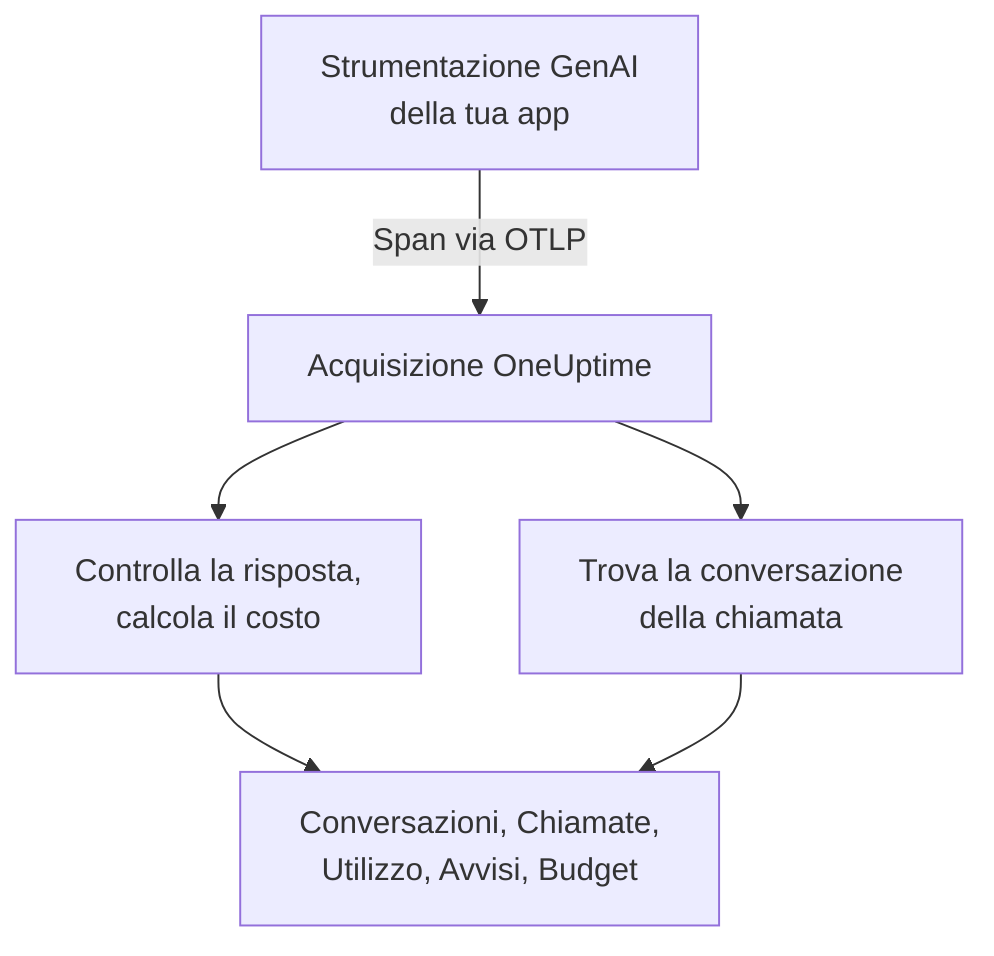
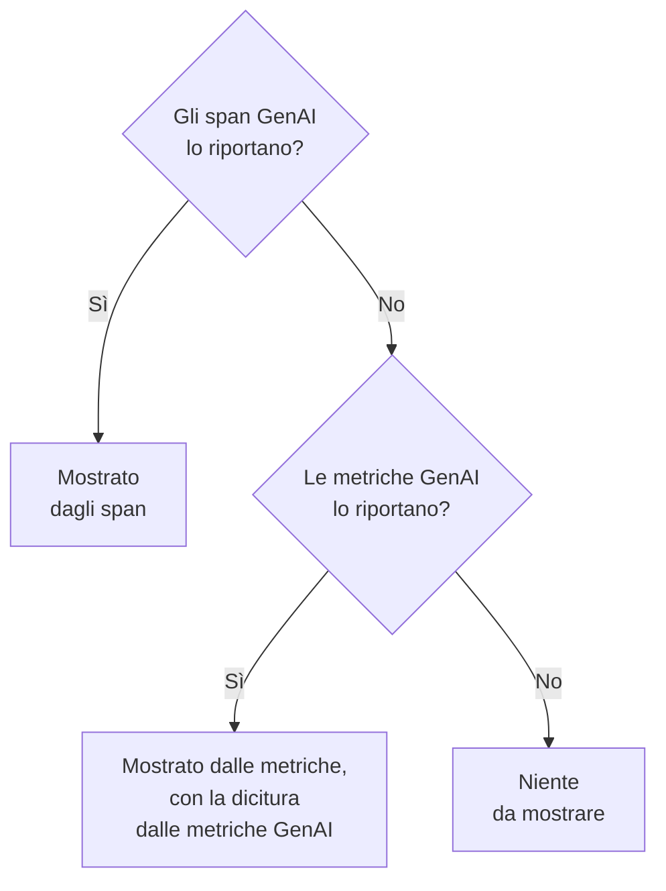

# Osservabilità IA / LLM

Leggi ogni conversazione avuta dalla tua IA, riproducila così come è avvenuta e vieni avvisato quando risponde male. OneUptime costruisce tutto a partire da OpenTelemetry standard: se la tua app invia span con le **convenzioni semantiche GenAI** (`gen_ai.*`), ottieni conversazioni, avvisi, utilizzo e costi, senza un SDK proprietario.

:::cards
- [Configuralo](#configuralo-in-cinque-passaggi): Cinque passaggi, dal primo span alle risposte segnalate.
- [Riproduci una conversazione](#leggi-e-riproduci-una-conversazione): Leggi una chat come l'ha vista la persona, al ritmo in cui è avvenuta.
- [Ricevi avvisi](#vieni-avvisato-quando-lia-risponde-male): Avvisi pronti per le risposte che falliscono, vengono rifiutate, troncate, segnalate o sono lente.
- [Tieni d'occhio la spesa](#guarda-chi-spende-cosa): Il costo per persona, team, modello e app, con budget giornalieri.
:::

## Come funziona

La strumentazione GenAI della tua app esporta ogni chiamata al modello come uno span OpenTelemetry. Quando lo span arriva, OneUptime legge i suoi attributi `gen_ai.*`, controlla se la risposta ha problemi, calcola il costo della chiamata e la archivia nella sua conversazione.



Apri **Prodotti → AI / LLM**, sotto **Osservabilità**. Il prodotto ha sette schede:

| Scheda | Cosa mostra |
| --- | --- |
| **Conversazioni** | Ogni conversazione avuta dalla tua IA, prima quelle che richiedono attenzione. Sopra l'elenco: conversazioni, risposte dell'IA, quante richiedono attenzione, costo e il tempo di risposta tipico. |
| **Chiamate** | Ogni chiamata di modello, embedding, agente e strumento. Filtra per servizio, provider, modello, operazione, persona, team o conversazione; fai clic su una chiamata per aprirla nel visualizzatore di tracce. |
| **Utilizzo** | Chiamate, token e costo di un intervallo di tempo, ordinati per dipendente, team, modello, provider o app. |
| **Avvisi** | Avvisi pronti per quando l'IA risponde male, e i tuoi monitor IA / LLM. |
| **Budget** | Limiti di costo giornalieri, pubblicati come metriche su cui impostare avvisi. |
| **Prezzi** | I tuoi prezzi per i modelli che il listino integrato non conosce. |
| **Configurazione** | I cinque passaggi qui sotto, con l'endpoint del tuo progetto. |

Nel visualizzatore di tracce, lo span di ogni chiamata di IA ha anche una scheda **LLM**: provider, modello, token, costo, parametri della richiesta, e il prompt e la risposta.

## Prima di iniziare

- Un progetto OneUptime in cui puoi creare una chiave di acquisizione della telemetria.
- Un'app che chiama un modello, e una strumentazione GenAI per il suo linguaggio: **OpenLLMetry** (Traceloop), **OpenInference** (Arize), il **Vercel AI SDK**, o le strumentazioni OpenTelemetry per OpenAI, Anthropic e Gemini.

> [!TIP]
> Il traffico verso i modelli che passa da un gateway come LiteLLM o Portkey si può esportare dal gateway invece che da ogni app: vedi [Gateway IA](/docs/telemetry/ai-gateways). Per gli assistenti di programmazione usati dai tuoi ingegneri, vedi [Assistenti di programmazione IA](/docs/telemetry/ai-coding-assistants).

## Configuralo in cinque passaggi

Il primo passaggio è tutto ciò che serve per vedere le chiamate. Ogni passaggio successivo mostra di più.

:::steps
### Invia le chiamate di IA

Crea una chiave di acquisizione in **Impostazioni del progetto → Telemetria e APM → Chiavi di acquisizione** (l'[avvio rapido di OpenTelemetry](/docs/telemetry/open-telemetry#creare-una-chiave-di-acquisizione) ti guida). Poi punta la tua strumentazione verso OneUptime:

:::tabs
@tab Python
```bash
pip install traceloop-sdk opentelemetry-exporter-otlp
```

```python
from traceloop.sdk import Traceloop

Traceloop.init(
    app_name="my-ai-agent",
    api_endpoint="https://oneuptime.com/otlp",
    headers={"x-oneuptime-token": "YOUR_INGESTION_TOKEN"},
)
# Your OpenAI, Anthropic and LangChain calls are now traced.
```
@tab Node.js
```bash
npm install @traceloop/node-server-sdk
```

```typescript
import * as traceloop from "@traceloop/node-server-sdk";

traceloop.initialize({
  appName: "my-ai-agent",
  baseUrl: "https://oneuptime.com/otlp",
  headers: { "x-oneuptime-token": "YOUR_INGESTION_TOKEN" },
});
```
@tab OpenTelemetry SDK
```bash
export OTEL_EXPORTER_OTLP_ENDPOINT="https://oneuptime.com/otlp"
export OTEL_EXPORTER_OTLP_HEADERS="x-oneuptime-token=YOUR_INGESTION_TOKEN"
export OTEL_EXPORTER_OTLP_PROTOCOL="http/protobuf"
export OTEL_SERVICE_NAME="my-ai-agent"
```
:::

Ospiti OneUptime in proprio? Usa `https://YOUR-ONEUPTIME-HOST/otlp` al posto di `https://oneuptime.com/otlp`. Chiama il tuo modello una volta, e la chiamata compare in **Chiamate**.

### Registra cosa è stato detto

Una conversazione mostra cosa hanno chiesto le persone e cosa ha risposto l'IA solo se la tua strumentazione lo registra. OpenLLMetry registra prompt e risposte a meno che tu non imposti `TRACELOOP_TRACE_CONTENT=false`. Le strumentazioni OpenTelemetry li registrano solo se lo chiedi:

```bash
export OTEL_INSTRUMENTATION_GENAI_CAPTURE_MESSAGE_CONTENT=true
```

Le strumentazioni OpenTelemetry più recenti accettano `span_only`, `event_only` o `span_and_event` al posto di `true`. Senza contenuto registrato, una conversazione mostra comunque i suoi tempi, il suo costo e i suoi problemi. I prompt possono contenere dati sensibili: [Privacy e oscuramento](#privacy-e-oscuramento) mostra come mascherarli prima che vengano salvati.

### Raggruppa le chiamate in conversazioni

Un'app di chat fa una chiamata al modello per turno. Imposta `gen_ai.conversation.id` (o `session.id`) sull'id della tua chat in ogni chiamata di IA, e ogni chat compare come un'unica conversazione, per quante chiamate e tracce abbia richiesto. Con OpenLLMetry, impostalo una volta per richiesta:

```python
from traceloop.sdk import Traceloop

Traceloop.set_association_properties({
    "session_id": chat.id,
    "user_email": user.email,
})
```

Con il Vercel AI SDK, passa l'id della chat come `experimental_telemetry: { metadata: { sessionId } }`. Le chiamate senza id di conversazione compaiono comunque, una richiesta (una traccia) alla volta.

### Indica chi ha chiesto

Imposta `user.id` o `user.email` in ogni chiamata di IA (la proprietà di associazione qui sopra imposta l'email). Ogni conversazione mostra allora con chi è avvenuta, puoi cercare nell'elenco per persona, e la scheda **Utilizzo** ordina la spesa per dipendente. [Attribuzione a dipendenti e team](/docs/telemetry/ai-coding-assistants#attribuzione-a-dipendenti-e-team) elenca ogni chiave di identità che OneUptime legge.

### Segnala le risposte sbagliate

OneUptime controlla ogni risposta appena arriva e segna cosa è andato storto:

| Problema | Cosa significa | Rilevato da |
| --- | --- | --- |
| Fallita | La chiamata è finita con un errore, quindi non è arrivata nessuna risposta | Lo stato dello span Error, `error.type`, o un motivo di fine `error` |
| Rifiutata | L'IA si è rifiutata, o un filtro di sicurezza ha bloccato la risposta | Un motivo di fine di rifiuto o di sicurezza (`content_filter`, `refusal`, `SAFETY` e simili), un rifiuto nella risposta, o una risposta che inizia con un rifiuto standard in inglese |
| Troncata | La risposta si è fermata al limite di token | Un motivo di fine `length`, `max_tokens` o `MAX_TOKENS` |
| Vuota | Nessun testo e nessuna chiamata a strumenti | Contenuto registrato che non contiene nulla, o 0 token di output |
| Segnalata | Una valutazione inviata dalla tua app ha detto che la risposta era sbagliata | Un evento `gen_ai.evaluation.result` |

Le prime quattro non richiedono nulla da parte tua. Per segnalare una risposta che il tuo guardrail, la tua valutazione o un pulsante pollice verso rifiuta, aggiungi un evento `gen_ai.evaluation.result` allo span della risposta, mentre lo span è aperto, con `gen_ai.evaluation.score.label` impostato a `fail`:

```python
from opentelemetry import trace

trace.get_current_span().add_event(
    "gen_ai.evaluation.result",
    {
        "gen_ai.evaluation.name": "relevance",
        "gen_ai.evaluation.score.label": "fail",
        "gen_ai.evaluation.explanation": "The answer is about another product.",
    },
)
```

Anche etichette come `incorrect`, `wrong`, `unhelpful`, `toxic`, `unsafe` e `hallucination` contano come fallimento. OneUptime non invia mai le tue conversazioni a un'altra IA per giudicarle: ogni controllo legge solo ciò che la chiamata stessa porta.
:::

## Leggi e riproduci una conversazione

Una conversazione si apre per intero, come una app di chat mostra la sua cronologia: ciò che ha detto la persona a destra, le risposte dell'IA a sinistra con modello, ora, token e costo, le chiamate a strumenti in mezzo, e ciò che è andato storto segnato dove è successo. **Dettagli** sotto una risposta mostra perché si è fermata, le sue valutazioni e un link alla chiamata in Tracce.

La barra in basso riproduce la conversazione come l'ha vissuta la persona:

| Controllo | Cosa fa |
| --- | --- |
| **Riproduci di nuovo** | Riproduce la conversazione dal primo messaggio, al ritmo in cui è avvenuta. "L'IA sta rispondendo…" conta il tempo mentre una risposta è in arrivo. Fai clic sull'ora di un messaggio per riprodurre da lì. |
| **Salta le attese** | Attivo per impostazione predefinita: accorcia ogni silenzio più lungo di 3 secondi. |
| `1x` | Cambia la velocità: 1x, 2x, 4x o 8x. |
| **K**, **J** o **←**, **L** o **→** | Riproduci o metti in pausa, torna indietro di un messaggio, vai avanti di un messaggio. |

L'indirizzo della pagina conserva il messaggio a cui si è fermata una riproduzione (`?step=`), così un link che condividi si apre su quel momento.

## Vieni avvisato quando l'IA risponde male

La scheda **Avvisi** elenca gli avvisi che servono alla maggior parte delle app di IA. Sceglierne uno apre **Crea monitor** già compilato, e puoi cambiare qualsiasi cosa prima di salvare:

| Avviso | Quando ti avvisa | Gravità |
| --- | --- | --- |
| Le risposte vanno male | Più del 5% delle risposte in 15 minuti fallisce, viene rifiutato, troncato, è vuoto o segnalato | Warning |
| Le chiamate all'IA falliscono | Più del 10% delle chiamate al modello in 5 minuti termina con un errore | Critical |
| L'IA rifiuta di rispondere | Più del 5% delle risposte in 30 minuti sono rifiuti | Warning |
| Le risposte vengono troncate | 3 o più risposte in 30 minuti si fermano al limite di token | Warning |
| Le risposte vengono segnalate | Una valutazione segna una risposta come sbagliata | Warning |
| Le risposte sono lente | Più del 10% delle risposte in 15 minuti impiega più di 30 secondi | Warning |
| L'IA smette di rispondere | L'IA non dà alcuna risposta per 30 minuti | Critical |

Gli avvisi su una quota di risposte aspettano anche almeno 3 risposte sbagliate, così una risposta sbagliata su due non chiama nessuno. Un avviso Critical prende la gravità di avviso più alta del tuo progetto e un avviso Warning quella successiva: High e Low in un progetto nuovo.

Ogni avviso è un monitor **IA / LLM**. Le sue impostazioni dicono cosa conta come risposta sbagliata (**Considera problematica una risposta quando**, **Oppure richiede più di (secondi)**), quanto indietro guarda ogni controllo (**Finestra temporale**, 15 minuti per impostazione predefinita), quali **App** osserva e, sotto **Altri campi**, quale **Modello**. Un'**Anteprima** mostra cosa conterebbe il monitor in questo momento. I suoi criteri confrontano tre numeri: **Risposte problematiche dell'IA (in %)**, **Risposte problematiche dell'IA** e **Risposte dell'IA**.

Un avviso pronto genera un avviso che si risolve da solo, e mostra il monitor come **Degraded** finché le risposte sono sbagliate. Il suo incidente è compilato ma disattivato: attivalo per chiamare qualcuno.

## Guarda chi spende cosa

La scheda **Utilizzo** mostra le chiamate, i token e il costo di un intervallo di tempo (gli ultimi 7 giorni, se non ne scegli un altro), e una tabella dei primi 25 secondo una di cinque suddivisioni: **Dipendente**, **Team**, **Modello**, **Provider** e **Applicazione / Servizio**. Le chiamate che non nominano nessuno vengono contate in **Non attribuito**, mai scartate.

Persone e team vengono dagli attributi di identità della chiamata: vedi [Attribuzione a dipendenti e team](/docs/telemetry/ai-coding-assistants#attribuzione-a-dipendenti-e-team).

### Prima gli span, le metriche colmano i vuoti

Gli span GenAI portano il modello, i token e il costo di una chiamata, quindi dove esistono rispondono a tutto. Alcuni strumenti pubblicano metriche di token e di costo senza span GenAI, come la maggior parte degli assistenti di programmazione. OneUptime legge quelle metriche solo per un valore per cui gli span non hanno riportato nulla, e non somma mai le due cose: molte strumentazioni inviano entrambe per la stessa chiamata, e sommarle conterebbe ogni dollaro due volte.



| Dove | Cosa ripiega sulle metriche | Quando |
| --- | --- | --- |
| Token di input e di output | Entrambi i totali | I totali di token degli span sono entrambi 0 |
| Costo (USD) | Il costo, con il costo in micro-USD di Codex convertito in USD | Il totale di costo degli span è 0 |
| Chiamate LLM | Niente: solo span | — |
| Tabelle **Dipendente**, **Team**, **Modello** | Solo il costo; le celle di chiamate e token mostrano `—` | Quella tabella non ha trovato righe di span |
| Tabelle **Provider**, **Applicazione / Servizio** | Niente: solo span | — |
| Conversazioni | Niente: le conversazioni sono costruite dagli span | — |

Un valore preso dalle metriche porta la dicitura **dalle metriche GenAI**, perché non ha righe corrispondenti in **Chiamate**. Quindi, quando i tuoi span GenAI riportano un valore, la quota di uno strumento che invia solo metriche non compare. Per vedere da sola la spesa di uno strumento del genere, invialo a un progetto tutto suo, dove non arrivano span GenAI.

## Quanto costa una chiamata

Un costo riportato dalla tua strumentazione (`gen_ai.usage.cost`) viene usato così com'è, anche quando è 0. Quando non ne viene riportato nessuno, OneUptime lo stima all'arrivo dello span, dai suoi conteggi di token e da un listino integrato per i modelli più comuni di OpenAI, Anthropic, Google Gemini, Mistral, DeepSeek, xAI, Cohere, Amazon Nova e Meta Llama. Il prezzo si cerca prima per il modello servito, poi per il modello richiesto.

I modelli vengono abbinati per il prefisso di nome più lungo, così id con data o decorati dal fornitore come `gpt-4o-2024-08-06` e `us.anthropic.claude-sonnet-4-5-20250929-v1:0` trovano il prezzo della loro famiglia. Un modello che il listino non conosce, anche una nuova versione, non viene mai indovinato: il suo costo resta 0 finché non gli dai un prezzo. Le stime usano i prezzi di listino, senza sconti per cache o batch.

Per dare tu un prezzo a un modello (una tariffa negoziata, un modello con fine-tuning o un modello che ospiti tu), aggiungilo nella scheda **Prezzi**, in **Prezzi LLM personalizzati**: un **Prefisso del modello**, un **Prezzo input (USD per 1M di token)** e un **Prezzo output (USD per 1M di token)**. Vince il prefisso corrispondente più lungo tra i tuoi prezzi e il listino integrato; a parità, vince il tuo prezzo. Un prezzo si applica alle chiamate che arrivano circa un minuto dopo il salvataggio; le chiamate già salvate mantengono il loro costo.

## Budget di costo giornalieri

Un budget segue la spesa di un giorno, in USD, sul giorno UTC. Ogni 15 minuti OneUptime somma la spesa di IA della giornata (dagli span, o dalle metriche di costo GenAI quando nessuno span ne ha riportata), la mostra sul budget e pubblica due metriche:

| Metrica | Cos'è |
| --- | --- |
| `oneuptime.llm.budget.spend.usd` | La spesa della giornata finora, in USD |
| `oneuptime.llm.budget.percent.used` | La spesa come percentuale del limite giornaliero |

Entrambe portano `oneuptime.llm.budget.id` e `oneuptime.llm.budget.name`, e l'ambito del budget quando ne ha uno.

:::steps
### Crea il budget

Nella scheda **Budget**, fai clic su **Crea: LLM Cost Budget**. Dagli un nome e un **Budget giornaliero (USD)**, e lascia vuoto l'ambito per tutto il progetto, oppure scegli un **Servizio (facoltativo)**, un **Provider LLM (facoltativo)** o un **Modello LLM (facoltativo)**. Più budget possono sorvegliare ambiti diversi.

### Imposta un avviso

Crea un [monitor metriche](/docs/monitor/metrics-monitor) su `oneuptime.llm.budget.percent.used`, filtrato per `oneuptime.llm.budget.id` (il nome cambia quando rinomini il budget). Aggiungi un criterio `>= 80` che genera un avviso di livello warning e uno `>= 100` che genera un avviso critico.

### Allarga la finestra

Imposta la finestra mobile del monitor a 30 minuti. Un budget pubblica un punto ogni 15 minuti, quindi la finestra predefinita di 1 minuto non troverebbe nulla tra due punti.
:::

Un avviso di budget può anche avviare un workflow che ferma un agente fuori controllo: vedi [Circuit breaker per agenti IA](/docs/telemetry/ai-agent-circuit-breaker).

## Dashboard e avvisi sulle metriche

Le metriche GenAI come `gen_ai.client.token.usage` e `gen_ai.client.operation.duration` arrivano come normali metriche OpenTelemetry. Rappresentale in una [dashboard](/docs/dashboards/index), o imposta avvisi su di esse con un [monitor metriche](/docs/monitor/metrics-monitor), per esempio quando il p95 di `gen_ai.client.operation.duration` supera una soglia, raggruppato per modello.

## Privacy e oscuramento

Le chiamate di IA vengono salvate come span di traccia, quindi le **Regole di mascheramento** e i **Filtri di scarto** delle tracce si applicano anche a loro: maschera un attributo, o scarta uno span, prima che venga salvato. Li trovi entrambi in **Tracce → Impostazioni**. La colonna dell'email del dipendente viene mascherata insieme all'attributo da cui è stata letta, quindi una regola che maschera le email copre anche questa.

Le conversazioni si leggono con lo stesso permesso delle tracce: chi può leggere le tracce del progetto può leggerne le conversazioni, e nessun altro.

## Attributi che OneUptime legge

OneUptime legge le convenzioni GenAI di OpenTelemetry, e le varianti usate da OpenLLMetry, OpenInference, il Vercel AI SDK e LiteLLM, così le librerie più diffuse funzionano così come sono. Per ogni valore, vince la prima chiave che lo span porta:

| Valore | Chiavi, nell'ordine in cui vengono provate |
| --- | --- |
| Provider | `gen_ai.system`, `gen_ai.provider.name`, `llm.system`, `llm.provider` |
| Operazione | `gen_ai.operation.name`, `llm.request.type`, `openinference.span.kind` |
| Modello richiesto | `gen_ai.request.model`, `llm.model_name`, `llm.request.model` |
| Modello servito | `gen_ai.response.model`, `llm.response.model` |
| Token di input | `gen_ai.usage.input_tokens`, `gen_ai.usage.prompt_tokens`, `llm.token_count.prompt`, `llm.usage.prompt_tokens` |
| Token di output | `gen_ai.usage.output_tokens`, `gen_ai.usage.completion_tokens`, `llm.token_count.completion`, `llm.usage.completion_tokens` |
| Token totali | `gen_ai.usage.total_tokens`, `llm.token_count.total`, `llm.usage.total_tokens` |
| Costo (USD) | `gen_ai.usage.cost`, `gen_ai.usage.cost_usd`, `gen_ai.usage.total_cost`, `llm.usage.total_cost`, `gen_ai.cost.total_cost`, `litellm.cost.total` |
| Conversazione | `gen_ai.conversation.id`, `session.id`, `langfuse.session.id`, `traceloop.association.properties.session_id`, `ai.telemetry.metadata.sessionId` |
| Agente | `gen_ai.agent.name`, `agent.name` |
| Strumento | `gen_ai.tool.name`, `tool.name`, `ai.toolCall.name` |
| Motivo di fine | `gen_ai.response.finish_reasons`, `gen_ai.response.finish_reason`, `llm.response.finish_reason`, `ai.response.finishReason` |
| Errore | `error.type` |

Uno span conta come chiamata di IA quando porta uno di questi valori, o un attributo che inizia con `gen_ai.`, `llm.` o `traceloop.`. I token totali sono input più output quando non viene riportato un totale. Le chiavi `gen_ai.usage.total_tokens` e `gen_ai.usage.cost` non fanno parte delle convenzioni, che non definiscono né l'una né l'altra; OneUptime le legge perché le strumentazioni più comuni le inviano.

Le chiavi di identità (chi ha fatto la chiamata, e il suo team) sono elencate in [Attribuzione a dipendenti e team](/docs/telemetry/ai-coding-assistants#attribuzione-a-dipendenti-e-team).

### Da dove vengono letti prompt e risposte

La vista della conversazione legge i messaggi di una chiamata da, in quest'ordine:

- l'evento `gen_ai.client.inference.operation.details`;
- gli attributi `gen_ai.input.messages`, `gen_ai.output.messages` e `gen_ai.system_instructions`;
- i vecchi eventi per ruolo: `gen_ai.system.message`, `gen_ai.user.message`, `gen_ai.assistant.message`, `gen_ai.tool.message` e `gen_ai.choice`;
- gli attributi indicizzati: `gen_ai.prompt.N.content` e `gen_ai.completion.N.content` di OpenLLMetry, `llm.input_messages.N.message.content` e `llm.output_messages.N.message.content` di OpenInference;
- gli array di messaggi in `gen_ai.prompt`, `gen_ai.completion`, `ai.prompt.messages`, `ai.response.text`, `input.value` e `output.value`.

## Risoluzione dei problemi

:::details Le chiamate arrivano, ma nessuna conversazione mostra testo
La tua strumentazione non registra il contenuto. Attivalo come mostra [Registra cosa è stato detto](#registra-cosa-è-stato-detto); le chiamate fatte prima restano senza testo.
:::

:::details Ogni chiamata di una chat compare come una conversazione a sé
Le chiamate non portano un id di conversazione. Imposta `gen_ai.conversation.id` o `session.id` in ogni chiamata della chat, come mostra [Raggruppa le chiamate in conversazioni](#raggruppa-le-chiamate-in-conversazioni).
:::

:::details Le chiamate mostrano token ma costano 0 $
Il modello non è nel listino integrato, oppure lo span non nomina nessun modello. Aggiungi i prezzi del modello nella scheda **Prezzi**; le chiamate che arrivano dopo hanno un prezzo.
:::

:::details La scheda Utilizzo dice dalle metriche GenAI e mostra `—` per chiamate e token
I valori vengono da uno strumento che invia metriche e nessuno span GenAI, come un assistente di programmazione. Una metrica porta il costo ma nessun dettaglio per chiamata, quindi quelle celle restano vuote. Vedi [Prima gli span, le metriche colmano i vuoti](#prima-gli-span-le-metriche-colmano-i-vuoti).
:::

:::details Un monitor di budget oscilla tra due stati
La finestra mobile del monitor è più corta di 15 minuti, quindi a volte non trova nessun punto. Impostala a 30 minuti.
:::

## Passaggi successivi

:::cards
- [Assistenti di programmazione IA](/docs/telemetry/ai-coding-assistants): La spesa per ingegnere di Claude Code, Cursor, Codex, Gemini CLI e Copilot.
- [Gateway IA](/docs/telemetry/ai-gateways): Traccia le chiamate ai modelli di ogni app da un unico gateway LiteLLM o Portkey.
- [Circuit breaker per agenti IA](/docs/telemetry/ai-agent-circuit-breaker): Ferma un agente fuori controllo quando scatta un avviso di budget.
- [OpenTelemetry](/docs/telemetry/open-telemetry): Endpoint, chiavi di acquisizione e limiti per ogni segnale.
:::
