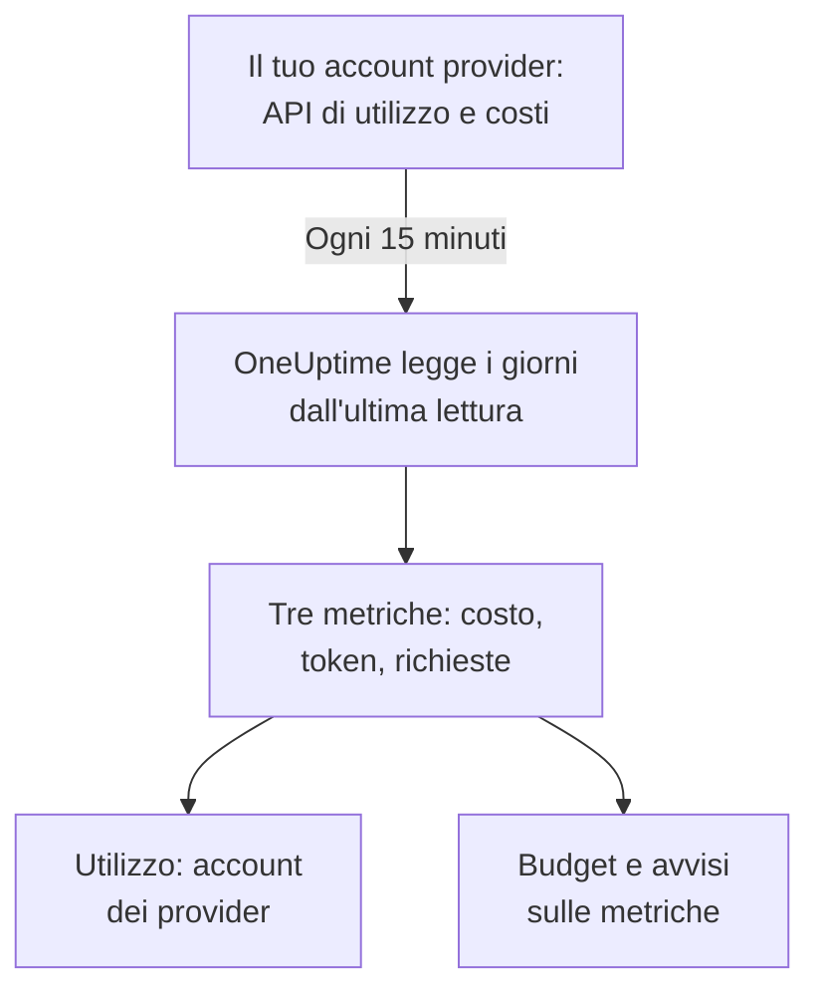

# Account dei provider di IA

Guarda cosa hanno consumato i tuoi account dei provider di IA e quanto sono costati, senza cambiare le tue app. Collega un account di OpenAI, Anthropic, Azure OpenAI e Microsoft Foundry, Amazon Bedrock o Google Vertex AI con una credenziale che può solo leggere, e OneUptime ne legge l'utilizzo ogni 15 minuti in **Utilizzo**, **Budget** e metriche su cui puoi creare avvisi.

:::cards
- [Collegare un account](#collegare-un-account): Scegli il provider, incolla la credenziale, provala e collega.
- [Cosa offre ogni provider](#cosa-offre-ogni-provider): Costo, token e richieste, e come ogni provider li raggruppa.
- [Vedere l'utilizzo](#vedere-lutilizzo): Per modello, persona, progetto o risorsa, chiave API e connessione.
- [Budget e avvisi](#budget-e-avvisi): Un budget giornaliero sulla fattura e avvisi sulle metriche.
:::

## Come funziona

Ogni 15 minuti, OneUptime chiede a ogni account collegato il suo utilizzo per giorno UTC e lo conserva come tre metriche del servizio della connessione. Ogni lettura prende i giorni dall'ultima lettura, e di nuovo gli ultimi 3 giorni, oggi compreso, perché i provider continuano ad aggiungere a oggi e correggono i giorni appena passati.

L'utilizzo di un account è ciò che gli è stato addebitato, un giorno alla volta. Non contiene conversazioni, prompt o risposte: per quelli, invia le chiamate di IA delle tue app come mostra [Osservabilità IA / LLM](/docs/telemetry/ai-llm-observability). Le due cose restano separate, quindi niente viene contato due volte.

## Prima di iniziare

- Il ruolo Project Owner o Project Admin. Solo loro possono collegare, modificare o rimuovere un account; chi legge la telemetria del progetto vede le connessioni e l'utilizzo.
- Una credenziale per l'account, da chi lo amministra. La sezione di ogni provider, più sotto, dice quale e dove si crea.
- Niente da installare: OneUptime chiama l'API del provider dai propri server.

## Collegare un account

:::steps
### Apri Collega

Apri **Prodotti → AI / LLM → Collega**. In **I tuoi account dei provider di IA**, fai clic sul riquadro del provider.

### Incolla la credenziale

In **Credenziali**, compila ciò che il provider chiede. I segreti sono salvati cifrati e non vengono mai più mostrati, né nella Dashboard né tramite l'API. **Nome** e le impostazioni che quasi nessuno cambia sono in **Altri campi**.

### Provala

In **Test**, fai clic su **Testa la connessione**. OneUptime legge l'utilizzo degli ultimi 7 giorni e mostra cosa ha trovato: costo, token, richieste, modelli, persone, chiavi e progetti. Non viene conservato nulla finché non colleghi.

### Collega

Fai clic su **Collega**. La prima lettura parte entro un minuto e porta gli ultimi 30 giorni.
:::

Gli account collegati compaiono sotto i riquadri, con il loro **Stato** e la loro **Ultima lettura**. **Leggi ora** legge subito, **Test** ricontrolla le impostazioni salvate, **Disattiva** smette di leggere e tiene ciò che è stato letto, e **Modifica** cambia le impostazioni: un segreto lasciato vuoto mantiene quello salvato. **View error** mostra perché una lettura non è riuscita, senza alcun segreto.

## Cosa offre ogni provider

| Provider | Costo | Raggruppato per | Credenziale |
| --- | --- | --- | --- |
| OpenAI | Quanto riporta OpenAI | Progetto, chiave API, persona e modello | Una chiave di amministrazione |
| Anthropic | Quanto riporta Anthropic | Workspace, chiave API, persona e modello | Una chiave di amministrazione |
| Azure OpenAI e Microsoft Foundry | Stimato dai token | Risorsa e modello | Un'app con Monitoring Reader |
| Amazon Bedrock | Stimato dai token | Regione e modello | Una chiave di accesso che legge CloudWatch |
| Google Vertex AI | Stimato dai token | Regione e modello | Un account di servizio con Monitoring Viewer |

Tutti i provider tranne Anthropic contano anche le richieste: il report di utilizzo di Anthropic non ne ha. Un costo stimato usa il listino di [Quanto costa una chiamata](/docs/telemetry/ai-llm-observability#quanto-costa-una-chiamata) e i tuoi prezzi in **Prezzi**, ed è segnato come stima. Un modello che il listino non conosce non ha costo finché non gli dai un prezzo lì.

Nessuna di queste credenziali può chiamare un modello: ognuna legge utilizzo, costi o metriche, e nient'altro.

## OpenAI

OneUptime legge la tua organizzazione OpenAI con una chiave di amministrazione: l'utilizzo di completions ed embeddings per giorno, modello, progetto, chiave API e persona, e i costi di ogni giorno per progetto e voce. Una voce di costo viene ripartita tra le chiavi e le persone che hanno usato il suo modello, così anche la riga di una persona ha un costo. I nomi di progetti e chiavi e le email delle persone sostituiscono gli ID di OpenAI.

:::steps
### Crea una chiave di amministrazione OpenAI

Nella dashboard di OpenAI, apri Settings, Organization, Admin keys e crea una chiave. Solo i proprietari dell'organizzazione possono farlo. Inizia con `sk-admin-`.

### Collega OpenAI

Incolla la chiave come **Chiave di amministrazione**.
:::

## Anthropic

OneUptime legge la tua organizzazione dell'API di Claude con una chiave di amministrazione: il report di utilizzo dei messaggi per giorno, modello, workspace, chiave API e persona, e il report dei costi per workspace e voce, ripartito allo stesso modo. Anche Claude Code usato con le chiavi o con gli accessi Console dell'organizzazione è in questi report, sotto la persona o la chiave che lo ha usato.

:::steps
### Crea una chiave di amministrazione Anthropic

Nella Claude Console, apri Settings, Admin keys e crea una chiave. Solo gli amministratori dell'organizzazione possono farlo. Inizia con `sk-ant-admin01-`.

### Collega Anthropic

Incolla la chiave come **Chiave di amministrazione**.
:::

## Azure OpenAI e Microsoft Foundry

OneUptime legge ogni risorsa Azure OpenAI e Foundry di una sottoscrizione da Azure Monitor: token e richieste per giorno, risorsa e modello. Azure Monitor conta token, non denaro, e non indica né persona né chiave, quindi il costo è la stima di OneUptime e persona e chiave restano vuote.

:::steps
### Registra un'app

In Microsoft Entra ID, registra un'app e crea un segreto client per essa.

### Lasciale leggere le metriche

Sulla sottoscrizione, assegna all'app il ruolo Monitoring Reader.

### Collega Azure

Compila **ID directory (tenant)**, **ID applicazione (client)**, **ID sottoscrizione** e **Segreto client**. Per Azure Government, cambia **Cloud** in **Altri campi**.
:::

## Amazon Bedrock

OneUptime legge le metriche CloudWatch `AWS/Bedrock` di ogni regione che indichi: token di input, di output e di cache, e invocazioni, per giorno e modello. CloudWatch conta token, non denaro, e non indica né persona né chiave: il costo è la stima di OneUptime, e ogni regione è elencata come un progetto.

:::steps
### Crea una chiave di accesso

Crea un utente o un ruolo IAM la cui policy consenta `cloudwatch:GetMetricData` e `cloudwatch:ListMetrics`, e una chiave di accesso per esso.

### Collega Bedrock

Compila **ID chiave di accesso**, **Chiave di accesso segreta** e **Regioni**, separate da virgole: `us-east-1` se non lo cambi.
:::

## Google Vertex AI

OneUptime legge le metriche di Cloud Monitoring che Vertex AI pubblica per i suoi modelli, Gemini e modelli partner come Claude: token di input e di output, e invocazioni, per giorno, regione e modello. Cloud Monitoring conta token, non denaro, e non indica né persona né chiave: il costo è la stima di OneUptime.

:::steps
### Crea un account di servizio

Nel progetto, crea un account di servizio con il ruolo Monitoring Viewer e una chiave JSON per esso.

### Collega Vertex AI

Compila **ID Progetto** e incolla l'intero file della chiave come **Chiave dell'account di servizio (JSON)**.
:::

## Vedere l'utilizzo

Apri **Utilizzo** e scegli **Account provider**. Mostra il costo, i token e le richieste che i tuoi account hanno riportato per l'intervallo, ordinati per **Modello**, **Persona**, **Provider**, **Progetto o risorsa**, **Chiave API** o **Connessione**. L'intervallo inizia alla mezzanotte UTC del suo primo giorno, perché i provider riportano giorni interi.

**Account provider** e **Le tue chiamate IA** non vengono mai sommati. Una chiamata che la tua app fa con una chiave di un account collegato è in entrambi, quindi sommarli la conterebbe due volte.

## Budget e avvisi

Un budget conta l'uno o l'altro. In **Budget**, crea un budget e imposta **Conta la spesa da** su **Account provider**: conta ciò che è stato addebitato agli account collegati per il giorno UTC, ristretto da **Provider LLM (facoltativo)** e **Modello LLM (facoltativo)** quando li imposti. I provider riportano l'utilizzo di un giorno con minuti o ore di ritardo, quindi per avvisi entro pochi minuti metti a budget **Le tue chiamate IA**.

L'utilizzo di ogni account è conservato come tre metriche, che puoi mostrare in una [dashboard](/docs/dashboards/index) o sorvegliare con un [Monitor metriche](/docs/monitor/metrics-monitor):

| Metrica | Cos'è |
| --- | --- |
| `oneuptime.llm.provider.cost` | Il costo di un giorno, in USD |
| `oneuptime.llm.provider.tokens` | I token di un giorno, per `gen_ai.token.type`: `input` (token in cache inclusi), `output`, `cache_read` e `cache_write` |
| `oneuptime.llm.provider.requests` | Le richieste di un giorno |

Ogni punto ha come timestamp l'inizio del suo giorno UTC. Porta `oneuptime.llm.connection.id` e `oneuptime.llm.connection.name`, e ciò che il provider indica: `gen_ai.provider.name`, `gen_ai.request.model`, `user.email`, `oneuptime.llm.provider.project` e `oneuptime.llm.provider.api_key`. Un costo stimato porta `oneuptime.llm.cost.estimated`.

## Quando avvengono le letture

| Lettura | Quando |
| --- | --- |
| La prima | Entro un minuto dal collegamento, 30 giorni indietro |
| Le successive | Ogni 15 minuti |
| Dopo il rifiuto di una chiave o di un permesso | 60 minuti dopo |
| Dopo qualsiasi altro errore | 15 minuti dopo |
| Disattivata | Nessuna finché non viene riattivata |

Un piano senza funzioni di telemetria non legge nulla. Rimuovere una connessione ferma le sue letture e mantiene ciò che ha letto finché la conservazione del servizio non lo elimina.

## Perché OneUptime non ha un gateway suo

OneUptime legge i tuoi account; non si mette mai tra le tue app e i provider. Un proxy custodirebbe le tue chiavi dei provider e aggiungerebbe un passaggio a ogni chiamata a un modello che fanno le tue app. Se il tuo traffico verso i modelli passa già da LiteLLM, Portkey o OpenRouter, invia le tracce del gateway a OneUptime come mostra [Gateway IA](/docs/telemetry/ai-gateways), e collega l'account per la sua fattura.

## Risoluzione dei problemi

:::details Il test dice che la chiave o il segreto non è stato accettato
Controlla di averla copiata tutta, che non sia stata revocata e che sia del tipo che questo provider chiede: una chiave di amministrazione di OpenAI o di Anthropic, non una chiave di progetto o API.
:::

:::details La credenziale funziona, ma non può leggere ciò che serve alla connessione
Dalle il ruolo che questa pagina indica per il provider: Monitoring Reader sulla sottoscrizione Azure, le due azioni CloudWatch su AWS, Monitoring Viewer sul progetto Google Cloud.
:::

:::details Il test passa, ma per oggi non compare nulla
I provider riportano l'utilizzo di un giorno minuti o ore dopo, e lo correggono per un giorno o due. Le letture successive lo portano.
:::

:::details Il costo è diverso dalla fattura
Un costo riportato è la cifra del provider prima di tasse, crediti e sconti. Un costo stimato è token a prezzo di listino, o ai tuoi prezzi in **Prezzi**.
:::

## Passi successivi

:::cards
- [Osservabilità IA / LLM](/docs/telemetry/ai-llm-observability): Conversazioni, avvisi e costo delle chiamate di IA delle tue app.
- [Strumenti di IA aziendali](/docs/telemetry/ai-company-tools): Cosa chiedono le tue persone a Claude Enterprise e Microsoft 365 Copilot.
- [Gateway IA](/docs/telemetry/ai-gateways): Traccia ogni chiamata a un modello attraverso LiteLLM, Portkey o OpenRouter.
- [Monitor metriche](/docs/monitor/metrics-monitor): Crea avvisi sulle metriche dei provider.
:::
