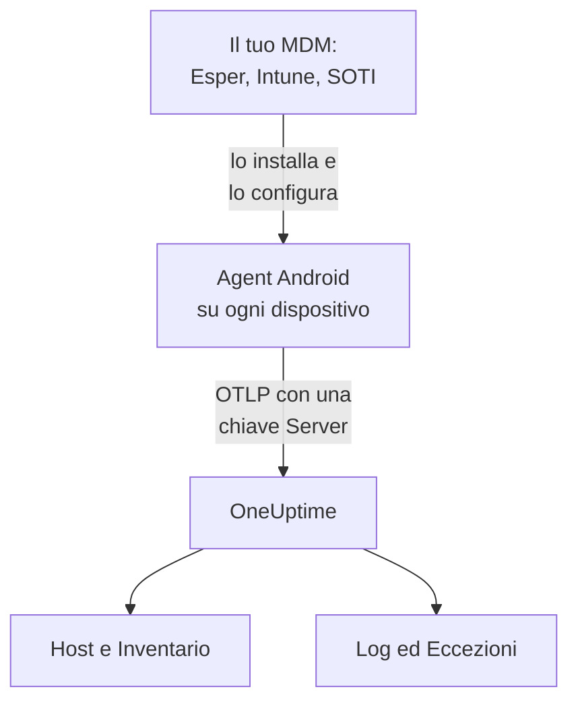

# Agent Android

L'agent Android di OneUptime segnala a OneUptime un dispositivo Android di proprietà della tua organizzazione, come un chiosco per gli ordini, un terminale POS, un palmare o un player di digital signage: la sua memoria, lo spazio di archiviazione, la rete, la batteria e la temperatura, i riavvii, le app installate e i crash e i log di queste app. Il tuo gestore dei dispositivi lo installa e lo configura su tutta la flotta in una volta sola. Ogni dispositivo diventa un host in **Host** e un elemento in **Inventario**, accanto ai tuoi server e alle tue macchine Windows.

:::cards
- [Quando usarlo](#lagent-o-la-strumentazione-dellapp): L'agent vede il dispositivo, la strumentazione dell'app vede la tua app.
- [Distribuirlo con Esper](#distribuirlo-con-esper): Caricare l'APK, inviare le sue impostazioni, avviarlo una volta.
- [Impostazioni](#impostazioni): Ogni chiave della sua configurazione gestita.
- [Leggere i log delle altre app](#leggere-i-log-delle-altre-app): Concedere READ_LOGS una volta, con adb o con il tuo gestore dei dispositivi.
- [Sessioni di log](#sessioni-di-log): I log di tutte le app per un certo tempo, consentiti dalla persona davanti al dispositivo.
:::

## Come funziona

L'agent è una piccola app che viene eseguita come servizio in primo piano. Ogni minuto legge lo stato del dispositivo e lo invia alla tua istanza di OneUptime tramite OTLP con una chiave di acquisizione **Server**, insieme ai riavvii, alle app installate e ai log del dispositivo. Si avvia da solo quando il dispositivo si accende, conserva sul dispositivo ciò che raccoglie mentre la rete è assente e lo invia non appena la rete torna. Non tiene mai sveglio un dispositivo in sospensione e comprime ciò che invia.



## L'agent o la strumentazione dell'app

| | [OpenTelemetry Android](/docs/rum/android-setup) nella tua app | L'agent Android |
| --- | --- | --- |
| Cosa vede | La tua app: i suoi crash, gli ANR, le schermate, le sessioni, le richieste e i flussi di lavoro | Il dispositivo: memoria, archiviazione, rete, batteria, riavvii, app installate, e i crash e gli ANR di ogni app |
| Dove compare | **Monitoraggio degli utenti reali**, **Tracce** ed **Eccezioni** | **Host**, **Inventario**, **Log** ed **Eccezioni** |
| Come si installa | Nel codice della tua app | Come app, tramite il tuo gestore dei dispositivi |

Sui dispositivi di tua proprietà usa entrambi, e dai al dispositivo lo stesso nome in tutti e due: nell'impostazione `device_name` dell'agent e nell'`host.name` che imposta la tua app. Il dispositivo è allora un solo elemento in **Inventario**, che riunisce la telemetria dell'app e quella del dispositivo.

## Prima di iniziare

- Dispositivi con Android 7.0 o successivo, registrati in un gestore dei dispositivi che supporta le configurazioni gestite di Android: Esper, Microsoft Intune, Workspace ONE, SOTI e altri gestori dei dispositivi Android Enterprise. Per un singolo dispositivo basta adb.
- Una chiave di acquisizione **Server**, creata in **Impostazioni del progetto → Telemetria e APM → Chiavi di acquisizione** con **Crea chiave di acquisizione**.
- L'agent: `oneuptime-android-agent.apk`, allegato a ogni [release di OneUptime](https://github.com/OneUptime/oneuptime/releases/latest).
- HTTPS in uscita dai dispositivi verso il tuo URL di OneUptime. L'agent rifiuta qualsiasi URL che non inizi con `https://`, perché ogni richiesta trasporta la chiave di acquisizione.

## Distribuirlo con Esper

:::steps
### Caricare l'APK

Nella console di Esper, carica `oneuptime-android-agent.apk` nell'**App Library** e aggiungilo al blueprint dei dispositivi da monitorare.

### Inviare le sue impostazioni

Nel blueprint, apri la **Managed Configuration** dell'agent e incolla le sue impostazioni. Esper compila i segnaposto su ogni dispositivo, con Esper Agent 8.00.0764 o successivo:

```json title="Managed configuration"
{
  "oneuptime_url": "https://oneuptime.com",
  "oneuptime_token": "YOUR_TELEMETRY_INGESTION_TOKEN",
  "device_name": "${esper.deviceName}",
  "device_serial": "${esper.serialNumber}",
  "device_type": "kiosk",
  "labels": "region=emea"
}
```

Se ospiti OneUptime in proprio, inserisci il tuo URL in `oneuptime_url`. Poi esegui un Converge dei dispositivi, così leggono le nuove impostazioni.

### Avviarlo una volta

Android non avvia all'accensione un'app appena installata finché non è stata aperta una volta. Attiva **Launch on Start** per l'agent nel blueprint, in modalità Multi-App, oppure apri l'agent una volta su ogni dispositivo. Da quel momento si avvia da solo a ogni accensione del dispositivo, e dopo ogni aggiornamento.

### Trovare i dispositivi in OneUptime

Entro un minuto ogni dispositivo compare in **Host**, con il nome del suo `device_name`, e in **Inventario**. La schermata dell'agent sul dispositivo indica se sta inviando dati e, se non lo fa, cosa glielo impedisce.
:::

Gli altri gestori dei dispositivi funzionano allo stesso modo: aggiungi l'APK come app line-of-business o come app interna, imposta le stesse chiavi nella configurazione dell'app e aprila una volta su ogni dispositivo.

## Impostazioni

L'agent legge queste chiavi dalla sua configurazione gestita. Un dispositivo che non ne ha una si può configurare invece dalla schermata dell'agent, con l'URL, la chiave di acquisizione e il nome del dispositivo. Una chiave di acquisizione inserita lì viene salvata cifrata con l'Android Keystore.

| Chiave | Cosa imposta | Valore predefinito |
| --- | --- | --- |
| `oneuptime_url` | Il tuo URL di OneUptime | `https://oneuptime.com` |
| `oneuptime_token` | Una chiave di acquisizione **Server** | Nessuno: senza chiave l'agent non invia nulla |
| `device_name` | Il nome del dispositivo in **Host** e in **Inventario**, che lì ne costituisce l'identità | Il suo modello e l'inizio del suo Android ID |
| `device_serial` | Il suo numero di serie, che Android non fornisce alle app a partire da Android 10 | Nessuno |
| `device_type` | Che cosa è, ad esempio un chiosco, un terminale POS o un palmare | `Android device` |
| `device_location` | Dove si trova, ad esempio il numero di un negozio | Nessuno |
| `labels` | Etichette per l'host, come coppie `name=value` separate da virgole | Nessuno |
| `collection_interval_seconds` | Ogni quanto invia dati, da 30 a 600 secondi | `60` |
| `logcat_enabled` | Se invia ciò che legge da Logcat | `true` |
| `logcat_min_level` | Le righe di Logcat meno gravi che invia su Android 12 e versioni precedenti: `verbose`, `debug`, `info`, `warn`, `error` o `fatal` | `warn` |
| `installed_apps_enabled` | Se invia le app installate | `true` |

Un segnaposto che il tuo gestore dei dispositivi non ha compilato, come un `${esper.deviceName}` inviato così com'è, viene ignorato, e la schermata dell'agent lo segnala. Mantieni lo stesso `device_name` una volta che un dispositivo invia dati: un nuovo nome è un nuovo host.

La schermata dell'agent, le sue notifiche e i titoli e le descrizioni che il tuo gestore dei dispositivi mostra per queste chiavi sono nella lingua del dispositivo, in tutte le lingue che parla la dashboard di OneUptime.

## Leggere i log delle altre app

Android consente a un'app di leggere i log delle altre app solo con l'autorizzazione READ_LOGS, e solo adb può concederla: né l'app stessa né un criterio del dispositivo. Concedila una volta su ogni dispositivo, e resta concessa anche dopo riavvii e aggiornamenti:

```bash
adb shell pm grant com.oneuptime.androidagent android.permission.READ_LOGS
```

Con Esper, esegui quel comando tramite **Secure Remote ADB**: attiva l'accesso ADB per il dispositivo, connettiti con `espercli secureadb connect -d DEVICE_ID`, poi esegui il comando. Android riavvia l'agent quando l'autorizzazione viene concessa, e l'agent inizia subito a leggere.

Ciò che l'agent legge da quel momento dipende dalla versione di Android:

- Android 13 e successivi: i crash e gli ANR di ogni app. Android mostra le righe di log delle altre app solo a un'app che è sullo schermo, dopo che la persona davanti al dispositivo lo consente, quindi un agent in esecuzione in background non può leggerle. Chiedile per un certo tempo con una [sessione di log](#sessioni-di-log).
- Android 12 e precedenti: i crash e gli ANR di ogni app, e le righe di log di ogni app di livello `logcat_min_level` o superiore.

Senza READ_LOGS, l'agent segnala tutto il resto, e la sua schermata e i log del dispositivo spiegano come concederla.

### Stack trace dei crash e motivi dei riavvii

Android conserva nella sua DropBox il rapporto completo di ogni crash di un'app, di ogni crash nativo e di ogni ANR, e il motivo di ogni riavvio. L'agent li legge per ogni app quando ha READ_LOGS e l'accesso ai dati di utilizzo e, su Android 15 e successivi, READ_DROPBOX_DATA. Concedili una volta con adb, come READ_LOGS:

```bash
adb shell pm grant com.oneuptime.androidagent android.permission.READ_DROPBOX_DATA
adb shell appops set com.oneuptime.androidagent GET_USAGE_STATS allow
```

Il primo comando è per Android 15 e successivi; l'accesso ai dati di utilizzo si può attivare anche sul dispositivo, in **Impostazioni → Accesso ai dati di utilizzo**. Un criterio del dispositivo non può concederli, e la schermata dell'agent elenca i comandi ancora da eseguire. Con questi, ogni crash in **Eccezioni** ha il suo stack trace completo, un crash nativo il suo segnale e la libreria in cui si è verificato, un ANR lo stack del suo thread principale, e un riavvio in **Log** il motivo che ne dà Android. Numeri di carta, indirizzi email, token e password in ciò che l'agent legge vengono sostituiti con `[card number]`, `[email]`, `[token]` e `[redacted]` prima dell'invio.

### Uso della CPU

Da Android 8 in poi, Android nasconde alle app l'uso della CPU di un dispositivo. Solo un'app proprietaria del dispositivo può leggerlo, e solo sui dispositivi il cui hardware lo fornisce. L'agent lo legge quando è il proprietario del dispositivo, cosa che imposti con adb su un dispositivo senza account e senza un altro proprietario:

```bash
adb shell dpm set-device-owner com.oneuptime.androidagent/.admin.AgentDeviceAdminReceiver
```

Un dispositivo di cui il tuo gestore dei dispositivi è già proprietario non può avere un secondo proprietario, quindi il suo uso della CPU non è disponibile, e la schermata dell'agent lo segnala. Il suo uso della CPU resta allora fuori dall'elenco degli host, e il modello **High CPU Utilization** non gli viene proposto.

## Sessioni di log

Una sessione di log invia per un certo tempo i log di tutte le app di un dispositivo, per risolverne i problemi. Su Android 13 e successivi è l'unico modo per leggere le righe di log delle altre app, perché Android le mostra solo a un'app che è sullo schermo, dopo che la persona davanti al dispositivo lo consente.

:::steps
### Richiederne una

Apri il dispositivo in **Host**, poi **Log**, e fai clic su **Richiedi sessione di log** in **Sessioni di log**. Scegli per quanto tempo il dispositivo invia i suoi log, da 15 minuti a 4 ore, e il livello più basso che invia: **Info**, **Debug** o **Dettagliato**.

### Consentirla sul dispositivo

Entro un minuto il dispositivo mostra una notifica che qualcuno ha chiesto i suoi log, con il suo nome. La persona davanti al dispositivo apre l'agent e tocca **Consenti**. Su Android 13 e successivi Android chiede poi di consentire l'accesso a tutti i log del dispositivo, e la persona consente anche quello.

### Leggere le righe

La sessione indica **In raccolta**, e le righe di tutte le app arrivano nei log del dispositivo. Fai clic su **Mostra righe** per vedere solo le righe della sessione. La sessione termina quando il suo tempo è scaduto, o quando qualcuno la ferma sul dispositivo o la annulla in OneUptime.
:::

Una sessione ha bisogno di READ_LOGS e di `logcat_enabled`; senza, indica **Non disponibile**. Su un dispositivo viene eseguita una sola sessione alla volta. Una richiesta che nessuno consente entro un'ora scade, e una sessione durante la quale il dispositivo si riavvia termina con il riavvio, perché l'autorizzazione di Android termina con il processo dell'agent. Per chiedere una sessione serve l'autorizzazione a modificare l'host, e i **Log di audit** dell'host conservano chi l'ha chiesta, e quando.

## Cosa segnala l'agent

| Cosa | Dove compare in OneUptime |
| --- | --- |
| Memoria, archiviazione, rete e tempo di attività | La pagina del dispositivo in **Host**: le stesse metriche che invia il collector di un server, quindi i modelli di avviso per gli host funzionano |
| Carica della batteria e temperatura, e se il dispositivo è collegato a un'alimentazione esterna | Le metriche `hw.battery.charge`, `hw.temperature` e `android.battery.plugged` |
| Stato termico | Le metriche `android.thermal.status` e `android.thermal.headroom` |
| Uso della CPU | La metrica `system.cpu.utilization`: su Android 7, e su Android 8 e successivi quando l'agent è il [proprietario del dispositivo](#uso-della-cpu) |
| Riavvii | **Log**, con `@event.name:device.boot`: da quanto tempo il dispositivo era acceso, se si è spento correttamente, per quanto tempo è rimasto spento, perché si è riavviato, e i cicli di riavvio |
| App installate | **Log**, con `@event.name:android.package.inventory` una volta al giorno, e a ogni installazione, aggiornamento e rimozione |
| Crash e ANR di ogni app | **Eccezioni**, come non gestiti, con il nome dell'app, e con i loro stack quando l'agent legge la [DropBox](#stack-trace-dei-crash-e-motivi-dei-riavvii) |
| Marca, modello, numero di serie, versione del sistema operativo, livello patch di sicurezza e firmware | L'elemento del dispositivo in **Inventario** |

In **Host**, il sistema operativo del dispositivo risulta Android, con il logo di Android.

Gli avvii del dispositivo nell'ultima ora sono la metrica `android.boot.recent_count`, e un dispositivo che continua a riavviarsi scrive un log di livello avviso a ogni avvio. In **Host**, a un dispositivo Android vengono proposti modelli di avviso propri: Device Unplugged, Low Battery, Device Overheating, Restart Loop e Storage Nearly Full, insieme a Host Stopped Reporting, Host Restarted e High Memory Utilization, e High CPU Utilization quando segnala l'uso della CPU. I primi comandi di debug di ogni avviso sono comandi adb. Vedi [Monitor host](/docs/monitor/host-monitor#dispositivi-android).

## Risoluzione dei problemi

:::details Un dispositivo non compare in Host
Apri l'agent sul dispositivo: la sua schermata indica cosa manca, ad esempio una chiave di acquisizione, un URL che non può usare, o un invio non riuscito e il motivo. Su un dispositivo in cui l'agent non è mai stato aperto dopo l'installazione, l'agent non si è avviato: aprilo una volta, oppure attiva **Launch on Start**.
:::

:::details L'agent dice che OneUptime ha rifiutato la chiave di acquisizione
Usa una chiave **Server** attiva e non scaduta. Una chiave **Browser** viene rifiutata da un dispositivo.
:::

:::details Nessun log dalle altre app
Concedi READ_LOGS, come spiega [Leggere i log delle altre app](#leggere-i-log-delle-altre-app). Su Android 13 e successivi vengono letti solo i crash e gli ANR delle altre app, a meno che non sia in corso una [sessione di log](#sessioni-di-log).
:::

:::details Una sessione di log resta su In attesa di approvazione
Nessuno davanti al dispositivo l'ha ancora consentita. Qualcuno deve aprire l'agent sul dispositivo e toccare **Consenti** e, su Android 13 e successivi, consentire anche la richiesta di Android, mentre l'agent è sullo schermo. Una sessione che la richiesta di Android ha rifiutato indica **Rifiutato**: richiedine un'altra.
:::

:::details Due dispositivi compaiono come un solo host
Hanno lo stesso `device_name`. Usa un segnaposto che cambi da un dispositivo all'altro, come `${esper.deviceName}` o `${esper.serialNumber}`.
:::

## Passaggi successivi

:::cards
- [Configurazione Android](/docs/rum/android-setup): Strumentare la tua app con OpenTelemetry Android.
- [Host](/docs/telemetry/hosts): Le pagine, le misure e gli avvisi di un host.
- [Monitor host](/docs/monitor/host-monitor): Ricevere un avviso quando un dispositivo smette di inviare dati o resta senza spazio di archiviazione.
- [Eccezioni](/docs/telemetry/exceptions): Smistare i crash e gli ANR che i tuoi dispositivi segnalano.
:::
