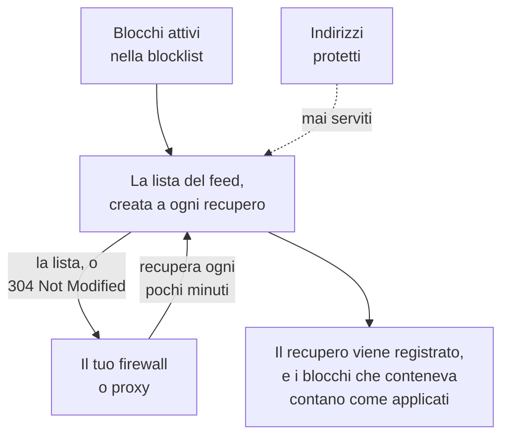

# Feed della blocklist per firewall e proxy

Un feed della blocklist è un URL segreto da cui il tuo firewall o proxy legge la [blocklist](/docs/telemetry/security-cases#blocklist) del tuo progetto ogni pochi minuti. Palo Alto Networks, FortiGate, Check Point, Cisco Secure Firewall, OPNsense e pfSense lo leggono come lista esterna, e i comandi che copi da OneUptime lo applicano con nftables, ipset, nginx, HAProxy o Windows Firewall. È il tuo firewall a collegarsi a OneUptime: OneUptime non ha mai bisogno di un percorso verso la tua rete né di una password del tuo firewall.

:::cards
- [Creare un feed](#creare-un-feed): Scegli il firewall, copia il segreto e segui i suoi passi.
- [Configurare il firewall](#configurare-il-firewall): I passi per ogni firewall e proxy, e ogni quanto recupera il feed.
- [Quando un blocco è applicato](#quando-un-blocco-è-applicato): Solo dopo che un firewall ha recuperato una lista che lo contiene.
- [Ruotare o revocare il segreto](#ruotare-o-revocare-il-segreto): Un nuovo segreto con un giorno di sovrapposizione, o nessuno, subito.
:::

## Come funziona



Ogni recupero crea la lista dai blocchi attivi in quel momento. Un blocco che scade o viene revocato sparisce dal recupero successivo, e un indirizzo protetto non c'è mai, nemmeno uno protetto dopo essere stato bloccato. Un blocco conta come applicato sul feed solo dopo che un firewall ha recuperato una lista che lo contiene.

## Prima di iniziare

- Un firewall o un proxy che legge una lista di indirizzi da un URL `https`, oppure un host Linux o Windows su cui puoi eseguire comandi come root o come amministratore.
- Un'uscita dal firewall verso OneUptime su HTTPS: `https://oneuptime.com` o l'indirizzo del tuo server OneUptime.
- Un ruolo che può creare feed: Proprietario del progetto, Amministratore del progetto o Amministratore della sicurezza. Membro della sicurezza e Visualizzatore della sicurezza possono leggere i feed e i loro recuperi. Vedi [Ruoli](/docs/permissions/reference#ruoli).

## Creare un feed

:::steps
### Apri Feed della blocklist

Apri **Prodotti → Eventi di sicurezza → Playbook → Feed della blocklist**.

### Crea il feed

Fai clic su **Crea: Feed della blocklist** e scegli il **Firewall** che lo legge. **Nome** è il nome con cui la Blocklist chiama il feed dove un blocco viene applicato; se resta vuoto, prende il nome del firewall, ad esempio «FortiGate feed». In **Altri campi**, **Indirizzi serviti** sceglie IPv4 e IPv6, solo IPv4 o solo IPv6, e **Indirizzi di origine consentiti** limita chi può leggere il feed.

### Copia il segreto

La pagina del feed si apre con il suo segreto, mostrato una sola volta: OneUptime ne conserva solo l'hash. Copialo, poi fai clic su **Fatto**. Finché non lasci la pagina, i passi su di essa inseriscono il segreto per te.

### Segui i passi del tuo firewall

**Configura il tuo firewall** mostra l'URL da incollare, come il tuo firewall invia il segreto e i passi nella sua console, già compilati. Scegli lì un altro firewall per vedere invece i suoi passi. Dopo il primo recupero del tuo firewall, lo stato del feed indica **Lettura in corso**, e **Recuperi** elenca il recupero.
:::

## Cosa fornisce un feed

| File | Per | Cosa contiene |
| --- | --- | --- |
| `blocklist.txt` | Palo Alto Networks, pfSense, ipset, HAProxy, Windows Firewall e qualsiasi altro firewall | Un indirizzo o un intervallo per riga. |
| `blocklist.txt?comments=1` | FortiGate, Check Point, Cisco Secure Firewall e OPNsense, che saltano le righe che iniziano con `#` | Ogni indirizzo o intervallo dopo una riga che dice perché è bloccato. |
| `nftables.nft` | nftables | Un file per `nft -f` che svuota i set `blocklist_v4` e `blocklist_v6` della tabella `inet oneuptime` e li riempie di nuovo. |
| `nginx.conf` | nginx | Una riga `deny` per ogni indirizzo o intervallo. |
| Il nome di un file seguito da `.md5`, ad esempio `blocklist.txt.md5` | Cisco Secure Firewall | L'MD5 del file, così il firewall scarica la lista solo quando è cambiata. |

L'URL di un feed è `https://oneuptime.com/api/blocklist-feed/<feed ID>/<file>`, e la pagina del feed lo mostra compilato per il tuo firewall. Con `?comments=1`, la lista appare così:

```text
# OneUptime case CASE-42 until 2026-11-21 10:42 UTC
203.0.113.7
# OneUptime blocklist until lifted
198.51.100.0/24
```

Un feed serve i blocchi attivi la cui azione è **Blocca**. Non serve mai una verifica, che un firewall non può eseguire, e un feed che serve solo IPv4 o solo IPv6 tralascia gli altri indirizzi. Il file per nftables tralascia un indirizzo che un intervallo della lista contiene già, perché nftables rifiuta le voci sovrapposte in un set.

Quando nulla è bloccato, `blocklist.txt` contiene un indirizzo, `192.0.2.1` (`2001:db8::1` per un feed che serve solo IPv6). È un indirizzo riservato alla documentazione, da cui non arriva alcun traffico internet: Palo Alto Networks e Cisco mantengono l'ultima lista letta quando una lista torna vuota, quindi una lista vuota continuerebbe a bloccare ciò che hai revocato.

Ogni risposta porta un `ETag`. Un firewall che lo rimanda in `If-None-Match` riceve `304 Not Modified` finché la lista non cambia, e i comandi che ti dà OneUptime lo fanno.

## Come un firewall invia il segreto

| Come | Cosa invia il firewall | Usato da |
| --- | --- | --- |
| Autenticazione Basic | Qualsiasi nome utente, ad esempio `oneuptime`, con il segreto come password | Palo Alto Networks (solo su HTTPS), FortiGate e Check Point |
| Token bearer | `Authorization: Bearer <secret>` | I comandi per nftables, ipset, nginx, HAProxy e Windows Firewall |
| Segreto nell'URL | `https://oneuptime.com/api/blocklist-feed/<feed ID>/<secret>/blocklist.txt` | Cisco Secure Firewall, OPNsense e pfSense, che non documentano un altro modo per inviarlo |

Una richiesta senza segreto, o con un segreto sbagliato, riceve `401 Unauthorized`. Un URL con un segreto sbagliato riceve `404 Not Found`, come un indirizzo che non esiste. Il server web di OneUptime non scrive gli URL dei feed nel suo log di accesso, quindi un segreto in un URL non finisce lì.

## Limitare chi può leggere un feed

**Indirizzi di origine consentiti**, in **Altri campi**, accetta fino a 50 indirizzi e intervalli, uno per riga, ad esempio `203.0.113.7` o `198.51.100.0/24`. Una richiesta da qualsiasi altro indirizzo riceve `403 Forbidden`, anche con il segreto giusto. Lascialo vuoto per consentire la lettura del feed a qualsiasi indirizzo che abbia il segreto.

Ogni indirizzo può recuperare un feed 60 volte al minuto, e recuperare feed 600 volte al minuto in tutto. Oltre questo limite riceve `429 Too Many Requests` con un'intestazione `Retry-After`.

## Quando un blocco è applicato

Un blocco conta come applicato su un feed quando un firewall ha recuperato una lista che lo contiene, dopo la creazione del blocco, e per dieci minuti dopo ogni recupero di questo tipo. Una risposta `304 Not Modified` conta come un recupero della stessa lista. Nella **Blocklist**, il chip del feed in **Applicato su** diventa allora verde, e il suo tooltip dice quanto tempo dopo il blocco il firewall l'ha recuperato, ad esempio «Un firewall ha recuperato questo blocco da FortiGate feed 3 min dopo la sua creazione. Ultimo recupero 2 minuti fa.»

Dopo dieci minuti senza recupero, il chip dice che da allora il firewall non ha più recuperato il feed: il firewall potrebbe ancora bloccare l'indirizzo, ma OneUptime non può saperlo. Quindi fai recuperare il feed al tuo firewall ogni cinque minuti o più spesso. Un firewall che recupera meno spesso, come OPNsense, continua a bloccare tra un recupero e l'altro, e OneUptime considera il blocco applicato lì solo per i dieci minuti successivi a ciascuno.

Un blocco che scade o viene revocato sparisce dal recupero successivo, e il suo chip attende che un firewall recuperi la lista senza di esso. Quando OneUptime non riesce a leggere quali indirizzi sono protetti, il feed risponde `503 Service Unavailable` con `Retry-After: 60` invece di una lista che potrebbe contenerne uno, e il firewall mantiene la lista che ha.

## Quando un firewall smette di leggere

OneUptime impara con quale frequenza viene recuperato ogni feed. Quando un feed non viene recuperato per tre volte il suo intervallo abituale, e per almeno dieci minuti, il suo stato indica **Lettura interrotta**, la **Blocklist** lo nomina sopra la sua lista, e i Proprietari del progetto ricevono un'email: «Your firewall stopped reading the blocklist feed _nome del feed_». Finché un firewall non ha recuperato un feed due volte, OneUptime si aspetta un recupero ogni cinque minuti, ogni ora da OPNsense e ogni giorno da pfSense.

Il recupero successivo lo annulla, e un'interruzione successiva invia un'altra email. Un feed il cui segreto è stato revocato non conta mai come interrotto.

## Ruotare o revocare il segreto

**Ruota il segreto**, nella pagina del feed, crea un nuovo segreto e lo mostra una sola volta. Il segreto che sostituisce continua a funzionare per 24 ore, così puoi dare il nuovo a ogni firewall; **Recuperi** segna come **Segreto precedente** un recupero che ha ancora inviato quello vecchio. Ruotarlo di nuovo entro quelle 24 ore fa scadere subito il segreto più vecchio.

**Revoca il segreto** fa scadere subito il segreto, e quello precedente: usalo quando un segreto è trapelato. Il feed allora non risponde più a nessuno, e i suoi firewall mantengono la lista che hanno senza aggiornarla, finché **Ruota il segreto** non crea un nuovo segreto. Eliminare un feed elimina il feed, il suo segreto e i suoi recuperi.

## Configurare il firewall

La pagina del feed mostra questi passi per il firewall che scegli, con l'URL, il nome utente e, subito dopo la creazione del segreto, il segreto già inseriti.

| Firewall | File | Segreto | Recupero ogni | Contiene al massimo |
| --- | --- | --- | --- | --- |
| Palo Alto Networks | `blocklist.txt` | Autenticazione Basic | 5 minuti, il minimo che offre | 30 liste personalizzate e 50.000 indirizzi in tutto (150.000 sulle serie PA-3200, PA-5200 e PA-7000) |
| FortiGate | `blocklist.txt?comments=1` | Autenticazione Basic | 5 minuti (da 1 a 43.200; 5 per impostazione predefinita) | 300.000 indirizzi in tutti i suoi feed di minacce |
| Check Point | `blocklist.txt?comments=1`, IPv4 | Autenticazione Basic | 5 minuti (ogni ora per impostazione predefinita) | 50.000 indirizzi in un feed |
| Cisco Secure Firewall | `blocklist.txt?comments=1` e il suo MD5 | Nell'URL | 5 minuti (2 ore per impostazione predefinita) | |
| OPNsense | `blocklist.txt?comments=1` | Nell'URL | 1 ora, il minimo che offre | |
| pfSense | `blocklist.txt` | Nell'URL | 1 giorno, il minimo che offre | |
| nftables, ipset, nginx, HAProxy, Windows Firewall | I propri | Token bearer | 1 minuto | |

### Palo Alto Networks

1. Nell'interfaccia web, vai su **Objects → External Dynamic Lists** e fai clic su **Add**.
2. Imposta **Type** su **IP List** e **Source** sull'URL del feed, `https://oneuptime.com/api/blocklist-feed/<feed ID>/blocklist.txt`.
3. Attiva **Client Authentication**, con **Username** `oneuptime` e il segreto del feed come **Password**.
4. Imposta **Check for updates** su **Every Five Minutes**, fai clic su **OK** ed esegui il commit.
5. In **Policies → Security**, aggiungi una regola con la lista come **Source Address** e l'azione **Deny**, ed esegui il commit.

Palo Alto Networks invia il nome utente e la password solo su HTTPS. Legge un commento solo dopo un indirizzo, mai su una riga a sé, quindi il suo feed è la lista semplice. Vedi [Configure the Firewall to Access an External Dynamic List](https://docs.paloaltonetworks.com/pan-os/11-1/pan-os-admin/policy/use-an-external-dynamic-list-in-policy/configure-the-firewall-to-access-an-external-dynamic-list).

### FortiGate

1. Vai su **Security Fabric → External Connectors**, fai clic su **Create New** e scegli **IP Address** in **Threat Feeds**.
2. Imposta **URL of external resource** sull'URL del feed, `https://oneuptime.com/api/blocklist-feed/<feed ID>/blocklist.txt?comments=1`.
3. Attiva **HTTP basic authentication**, con **Username** `oneuptime` e il segreto del feed come **Password**.
4. Imposta **Refresh Rate** su 5 minuti e fai clic su **OK**.
5. In **Policy & Objects → Firewall Policy**, usa il feed come **Source** di una policy e imposta **Action** su **DENY**.

Vedi [Configuring a threat feed](https://docs.fortinet.com/document/fortigate/7.6.0/administration-guide/379433/configuring-a-threat-feed).

### Check Point

1. In SmartConsole, apri l'**Object Explorer** e scegli **New → More → Network Object → Network Feed**.
2. Imposta **Feed URL** sull'URL del feed, `https://oneuptime.com/api/blocklist-feed/<feed ID>/blocklist.txt?comments=1`, **Format** su **Flat list** e **Data type** su **IP Address**.
3. In **Advanced Settings**, inserisci **Username** `oneuptime` e il segreto del feed come password per **Authentication**.
4. Imposta **Check feed interval** su 5 minuti, fai clic su **Test Feed**, poi su **OK**.
5. Usa il feed come **Source** di una regola di Access Control la cui azione è **Drop**, e installa la policy.

Check Point documenta indirizzi IPv4 per un Network Feed, quindi un feed creato per Check Point serve solo IPv4. Vedi [Network Feed](https://sc1.checkpoint.com/documents/R82/WebAdminGuides/EN/CP_R82_SecurityManagement_AdminGuide/Content/Topics-SECMG/Network_Feed.htm).

### Cisco Secure Firewall

1. Nel centro di gestione, scegli **Objects → Security Intelligence** e fai clic su **Add Network Lists and Feeds**.
2. Imposta **Type** su **Feed**, **Feed URL** sull'URL del feed, `https://oneuptime.com/api/blocklist-feed/<feed ID>/<secret>/blocklist.txt?comments=1`, e **MD5 URL** sullo stesso URL con `.md5` dopo `blocklist.txt`.
3. Imposta **Update Frequency** su 5 minuti e salva.
4. Nella tua policy di controllo degli accessi, apri **Security Intelligence → Networks**, aggiungi il feed alla **Block List**, poi salva e distribuisci.

Cisco richiede un URL MD5 per una frequenza di aggiornamento di 30 minuti o meno, e i suoi dispositivi gestiti ricevono gli aggiornamenti dal centro di gestione ogni 30 minuti, quindi un blocco li raggiunge fino a 30 minuti dopo il recupero del feed. Vedi [Creating Security Intelligence feeds](https://docs.manage.security.cisco.com/cdfmc/t_creating_security_intelligence_feeds.html).

### OPNsense

1. Vai su **Firewall → Aliases** e aggiungi un alias di tipo **URL Table (IPs)**.
2. Imposta **Content** sull'URL del feed, `https://oneuptime.com/api/blocklist-feed/<feed ID>/<secret>/blocklist.txt?comments=1`, e **Refresh Frequency** su 0 giorni e 1 ora.
3. Salva e fai clic su **Apply**, poi in **Firewall → Rules** aggiungi una regola che blocchi il traffico il cui **Source** è l'alias.

OPNsense recupera una tabella URL al massimo una volta all'ora, quindi OneUptime conferma i suoi blocchi solo per i dieci minuti dopo ogni recupero. Nel frattempo OPNsense continua comunque a bloccarli. Vedi [Aliases](https://docs.opnsense.org/manual/aliases.html).

### pfSense

1. Vai su **Firewall → Aliases**, fai clic su **Add** e scegli **URL Table (IPs)**.
2. Inserisci l'URL del feed, `https://oneuptime.com/api/blocklist-feed/<feed ID>/<secret>/blocklist.txt`, e imposta la frequenza di aggiornamento a 1 giorno.
3. Fai clic su **Save** e su **Apply Changes**, poi in **Firewall → Rules** aggiungi una regola con l'alias come **Source** e l'azione **Block**.

> [!WARNING]
> pfSense recupera una tabella URL al massimo una volta al giorno: troppo lento per bloccare un attacco mentre avviene. Usalo per i blocchi lunghi, accanto a un firewall che recupera il feed ogni pochi minuti.

Vedi [Alias Types](https://docs.netgate.com/pfsense/en/latest/firewall/aliases-types.html).

### nftables

Come root, esegui una volta i comandi mostrati nella pagina del feed. Creano la tabella `inet oneuptime` con due set, `blocklist_v4` e `blocklist_v6`, regole nelle sue catene `input` e `forward` che scartano il traffico dagli indirizzi che contengono, e lo script `/usr/local/sbin/oneuptime-blocklist`, che conserva il segreto in `/etc/oneuptime-blocklist`, leggibile solo da root.

```bash
# Run once, as root.
install -d -m 700 /etc/oneuptime-blocklist /var/lib/oneuptime-blocklist
printf 'Authorization: Bearer %s\n' 'YOUR_FEED_SECRET' > /etc/oneuptime-blocklist/auth
chmod 600 /etc/oneuptime-blocklist/auth
cat > /usr/local/sbin/oneuptime-blocklist <<'SCRIPT'
#!/bin/sh
# Loads the OneUptime blocklist into nftables when it changed.
set -eu
URL='https://oneuptime.com/api/blocklist-feed/<feed ID>/nftables.nft'
STATE=/var/lib/oneuptime-blocklist
if ! nft list table inet oneuptime >/dev/null 2>&1; then
  rm -f "$STATE/etag"
  nft -f - <<'NFT'
table inet oneuptime {
  set blocklist_v4 { type ipv4_addr; flags interval; auto-merge; }
  set blocklist_v6 { type ipv6_addr; flags interval; auto-merge; }
  chain input {
    type filter hook input priority filter; policy accept;
    ip saddr @blocklist_v4 drop
    ip6 saddr @blocklist_v6 drop
  }
  chain forward {
    type filter hook forward priority filter; policy accept;
    ip saddr @blocklist_v4 drop
    ip6 saddr @blocklist_v6 drop
  }
}
NFT
fi
TMP=$(mktemp)
trap 'rm -f "$TMP" "$TMP.h"' EXIT
ETAG=$(cat "$STATE/etag" 2>/dev/null || true)
CODE=$(curl --silent --show-error --max-time 60 --header @/etc/oneuptime-blocklist/auth \
  ${ETAG:+--header "If-None-Match: $ETAG"} \
  --dump-header "$TMP.h" --output "$TMP" --write-out '%{http_code}' "$URL")
[ "$CODE" = 304 ] && exit 0
[ "$CODE" = 200 ] || { echo "oneuptime-blocklist: the feed answered $CODE" >&2; exit 1; }
nft -f "$TMP"
sed -n 's/^[Ee][Tt][Aa][Gg]:[[:space:]]*//p' "$TMP.h" | tr -d '\r' > "$STATE/etag"
SCRIPT
chmod 700 /usr/local/sbin/oneuptime-blocklist
echo '* * * * * root flock -n /run/oneuptime-blocklist.lock /usr/local/sbin/oneuptime-blocklist' > /etc/cron.d/oneuptime-blocklist
/usr/local/sbin/oneuptime-blocklist
```

Lo script viene eseguito ogni minuto da `/etc/cron.d/oneuptime-blocklist`. Carica `nftables.nft` solo quando la lista è cambiata, in un'unica transazione, così i set non sono mai riempiti a metà. Vedi [Sets](https://wiki.nftables.org/wiki-nftables/index.php/Sets).

### ipset e iptables

Come root, esegui una volta i comandi mostrati nella pagina del feed. Creano due set, `oneuptime_v4` e `oneuptime_v6`, e regole nella catena `PREROUTING` della tabella `raw`, per iptables e ip6tables, che scartano il traffico dagli indirizzi che contengono.

Lo script viene eseguito ogni minuto da cron. Quando la lista è cambiata, riempie due nuovi set e li scambia con quelli in uso, così le regole non vedono mai un set riempito a metà. Vedi [ipset](https://ipset.netfilter.org/ipset.man.html).

### nginx

Aggiungi la riga include al blocco `server` di ogni sito da proteggere, poi esegui una volta, come root, i comandi mostrati nella pagina del feed:

```nginx
server {
    include /etc/nginx/oneuptime-blocklist.conf;
}
```

```bash
# Run once, as root.
install -d -m 700 /etc/oneuptime-blocklist /var/lib/oneuptime-blocklist
printf 'Authorization: Bearer %s\n' 'YOUR_FEED_SECRET' > /etc/oneuptime-blocklist/auth
chmod 600 /etc/oneuptime-blocklist/auth
touch /etc/nginx/oneuptime-blocklist.conf
cat > /usr/local/sbin/oneuptime-blocklist <<'SCRIPT'
#!/bin/sh
# Writes the OneUptime blocklist for nginx when it changed, and reloads nginx.
set -eu
URL='https://oneuptime.com/api/blocklist-feed/<feed ID>/nginx.conf'
STATE=/var/lib/oneuptime-blocklist
TMP=$(mktemp)
trap 'rm -f "$TMP" "$TMP.h"' EXIT
ETAG=$(cat "$STATE/etag" 2>/dev/null || true)
CODE=$(curl --silent --show-error --max-time 60 --header @/etc/oneuptime-blocklist/auth \
  ${ETAG:+--header "If-None-Match: $ETAG"} \
  --dump-header "$TMP.h" --output "$TMP" --write-out '%{http_code}' "$URL")
[ "$CODE" = 304 ] && exit 0
[ "$CODE" = 200 ] || { echo "oneuptime-blocklist: the feed answered $CODE" >&2; exit 1; }
cp /etc/nginx/oneuptime-blocklist.conf "$STATE/last.conf"
cp "$TMP" /etc/nginx/oneuptime-blocklist.conf
if nginx -t -q; then nginx -s reload; else cp "$STATE/last.conf" /etc/nginx/oneuptime-blocklist.conf; exit 1; fi
sed -n 's/^[Ee][Tt][Aa][Gg]:[[:space:]]*//p' "$TMP.h" | tr -d '\r' > "$STATE/etag"
SCRIPT
chmod 700 /usr/local/sbin/oneuptime-blocklist
echo '* * * * * root flock -n /run/oneuptime-blocklist.lock /usr/local/sbin/oneuptime-blocklist' > /etc/cron.d/oneuptime-blocklist
/usr/local/sbin/oneuptime-blocklist

# Then add this line to the server block of the site to protect, and reload nginx:
#   include /etc/nginx/oneuptime-blocklist.conf;
```

Lo script viene eseguito ogni minuto da cron. Quando la lista è cambiata, scrive `/etc/nginx/oneuptime-blocklist.conf`, controlla la configurazione con `nginx -t` e ricarica nginx, e rimette il file precedente se il controllo non riesce.

Dietro un load balancer o una CDN, nginx vede l'indirizzo del bilanciatore, non quello del visitatore, a meno che il modulo realip non sia configurato: imposta `set_real_ip_from` sugli indirizzi del bilanciatore e `real_ip_header` sull'intestazione che invia, oppure blocca direttamente sul bilanciatore. Vedi [ngx_http_access_module](https://nginx.org/en/docs/http/ngx_http_access_module.html).

### HAProxy

Come root, crea il file della lista e aggiungi due righe a `haproxy.cfg`, poi ricarica HAProxy una volta: la sua API Runtime aggiorna solo una lista che HAProxy legge già.

```text
global
    stats socket /run/haproxy/admin.sock mode 660 level admin

frontend www
    http-request deny if { src -n -f /etc/haproxy/oneuptime-blocklist.lst }
```

Poi esegui il resto dei comandi mostrati nella pagina del feed. Lo script viene eseguito ogni minuto da cron e, quando la lista è cambiata, scrive `/etc/haproxy/oneuptime-blocklist.lst` e aggiorna HAProxy tramite la sua API Runtime, senza ricaricarlo. Vedi [The Runtime API](https://docs.haproxy.org/3.4/management.html#9.3).

### Windows Firewall

In PowerShell come amministratore, esegui una volta i comandi mostrati nella pagina del feed. Salvano uno script e il segreto in `C:\ProgramData\OneUptime\Blocklist`, che solo SYSTEM e Administrators possono leggere, e registrano l'attività pianificata «OneUptime Blocklist», che esegue lo script ogni minuto come SYSTEM.

Lo script mantiene regole in entrata che bloccano ogni indirizzo della lista, 1.000 per regola: «OneUptime blocklist 0», «OneUptime blocklist 1» e così via. Vedi [Set-NetFirewallRule](https://learn.microsoft.com/en-us/powershell/module/netsecurity/set-netfirewallrule).

### Altri firewall

1. Punta il tuo firewall o proxy all'URL del feed, `https://oneuptime.com/api/blocklist-feed/<feed ID>/blocklist.txt`: un indirizzo o un intervallo per riga.
2. Invia il segreto del feed come password dell'autenticazione Basic, con qualsiasi nome utente, o come token bearer.
3. Fagli recuperare la lista ogni 5 minuti o più spesso: lì un blocco conta come applicato per dieci minuti dopo ogni recupero.

### Kubernetes

Blocca sull'edge o sul WAF cloud davanti al cluster, collegato come destinazione della blocklist in **Connessioni di sicurezza** o **Connessioni cloud**, oppure su un proxy che esegui davanti al cluster con i comandi per nginx o HAProxy. Il controller comunitario Ingress NGINX è stato dismesso e il suo repository è stato archiviato a marzo 2026, quindi OneUptime non ne documenta le annotazioni. Vedi [Ingress NGINX Retirement](https://kubernetes.io/blog/2025/11/11/ingress-nginx-retirement/).

## Limiti

| Cosa | Limite |
| --- | --- |
| Voci in un feed | 20.000 |
| Indirizzi di origine consentiti | 50 indirizzi e intervalli |
| Recuperi di un feed da un indirizzo | 60 al minuto |
| Recuperi di tutti i feed da un indirizzo | 600 al minuto |
| Un segreto sostituito continua a funzionare | 24 ore |
| Un blocco conta come applicato dopo un recupero | 10 minuti |
| Recuperi conservati | 30 giorni |

## Risoluzione dei problemi

:::details Il firewall riceve 401 Unauthorized
Il segreto che invia non è quello del feed. Verifica che la password, o il token bearer, sia l'intero segreto, senza nulla prima o dopo. Un segreto sostituito più di 24 ore fa non funziona più: **Ruota il segreto** ne crea uno nuovo.
:::

:::details Il firewall riceve 404 Not Found
L'URL indica un feed che non esiste, un file che un feed non serve o un segreto sbagliato nell'URL. Copia di nuovo l'URL dalla pagina del feed.
:::

:::details Il firewall riceve 403 Forbidden
**Indirizzi di origine consentiti** del feed non contiene l'indirizzo da cui il firewall recupera. **Recuperi** mostra l'indirizzo da cui è arrivato ogni recupero.
:::

:::details Il chip di un blocco dice che è in attesa che un firewall recuperi il feed
Nessun firewall ha recuperato il feed da quando il blocco è stato creato. Controlla **Recuperi** nella pagina del feed: un firewall che recupera ogni cinque minuti ha il blocco entro cinque minuti.
:::

## Passaggi successivi

:::cards
- [Casi di sicurezza e playbook](/docs/telemetry/security-cases): Blocca un indirizzo da un caso, a mano o da un playbook.
- [Intelligence sulle minacce](/docs/telemetry/threat-intelligence): Porta in OneUptime gli indirizzi malevoli noti.
- [Eventi di sicurezza](/docs/telemetry/security-events): Trova gli indirizzi che vale la pena bloccare.
:::
