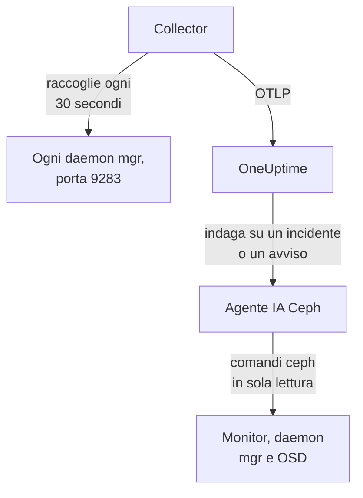

# Agent Ceph

L'agent Ceph di OneUptime monitora un cluster Ceph: lo stato di salute, il quorum dei monitor, gli OSD, i pool e i placement group. Raccoglie il modulo `prometheus` del mgr Ceph su ogni daemon mgr, applica a ogni metrica il nome del tuo cluster e la invia a OneUptime, dove il cluster compare con i suoi OSD, pool e daemon. I [monitor Ceph](/docs/monitor/ceph-monitor) inviano avvisi su ciò che arriva.

:::cards
- [Installare l'agent](#installa-lagent): Attiva il modulo del mgr, poi lo script di installazione o Docker Compose.
- [Cosa raccoglie l'agent](#cosa-raccoglie-lagent): Le serie dietro le pagine Ceph, le metriche e i modelli di avviso.
- [Agente IA](#agente-ia): Lascia che OneUptime AI legga il cluster mentre indaga.
- [Risoluzione dei problemi](#risoluzione-dei-problemi): Uno script di diagnostica, e i problemi più comuni.
:::

## Come funziona

L'agent è composto da due container che esegui con Docker Compose su una macchina. Un OpenTelemetry Collector raccoglie il modulo `prometheus` del mgr su ogni daemon mgr ogni 30 secondi. Solo il mgr attivo risponde con le metriche, quindi quando passa a uno in standby le metriche continuano ad arrivare senza alcuna modifica. L'agente IA Ceph accanto permette a OneUptime AI di eseguire comandi `ceph` in sola lettura mentre indaga su un incidente o un avviso.



Il cluster si registra con i suoi primi dati, con il nome che l'agent applica a ogni metrica come `ceph.cluster.name`.

## Prima di iniziare

- Docker Engine 20.10 o successivo con il plugin Docker Compose v2, su una macchina che raggiunge i tuoi daemon mgr Ceph sulla porta 9283.
- Una shell su un nodo di amministrazione Ceph, dove la CLI `ceph` funziona con i diritti di amministratore.
- Una chiave di acquisizione. Creane una in **Impostazioni del progetto → Telemetria e APM → Chiavi di acquisizione** e copiane il valore.
- HTTPS in uscita da quella macchina verso il tuo URL di OneUptime.

## Installa l'agent

:::steps
### Attivare il modulo prometheus del mgr

Su un nodo di amministrazione Ceph:

```bash
ceph mgr module enable prometheus
```

Ogni daemon mgr serve quindi metriche Prometheus sulla porta `9283` in `/metrics`. Solo il mgr attivo restituisce metriche: i mgr in standby rispondono con una risposta vuota, oppure con un errore HTTP se `mgr/prometheus/standby_behaviour` è impostato su `error`. Per questo l'agent raccoglie ogni mgr. Elencali:

```bash
ceph mgr stat                    # active mgr
ceph orch ps --daemon-type mgr   # all mgrs (cephadm clusters)
```

### Installa e avvia l'agent

:::tabs
@tab install.sh
Scarica lo script di installazione ed eseguilo sulla macchina che ospiterà l'agent:

```bash
curl -sSL https://raw.githubusercontent.com/OneUptime/oneuptime/master/agents/CephAgent/install.sh -o install.sh
bash install.sh
```

Lo script chiede il tuo URL di OneUptime, la chiave di acquisizione, un nome per il cluster e gli endpoint dei mgr, e se l'[agente IA](#agente-ia) può applicare correzioni. Dove `ceph` funziona con i diritti di amministratore, propone anche di creare il client Ceph dell'agente IA. Si installa in `/opt/oneuptime-ceph-agent`, scrive un file `.env` con `0600` e avvia l'agent con Docker Compose. Eseguire di nuovo lo script riutilizza tutto ciò che c'è in quel `.env` invece di chiedere di nuovo, ed è così che [aggiorni l'agent](#aggiornare-lagent).
@tab Docker Compose
Scarica `docker-compose.yml` e `otel-collector-config.yaml` dalla [directory CephAgent](https://github.com/OneUptime/oneuptime/tree/master/agents/CephAgent) in una nuova cartella:

```bash
mkdir oneuptime-ceph-agent && cd oneuptime-ceph-agent
curl -fsSLO https://raw.githubusercontent.com/OneUptime/oneuptime/master/agents/CephAgent/docker-compose.yml
curl -fsSLO https://raw.githubusercontent.com/OneUptime/oneuptime/master/agents/CephAgent/otel-collector-config.yaml
```

Crea un file `.env` accanto a essi:

```bash title=".env"
ONEUPTIME_URL=YOUR_ONEUPTIME_URL
ONEUPTIME_TELEMETRY_INGESTION_KEY=YOUR_TELEMETRY_INGESTION_TOKEN
CEPH_CLUSTER_NAME=my-ceph-cluster
CEPH_MGR_ENDPOINTS=[ceph-mon-1:9283,ceph-mon-2:9283,ceph-mon-3:9283]
```

Elenca ogni daemon mgr, quello attivo e quelli in standby, separati da virgole e racchiusi tra parentesi quadre: le parentesi fanno leggere al collector il valore come un elenco di destinazioni di raccolta. Avvia l'agent:

```bash
docker compose up -d
```

Si avvia anche il container dell'agente IA, che attende un client Ceph tutto suo: vedi [Agente IA](#agente-ia).
:::

### Verifica che l'agent sia in esecuzione

```bash
docker compose ps
docker logs -f oneuptime-ceph-agent
```

`docker compose ps` elenca il collector (`oneuptime-ceph-agent`) e l'agente IA (`oneuptime-ceph-ai-agent`). Una volta avviato, i log del collector dovrebbero mostrare questa riga:

```text
Everything is ready. Begin running and processing data.
```

### Trova il cluster in OneUptime

Apri **Prodotti → Infrastruttura → Ceph → Tutti i cluster**. Il cluster compare con il suo `CEPH_CLUSTER_NAME` entro circa un minuto, con i suoi OSD, pool e daemon.
:::

## Variabili d'ambiente

Lo script di installazione le scrive in `/opt/oneuptime-ceph-agent/.env`; un'installazione con Docker Compose le legge dal `.env` accanto a `docker-compose.yml`. Dopo averne cambiata una, esegui `docker compose up -d` in quella cartella.

| Variabile | Obbligatoria | Descrizione |
| --- | --- | --- |
| `ONEUPTIME_URL` | Sì | Il tuo URL di OneUptime, come `https://oneuptime.com` o la tua istanza self-hosted. Usa `http://` e la sua porta se l'istanza usa solo HTTP. |
| `ONEUPTIME_TELEMETRY_INGESTION_KEY` | Sì | La chiave di acquisizione da **Impostazioni del progetto → Telemetria e APM → Chiavi di acquisizione**. |
| `CEPH_CLUSTER_NAME` | Sì | Il nome del cluster in OneUptime, applicato a ogni metrica come attributo di risorsa `ceph.cluster.name`. Mantienilo stabile: cambiarlo in seguito registra un secondo cluster. Il valore predefinito è `ceph`. |
| `CEPH_MGR_ENDPOINTS` | Sì | Ogni daemon mgr come elenco `host:port` separato da virgole tra parentesi quadre, come `[ceph-mon-1:9283,ceph-mon-2:9283,ceph-mon-3:9283]`. Lo script di installazione aggiunge le parentesi per te. |

Le impostazioni proprie dell'agente IA sono in [Agente IA](#agente-ia).

## Come raccoglie l'agent

- **Ogni mgr, ogni 30 secondi.** Il modulo `prometheus` del mgr mette in cache ogni raccolta per `mgr/prometheus/scrape_interval` (15 secondi per impostazione predefinita). Non raccogliere mai più spesso: rileggeresti solo la cache.
- **`honor_labels: true`.** Le etichette esportate da Ceph (`ceph_daemon`, `pool_id`, etichette di istanza per daemon) restano come sono. Senza questa impostazione, l'etichetta `instance` verrebbe riscritta per ogni destinazione di raccolta e cambierebbe a ogni cambio del mgr attivo, interrompendo ogni serie.

## Cosa raccoglie l'agent

L'agent invia tutto ciò che esporta il modulo `prometheus` del mgr. Le pagine Ceph, il catalogo delle metriche e i modelli di avviso di OneUptime si basano su queste serie:

| Categoria | Metriche |
| --- | --- |
| Stato del cluster | `ceph_health_status` (0 = OK, 1 = WARN, 2 = ERR), `ceph_health_detail` (una serie per ogni controllo di stato attivo, con le etichette `name` e `severity`, da Quincy in poi; alla base dei modelli di avviso sui controlli di stato e degli **Active Health Checks** della panoramica), `ceph_healthcheck_slow_ops`, `ceph_daemon_health_metrics` (per daemon, in base a `type`), `ceph_mon_quorum_status`, `ceph_mon_metadata`, `ceph_cluster_total_bytes`, `ceph_cluster_total_used_bytes` |
| OSD | `ceph_osd_up`, `ceph_osd_in`, `ceph_osd_apply_latency_ms`, `ceph_osd_commit_latency_ms`, `ceph_osd_stat_bytes`, `ceph_osd_stat_bytes_used`, `ceph_osd_numpg`, `ceph_osd_metadata`, per OSD tramite l'etichetta `ceph_daemon` (come `osd.3`) |
| Pool | `ceph_pool_stored`, `ceph_pool_max_avail`, `ceph_pool_objects`, `ceph_pool_rd`, `ceph_pool_wr`, `ceph_pool_rd_bytes`, `ceph_pool_wr_bytes`, `ceph_pool_metadata`. Le serie di dati hanno solo un'etichetta `pool_id`; il nome del pool è su `ceph_pool_metadata`. |
| Placement group | `ceph_pg_total`, `ceph_pg_active`, `ceph_pg_clean`, `ceph_pg_degraded`, `ceph_pg_undersized` (tutte per pool, in base a `pool_id`), `ceph_num_objects_degraded`, `ceph_num_objects_misplaced` |
| Daemon | `ceph_mgr_metadata`, `ceph_mds_metadata` e `ceph_rgw_metadata`, oltre ai metadati dei monitor e degli OSD qui sopra. Ognuna nomina un daemon e ne riporta la versione nell'etichetta `ceph_version`: la pagina **Daemons** li elenca. |

### Altre destinazioni di raccolta

Il modulo del mgr copre lo stato e la capacità del cluster. Per uno sguardo più da vicino, aggiungi altri job in `scrape_configs` dentro `otel-collector-config.yaml`:

- **`ceph-exporter` (Reef 18.2 e successivi).** cephadm esegue un daemon `ceph-exporter` su ogni host del cluster, che serve contatori di prestazioni per daemon sulla porta `9926`. Aggiungi una destinazione per host.
- **`node_exporter`.** Il compagno abituale per le metriche di CPU, memoria, disco e rete di ogni host Ceph, sulla porta `9100` per impostazione predefinita.

Entrambi ricevono l'attributo di risorsa `ceph.cluster.name` dal processor `resource` incluso, quindi arrivano allo stesso cluster in OneUptime.

## Facoltativo — Inviare il log del cluster Ceph

L'agent può seguire `/var/log/ceph/ceph.log` e inviarlo a OneUptime, riempiendo la pagina **Cluster Log** del cluster. È disattivato per impostazione predefinita perché l'agent deve girare su un host che ha il log del cluster: per impostazione predefinita, un host monitor.

:::steps
### Attiva il receiver

In `otel-collector-config.yaml`, togli il commento al receiver `filelog` e alla pipeline `logs`.

### Montare la directory dei log

In `docker-compose.yml`, togli il commento al volume che monta la directory nel collector:

```yaml
- /var/log/ceph:/var/log/ceph:ro
```

### Riavviare l'agent

```bash
docker compose up -d
```
:::

Le righe vengono inviate man mano che vengono scritte. OneUptime legge il formato di `ceph.log` (ora, daemon, livello `INF`/`WRN`/`ERR`, messaggio) quando le mostra, e il processor `resource` applica `ceph.cluster.name`, quindi il log arriva a questo cluster.

## Etichettare il cluster con le etichette di progetto

Un attributo di risorsa che inizia con `oneuptime.label.` diventa un'etichetta di progetto sul cluster: `oneuptime.label.<dimension>=<value>` è l'etichetta `<dimension>:<value>`. Aggiungi gli attributi al processor `resource` in `otel-collector-config.yaml`, accanto a `ceph.cluster.name`:

```yaml
processors:
  resource:
    attributes:
      # ...existing attributes...
      - key: oneuptime.label.team
        value: storage
        action: upsert
      - key: oneuptime.label.env
        value: production
        action: upsert
```

Il collector legge la sua configurazione solo all'avvio: esegui `docker compose restart oneuptime-ceph-agent`. Il cluster mostra quindi le etichette `team:storage` e `env:production`. Le etichette vengono confrontate senza distinguere maiuscole e minuscole, quindi un'etichetta `Production` esistente viene riutilizzata invece che duplicata, e l'agent non rimuove mai un'etichetta che qualcuno ha aggiunto in OneUptime.

## Eseguire come servizio systemd

Per avviare l'agent insieme alla macchina e riavviarlo quando si blocca, installa la sua unità systemd. Presuppone che l'agent si trovi in `/opt/oneuptime-ceph-agent`, dove lo mette lo script di installazione:

```bash
sudo curl -fsSL https://raw.githubusercontent.com/OneUptime/oneuptime/master/agents/CephAgent/systemd/oneuptime-ceph-agent.service -o /etc/systemd/system/oneuptime-ceph-agent.service
sudo systemctl daemon-reload
sudo systemctl enable --now oneuptime-ceph-agent
```

## Aggiornare l'agent

L'agent riporta come sua **Versione dell'agente** la versione del collector fissata dai suoi file. Quando è più vecchia della versione fissata da questa release di OneUptime, compare un segnale di avviso accanto a essa nella **Panoramica** del cluster. Selezionalo per vedere questi comandi. Un agent installato prima che i suoi file riportassero una versione non ne mostra nessuna finché non viene aggiornato in questo modo.

L'immagine del collector è fissata in `docker-compose.yml` e la sua configurazione è un file accanto, quindi scaricare le immagini da solo non porta avanti l'agent. Esegui di nuovo `install.sh`: riutilizza ogni valore del tuo `.env` esistente (non viene chiesto nulla di nuovo), aggiorna `docker-compose.yml` e `otel-collector-config.yaml` (un file che hai modificato viene conservato come `<file>.bak.<timestamp>`), scarica le immagini e ricrea l'agent così che il collector legga la sua nuova configurazione. La cartella `ceph/` dell'agente IA resta com'è.

```bash
curl -sSL https://raw.githubusercontent.com/OneUptime/oneuptime/master/agents/CephAgent/install.sh -o install.sh
bash install.sh
```

L'hai installato invece con Docker Compose? Nella cartella dell'agent, scarica di nuovo entrambi i file (e rifai le eventuali modifiche che ci avevi apportato), poi scarica le immagini e ricrea l'agent:

```bash
curl -fsSLO https://raw.githubusercontent.com/OneUptime/oneuptime/master/agents/CephAgent/docker-compose.yml
curl -fsSLO https://raw.githubusercontent.com/OneUptime/oneuptime/master/agents/CephAgent/otel-collector-config.yaml
docker compose pull
docker compose up -d --force-recreate
```

## Disinstallare l'agent

```bash
cd /opt/oneuptime-ceph-agent
docker compose down
```

Se hai creato il client Ceph dell'agente IA, rimuovilo su un nodo di amministrazione con `ceph auth del client.oneuptime-ai`.

## Agente IA

Il `docker-compose.yml` dell'agent esegue anche l'**Agente IA Ceph**, `oneuptime-ceph-ai-agent` (immagine `oneuptime/resource-ai-agent:release`). Mentre OneUptime AI indaga su un incidente o un avviso in questo cluster, esegue tramite esso comandi `ceph` in sola lettura — `ceph health detail`, `ceph osd tree`, `ceph pg dump_stuck`, `ceph crash ls` — e, solo se lo consenti, applica correzioni come rimettere un OSD in stato in o rimuovere `noout`. Si registra come il cluster chiamato `CEPH_CLUSTER_NAME`, come il collector, e compare nella pagina **IA → Agente IA** del cluster in OneUptime.

- **Le indagini IA sono attive per impostazione predefinita.** Appena l'agent si connette, OneUptime AI lo usa per indagare sugli incidenti e sugli avvisi di questo cluster, e la **Panoramica** del cluster mostra lo stato dell'agent. Per fermarlo, imposta `ONEUPTIME_AI_INVESTIGATION=false` dove viene eseguito l'agent (**Cambia** sotto **Cosa può fare l'IA**, nella pagina dell'agente IA, mostra come), oppure ometti l'agent.
- **Il suo client Ceph è il limite invalicabile.** Si connette come `client.oneuptime-ai`, con il `ceph.conf` minimo del cluster e il keyring di quel client in una cartella `ceph/` accanto a `docker-compose.yml` (montata in sola lettura in `/etc/ceph`). Con caps di sola lettura, nulla di ciò che esegue può modificare il cluster. In una nuova installazione, `install.sh` propone di creare il client; eseguirlo di nuovo non lo fa mai. Non mettere mai il keyring di amministrazione in quella cartella.
- È in **sola lettura** a meno che tu non imposti `ONEUPTIME_AI_ALLOW_WRITES=true` e dia al client i caps per le correzioni (il README dell'agent li elenca); `ONEUPTIME_AI_WRITE_TARGETS` (per esempio `osd.*,cluster`) limita ciò che una correzione può toccare. `ONEUPTIME_AI_FIXES` nello stesso `.env` indica come vengono eseguite le correzioni — `ask-for-approval` (una persona approva ciascuna), `automatic` o `bypass-approval` — e la pagina dell'agente IA lo mostra in sola lettura ([Cosa può fare l'IA, impostato dall'agent](/docs/ai/infrastructure-ai-agents#what-ai-may-do-set-by-the-agent)).
- Si connette in uscita ai monitor (TCP 3300 e 6789) e ai daemon mgr e OSD (TCP 6800–7300), gira come UID 1000 senza capabilities e non esegue mai `auth`, `config-key`, `tell` né nulla che elimini dati. Elimina il servizio `oneuptime-ceph-ai-agent` da `docker-compose.yml` se non usi OneUptime AI.

Per creare il client a mano, esegui questo su un nodo di amministrazione Ceph, nella cartella dell'agent (copia i due file nella cartella `ceph/` della macchina dell'agent se è un'altra):

```bash
mkdir -p ceph
ceph config generate-minimal-conf > ceph/ceph.conf
ceph auth get-or-create client.oneuptime-ai mon 'allow r' mgr 'allow r' osd 'allow r' -o ceph/ceph.client.oneuptime-ai.keyring
sudo chown 1000:1000 ceph/ceph.client.oneuptime-ai.keyring
sudo chmod 600 ceph/ceph.client.oneuptime-ai.keyring
docker compose up -d
```

Cosa può eseguire, come funzionano le correzioni e come risolverne i problemi: [Infrastructure AI Agents](/docs/ai/infrastructure-ai-agents#ceph-clusters).

## Risoluzione dei problemi

:::details Esegui prima lo script di diagnostica
L'agent include uno script, [`troubleshoot.sh`](https://github.com/OneUptime/oneuptime/blob/master/agents/CephAgent/troubleshoot.sh), che controlla l'intera catena: il runtime dei container, ogni endpoint mgr configurato, il nome del cluster applicato a ogni metrica, la forma del token, le metriche proprie del collector, e se OneUptime accetta la chiave di acquisizione. Avvisa quando nessun endpoint restituisce `ceph_health_status`, o quando ne è configurato uno solo, dato che solo il mgr attivo serve metriche. Il controllo della chiave è il più importante. OneUptime rifiuta una chiave errata con `401` (`422` per una chiave disattivata o una chiave del browser), e il collector tratta entrambi come definitivi: scarta il batch e registra un unico errore `Exporting failed`, facile da non notare mentre il container resta in salute. Lo script interroga `GET <url>/otlp/v1/validate` dall'interno della rete dell'agent per ottenere direttamente `200` (valida) o `401` (non valida), e sui server più vecchi ripiega su `POST /fluentd/v1/logs`.

```bash
curl -sSL https://raw.githubusercontent.com/OneUptime/oneuptime/master/agents/CephAgent/troubleshoot.sh -o troubleshoot.sh
bash troubleshoot.sh    # add -d <dir> if you installed outside /opt/oneuptime-ceph-agent
```

Termina con un verdetto che indica la causa più probabile.
:::

:::details Nessun cluster compare in OneUptime
1. Leggi i log del collector: `docker logs oneuptime-ceph-agent`. Un `401` in esportazione indica una chiave di acquisizione errata; una connessione rifiutata indica un `ONEUPTIME_URL` errato.
2. Verifica che un mgr serva metriche: `curl http://ACTIVE_MGR_HOST:9283/metrics | head` dovrebbe stampare righe `ceph_*`. Se non lo fa, attiva il modulo con `ceph mgr module enable prometheus`.
3. Verifica che `CEPH_MGR_ENDPOINTS` sia racchiuso tra parentesi quadre. Senza, il collector legge l'intero elenco separato da virgole come un'unica destinazione, che non esiste.
:::

:::details Il cluster risulta disconnesso
Un cluster risulta disconnesso quando OneUptime non ha ricevuto nulla da esso per 15 minuti; OneUptime controlla ogni 5 minuti, e il tempo in cui era OneUptime stesso a non ricevere dati non conta. Verifica che il collector sia in esecuzione (`docker compose ps`), che i suoi log non mostrino errori di esportazione e che la macchina raggiunga ancora il tuo URL di OneUptime. Il cluster torna connesso con i dati successivi.
:::

:::details Le metriche si fermano dopo un failover del mgr
Probabilmente stai raccogliendo solo il mgr che prima era attivo. Elenca ogni daemon mgr in `CEPH_MGR_ENDPOINTS`: raccogliere quelli in standby non costa quasi nulla, e rispondono con risposte vuote.
:::

:::details Errori di raccolta per i mgr in standby nei log del collector
È previsto quando `mgr/prometheus/standby_behaviour` è impostato su `error` nel tuo cluster: i mgr in standby rispondono allora con HTTP 500. La raccolta del mgr attivo riesce comunque, quindi gli errori sono solo rumore; reimposta il comportamento su `default` per silenziarli.
:::

:::details Le metriche finiscono nel cluster sbagliato
OneUptime registra un cluster Ceph tramite il suo `ceph.cluster.name`, che l'agent prende da `CEPH_CLUSTER_NAME`. Cambiarlo dopo i primi dati crea un secondo cluster invece di rinominare il primo.
:::

## Passaggi successivi

:::cards
- [Monitor Ceph](/docs/monitor/ceph-monitor): Avvisi su stato, OSD, placement group, capacità, crash e operazioni lente.
- [Agent Proxmox](/docs/telemetry/proxmox): Usi Ceph sotto Proxmox VE? Monitora anche il cluster.
- [Infrastructure AI Agents](/docs/ai/infrastructure-ai-agents): Cosa può eseguire l'agente IA Ceph e come funzionano le correzioni.
- [Collector OpenTelemetry sull'host](/docs/telemetry/host-otel-collector): La vista del sistema operativo di ogni host Ceph.
:::
