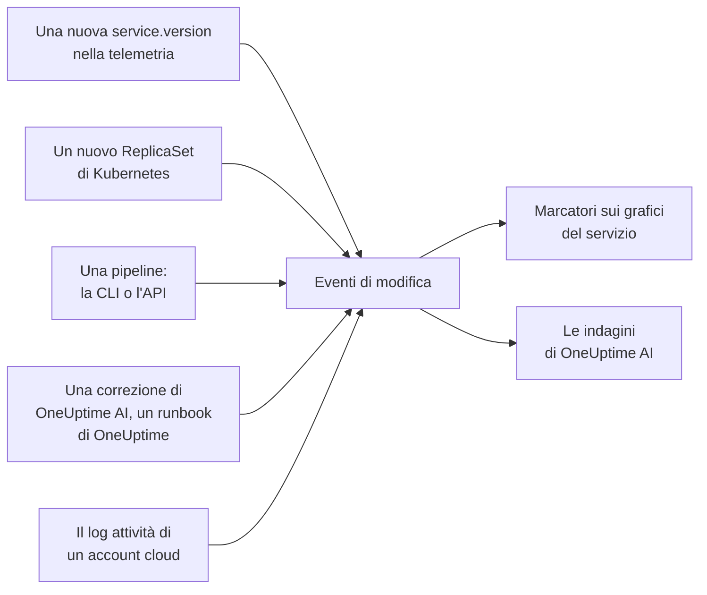

# Deploy e modifiche

OneUptime tiene traccia di ciò che è cambiato nel tuo progetto: deploy, rollout di Kubernetes, modifiche di configurazione, le modifiche nei tuoi account cloud collegati e le correzioni che ha eseguito da sé. Ogni modifica viene disegnata come un marcatore sui grafici del suo servizio o della sua risorsa cloud, e OneUptime AI le legge quando indaga su un incidente, così "è iniziato subito dopo il deploy delle 10:02" è la prima cosa che scopri, non l'ultima.

:::cards
- [Che cosa registra OneUptime da solo](#che-cosa-registra-oneuptime-da-solo): Deploy e rollout dalla telemetria, le modifiche dei tuoi account cloud, e le sue correzioni.
- [Registrare un deploy da una pipeline](#registrare-un-deploy-da-una-pipeline): La CLI, GitHub Actions e l'API.
- [Come OneUptime AI usa le modifiche](#come-oneuptime-ai-usa-le-modifiche): Le modifiche sospette di ogni indagine.
- [Riferimento](#riferimento): Campi, attributi e limiti.
:::

## Come funziona



## Che cosa registra OneUptime da solo

Per queste non devi inviare nulla. OneUptime le registra a partire dalla telemetria che riceve già e da ciò che fa da sé.

| Modifica | Registrata quando | Origine |
| --- | --- | --- |
| Un deploy | Un servizio inizia a riportare una `service.version` che non aveva mai riportato prima nel suo ambiente | `service-version` |
| Un rollout | I pod di un Deployment Kubernetes iniziano a eseguire un ReplicaSet che non avevano mai eseguito: una nuova immagine, una variabile d'ambiente o un riferimento di configurazione cambiati, oppure un riavvio | `kubernetes` |
| Una correzione eseguita da OneUptime AI | Un agente IA riporta il risultato di un comando che cambia qualcosa, come `kubectl rollout restart` | `oneuptime-ai` |
| Un runbook | Un runbook eseguito da OneUptime si completa, non riesce o viene annullato dopo essere partito | `runbook` |
| Una modifica nel cloud | Il log attività di un account cloud collegato registra una modifica: AWS CloudTrail, il log attività di Azure o il log di audit Admin Activity di Google Cloud | `cloud` |
| Un evento del provider | Il provider cloud pubblica un evento di stato sull'account: AWS Health, Azure Service Health o Resource Health, oppure Google Cloud Service Health | `cloud-health` |

- **La prima versione che un servizio riporta è il suo punto di partenza, non un deploy.** Un servizio che gira da mesi non viene rilasciato nel momento in cui OneUptime inizia a riceverne la telemetria.
- **Un rollback a una versione vista negli ultimi 30 giorni non viene registrato,** perché quella versione non è nuova. Un rollback eseguito da OneUptime AI viene registrato come correzione.
- **Oltre 6 nuove versioni o nuovi ReplicaSet in un'ora, la registrazione si ferma fino alla fine dell'ora.** Altrimenti una "versione" che cambia a ogni pod, come un timestamp di build, registrerebbe un deploy per ogni pod.

Un deploy viene registrato solo per un servizio che riporta `service.version`. Impostala, insieme all'ambiente e al commit, negli attributi di risorsa del tuo SDK o collector OpenTelemetry:

```bash
OTEL_RESOURCE_ATTRIBUTES="service.version=2.3.1,deployment.environment.name=production,vcs.ref.head.revision=$GIT_SHA"
```

Un rollout richiede l'[agent Kubernetes](/docs/telemetry/kubernetes-agent), che contrassegna la telemetria di ogni pod con il suo Deployment e il suo ReplicaSet.

Una modifica nel cloud o un evento del provider richiede un [account cloud collegato](/docs/telemetry/cloud-accounts). Ciascuno è collegato alla risorsa cloud che nomina, quando OneUptime elenca quella risorsa, e viene disegnato sui grafici della risorsa. Il suo tipo deriva dall'operazione: `deployment`, `scaling` o `rollback` quando il nome dell'operazione lo dice, altrimenti `config-change`, e `provider-event` per un evento di stato. I grafici non filtrati su alcuna risorsa lasciano fuori il log attività di un account cloud, così un account molto attivo non oscura i tuoi deploy; gli eventi di stato del provider restano sui grafici.

## Registrare un deploy da una pipeline

Una pipeline può registrare un deploy, o qualsiasi altra modifica, nel momento in cui avviene: una modifica di configurazione, una migrazione, un feature flag. Scrive con una chiave di acquisizione della telemetria del tuo progetto, dello stesso tipo con cui le tue applicazioni inviano la telemetria. Creane una in **Impostazioni del progetto → Telemetria e APM → Chiavi di acquisizione**.

Una chiave vincolata a un servizio registra ogni modifica sotto quel servizio.

:::tabs
@tab CLI
```bash
oneuptime deploy \
  --service checkout \
  --service-version 2.3.1 \
  --commit "$GIT_SHA" \
  --environment production \
  --url https://oneuptime.com \
  --ingestion-key "$ONEUPTIME_TELEMETRY_INGESTION_KEY"
```
@tab GitHub Actions
```yaml title=".github/workflows/deploy.yml"
- name: Record the deploy in OneUptime
  env:
    ONEUPTIME_URL: https://oneuptime.com
    ONEUPTIME_TELEMETRY_INGESTION_KEY: ${{ secrets.ONEUPTIME_TELEMETRY_INGESTION_KEY }}
  run: |
    npx -y @oneuptime/cli deploy \
      --service checkout \
      --service-version "${{ github.ref_name }}" \
      --commit "${{ github.sha }}" \
      --repository "${{ github.server_url }}/${{ github.repository }}" \
      --environment production
```
@tab API
```bash
curl -X POST https://oneuptime.com/telemetry/change-events/v1/ingest \
  -H "Content-Type: application/json" \
  -H "x-oneuptime-token: $ONEUPTIME_TELEMETRY_INGESTION_KEY" \
  -d '{"events": [{"serviceName": "checkout", "version": "2.3.1", "commit": "1a2b3c4", "environment": "production"}]}'
```
:::

Su un OneUptime self-hosted, usa il tuo indirizzo invece di `https://oneuptime.com`. L'API risponde con quanti eventi ha memorizzato e quanti ne ha saltati:

```json
{ "ingested": 1, "skipped": 0 }
```

Vedi [`oneuptime deploy`](/docs/cli/command-reference#oneuptime-deploy) per tutte le opzioni della CLI.

## Come OneUptime AI usa le modifiche

Ogni [indagine IA](/docs/ai/ai-sre) di un incidente o di un avviso parte dalle modifiche registrate nelle 2 ore precedenti, e nei 10 minuti successivi, per una pipeline che registra il suo deploy a rollout concluso. Le modifiche sui servizi, cluster, host e risorse cloud a cui l'incidente è collegato vengono per prime.

Per un massimo di 4 di esse che nominano un servizio, OneUptime legge la telemetria del servizio nei 30 minuti prima e dopo la modifica, e segna la modifica come **sospetta** quando il servizio è peggiorato in modo misurabile subito dopo:

| Segnale | Sospetta quando |
| --- | --- |
| Span non riusciti | Il tasso di errore è almeno raddoppiato ed è salito di almeno un punto percentuale, su almeno 10 span non riusciti |
| Latenza | Il p99 è cresciuto almeno della metà, e di almeno 100 ms |
| Eccezioni | Almeno il triplo al minuto, e almeno 10 in tutto |
| Nuove eccezioni | Un tipo di eccezione visto per la prima volta nella versione rilasciata dalla modifica, tra 10 minuti prima della modifica e 30 minuti dopo, si è verificato almeno 3 volte |

OneUptime decide quale modifica è sospetta in base a questi numeri, non a ciò che dice il titolo di una modifica. L'indagine controlla per prima una modifica sospetta, dice se ha causato l'incidente e dice se annullarla con un rollback è la correzione sicura più rapida.

Quando la modifica sospetta è un rollout Kubernetes su un cluster le cui [correzioni IA](/docs/ai/ai-sre#come-funzionano-le-correzioni) sono attive, OneUptime AI ne fa prima il rollback, con un `kubectl rollout undo` che OneUptime costruisce a partire dalla modifica registrata. Un deploy che rilascia codice viene annullato tramite i suoi commit: l'indagine indica il commit o la pull request che ha causato il problema, così una [pull request di correzione](/docs/ai/ai-sre#correzioni-automatiche-del-codice) può annullare esattamente quello.

OneUptime controlla anche ogni deploy da solo, che qualcuno venga avvisato o no. Trascorsi i 30 minuti dopo un deploy, li confronta con i 30 minuti prima secondo le stesse soglie e, quando il servizio è peggiorato, un [AI Insight](/docs/ai/ai-sre#insight-rilevamento-proattivo) indica il deploy su quel servizio.

Una pull request di correzione che OneUptime AI ha aperto viene verificata allo stesso modo: appena un deploy registrato contiene il suo commit, OneUptime osserva lì ciò per cui serviva la correzione - l'eccezione, l'operazione che ha reso più veloce, il monitor dietro l'incidente o l'avviso, la telemetria che aggiunge - e indica se la correzione ha funzionato (vedi [Correzioni automatiche del codice](/docs/ai/ai-sre#correzioni-automatiche-del-codice)). La correzione distribuita viene letta nella versione del deploy solo quando la telemetria del servizio riporta essa stessa quella versione, e altrimenti da 10 minuti dopo il deploy, quando le vecchie istanze si sono fermate.

In un'indagine e in [Chiedi all'IA](/docs/ai/ask-ai), `recent_changes` elenca le modifiche in qualsiasi finestra di tempo, e `get_change_details` mostra che cosa ha rilasciato un deploy: i commit dal deploy precedente del servizio, i loro autori, le pull request e i file che hanno toccato. Per questo servono il commit sulla modifica e il suo repository collegato in Codice: tramite la [GitHub App](/docs/ai/github-app), o una connessione GitLab, Forgejo o Gitea (vedi [Collegare un repository](/docs/ai/ai-agent#collegare-un-repository)).

## Riferimento

### Campi

| Campo | Cos'è |
| --- | --- |
| `title` | Che cosa è cambiato, come `Deploy 2.3.1`. Un deploy che invia `version` può ometterlo |
| `eventType` | Il tipo di modifica: `deployment` (il predefinito), `config-change`, `scaling`, `rollback`, `feature-flag` o uno tuo |
| `serviceName` | Il servizio a cui appartiene. Senza, la modifica riguarda tutto il progetto |
| `time` | Quando è avvenuta, come ISO 8601 o come secondi o millisecondi epoch. Il predefinito è il momento in cui è arrivata |
| `description` | I dettagli della modifica |
| `version` | La versione rilasciata |
| `previousVersion` | La versione che ha sostituito |
| `commit` | Il commit rilasciato (anche `commitSha` o `sha`) |
| `repository` | Il repository del commit (anche `repositoryUrl`) |
| `branch` | Il branch rilasciato |
| `pullRequest` | La pull request rilasciata |
| `environment` | L'ambiente in cui è stato rilasciato |
| `attributes` | Fino a 50 attributi in più, come testo, numeri o booleani |

I campi di primo livello vengono memorizzati come attributi con i nomi OpenTelemetry: `version` come `service.version`, `commit` come `vcs.ref.head.revision`, `repository` come `vcs.repository.url.full`, `branch` come `vcs.ref.head.name`, `pullRequest` come `vcs.change.id` e `environment` come `deployment.environment.name`. Un attributo inviato con uno di quei nomi prevale sul suo campo.

Gli attributi il cui nome inizia con `oneuptime.` sono di OneUptime e vengono scartati da ciò che invia una pipeline. Ogni modifica registrata da una pipeline lo dice in `oneuptime.change.source`, che vale `api`.

Una modifica letta da un account cloud nomina l'account e la risorsa con i nomi di OpenTelemetry, `cloud.provider`, `cloud.account.id`, `cloud.region` e `cloud.resource_id`, e tiene l'operazione in `oneuptime.cloud.operation`, chi l'ha eseguita in `oneuptime.cloud.actor`, se non è riuscita in `oneuptime.change.status` e il suo account cloud in `oneuptime.cloud_account.id`.

### Limiti

| Limite | Valore |
| --- | --- |
| Eventi in una richiesta | 100 |
| Titolo | 500 caratteri |
| Descrizione | 5.000 caratteri |
| Attributi | 50 |
| Ora | Un orario di più di 366 giorni fa, o di più di 60 minuti nel futuro, viene sostituito con l'ora in cui l'evento è arrivato |

## Passaggi successivi

:::cards
- [AI SRE](/docs/ai/ai-sre): Che cosa legge un'indagine e come corregge ciò che trova.
- [Riferimento dei comandi](/docs/cli/command-reference): Ogni comando della CLI.
- [OpenTelemetry](/docs/telemetry/open-telemetry): Inviare la telemetria dei tuoi servizi, con le loro versioni.
- [Collegare un account cloud](/docs/telemetry/cloud-accounts): Le modifiche e gli eventi di stato dei tuoi account AWS, Azure e Google Cloud.
:::
