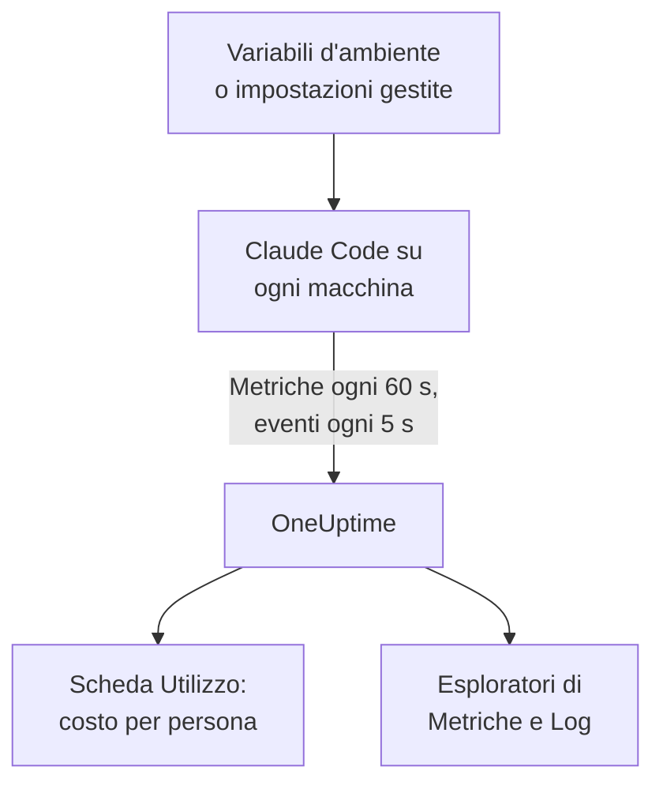

# Claude Code

Claude Code esporta da sé metriche ed eventi OpenTelemetry, direttamente verso OneUptime: nessun collector e nessun gateway in mezzo. Attivalo con poche variabili d'ambiente, o per un'intera flotta con un solo file di impostazioni gestite, e vedi costi, token, sessioni, commit e modifiche accettate per sviluppatore.

:::cards
- [Configura una macchina](#configura-una-macchina): Sei variabili d'ambiente e un riavvio.
- [Distribuiscilo alla flotta](#distribuiscilo-alla-flotta): Un file di impostazioni gestite su ogni macchina.
- [Attribuisci la spesa alle persone](#attribuisci-lutilizzo-a-persone-e-team): Chi ha fatto l'accesso, e quando devi impostare tu l'identità.
- [Risoluzione dei problemi](#risoluzione-dei-problemi): Cosa controllare quando non arriva nulla.
:::

## Come funziona



Claude Code invia:

- **Costi e token**: `claude_code.cost.usage` (USD) e `claude_code.token.usage`, per modello, per agente principale o subagente, e per l'agente, la skill, il plugin o il server MCP che ha fatto la chiamata.
- **Attività**: sessioni, commit, pull request, righe di codice aggiunte e rimosse, e tempo attivo.
- **Decisioni sulle modifiche**: `claude_code.code_edit_tool.decision` conta le modifiche accettate e rifiutate, quindi il tasso di accettazione è `accept / (accept + reject)`, per linguaggio e per strumento.
- **Eventi**: prompt, risultati degli strumenti, richieste ed errori dell'API, cambi di modalità dei permessi e connessioni ai server MCP, come record di log OTLP.

Ogni punto dati delle metriche e ogni evento porta `user.email` quando lo sviluppatore ha fatto l'accesso con un account Claude, e OneUptime lo legge come il dipendente sulle metriche, dove si trovano costi e token.

## Prima di iniziare

1. Crea una chiave di acquisizione della telemetria in **Impostazioni del progetto → Telemetria e APM → Chiavi di acquisizione**.
2. Il tuo endpoint OTLP è `https://oneuptime.com/otlp`, o `https://YOUR-ONEUPTIME-HOST/otlp` se ospiti OneUptime in proprio.
3. Usa una sola chiave per tutta la flotta. Finisce su ogni macchina degli sviluppatori, quindi trattala come una credenziale condivisa che può solo inviare dati, e ruotala come qualsiasi altra.

## Configura una macchina

:::steps
### Esporta le variabili

Aggiungile al profilo della tua shell (`.zshrc` o `.bashrc`), o esportale nel terminale da cui avvii Claude Code:

```bash
export CLAUDE_CODE_ENABLE_TELEMETRY=1
export OTEL_METRICS_EXPORTER=otlp
export OTEL_LOGS_EXPORTER=otlp
export OTEL_EXPORTER_OTLP_PROTOCOL=http/protobuf
export OTEL_EXPORTER_OTLP_ENDPOINT="https://oneuptime.com/otlp"
export OTEL_EXPORTER_OTLP_HEADERS="x-oneuptime-token=YOUR_INGESTION_TOKEN"
```

| Variabile | Cosa fa |
| --- | --- |
| `CLAUDE_CODE_ENABLE_TELEMETRY` | L'interruttore principale: senza di esso non viene esportato nulla. |
| `OTEL_METRICS_EXPORTER`, `OTEL_LOGS_EXPORTER` | `otlp` invia a OneUptime. `otlp,console` stampa anche ciò che viene inviato, utile durante la configurazione. |
| `OTEL_EXPORTER_OTLP_PROTOCOL` | `http/protobuf`; funzionano anche `http/json` e `grpc`. |
| `OTEL_EXPORTER_OTLP_ENDPOINT` | L'URL di base. Claude Code aggiunge da sé `/v1/metrics` e `/v1/logs`. |
| `OTEL_EXPORTER_OTLP_HEADERS` | Coppie `key=value` separate da virgole; qui, la tua chiave di acquisizione. |

### Riavvia Claude Code

Le variabili vengono lette all'avvio di Claude Code. Le metriche vengono inviate ogni 60 secondi e gli eventi ogni 5 secondi, quindi usa Claude Code per un minuto prima di guardare.

### Controlla che i dati arrivino

Apri **Metriche** e cerca `claude_code.token.usage`, poi apri **Prodotti → AI / LLM** e vai su **Utilizzo**: il tuo costo compare sotto la tua email, con la dicitura **dalle metriche GenAI**.
:::

Per inviare metriche ed eventi in posti diversi, imposta invece `OTEL_EXPORTER_OTLP_METRICS_ENDPOINT` e `OTEL_EXPORTER_OTLP_LOGS_ENDPOINT`, con il percorso completo (`https://oneuptime.com/otlp/v1/metrics`, `https://oneuptime.com/otlp/v1/logs`).

## Distribuiscilo alla flotta

Per un'organizzazione, distribuisci le stesse variabili in un file di impostazioni gestite. Ha la forma di `settings.json`, con le variabili in un blocco `env`:

```json title="managed-settings.json"
{
  "env": {
    "CLAUDE_CODE_ENABLE_TELEMETRY": "1",
    "OTEL_METRICS_EXPORTER": "otlp",
    "OTEL_LOGS_EXPORTER": "otlp",
    "OTEL_EXPORTER_OTLP_PROTOCOL": "http/protobuf",
    "OTEL_EXPORTER_OTLP_ENDPOINT": "https://oneuptime.com/otlp",
    "OTEL_EXPORTER_OTLP_HEADERS": "x-oneuptime-token=YOUR_INGESTION_TOKEN",
    "OTEL_RESOURCE_ATTRIBUTES": "team.id=platform,cost_center=eng-123"
  }
}
```

:::steps
### Metti il file dove Claude Code lo legge

| Piattaforma | Percorso |
| --- | --- |
| macOS | `/Library/Application Support/ClaudeCode/managed-settings.json` |
| Linux e WSL | `/etc/claude-code/managed-settings.json` |
| Windows | `C:\Program Files\ClaudeCode\managed-settings.json` |

Claude Code non legge più il vecchio percorso Windows `C:\ProgramData\ClaudeCode\managed-settings.json`. Se distribuisci già un file di impostazioni gestite, aggiungi invece un file aggiuntivo, come `managed-settings.d/10-telemetry.json` accanto a esso: Claude Code unisce prima `managed-settings.json`, poi ogni file `*.json` in `managed-settings.d/` in ordine alfabetico.

### Controlla una macchina

Esegui `/status` in Claude Code. La riga `Setting sources` deve dire `Enterprise managed settings (file)`, oppure `(drop-ins)` o `(file + drop-ins)` per un file aggiuntivo. Un'altra fonte tra parentesi significa che ha vinto una fonte di rango più alto, e la tua non è stata usata.

### Guarda arrivare la flotta

Nella scheda **Utilizzo**, ogni sviluppatore compare come una riga dopo aver usato Claude Code con le nuove impostazioni.
:::

Lo stesso JSON può arrivare anche dalle impostazioni gestite dal server nella console di amministrazione di claude.ai (recuperate all'avvio e ogni ora), da un profilo di configurazione macOS nel dominio `com.anthropic.claudecode`, o da un valore `Settings` sotto `HKLM\SOFTWARE\Policies\ClaudeCode` su Windows.

:::details Quale fonte gestita vince, e come si combinano le variabili di telemetria
Per impostazione predefinita, Claude Code usa la fonte di rango più alto che imposta una qualsiasi chiave di policy, e ignora le altre: le impostazioni gestite dal server, poi una policy MDM o del sistema operativo, poi i file di impostazioni gestite, poi il valore di registro `HKCU` per utente. Il blocco `env` è l'eccezione: dalla versione 2.1.223 viene unito variabile per variabile tra le fonti amministrative.

Le variabili di telemetria no: le variabili `OTEL_EXPORTER_OTLP_*`, gli interruttori di contenuto `OTEL_LOG_*`, `OTEL_LOGS_EXPORTER` e le variabili del tracing in beta arrivano insieme dalla fonte di rango più alto che ne imposta una qualsiasi, così un endpoint di una fonte non si abbina mai alle credenziali di un'altra. Se una fonte di rango più alto ne imposta anche solo una, un file aggiuntivo di telemetria non contribuisce nulla.

Le impostazioni gestite dal server richiedono un passaggio in più: un `OTEL_EXPORTER_OTLP_ENDPOINT` non vuoto viene applicato solo dopo che ogni sviluppatore accetta una finestra di approvazione di sicurezza in una sessione interattiva, e le modifiche alle impostazioni dell'esportatore si applicano al successivo avvio. I file e le policy MDM non hanno finestre di dialogo.
:::

:::details Ruotare la chiave di acquisizione senza modificare ogni macchina
Invece di un header fisso, imposta `"otelHeadersHelper": "/path/to/generate-otel-headers.sh"` nelle impostazioni. Lo script stampa un oggetto JSON piatto di header, come `{"x-oneuptime-token":"..."}`. Claude Code lo esegue all'avvio e di nuovo ogni `CLAUDE_CODE_OTEL_HEADERS_HELPER_DEBOUNCE_MS` millisecondi (`1740000` per impostazione predefinita, 29 minuti). Gli errori compaiono in `/status`.
:::

## Attribuisci l'utilizzo a persone e team

**Il dipendente è `user.email`.** Claude Code lo invia quando lo sviluppatore ha fatto l'accesso con un account Claude, e non c'è alcuna variabile per disattivarlo. OneUptime lo legge da ogni punto dati di costo e di token, senza configurazione.

**Gli altri accessi non inviano email.** Con una chiave API, o con Claude su Amazon Bedrock, Google Cloud o Microsoft Foundry, nella sessione non c'è un account Claude, e Claude Code invia solo `user.id` e `session.id`. Imposta tu l'identità, per macchina, nelle impostazioni gestite o in uno script di avvio:

```bash
export OTEL_RESOURCE_ATTRIBUTES="user.email=jdoe@example.com,team.id=platform"
```

**`user.id` non è una persona.** È un id casuale che Claude Code scrive in `~/.claude.json` al primo avvio: uno per installazione, e uno nuovo se il file viene eliminato. Senza un'email, ogni installazione compare come una riga a sé. Un'eccezione: una sessione con l'accesso fatto tramite un gateway delle app Claude invia l'identità dell'accesso (`user.id` è il subject del provider di identità, `user.email` l'email) e ignora le chiavi `user.*` che imposti tu.

**Team e centri di costo** vengono da `OTEL_RESOURCE_ATTRIBUTES`: OneUptime legge `team.id`, `team`, `cost_center` e `department`. I valori non possono contenere spazi, e le virgolette non li proteggono: scrivi `team=Platform_Engineering`, o usa la codifica percentuale, come in `team=Platform%20Engineering`. Claude Code copia queste chiavi su ogni punto dati (`OTEL_METRICS_INCLUDE_RESOURCE_ATTRIBUTES`, attivo per impostazione predefinita), e OneUptime le legge in entrambi i casi. Una chiave che imposti tu non sostituisce mai una che Claude Code imposta da sé.

## Cosa mostra OneUptime

In **Prodotti → AI / LLM → Utilizzo**, `claude_code.cost.usage` alimenta le tabelle **Dipendente**, **Team** e **Modello**, e `claude_code.token.usage` i totali dei token. Due regole decidono cosa vedi:

- **Le metriche colmano i vuoti degli span; non vengono mai sommate a essi.** Se lo stesso progetto riceve span GenAI con un costo dalle tue app, la spesa di Claude Code non compare. Invia Claude Code a un progetto tutto suo. Vedi [Prima gli span, le metriche colmano i vuoti](/docs/telemetry/ai-llm-observability#prima-gli-span-le-metriche-colmano-i-vuoti).
- **Una riga dalle metriche porta solo il costo.** Le sue celle di chiamate e token mostrano `—`, e le tabelle **Provider** e **Applicazione / Servizio** restano vuote: le metriche non nominano alcun provider e non appartengono ad alcun servizio OneUptime.

Tutto il resto, come il tasso di accettazione, le righe di codice, i commit e le pull request per sviluppatore, o la spesa per `query_source`, lo rappresenti in una [dashboard](/docs/dashboards/index) a partire dalle metriche qui sotto, e ci imposti avvisi con un [monitor metriche](/docs/monitor/metrics-monitor).

## Metriche

Ogni metrica è un contatore, e porta gli attributi standard oltre ai propri.

| Metrica | Unità | I suoi attributi |
| --- | --- | --- |
| `claude_code.session.count` | nessuna | `start_type`: `fresh`, `resume`, `continue`, `agents_view` |
| `claude_code.lines_of_code.count` | nessuna | `type`: `added`, `removed`; `model` |
| `claude_code.commit.count` | nessuna | nessuno |
| `claude_code.pull_request.count` | nessuna | nessuno |
| `claude_code.cost.usage` | USD | `model`; `query_source`: `main`, `subagent`, `auxiliary`; `speed`: `fast`, `normal`; `effort`; `agent.name`, `skill.name`, `plugin.name`, `marketplace.name`, `mcp_server.name`, `mcp_tool.name` |
| `claude_code.token.usage` | token | `type`: `input`, `output`, `cacheRead`, `cacheCreation`; e gli stessi attributi di `claude_code.cost.usage` |
| `claude_code.code_edit_tool.decision` | nessuna | `tool_name`: `Edit`, `Write`, `NotebookEdit`; `decision`: `accept`, `reject`; `source`; `language` |
| `claude_code.active_time.total` | s | `type`: `user` (alla tastiera), `cli` (strumenti e risposte del modello) |

Gli attributi standard sono `session.id`, `app.version`, `app.entrypoint`, `organization.id`, `user.account_uuid`, `user.account_id`, `user.id`, `user.email` e `terminal.type`, più i tuoi `OTEL_RESOURCE_ATTRIBUTES`. Alcuni si possono disattivare: vedi [Tieni basso il volume delle metriche](#tieni-basso-il-volume-delle-metriche).

- I tipi di token della cache sono in camelCase: `cacheRead` e `cacheCreation`. I totali dei token di OneUptime contano solo `input` e `output`.
- Sulle metriche di costo e di token, i nomi dei tuoi agenti e server MCP, e dei plugin e delle skill di terze parti, compaiono come `custom` o `third-party` a meno che non sia impostato `OTEL_LOG_TOOL_DETAILS=1` (Claude Code 2.1.273 o successivo).

## Eventi

Gli eventi arrivano come record di log OTLP, ciascuno con `event.name`, `event.timestamp` e `event.sequence`. Quelli che userai di più:

| Evento | Cosa registra |
| --- | --- |
| `claude_code.user_prompt` | Un prompt: la sua lunghezza e il suo comando; il testo solo se lo attivi |
| `claude_code.api_request` | Una richiesta al modello: `model`, `cost_usd`, `cost_usd_micros`, `duration_ms`, `input_tokens`, `output_tokens`, token della cache |
| `claude_code.api_error` | Una richiesta fallita dopo i suoi tentativi: `model`, `error`, `status_code`, `attempt` |
| `claude_code.tool_result` | Un'esecuzione di uno strumento: `tool_name`, `success`, `duration_ms`, e la decisione che l'ha permessa |
| `claude_code.tool_decision` | Se uno strumento è stato permesso, e da cosa |
| `claude_code.mcp_server_connection` | Un server MCP che si connette o fallisce |

Claude Code ne invia molti altri, come rifiuti, cambi di modalità dei permessi ed eventi di plugin, hook e skill: il [riferimento sul monitoraggio](https://code.claude.com/docs/en/monitoring-usage) di Anthropic li elenca tutti. In `cost_usd_micros`, il costo è un numero intero di milionesimi di USD, che si somma senza derive di arrotondamento.

## Tieni basso il volume delle metriche

Claude Code mette `session.id` su ogni punto dati per impostazione predefinita, e ogni sessione è una nuova serie. Su una flotta quel solo attributo fa crescere il volume delle metriche, e il reporting dei costi non ne ha bisogno:

```bash
export OTEL_METRICS_INCLUDE_SESSION_ID=false
```

| Variabile | Predefinito | Aggiunge |
| --- | --- | --- |
| `OTEL_METRICS_INCLUDE_SESSION_ID` | `true` | `session.id`, un valore nuovo a ogni sessione |
| `OTEL_METRICS_INCLUDE_VERSION` | `false` | `app.version` |
| `OTEL_METRICS_INCLUDE_ACCOUNT_UUID` | `true` | `user.account_uuid` e `user.account_id` |
| `OTEL_METRICS_INCLUDE_ENTRYPOINT` | `false` | `app.entrypoint` |
| `OTEL_METRICS_INCLUDE_RESOURCE_ATTRIBUTES` | `true` | Le tue chiavi di `OTEL_RESOURCE_ATTRIBUTES` |
| `OTEL_METRICS_INCLUDE_REPOSITORY` | `false` | Gli attributi `vcs.*` del repository |

`user.email`, `user.id`, `organization.id` e `terminal.type` non hanno un interruttore. Gli eventi sono il segnale più attivo: ogni sviluppatore attivo invia ogni 5 secondi (`OTEL_LOGS_EXPORT_INTERVAL`, in millisecondi). Aumentalo per inviare lotti meno frequenti e più grandi, o imposta `OTEL_LOGS_EXPORTER=none` se ti servono solo costi e utilizzo, che stanno tutti nelle metriche.

## Il contenuto di prompt e strumenti è disattivato per impostazione predefinita

Claude Code non esporta prompt, risposte, argomenti o output degli strumenti a meno che tu non attivi ciascuno di essi:

| Variabile | Predefinito | Cosa attiva `1` |
| --- | --- | --- |
| `OTEL_LOG_USER_PROMPTS` | disattivato | Il testo dei prompt |
| `OTEL_LOG_ASSISTANT_RESPONSES` | disattivato | Il testo delle risposte; se non è impostata, segue `OTEL_LOG_USER_PROMPTS` |
| `OTEL_LOG_TOOL_DETAILS` | disattivato | I parametri degli strumenti, i comandi Bash, e i nomi reali di agenti, plugin, skill e server MCP |
| `OTEL_LOG_TOOL_CONTENT` | disattivato | Input e output degli strumenti, solo sugli span di traccia |
| `OTEL_LOG_RAW_API_BODIES` | disattivato | I corpi completi delle richieste e delle risposte API (`file:<dir>` li scrive invece su disco) |

Ti consigliamo di lasciarli disattivati: le metriche e gli eventi oscurati dicono già chi ha speso cosa, con quale modello e con quale tasso di accettazione. Catturare il contenuto sposta prompt, codice sorgente e output degli strumenti in un archivio di telemetria con controlli di accesso diversi da quelli dei tuoi repository. Se lo attivi per un'indagine, `CLAUDE_CODE_OTEL_CONTENT_MAX_LENGTH` (`61440` per impostazione predefinita) limita quanto viaggia per record, e le **Regole di mascheramento** e i **Filtri di scarto** delle tracce, in **Tracce → Impostazioni**, lo mascherano o lo scartano prima che venga salvato.

## Le metriche arrivano come delta

Claude Code invia metriche delta per impostazione predefinita: ogni punto dati è l'aumento dall'ultima esportazione, non un totale progressivo. Quando le rappresenti o ci imposti avvisi, somma i punti dati sulla finestra, e non applicare una funzione di rate o di reset del contatore come faresti con un contatore cumulativo: i numeri escono sbagliati senza sembrare rotti.

```bash
export OTEL_EXPORTER_OTLP_METRICS_TEMPORALITY_PREFERENCE=cumulative
```

Fissa `cumulative` solo se ogni esportatore della tua organizzazione lo usa, e non mescolare i due in una flotta.

## Tracce (beta)

Claude Code ha anche un esportatore di tracce in beta, che disegna ogni interazione come un albero di span: `claude_code.interaction`, con sotto `claude_code.llm_request` e `claude_code.tool`.

```bash
export CLAUDE_CODE_ENHANCED_TELEMETRY_BETA=1
export OTEL_TRACES_EXPORTER=otlp
```

> [!WARNING]
> Tieni la beta delle tracce fuori dal progetto che usi per la spesa. I suoi span del modello portano `gen_ai.system` e `gen_ai.request.model`, quindi OneUptime li elenca in **Chiamate**, ma i loro token sono in `input_tokens` e `output_tokens`, non nelle chiavi `gen_ai.usage.*`, quindi arrivano senza token e senza costo. Una volta presenti, sono le righe che mostrano le tabelle **Dipendente**, **Team** e **Modello**, a 0 $, al posto della spesa delle metriche.

Nelle sessioni dell'Agent SDK e nelle sessioni non interattive `-p`, Claude Code raccoglie un `TRACEPARENT` in arrivo, così i suoi span si uniscono alla traccia del chiamante; le sessioni interattive lo ignorano. Invia l'header `traceparent` al modello solo quando `ANTHROPIC_BASE_URL` non è impostato o è l'API di Anthropic; dietro un tuo proxy, imposta `CLAUDE_CODE_PROPAGATE_TRACEPARENT=1`.

## Risoluzione dei problemi

:::details Non arriva proprio nulla
Controlla prima `CLAUDE_CODE_ENABLE_TELEMETRY=1`: senza di essa, nessun'altra variabile fa qualcosa. Poi aggiungi `console` agli esportatori (`OTEL_METRICS_EXPORTER=otlp,console`) e guarda il terminale: se vengono stampati punti dati, Claude Code funziona e il problema è l'endpoint, la chiave o la rete.
:::

:::details Il file di impostazioni gestite sembra ignorato
Esegui `/status` e leggi la riga `Setting sources`. Se non compare alcuna fonte gestita, il file è nel percorso sbagliato, non è JSON valido o l'account dello sviluppatore non può leggerlo. Se compare un'altra fonte, ha vinto quella, e la tua non è stata usata. Le impostazioni gestite dal server aspettano inoltre che lo sviluppatore accetti la finestra di approvazione in una sessione interattiva.
:::

:::details La spesa compare come Non attribuito, o come una riga per installazione
Quegli sviluppatori non hanno fatto l'accesso con un account Claude: usano una chiave API, Amazon Bedrock, Google Cloud o Microsoft Foundry. Imposta `user.email` in `OTEL_RESOURCE_ATTRIBUTES` per loro, come mostra [Attribuisci l'utilizzo a persone e team](#attribuisci-lutilizzo-a-persone-e-team).
:::

:::details Manca il team o il centro di costo
Controlla che `OTEL_RESOURCE_ATTRIBUTES` sia impostata sulla macchina, non contenga spazi e non riusi una chiave che Claude Code imposta da sé: vince il valore di Claude Code.
:::

:::details I numeri sembrano troppo piccoli o troppo grandi
Claude Code invia delta: somma i punti dati sulla finestra, come spiega [Le metriche arrivano come delta](#le-metriche-arrivano-come-delta). E aspetta un minuto intero: le metriche vengono inviate ogni 60 secondi.
:::

:::details La chiave viene rifiutata
OneUptime rifiuta un `x-oneuptime-token` sbagliato. Copia di nuovo la chiave da **Impostazioni del progetto → Telemetria e APM → Chiavi di acquisizione**, e controlla che l'header dica `x-oneuptime-token=YOUR_INGESTION_TOKEN` senza spazi attorno all'`=`.
:::

## Passaggi successivi

:::cards
- [Assistenti di programmazione IA](/docs/telemetry/ai-coding-assistants): Come viene attribuita la spesa per ogni assistente di programmazione.
- [Osservabilità IA / LLM](/docs/telemetry/ai-llm-observability): Conversazioni, avvisi, costi e budget per le tue chiamate di IA.
- [Monitor metriche](/docs/monitor/metrics-monitor): Imposta avvisi sulla spesa o sui token per sviluppatore.
:::
