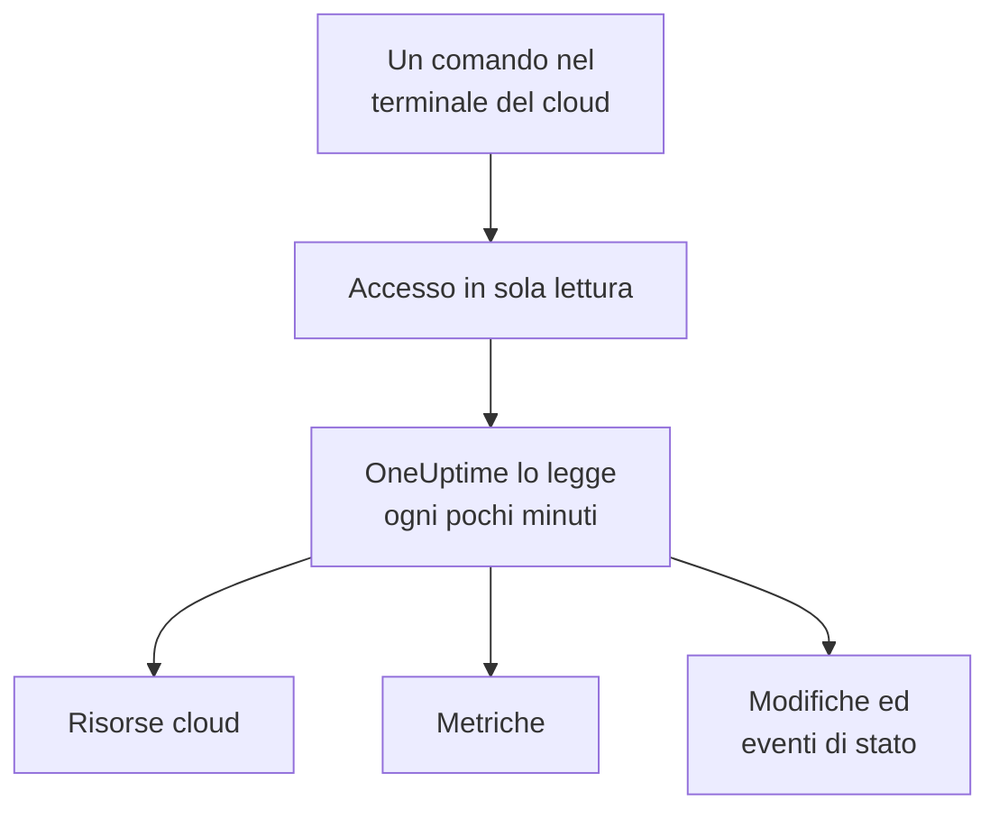

# Collegare un account cloud

Collega un account AWS, una sottoscrizione Azure o un progetto Google Cloud dalla dashboard, e OneUptime elenca ogni risorsa che contiene, legge le loro metriche principali e registra cosa vi è cambiato e cosa dice il tuo provider cloud sul loro stato. Esegui un comando nel terminale del browser del tuo cloud e incolli ciò che stampa: nessun collector da far girare, niente da installare.

:::cards
- [Amazon Web Services](#amazon-web-services): Un ruolo IAM con cui OneUptime accede, o una chiave di accesso.
- [Microsoft Azure](#microsoft-azure): Un'app con il ruolo Monitoring Reader.
- [Google Cloud](#google-cloud): Un account di servizio con quattro ruoli di sola lettura.
- [Cosa legge OneUptime](#cosa-legge-oneuptime): Risorse, metriche, modifiche ed eventi di stato, con quale frequenza e quanto costa.
- [Consenti all'IA di correggere i problemi](#consenti-allia-di-correggere-i-problemi): Un comando in più, e OneUptime AI può correggere ciò che trova.
:::

## Come funziona



- **L'accesso può solo leggere.** Il comando crea un accesso che legge le tue risorse e la loro configurazione, le loro metriche, cosa è cambiato e gli eventi di stato del tuo provider, e nient'altro: le azioni elencate sotto su AWS, il ruolo **Monitoring Reader** su Azure e quattro ruoli di lettura su Google Cloud. OneUptime non legge mai dati o segreti con esso, tranne righe di log se lasci che l'IA legga i log di un account. Eliminalo per togliere l'accesso a OneUptime.
- **OneUptime legge secondo una pianificazione.** Ogni 5 minuti per Azure e Google Cloud, e ogni 10 minuti per AWS, a meno che tu non scelga un altro intervallo quando colleghi. Ogni lettura registra anche cosa è cambiato dalla precedente, e ogni 30 minuti una lettura elenca di nuovo ogni risorsa.
- **Ogni risorsa ha una pagina propria.** Le risorse compaiono in **Cloud → Tutte le risorse** con le metriche principali, i proprietari e le etichette. La pagina di una risorsa elencata mostra anche le sue **Risorse connesse** (dove viene eseguita, cosa le invia traffico), i suoi endpoint, tag e impostazioni, e i suoi **Incidenti**, **Avvisi** e **Modifiche**.
- **Ogni account ha una pagina propria.** Gli account compaiono in **Cloud → Account** con le loro risorse per tipo e regione, le loro **Modifiche** e una **Topologia** di come si incastrano le loro risorse.
- **OneUptime AI legge cosa è cambiato.** Un'indagine su un incidente o un avviso collegati a una risorsa cloud legge per prime le modifiche di quella risorsa, e rilegge il log attività dell'account quando inizia.

## Prima di iniziare

- **Un proprietario o un amministratore del progetto.** Solo loro possono collegare, testare e modificare gli account cloud.
- **Il terminale del tuo cloud** (AWS CloudShell, Azure Cloud Shell o Google Cloud Shell), con l'accesso di qualcuno che può creare un ruolo o un utente IAM, una registrazione app o un account di servizio.

## Amazon Web Services

:::steps
### Aprire il modulo AWS

Vai in **Cloud → Collega** e scegli **Amazon Web Services**.

### Eseguire il comando in AWS CloudShell

Scegli come accede OneUptime. Un **Ruolo IAM** è il modo consigliato: non viene salvato nulla di segreto e puoi eliminare il ruolo in qualsiasi momento. Il modulo mostra il comando scritto per il tuo progetto: crea un ruolo che si fida dell'account AWS di OneUptime con l'ID esterno del tuo progetto, e stampa l'ARN del ruolo.

In **Cosa leggere**, scegli questo account oppure ogni account della tua AWS Organization. Esegui il comando dell'organizzazione nel suo account di gestione: aggiunge uno StackSet che mette lo stesso ruolo in ogni account, ora e man mano che se ne aggiungono, e permette al ruolo dell'account di gestione di elencare gli account. Una connessione legge fino a 50 account.

Usa una **Chiave di accesso** quando un ruolo non è possibile: legge solo il proprio account. Questo comando crea un utente con le stesse autorizzazioni e ne stampa la chiave:

```bash
aws iam create-user --user-name OneUptimeReadOnly > /dev/null 2>&1 || true
aws iam put-user-policy --user-name OneUptimeReadOnly --policy-name OneUptimeReadOnly --policy-document '{"Version":"2012-10-17","Statement":[{"Effect":"Allow","Action":["cloudwatch:GetMetricData","cloudwatch:ListMetrics","tag:GetResources","iam:ListAccountAliases","cloudformation:ListResources","ec2:DescribeInstances","ec2:DescribeVolumes","ec2:DescribeVpcs","ec2:DescribeNatGateways","autoscaling:DescribeAutoScalingGroups","elasticloadbalancing:DescribeLoadBalancers","elasticloadbalancing:DescribeLoadBalancerAttributes","elasticloadbalancing:DescribeTargetGroups","elasticloadbalancing:DescribeTargetGroupAttributes","elasticloadbalancing:DescribeTargetHealth","elasticloadbalancing:DescribeTags","ecs:ListClusters","ecs:DescribeClusters","ecs:ListServices","ecs:DescribeServices","lambda:ListFunctions","rds:DescribeDBInstances","rds:DescribeDBClusters","elasticache:DescribeReplicationGroups","sqs:ListQueues","sqs:GetQueueAttributes","sns:ListTopics","sns:GetTopicAttributes","sns:ListSubscriptionsByTopic","dynamodb:ListTables","dynamodb:DescribeTable","kinesis:ListStreams","kinesis:DescribeStreamSummary","states:ListStateMachines","states:DescribeStateMachine","cloudfront:ListDistributions","elasticfilesystem:DescribeFileSystems","es:ListDomainNames","es:DescribeDomains","apprunner:ListServices","apprunner:DescribeService","cloudtrail:LookupEvents","health:DescribeEvents","health:DescribeEventDetails","rds:DescribeEvents","autoscaling:DescribeScalingActivities","ec2:DescribeInstanceStatus","ecs:DescribeTaskDefinition","lambda:GetFunctionConfiguration","lambda:GetFunctionConcurrency","lambda:GetAlias","servicequotas:ListServiceQuotas","logs:DescribeLogGroups","logs:FilterLogEvents"],"Resource":"*"},{"Effect":"Allow","Action":["apigateway:GET"],"Resource":["arn:aws:apigateway:*::/restapis","arn:aws:apigateway:*::/restapis/*","arn:aws:apigateway:*::/apis","arn:aws:apigateway:*::/apis/*"]}]}'
aws iam create-access-key --user-name OneUptimeReadOnly
```

### Incollare ciò che ha stampato il comando AWS

Incolla tutto ciò che il comando ha stampato in **Cosa ha stampato il comando**. OneUptime ne ricava l'ARN del ruolo, oppure l'ID della chiave di accesso e il suo segreto.

### Testare e collegare AWS

OneUptime testa la connessione appena si apre questo passaggio: accede, conta le risorse che trova e dice quanto costa leggerle. Seleziona **Collega** per salvare.
:::

Il ruolo e l'utente possono fare questo, e nient'altro:

| A cosa servono a OneUptime | Azioni |
| --- | --- |
| Trovare le risorse che segnalano metriche, e leggerne le metriche | `cloudwatch:GetMetricData`, `cloudwatch:ListMetrics` |
| Dare un nome a ogni risorsa e leggerne i tag | `tag:GetResources`, `iam:ListAccountAliases` |
| Elencare ogni risorsa e la sua configurazione, tramite Cloud Control | `cloudformation:ListResources`, `ec2:DescribeInstances`, `ec2:DescribeVolumes`, `ec2:DescribeVpcs`, `ec2:DescribeNatGateways`, `autoscaling:DescribeAutoScalingGroups`, `elasticloadbalancing:DescribeLoadBalancers`, `elasticloadbalancing:DescribeLoadBalancerAttributes`, `elasticloadbalancing:DescribeTargetGroups`, `elasticloadbalancing:DescribeTargetGroupAttributes`, `elasticloadbalancing:DescribeTargetHealth`, `elasticloadbalancing:DescribeTags`, `ecs:ListClusters`, `ecs:DescribeClusters`, `ecs:ListServices`, `ecs:DescribeServices`, `lambda:ListFunctions`, `rds:DescribeDBInstances`, `rds:DescribeDBClusters`, `elasticache:DescribeReplicationGroups`, `sqs:ListQueues`, `sqs:GetQueueAttributes`, `sns:ListTopics`, `sns:GetTopicAttributes`, `sns:ListSubscriptionsByTopic`, `dynamodb:ListTables`, `dynamodb:DescribeTable`, `kinesis:ListStreams`, `kinesis:DescribeStreamSummary`, `states:ListStateMachines`, `states:DescribeStateMachine`, `cloudfront:ListDistributions`, `elasticfilesystem:DescribeFileSystems`, `es:ListDomainNames`, `es:DescribeDomains`, `apprunner:ListServices`, `apprunner:DescribeService`, `apigateway:GET` |
| Leggere cosa è cambiato: gli eventi di gestione dell'account | `cloudtrail:LookupEvents` |
| Leggere gli eventi di stato di AWS stesso per l'account | `health:DescribeEvents`, `health:DescribeEventDetails` |
| Leggere lo stato attuale e gli eventi recenti di una risorsa durante un'indagine | `rds:DescribeEvents`, `autoscaling:DescribeScalingActivities`, `ec2:DescribeInstanceStatus`, `ecs:DescribeTaskDefinition`, `lambda:GetFunctionConfiguration`, `lambda:GetFunctionConcurrency`, `lambda:GetAlias` |
| Leggere le quote dell'account durante un'indagine | `servicequotas:ListServiceQuotas` |
| Leggere righe di log, solo se lasci che l'IA legga i log di un account | `logs:DescribeLogGroups`, `logs:FilterLogEvents` |
| Elencare gli account dell'organizzazione, dal suo account di gestione | `organizations:ListAccounts` |

`apigateway:GET` è consentito solo sulle definizioni delle API stesse, mai sulle loro chiavi, e solo il ruolo dell'account di gestione può elencare gli account dell'organizzazione. AWS Health risponde solo agli account con un piano di supporto Business, Enterprise On-Ramp o Enterprise: senza, OneUptime chiede di nuovo un giorno dopo.

> [!NOTE]
> Su un OneUptime self-hosted, la via del **Ruolo IAM** richiede un'identità AWS propria di OneUptime: imposta `CLOUD_CONNECT_AWS_ACCESS_KEY_ID` e `CLOUD_CONNECT_AWS_SECRET_ACCESS_KEY` sulla chiave di un utente IAM che può chiamare `sts:AssumeRole`. Senza di esse, il modulo offre una **Chiave di accesso**.

## Microsoft Azure

:::steps
### Aprire il modulo Azure

Vai in **Cloud → Collega** e scegli **Microsoft Azure**.

### Eseguire il comando in Azure Cloud Shell

Il comando crea un'app con il ruolo **Monitoring Reader** sulla tua sottoscrizione attuale, e ne stampa i dettagli con la data di scadenza del suo segreto:

```bash
SCOPE="/subscriptions/$(az account show --query id --output tsv)"
OUT=$(az ad sp create-for-rbac --name OneUptimeReadOnly --role "Monitoring Reader" --scopes "$SCOPE")
APP=$(echo "$OUT" | jq -r .appId)
END=$(az ad app credential list --id "$APP" --query "max([].endDateTime)" --output tsv)
echo "$OUT" | jq --arg end "$END" '. + {endDateTime: $end}'
```

In **Cosa leggere**, scegli invece ogni sottoscrizione del tenant, e il ruolo viene assegnato al gruppo di gestione radice del tenant:

```bash
SCOPE="/providers/Microsoft.Management/managementGroups/$(az account show --query tenantId --output tsv)"
OUT=$(az ad sp create-for-rbac --name OneUptimeReadOnly --role "Monitoring Reader" --scopes "$SCOPE")
APP=$(echo "$OUT" | jq -r .appId)
END=$(az ad app credential list --id "$APP" --query "max([].endDateTime)" --output tsv)
echo "$OUT" | jq --arg end "$END" '. + {endDateTime: $end}'
```

### Incollare ciò che ha stampato il comando Azure

Incolla tutto ciò che il comando ha stampato in **Cosa ha stampato il comando**. OneUptime ne ricava `tenant`, `appId`, `password` e la sua data di scadenza.

### Testare e collegare Azure

OneUptime testa la connessione appena si apre questo passaggio. Seleziona **Collega** per salvare.
:::

Per leggere altre sottoscrizioni con la stessa app, assegnale il ruolo su ciascuna:

```bash
az role assignment create --assignee <APP_ID> --role "Monitoring Reader" --scope /subscriptions/<SUBSCRIPTION_ID>
```

OneUptime legge ogni sottoscrizione che l'app può leggere, fino a 50, a meno che tu non ne elenchi alcune in **Sottoscrizioni**. Il segreto dell'app smette di funzionare alla data di scadenza: da 30 giorni prima, ogni lettura ti avvisa. Esegui di nuovo il comando e incolla ciò che stampa per dargliene uno nuovo.

## Google Cloud

:::steps
### Aprire il modulo Google Cloud

Vai in **Cloud → Collega** e scegli **Google Cloud**.

### Eseguire il comando in Google Cloud Shell

Eseguilo nel progetto da monitorare. Attiva le API che OneUptime legge, crea un account di servizio con i ruoli **Monitoring Viewer**, **Cloud Asset Viewer**, **Logs Viewer** e **Service Health Viewer**, e ne stampa la chiave:

```bash
PROJECT_ID=$(gcloud config get-value project)
gcloud services enable monitoring.googleapis.com cloudasset.googleapis.com logging.googleapis.com cloudresourcemanager.googleapis.com servicehealth.googleapis.com
gcloud iam service-accounts create oneuptime-read-only --display-name "OneUptime (read only)" > /dev/null 2>&1 || true
gcloud projects add-iam-policy-binding "$PROJECT_ID" --member "serviceAccount:oneuptime-read-only@$PROJECT_ID.iam.gserviceaccount.com" --role roles/monitoring.viewer --condition=None > /dev/null
gcloud projects add-iam-policy-binding "$PROJECT_ID" --member "serviceAccount:oneuptime-read-only@$PROJECT_ID.iam.gserviceaccount.com" --role roles/cloudasset.viewer --condition=None > /dev/null
gcloud projects add-iam-policy-binding "$PROJECT_ID" --member "serviceAccount:oneuptime-read-only@$PROJECT_ID.iam.gserviceaccount.com" --role roles/logging.viewer --condition=None > /dev/null
gcloud projects add-iam-policy-binding "$PROJECT_ID" --member "serviceAccount:oneuptime-read-only@$PROJECT_ID.iam.gserviceaccount.com" --role roles/servicehealth.viewer --condition=None > /dev/null
gcloud iam service-accounts keys create oneuptime-key.json --iam-account "oneuptime-read-only@$PROJECT_ID.iam.gserviceaccount.com"
cat oneuptime-key.json && rm oneuptime-key.json
```

In **Cosa leggere**, scegli invece ogni progetto dell'organizzazione, e i ruoli vengono assegnati all'organizzazione del progetto:

```bash
PROJECT_ID=$(gcloud config get-value project)
ORG_ID=$(gcloud projects get-ancestors "$PROJECT_ID" --format="value(id)" | tail -1)
gcloud services enable monitoring.googleapis.com cloudasset.googleapis.com logging.googleapis.com cloudresourcemanager.googleapis.com servicehealth.googleapis.com
gcloud iam service-accounts create oneuptime-read-only --display-name "OneUptime (read only)" > /dev/null 2>&1 || true
gcloud organizations add-iam-policy-binding "$ORG_ID" --member "serviceAccount:oneuptime-read-only@$PROJECT_ID.iam.gserviceaccount.com" --role roles/monitoring.viewer --condition=None > /dev/null
gcloud organizations add-iam-policy-binding "$ORG_ID" --member "serviceAccount:oneuptime-read-only@$PROJECT_ID.iam.gserviceaccount.com" --role roles/cloudasset.viewer --condition=None > /dev/null
gcloud organizations add-iam-policy-binding "$ORG_ID" --member "serviceAccount:oneuptime-read-only@$PROJECT_ID.iam.gserviceaccount.com" --role roles/logging.viewer --condition=None > /dev/null
gcloud organizations add-iam-policy-binding "$ORG_ID" --member "serviceAccount:oneuptime-read-only@$PROJECT_ID.iam.gserviceaccount.com" --role roles/servicehealth.viewer --condition=None > /dev/null
gcloud iam service-accounts keys create oneuptime-key.json --iam-account "oneuptime-read-only@$PROJECT_ID.iam.gserviceaccount.com"
cat oneuptime-key.json && rm oneuptime-key.json
```

### Incollare la chiave

Incolla tutto ciò che il comando ha stampato. OneUptime legge il progetto proprio della chiave e la conserva cifrata.

### Testare e collegare Google Cloud

OneUptime testa la connessione appena si apre questo passaggio. Seleziona **Collega** per salvare.
:::

Per leggere altri progetti con lo stesso account di servizio, assegnagli i quattro ruoli in ciascuno ed elencali in **Progetti**:

```bash
for ROLE in roles/monitoring.viewer roles/cloudasset.viewer roles/logging.viewer roles/servicehealth.viewer; do gcloud projects add-iam-policy-binding <PROJECT_ID> --member "serviceAccount:oneuptime-read-only@<KEY_PROJECT_ID>.iam.gserviceaccount.com" --role "$ROLE"; done
```

La connessione di un'organizzazione legge fino a 50 dei suoi progetti, a meno che tu non ne elenchi alcuni in **Progetti**.

## Cosa legge OneUptime

| | AWS | Azure | Google Cloud |
| --- | --- | --- | --- |
| Risorse | Ogni risorsa dei tipi che OneUptime conosce, in ogni regione che usi, da Cloud Control | Ogni risorsa delle sottoscrizioni, da Resource Graph | Ogni risorsa dei progetti, da Cloud Asset Inventory |
| Metriche | Le metriche principali di ogni servizio, come CPU, rete e controlli di stato di un'istanza | Fino a 8 metriche principali per risorsa | Le metriche principali di ogni tipo di risorsa |
| Modifiche | Gli eventi di gestione di CloudTrail | Gli eventi amministrativi del log attività | Il log di audit Admin Activity |
| Eventi di stato | AWS Health | Service Health e Resource Health | Service Health |
| Letto ogni | 10 minuti | 5 minuti | 5 minuti |
| Una risorsa eliminata | Archiviata quando un elenco completo non la contiene più | Archiviata quando un elenco completo non la contiene più | Archiviata quando un elenco completo non la contiene più |

Ogni lettura riprende da dove si è fermata la precedente, così ogni punto dati e ogni modifica vengono scritti una sola volta. La prima lettura di una nuova connessione parte entro un minuto e risale di un'ora per le metriche e di 2 ore per le modifiche; dopo una pausa, una lettura risale al massimo di 6 ore. Una risorsa che segnala solo metriche, e che nessun elenco contiene, viene archiviata dopo 7 giorni senza metriche.

Le chiamate di OneUptime vengono addebitate al tuo account cloud, ai prezzi del tuo cloud. Elencare le risorse e leggere modifiche ed eventi di stato non costa nulla sui tre cloud; leggere le metriche sì. Il test stima il costo di ciò che trova, e leggere meno spesso costa meno: cambia **Frequenza di lettura delle metriche** in **Altri campi**.

| Cloud | Prezzo |
| --- | --- |
| AWS | CloudWatch `GetMetricData`: $0.01 ogni 1.000 metriche, e ogni metrica principale di una risorsa è una metrica per lettura |
| Azure | Le prime 1.000.000 letture di metriche al mese di ogni sottoscrizione sono gratuite, poi $0.01 ogni 1.000 |
| Google Cloud | Le prime 1.000.000 serie temporali lette al mese sono gratuite, poi $0.50 per milione |

## Cosa vedi in OneUptime

- **La pagina di un account.** In **Cloud → Account**, la panoramica di un account ne conta le risorse per tipo e regione e dice quando una connessione l'ha letto l'ultima volta. Le sue **Risorse** le elencano, le sue **Modifiche** elencano cosa vi è cambiato, prima le più recenti, e la sua **Topologia** disegna le sue regioni, le reti che contengono e cosa gira in ciascuna, con gli incidenti e gli avvisi aperti sulle risorse a cui sono collegati.
- **Le modifiche di una risorsa.** Una modifica viene conservata come evento di modifica collegato alla risorsa che ha cambiato e al suo account, e disegnata come indicatore sui grafici delle metriche della risorsa, insieme ai suoi incidenti e avvisi. I grafici filtrati su nessuna risorsa lasciano fuori il log attività di un account cloud, così un account molto attivo non copre i tuoi deploy; gli eventi di stato del provider restano.
- **Incidenti e avvisi.** Collega una risorsa cloud a un monitor, un incidente o un avviso nelle sue risorse collegate, e i suoi incidenti e avvisi vengono elencati nella pagina della risorsa. Un monitor di sito web, API, SSL, ping o porta il cui host porta a un endpoint di una risorsa, direttamente o tramite il suo DNS, mostra la risorsa in **Risorse cloud suggerite** sulla sua scheda **Risorse collegate**: seleziona **Collega risorsa** per collegarla.

## Consenti all'IA di correggere i problemi

OneUptime AI legge ogni account collegato mentre indaga, con l'accesso in sola lettura descritto sopra. Per consentirgli di correggere anche i problemi, ad esempio riavviare un servizio, aumentarne la capacità o eseguirne il rollback, apri l'account in **Cloud → Account** e seleziona **Consenti all'IA di correggere i problemi** nella scheda **Agente IA** della sua **Panoramica**.

La finestra di dialogo pone una sola domanda, **Fin dove può spingersi l'IA?**: **Chiedimi prima**, l'impostazione predefinita, in cui OneUptime AI propone ogni correzione e una persona la approva con un clic, oppure **Applica in autonomia le correzioni sicure**, in cui le modifiche sicure vengono eseguite da sole e quelle più rischiose attendono comunque l'approvazione. Tutto il resto ha un valore predefinito sicuro in **Altri campi**. Poi mostra un solo comando, scritto per questo account: eseguilo in AWS CloudShell, Azure Cloud Shell o Google Cloud Shell, autenticato come qualcuno che può creare ruoli nell'account. Il comando crea un ruolo che può apportare solo le modifiche attivate e avvia con esso l'agente IA cloud nel tuo account. L'agente si connette da solo entro pochi minuti, e la finestra di dialogo lo segnala: non c'è nulla da reincollare.

L'agente è un piccolo container che gira tutto il mese nel tuo account, fatturato dal tuo cloud ai suoi prezzi di listino:

| Cloud | Cosa gira | Circa |
| --- | --- | --- |
| AWS | Un task ECS Fargate da 0.25 vCPU e 0.5 GB, più il suo indirizzo IPv4 pubblico, ai prezzi di `us-east-1` | $13 al mese |
| Azure | Una replica Container Apps da 0.25 vCPU e 0.5 GiB, dopo la concessione gratuita mensile della sottoscrizione di 180.000 vCPU-secondi e 360.000 GiB-secondi | $14 al mese |
| Google Cloud | Un'istanza Cloud Run da 1 vCPU e 0.5 GiB con la CPU sempre allocata, che occupa un'intera vCPU, dopo il livello gratuito mensile di 240.000 vCPU-secondi e 450.000 GiB-secondi | $45 al mese |

Cosa può modificare l'agente, come viene classificata e annullata ogni modifica e come leggerne i log: [Agenti IA per l'infrastruttura](/docs/ai/infrastructure-ai-agents#in-un-account-cloud).

## Risoluzione dei problemi

:::details Il test dice che la chiave o il segreto non è stato accettato
Copia tutto ciò che il comando ha stampato e incollalo di nuovo. Una chiave creata un minuto fa può impiegare un minuto per funzionare. Anche un segreto Azure scaduto viene rifiutato: esegui di nuovo il comando.
:::

:::details Il test accede, ma non riesce a leggere
Esegui di nuovo il comando: concede i ruoli di cui OneUptime ha bisogno. Su AWS, esegui il comando che il modulo mostra per questo progetto: un ruolo creato per un altro progetto si fida dell'ID esterno di quel progetto, non di questo.
:::

:::details Google Cloud non lascia che il comando crei una chiave
Un criterio dell'organizzazione, `iam.disableServiceAccountKeyCreation`, può vietare le chiavi degli account di servizio. Chiedi all'amministratore della tua organizzazione un'eccezione per il progetto, oppure [invia le metriche con il tuo collector](/docs/telemetry/cloud-resources).
:::

:::details Non compare nessuna risorsa
La prima lettura elenca ogni risorsa dell'account, che segnali metriche o no. Se una connessione non funziona, **View error** in **Cloud → Collega** dice perché la sua ultima lettura non è riuscita.
:::

:::details Mancano alcuni account dell'organizzazione
Una connessione legge fino a 50 account, sottoscrizioni o progetti, e ogni lettura lo dice quando ce ne sono di più. Collega gli altri con una connessione a parte.
:::

## Prossimi passi

:::cards
- [Risorse cloud](/docs/telemetry/cloud-resources): Esegui invece il tuo OpenTelemetry Collector, o trasmetti le metriche di CloudWatch.
- [Deploy e modifiche](/docs/telemetry/change-events): Ogni modifica che OneUptime registra, e come OneUptime AI le legge.
- [Monitor di metriche](/docs/monitor/metrics-monitor): Crea avvisi sulle metriche di una risorsa.
:::
