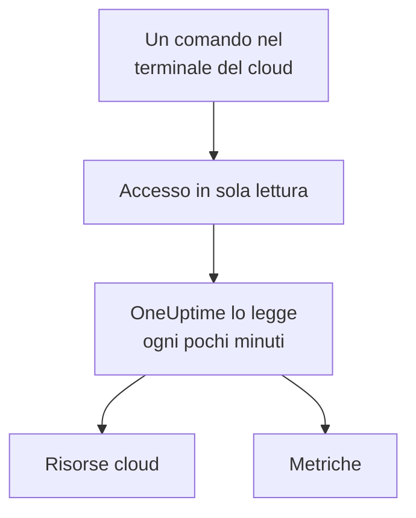

# Collegare un account cloud

Collega un account AWS, una sottoscrizione Azure o un progetto Google Cloud dalla dashboard, e OneUptime ne elenca le risorse e ne legge le metriche principali secondo una pianificazione. Esegui un comando nel terminale del browser del tuo cloud e incolli ciò che stampa: nessun collector da eseguire e niente da installare.

:::cards
- [Amazon Web Services](#amazon-web-services): Un ruolo IAM con cui OneUptime accede, o una chiave di accesso.
- [Microsoft Azure](#microsoft-azure): Un'app con il ruolo Monitoring Reader.
- [Google Cloud](#google-cloud): Un account di servizio con il ruolo Monitoring Viewer.
- [Cosa legge OneUptime](#cosa-legge-oneuptime): Quali risorse e metriche, con quale frequenza e quanto costa.
:::

## Come funziona



- **L'accesso può solo leggere.** Il comando crea un accesso che legge le metriche e nient'altro: tre azioni di lettura su AWS, il ruolo **Monitoring Reader** su Azure e il ruolo **Monitoring Viewer** su Google Cloud. Eliminalo per togliere l'accesso a OneUptime.
- **OneUptime legge secondo una pianificazione.** Ogni 5 minuti per Azure e Google Cloud, e ogni 10 minuti per AWS, a meno che tu non scelga un altro intervallo quando colleghi.
- **Ogni risorsa ha una pagina propria.** Le risorse compaiono in **Cloud → Tutte le risorse** con le metriche principali, i proprietari e le etichette, come le risorse segnalate da un collector.

## Prima di iniziare

- **Un proprietario o un amministratore del progetto.** Solo loro possono collegare, testare e modificare gli account cloud.
- **Il terminale del tuo cloud** (AWS CloudShell, Azure Cloud Shell o Google Cloud Shell), con l'accesso di qualcuno che può creare un ruolo o un utente IAM, una registrazione app o un account di servizio.

## Amazon Web Services

:::steps
### Aprire il modulo AWS

Vai su **Cloud → Collega** e scegli **Amazon Web Services**.

### Eseguire il comando in AWS CloudShell

Scegli come accede OneUptime. Un **Ruolo IAM** è il modo consigliato: non viene salvato nulla di segreto e puoi eliminare il ruolo in qualsiasi momento. Il modulo mostra il comando scritto per il tuo progetto: crea un ruolo che si fida dell'account AWS di OneUptime con l'ID esterno del tuo progetto, e stampa l'ARN del ruolo. Usa una **Chiave di accesso** quando un ruolo non è possibile. Questo comando crea un utente con le stesse autorizzazioni e ne stampa la chiave:

```bash
aws iam create-user --user-name OneUptimeReadOnly > /dev/null 2>&1 || true
aws iam put-user-policy --user-name OneUptimeReadOnly --policy-name OneUptimeReadOnly --policy-document '{"Version":"2012-10-17","Statement":[{"Effect":"Allow","Action":["cloudwatch:GetMetricData","cloudwatch:ListMetrics","tag:GetResources"],"Resource":"*"}]}'
aws iam create-access-key --user-name OneUptimeReadOnly
```

### Incollare ciò che ha stampato il comando AWS

Incolla tutto ciò che il comando ha stampato in **Cosa ha stampato il comando**. OneUptime ne estrae l'ARN del ruolo, oppure l'ID della chiave di accesso e il suo segreto.

### Testare e collegare AWS

OneUptime testa la connessione appena si apre questo passaggio: accede, conta le risorse che trova e dice quanto costa leggerle. Seleziona **Collega** per salvare.
:::

Il ruolo e l'utente possono fare tre cose, e nient'altro:

| Azione | A cosa serve a OneUptime |
| --- | --- |
| `cloudwatch:ListMetrics` | Trovare le risorse che inviano metriche, in ogni regione |
| `cloudwatch:GetMetricData` | Leggerne le metriche principali |
| `tag:GetResources` | Dare a ogni risorsa il nome del suo tag `Name` |

> [!NOTE]
> Su un OneUptime self-hosted, il modo **Ruolo IAM** richiede un'identità AWS propria di OneUptime: imposta `CLOUD_CONNECT_AWS_ACCESS_KEY_ID` e `CLOUD_CONNECT_AWS_SECRET_ACCESS_KEY` con la chiave di un utente IAM che può chiamare `sts:AssumeRole`. Senza, il modulo offre una **Chiave di accesso**.

## Microsoft Azure

:::steps
### Aprire il modulo Azure

Vai su **Cloud → Collega** e scegli **Microsoft Azure**.

### Eseguire il comando in Azure Cloud Shell

Il comando crea un'app con il ruolo **Monitoring Reader** sulla sottoscrizione corrente, e ne stampa i dettagli:

```bash
az ad sp create-for-rbac --name OneUptimeReadOnly --role "Monitoring Reader" --scopes "/subscriptions/$(az account show --query id --output tsv)"
```

### Incollare ciò che ha stampato il comando Azure

Incolla tutto ciò che il comando ha stampato in **Cosa ha stampato il comando**. OneUptime ne estrae `tenant`, `appId` e `password`.

### Testare e collegare Azure

OneUptime testa la connessione appena si apre questo passaggio. Seleziona **Collega** per salvare.
:::

Per leggere altre sottoscrizioni con la stessa app, assegnale il ruolo su ciascuna di esse:

```bash
az role assignment create --assignee <APP_ID> --role "Monitoring Reader" --scope /subscriptions/<SUBSCRIPTION_ID>
```

OneUptime legge ogni sottoscrizione che l'app può leggere, a meno che tu non ne elenchi alcune in **Sottoscrizioni**.

## Google Cloud

:::steps
### Aprire il modulo Google Cloud

Vai su **Cloud → Collega** e scegli **Google Cloud**.

### Eseguire il comando in Google Cloud Shell

Eseguilo nel progetto da monitorare. Attiva l'API Cloud Monitoring, crea un account di servizio con il ruolo **Monitoring Viewer** e ne stampa la chiave:

```bash
PROJECT_ID=$(gcloud config get-value project)
gcloud services enable monitoring.googleapis.com
gcloud iam service-accounts create oneuptime-read-only --display-name "OneUptime (read only)"
gcloud projects add-iam-policy-binding "$PROJECT_ID" --member "serviceAccount:oneuptime-read-only@$PROJECT_ID.iam.gserviceaccount.com" --role roles/monitoring.viewer --condition=None > /dev/null
gcloud iam service-accounts keys create oneuptime-key.json --iam-account "oneuptime-read-only@$PROJECT_ID.iam.gserviceaccount.com"
cat oneuptime-key.json && rm oneuptime-key.json
```

### Incollare la chiave

Incolla tutto ciò che il comando ha stampato. OneUptime legge il progetto della chiave e salva la chiave cifrata.

### Testare e collegare Google Cloud

OneUptime testa la connessione appena si apre questo passaggio. Seleziona **Collega** per salvare.
:::

Per leggere altri progetti con lo stesso account di servizio, assegnagli il ruolo in ciascuno di essi ed elencali in **Progetti**:

```bash
gcloud projects add-iam-policy-binding <PROJECT_ID> --member "serviceAccount:oneuptime-read-only@<KEY_PROJECT_ID>.iam.gserviceaccount.com" --role roles/monitoring.viewer
```

## Cosa legge OneUptime

| | AWS | Azure | Google Cloud |
| --- | --- | --- | --- |
| Risorse | Quelle che inviano metriche a CloudWatch, in ogni regione che usi | Ogni risorsa delle sottoscrizioni | Quelle che inviano metriche a Cloud Monitoring |
| Metriche | Le metriche principali di ogni servizio, come CPU, rete e controlli di stato di un'istanza | Fino a 8 metriche principali per risorsa | Le metriche principali di ogni tipo di risorsa |
| Letto ogni | 10 minuti | 5 minuti | 5 minuti |
| Una risorsa eliminata | Archiviata dopo 7 giorni senza metriche | Archiviata alla lettura successiva | Archiviata dopo 7 giorni senza metriche |

Ogni lettura riprende da dove si era fermata la precedente, quindi ogni punto dati viene scritto una sola volta. La prima lettura di una nuova connessione parte entro un minuto e risale a un'ora prima; dopo una pausa, una lettura risale al massimo di 6 ore.

Le chiamate di OneUptime vengono addebitate al tuo account cloud, ai prezzi del tuo cloud. Il test stima il costo di ciò che trova, e leggere meno spesso costa meno: cambia **Frequenza di lettura delle metriche** in **Altri campi**.

| Cloud | Prezzo |
| --- | --- |
| AWS | CloudWatch `GetMetricData`: $0.01 ogni 1.000 metriche, e ogni metrica principale di una risorsa è una metrica per lettura |
| Azure | Le prime 1.000.000 letture di metriche al mese di ogni sottoscrizione sono gratuite, poi $0.01 ogni 1.000 |
| Google Cloud | Le prime 1.000.000 serie temporali lette al mese sono gratuite, poi $0.50 per milione |

## Risoluzione dei problemi

:::details Il test dice che la chiave o il segreto non è stato accettato
Copia tutto ciò che il comando ha stampato e incollalo di nuovo. Una chiave creata un minuto fa può impiegare un minuto per funzionare.
:::

:::details Il test accede, ma non riesce a leggere
Esegui di nuovo il comando: assegna il ruolo che serve a OneUptime. Su AWS, esegui il comando che il modulo mostra per questo progetto: un ruolo creato per un altro progetto si fida dell'ID esterno di quel progetto, non di questo.
:::

:::details Google Cloud non lascia che il comando crei una chiave
Un criterio dell'organizzazione, `iam.disableServiceAccountKeyCreation`, può vietare le chiavi degli account di servizio. Chiedi all'amministratore della tua organizzazione un'eccezione per il progetto, oppure [invia le metriche con il tuo collector](/docs/telemetry/cloud-resources).
:::

:::details Non compare nessuna risorsa
Su AWS e Google Cloud, una risorsa compare quando invia metriche. Se una connessione non funziona, **View error** in **Cloud → Collega** dice perché la sua ultima lettura non è riuscita.
:::

## Prossimi passi

:::cards
- [Risorse cloud](/docs/telemetry/cloud-resources): Esegui invece il tuo OpenTelemetry Collector, o trasmetti le metriche di CloudWatch.
- [Monitor di metriche](/docs/monitor/metrics-monitor): Crea avvisi sulle metriche di una risorsa.
:::
