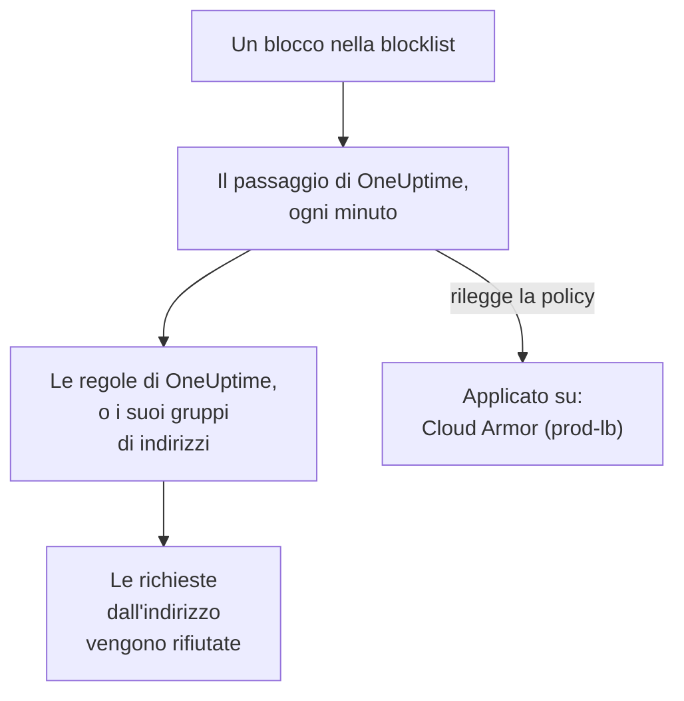

# Bloccare indirizzi in Cloud Armor

La blocklist del tuo progetto può essere applicata nelle policy di sicurezza di Google Cloud Armor dei tuoi bilanciatori di carico. Attivala su una connessione Google Cloud che hai già, scegli le policy di sicurezza, e ogni indirizzo bloccato dalla blocklist viene bloccato anche lì, che l'abbia bloccato una persona, un playbook o OneUptime AI.

:::cards
- [Attivazione](#attivazione): Un'impostazione sulla connessione Google Cloud, e il ruolo che richiede.
- [Cosa crea OneUptime](#cosa-crea-oneuptime): Regole proprie in ogni policy, oppure gruppi di indirizzi con Cloud Armor Enterprise.
- [Quale indirizzo viene confrontato](#quale-indirizzo-viene-confrontato): L'indirizzo che si è connesso, o l'IP utente dietro un proxy.
:::

## Come funziona

OneUptime mantiene regole proprie in ogni policy di sicurezza che scegli, e vi inserisce gli indirizzi bloccati dalla blocklist. Ogni minuto modifica ciò che è cambiato, una regola alla volta, poi rilegge la policy. Nella pagina **Blocklist**, la colonna **Applicato su** di un blocco nomina Cloud Armor (prod-lb) solo quando la policy contiene il blocco; fino ad allora il blocco non è applicato.

## Prima di iniziare

- Un progetto Google Cloud collegato a OneUptime (vedi [Collegare un account cloud](/docs/telemetry/cloud-accounts#google-cloud)).
- Un ruolo che possa cambiare dove viene applicata la blocklist: **Proprietario del progetto**, **Amministratore del progetto** o **Amministratore della sicurezza**.
- Qualcuno che possa creare ruoli e concederli nel progetto Google Cloud, per eseguire un comando in Cloud Shell.

## Attivazione

:::steps
### Aprire la connessione
Apri **Cloud → Collega** e modifica la connessione Google Cloud.

### Attivare l'impostazione
In **Altri campi**, imposta **Blocca indirizzi in Cloud Armor** su **Attivato** e salva. Il comando di configurazione mostrato dal modulo ora concede il ruolo descritto più sotto, dove concede gli altri. Una connessione che hai già non deve eseguirlo di nuovo: la finestra **Aggiungi WAF** fornisce le righe che concedono il ruolo nel progetto della policy.

### Aggiungere le policy di sicurezza
Apri **Eventi di sicurezza → Playbook → Blocklist**. In **WAF cloud**, fai clic su **Aggiungi WAF** e scegli una policy di sicurezza. OneUptime chiede a Google Cloud se la connessione può scrivere nella policy, senza scrivere nulla.

### Concedere il ruolo, se manca
Quando manca un'autorizzazione, la finestra mostra le righe che la concedono nel progetto della policy. Eseguile in Cloud Shell, fai clic su **Verifica di nuovo**, poi aggiungi la policy. Il suo **Stato** indica **Applicata** quando OneUptime l'ha configurata.
:::

Le policy di sicurezza provengono dall'inventario della connessione: una policy che OneUptime non ha ancora letto compare dopo la lettura successiva. Finché una policy applica la blocklist, l'impostazione della sua connessione non può essere disattivata e la connessione non può essere eliminata: rimuovi prima la policy, così OneUptime toglie le sue regole.

## Cosa crea OneUptime

OneUptime sceglie come una policy contiene la blocklist quando la aggiungi.

| Cosa | Nome | Dove |
| --- | --- | --- |
| Regole che rifiutano con 403, ognuna con al massimo 10 indirizzi o intervalli | La loro descrizione inizia con `OneUptime blocklist <project> #1`, `#2`, ... | In ogni policy che scegli, al massimo 20. |
| Due gruppi di indirizzi, IPv4 e IPv6 | `oneuptime-<project>-block-ipv4`, `oneuptime-<project>-block-ipv6` | Globali, nel progetto della policy. Solo con Cloud Armor Enterprise. |
| Una regola che rifiuta con 403 ciò che contiene l'uno o l'altro gruppo | La sua descrizione inizia con `OneUptime blocklist <project>, address groups` | In ogni policy di backend globale che scegli, con Cloud Armor Enterprise. |

`<project>` sono i primi otto caratteri dell'ID esterno del tuo progetto, quindi due progetti OneUptime che scelgono la stessa policy non scrivono mai le regole l'uno dell'altro. Cloud Armor identifica una regola solo dalla sua priorità, quindi OneUptime riconosce le proprie regole dalla loro descrizione.

- **Regole.** Cloud Armor contiene 10 indirizzi o intervalli in una regola, quindi una policy contiene fino a 200 blocchi nelle 20 regole di OneUptime; un blocco che non ci sta lo indica sulla sua riga.
- **Gruppi di indirizzi.** Una policy di backend globale di un progetto con Cloud Armor Enterprise contiene invece la blocklist in due gruppi di indirizzi: 10.000 intervalli IPv4 e 2.000 IPv6. Tutte queste policy del progetto li condividono, e una regola in ogni policy rifiuta ciò che contengono. I gruppi occupano 16.000 unità della quota di gruppi di indirizzi del progetto.

OneUptime aggiunge, modifica e rimuove ciascuna delle sue regole singolarmente, con i metodi per le regole di Cloud Armor: non scrive mai la policy per intero, e non scrive mai una tua regola. Un singolo indirizzo è scritto come `/32` o `/128`.

## Il posto delle regole nella policy

OneUptime mette le sue regole su priorità libere prima della tua prima regola che lascia passare una richiesta, partendo dalla più bassa, così nessuna tua regola lascia passare un indirizzo bloccato: una regola che consente, limita, esclude in base alla frequenza o ripartisce equamente. Una tua regola che rifiuta può venire prima. OneUptime non rinumera, non modifica e non rimuove mai una tua regola: quando prima della tua prima regola di questo tipo non c'è nessuna priorità libera, la policy indica **Nessuna priorità libera**, e OneUptime aggiunge la sua regola non appena ne liberi una.

## Quale indirizzo viene confrontato

| Policy di sicurezza | Indirizzo del client | Quando sceglierlo |
| --- | --- | --- |
| Backend | **L'indirizzo che si è connesso al bilanciatore di carico (origin.ip)** | Il valore predefinito. |
| Backend | L'IP utente dalle intestazioni di richiesta della policy (origin.user_ip) | Per un bilanciatore di carico dietro un altro proxy o una CDN. |
| Edge | L'indirizzo che si è connesso al bilanciatore di carico (origin.ip) | L'unica scelta: una policy edge non legge nessun altro indirizzo. |

`origin.user_ip` è l'indirizzo nelle intestazioni di richiesta per l'IP utente della policy (`userIpRequestHeaders`), che scrive un proxy o una CDN davanti al bilanciatore di carico. Se non ne è impostata nessuna, o se non contengono un indirizzo valido, è `origin.ip`. Sceglilo solo quando un proxy del genere le scrive, poiché un client che raggiunge direttamente il bilanciatore di carico può scriverle da sé. La scelta si trova in **Altri campi** nella finestra **Aggiungi WAF**, e puoi cambiarla in seguito con **Indirizzo del client** sulla riga della policy.

Una policy di sicurezza edge di rete, per i bilanciatori di carico di rete passthrough, non può essere scelta, e la finestra **Aggiungi WAF** spiega perché: le sue regole confrontano pacchetti, non richieste.

Le regole di OneUptime in Cloud Armor si limitano a rifiutare. Un blocco che chiede di sottoporre un indirizzo a verifica non viene applicato in Cloud Armor, e lo indica. La verifica di una policy di risposta automatica vi viene applicata come un blocco per lo stesso tempo.

## Quando una regola viene modificata a mano

Quando qualcuno mette in modalità di anteprima una delle regole di OneUptime, la modifica o la elimina, oppure elimina uno dei suoi gruppi di indirizzi, OneUptime lascia le cose come sono. La policy indica **Modificata a mano**, e i blocchi che conteneva non sono applicati, con il motivo, finché qualcuno non fa clic su **Ripristina** sulla riga della policy. Ripristina riscrive la regola come la scrive OneUptime, alla sua priorità finché questa è libera, e ricrea un gruppo di indirizzi eliminato.

OneUptime non verifica che una policy sia collegata a un servizio di backend. Una policy non collegata a nessuno non blocca nulla.

## Gestire una policy in Terraform

Una `google_compute_security_policy` con blocchi `rule` possiede ogni regola della policy, quindi il suo plan successivo rimuove le regole di OneUptime. Gestisci le tue regole come risorse `google_compute_security_policy_rule`, che lasciano stare le altre regole, oppure aggiungi `ignore_changes = [rule]` al blocco `lifecycle` della policy.

## Permessi

Il comando di configurazione aggiunge un ruolo personalizzato, `oneuptimeCloudArmorBlocklist`, dove concede gli altri ruoli della connessione, e lo concede all'account di servizio della connessione. Le righe mostrate dalla finestra **Aggiungi WAF** aggiungono lo stesso ruolo nel progetto della policy. Una policy in modalità regole richiede solo i permessi relativi alle policy.

| Permesso | Perché |
| --- | --- |
| `compute.securityPolicies.get`, `compute.securityPolicies.update` | Leggere una policy globale e modificarne le regole di OneUptime. |
| `compute.regionSecurityPolicies.get`, `compute.regionSecurityPolicies.update` | Leggere una policy regionale e modificarne le regole di OneUptime. |
| `compute.globalOperations.get`, `compute.regionOperations.get` | Attendere che una modifica sia completata. |
| `compute.projects.get` | Leggere se il progetto ha Cloud Armor Enterprise. |
| `networksecurity.addressGroups.get`, `networksecurity.addressGroups.list`, `networksecurity.addressGroups.create`, `networksecurity.addressGroups.update`, `networksecurity.addressGroups.delete`, `networksecurity.addressGroups.use` | Mantenere i gruppi di indirizzi di OneUptime e farvi riferimento dalla sua regola. Solo con Cloud Armor Enterprise. |
| `networksecurity.operations.get` | Attendere che la modifica di un gruppo di indirizzi sia completata. |

Il ruolo non può eliminare una policy, e OneUptime non scrive mai nient'altro. Il comando di configurazione attiva anche le API Compute Engine e Network Security.

## Disattivazione

:::steps
### Rimuovere la policy di sicurezza
In **Eventi di sicurezza → Playbook → Blocklist**, fai clic su **Rimuovi** sulla riga della policy. OneUptime toglie le sue regole dalla policy ed elimina i suoi gruppi di indirizzi quando nessun'altra policy del progetto li usa.

### Disattivare l'impostazione
Modifica la connessione, imposta **Blocca indirizzi in Cloud Armor** su **Disattivato** e salva. L'impostazione può essere disattivata quando nessuna policy della connessione applica la blocklist.
:::

Quando OneUptime non può più scrivere nella policy, seleziona **Rimuovi solo da OneUptime** nella finestra **Rimuovi WAF**. OneUptime rimuove la policy dalla blocklist e nomina le regole e i gruppi di indirizzi che ha lasciato: continuano a bloccare ciò che contengono finché non li elimini in Google Cloud.

## Risoluzione dei problemi

:::details Non applicata
Lo stato della policy dice cosa ha risposto Google Cloud e cosa fare. Un rifiuto nomina l'autorizzazione che manca: esegui le righe che **Aggiungi WAF** mostra per la policy, poi fai clic su **Verifica di nuovo**. Un rifiuto per una quota la nomina: chiedi a Google Cloud di aumentarla, oppure elimina le regole che non usi più.
:::

:::details Nessuna priorità libera
Tutte le priorità prima della tua prima regola che lascia passare una richiesta sono occupate. Sposta quella regola su un numero più alto, poi fai clic su **Verifica di nuovo**.
:::

:::details Una policy non compare nell'elenco
OneUptime elenca le policy di sicurezza delle connessioni con l'impostazione attivata, una volta che le ha lette. Una policy aggiunta nel frattempo compare dopo la lettura successiva della connessione.
:::

## Prossimi passi

:::cards
- [Casi di sicurezza e playbook](/docs/telemetry/security-cases): Blocca un indirizzo da un caso e guarda il suo passaggio verificato.
- [Collegare un account cloud](/docs/telemetry/cloud-accounts): La connessione di cui fa parte questa impostazione.
:::
