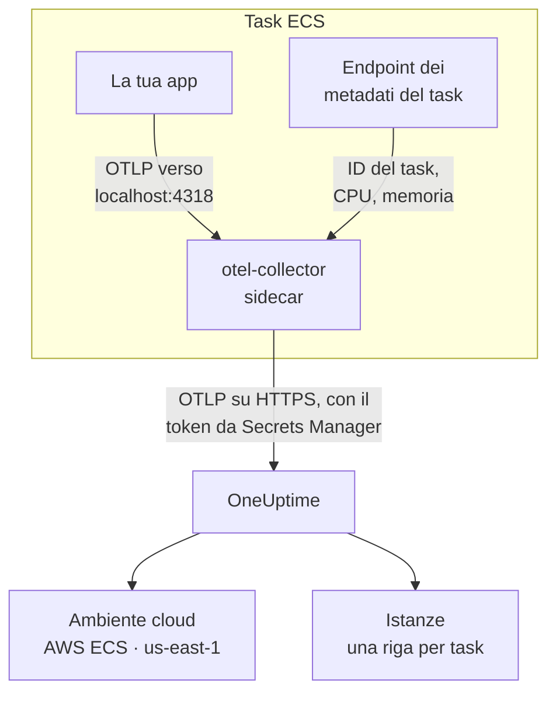

# AWS ECS / Fargate

Invia a OneUptime le tracce, i log e le metriche dei tuoi task Amazon ECS, sia sul tipo di avvio Fargate sia su EC2. Ogni task che riporta `cloud.platform=aws_ecs` entra in un **Cloud Environment** per account AWS e regione, ad esempio _AWS ECS · us-east-1 · 123456789012_, che vi giri un servizio o cinquanta.

:::cards
- [Come funziona](#come-funziona): Cosa fanno il rilevatore ECS e il collector sidecar.
- [Configurazione](#configurazione): Salvare il token, aggiungere le impostazioni alla definizione del task, distribuire e verificare.
- [La definizione del task completa](#la-definizione-del-task-completa): Una definizione del task Fargate completa da registrare.
- [Risoluzione dei problemi](#risoluzione-dei-problemi): Task bloccati in PENDING, esportazioni rifiutate, istanze o riquadri vuoti.
:::

## Come funziona



- **Il rilevatore ECS dà il nome all'ambiente.** Il rilevatore di risorse ECS di OpenTelemetry, nell'SDK o in un collector, legge l'endpoint dei metadati del task che ECS fornisce a ogni container, e imposta account, regione e task su tutto ciò che il task invia. Niente è scritto a mano nel codice.
- **Il task dà il nome a ogni istanza.** La scheda **Istanze** dell'ambiente elenca i task in esecuzione per ID del task, con la loro CPU e la loro memoria.
- **Un collector sidecar aggiunge CPU e memoria.** Il suo receiver `awsecscontainermetrics` legge la CPU e la memoria di ogni task dallo stesso endpoint, e custodisce il token, così l'applicazione non lo vede mai.

Il rilevatore ECS imposta questi attributi di risorsa:

| Attributo | Impostato dal rilevatore ECS | A cosa serve |
| ------------------------------------------------------------------ | ----------------------- | --------------------------------------------------------------------------------------------------------- |
| `cloud.platform` | `aws_ecs` | Archivia la telemetria in **Ambienti cloud**. Il valore deve essere esatto |
| `cloud.account.id` | `123456789012` | Parte della chiave dell'ambiente |
| `cloud.region` | `us-east-1` | Parte della chiave dell'ambiente |
| `aws.ecs.task.arn` | l'ARN del task | Dà il nome a un task in esecuzione in **Istanze**, con l'ID del task alla sua fine |
| `aws.ecs.task.id` | l'ID del task | Lo stesso; le versioni più recenti del rilevatore impostano entrambi |
| `aws.ecs.cluster.arn`, `aws.ecs.task.family`, `aws.ecs.launchtype` | il cluster e il task | Conservati su ogni span, log e metrica per le tue ricerche; non fanno parte dell'ambiente |

La chiave dell'ambiente è `aws_ecs|123456789012|us-east-1`. L'ID del task dà il nome a un'istanza anche quando l'SDK imposta anche `service.instance.id`: le metriche dei container del sidecar portano solo l'ID del task, e usarlo come chiave tiene gli span di un task e la sua CPU e memoria su un'unica riga. La regola completa è in [Ambienti cloud](/docs/telemetry/cloud-environments).

## Prima di iniziare

- **Una chiave di acquisizione.** Crea una chiave **Server** in **Impostazioni del progetto → Telemetria e APM → Chiavi di acquisizione** e copia il suo token.
- **Un cluster ECS e una definizione del task che puoi modificare**, e l'AWS CLI configurata per quell'account.
- **La tua applicazione strumentata con un SDK OpenTelemetry** che esporta OTLP, in qualsiasi linguaggio.

## Scegliere come la telemetria esce dal task

| | Sidecar collector | SDK direct |
| ----------------------- | ---------------------------------------------- | ----------------------------------------------- |
| Container in più | `otel-collector` in ogni task | Nessuno |
| CPU e memoria per task | Sì, dal receiver `awsecscontainermetrics` | No |
| Custodisce il token | Il collector | L'applicazione |
| Il segreto contiene | Il solo token | L'intestazione completa `x-oneuptime-token=...` |

La maggior parte dei team usa il collector sidecar: imposta gli attributi `cloud.*` anche sulla telemetria di librerie che non sanno nulla di ECS. SDK direct è la scelta più semplice per un singolo servizio. Ogni passaggio qui sotto ha una scheda per ciascuno; scegline una e ogni passaggio la seguirà.

## Configurazione

:::steps
### Salvare il token in Secrets Manager

> [!IMPORTANT]
> Il token è un segreto. Conservalo in AWS Secrets Manager e fai riferimento a esso dalla definizione del task con `secrets` e `valueFrom`. Un token in una semplice voce `environment` è visibile a chiunque possa leggere la definizione del task, e compare in ogni output di `describe-task-definition` e in ogni diff di CloudFormation.

:::tabs
@tab Sidecar collector
```bash
aws secretsmanager create-secret \
  --name oneuptime/ingestion-token \
  --region us-east-1 \
  --secret-string "YOUR_TELEMETRY_INGESTION_TOKEN"
```

La configurazione del collector aggiunge il nome dell'intestazione, quindi questo segreto contiene solo il token.
@tab SDK direct
```bash
aws secretsmanager create-secret \
  --name oneuptime/ingestion-token \
  --region us-east-1 \
  --secret-string "x-oneuptime-token=YOUR_TELEMETRY_INGESTION_TOKEN"
```

ECS inserisce il valore di un segreto così com'è nella variabile, e `OTEL_EXPORTER_OTLP_HEADERS` ha bisogno della coppia `name=value` completa, quindi questo segreto contiene l'intestazione completa.
:::

Annota l'ARN che stampa il comando. Termina con un suffisso casuale, ad esempio `oneuptime/ingestion-token-AbCdEf`, e lo incollerai nella definizione del task.

### Permettere al task di leggere il segreto

Il ruolo di esecuzione del task (il ruolo con cui ECS avvia il task, non il ruolo con cui gira il tuo codice) deve poter leggere il segreto. Collega questo criterio a `ecsTaskExecutionRole`:

```json title="secret-access-policy.json"
{
  "Version": "2012-10-17",
  "Statement": [
    {
      "Effect": "Allow",
      "Action": ["secretsmanager:GetSecretValue"],
      "Resource": "arn:aws:secretsmanager:us-east-1:123456789012:secret:oneuptime/ingestion-token-*"
    }
  ]
}
```

Se una chiave KMS gestita dal cliente cifra il segreto, il ruolo ha bisogno anche di `kms:Decrypt` su quella chiave. Senza l'una o l'altra cosa, il task non si avvia: si ferma con `ResourceInitializationError: unable to pull secrets`.

### Aggiungere le impostazioni alla definizione del task

:::tabs
@tab Sidecar collector
1. **AWS Console → Amazon Elastic Container Service → Task definitions** → seleziona la famiglia → **Create new revision**.
2. In **Container - 1** (la tua applicazione), espandi **Environment variables** e aggiungi le variabili dell'applicazione qui sotto.
3. **+ Add container**: nome `otel-collector`, immagine `otel/opentelemetry-collector-contrib:latest` (fissa una versione quando funziona), **Essential container: No**. In **Docker configuration → Command** inserisci `--config=env:OTEL_COLLECTOR_CONFIG`.
4. Sul container del collector, aggiungi la variabile d'ambiente `ONEUPTIME_TOKEN` con **Value type: ValueFrom** e l'ARN del segreto, e `OTEL_COLLECTOR_CONFIG` con **Value type: Value** e la configurazione del collector qui sotto.
5. In **Startup dependency ordering** sul container dell'applicazione, aggiungi `otel-collector` con la condizione **Start**, così l'applicazione non si avvia mai prima che qualcosa sia in ascolto sulla porta 4318.
6. In **Task execution role**, controlla che sia il ruolo a cui hai collegato il criterio.

Variabili dell'applicazione. In modalità di rete `awsvpc` (sempre, su Fargate) i container di un task condividono una rete, quindi `localhost` è il sidecar:

```bash
OTEL_SERVICE_NAME=checkout-api
OTEL_EXPORTER_OTLP_ENDPOINT=http://localhost:4318
OTEL_EXPORTER_OTLP_PROTOCOL=http/protobuf
```

Configurazione del collector. Il collector la legge interamente dalla variabile `OTEL_COLLECTOR_CONFIG`, quindi non c'è alcun file da inserire in un'immagine, e risolve `${env:ONEUPTIME_TOKEN}` dal segreto che ECS mette nel suo ambiente:

```yaml title="OTEL_COLLECTOR_CONFIG"
receivers:
  otlp:
    protocols:
      http:
        endpoint: 0.0.0.0:4318
      grpc:
        endpoint: 0.0.0.0:4317
  # Per-task and per-container CPU / memory from the ECS task metadata
  # endpoint. This is what fills the CPU and memory tiles in OneUptime.
  awsecscontainermetrics:
    collection_interval: 20s
processors:
  # Stamps cloud.provider, cloud.platform=aws_ecs, cloud.account.id,
  # cloud.region and aws.ecs.task.arn on every span, log and metric.
  resourcedetection:
    detectors: [env, ecs]
    timeout: 5s
  batch: {}
exporters:
  otlphttp/oneuptime:
    endpoint: https://oneuptime.com/otlp
    headers:
      x-oneuptime-token: ${env:ONEUPTIME_TOKEN}
service:
  pipelines:
    traces:
      receivers: [otlp]
      processors: [resourcedetection, batch]
      exporters: [otlphttp/oneuptime]
    metrics:
      receivers: [otlp, awsecscontainermetrics]
      processors: [resourcedetection, batch]
      exporters: [otlphttp/oneuptime]
    logs:
      receivers: [otlp]
      processors: [resourcedetection, batch]
      exporters: [otlphttp/oneuptime]
```

Né il rilevatore `ecs` né il receiver `awsecscontainermetrics` hanno bisogno di un'autorizzazione IAM: entrambi leggono l'endpoint dei metadati che ECS fornisce a ogni container in `ECS_CONTAINER_METADATA_URI_V4`.
@tab SDK direct
1. **AWS Console → Amazon Elastic Container Service → Task definitions** → seleziona la famiglia → **Create new revision**.
2. In **Container - 1** (la tua applicazione), espandi **Environment variables** e aggiungi le variabili qui sotto. Aggiungi `OTEL_EXPORTER_OTLP_HEADERS` con **Value type: ValueFrom** e l'ARN del segreto come valore.
3. Aggiungi l'impostazione che attiva il rilevatore di risorse ECS del tuo linguaggio, dalla tabella qui sotto.
4. In **Task execution role**, controlla che sia il ruolo a cui hai collegato il criterio.

```bash
OTEL_SERVICE_NAME=checkout-api
OTEL_EXPORTER_OTLP_ENDPOINT=https://oneuptime.com/otlp
OTEL_EXPORTER_OTLP_PROTOCOL=http/protobuf
# Injected from Secrets Manager (secrets / valueFrom), not typed here.
OTEL_EXPORTER_OTLP_HEADERS=x-oneuptime-token=YOUR_TELEMETRY_INGESTION_TOKEN
```

| Linguaggio | Attivare il rilevatore ECS |
| -------- | --------------------------------------------------------------------------------------------------------------- |
| Node.js | `OTEL_NODE_RESOURCE_DETECTORS=env,host,os,aws` (auto-instrumentations-node) |
| Python | `pip install opentelemetry-sdk-extension-aws`, poi `OTEL_EXPERIMENTAL_RESOURCE_DETECTORS=aws_ecs` |
| Java | `-Dotel.resource.providers.aws.enabled=true` (l'agent distribuisce il provider disattivato) |
| Go | `import "go.opentelemetry.io/contrib/detectors/aws/ecs"` e passa `ecs.NewResourceDetector()` a `resource.New` |
| .NET | Il pacchetto `OpenTelemetry.Resources.AWS`: `.ConfigureResource(r => r.AddAWSECSDetector())` |

In un file di definizione del task, il segreto è `"secrets": [{ "name": "OTEL_EXPORTER_OTLP_HEADERS", "valueFrom": "<secret ARN>" }]`.
:::

Se ospiti OneUptime in autonomia, usa `https://YOUR-ONEUPTIME-HOST/otlp` come endpoint.

### Distribuire la nuova revisione

Fai clic su **Create**, poi su **Clusters → your cluster → Services → select the service → Update → Task definition revision: latest → Deploy**. Oppure dalla CLI:

```bash
aws ecs update-service \
  --cluster production \
  --service checkout-api \
  --task-definition checkout-api
```

### Verificare la connessione

Verifica prima il token: è il controllo più economico, e niente di ciò che segue funziona senza.

```bash
curl -i https://oneuptime.com/otlp/v1/validate \
  -H "x-oneuptime-token: YOUR_TELEMETRY_INGESTION_TOKEN"
```

`200` con `"valid": true` significa che il token è accettato. `401` significa che è sconosciuto, revocato, disattivato o scaduto. Esegui lo stesso comando dall'interno del task con ECS Exec, per dimostrare che il task stesso raggiunge OneUptime:

```bash
aws ecs execute-command --cluster production --task <task id> \
  --container app --interactive --command "sh"
```

Il flusso di log CloudWatch del collector (`otel/otel-collector/...`) dovrebbe riportare `Everything is ready`, senza righe `401` o `connection refused`. Entro un minuto dal primo span, log o metrica, l'ambiente compare in **Cloud → All Environments** come _AWS ECS · us-east-1 · 123456789012_.
:::

## La definizione del task completa

La configurazione con sidecar come file da registrare con `aws ecs register-task-definition --cli-input-json file://task-definition.json`. Sostituisci l'ID dell'account, la regione, l'immagine e l'ARN del segreto:

```json title="task-definition.json"
{
  "family": "checkout-api",
  "requiresCompatibilities": ["FARGATE"],
  "networkMode": "awsvpc",
  "cpu": "512",
  "memory": "1024",
  "executionRoleArn": "arn:aws:iam::123456789012:role/ecsTaskExecutionRole",
  "taskRoleArn": "arn:aws:iam::123456789012:role/checkout-api-task-role",
  "containerDefinitions": [
    {
      "name": "app",
      "image": "123456789012.dkr.ecr.us-east-1.amazonaws.com/checkout-api:1.4.2",
      "essential": true,
      "portMappings": [{ "containerPort": 8080, "protocol": "tcp" }],
      "environment": [
        { "name": "OTEL_SERVICE_NAME", "value": "checkout-api" },
        {
          "name": "OTEL_EXPORTER_OTLP_ENDPOINT",
          "value": "http://localhost:4318"
        },
        { "name": "OTEL_EXPORTER_OTLP_PROTOCOL", "value": "http/protobuf" }
      ],
      "dependsOn": [
        { "containerName": "otel-collector", "condition": "START" }
      ],
      "logConfiguration": {
        "logDriver": "awslogs",
        "options": {
          "awslogs-group": "/ecs/checkout-api",
          "awslogs-region": "us-east-1",
          "awslogs-stream-prefix": "app"
        }
      }
    },
    {
      "name": "otel-collector",
      "image": "otel/opentelemetry-collector-contrib:latest",
      "essential": false,
      "command": ["--config=env:OTEL_COLLECTOR_CONFIG"],
      "secrets": [
        {
          "name": "ONEUPTIME_TOKEN",
          "valueFrom": "arn:aws:secretsmanager:us-east-1:123456789012:secret:oneuptime/ingestion-token-AbCdEf"
        }
      ],
      "environment": [
        {
          "name": "OTEL_COLLECTOR_CONFIG",
          "value": "receivers:\n  otlp:\n    protocols:\n      http:\n        endpoint: 0.0.0.0:4318\n      grpc:\n        endpoint: 0.0.0.0:4317\n  awsecscontainermetrics:\n    collection_interval: 20s\nprocessors:\n  resourcedetection:\n    detectors: [env, ecs]\n    timeout: 5s\n  batch: {}\nexporters:\n  otlphttp/oneuptime:\n    endpoint: https://oneuptime.com/otlp\n    headers:\n      x-oneuptime-token: ${env:ONEUPTIME_TOKEN}\nservice:\n  pipelines:\n    traces:\n      receivers: [otlp]\n      processors: [resourcedetection, batch]\n      exporters: [otlphttp/oneuptime]\n    metrics:\n      receivers: [otlp, awsecscontainermetrics]\n      processors: [resourcedetection, batch]\n      exporters: [otlphttp/oneuptime]\n    logs:\n      receivers: [otlp]\n      processors: [resourcedetection, batch]\n      exporters: [otlphttp/oneuptime]\n"
        }
      ],
      "logConfiguration": {
        "logDriver": "awslogs",
        "options": {
          "awslogs-group": "/ecs/checkout-api",
          "awslogs-region": "us-east-1",
          "awslogs-stream-prefix": "otel"
        }
      }
    }
  ]
}
```

Il valore di `OTEL_COLLECTOR_CONFIG` è la configurazione del collector come un'unica stringa JSON. Invece di eseguirne l'escape a mano, tieni lo YAML in `collector.yaml` e lascia fare a `jq`:

```bash
jq --rawfile cfg collector.yaml \
  '.containerDefinitions[1].environment[0].value = $cfg' \
  task-definition.json > task-definition.rendered.json
aws ecs register-task-definition --cli-input-json file://task-definition.rendered.json
```

## Rete

Il task deve raggiungere due cose fuori dal tuo VPC: Secrets Manager, per avviarsi, e OneUptime, per esportare.

- **I task Fargate in subnet private** hanno bisogno di una route verso Internet: un NAT gateway nella tabella di routing della subnet, oppure una subnet pubblica con `assignPublicIp=ENABLED`. Un task senza nessuno dei due resta in `PENDING` sul segreto, prima che il collector invii qualsiasi cosa.
- **Il traffico in uscita del gruppo di sicurezza** deve consentire TCP 443 verso l'host di OneUptime: `oneuptime.com`, oppure il tuo host sulla porta su cui è in ascolto. Il gruppo di sicurezza predefinito consente tutto il traffico in uscita; uno ristretto spesso no. La telemetria non ha bisogno di alcuna regola in entrata.
- **Gli endpoint di interfaccia VPC** per `com.amazonaws.us-east-1.secretsmanager` (e `ecr.api`, `ecr.dkr` e S3 per scaricare le immagini) tengono le chiamate AWS fuori dal percorso NAT. OneUptime stesso ha comunque bisogno della route verso Internet.

```bash
aws ecs update-service \
  --cluster production \
  --service checkout-api \
  --task-definition checkout-api \
  --network-configuration "awsvpcConfiguration={subnets=[subnet-0abc1234],securityGroups=[sg-0def5678],assignPublicIp=ENABLED}"
```

## Che cosa ottieni

- **Panoramica**: richieste, tasso di errore e latenza p95 dalle tue tracce, i riquadri **CPU** e **Memoria** e **Istanze principali per CPU**. I riquadri si riempiono con `ecs.task.cpu.utilized` e `ecs.task.memory.utilized` del receiver `awsecscontainermetrics`, oppure con qualsiasi metrica `container.cpu.utilization` e `container.memory.usage` che porti l'identità del task. SDK direct non invia né l'una né l'altra.
- **Istanze**: una riga per task in esecuzione, con il nome del suo ID del task (la fine di `aws.ecs.task.arn`), con la sua ultima CPU, la memoria e l'ora in cui è stato visto l'ultima volta. Un task che smette di segnalare diventa **Stale**.
- **Registri**, **Tracce** e **Metriche**: tutto ciò che ha portato `cloud.platform=aws_ecs` per questo account e questa regione.
- **Servizi**: gli stessi task, suddivisi per `service.name`.

## Risoluzione dei problemi

I guasti propri di ECS, nell'ordine in cui si verificano:

:::details Un task resta bloccato in PENDING con "unable to pull secrets"
L'errore completo è `ResourceInitializationError: unable to pull secrets`. O il ruolo di esecuzione del task non ha `secretsmanager:GetSecretValue` sul segreto (o `kms:Decrypt` sulla sua chiave), oppure il task non ha alcuna route verso Secrets Manager: né NAT gateway né endpoint VPC. Vedi [Rete](#rete).
:::

:::details Il collector registra 401
Il segreto contiene il valore sbagliato. Per il collector sidecar deve essere il solo token; per SDK direct, l'intestazione completa `x-oneuptime-token=...`. Verifica il token stesso con il comando in [Verificare la connessione](#verificare-la-connessione).
:::

:::details L'ambiente compare, ma Istanze è vuota
La telemetria non porta alcuna identità del task. Assicurati che il rilevatore `ecs` sia in esecuzione: la risorsa deve portare `aws.ecs.task.arn`, `aws.ecs.task.id` o `service.instance.id`.
:::

:::details Le istanze si riempiono, ma i riquadri CPU e Memoria restano vuoti
Il receiver `awsecscontainermetrics` manca dalla pipeline `metrics`, oppure quella pipeline salta il processore `resourcedetection`, così le metriche dei container arrivano senza `cloud.platform`. SDK direct non riempie mai questi riquadri.
:::

Un ambiente che non compare mai, che finisce in **Host** o in **Funzioni serverless**, che mostra **Disconnesso** o si divide in due è trattato in [Risoluzione dei problemi cloud](/docs/telemetry/cloud-troubleshooting).

## Prossimi passi

:::cards
- [Ambienti cloud](/docs/telemetry/cloud-environments): Come vengono identificati ambienti e istanze.
- [Risoluzione dei problemi cloud](/docs/telemetry/cloud-troubleshooting): I guasti comuni a tutte le piattaforme.
- [Risorse cloud (IaaS e PaaS)](/docs/telemetry/cloud-resources): I tuoi load balancer, database RDS e bucket, da CloudWatch.
- [OpenTelemetry](/docs/telemetry/open-telemetry): Strumentare la tua applicazione, con gli endpoint e i limiti.
:::
