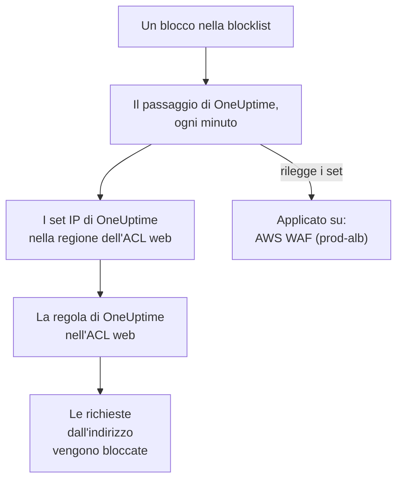

# Bloccare indirizzi in AWS WAF

La blocklist del tuo progetto può essere applicata nelle ACL web di AWS WAF che si trovano davanti alle tue distribuzioni CloudFront, ai tuoi bilanciatori di carico e ai tuoi API Gateway. Attivala su una connessione cloud AWS che hai già, scegli le ACL web, e ogni indirizzo bloccato dalla blocklist viene bloccato anche lì, che l'abbia bloccato una persona, un playbook o OneUptime AI.

:::cards
- [Attivazione](#attivazione): Un'impostazione sulla connessione AWS, e di nuovo il suo comando di configurazione.
- [Cosa crea OneUptime](#cosa-crea-oneuptime): Quattro set IP per regione e due regole per ACL web.
- [Gestire l'ACL web nel codice](#gestire-lacl-web-nel-codice): Aggiungi tu stesso le regole in Terraform o CloudFormation.
:::

## Come funziona

OneUptime mantiene i propri set IP in ogni regione in cui si trova un'ACL web scelta, e in ogni ACL web una regola che blocca gli indirizzi che contengono. Ogni minuto scrive una volta ogni set con ciò che contiene la blocklist, poi rilegge i set. Nella pagina **Blocklist**, la colonna **Applicato su** di un blocco nomina AWS WAF (prod-alb) solo quando AWS WAF contiene il blocco e la regola dell'ACL web blocca il suo set; fino ad allora il blocco non è applicato.

## Prima di iniziare

- Un account AWS collegato a OneUptime (vedi [Collegare un account cloud](/docs/telemetry/cloud-accounts#amazon-web-services)).
- Un ruolo che possa cambiare dove viene applicata la blocklist: **Proprietario del progetto**, **Amministratore del progetto** o **Amministratore della sicurezza**.
- Qualcuno che possa eseguire di nuovo il comando di configurazione della connessione nell'account AWS.

## Attivazione

:::steps
### Aprire la connessione
Apri **Cloud → Collega** e modifica la connessione AWS.

### Scegliere chi aggiunge la regola
In **Altri campi**, imposta **Blocca indirizzi in AWS WAF** su **Attivato, e OneUptime aggiunge la sua regola**, oppure su **Attivato, e aggiungo io la regola nel codice** se le tue ACL web sono gestite in Terraform o CloudFormation.

### Eseguire di nuovo il comando di configurazione
Il comando mostrato dal modulo ora concede i set IP, e la regola quando è OneUptime ad aggiungerla. Eseguilo in AWS CloudShell, poi salva la connessione.

### Aggiungere le ACL web
Apri **Eventi di sicurezza → Playbook → Blocklist**. In **WAF cloud**, fai clic su **Aggiungi ACL web**, scegli un'ACL web e da dove legge l'indirizzo del client, e aggiungila. OneUptime la configura subito, e il suo **Stato** indica **Applicata** quando la sua regola blocca i set.
:::

Le ACL web provengono dall'inventario della connessione: un'ACL web che OneUptime non ha ancora letto compare dopo la lettura successiva. Finché un'ACL web applica la blocklist, l'impostazione della sua connessione non può essere disattivata né passare da OneUptime che aggiunge la regola all'aggiunta nel codice, e la connessione non può essere eliminata: rimuovi prima l'ACL web, così OneUptime toglie la sua regola.

## Cosa crea OneUptime

| Cosa | Nome | Dove |
| --- | --- | --- |
| Quattro set IP: blocco e verifica, IPv4 e IPv6 | `oneuptime-<project>-block-ipv4`, `oneuptime-<project>-block-ipv6`, `oneuptime-<project>-challenge-ipv4`, `oneuptime-<project>-challenge-ipv6` | In ogni regione in cui si trova un'ACL web scelta. Le ACL web di CloudFront sono globali, e i loro set si trovano in `us-east-1`. |
| Due regole: una blocca, l'altra sottopone a verifica | `OneUptime-Blocklist-<project>`, `OneUptime-Challenge-<project>` | In ogni ACL web scelta, quando OneUptime aggiunge la sua regola. |

`<project>` sono i primi otto caratteri dell'ID esterno del tuo progetto, quindi due progetti OneUptime nello stesso account non scrivono mai nei set l'uno dell'altro. Le ACL web di una stessa regione condividono i set. Un singolo indirizzo è scritto come `/32` o `/128`. AWS WAF accetta 10.000 indirizzi in un set e 100 set IP per regione, a meno che AWS non abbia alzato il limite per te; un blocco che non ci sta lo indica sulla sua riga.

## Il posto della regola nell'ACL web

OneUptime mette le sue due regole su priorità libere inferiori a quella della tua prima regola, così vengono eseguite prima delle regole che hai scritto. Se l'ACL web non ha regole, prendono le priorità 0 e 1. OneUptime non rinumera, non modifica e non rimuove mai una tua regola: quando sotto la tua prima regola non ci sono due priorità libere, l'ACL web indica **Nessuna priorità libera**, e OneUptime aggiunge le sue regole non appena ne liberi due.

Ogni regola corrisponde quando uno dei suoi set, IPv4 o IPv6, contiene l'indirizzo del client. AWS WAF aggiorna un'ACL web per intero, quindi OneUptime la legge, aggiunge le sue regole e la riscrive con il token di blocco dell'ACL web, e la rilegge se qualcun altro l'ha scritta nel frattempo.

## Indirizzi inoltrati

Un'ACL web dietro un altro proxy o una CDN vede l'indirizzo del proxy, non quello del client. Scegli da dove legge l'indirizzo del client in **Indirizzo del client**:

| Indirizzo del client | Cosa legge la regola |
| --- | --- |
| **L'indirizzo di origine della richiesta** | L'indirizzo da cui è arrivata la richiesta. Il valore predefinito. |
| L'ultimo indirizzo nell'intestazione `X-Forwarded-For` | L'indirizzo che l'ultimo proxy ha aggiunto. Un indirizzo che lo precede è uno dichiarato dalla richiesta. |
| L'intestazione `CF-Connecting-IP` | L'unico indirizzo che scrive Cloudflare. |
| L'intestazione `True-Client-IP` | L'unico indirizzo che scrive Akamai o Cloudflare Enterprise. |

Una richiesta senza l'intestazione non corrisponde: AWS WAF la lascia passare invece di bloccare l'indirizzo di un proxy.

## Gestire l'ACL web nel codice

Con **Attivato, e aggiungo io la regola nel codice**, OneUptime crea solo i set IP e non scrive mai nella tua ACL web. Fai clic su **Mostra regola** sulla riga dell'ACL web: fornisce entrambe le regole in Terraform (blocchi `rule` di `aws_wafv2_web_acl`) e in CloudFormation, con l'ARN di ogni set e l'intestazione che legge l'ACL web. Aggiungile al tuo codice prima delle tue altre regole e applicalo.

Finché le regole non ci sono, l'ACL web indica **In attesa della tua regola**, e i suoi blocchi non sono applicati. OneUptime legge l'ACL web a ogni passaggio, e i suoi blocchi sono applicati dal primo passaggio che trova una regola che blocca ogni set, qualunque nome tu le abbia dato.

## Permessi

Il comando di configurazione aggiunge al ruolo una policy inline, `OneUptimeWafBlocklist`. Con una chiave di accesso, il limite che IAM pone alle policy proprie di un utente la mette su un gruppo, `OneUptimeWafBlocklist-<project>`, a cui viene aggiunto l'utente.

| Azione | Risorsa | Perché |
| --- | --- | --- |
| `wafv2:ListIPSets` | Qualsiasi | Trovare i set IP di OneUptime in una regione. |
| `wafv2:GetIPSet`, `wafv2:CreateIPSet`, `wafv2:UpdateIPSet`, `wafv2:DeleteIPSet` | Solo i set IP di OneUptime (`oneuptime-<project>-*`) | Mantenere i set, ed eliminarli quando rimuovi l'ultima ACL web di una regione. |
| `wafv2:GetSampledRequests` | ACL web | Leggere le richieste respinte da una regola: la prova con cui viene verificato il passaggio di blocco di un caso. |
| `wafv2:UpdateWebACL` | ACL web, e i set IP, i set di espressioni regolari e i gruppi di regole a cui fanno riferimento | Aggiungere le regole di OneUptime. Solo con **Attivato, e OneUptime aggiunge la sua regola**. |

La lettura di un'ACL web, `wafv2:GetWebACL`, fa già parte della policy di sola lettura della connessione.

## Disattivazione

:::steps
### Rimuovere l'ACL web
In **Eventi di sicurezza → Playbook → Blocklist**, fai clic su **Rimuovi** sulla riga dell'ACL web. OneUptime toglie le sue regole dall'ACL web, poi svuota ed elimina i suoi set IP quando nessun'altra ACL web della regione li usa.

### Disattivare l'impostazione
Modifica la connessione, imposta **Blocca indirizzi in AWS WAF** su **Disattivato** e salva. L'impostazione può essere disattivata quando nessuna ACL web della connessione applica la blocklist.
:::

Quando OneUptime non può più scrivere nell'ACL web, seleziona **Rimuovi solo da OneUptime** nella finestra **Rimuovi ACL web**. OneUptime rimuove l'ACL web dalla blocklist e nomina le regole e i set IP che ha lasciato in AWS WAF: continuano a bloccare ciò che contengono finché non li elimini lì. Una tua regola che fa ancora riferimento a un set lo mantiene anch'esso: OneUptime lo svuota e lo nomina.

## Risoluzione dei problemi

:::details Non applicata
Lo stato dell'ACL web dice cosa ha risposto AWS e cosa fare. Un rifiuto nomina l'azione e l'impostazione che la concede: attiva l'impostazione, oppure scegli **Attivato, e OneUptime aggiunge la sua regola**, poi esegui di nuovo il comando di configurazione della connessione e fai clic su **Verifica di nuovo**.
:::

:::details Nessuna priorità libera
La tua prima regola ha priorità 0 o 1, quindi sotto di essa non ci sono due priorità libere. Aumenta di due il numero di priorità delle tue regole, poi fai clic su **Verifica di nuovo**.
:::

:::details Un'ACL web non compare nell'elenco
OneUptime elenca le ACL web delle connessioni con l'impostazione attivata, una volta che le ha lette. Le ACL web viste solo tramite le loro metriche richiedono di eseguire di nuovo il comando di configurazione della connessione, che permette a OneUptime di leggerle.
:::

## Prossimi passi

:::cards
- [Casi di sicurezza e playbook](/docs/telemetry/security-cases): Blocca un indirizzo da un caso e guarda il suo passaggio verificato.
- [Collegare un account cloud](/docs/telemetry/cloud-accounts): La connessione di cui fa parte questa impostazione.
:::
