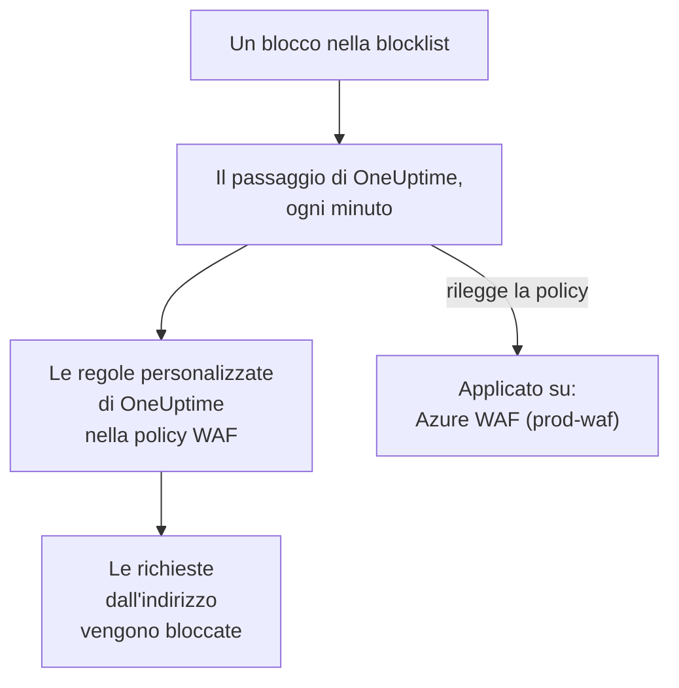

# Bloccare indirizzi in Azure WAF

La blocklist del tuo progetto può essere applicata nelle policy di Azure WAF dei tuoi Application Gateway e Front Door. Attivala su una connessione cloud Azure che hai già, scegli le policy WAF, e ogni indirizzo bloccato dalla blocklist viene bloccato anche lì, che l'abbia bloccato una persona, un playbook o OneUptime AI.

:::cards
- [Attivazione](#attivazione): Un'impostazione sulla connessione Azure, e il ruolo che richiede.
- [Cosa crea OneUptime](#cosa-crea-oneuptime): Regole personalizzate proprie in ogni policy che scegli.
- [Quale indirizzo viene confrontato](#quale-indirizzo-viene-confrontato): L'indirizzo che si è connesso, o il client originale dietro un proxy.
:::

## Come funziona

OneUptime mantiene regole personalizzate proprie in ogni policy WAF che scegli, e vi inserisce gli indirizzi bloccati dalla blocklist. Ogni minuto scrive una volta la policy con ciò che contiene la blocklist, poi la rilegge. Nella pagina **Blocklist**, la colonna **Applicato su** di un blocco nomina Azure WAF (prod-waf) solo quando la policy contiene il blocco e Azure ha applicato la modifica; fino ad allora il blocco non è applicato.

## Prima di iniziare

- Una sottoscrizione Azure collegata a OneUptime (vedi [Collegare un account cloud](/docs/telemetry/cloud-accounts#microsoft-azure)).
- Un ruolo che possa cambiare dove viene applicata la blocklist: **Proprietario del progetto**, **Amministratore del progetto** o **Amministratore della sicurezza**.
- Qualcuno che possa assegnare ruoli nella sottoscrizione Azure, per eseguire un comando in Azure Cloud Shell.

## Attivazione

:::steps
### Aprire la connessione
Apri **Cloud → Collega** e modifica la connessione Azure.

### Attivare l'impostazione
In **Altri campi**, imposta **Blocca indirizzi in Azure WAF** su **Attivato** e salva. Il comando di configurazione mostrato dal modulo ora concede il ruolo descritto più sotto sull'intera sottoscrizione. Una connessione che hai già non deve eseguirlo di nuovo: la finestra **Aggiungi WAF** fornisce le righe che concedono il ruolo su una sola policy.

### Aggiungere le policy WAF
Apri **Eventi di sicurezza → Playbook → Blocklist**. In **WAF cloud**, fai clic su **Aggiungi WAF** e scegli una policy WAF. OneUptime chiede ad Azure se la connessione può scrivere nella policy, senza scrivere nulla.

### Concedere il ruolo, se manca
Quando manca un'autorizzazione, la finestra mostra le righe che la concedono solo su quella policy. Eseguile in Azure Cloud Shell, fai clic su **Verifica di nuovo**, poi aggiungi la policy. Il suo **Stato** indica **Applicata** quando OneUptime l'ha letta.
:::

Le policy WAF provengono dall'inventario della connessione: una policy che OneUptime non ha ancora letto compare dopo la lettura successiva. Finché una policy applica la blocklist, l'impostazione della sua connessione non può essere disattivata e la connessione non può essere eliminata: rimuovi prima la policy, così OneUptime toglie le sue regole.

## Cosa crea OneUptime

| Cosa | Nome | Dove |
| --- | --- | --- |
| Regole personalizzate, ognuna con una condizione di corrispondenza IP e l'azione Block | `OneUptime<project>Block1`, `OneUptime<project>Block2`, ... | In ogni policy WAF che scegli, al massimo 10. |

`<project>` sono i primi otto caratteri dell'ID esterno del tuo progetto, quindi due progetti OneUptime che scelgono la stessa policy non scrivono mai le regole l'uno dell'altro. Una regola contiene 540 indirizzi o intervalli su Application Gateway, 600 con CRS 3.2 o un Default Rule Set, e 600 su Front Door. Con dieci regole, una policy contiene 5.400 o 6.000 blocchi; un blocco che non ci sta lo indica sulla sua riga.

OneUptime non modifica nulla in una policy tranne le proprie regole. Azure scrive una policy WAF solo per intero, quindi OneUptime legge la policy con il suo ETag, modifica le proprie regole e la riscrive con l'ETag in `If-Match`: ogni altra regola, impostazione e set di regole gestito viene scritto così come è stato letto. Se nel frattempo qualcun altro ha scritto la policy, Azure rifiuta la scrittura, e OneUptime la rilegge e applica la sua modifica su ciò che è stato scritto.

## Il posto delle regole nella policy

OneUptime mette le sue regole su priorità libere prima della tua prima regola che consente il traffico, partendo dalla più bassa, così nessuna tua regola lascia passare un indirizzo bloccato. Una tua regola che blocca o registra può venire prima. OneUptime non rinumera, non modifica e non rimuove mai una tua regola: quando prima della tua prima regola Allow non c'è nessuna priorità libera, la policy indica **Nessuna priorità libera**, e OneUptime aggiunge la sua regola non appena ne liberi una.

## Quale indirizzo viene confrontato

| Policy WAF | Indirizzo del client | Quando sceglierlo |
| --- | --- | --- |
| Front Door | **L'indirizzo che si è connesso a Front Door (SocketAddr)** | Il valore predefinito. |
| Front Door | Il client originale, da X-Forwarded-For (RemoteAddr) | Per un Front Door dietro un altro proxy o una CDN. |
| Application Gateway | L'indirizzo che si è connesso al gateway (RemoteAddr) | L'unica scelta: la sua corrispondenza IP non legge nessun altro indirizzo. |

Front Door prende `RemoteAddr` dall'intestazione `X-Forwarded-For`, che un client che si connette direttamente a Front Door scrive da sé. Sceglilo solo quando un altro proxy o una CDN davanti a Front Door scrive quell'intestazione. La scelta si trova in **Altri campi** nella finestra **Aggiungi WAF**, e puoi cambiarla in seguito con **Indirizzo del client** sulla riga della policy.

La corrispondenza IP di Application Gateway legge solo indirizzi IPv4, quindi un blocco IPv6 non vi viene applicato, e la sua riga spiega perché.

Le regole di OneUptime in Azure WAF si limitano a bloccare. Un blocco che chiede di sottoporre un indirizzo a verifica non viene applicato in Azure WAF, e lo indica. La verifica di una policy di risposta automatica vi viene applicata come un blocco per lo stesso tempo.

## Quanto tempo richiede una modifica

Application Gateway applica una modifica non appena Azure la scrive. Front Door accetta la modifica e la propaga ai suoi nodi edge nei minuti successivi: la policy indica **Applicazione in corso**, e la colonna **Applicato su** di un nuovo blocco attende la policy finché Azure non ne segnala il provisioning come completato. Da quel momento il blocco è applicato.

## Quando una regola viene modificata a mano

Quando qualcuno disattiva, modifica o elimina una delle regole di OneUptime in Azure, OneUptime la lascia così com'è. La policy indica **Modificata a mano**, e i blocchi contenuti in quella regola non sono applicati, con il motivo, finché qualcuno non fa clic su **Ripristina** sulla riga della policy. Ripristina riscrive la regola come la scrive OneUptime, alla sua priorità finché questa è libera.

Anche una policy che non blocca nulla lo indica, e i suoi blocchi non sono applicati:

- Una policy disattivata.
- Una policy in modalità **Detection**, che registra soltanto ciò che corrisponde alle regole di OneUptime.
- Una policy non associata a un gateway applicazione, a un listener, a una regola di percorso o a un dominio di Front Door.

## Gestire una policy in Terraform

Anche Terraform scrive una policy WAF per intero, quindi il suo plan successivo rimuove le regole di OneUptime. Per consentire a OneUptime di mantenerle, aggiungi `ignore_changes = [custom_rules]` al blocco `lifecycle` di una `azurerm_web_application_firewall_policy`, oppure `ignore_changes = [custom_rule]` a quello di una `azurerm_cdn_frontdoor_firewall_policy`, e tieni le tue regole personalizzate fuori dal codice di quella policy.

## Permessi

Il comando di configurazione aggiunge un ruolo personalizzato, `OneUptime WAF Blocklist`, e lo assegna all'app della connessione sulla sottoscrizione. Le righe mostrate dalla finestra **Aggiungi WAF** assegnano lo stesso ruolo su una sola policy.

| Azione | Perché |
| --- | --- |
| `Microsoft.Network/ApplicationGatewayWebApplicationFirewallPolicies/read`, `Microsoft.Network/ApplicationGatewayWebApplicationFirewallPolicies/write` | Leggere una policy WAF di Application Gateway e scrivervi le regole di OneUptime. |
| `Microsoft.Network/FrontDoorWebApplicationFirewallPolicies/read`, `Microsoft.Network/FrontDoorWebApplicationFirewallPolicies/write` | Leggere una policy WAF di Front Door e scrivervi le regole di OneUptime. |

Il ruolo non può eliminare una policy, e OneUptime non scrive mai nient'altro.

## Disattivazione

:::steps
### Rimuovere la policy WAF
In **Eventi di sicurezza → Playbook → Blocklist**, fai clic su **Rimuovi** sulla riga della policy. OneUptime toglie le sue regole dalla policy e non vi modifica nient'altro.

### Disattivare l'impostazione
Modifica la connessione, imposta **Blocca indirizzi in Azure WAF** su **Disattivato** e salva. L'impostazione può essere disattivata quando nessuna policy della connessione applica la blocklist.
:::

Quando OneUptime non può più scrivere nella policy, seleziona **Rimuovi solo da OneUptime** nella finestra **Rimuovi WAF**. OneUptime rimuove la policy dalla blocklist e nomina le regole che vi ha lasciato: continuano a bloccare ciò che contengono finché non le elimini in Azure.

## Risoluzione dei problemi

:::details Non applicata
Lo stato della policy dice cosa ha risposto Azure e cosa fare. Un rifiuto nomina l'autorizzazione che manca: esegui le righe che **Aggiungi WAF** mostra per la policy, poi fai clic su **Verifica di nuovo**.
:::

:::details Nessuna priorità libera
La tua prima regola che consente il traffico ha priorità 1, oppure tutte le priorità prima di essa sono occupate. Aumentane il numero di priorità, poi fai clic su **Verifica di nuovo**.
:::

:::details Una policy non compare nell'elenco
OneUptime elenca le policy WAF delle connessioni con l'impostazione attivata, una volta che le ha lette. Una policy aggiunta nel frattempo compare dopo la lettura successiva della connessione.
:::

## Prossimi passi

:::cards
- [Casi di sicurezza e playbook](/docs/telemetry/security-cases): Blocca un indirizzo da un caso e guarda il suo passaggio verificato.
- [Collegare un account cloud](/docs/telemetry/cloud-accounts): La connessione di cui fa parte questa impostazione.
:::
