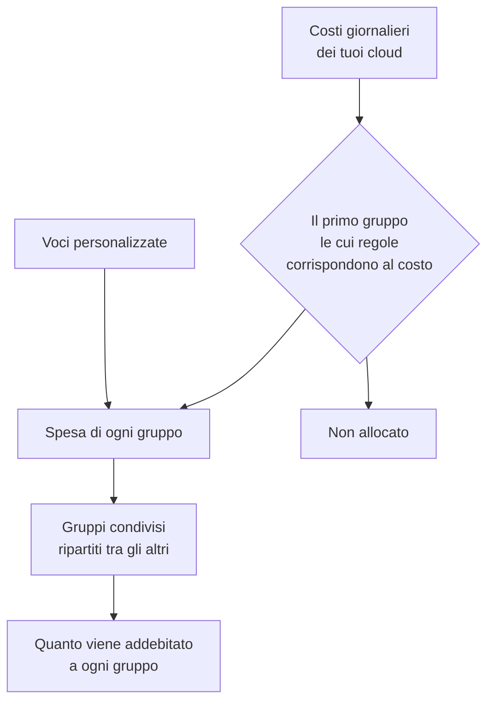

# Ripartizione dei costi del cloud

I gruppi di costi rispondono alla prima domanda di ogni fattura cloud mensile: chi ha speso? Una **vista dei costi** come «Per team» o «Per centro di costo» ripartisce la spesa dei tuoi account collegati in **gruppi di costi** secondo regole, senza contare nulla due volte. Ciò che nessuna regola prende resta ben visibile come spesa non allocata, e i costi condivisi vengono ripartiti tra i gruppi. Li trovi in **Cloud → Spesa → Gruppi di costi**.

:::cards
- [Creare una vista](#creare-una-vista): Per team dai proprietari che hai già impostato, per tag o con gruppi tuoi.
- [Scrivere le regole di un gruppo](#scrivere-le-regole-di-un-gruppo): Account, servizi, tag, team proprietari, etichette e altro.
- [Spesa non allocata](#spesa-non-allocata): Ciò che nessuna regola prende, e un clic per ripartirlo.
- [Costi condivisi](#costi-condivisi): Un piano di supporto o un cluster condiviso, ripartito tra i gruppi.
:::

## Come funziona



- **Il primo gruppo che corrisponde prende il costo.** I gruppi di una vista sono in ordine, e ogni costo va nel primo gruppo le cui regole gli corrispondono, quindi nulla viene contato due volte. I gruppi e la spesa non allocata danno sempre il totale del periodo.
- **Le regole leggono tutto ciò che un costo porta con sé.** L'account, il cloud, il servizio, la regione, la risorsa e i suoi tag, e ciò che OneUptime sa della risorsa: i suoi team proprietari, le sue etichette, il suo ambiente e la sua app delle piattaforme applicative.
- **Tutto viene calcolato quando guardi.** Non si scrive nulla per costo. Una regola che cambi ripartisce di nuovo ogni mese che OneUptime conserva, fino a 400 giorni indietro, senza nulla da attendere.
- **Più viste possono ripartire la stessa spesa.** «Per team» e «Per centro di costo» ripartiscono ciascuna tutta la spesa, a modo loro.

## Prima di iniziare

- **Costi che vengono letti.** [Collega un account cloud](/docs/telemetry/cloud-accounts) e lascia che [legga i suoi costi](/docs/telemetry/cloud-costs).
- **Tag o proprietari, se li vuoi.** Le regole sui tag richiedono costi che li portino; su AWS, attiva [Costi per risorsa](/docs/telemetry/cloud-costs#costi-per-risorsa). I team proprietari derivano dai proprietari di ogni risorsa, impostati a mano o con le [regole del proprietario](/docs/configuration/label-and-owner-rules).

## Creare una vista

Apri **Cloud → Spesa → Gruppi di costi**. A un progetto senza viste vengono proposti tre modi per iniziare:

| Inizio | Cosa crea |
| --- | --- |
| **Per team, dai proprietari** | Un gruppo per ogni team proprietario di risorse cloud, collegato al team. |
| **Per tag** | Un gruppo per ogni valore di un tag dei tuoi costi, come `team` o `cost-center`. |
| **I tuoi gruppi** | Una vista vuota. Scrivi tu le regole di ogni gruppo. |

OneUptime crea i gruppi di una vista per tag o per team proprietario quando la salvi, poi ogni ora man mano che compaiono nuovi valori di tag e proprietari. Puoi rinominare questi gruppi, collegarli a un team o condividerli. Le loro regole restano di OneUptime. Per creare subito i gruppi mancanti, apri la vista e premi **Crea gruppi ora**.

## Scrivere le regole di un gruppo

Apri una vista, poi **Crea: Gruppo di costi** in **Gruppi**. Un costo appartiene al gruppo quando **una qualsiasi** delle sue regole gli corrisponde, e una regola corrisponde quando corrispondono **tutte** le sue condizioni. Una condizione confronta qualcosa che un costo porta con i valori che scegli o digiti:

| Campo | Cosa legge |
| --- | --- |
| **Tag** | Il valore di un tag, tramite la chiave del tag. **è impostato** e **non è impostato** chiedono se il costo lo porta. |
| **Account** | L'account collegato a cui è addebitato il costo. |
| **Team proprietario** | I team proprietari della risorsa in OneUptime. |
| **Servizio** | Il servizio, come lo chiama la fatturazione del tuo cloud. |
| **Etichetta** | Le etichette della risorsa, o del suo account, in OneUptime. |
| **Regione** | La regione. Lascia vuoto il valore per un servizio globale. |
| **Cloud** | AWS, Azure o Google Cloud. |
| **Risorsa** | La risorsa, come la chiama il tuo cloud. |
| **Ambiente delle piattaforme applicative** e **App** | Quanto viene addebitato a un ambiente o a un'app, come lo conta **Cloud → Spesa → Costi**. |
| **Namespace Kubernetes** e **cluster Kubernetes** | I namespace di un cluster, quando un gruppo condiviso viene ripartito in base a essi. Vedi [Cluster Kubernetes](#cluster-kubernetes). |

Il testo viene confrontato senza distinguere maiuscole e minuscole: `Payments` e `payments` sono un solo team. La chiave di un tag viene confrontata così come è scritta, come la conservano i tuoi cloud.

Per esempio, un gruppo **Pagamenti** con tre regole prende un costo con il tag `team: payments`, **oppure** addebitato all'account payments, **oppure** di proprietà del team Pagamenti.

### L'ordine dei gruppi

Trascina i gruppi in **Gruppi** per cambiarne l'ordine. Un gruppo le cui regole sono già coperte da un gruppo precedente non può mai prendere un costo, e la sua riga dice quale gruppo prende tutto. Un gruppo le cui regole corrispondono anche a costi presi da un gruppo precedente dice quanto ne riceve.

### Risorse con più team proprietari

Una risorsa di due team viene divisa in parti uguali tra loro: la metà di ciascun team passa per le regole da sola. Una regola che non riguarda i proprietari, come un tag o un account, prende comunque l'intero costo. Una metà il cui team non ha un gruppo resta non allocata.

## Spesa non allocata

La pagina di una vista elenca ciò che nessuna regola prende ancora: i servizi, gli account, i valori di tag e i team proprietari che lo compongono, prima i più costosi. Premi **Aggiungi al gruppo** accanto a uno di essi per aggiungere una regola per esso a un gruppo, o a un nuovo gruppo. I suoi costi passano subito nel gruppo, anche quelli dei mesi passati.

## Costi condivisi

Un piano di supporto, un cluster condiviso o un hub di rete appartiene a tutti. Rendilo un gruppo a sé, poi in **Altri campi** attiva **Condiviso** e scegli come ripartire i suoi costi tra gli altri gruppi della vista:

| Ripartizione | Come |
| --- | --- |
| **Ripartisci per quota di spesa** | Ogni gruppo prende la sua quota della spesa cloud degli altri gruppi in quel mese. Un mese in cui non hanno speso nulla viene ripartito in parti uguali. |
| **Ripartisci in parti uguali** | Lo stesso importo a ogni gruppo. |
| **Ripartisci con percentuali fisse** | Le percentuali che imposti per ogni gruppo, che sommano a 100. |
| **Ripartisci per namespace Kubernetes** | Quanto è costato ogni namespace di un cluster in quel mese. Vedi sotto. |

I costi di un gruppo condiviso vengono ripartiti giorno per giorno con le quote di ogni mese, quindi un mese dà le stesse cifre letto per giorno o per mese. La spesa non allocata non riceve mai una quota.

### Cluster Kubernetes

I nodi di un cluster sono fatturati dal tuo cloud, mentre il motore dei costi del cluster dice quanto ha usato ogni namespace. Per addebitare a ogni team i suoi carichi di lavoro in un cluster condiviso:

1. Crea un gruppo le cui regole corrispondano ai nodi del cluster, per esempio **Tag** `eks:cluster-name` **è uno tra** `prod`.
2. Attiva **Condiviso**, scegli **Ripartisci per namespace Kubernetes** e seleziona il **Cluster Kubernetes**.
3. Dai ai gruppi dei team regole che leggono le label dei namespace, che contano come tag. Per esempio, **Tag** `team` **è uno tra** `payments`, oppure **Namespace Kubernetes** **inizia con** `payments-`.

Ogni mese, i costi dei nodi vengono ripartiti in base a quanto è costato ogni namespace nel [motore dei costi](/docs/telemetry/kubernetes-cost) del cluster, e la parte di ogni namespace va al primo gruppo le cui regole gli corrispondono. La capacità inutilizzata, e un namespace che nessun gruppo prende, restano al gruppo del cluster. I costi valorizzati del cluster non vengono mai aggiunti alla tua fattura, quindi nulla viene contato due volte.

## Voci personalizzate

In **Cloud → Spesa → Gruppi di costi → Voci personalizzate**, aggiungi un addebito o un credito che le fatture dei tuoi cloud non riportano: una quota di un contratto di supporto, uno sconto aziendale, un ricarico interno o una tariffa di piattaforma.

- **Una volta o ogni mese.** Una voce mensile è distribuita sui giorni di ogni mese, quindi una parte di mese ne prende la sua parte.
- **Su un account o un gruppo.** Una voce aggiunta a un account passa per le regole di ogni vista come i costi dell'account. Una voce aggiunta a un gruppo va direttamente a esso.
- **Sempre a parte.** Ogni cifra tiene le voci separate da quanto fatturato dai cloud, quindi le cifre dei cloud corrispondono ancora alle loro console.

## Vedere la spesa di ogni gruppo

- **Cloud → Spesa → Costi**: in **Dove vanno i soldi**, scegli **Gruppi di costi** e una vista. La spesa di ogni gruppo, rispetto al periodo precedente.
- **La pagina di una vista**: quanto è stato addebitato a ogni gruppo, con i suoi costi condivisi, ciò che nessuna regola prende, e **Scarica CSV** per il riaddebito del mese.
- **La pagina di un gruppo**: la sua spesa giorno per giorno, i servizi, le risorse e gli account che gli vengono addebitati di più, e le sue regole. Mostra solo la spesa di quel gruppo, quindi collega il gruppo al suo **Team** e invia al team la sua pagina: chiunque possa leggere la spesa cloud può aprirla.

## API, CLI e MCP

Viste, gruppi e voci sono risorse dell'API (`cloud-cost-view`, `cloud-cost-group`, `cloud-cost-line-item`), con comandi CLI e strumenti MCP come ogni risorsa. Le regole di un gruppo sono JSON:

```json
[
  { "conditions": [{ "field": "tag", "key": "team", "operator": "is", "values": ["payments"] }] },
  { "conditions": [{ "field": "ownerTeam", "operator": "is", "values": ["<team ID>"] }] }
]
```

Per leggere ciò che una vista ripartisce, per giorni UTC interi da `startDate` a `endDate`:

```bash
curl -X POST "https://oneuptime.com/api/cloud-cost-view/<view ID>/allocation" \
  -H "apikey: <API key>" -H "tenantid: <project ID>" -H "Content-Type: application/json" \
  -d '{"startDate": "2026-11-01", "endDate": "2026-11-30", "currency": "USD"}'
```

La risposta contiene il `total` di ogni gruppo e la sua composizione (`cloud`, `lineItems`, `sharedIn`, `sharedOut`), le sue cifre per giorno o per mese, il periodo precedente e la composizione della spesa non allocata. `POST /cloud-cost-group/<group ID>/spend` risponde per un solo gruppo.

## Limiti

- Una vista contiene al massimo 500 gruppi. Una vista per tag crea gruppi per i 500 valori più costosi.
- Un gruppo ha al massimo 25 regole, una regola 20 condizioni e una condizione 200 valori.
- I costi sono conservati per 400 giorni, quindi una vista legge al massimo 400 giorni.

## Risoluzione dei problemi

:::details Un gruppo non riceve nulla
Forse le sue regole non corrispondono ancora a nessun costo, oppure un gruppo precedente prende tutti i costi che corrispondono. La sua riga in **Gruppi** nomina allora quel gruppo: trascina questo sopra di esso, oppure restringi le regole del gruppo precedente.
:::

:::details Un costo è nel gruppo sbagliato
Un costo va nel primo gruppo le cui regole gli corrispondono. Trascina il gruppo a cui appartiene sopra il gruppo che lo prende, oppure restringi le regole di quel gruppo.
:::

:::details Una regola su un tag non corrisponde a nulla
Un costo conserva i tag che aveva quando è stato letto: le etichette di un'esportazione della fatturazione di Google Cloud, altrimenti i tag della risorsa a cui è addebitato, il che su AWS richiede [Costi per risorsa](/docs/telemetry/cloud-costs#costi-per-risorsa). La chiave di un tag viene confrontata così come è scritta.
:::

:::details A una vista per tag o per team proprietario manca un gruppo
OneUptime crea i gruppi mancanti ogni ora: uno per ogni valore di tag dei costi degli ultimi 400 giorni, o per ogni team proprietario di risorse cloud, fino a 500 gruppi. Premi **Crea gruppi ora** nella pagina della vista per crearli subito.
:::

:::details Le cifre escludono un account
Le cifre di una vista sono nella valuta in cui è fatturata la maggior parte dei tuoi account. Un account fatturato in un'altra ne resta escluso, così come una voce in un'altra valuta.
:::

## Prossimi passi

:::cards
- [Costi e risparmi del cloud](/docs/telemetry/cloud-costs): Quanto costano i tuoi account collegati e come spendere meno.
- [Regole per etichette e proprietari](/docs/configuration/label-and-owner-rules): Dai alle risorse team proprietari ed etichette che le regole leggono.
- [Osservabilità dei costi di Kubernetes](/docs/telemetry/kubernetes-cost): Quanto costa ogni carico di lavoro Kubernetes.
:::
