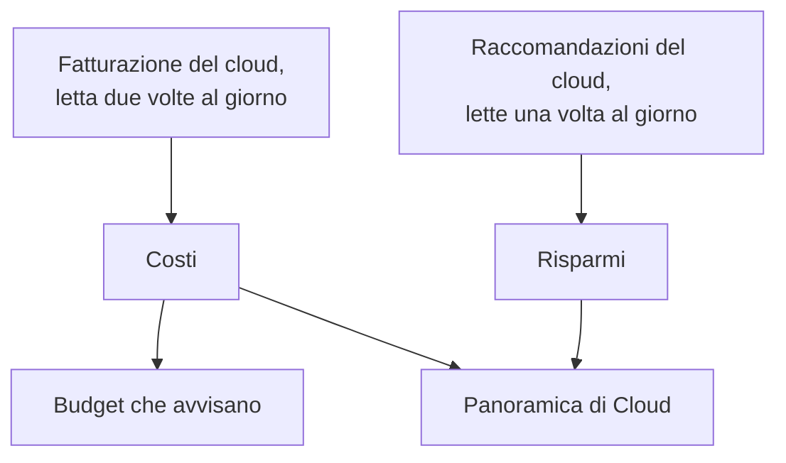

# Costi e risparmi del cloud

Un account cloud collegato dice anche quanto costa e come potrebbe costare meno. OneUptime legge i costi di ogni giorno dalla fatturazione del tuo cloud e le raccomandazioni del motore di raccomandazione del tuo cloud, li mostra in **Cloud → Spesa → Costi** e **Cloud → Spesa → Risparmi**, elenca i tuoi Savings Plans, le prenotazioni e gli sconti per impegno di utilizzo in **Cloud → Spesa → Impegni**, e avvisa prima che un mese costi più del suo budget in **Cloud → Spesa → Budget**.

:::cards
- [Amazon Web Services](#amazon-web-services): Cost Explorer e Cost Optimization Hub, ciascuno attivato una volta.
- [Microsoft Azure](#microsoft-azure): Cost Management e Azure Advisor, con un ruolo in più.
- [Google Cloud](#google-cloud): La tua esportazione della fatturazione verso BigQuery, e il Recommender.
- [Fatturato, ammortizzato e netto](#fatturato-ammortizzato-e-netto): Ogni costo in tre modi, perché impegni e crediti finiscano dove sono andati i soldi.
- [Impegni e rinnovi](#impegni-e-rinnovi): Ogni impegno, avvisi prima che uno termini o mentre è sottoutilizzato, e cosa rinnovare o acquistare.
- [Budget](#budget): Un avviso quando la spesa di un mese supera una quota del suo budget.
:::

## Come funziona



- **I costi vengono dalla fatturazione del tuo cloud.** AWS Cost Explorer, Azure Cost Management e l'esportazione della fatturazione di Google Cloud verso BigQuery, nella valuta in cui l'account viene fatturato, ognuno conservato fatturato, ammortizzato e netto: vedi [Fatturato, ammortizzato e netto](#fatturato-ammortizzato-e-netto). Ogni cifra è quella di un giorno, in giorni UTC, come li fattura il tuo cloud.
- **Un cloud segnala l'ultimo giorno o due in ritardo.** Ogni lettura riprende l'ultima settimana, e tutto il mese scorso nei primi giorni di un mese, così il costo di un giorno si assesta man mano che il tuo cloud lo chiude. La prima lettura di una connessione risale all'inizio del penultimo mese.
- **La proiezione del mese segue il ritmo dell'ultima settimana.** È quanto il mese è costato finora, con ogni giorno ancora da venire alla media degli ultimi sette giorni completi.
- **I risparmi vengono dal motore di raccomandazione del tuo cloud.** AWS Cost Optimization Hub, Azure Advisor e il Recommender di Google Cloud: una dimensione più piccola, una risorsa inattiva, un impegno che conviene, ciascuno con quanto farebbe risparmiare al mese. Una raccomandazione che applichi o scarti nella console del tuo cloud sparisce alla lettura successiva.

## Prima di iniziare

- **Un account collegato.** [Collegare un account cloud](/docs/telemetry/cloud-accounts) con il comando di configurazione attuale: permette alla connessione di leggere costi e raccomandazioni. Una connessione creata prima non legge né gli uni né le altre finché non ne esegui di nuovo il comando.

## Amazon Web Services

La connessione legge i costi con `ce:GetCostAndUsage`, i suoi impegni con `ce:GetSavingsPlansCoverage`, `ce:GetSavingsPlansUtilization`, `ce:GetSavingsPlansUtilizationDetails`, `ce:GetReservationCoverage` e `ce:GetReservationUtilization`, i Savings Plans acquistati con `savingsplans:DescribeSavingsPlans`, e le raccomandazioni con `cost-optimization-hub:ListRecommendations` e `cost-optimization-hub:GetRecommendation`. Il comando di configurazione concede le letture di Cost Explorer come tre famiglie, `ce:GetCostAndUsage*`, `ce:GetSavingsPlans*` e `ce:GetReservation*`, tutte letture, perché l'utente di una chiave di accesso stia ancora nei 2.048 caratteri che IAM consente alla sua policy. Cost Explorer e Cost Optimization Hub vanno prima attivati nell'account:

:::steps
### Attivare Cost Explorer

Apri Cost Explorer una volta nella console AWS Billing and Cost Management: AWS prepara i costi dell'account entro un giorno. Collega l'account di gestione dell'organizzazione per leggere i costi di ogni account membro.

### Attivare Cost Optimization Hub

Apri Cost Optimization Hub nella stessa console e attivalo, per l'organizzazione dal suo account di gestione o per il solo account. Le sue raccomandazioni arrivano entro un giorno.
:::

Cost Explorer addebita $0.01 per ogni richiesta: una lettura dei costi ne fa due o poche di più, una per fatturato e ammortizzato e una per netto, e gli impegni si leggono con quattro al giorno per la loro copertura e il loro utilizzo, e da sei a dodici in più al giorno per quelli di ciascuno. L'API Savings Plans e Cost Optimization Hub sono gratuiti.

### Costi per risorsa

Cost Explorer indica anche quanto costa ogni risorsa, per gli ultimi 14 giorni, una volta attivati i dati a livello di risorsa. Nella console AWS Billing and Cost Management, apri le preferenze di Cost Management e attiva i dati a livello di risorsa con granularità giornaliera, per l'organizzazione dal suo account di gestione. AWS li prepara entro 48 ore.

Poi modifica la connessione in **Cloud → Collega** e, in **Altri campi**, attiva **Costi per risorsa**. La connessione li legge con `ce:GetCostAndUsageWithResources` una volta al giorno: i 14 giorni la prima volta, poi di nuovo gli ultimi tre, con alcune richieste ogni volta. Ciò che legge resta con i costi dell'account dopo che Cost Explorer lo ha dimenticato. Una connessione creata prima deve eseguire di nuovo il suo comando di configurazione, che aggiunge l'azione.

## Microsoft Azure

L'app legge i costi con il ruolo **Cost Management Reader**, sullo stesso ambito di **Monitoring Reader**: il comando di configurazione assegna entrambi. Le raccomandazioni di Azure Advisor vengono lette con **Monitoring Reader**, quindi non c'è nulla da attivare. Per assegnare il ruolo a un'app creata prima, esegui:

```bash
az role assignment create --assignee <APP_ID> --role "Cost Management Reader" --scope /subscriptions/<SUBSCRIPTION_ID>
```

Cost Management risponde per ogni sottoscrizione, con la risorsa a cui si riferisce ogni costo, e leggerlo non costa nulla. Quando non può rispondere per una sottoscrizione, i **Costi** dell'account dicono perché.

Cost Management limita la velocità con cui si leggono i costi di un tenant, uguale per chiunque li legga: ogni query costa un'unità di elaborazione delle query (QPU) per ogni mese di dati che legge, e un tenant ha 12 QPU ogni 10 secondi, 60 al minuto e 600 all'ora. OneUptime legge le sottoscrizioni di un tenant una dopo l'altra entro i due terzi di ciascuna quota, attende quanto Cost Management chiede quando rifiuta una query e riprende alla lettura successiva da dove si era fermato. Una sottoscrizione non ancora letta dice **In coda**, con quando viene letta; una che ha già delle cifre le conserva nel frattempo. Il suo costo ammortizzato si legge a ogni lettura e il suo costo effettivo una volta al giorno, quindi la prima lettura di una sottoscrizione interroga Cost Management due volte e consuma il doppio delle unità di query: le prime cifre di un tenant grande richiedono qualche lettura in più.

Le prenotazioni e i piani di risparmio del tenant si leggono con **Reservations Reader** e **Savings plan Reader**, che Azure concede all'ambito del tenant stesso, dove solo un amministratore globale con accesso con privilegi elevati può assegnarli. Il comando di configurazione ci prova, e lo dice quando non può. Per assegnarli in seguito, come amministratore globale con accesso con privilegi elevati:

```bash
az role assignment create --assignee <APP_ID> --role "Reservations Reader" --scope /providers/Microsoft.Capacity
az role assignment create --assignee <APP_ID> --role "Savings plan Reader" --scope /providers/Microsoft.BillingBenefits
```

Senza di essi, costi e raccomandazioni si leggono come prima, e **Cloud → Spesa → Impegni** dice quale ruolo assegnare.

## Google Cloud

Google Cloud non ha un'API per i costi di un progetto: OneUptime li legge dall'esportazione del tuo account di fatturazione verso BigQuery.

:::steps
### Esportare la fatturazione verso BigQuery

Nella console di Google Cloud, apri Billing, poi Billing export, e attiva l'esportazione del costo di utilizzo dettagliato verso un dataset BigQuery. Google la scrive con qualche ora di ritardo, dal giorno in cui la attivi.

### Lasciare che l'account di servizio la legga

Assegna all'account di servizio della connessione **BigQuery Data Viewer** sul dataset dell'esportazione. Il comando di configurazione gli ha già assegnato **BigQuery Job User**, per eseguire la query nel suo progetto.

### Indicare la tabella dell'esportazione

Modifica la connessione in **Cloud → Collega** e, in **Altri campi**, imposta **Tabella dell'esportazione della fatturazione** sul nome completo della tabella: `<PROJECT_ID>.<DATASET>.gcp_billing_export_resource_v1_<BILLING_ACCOUNT_ID>`.
:::

L'esportazione dettagliata indica la risorsa a cui si riferisce ogni costo; quella standard dice solo il servizio e la regione. BigQuery addebita la query: il primo 1 TiB al mese è gratuito, poi $6.25 per TiB, e un mese di esportazione va da qualche megabyte a qualche gigabyte. Le raccomandazioni del Recommender su tipi di macchina e risorse inattive vengono lette con **Compute Recommender Viewer**, che il comando di configurazione assegna, e non costano nulla. Gli impegni di Compute Engine vengono elencati da Cloud Asset Inventory con **Cloud Asset Viewer**, che il comando di configurazione assegna già: non serve altro.

## Fatturato, ammortizzato e netto

Ogni costo viene conservato in tre modi, e **Cloud → Spesa → Costi**, i **Costi** di un account, la panoramica di Cloud e i budget mostrano quello che scegli:

- **Fatturato** è ogni addebito il giorno in cui il tuo cloud lo ha fatturato, prima di crediti e rimborsi. Un Savings Plan o una prenotazione pagati in anticipo sono un unico grande addebito il giorno dell'acquisto, e l'utilizzo che coprono sembra gratuito per il resto della durata.
- **Ammortizzato** distribuisce le commissioni di ogni impegno sui giorni e sulle risorse che copre, perché i soldi finiscano dove sono stati spesi. Sempre prima di crediti e rimborsi. È ciò che mostrano le pagine, a meno che tu non ne scelga un altro.
- **Netto** è l'ammortizzato, meno crediti, rimborsi e sconti: l'importo della fattura.

| | Fatturato | Ammortizzato | Netto |
|---|---|---|---|
| AWS | Il costo non combinato (unblended) di Cost Explorer | Il costo ammortizzato di Cost Explorer | Il costo ammortizzato netto di Cost Explorer, con crediti e rimborsi |
| Azure | Il costo effettivo di Cost Management | Il costo ammortizzato di Cost Management | Il costo ammortizzato: Azure sottrae i crediti sull'account di fatturazione, che la connessione di una sottoscrizione non legge |
| Google Cloud | Il costo dell'esportazione | Il costo meno i crediti degli sconti per impegno di utilizzo e degli abbonamenti | Il costo meno ogni credito |

Il selettore sopra le cifre cambia la base nella pagina, e OneUptime ricorda la tua scelta per questo progetto, nel tuo browser. La base del progetto, quella con cui si aprono le pagine e che i budget osservano, si trova in **Cloud → Impostazioni → Impostazioni dei costi**. Un budget può osservare una base propria: modificalo e imposta **Base di costo**.

I costi letti prima che i tre venissero conservati mostrano la loro cifra fatturata su ogni base. Ogni connessione rilegge i suoi costi una volta, fino a quanto risale una prima lettura, perché ogni base si riempia.

## Modi per spendere meno

**Cloud → Spesa → Risparmi** elenca ogni raccomandazione, il risparmio maggiore per primo: cosa fare, su quale risorsa, cosa cambierebbe e quanto fa risparmiare al mese. La fascia sopra le somma, in totale e per tipo: una dimensione più piccola, una risorsa inattiva, un impegno. Una raccomandazione rimanda alla pagina della sua risorsa quando OneUptime ha la risorsa.

### Ridimensionamento dalle letture di OneUptime

Una risorsa di cui nessun motore di raccomandazione si occupa, perché non è attivo, non copre il suo tipo o la ritiene troppo nuova, viene dimensionata da OneUptime in base alle letture di CPU e memoria che la sua connessione ha raccolto negli ultimi 14 giorni. OneUptime dimensiona istanze EC2, database RDS e cluster ElastiCache su AWS, macchine virtuali, server flessibili PostgreSQL e MySQL e piani App Service su Azure, e VM di Compute Engine e istanze Cloud SQL su Google Cloud:

- **Sovradimensionato** quando la dimensione grande la metà, o un quarto, avrebbe ancora margine: sulla dimensione più piccola, il 95° percentile della sua CPU sarebbe al massimo del 60%, la sua lettura di CPU più alta al massimo del 100% e il picco della sua memoria al massimo del 70%, quando la sua memoria viene letta.
- **Sottodimensionato** quando il 95° percentile della sua CPU è all'85% o più, o il picco della sua memoria al 90% o più: la dimensione grande il doppio.

Una risorsa viene dimensionata appena ha 6 giorni di letture. La sua pagina mostra il suo **Ridimensionamento** accanto a quanto costa, e una sovradimensionata compare in **Cloud → Spesa → Risparmi**, con OneUptime come fonte. Quanto fa risparmiare una modifica è la sua quota di quanto la risorsa è costata negli ultimi 30 giorni, quindi si conosce appena il tuo cloud fattura la risorsa per nome: l'esportazione dettagliata di Azure e di Google Cloud lo fa, e AWS anche, una volta attivato Costi per risorsa. Un'istanza EC2 riporta la sua memoria solo con l'agente CloudWatch, e una VM di Compute Engine solo con l'Ops Agent: senza, viene dimensionata solo in base alla CPU. Le dimensioni burstable, come t3, la serie B ed e2-micro, non vengono mai dimensionate.

### Impegni

**Cloud → Spesa → Risparmi** e i **Costi** di un account mostrano quanta parte della spesa degli ultimi 30 giorni hanno pagato gli impegni di ogni account, e quanto di essi è stato usato, una riga per tipo:

- AWS: Savings Plans e istanze riservate, da Cost Explorer. L'account di gestione di un'organizzazione li legge per ogni account dell'organizzazione.
- Azure: piani di risparmio e prenotazioni, da Cost Management, in costo ammortizzato.
- Google Cloud: sconti per impegno di utilizzo, dalla tua esportazione della fatturazione. L'esportazione non dice quanto di un impegno è rimasto inutilizzato, quindi quanto se ne usa non viene mostrato.

Un account senza impegni indica ciò che è stato eseguito a tariffe on demand e che un impegno pagherebbe a un prezzo più basso. Le cifre di ogni tipo sono quelle del suo cloud, e i tipi non vengono mai sommati: una prenotazione e un Savings Plan possono entrambi contare la spesa della stessa macchina come propria da coprire. Ogni impegno singolarmente è elencato in **Cloud → Spesa → Impegni**: vedi [Impegni e rinnovi](#impegni-e-rinnovi).

## Impegni e rinnovi

**Cloud → Spesa → Impegni** elenca ogni Savings Plan, prenotazione e sconto per impegno di utilizzo che le tue connessioni possono leggere, perché nessuno termini inosservato:

- **Impegni attivi**, in alto, conta quelli attivi e quelli che terminano entro 90 giorni, **Utilizzo** quanto ne è stato usato negli ultimi 30 giorni e quanto è rimasto inutilizzato, e **Copertura** quanta parte della spesa coprono.
- **In scadenza** elenca quelli che terminano entro 90 giorni e non si rinnovano da soli, ciascuno con il suo piano di rinnovo: cosa acquistare per mantenere il suo sconto (il suo impegno orario, o le sue istanze, nella quota che è stata usata), quanto costa e fa risparmiare al mese, quando si ripaga, e quanta parte della spesa è coperta ora e una volta terminato. **Rinnova nella console** apre la pagina in cui il tuo cloud lo rinnova.
- **Tutti gli impegni** è l'elenco completo: cos'è e cosa copre ciascuno, il suo account, quando termina, la sua durata e l'opzione di pagamento, quanto ne è stato usato negli ultimi 30 giorni, e l'utilizzo che ha pagato e quanto ha fatto risparmiare.
- **Piani di acquisto** sono ciò che il motore di raccomandazione del tuo cloud suggerisce di acquistare, ciascuno con quanto costerebbe e farebbe risparmiare al mese, quando si ripagherebbe e come cambierebbe la copertura. **Acquista nella console** apre la pagina in cui acquistarlo.
- Sotto, gli impegni di ogni account per tipo, come li mostrano i suoi **Costi**, e quando avvisano gli impegni, con **Modifica avvisi**.

OneUptime pianifica soltanto: non acquista, rinnova né restituisce mai un impegno. Acquisti tu nella console del tuo cloud.

| | Da dove vengono gli impegni | Cosa si sa di ciascuno |
|---|---|---|
| AWS | I Savings Plans e le istanze riservate di Cost Explorer, ciascuno con il proprio utilizzo, e l'API Savings Plans per i piani acquistati, compresi quelli in coda per iniziare | La sua fine, la durata, l'opzione di pagamento, l'impegno orario o le istanze, le commissioni e l'utilizzo negli ultimi 30 e 7 giorni |
| Azure | Le prenotazioni e i piani di risparmio del tenant | La sua fine, la durata, il piano di fatturazione, se si rinnova da solo, e l'utilizzo negli ultimi 30 e 7 giorni |
| Google Cloud | Gli impegni di Compute Engine, da Cloud Asset Inventory | La sua fine, il piano, le risorse e se si rinnova da solo. Google Cloud non dice quanto di un impegno viene usato |

L'account di gestione di un'organizzazione elenca quelli di ogni account su AWS. Gli sconti per impegno di utilizzo basati sulla spesa, che Google Cloud tiene sull'account di fatturazione anziché in un progetto, non sono ancora elencati.

### Avvisi sugli impegni

Gli impegni generano avvisi, che chiamano tramite le policy di reperibilità come ogni avviso. In **Cloud → Impostazioni → Impostazioni dei costi**, **Avvisi sugli impegni** dice quando:

- **Avvisa prima della fine di un impegno**: per cominciare 90, 30 e 7 giorni prima della sua fine. Un avviso al più vicino di quei giorni che l'impegno ha raggiunto, e ogni più vicino sostituisce il precedente. Un impegno che si rinnova da solo, o il cui rinnovo è in coda per iniziare alla sua fine, non ne genera.
- **Avvisa quando l'utilizzo è inferiore a**: per cominciare 80%, degli ultimi 7 giorni di un impegno, una volta che è stato attivo una settimana. L'avviso si risolve quando il suo utilizzo torna.
- **Avvisa quando la copertura scende sotto**: per cominciare 60%, della spesa che gli impegni di un tipo di un account potrebbero coprire, dopo averne coperta di più. Si risolve quando la copertura torna. Se è vuoto, la copertura non genera avvisi.

**Avvisa sugli impegni** li disattiva tutti, e **Gravità avviso**, **Policy di reperibilità** e **Proprietari** dicono quanto sono gravi, chi viene chiamato e a chi appartengono. Ogni avviso dice cosa copre l'impegno e cosa ha pagato, e rimanda al suo piano di rinnovo. Un avviso si risolve da solo quando il suo impegno termina, si rinnova o non è più elencato.

## Budget

:::steps
### Creare un budget

In **Cloud → Spesa → Budget**, crea un budget: il suo **Importo mensile**, l'**Account** a cui si riferisce, o nessuno per tutti gli account, e la **Base di costo** che conta, o nessuna per quella del progetto.

### Scegliere quando avvisa

**Avvisa al** prende le quote del budget a cui avvisare, in percentuale: 80 e 100 per iniziare. **Avvisa se si avvia al superamento** avvisa anche, una volta al mese, quando il ritmo dell'ultima settimana porterebbe il mese oltre il budget. **Avvisa nei giorni insoliti** avvisa anche il giorno dopo un giorno costato molto più del solito: vedi [Giorni insoliti](#giorni-insoliti). **Gravità avviso** e **Policy di reperibilità** dicono quanto sono gravi gli avvisi e chi viene chiamato.
:::

Un budget viene controllato dopo ogni lettura dei costi e ogni ora. Quando la spesa del mese supera una soglia, viene generato un avviso per essa, la più alta se una lettura ne supera diverse insieme, e un nuovo mese risolve gli avvisi del mese scorso. Un budget conta solo gli account fatturati nella sua valuta, sulla sua base: un budget ammortizzato non scatta per un impegno acquistato in anticipo, che uno fatturato conta il giorno dell'acquisto.

Gli agenti IA possono creare e modificare i budget tramite il [server MCP](/docs/ai/mcp-server), e gli script con il comando `oneuptime cloud-budget` della CLI: vedi [Operazioni sulle risorse](/docs/cli/resource-operations).

### Giorni insoliti

Dopo ogni lettura, ciascuno degli ultimi 14 giorni completi di un account viene confrontato con i 14 giorni precedenti. Un giorno è insolito quando un servizio è costato il doppio del suo giorno abituale o più, o l'intero account una volta e mezza il suo giorno abituale o più. In entrambi i casi servono almeno 10 in più del solito, nella valuta dell'account, e almeno il 5% del giorno abituale dell'account, così che pochi centesimi non contino mai come un picco. Il valore abituale di un giorno è la mediana dei 14 giorni precedenti, quindi un picco isolato lo sposta poco, e un account viene giudicato solo quando ha una settimana di costi.

**Cloud → Spesa → Costi** segna i giorni insoliti sulla spesa giornaliera, sopra le loro barre, e li elenca sotto. Su tutti gli account, ogni segno apre i **Costi** del suo account. Un budget che include l'account genera un avviso per ogni account e giorno, il giorno dopo, nominando ogni servizio che è salito. Un picco che dura più giorni viene segnalato il giorno in cui è iniziato, e un giorno di più di una settimana fa non viene segnalato. Un budget creato prima che esistessero questi avvisi non li genera finché non lo modifichi e li attivi.

## Dove vanno i soldi

**Cloud → Spesa → Costi** suddivide la spesa di un periodo per servizio, regione, account o risorsa, e in altri tre modi:

- Per ambiente delle piattaforme applicative: il servizio di piattaforma di ogni ambiente nel suo account e nella sua regione, come Amazon ECS o Cloud Run, e le risorse di un ambiente Elastic Beanstalk in base al tag che AWS gli assegna.
- Per app: ciò che una piattaforma addebita a un'app per nome, come un servizio Cloud Run o una Container App. Amazon ECS addebita i suoi task e App Service i suoi piani, quindi i costi delle loro app restano del loro ambiente.
- Per tag: ogni valore del tag che scegli. Un costo mantiene i tag che aveva quando è stato letto: le etichette di un'esportazione della fatturazione di Google Cloud, altrimenti i tag della risorsa a cui è addebitato, il che su AWS richiede Costi per risorsa.

Sotto l'elenco, la scheda dice a quanto è ammontato il resto: ciò che non è in nessun ambiente, ciò che è addebitato a un ambiente nel suo insieme o ciò che non ha il tag. I costi letti prima che i tag venissero conservati vengono riletti una volta, fin dove arriva una prima lettura, così che i loro tag si completino.

## Cosa vedi in OneUptime

- **La panoramica di Cloud.** **Cloud → Panoramica** mostra la spesa del mese rispetto a quella del mese scorso allo stesso giorno, i servizi che costano di più e i modi maggiori per spendere meno, accanto a ciò che richiede attenzione.
- **La spesa di ogni giorno.** **Cloud → Spesa → Costi** disegna ciascuno degli ultimi 30 giorni segnando i giorni costati molto più del solito, elenca quei giorni e suddivide un periodo per servizio, regione, account, risorsa, ambiente delle piattaforme applicative, app o tag, fatturato, ammortizzato o netto. Gli account i cui costi non vengono letti sono elencati sotto, ciascuno con il motivo.
- **Ogni impegno.** **Cloud → Spesa → Impegni** elenca ciascuno con quando termina e quanto ne viene usato, quelli in scadenza con cosa rinnovare, e cosa acquistare.
- **I costi di un account.** I **Costi** di un account mostrano lo stesso per il solo account, con i suoi impegni e i suoi modi per spendere meno.
- **Il costo di una risorsa.** La pagina di una risorsa mostra quanto è costata questo mese e negli ultimi 30 giorni quando il suo cloud la fattura per nome, con i suoi modi per spendere meno e il suo ridimensionamento.

## Risoluzione dei problemi

:::details Un account dice Serve un'autorizzazione
La connessione non può ancora leggere i costi dell'account. Esegui di nuovo il suo comando di configurazione da **Cloud → Collega**: aggiunge ciò che serve per leggere i costi. Su Google Cloud, assegna anche all'account di servizio **BigQuery Data Viewer** sul dataset dell'esportazione.
:::

:::details Un account dice Non configurato
Il suo cloud non ha ancora costi da fornire. Su AWS, attiva Cost Explorer; su Google Cloud, indica la tabella dell'esportazione in **Tabella dell'esportazione della fatturazione**. Le prime cifre arrivano con la lettura successiva, entro 12 ore.
:::

:::details Un account dice In coda
I suoi costi aspettano il loro turno: Azure Cost Management limita la velocità con cui si leggono i costi di un tenant. L'account dice quando vengono letti, alla prima lettura della connessione da quel momento, e non c'è nulla da fare. Un account che ha già delle cifre le conserva nel frattempo.
:::

:::details Costi per risorsa dice Non configurato
I dati a livello di risorsa non sono attivati per l'account. Attivali con granularità giornaliera nelle preferenze di Cost Management della console AWS Billing and Cost Management, dall'account di gestione dell'organizzazione per i suoi membri. AWS li prepara entro 48 ore, e la lettura del giorno dopo li prende.
:::

:::details Gli impegni dicono Serve un'autorizzazione
La connessione non può ancora leggere i Savings Plans e le prenotazioni dell'account. Esegui di nuovo il suo comando di configurazione da **Cloud → Collega**: aggiunge le azioni con cui vengono letti. Su Azure, un amministratore globale con accesso con privilegi elevati assegna **Reservations Reader** e **Savings plan Reader**: vedi [Microsoft Azure](#microsoft-azure).
:::

:::details Ammortizzato e netto mostrano lo stesso di fatturato
I costi letti prima che i tre venissero conservati mostrano la loro cifra fatturata su ogni base fino alla prossima lettura dei costi della connessione, che li rilegge fino a quanto risale la sua prima. Su Azure, il netto è sempre il costo ammortizzato.
:::

:::details Un impegno termina e non è arrivato nessun avviso
Un impegno che si rinnova da solo, o il cui rinnovo è in coda per iniziare alla sua fine, non ne genera, e nemmeno uno di un progetto i cui avvisi sugli impegni sono disattivati in **Cloud → Impostazioni → Impostazioni dei costi**. Un avviso richiede anche che il progetto abbia una gravità avviso.
:::

:::details Le cifre lasciano fuori un account
Le cifre sono nella valuta in cui viene fatturata la maggior parte dei tuoi account. Un account fatturato in un'altra è elencato sotto con la sua valuta, e un budget conta solo gli account fatturati nella sua.
:::

:::details Questo mese è più basso che nella console del tuo cloud
Il tuo cloud segnala l'ultimo giorno o due in ritardo, e le cifre fatturate e ammortizzate sono prima di crediti e rimborsi. Le letture successive recuperano. Confronta con la base che mostra la console del tuo cloud: AWS si apre sui costi non combinati, cioè fatturati.
:::

## Prossimi passi

:::cards
- [Collegare un account cloud](/docs/telemetry/cloud-accounts): Collega un altro account, o esegui di nuovo il suo comando.
- [Risorse cloud](/docs/telemetry/cloud-resources): Le metriche di ogni risorsa, da un tuo collector.
- [Osservabilità dei costi di Kubernetes](/docs/telemetry/kubernetes-cost): Quanto costa ogni carico di lavoro Kubernetes.
:::
