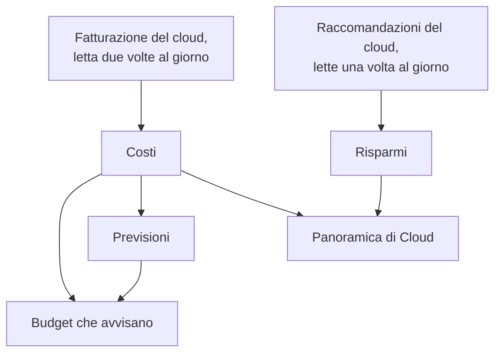

# Costi e risparmi del cloud

Un account cloud collegato dice anche quanto costa e come potrebbe costare meno. OneUptime legge i costi di ogni giorno dalla fatturazione del tuo cloud e le raccomandazioni del motore di raccomandazione del tuo cloud, li mostra in **Cloud → Spesa → Costi** e **Cloud → Spesa → Risparmi**, elenca i tuoi Savings Plans, le prenotazioni e gli sconti per impegno di utilizzo in **Cloud → Spesa → Impegni**, ti avvisa in **Cloud → Spesa → Budget** prima che un mese, un trimestre o un anno costi più del suo budget, e prevede i prossimi mesi in **Cloud → Spesa → Previsione**. Se glielo permetti, realizza anche i risparmi approvati da un proprietario, ferma le risorse non di produzione fuori dall'orario di lavoro e verifica ogni modifica sulla fattura.

:::cards
- [Amazon Web Services](#amazon-web-services): Cost Explorer e Cost Optimization Hub, ciascuno attivato una volta.
- [Microsoft Azure](#microsoft-azure): Cost Management e Azure Advisor, con un ruolo in più.
- [Google Cloud](#google-cloud): La tua esportazione della fatturazione verso BigQuery, e il Recommender.
- [Fatturato, ammortizzato e netto](#fatturato-ammortizzato-e-netto): Ogni costo in tre modi, perché impegni e crediti finiscano dove sono andati i soldi.
- [Impegni e rinnovi](#impegni-e-rinnovi): Ogni impegno, avvisi prima che uno termini o mentre è sottoutilizzato, e cosa rinnovare o acquistare.
- [Realizzare i risparmi](#realizzare-i-risparmi): Applica un risparmio con l'approvazione del suo proprietario, e annullalo.
- [Pianificazioni fuori orario](#pianificazioni-fuori-orario): Ferma le risorse non di produzione di notte e nei fine settimana.
- [Regole IA per i risparmi](#regole-ia-per-i-risparmi): Proposte per i proprietari, o modifiche entro un limite.
- [Budget](#budget): Il budget di un mese, di un trimestre o di un anno per qualsiasi account, gruppo di costi o servizio.
- [Previsioni](#previsioni): Quanto i prossimi 12 mesi sono in rotta per costare, e con quanta certezza.
:::

## Come funziona



- **I costi vengono dalla fatturazione del tuo cloud.** AWS Cost Explorer, Azure Cost Management e l'esportazione della fatturazione di Google Cloud verso BigQuery, nella valuta in cui l'account viene fatturato, ognuno conservato fatturato, ammortizzato e netto: vedi [Fatturato, ammortizzato e netto](#fatturato-ammortizzato-e-netto). Ogni cifra è quella di un giorno, in giorni UTC, come li fattura il tuo cloud.
- **Un cloud segnala l'ultimo giorno o due in ritardo.** Ogni lettura riprende l'ultima settimana, e tutto il mese scorso nei primi giorni di un mese, così il costo di un giorno si assesta man mano che il tuo cloud lo chiude. La prima lettura di una connessione risale all'inizio del penultimo mese.
- **La proiezione del mese segue il ritmo dell'ultima settimana.** È quanto il mese è costato finora, con ogni giorno ancora da venire alla media degli ultimi sette giorni completi.
- **I risparmi vengono dal motore di raccomandazione del tuo cloud.** AWS Cost Optimization Hub, Azure Advisor e il Recommender di Google Cloud: una dimensione più piccola, una risorsa inattiva, un impegno che conviene, ciascuno con quanto farebbe risparmiare al mese. Una raccomandazione che applichi o scarti nella console del tuo cloud sparisce alla lettura successiva.

## Prima di iniziare

- **Un account collegato.** [Collegare un account cloud](/docs/telemetry/cloud-accounts) con il comando di configurazione attuale: permette alla connessione di leggere costi e raccomandazioni. Una connessione creata prima non legge né gli uni né le altre finché non ne esegui di nuovo il comando.

## Amazon Web Services

La connessione legge i costi con `ce:GetCostAndUsage`, i suoi impegni con `ce:GetSavingsPlansCoverage`, `ce:GetSavingsPlansUtilization`, `ce:GetSavingsPlansUtilizationDetails`, `ce:GetReservationCoverage` e `ce:GetReservationUtilization`, i Savings Plans acquistati con `savingsplans:DescribeSavingsPlans`, e le raccomandazioni con `cost-optimization-hub:ListRecommendations` e `cost-optimization-hub:GetRecommendation`. Il comando di configurazione concede le letture di Cost Explorer come tre famiglie, `ce:GetCostAndUsage*`, `ce:GetSavingsPlans*` e `ce:GetReservation*`, tutte letture, perché l'utente di una chiave di accesso stia ancora nei 2.048 caratteri che IAM consente alla sua policy. Cost Explorer e Cost Optimization Hub vanno prima attivati nell'account:

:::steps
### Attivare Cost Explorer

Apri Cost Explorer una volta nella console AWS Billing and Cost Management: AWS prepara i costi dell'account entro un giorno. Collega l'account di gestione dell'organizzazione per leggere i costi di ogni account membro.

### Attivare Cost Optimization Hub

Apri Cost Optimization Hub nella stessa console e attivalo, per l'organizzazione dal suo account di gestione o per il solo account. Le sue raccomandazioni arrivano entro un giorno.
:::

Cost Explorer addebita $0.01 per ogni richiesta: una lettura dei costi ne fa due o poche di più, una per fatturato e ammortizzato e una per netto, e gli impegni si leggono con quattro al giorno per la loro copertura e il loro utilizzo, e da sei a dodici in più al giorno per quelli di ciascuno. L'API Savings Plans e Cost Optimization Hub sono gratuiti.

### Costi per risorsa

Cost Explorer indica anche quanto costa ogni risorsa, per gli ultimi 14 giorni, una volta attivati i dati a livello di risorsa. Nella console AWS Billing and Cost Management, apri le preferenze di Cost Management e attiva i dati a livello di risorsa con granularità giornaliera, per l'organizzazione dal suo account di gestione. AWS li prepara entro 48 ore.

Poi modifica la connessione in **Cloud → Collega** e, in **Altri campi**, attiva **Costi per risorsa**. La connessione li legge con `ce:GetCostAndUsageWithResources` una volta al giorno: i 14 giorni la prima volta, poi di nuovo gli ultimi tre, con alcune richieste ogni volta. Ciò che legge resta con i costi dell'account dopo che Cost Explorer lo ha dimenticato. Una connessione creata prima deve eseguire di nuovo il suo comando di configurazione, che aggiunge l'azione.

## Microsoft Azure

L'app legge i costi con il ruolo **Cost Management Reader**, sullo stesso ambito di **Monitoring Reader**: il comando di configurazione assegna entrambi. Le raccomandazioni di Azure Advisor vengono lette con **Monitoring Reader**, quindi non c'è nulla da attivare. Per assegnare il ruolo a un'app creata prima, esegui:

```bash
az role assignment create --assignee <APP_ID> --role "Cost Management Reader" --scope /subscriptions/<SUBSCRIPTION_ID>
```

Cost Management risponde per ogni sottoscrizione, con la risorsa a cui si riferisce ogni costo, e leggerlo non costa nulla. Quando non può rispondere per una sottoscrizione, i **Costi** dell'account dicono perché.

Cost Management limita la velocità con cui si leggono i costi di un tenant, uguale per chiunque li legga: ogni query costa un'unità di elaborazione delle query (QPU) per ogni mese di dati che legge, e un tenant ha 12 QPU ogni 10 secondi, 60 al minuto e 600 all'ora. OneUptime legge le sottoscrizioni di un tenant una dopo l'altra entro i due terzi di ciascuna quota, attende quanto Cost Management chiede quando rifiuta una query e riprende alla lettura successiva da dove si era fermato. Una sottoscrizione non ancora letta dice **In coda**, con quando viene letta; una che ha già delle cifre le conserva nel frattempo. Il suo costo ammortizzato si legge a ogni lettura e il suo costo effettivo una volta al giorno, quindi la prima lettura di una sottoscrizione interroga Cost Management due volte e consuma il doppio delle unità di query: le prime cifre di un tenant grande richiedono qualche lettura in più.

Le prenotazioni e i piani di risparmio del tenant si leggono con **Reservations Reader** e **Savings plan Reader**, che Azure concede all'ambito del tenant stesso, dove solo un amministratore globale con accesso con privilegi elevati può assegnarli. Il comando di configurazione ci prova, e lo dice quando non può. Per assegnarli in seguito, come amministratore globale con accesso con privilegi elevati:

```bash
az role assignment create --assignee <APP_ID> --role "Reservations Reader" --scope /providers/Microsoft.Capacity
az role assignment create --assignee <APP_ID> --role "Savings plan Reader" --scope /providers/Microsoft.BillingBenefits
```

Senza di essi, costi e raccomandazioni si leggono come prima, e **Cloud → Spesa → Impegni** dice quale ruolo assegnare.

## Google Cloud

Google Cloud non ha un'API per i costi di un progetto: OneUptime li legge dall'esportazione del tuo account di fatturazione verso BigQuery.

:::steps
### Esportare la fatturazione verso BigQuery

Nella console di Google Cloud, apri Billing, poi Billing export, e attiva l'esportazione del costo di utilizzo dettagliato verso un dataset BigQuery. Google la scrive con qualche ora di ritardo, dal giorno in cui la attivi.

### Lasciare che l'account di servizio la legga

Assegna all'account di servizio della connessione **BigQuery Data Viewer** sul dataset dell'esportazione. Il comando di configurazione gli ha già assegnato **BigQuery Job User**, per eseguire la query nel suo progetto.

### Indicare la tabella dell'esportazione

Modifica la connessione in **Cloud → Collega** e, in **Altri campi**, imposta **Tabella dell'esportazione della fatturazione** sul nome completo della tabella: `<PROJECT_ID>.<DATASET>.gcp_billing_export_resource_v1_<BILLING_ACCOUNT_ID>`.
:::

L'esportazione dettagliata indica la risorsa a cui si riferisce ogni costo; quella standard dice solo il servizio e la regione. BigQuery addebita la query: il primo 1 TiB al mese è gratuito, poi $6.25 per TiB, e un mese di esportazione va da qualche megabyte a qualche gigabyte. Le raccomandazioni del Recommender su tipi di macchina e risorse inattive vengono lette con **Compute Recommender Viewer**, che il comando di configurazione assegna, e non costano nulla. Gli impegni di Compute Engine vengono elencati da Cloud Asset Inventory con **Cloud Asset Viewer**, che il comando di configurazione assegna già: non serve altro.

## Fatturato, ammortizzato e netto

Ogni costo viene conservato in tre modi, e **Cloud → Spesa → Costi**, i **Costi** di un account, la panoramica di Cloud e i budget mostrano quello che scegli:

- **Fatturato** è ogni addebito il giorno in cui il tuo cloud lo ha fatturato, prima di crediti e rimborsi. Un Savings Plan o una prenotazione pagati in anticipo sono un unico grande addebito il giorno dell'acquisto, e l'utilizzo che coprono sembra gratuito per il resto della durata.
- **Ammortizzato** distribuisce le commissioni di ogni impegno sui giorni e sulle risorse che copre, perché i soldi finiscano dove sono stati spesi. Sempre prima di crediti e rimborsi. È ciò che mostrano le pagine, a meno che tu non ne scelga un altro.
- **Netto** è l'ammortizzato, meno crediti, rimborsi e sconti: l'importo della fattura.

| | Fatturato | Ammortizzato | Netto |
|---|---|---|---|
| AWS | Il costo non combinato (unblended) di Cost Explorer | Il costo ammortizzato di Cost Explorer | Il costo ammortizzato netto di Cost Explorer, con crediti e rimborsi |
| Azure | Il costo effettivo di Cost Management | Il costo ammortizzato di Cost Management | Il costo ammortizzato: Azure sottrae i crediti sull'account di fatturazione, che la connessione di una sottoscrizione non legge |
| Google Cloud | Il costo dell'esportazione | Il costo meno i crediti degli sconti per impegno di utilizzo e degli abbonamenti | Il costo meno ogni credito |

Il selettore sopra le cifre cambia la base nella pagina, e OneUptime ricorda la tua scelta per questo progetto, nel tuo browser. La base del progetto, quella con cui si aprono le pagine e che i budget osservano, si trova in **Cloud → Impostazioni → Impostazioni dei costi**. Un budget può osservare una base propria: modificalo e imposta **Base di costo**.

I costi letti prima che i tre venissero conservati mostrano la loro cifra fatturata su ogni base. Ogni connessione rilegge i suoi costi una volta, fino a quanto risale una prima lettura, perché ogni base si riempia.

## Modi per spendere meno

**Cloud → Spesa → Risparmi** elenca ogni raccomandazione, il risparmio maggiore per primo: cosa fare, su quale risorsa, cosa cambierebbe e quanto fa risparmiare al mese. La fascia sopra le somma, in totale e per tipo: una dimensione più piccola, una risorsa inattiva, un impegno. Una raccomandazione rimanda alla pagina della sua risorsa quando OneUptime ha la risorsa, e una che OneUptime può realizzare ha **Applica**: vedi [Realizzare i risparmi](#realizzare-i-risparmi).

### Ridimensionamento dalle letture di OneUptime

Una risorsa di cui nessun motore di raccomandazione si occupa, perché non è attivo, non copre il suo tipo o la ritiene troppo nuova, viene dimensionata da OneUptime in base alle letture di CPU e memoria che la sua connessione ha raccolto negli ultimi 14 giorni. OneUptime dimensiona istanze EC2, database RDS e cluster ElastiCache su AWS, macchine virtuali, server flessibili PostgreSQL e MySQL e piani App Service su Azure, e VM di Compute Engine e istanze Cloud SQL su Google Cloud:

- **Sovradimensionato** quando la dimensione grande la metà, o un quarto, avrebbe ancora margine: sulla dimensione più piccola, il 95° percentile della sua CPU sarebbe al massimo del 60%, la sua lettura di CPU più alta al massimo del 100% e il picco della sua memoria al massimo del 70%, quando la sua memoria viene letta.
- **Sottodimensionato** quando il 95° percentile della sua CPU è all'85% o più, o il picco della sua memoria al 90% o più: la dimensione grande il doppio.

Una risorsa viene dimensionata appena ha 6 giorni di letture. La sua pagina mostra il suo **Ridimensionamento** accanto a quanto costa, e una sovradimensionata compare in **Cloud → Spesa → Risparmi**, con OneUptime come fonte. Quanto fa risparmiare una modifica è la sua quota di quanto la risorsa è costata negli ultimi 30 giorni, quindi si conosce appena il tuo cloud fattura la risorsa per nome: l'esportazione dettagliata di Azure e di Google Cloud lo fa, e AWS anche, una volta attivato Costi per risorsa. Un'istanza EC2 riporta la sua memoria solo con l'agente CloudWatch, e una VM di Compute Engine solo con l'Ops Agent: senza, viene dimensionata solo in base alla CPU. Le dimensioni burstable, come t3, la serie B ed e2-micro, non vengono mai dimensionate.

### Impegni

**Cloud → Spesa → Risparmi** e i **Costi** di un account mostrano quanta parte della spesa degli ultimi 30 giorni hanno pagato gli impegni di ogni account, e quanto di essi è stato usato, una riga per tipo:

- AWS: Savings Plans e istanze riservate, da Cost Explorer. L'account di gestione di un'organizzazione li legge per ogni account dell'organizzazione.
- Azure: piani di risparmio e prenotazioni, da Cost Management, in costo ammortizzato.
- Google Cloud: sconti per impegno di utilizzo, dalla tua esportazione della fatturazione. L'esportazione non dice quanto di un impegno è rimasto inutilizzato, quindi quanto se ne usa non viene mostrato.

Un account senza impegni indica ciò che è stato eseguito a tariffe on demand e che un impegno pagherebbe a un prezzo più basso. Le cifre di ogni tipo sono quelle del suo cloud, e i tipi non vengono mai sommati: una prenotazione e un Savings Plan possono entrambi contare la spesa della stessa macchina come propria da coprire. Ogni impegno singolarmente è elencato in **Cloud → Spesa → Impegni**: vedi [Impegni e rinnovi](#impegni-e-rinnovi).

## Impegni e rinnovi

**Cloud → Spesa → Impegni** elenca ogni Savings Plan, prenotazione e sconto per impegno di utilizzo che le tue connessioni possono leggere, perché nessuno termini inosservato:

- **Impegni attivi**, in alto, conta quelli attivi e quelli che terminano entro 90 giorni, **Utilizzo** quanto ne è stato usato negli ultimi 30 giorni e quanto è rimasto inutilizzato, e **Copertura** quanta parte della spesa coprono.
- **In scadenza** elenca quelli che terminano entro 90 giorni e non si rinnovano da soli, ciascuno con il suo piano di rinnovo: cosa acquistare per mantenere il suo sconto (il suo impegno orario, o le sue istanze, nella quota che è stata usata), quanto costa e fa risparmiare al mese, quando si ripaga, e quanta parte della spesa è coperta ora e una volta terminato. **Rinnova nella console** apre la pagina in cui il tuo cloud lo rinnova.
- **Tutti gli impegni** è l'elenco completo: cos'è e cosa copre ciascuno, il suo account, quando termina, la sua durata e l'opzione di pagamento, quanto ne è stato usato negli ultimi 30 giorni, e l'utilizzo che ha pagato e quanto ha fatto risparmiare.
- **Piani di acquisto** sono ciò che il motore di raccomandazione del tuo cloud suggerisce di acquistare, ciascuno con quanto costerebbe e farebbe risparmiare al mese, quando si ripagherebbe e come cambierebbe la copertura. **Acquista nella console** apre la pagina in cui acquistarlo.
- Sotto, gli impegni di ogni account per tipo, come li mostrano i suoi **Costi**, e quando avvisano gli impegni, con **Modifica avvisi**.

OneUptime pianifica soltanto: non acquista, rinnova né restituisce mai un impegno. Acquisti tu nella console del tuo cloud.

| | Da dove vengono gli impegni | Cosa si sa di ciascuno |
|---|---|---|
| AWS | I Savings Plans e le istanze riservate di Cost Explorer, ciascuno con il proprio utilizzo, e l'API Savings Plans per i piani acquistati, compresi quelli in coda per iniziare | La sua fine, la durata, l'opzione di pagamento, l'impegno orario o le istanze, le commissioni e l'utilizzo negli ultimi 30 e 7 giorni |
| Azure | Le prenotazioni e i piani di risparmio del tenant | La sua fine, la durata, il piano di fatturazione, se si rinnova da solo, e l'utilizzo negli ultimi 30 e 7 giorni |
| Google Cloud | Gli impegni di Compute Engine, da Cloud Asset Inventory | La sua fine, il piano, le risorse e se si rinnova da solo. Google Cloud non dice quanto di un impegno viene usato |

L'account di gestione di un'organizzazione elenca quelli di ogni account su AWS. Gli sconti per impegno di utilizzo basati sulla spesa, che Google Cloud tiene sull'account di fatturazione anziché in un progetto, non sono ancora elencati.

### Avvisi sugli impegni

Gli impegni generano avvisi, che chiamano tramite le policy di reperibilità come ogni avviso. In **Cloud → Impostazioni → Impostazioni dei costi**, **Avvisi sugli impegni** dice quando:

- **Avvisa prima della fine di un impegno**: per cominciare 90, 30 e 7 giorni prima della sua fine. Un avviso al più vicino di quei giorni che l'impegno ha raggiunto, e ogni più vicino sostituisce il precedente. Un impegno che si rinnova da solo, o il cui rinnovo è in coda per iniziare alla sua fine, non ne genera.
- **Avvisa quando l'utilizzo è inferiore a**: per cominciare 80%, degli ultimi 7 giorni di un impegno, una volta che è stato attivo una settimana. L'avviso si risolve quando il suo utilizzo torna.
- **Avvisa quando la copertura scende sotto**: per cominciare 60%, della spesa che gli impegni di un tipo di un account potrebbero coprire, dopo averne coperta di più. Si risolve quando la copertura torna. Se è vuoto, la copertura non genera avvisi.

**Avvisa sugli impegni** li disattiva tutti, e **Gravità avviso**, **Policy di reperibilità** e **Proprietari** dicono quanto sono gravi, chi viene chiamato e a chi appartengono. Ogni avviso dice cosa copre l'impegno e cosa ha pagato, e rimanda al suo piano di rinnovo. Un avviso si risolve da solo quando il suo impegno termina, si rinnova o non è più elencato.

## Realizzare i risparmi

OneUptime realizza un risparmio tramite la connessione cloud dell'account non appena la sua impostazione **Azioni di risparmio** lo consente: [Azioni di risparmio](/docs/telemetry/cloud-accounts#azioni-di-risparmio) spiega cosa concede ogni scelta. Fa solo modifiche in un passaggio: ferma un'istanza o un database inattivo, passa un volume gp2 a gp3, elimina un disco non collegato, una vecchia istantanea o un'immagine inutilizzata, rilascia un indirizzo inutilizzato e, se lo consenti, ridimensiona un'istanza o un database alla dimensione consigliata. Non acquista mai un impegno: **Acquista nella console** apre la pagina del tuo cloud per farlo.

:::steps
### Scegli Applica

In **Cloud → Spesa → Risparmi**, scegli **Applica** su un risparmio. La finestra di dialogo dice cosa cambia, quanto fa risparmiare al mese, come si annulla o che non si può, e chi lo approva.

### Un proprietario la approva

Approva la modifica una persona indicata come proprietaria della risorsa, o un membro di un team che la possiede, che possa anche modificarla. Una risorsa senza proprietario viene approvata da un Proprietario del progetto o un Amministratore del progetto. Se puoi approvarla tu, **Applica** la effettua subito, a tuo nome. Altrimenti attende in **In attesa di approvazione** che un proprietario scelga **Approva**, oppure **Nascondi** con un motivo.

### OneUptime la effettua

La modifica passa dalla connessione ed è nelle cronologie della risorsa e dell'account, con chi l'ha approvata. Di un disco eliminato viene prima creata un'istantanea finale, a meno che tu non disattivi **Crea prima un'istantanea finale**.
:::

Ogni modifica dice come si annulla: **Annulla** in **Modifiche effettuate** riavvia un'istanza fermata, riporta un volume o una dimensione a com'erano, o ricrea un disco eliminato dalla sua istantanea finale. Ciò che elimina per sempre, come un'istantanea, un'immagine o un indirizzo rilasciato, non può essere annullato, e la finestra di dialogo lo dice prima che tu lo applichi. Dove il progetto chiede due approvazioni con **Richiedi due approvazioni per le correzioni più rischiose**, una modifica che non si può annullare richiede due persone.

Una risorsa i cui tag dicono che è gestita come codice, ad esempio da Terraform o CloudFormation, viene invece modificata nel suo codice: la finestra di dialogo offre **Apri pull request** verso il repository che la dichiara, così il prossimo apply non annulla il risparmio.

### Dimostrato dalla fattura

**Risparmiato questo mese** conta solo ciò che mostra la fattura del tuo cloud. Non appena tre giorni dopo una modifica si sono assestati sulla fattura, il costo giornaliero della risorsa viene confrontato con la settimana prima della modifica: è **Visibile nella fattura** quando il costo è sceso almeno di un quarto di quanto promesso, **Non visibile nella fattura** quando no, e **Non misurabile** quando il tuo cloud non fattura la risorsa per nome. **Verifica della fattura** conta le modifiche che attendono ancora quei giorni.

## Pianificazioni fuori orario

In **Cloud → Spesa → Pianificazioni**, una pianificazione ferma istanze e database non di produzione fuori dall'orario di lavoro, e li riavvia:

:::steps
### Scegli le risorse

Indica il tag cloud che le sceglie, ad esempio `Schedule` = `office-hours`, in un account o in tutti.

### Di' quando sono in esecuzione

Scegli i giorni lavorativi, l'ora in cui si avviano e quella in cui si fermano, nel formato 24 ore, e il fuso orario.
:::

Quando finisce l'orario di lavoro, una pianificazione ferma, tramite la connessione del suo account, ogni risorsa in esecuzione che il suo tag sceglie e che è nota per non essere di produzione, e quando inizia riavvia solo ciò che ha fermato: una risorsa che qualcuno ha fermato a mano resta ferma. **Vedi le risorse** elenca cosa sceglie ora una pianificazione e perché ne lascia qualcuna in esecuzione. Ferma le istanze EC2 e i database RDS su AWS, le macchine virtuali su Azure e le istanze Compute Engine su Google Cloud. AWS riavvia da solo un database fermo da sette giorni.

Una pianificazione non ferma mai la produzione, né una risorsa il cui ambiente nulla indica. Una risorsa è nota per non essere di produzione quando:

- uno dei suoi tag lo dice, con una chiave come `environment`, `env`, `stage`, `tier` o `deployment.environment` e una parola come `dev`, `test`, `qa`, `staging` o `sandbox`;
- il suo account è segnato come **Non di produzione** in **Ambiente** nelle **Impostazioni** dell'account;
- oppure una delle sue etichette lo dice, ad esempio `Staging` o `env: dev`.

Vince la produzione: un tag che dice `prod`, `production` o `live`, o un account segnato come **Produzione**, mantiene una risorsa in esecuzione, qualunque cosa dica il resto. Il nome di una risorsa non viene mai letto per questo. Disattiva una pianificazione e non ferma più nulla, e riavvia ciò che ha fermato quando inizia il suo orario di lavoro; eliminala e ciò che ha fermato viene riavviato subito.

## Regole IA per i risparmi

Con **Abilita IA** attivo, OneUptime AI propone ai proprietari della risorsa ogni risparmio che può realizzare, dopo ogni lettura dei risparmi dell'account, e loro lo approvano o lo rifiutano in **In attesa di approvazione**. In **Cloud → Impostazioni → Regole IA per i risparmi**, una regola dice cosa fa OneUptime AI con i risparmi che corrispondono, per tipo di modifica, ambiente della risorsa e cloud: **Disattivato**, **Proponi al proprietario** o **Agisci senza chiedere**, fino a un limite mensile. Senza regole, ogni risparmio viene proposto e nessuno effettuato; con le regole, solo ciò che corrisponde a una regola, e tra le regole che corrispondono vince la più prudente.

Una regola agisce senza chiedere solo su una risorsa nota per non essere di produzione, solo per una modifica che si può annullare, solo fino al limite più basso delle regole che corrispondono, e al massimo 10 volte all'ora in un progetto: tutto il resto viene proposto. Una modifica effettuata senza chiedere è nelle cronologie con la regola che l'ha effettuata, e i suoi proprietari possono annullarla. Un risparmio rifiutato o annullato non viene proposto di nuovo per 30 giorni.

## Budget

:::steps
### Creare un budget

In **Cloud → Spesa → Budget**, crea un budget e scegli a cosa **Si applica a**: tutti gli account, un **Account**, un **Gruppo di costi** come le sue regole ripartiscono la spesa, o i servizi, le regioni e i tag che un **Filtro** nomina, scritto come le regole di un gruppo di costi. Lascia vuota la sua **Base di costo** per contare quella del progetto.

### Indica quanto può costare

Il suo **Periodo** è un mese, un trimestre o un anno, e il suo **Importo** è quanto può costare un periodo. Trimestri e anni iniziano nel **Primo mese dell'anno**: da aprile, un anno va da aprile a marzo. Il **Piano di budget** di un anno può dividere il suo importo equamente tra i suoi mesi, o dare a ogni mese il suo in un **Piano mensile**. Ogni mese è allora tenuto alla sua quota, così un mese tranquillo non riceve mai avvisi per la spesa di un mese intenso.

### Scegliere quando avvisa

**Avvisa al** prende le quote del budget a cui agire, in percentuale: 80 e 100 per cominciare. **Avvisa se si avvia al superamento** avvisa anche, una volta per periodo, quando il periodo è in rotta per costare più del budget. **Avvisa nei giorni insoliti** avvisa anche il giorno dopo un giorno che è costato molto più del solito: vedi [Giorni insoliti](#giorni-insoliti). **Gravità avviso** dice quanto sono gravi i suoi avvisi.

### Scegli chi viene informato

Le persone e i team in **Notifica** vengono informati via e-mail e chat quando la spesa supera una quota sotto il 100%, senza avviso, così nessuno viene chiamato per una spesa entro il budget. **Informa il team del gruppo di costi** informa anche il team a cui appartiene il gruppo di costi. Dal 100% viene creato un avviso, ne sono proprietari, e le **Policy di reperibilità** vengono chiamate. Un budget senza nessuno da informare crea un avviso a ogni quota.
:::

Un budget viene verificato dopo ogni lettura dei costi e ogni ora. Quando la spesa del periodo supera una quota, le persone da notificare vengono informate, o dal 100% viene creato un avviso, una volta per la più alta quando una lettura ne supera più d'una insieme, e un nuovo periodo risolve gli avvisi del periodo precedente. Un anno diviso per mese viene verificato un mese alla volta, rispetto alla quota di quel mese. Un budget conta solo gli account fatturati nella sua valuta, sulla sua base: un budget ammortizzato non scatta per un impegno acquistato in anticipo, che un budget fatturato conta il giorno dell'acquisto.

Un periodo è in rotta per superare il budget quando quanto è costato finora, il resto di questo mese al ritmo dell'ultima settimana intera e i mesi successivi di un trimestre o di un anno secondo la [previsione](#previsioni) superano insieme il budget.

La riga di ogni budget dice cosa conta, il suo periodo e il periodo finora: per un anno diviso per mese, questo mese rispetto alla sua quota, con l'anno accanto. La sua pagina mostra il periodo mese per mese rispetto alla quota di ogni mese, questo mese giorno per giorno, cosa è costato di più e chi viene informato. La pagina di un budget annuale può salvare la sua previsione come suo piano.

Gli agenti IA possono creare e modificare i budget tramite il [server MCP](/docs/ai/mcp-server), e gli script con il comando `oneuptime cloud-budget` della CLI: vedi [Operazioni sulle risorse](/docs/cli/resource-operations).

### Giorni insoliti

Dopo ogni lettura, ciascuno degli ultimi 14 giorni completi di un account viene confrontato con i 14 giorni precedenti. Un giorno è insolito quando un servizio è costato il doppio del suo giorno abituale o più, o l'intero account una volta e mezza il suo giorno abituale o più. In entrambi i casi servono almeno 10 in più del solito, nella valuta dell'account, e almeno il 5% del giorno abituale dell'account, così che pochi centesimi non contino mai come un picco. Il valore abituale di un giorno è la mediana dei 14 giorni precedenti, quindi un picco isolato lo sposta poco, e un account viene giudicato solo quando ha una settimana di costi.

**Cloud → Spesa → Costi** segna i giorni insoliti sulla spesa giornaliera, sopra le loro barre, e li elenca sotto. Su tutti gli account, ogni segno apre i **Costi** del suo account. Un budget mensile per tutti gli account o per uno crea un avviso per ogni account e giorno, il giorno dopo, nominando ogni servizio salito. Ogni altro budget misura ciò che conta sul proprio giorno abituale allo stesso modo. Un picco che dura giorni viene segnalato il giorno in cui è iniziato, e un giorno di più di una settimana fa non viene segnalato. Un budget creato prima di questi avvisi non li crea finché non lo modifichi e li attivi.

## Previsioni

**Cloud → Spesa → Previsione** dice quanto la spesa è in rotta per costare in ciascuno dei prossimi 12 mesi, per tutto, un account, un gruppo di costi o un servizio, sulla base di costo che scegli. Dice come viene fatta ogni previsione, dai mesi interi di costi che OneUptime conserva, un anno o poco più:

- **Questo mese** è quanto è costato finora, con ogni giorno che resta alla media degli ultimi sette giorni interi, come lo proietta un budget.
- **Con meno di 3 mesi interi**, ogni mese successivo prosegue quel ritmo, senza intervallo probabile: è stato letto troppo poco per distinguere una tendenza da un picco isolato.
- **Da 3 mesi interi**, una tendenza passa per il giorno medio di ogni mese: la mediana delle pendenze tra ogni coppia di mesi, così un mese anomalo la sposta appena.
- **Da 12 mesi interi**, ogni mese del calendario conserva anche quanto è stato sopra o sotto la tendenza l'anno scorso, così un picco di dicembre viene previsto anche per il dicembre successivo.

Ogni mese successivo ha un intervallo probabile, in cui dovrebbe cadere 8 volte su 10, ricavato da quanto i mesi passati si sono scostati dalla loro tendenza, e mai più stretto del 5% per lato. Si allarga quanto più un mese è lontano e quanti meno mesi ha alle spalle la previsione. Da 12 mesi interi, ogni intervallo è ancora più ampio, perché un anno mostra ogni mese del calendario una sola volta. Una previsione non è una promessa: un nuovo servizio, una migrazione o un cambio di prezzo muovono i prossimi mesi in modi che nessun mese passato mostra.

**Simulazione** fa crescere o calare ogni mese successivo dal mese che scegli, della quota che digiti, come il 20% da gennaio. **Salva come piano di budget** fa dei prossimi dodici mesi il piano di un budget annuale, in un budget nuovo o in uno esistente, con ogni mese tenuto alla sua quota prevista.

## Budget e previsioni nell'API

I budget sono una risorsa dell'API (`cloud-budget`), con comandi CLI e strumenti MCP come ogni risorsa. Lo `scope` di un budget è `allAccounts`, `account` (con `cloudAccountId`), `costGroup` (con `cloudCostGroupId`) o `filter` (con `filterRules`, scritto come le regole di un gruppo di costi). Il suo `period` è `month`, `quarter` o `year`, da `fiscalYearStartMonth`, da 1 a 12. Il `planSplit` di un anno è `none`, `equal` o `byMonth`, con i suoi dodici mesi in `monthlyPlan`, nell'ordine dell'anno fiscale.

Per leggere il periodo di un budget mese per mese, i giorni di questo mese e cosa è costato di più, come fa la sua pagina:

```bash
curl -X POST "https://oneuptime.com/api/cloud-budget/<budget ID>/spend" \
  -H "apikey: <API key>" -H "tenantid: <project ID>"
```

Per prevedere un ambito, da 1 a 24 mesi in avanti, con una simulazione facoltativa:

```bash
curl -X POST "https://oneuptime.com/api/cloud-budget/forecast" \
  -H "apikey: <API key>" -H "tenantid: <project ID>" -H "Content-Type: application/json" \
  -d '{"scope": "costGroup", "cloudCostGroupId": "<group ID>", "monthsAhead": 12, "growth": {"percent": 20, "fromMonth": "2027-01"}}'
```

Il `forecast` della risposta ha il suo `method` (`pace`, `trend` o `trendAndSeason`), i mesi da cui è stata fatta e ogni mese con il suo `amount` e, per quelli successivi, il suo `low` e il suo `high`. Invia `basis` come `billed`, `amortized` o `net` per prevedere su quella base; senza, la previsione è su quella del progetto, e il `basis` della risposta dice quale. La spesa di un budget è sulla sua base.

## Dove vanno i soldi

**Cloud → Spesa → Costi** suddivide la spesa di un periodo per servizio, regione, account o risorsa, e in altri tre modi:

- Per ambiente delle piattaforme applicative: il servizio di piattaforma di ogni ambiente nel suo account e nella sua regione, come Amazon ECS o Cloud Run, e le risorse di un ambiente Elastic Beanstalk in base al tag che AWS gli assegna.
- Per app: ciò che una piattaforma addebita a un'app per nome, come un servizio Cloud Run o una Container App. Amazon ECS addebita i suoi task e App Service i suoi piani, quindi i costi delle loro app restano del loro ambiente.
- Per tag: ogni valore del tag che scegli. Un costo mantiene i tag che aveva quando è stato letto: le etichette di un'esportazione della fatturazione di Google Cloud, altrimenti i tag della risorsa a cui è addebitato, il che su AWS richiede Costi per risorsa.

Sotto l'elenco, la scheda dice a quanto è ammontato il resto: ciò che non è in nessun ambiente, ciò che è addebitato a un ambiente nel suo insieme o ciò che non ha il tag. I costi letti prima che i tag venissero conservati vengono riletti una volta, fin dove arriva una prima lettura, così che i loro tag si completino.

## Cosa vedi in OneUptime

- **La panoramica di Cloud.** **Cloud → Panoramica** mostra la spesa del mese rispetto a quella del mese scorso allo stesso giorno, i servizi che costano di più e i modi maggiori per spendere meno, accanto a ciò che richiede attenzione.
- **La spesa di ogni giorno.** **Cloud → Spesa → Costi** disegna ciascuno degli ultimi 30 giorni segnando i giorni costati molto più del solito, elenca quei giorni e suddivide un periodo per servizio, regione, account, risorsa, ambiente delle piattaforme applicative, app o tag, fatturato, ammortizzato o netto. Gli account i cui costi non vengono letti sono elencati sotto, ciascuno con il motivo.
- **Ogni impegno.** **Cloud → Spesa → Impegni** elenca ciascuno con quando termina e quanto ne viene usato, quelli in scadenza con cosa rinnovare, e cosa acquistare.
- **I costi di un account.** I **Costi** di un account mostrano lo stesso per il solo account, con i suoi impegni e i suoi modi per spendere meno.
- **Il costo di una risorsa.** La pagina di una risorsa mostra quanto è costata questo mese e negli ultimi 30 giorni quando il suo cloud la fattura per nome, con i suoi modi per spendere meno e il suo ridimensionamento.
- **Ogni budget.** **Cloud → Spesa → Budget** elenca ogni budget con ciò che conta, il suo periodo e il periodo finora, e ognuno apre la sua pagina.
- **I prossimi mesi.** **Cloud → Spesa → Previsione** disegna i mesi da cui è stata fatta una previsione, questo mese in rotta e i prossimi 12, con come è stata fatta.
- **Cosa è stato risparmiato.** **Cloud → Spesa → Risparmi** si apre su quanto le modifiche effettuate hanno fatto risparmiare questo mese, secondo la fattura, sulle modifiche in attesa di approvazione e quelle effettuate, e sulle ore in cui le pianificazioni hanno fermato le risorse.

## Risoluzione dei problemi

:::details Un account dice Serve un'autorizzazione
La connessione non può ancora leggere i costi dell'account. Esegui di nuovo il suo comando di configurazione da **Cloud → Collega**: aggiunge ciò che serve per leggere i costi. Su Google Cloud, assegna anche all'account di servizio **BigQuery Data Viewer** sul dataset dell'esportazione.
:::

:::details Un account dice Non configurato
Il suo cloud non ha ancora costi da fornire. Su AWS, attiva Cost Explorer; su Google Cloud, indica la tabella dell'esportazione in **Tabella dell'esportazione della fatturazione**. Le prime cifre arrivano con la lettura successiva, entro 12 ore.
:::

:::details Un account dice In coda
I suoi costi aspettano il loro turno: Azure Cost Management limita la velocità con cui si leggono i costi di un tenant. L'account dice quando vengono letti, alla prima lettura della connessione da quel momento, e non c'è nulla da fare. Un account che ha già delle cifre le conserva nel frattempo.
:::

:::details Costi per risorsa dice Non configurato
I dati a livello di risorsa non sono attivati per l'account. Attivali con granularità giornaliera nelle preferenze di Cost Management della console AWS Billing and Cost Management, dall'account di gestione dell'organizzazione per i suoi membri. AWS li prepara entro 48 ore, e la lettura del giorno dopo li prende.
:::

:::details Gli impegni dicono Serve un'autorizzazione
La connessione non può ancora leggere i Savings Plans e le prenotazioni dell'account. Esegui di nuovo il suo comando di configurazione da **Cloud → Collega**: aggiunge le azioni con cui vengono letti. Su Azure, un amministratore globale con accesso con privilegi elevati assegna **Reservations Reader** e **Savings plan Reader**: vedi [Microsoft Azure](#microsoft-azure).
:::

:::details Ammortizzato e netto mostrano lo stesso di fatturato
I costi letti prima che i tre venissero conservati mostrano la loro cifra fatturata su ogni base fino alla prossima lettura dei costi della connessione, che li rilegge fino a quanto risale la sua prima. Su Azure, il netto è sempre il costo ammortizzato.
:::

:::details Un impegno termina e non è arrivato nessun avviso
Un impegno che si rinnova da solo, o il cui rinnovo è in coda per iniziare alla sua fine, non ne genera, e nemmeno uno di un progetto i cui avvisi sugli impegni sono disattivati in **Cloud → Impostazioni → Impostazioni dei costi**. Un avviso richiede anche che il progetto abbia una gravità avviso.
:::

:::details Le cifre lasciano fuori un account
Le cifre sono nella valuta in cui viene fatturata la maggior parte dei tuoi account. Un account fatturato in un'altra è elencato sotto con la sua valuta, e un budget conta solo gli account fatturati nella sua.
:::

:::details Un risparmio non ha Applica
OneUptime fa solo modifiche in un passaggio: un impegno, o una raccomandazione che cambia più di una cosa, si fa nella console del tuo cloud. Applica apre una finestra che dice perché non si può fare da qui quando la connessione dell'account non lo consente: attiva le sue **Azioni di risparmio** ed esegui di nuovo il suo comando di configurazione.
:::

:::details Una pianificazione lascia una risorsa in esecuzione
**Vedi le risorse** dice perché: è di produzione, nulla indica che non sia di produzione, o la connessione del suo account non consente le azioni di risparmio. Aggiungi un tag, ad esempio `environment` = `dev`, oppure segna il suo account come **Non di produzione**.
:::

:::details Una previsione non ha un intervallo probabile
È stata fatta da meno di 3 mesi interi di costi, quindi ogni mese successivo prosegue il ritmo dell'ultima settimana intera e non viene dato alcun intervallo. L'intervallo arriva appena viene letto il terzo mese intero. La prima lettura di una connessione risale all'inizio del mese prima di quello scorso.
:::

:::details Qualcuno è stato informato di un budget ma non è arrivato alcun avviso
Sotto il 100%, un budget che nomina persone o team da notificare li informa e non crea alcun avviso, così nessuno viene chiamato. Dal 100% crea un avviso, e le sue policy di reperibilità vengono chiamate. Un budget senza nessuno da informare crea un avviso a ogni quota.
:::

:::details Questo mese è più basso che nella console del tuo cloud
Il tuo cloud segnala l'ultimo giorno o due in ritardo, e le cifre fatturate e ammortizzate sono prima di crediti e rimborsi. Le letture successive recuperano. Confronta con la base che mostra la console del tuo cloud: AWS si apre sui costi non combinati, cioè fatturati.
:::

## Prossimi passi

:::cards
- [Ripartizione dei costi del cloud](/docs/telemetry/cloud-cost-allocation): Ripartisci la spesa tra team, prodotti e centri di costo.
- [Collegare un account cloud](/docs/telemetry/cloud-accounts): Collega un altro account, o esegui di nuovo il suo comando.
- [Risorse cloud](/docs/telemetry/cloud-resources): Le metriche di ogni risorsa, da un tuo collector.
- [Osservabilità dei costi di Kubernetes](/docs/telemetry/kubernetes-cost): Quanto costa ogni carico di lavoro Kubernetes.
:::
