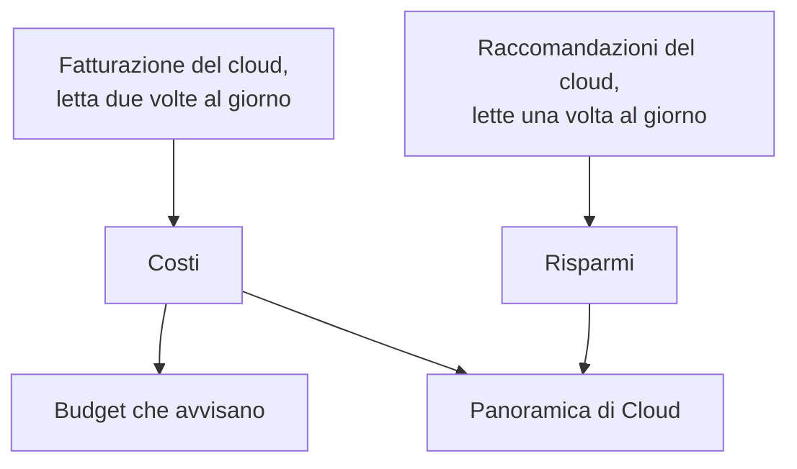

# Costi e risparmi del cloud

Un account cloud collegato dice anche quanto costa e come potrebbe costare meno. OneUptime legge i costi di ogni giorno dalla fatturazione del tuo cloud e le raccomandazioni del motore di raccomandazione del tuo cloud, li mostra in **Cloud → Spesa → Costi** e **Cloud → Spesa → Risparmi**, e avvisa prima che un mese costi più del suo budget in **Cloud → Spesa → Budget**.

:::cards
- [Amazon Web Services](#amazon-web-services): Cost Explorer e Cost Optimization Hub, ciascuno attivato una volta.
- [Microsoft Azure](#microsoft-azure): Cost Management e Azure Advisor, con un ruolo in più.
- [Google Cloud](#google-cloud): La tua esportazione della fatturazione verso BigQuery, e il Recommender.
- [Budget](#budget): Un avviso quando la spesa di un mese supera una quota del suo budget.
:::

## Come funziona



- **I costi vengono dalla fatturazione del tuo cloud.** AWS Cost Explorer, Azure Cost Management e l'esportazione della fatturazione di Google Cloud verso BigQuery, prima di crediti e rimborsi, nella valuta in cui l'account viene fatturato. Ogni cifra è quella di un giorno, in giorni UTC, come li fattura il tuo cloud.
- **Un cloud segnala l'ultimo giorno o due in ritardo.** Ogni lettura riprende l'ultima settimana, e tutto il mese scorso nei primi giorni di un mese, così il costo di un giorno si assesta man mano che il tuo cloud lo chiude. La prima lettura di una connessione risale all'inizio del penultimo mese.
- **La proiezione del mese segue il ritmo dell'ultima settimana.** È quanto il mese è costato finora, con ogni giorno ancora da venire alla media degli ultimi sette giorni completi.
- **I risparmi vengono dal motore di raccomandazione del tuo cloud.** AWS Cost Optimization Hub, Azure Advisor e il Recommender di Google Cloud: una dimensione più piccola, una risorsa inattiva, un impegno che conviene, ciascuno con quanto farebbe risparmiare al mese. Una raccomandazione che applichi o scarti nella console del tuo cloud sparisce alla lettura successiva.

## Prima di iniziare

- **Un account collegato.** [Collegare un account cloud](/docs/telemetry/cloud-accounts) con il comando di configurazione attuale: permette alla connessione di leggere costi e raccomandazioni. Una connessione creata prima non legge né gli uni né le altre finché non ne esegui di nuovo il comando.

## Amazon Web Services

La connessione legge i costi con `ce:GetCostAndUsage` e le raccomandazioni con `cost-optimization-hub:ListRecommendations`. Ciascuno richiede prima di attivare qualcosa nell'account:

:::steps
### Attivare Cost Explorer

Apri Cost Explorer una volta nella console AWS Billing and Cost Management: AWS prepara i costi dell'account entro un giorno. Collega l'account di gestione dell'organizzazione per leggere i costi di ogni account membro.

### Attivare Cost Optimization Hub

Apri Cost Optimization Hub nella stessa console e attivalo, per l'organizzazione dal suo account di gestione o per il solo account. Le sue raccomandazioni arrivano entro un giorno.
:::

Cost Explorer addebita $0.01 per ogni richiesta, e una lettura dei costi ne fa alcune. Cost Optimization Hub è gratuito.

## Microsoft Azure

L'app legge i costi con il ruolo **Cost Management Reader**, sullo stesso ambito di **Monitoring Reader**: il comando di configurazione assegna entrambi. Le raccomandazioni di Azure Advisor vengono lette con **Monitoring Reader**, quindi non c'è nulla da attivare. Per assegnare il ruolo a un'app creata prima, esegui:

```bash
az role assignment create --assignee <APP_ID> --role "Cost Management Reader" --scope /subscriptions/<SUBSCRIPTION_ID>
```

Cost Management risponde per ogni sottoscrizione, con la risorsa a cui si riferisce ogni costo, e leggerlo non costa nulla. Quando non può rispondere per una sottoscrizione, i **Costi** dell'account dicono perché.

## Google Cloud

Google Cloud non ha un'API per i costi di un progetto: OneUptime li legge dall'esportazione del tuo account di fatturazione verso BigQuery.

:::steps
### Esportare la fatturazione verso BigQuery

Nella console di Google Cloud, apri Billing, poi Billing export, e attiva l'esportazione del costo di utilizzo dettagliato verso un dataset BigQuery. Google la scrive con qualche ora di ritardo, dal giorno in cui la attivi.

### Lasciare che l'account di servizio la legga

Assegna all'account di servizio della connessione **BigQuery Data Viewer** sul dataset dell'esportazione. Il comando di configurazione gli ha già assegnato **BigQuery Job User**, per eseguire la query nel suo progetto.

### Indicare la tabella dell'esportazione

Modifica la connessione in **Cloud → Collega** e, in **Altri campi**, imposta **Tabella dell'esportazione della fatturazione** sul nome completo della tabella: `<PROJECT_ID>.<DATASET>.gcp_billing_export_resource_v1_<BILLING_ACCOUNT_ID>`.
:::

L'esportazione dettagliata indica la risorsa a cui si riferisce ogni costo; quella standard dice solo il servizio e la regione. BigQuery addebita la query: il primo 1 TiB al mese è gratuito, poi $6.25 per TiB, e un mese di esportazione va da qualche megabyte a qualche gigabyte. Le raccomandazioni del Recommender su tipi di macchina e risorse inattive vengono lette con **Compute Recommender Viewer**, che il comando di configurazione assegna, e non costano nulla.

## Modi per spendere meno

**Cloud → Spesa → Risparmi** elenca ogni raccomandazione, il risparmio maggiore per primo: cosa fare, su quale risorsa, cosa cambierebbe e quanto fa risparmiare al mese. La fascia sopra le somma, in totale e per tipo: una dimensione più piccola, una risorsa inattiva, un impegno. Una raccomandazione rimanda alla pagina della sua risorsa quando OneUptime ha la risorsa.

## Budget

:::steps
### Creare un budget

In **Cloud → Spesa → Budget**, crea un budget: il suo **Importo mensile** e l'**Account** a cui si riferisce, o nessuno per tutti gli account.

### Scegliere quando avvisa

**Avvisa al** prende le quote del budget a cui avvisare, in percentuale: 80 e 100 per iniziare. **Avvisa se si avvia al superamento** avvisa anche, una volta al mese, quando il ritmo dell'ultima settimana porterebbe il mese oltre il budget. **Gravità avviso** e **Policy di reperibilità** dicono quanto sono gravi gli avvisi e chi viene chiamato.
:::

Un budget viene controllato dopo ogni lettura dei costi e ogni ora. Quando la spesa del mese supera una soglia, viene generato un avviso per essa, la più alta se una lettura ne supera diverse insieme, e un nuovo mese risolve gli avvisi del mese scorso. Un budget conta solo gli account fatturati nella sua valuta.

## Cosa vedi in OneUptime

- **La panoramica di Cloud.** **Cloud → Panoramica** mostra la spesa del mese rispetto a quella del mese scorso allo stesso giorno, i servizi che costano di più e i modi maggiori per spendere meno, accanto a ciò che richiede attenzione.
- **La spesa di ogni giorno.** **Cloud → Spesa → Costi** disegna ciascuno degli ultimi 30 giorni e suddivide un periodo per servizio, regione, account o risorsa. Gli account i cui costi non vengono letti sono elencati sotto, ciascuno con il motivo.
- **I costi di un account.** I **Costi** di un account mostrano lo stesso per il solo account, con i suoi modi per spendere meno.
- **Il costo di una risorsa.** La pagina di una risorsa mostra quanto è costata questo mese e negli ultimi 30 giorni quando il suo cloud la fattura per nome, con i suoi modi per spendere meno.

## Risoluzione dei problemi

:::details Un account dice Serve un'autorizzazione
La connessione non può ancora leggere i costi dell'account. Esegui di nuovo il suo comando di configurazione da **Cloud → Collega**: aggiunge ciò che serve per leggere i costi. Su Google Cloud, assegna anche all'account di servizio **BigQuery Data Viewer** sul dataset dell'esportazione.
:::

:::details Un account dice Non configurato
Il suo cloud non ha ancora costi da fornire. Su AWS, attiva Cost Explorer; su Google Cloud, indica la tabella dell'esportazione in **Tabella dell'esportazione della fatturazione**. Le prime cifre arrivano con la lettura successiva, entro 12 ore.
:::

:::details Le cifre lasciano fuori un account
Le cifre sono nella valuta in cui viene fatturata la maggior parte dei tuoi account. Un account fatturato in un'altra è elencato sotto con la sua valuta, e un budget conta solo gli account fatturati nella sua.
:::

:::details Questo mese è più basso che nella console del tuo cloud
Il tuo cloud segnala l'ultimo giorno o due in ritardo, e le cifre sono prima di crediti e rimborsi. Le letture successive recuperano.
:::

## Prossimi passi

:::cards
- [Collegare un account cloud](/docs/telemetry/cloud-accounts): Collega un altro account, o esegui di nuovo il suo comando.
- [Risorse cloud](/docs/telemetry/cloud-resources): Le metriche di ogni risorsa, da un tuo collector.
- [Osservabilità dei costi di Kubernetes](/docs/telemetry/kubernetes-cost): Quanto costa ogni carico di lavoro Kubernetes.
:::
