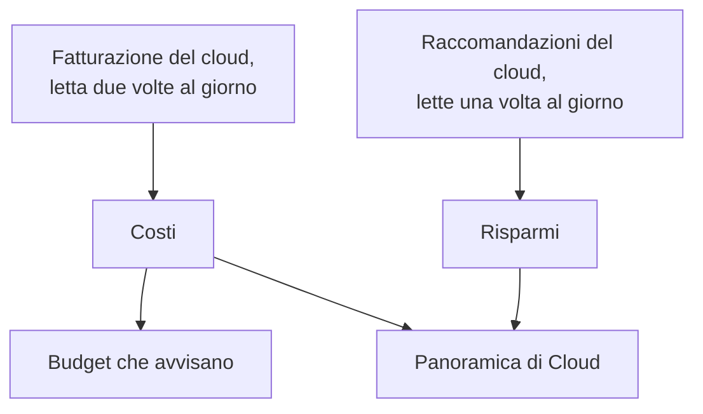

# Costi e risparmi del cloud

Un account cloud collegato dice anche quanto costa e come potrebbe costare meno. OneUptime legge i costi di ogni giorno dalla fatturazione del tuo cloud e le raccomandazioni del motore di raccomandazione del tuo cloud, li mostra in **Cloud → Spesa → Costi** e **Cloud → Spesa → Risparmi**, e avvisa prima che un mese costi più del suo budget in **Cloud → Spesa → Budget**. Se glielo permetti, realizza anche i risparmi approvati da un proprietario, ferma le risorse non di produzione fuori dall'orario di lavoro e verifica ogni modifica sulla fattura.

:::cards
- [Amazon Web Services](#amazon-web-services): Cost Explorer e Cost Optimization Hub, ciascuno attivato una volta.
- [Microsoft Azure](#microsoft-azure): Cost Management e Azure Advisor, con un ruolo in più.
- [Google Cloud](#google-cloud): La tua esportazione della fatturazione verso BigQuery, e il Recommender.
- [Realizzare i risparmi](#realizzare-i-risparmi): Applica un risparmio con l'approvazione del suo proprietario, e annullalo.
- [Pianificazioni fuori orario](#pianificazioni-fuori-orario): Ferma le risorse non di produzione di notte e nei fine settimana.
- [Regole IA per i risparmi](#regole-ia-per-i-risparmi): Proposte per i proprietari, o modifiche entro un limite.
- [Budget](#budget): Un avviso quando la spesa di un mese supera una quota del suo budget.
- [Tag obbligatori](#tag-obbligatori): Quanta parte della tua spesa porta i tag che richiedi, e le nuove risorse che non li hanno.
:::

## Come funziona



- **I costi vengono dalla fatturazione del tuo cloud.** AWS Cost Explorer, Azure Cost Management e l'esportazione della fatturazione di Google Cloud verso BigQuery, prima di crediti e rimborsi, nella valuta in cui l'account viene fatturato. Ogni cifra è quella di un giorno, in giorni UTC, come li fattura il tuo cloud.
- **Un cloud segnala l'ultimo giorno o due in ritardo.** Ogni lettura riprende l'ultima settimana, e tutto il mese scorso nei primi giorni di un mese, così il costo di un giorno si assesta man mano che il tuo cloud lo chiude. La prima lettura di una connessione risale all'inizio del penultimo mese.
- **La proiezione del mese segue il ritmo dell'ultima settimana.** È quanto il mese è costato finora, con ogni giorno ancora da venire alla media degli ultimi sette giorni completi.
- **I risparmi vengono dal motore di raccomandazione del tuo cloud.** AWS Cost Optimization Hub, Azure Advisor e il Recommender di Google Cloud: una dimensione più piccola, una risorsa inattiva, un impegno che conviene, ciascuno con quanto farebbe risparmiare al mese. Una raccomandazione che applichi o scarti nella console del tuo cloud sparisce alla lettura successiva.

## Prima di iniziare

- **Un account collegato.** [Collegare un account cloud](/docs/telemetry/cloud-accounts) con il comando di configurazione attuale: permette alla connessione di leggere costi e raccomandazioni. Una connessione creata prima non legge né gli uni né le altre finché non ne esegui di nuovo il comando.

## Amazon Web Services

La connessione legge i costi con `ce:GetCostAndUsage`, i suoi impegni con `ce:GetSavingsPlansCoverage`, `ce:GetSavingsPlansUtilization`, `ce:GetReservationCoverage` e `ce:GetReservationUtilization`, e le raccomandazioni con `cost-optimization-hub:ListRecommendations`. Cost Explorer e Cost Optimization Hub vanno prima attivati nell'account:

:::steps
### Attivare Cost Explorer

Apri Cost Explorer una volta nella console AWS Billing and Cost Management: AWS prepara i costi dell'account entro un giorno. Collega l'account di gestione dell'organizzazione per leggere i costi di ogni account membro.

### Attivare Cost Optimization Hub

Apri Cost Optimization Hub nella stessa console e attivalo, per l'organizzazione dal suo account di gestione o per il solo account. Le sue raccomandazioni arrivano entro un giorno.
:::

Cost Explorer addebita $0.01 per ogni richiesta: una lettura dei costi ne fa alcune, e gli impegni si leggono con quattro al giorno. Cost Optimization Hub è gratuito.

### Costi per risorsa

Cost Explorer indica anche quanto costa ogni risorsa, per gli ultimi 14 giorni, una volta attivati i dati a livello di risorsa. Nella console AWS Billing and Cost Management, apri le preferenze di Cost Management e attiva i dati a livello di risorsa con granularità giornaliera, per l'organizzazione dal suo account di gestione. AWS li prepara entro 48 ore.

Poi modifica la connessione in **Cloud → Collega** e, in **Altri campi**, attiva **Costi per risorsa**. La connessione li legge con `ce:GetCostAndUsageWithResources` una volta al giorno: i 14 giorni la prima volta, poi di nuovo gli ultimi tre, con alcune richieste ogni volta. Ciò che legge resta con i costi dell'account dopo che Cost Explorer lo ha dimenticato. Una connessione creata prima deve eseguire di nuovo il suo comando di configurazione, che aggiunge l'azione.

## Microsoft Azure

L'app legge i costi con il ruolo **Cost Management Reader**, sullo stesso ambito di **Monitoring Reader**: il comando di configurazione assegna entrambi. Le raccomandazioni di Azure Advisor vengono lette con **Monitoring Reader**, quindi non c'è nulla da attivare. Per assegnare il ruolo a un'app creata prima, esegui:

```bash
az role assignment create --assignee <APP_ID> --role "Cost Management Reader" --scope /subscriptions/<SUBSCRIPTION_ID>
```

Cost Management risponde per ogni sottoscrizione, con la risorsa a cui si riferisce ogni costo, e leggerlo non costa nulla. Quando non può rispondere per una sottoscrizione, i **Costi** dell'account dicono perché.

Cost Management limita la velocità con cui si leggono i costi di un tenant, uguale per chiunque li legga: ogni query costa un'unità di elaborazione delle query (QPU) per ogni mese di dati che legge, e un tenant ha 12 QPU ogni 10 secondi, 60 al minuto e 600 all'ora. OneUptime legge le sottoscrizioni di un tenant una dopo l'altra entro i due terzi di ciascuna quota, attende quanto Cost Management chiede quando rifiuta una query e riprende alla lettura successiva da dove si era fermato. Una sottoscrizione non ancora letta dice **In coda**, con quando viene letta; una che ha già delle cifre le conserva nel frattempo.

## Google Cloud

Google Cloud non ha un'API per i costi di un progetto: OneUptime li legge dall'esportazione del tuo account di fatturazione verso BigQuery.

:::steps
### Esportare la fatturazione verso BigQuery

Nella console di Google Cloud, apri Billing, poi Billing export, e attiva l'esportazione del costo di utilizzo dettagliato verso un dataset BigQuery. Google la scrive con qualche ora di ritardo, dal giorno in cui la attivi.

### Lasciare che l'account di servizio la legga

Assegna all'account di servizio della connessione **BigQuery Data Viewer** sul dataset dell'esportazione. Il comando di configurazione gli ha già assegnato **BigQuery Job User**, per eseguire la query nel suo progetto.

### Indicare la tabella dell'esportazione

Modifica la connessione in **Cloud → Collega** e, in **Altri campi**, imposta **Tabella dell'esportazione della fatturazione** sul nome completo della tabella: `<PROJECT_ID>.<DATASET>.gcp_billing_export_resource_v1_<BILLING_ACCOUNT_ID>`.
:::

L'esportazione dettagliata indica la risorsa a cui si riferisce ogni costo; quella standard dice solo il servizio e la regione. BigQuery addebita la query: il primo 1 TiB al mese è gratuito, poi $6.25 per TiB, e un mese di esportazione va da qualche megabyte a qualche gigabyte. Le raccomandazioni del Recommender su tipi di macchina e risorse inattive vengono lette con **Compute Recommender Viewer**, che il comando di configurazione assegna, e non costano nulla.

## Modi per spendere meno

**Cloud → Spesa → Risparmi** elenca ogni raccomandazione, il risparmio maggiore per primo: cosa fare, su quale risorsa, cosa cambierebbe e quanto fa risparmiare al mese. La fascia sopra le somma, in totale e per tipo: una dimensione più piccola, una risorsa inattiva, un impegno. Una raccomandazione rimanda alla pagina della sua risorsa quando OneUptime ha la risorsa, e una che OneUptime può realizzare ha **Applica**: vedi [Realizzare i risparmi](#realizzare-i-risparmi).

### Ridimensionamento dalle letture di OneUptime

Una risorsa di cui nessun motore di raccomandazione si occupa, perché non è attivo, non copre il suo tipo o la ritiene troppo nuova, viene dimensionata da OneUptime in base alle letture di CPU e memoria che la sua connessione ha raccolto negli ultimi 14 giorni. OneUptime dimensiona istanze EC2, database RDS e cluster ElastiCache su AWS, macchine virtuali, server flessibili PostgreSQL e MySQL e piani App Service su Azure, e VM di Compute Engine e istanze Cloud SQL su Google Cloud:

- **Sovradimensionato** quando la dimensione grande la metà, o un quarto, avrebbe ancora margine: sulla dimensione più piccola, il 95° percentile della sua CPU sarebbe al massimo del 60%, la sua lettura di CPU più alta al massimo del 100% e il picco della sua memoria al massimo del 70%, quando la sua memoria viene letta.
- **Sottodimensionato** quando il 95° percentile della sua CPU è all'85% o più, o il picco della sua memoria al 90% o più: la dimensione grande il doppio.

Una risorsa viene dimensionata appena ha 6 giorni di letture. La sua pagina mostra il suo **Ridimensionamento** accanto a quanto costa, e una sovradimensionata compare in **Cloud → Spesa → Risparmi**, con OneUptime come fonte. Quanto fa risparmiare una modifica è la sua quota di quanto la risorsa è costata negli ultimi 30 giorni, quindi si conosce appena il tuo cloud fattura la risorsa per nome: l'esportazione dettagliata di Azure e di Google Cloud lo fa, e AWS anche, una volta attivato Costi per risorsa. Le dimensioni burstable, come t3, la serie B ed e2-micro, non vengono mai dimensionate.

Il tuo cloud legge la memoria di una VM solo con un agente proprio dentro la VM: l'agente CloudWatch su un'istanza EC2, l'Ops Agent su una VM di Compute Engine, e nessuno per una VM di Azure, che riporta la memoria libera invece di quella usata. Una VM su cui gira [il collector dell'host di OneUptime](/docs/telemetry/hosts) viene invece dimensionata sulla memoria che legge il collector dell'host:

- **La VM e l'host sono la stessa macchina** quando provider, account, regione e ID dell'istanza coincidono tutti: l'ID dell'istanza EC2, l'ID numerico di una VM di Compute Engine o il `vmId` di una VM di Azure. Un nome host da solo non basta mai, e una VM rivendicata da due host, come una macchina clonata, non viene collegata a nessuno dei due. La pagina della VM nomina il suo host, e la pagina dell'host nomina la sua VM, ciascuna con un link all'altra.
- **La memoria è la memoria usata dell'host, senza cache e buffer**, il valore che la pagina dell'host mostra nel grafico, sugli stessi 14 giorni. Una cache dei file piena non viene mai letta come una macchina piena. Anche l'host ha bisogno di 6 giorni di letture.
- **Quando entrambi leggono la memoria**, come per una VM di Compute Engine con l'Ops Agent e il collector dell'host, si usa quello con più letture. La CPU è sempre la lettura del tuo cloud.

Il **Ridimensionamento** della VM dice da dove viene la sua memoria, come la sua riga in **Cloud → Spesa → Risparmi**. Una VM dimensionata solo sulla CPU lo dice, con un link per installare il collector dell'host. Il collector dell'host applica l'identità del suo cloud con il passaggio `resourcedetection/cloud` che contiene [la configurazione della guida degli host](/docs/telemetry/host-otel-collector). Un host con la configurazione predefinita di OneUptime riceve il passaggio con la prossima release di OneUptime, e uno con una configurazione tua deve aggiungerlo. I nodi Kubernetes sono lasciati all'[Osservabilità dei costi di Kubernetes](/docs/telemetry/kubernetes-cost), che dimensiona le richieste di ciò che vi gira.

### Impegni

**Cloud → Spesa → Risparmi** e i **Costi** di un account mostrano quanta parte della spesa degli ultimi 30 giorni hanno pagato gli impegni di ogni account, e quanto di essi è stato usato, una riga per tipo:

- AWS: Savings Plans e istanze riservate, da Cost Explorer. L'account di gestione di un'organizzazione li legge per ogni account dell'organizzazione.
- Azure: piani di risparmio e prenotazioni, da Cost Management, in costo ammortizzato.
- Google Cloud: sconti per impegno di utilizzo, dalla tua esportazione della fatturazione. L'esportazione non dice quanto di un impegno è rimasto inutilizzato, quindi quanto se ne usa non viene mostrato.

Un account senza impegni indica ciò che è stato eseguito a tariffe on demand e che un impegno pagherebbe a un prezzo più basso. Le cifre di ogni tipo sono quelle del suo cloud, e i tipi non vengono mai sommati: una prenotazione e un Savings Plan possono entrambi contare la spesa della stessa macchina come propria da coprire.

## Realizzare i risparmi

OneUptime realizza un risparmio tramite la connessione cloud dell'account non appena la sua impostazione **Azioni di risparmio** lo consente: [Azioni di risparmio](/docs/telemetry/cloud-accounts#azioni-di-risparmio) spiega cosa concede ogni scelta. Fa solo modifiche in un passaggio: ferma un'istanza o un database inattivo, passa un volume gp2 a gp3, elimina un disco non collegato, una vecchia istantanea o un'immagine inutilizzata, rilascia un indirizzo inutilizzato e, se lo consenti, ridimensiona un'istanza o un database alla dimensione consigliata. Non acquista mai un impegno: **Acquista nella console** apre la pagina del tuo cloud per farlo.

:::steps
### Scegli Applica

In **Cloud → Spesa → Risparmi**, scegli **Applica** su un risparmio. La finestra di dialogo dice cosa cambia, quanto fa risparmiare al mese, come si annulla o che non si può, e chi lo approva.

### Un proprietario la approva

Approva la modifica una persona indicata come proprietaria della risorsa, o un membro di un team che la possiede, che possa anche modificarla. Una risorsa senza proprietario viene approvata da un Proprietario del progetto o un Amministratore del progetto. Se puoi approvarla tu, **Applica** la effettua subito, a tuo nome. Altrimenti attende in **In attesa di approvazione** che un proprietario scelga **Approva**, oppure **Nascondi** con un motivo.

### OneUptime la effettua

La modifica passa dalla connessione ed è nelle cronologie della risorsa e dell'account, con chi l'ha approvata. Di un disco eliminato viene prima creata un'istantanea finale, a meno che tu non disattivi **Crea prima un'istantanea finale**.
:::

Ogni modifica dice come si annulla: **Annulla** in **Modifiche effettuate** riavvia un'istanza fermata, riporta un volume o una dimensione a com'erano, o ricrea un disco eliminato dalla sua istantanea finale. Ciò che elimina per sempre, come un'istantanea, un'immagine o un indirizzo rilasciato, non può essere annullato, e la finestra di dialogo lo dice prima che tu lo applichi. Dove il progetto chiede due approvazioni con **Richiedi due approvazioni per le correzioni più rischiose**, una modifica che non si può annullare richiede due persone.

Una risorsa i cui tag dicono che è gestita come codice, ad esempio da Terraform o CloudFormation, viene invece modificata nel suo codice: la finestra di dialogo offre **Apri pull request** verso il repository che la dichiara, così il prossimo apply non annulla il risparmio.

### Dimostrato dalla fattura

**Risparmiato questo mese** conta solo ciò che mostra la fattura del tuo cloud. Non appena tre giorni dopo una modifica si sono assestati sulla fattura, il costo giornaliero della risorsa viene confrontato con la settimana prima della modifica: è **Visibile nella fattura** quando il costo è sceso almeno di un quarto di quanto promesso, **Non visibile nella fattura** quando no, e **Non misurabile** quando il tuo cloud non fattura la risorsa per nome. **Verifica della fattura** conta le modifiche che attendono ancora quei giorni.

## Pianificazioni fuori orario

In **Cloud → Spesa → Pianificazioni**, una pianificazione ferma istanze e database non di produzione fuori dall'orario di lavoro, e li riavvia:

:::steps
### Scegli le risorse

Indica il tag cloud che le sceglie, ad esempio `Schedule` = `office-hours`, in un account o in tutti.

### Di' quando sono in esecuzione

Scegli i giorni lavorativi, l'ora in cui si avviano e quella in cui si fermano, nel formato 24 ore, e il fuso orario.
:::

Quando finisce l'orario di lavoro, una pianificazione ferma, tramite la connessione del suo account, ogni risorsa in esecuzione che il suo tag sceglie e che è nota per non essere di produzione, e quando inizia riavvia solo ciò che ha fermato: una risorsa che qualcuno ha fermato a mano resta ferma. **Vedi le risorse** elenca cosa sceglie ora una pianificazione e perché ne lascia qualcuna in esecuzione. Ferma le istanze EC2 e i database RDS su AWS, le macchine virtuali su Azure e le istanze Compute Engine su Google Cloud. AWS riavvia da solo un database fermo da sette giorni.

Una pianificazione non ferma mai la produzione, né una risorsa il cui ambiente nulla indica. Una risorsa è nota per non essere di produzione quando:

- uno dei suoi tag lo dice, con una chiave come `environment`, `env`, `stage`, `tier` o `deployment.environment` e una parola come `dev`, `test`, `qa`, `staging` o `sandbox`;
- il suo account è segnato come **Non di produzione** in **Ambiente** nelle **Impostazioni** dell'account;
- oppure una delle sue etichette lo dice, ad esempio `Staging` o `env: dev`.

Vince la produzione: un tag che dice `prod`, `production` o `live`, o un account segnato come **Produzione**, mantiene una risorsa in esecuzione, qualunque cosa dica il resto. Il nome di una risorsa non viene mai letto per questo. Disattiva una pianificazione e non ferma più nulla, e riavvia ciò che ha fermato quando inizia il suo orario di lavoro; eliminala e ciò che ha fermato viene riavviato subito.

## Regole IA per i risparmi

Con **Abilita IA** attivo, OneUptime AI propone ai proprietari della risorsa ogni risparmio che può realizzare, dopo ogni lettura dei risparmi dell'account, e loro lo approvano o lo rifiutano in **In attesa di approvazione**. In **Cloud → Impostazioni → Regole IA per i risparmi**, una regola dice cosa fa OneUptime AI con i risparmi che corrispondono, per tipo di modifica, ambiente della risorsa e cloud: **Disattivato**, **Proponi al proprietario** o **Agisci senza chiedere**, fino a un limite mensile. Senza regole, ogni risparmio viene proposto e nessuno effettuato; con le regole, solo ciò che corrisponde a una regola, e tra le regole che corrispondono vince la più prudente.

Una regola agisce senza chiedere solo su una risorsa nota per non essere di produzione, solo per una modifica che si può annullare, solo fino al limite più basso delle regole che corrispondono, e al massimo 10 volte all'ora in un progetto: tutto il resto viene proposto. Una modifica effettuata senza chiedere è nelle cronologie con la regola che l'ha effettuata, e i suoi proprietari possono annullarla. Un risparmio rifiutato o annullato non viene proposto di nuovo per 30 giorni.

## Budget

:::steps
### Creare un budget

In **Cloud → Spesa → Budget**, crea un budget: il suo **Importo mensile** e l'**Account** a cui si riferisce, o nessuno per tutti gli account.

### Scegliere quando avvisa

**Avvisa al** prende le quote del budget a cui avvisare, in percentuale: 80 e 100 per iniziare. **Avvisa se si avvia al superamento** avvisa anche, una volta al mese, quando il ritmo dell'ultima settimana porterebbe il mese oltre il budget. **Avvisa nei giorni insoliti** avvisa anche il giorno dopo un giorno costato molto più del solito: vedi [Giorni insoliti](#giorni-insoliti). **Gravità avviso** e **Policy di reperibilità** dicono quanto sono gravi gli avvisi e chi viene chiamato.
:::

Un budget viene controllato dopo ogni lettura dei costi e ogni ora. Quando la spesa del mese supera una soglia, viene generato un avviso per essa, la più alta se una lettura ne supera diverse insieme, e un nuovo mese risolve gli avvisi del mese scorso. Un budget conta solo gli account fatturati nella sua valuta.

Gli agenti IA possono creare e modificare i budget tramite il [server MCP](/docs/ai/mcp-server), e gli script con il comando `oneuptime cloud-budget` della CLI: vedi [Operazioni sulle risorse](/docs/cli/resource-operations).

### Giorni insoliti

Dopo ogni lettura, ciascuno degli ultimi 14 giorni completi di un account viene confrontato con i 14 giorni precedenti. Un giorno è insolito quando un servizio è costato il doppio del suo giorno abituale o più, o l'intero account una volta e mezza il suo giorno abituale o più. In entrambi i casi servono almeno 10 in più del solito, nella valuta dell'account, e almeno il 5% del giorno abituale dell'account, così che pochi centesimi non contino mai come un picco. Il valore abituale di un giorno è la mediana dei 14 giorni precedenti, quindi un picco isolato lo sposta poco, e un account viene giudicato solo quando ha una settimana di costi.

**Cloud → Spesa → Costi** segna i giorni insoliti sulla spesa giornaliera, sopra le loro barre, e li elenca sotto. Su tutti gli account, ogni segno apre i **Costi** del suo account. Un budget che include l'account genera un avviso per ogni account e giorno, il giorno dopo, nominando ogni servizio che è salito. Un picco che dura più giorni viene segnalato il giorno in cui è iniziato, e un giorno di più di una settimana fa non viene segnalato. Un budget creato prima che esistessero questi avvisi non li genera finché non lo modifichi e li attivi.

## Dove vanno i soldi

**Cloud → Spesa → Costi** suddivide la spesa di un periodo per servizio, regione, account o risorsa, e in altri tre modi:

- Per ambiente delle piattaforme applicative: il servizio di piattaforma di ogni ambiente nel suo account e nella sua regione, come Amazon ECS o Cloud Run, e le risorse di un ambiente Elastic Beanstalk in base al tag che AWS gli assegna.
- Per app: ciò che una piattaforma addebita a un'app per nome, come un servizio Cloud Run o una Container App. Amazon ECS addebita i suoi task e App Service i suoi piani, quindi i costi delle loro app restano del loro ambiente.
- Per tag: ogni valore del tag che scegli. Un costo mantiene i tag che aveva quando è stato letto: le etichette di un'esportazione della fatturazione di Google Cloud, altrimenti i tag della risorsa a cui è addebitato, il che su AWS richiede Costi per risorsa.

Sotto l'elenco, la scheda dice a quanto è ammontato il resto: ciò che non è in nessun ambiente, ciò che è addebitato a un ambiente nel suo insieme o ciò che non ha il tag. I costi letti prima che i tag venissero conservati vengono riletti una volta, fin dove arriva una prima lettura, così che i loro tag si completino.

## Tag obbligatori

La spesa è ripartita bene solo quanto i tag che porta. In **Cloud → Spesa → Tag**, indica quali tag deve portare ogni risorsa, come `team`, `env` e `cost-center`, e vedi quanta parte della tua spesa e delle tue risorse li porta, quali risorse no, e chi ha creato ogni nuova risorsa senza di essi.

:::steps
### Richiedere un tag

Seleziona **Richiedi un tag** e inserisci la sua **Chiave del tag**. In **Valori consentiti**, elenca i valori che può assumere, separati da virgole, oppure lascia vuoto per accettare qualsiasi valore. Scegli un **Account** per richiedere il tag solo in quell'account. Una **Descrizione**, in **Altri campi**, dice nelle email a cosa serve il tag.

### Leggere la copertura

La pagina si apre su quanta parte della spesa degli ultimi 30 giorni e delle tue risorse porta tutti i tag obbligatori. Sotto ci sono le risorse a cui manca un tag, le più costose prima, poi ogni tag da solo, l'andamento delle ultime 12 settimane e ogni account.

### Aggiungere i tag mancanti

Ogni risorsa a cui manca un tag mostra il valore suggerito da OneUptime e il comando che lo imposta nel tuo cloud. Una risorsa dichiarata nel codice dice quale codice la dichiara: aggiungi lì il tag, altrimenti il prossimo deploy lo toglie di nuovo.
:::

- **Le chiavi corrispondono senza distinzione tra maiuscole e minuscole.** `Team`, `team` e `TEAM` sono una sola chiave, e una risorsa porta il tag quando una qualsiasi grafia ha un valore consentito. Anche i valori corrispondono senza distinzione tra maiuscole e minuscole, e un valore vuoto non è un valore.
- **Un valore consentito può essere un modello.** `*` sta per qualsiasi carattere e `?` per uno solo, quindi `prod-*` accetta `prod-eu` e `prod-us`. I modelli non sono espressioni regolari.
- **I tag propri di un account.** Un tag richiesto in un account sostituisce lì il tag del progetto con la stessa chiave, e un account può richiedere una chiave tutta sua. I **Tag** di un account mostrano entrambi.
- **Nel tuo cloud non cambia nulla.** OneUptime non ferma né tagga mai una risorsa per un tag mancante. Avvisa le persone e suggerisce il valore.

### Copertura

- **Spesa con tag** è la quota dei costi degli ultimi 30 giorni che porta tutti i tag obbligatori, secondo i tag con cui è stato letto ciascun costo. Viene calcolata ogni volta che apri la pagina, quindi un tag che richiedi oggi viene misurato anche sugli ultimi 30 giorni. I costi AWS portano tag solo una volta attivato [Costi per risorsa](#costi-per-risorsa): fino ad allora, la spesa di un account AWS indica **Non misurato** invece di 0%.
- **Risorse con tag** è la quota delle risorse elencate dalle tue connessioni che portano tutti i tag obbligatori, così come sono taggate ora.
- **Copertura nel tempo** mostra ognuna delle ultime 12 settimane: la spesa dai costi, e le risorse dal conteggio che OneUptime fa ogni giorno.

### Nuove risorse

Una risorsa che la tua connessione elenca dopo il primo elenco completo del suo account è nuova. La connessione elenca ogni 30 minuti, quindi una nuova risorsa viene trovata entro l'ora in cui viene creata. Di una a cui manca un tag obbligatorio si avvisa una volta:

- **Chi viene informato.** La persona che l'ha creata, quando il registro delle modifiche dell'account nomina un membro del tuo progetto con il suo indirizzo email, e i proprietari della risorsa, dalle regole di proprietà e dai team. Quando non si può informare nessuno dei due, vengono informati i Proprietari del progetto. Ognuno deve poter leggere le tue risorse cloud.
- **Con quale frequenza.** Un'email all'ora elenca tutte le novità per ogni persona. In **Altre impostazioni**, **Un'email per ogni risorsa** invia ciascuna da sola, e **Genera un avviso** genera anche un avviso per ogni account, con la gravità e le policy di reperibilità in **Dove vanno gli avvisi**.
- **Quando viene taggata.** Una risorsa taggata prima dell'invio dell'email ne resta fuori, e l'elenco **Nuove risorse** segna ciascuna **Con tag** appena li porta.

### Valori suggeriti

OneUptime suggerisce un valore solo quando il tag lo consente:

- **Una chiave di tipo team**, come `team`, `owner` o `squad`: il team proprietario della risorsa.
- **Una chiave di tipo ambiente**, come `env`, `environment` o `stage`: l'ambiente App Platforms di un'app che gira come la risorsa, oppure per una VM, l'ambiente di deployment che riporta il suo host.
- **Qualsiasi chiave**: il valore che porta la maggior parte delle risorse accanto, nello stesso stack CloudFormation, nello stesso gruppo di risorse Azure o con lo stesso nome prima del numero, come `web-1` e `web-2`. Almeno due devono concordare.
- **Un tag che consente un solo valore**: quel valore.

Il comando imposta il tag in un solo passaggio, dalla shell del tuo cloud: `aws resourcegroupstaggingapi tag-resources` su AWS, `az tag update --operation Merge` su Azure, e `gcloud ... add-labels` o `--update-labels` per VM e dischi di Compute Engine, bucket di Cloud Storage e istanze di Cloud SQL su Google Cloud.

## Cosa vedi in OneUptime

- **La panoramica di Cloud.** **Cloud → Panoramica** mostra la spesa del mese rispetto a quella del mese scorso allo stesso giorno, i servizi che costano di più e i modi maggiori per spendere meno, accanto a ciò che richiede attenzione.
- **La spesa di ogni giorno.** **Cloud → Spesa → Costi** disegna ciascuno degli ultimi 30 giorni segnando i giorni costati molto più del solito, elenca quei giorni e suddivide un periodo per servizio, regione, account, risorsa, ambiente delle piattaforme applicative, app o tag. Gli account i cui costi non vengono letti sono elencati sotto, ciascuno con il motivo.
- **I costi di un account.** I **Costi** di un account mostrano lo stesso per il solo account, con i suoi impegni e i suoi modi per spendere meno.
- **Tag obbligatori.** **Cloud → Spesa → Tag** mostra quanta parte della spesa e delle risorse porta i tuoi tag obbligatori, e i **Tag** di un account mostrano lo stesso per quel solo account.
- **Il costo di una risorsa.** La pagina di una risorsa mostra quanto è costata questo mese e negli ultimi 30 giorni quando il suo cloud la fattura per nome, con i suoi modi per spendere meno e il suo ridimensionamento.
- **Cosa è stato risparmiato.** **Cloud → Spesa → Risparmi** si apre su quanto le modifiche effettuate hanno fatto risparmiare questo mese, secondo la fattura, sulle modifiche in attesa di approvazione e quelle effettuate, e sulle ore in cui le pianificazioni hanno fermato le risorse.

## Risoluzione dei problemi

:::details Un account dice Serve un'autorizzazione
La connessione non può ancora leggere i costi dell'account. Esegui di nuovo il suo comando di configurazione da **Cloud → Collega**: aggiunge ciò che serve per leggere i costi. Su Google Cloud, assegna anche all'account di servizio **BigQuery Data Viewer** sul dataset dell'esportazione.
:::

:::details Un account dice Non configurato
Il suo cloud non ha ancora costi da fornire. Su AWS, attiva Cost Explorer; su Google Cloud, indica la tabella dell'esportazione in **Tabella dell'esportazione della fatturazione**. Le prime cifre arrivano con la lettura successiva, entro 12 ore.
:::

:::details Un account dice In coda
I suoi costi aspettano il loro turno: Azure Cost Management limita la velocità con cui si leggono i costi di un tenant. L'account dice quando vengono letti, alla prima lettura della connessione da quel momento, e non c'è nulla da fare. Un account che ha già delle cifre le conserva nel frattempo.
:::

:::details Costi per risorsa dice Non configurato
I dati a livello di risorsa non sono attivati per l'account. Attivali con granularità giornaliera nelle preferenze di Cost Management della console AWS Billing and Cost Management, dall'account di gestione dell'organizzazione per i suoi membri. AWS li prepara entro 48 ore, e la lettura del giorno dopo li prende.
:::

:::details Gli impegni dicono Serve un'autorizzazione
La connessione non può ancora leggere i Savings Plans e le prenotazioni dell'account. Esegui di nuovo il suo comando di configurazione da **Cloud → Collega**: aggiunge le quattro azioni con cui vengono letti.
:::

:::details Le cifre lasciano fuori un account
Le cifre sono nella valuta in cui viene fatturata la maggior parte dei tuoi account. Un account fatturato in un'altra è elencato sotto con la sua valuta, e un budget conta solo gli account fatturati nella sua.
:::

:::details Un risparmio non ha Applica
OneUptime fa solo modifiche in un passaggio: un impegno, o una raccomandazione che cambia più di una cosa, si fa nella console del tuo cloud. Applica apre una finestra che dice perché non si può fare da qui quando la connessione dell'account non lo consente: attiva le sue **Azioni di risparmio** ed esegui di nuovo il suo comando di configurazione.
:::

:::details Una pianificazione lascia una risorsa in esecuzione
**Vedi le risorse** dice perché: è di produzione, nulla indica che non sia di produzione, o la connessione del suo account non consente le azioni di risparmio. Aggiungi un tag, ad esempio `environment` = `dev`, oppure segna il suo account come **Non di produzione**.
:::

:::details Questo mese è più basso che nella console del tuo cloud
Il tuo cloud segnala l'ultimo giorno o due in ritardo, e le cifre sono prima di crediti e rimborsi. Le letture successive recuperano.
:::

## Prossimi passi

:::cards
- [Ripartizione dei costi del cloud](/docs/telemetry/cloud-cost-allocation): Ripartisci la spesa tra team, prodotti e centri di costo.
- [Collegare un account cloud](/docs/telemetry/cloud-accounts): Collega un altro account, o esegui di nuovo il suo comando.
- [Risorse cloud](/docs/telemetry/cloud-resources): Le metriche di ogni risorsa, da un tuo collector.
- [Osservabilità dei costi di Kubernetes](/docs/telemetry/kubernetes-cost): Quanto costa ogni carico di lavoro Kubernetes.
:::
