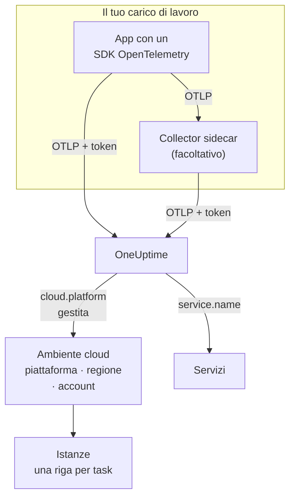

# Ambienti cloud

Un **Cloud Environment** è il luogo in cui i tuoi container girano su una piattaforma cloud gestita: l'account e la regione di un cluster ECS, il progetto e la regione di Cloud Run, la sottoscrizione e la regione di Container Apps. OneUptime lo crea la prima volta che la tua telemetria arriva con gli attributi di risorsa giusti, e raggruppa ogni carico di lavoro che vi gira. Non c'è niente da registrare a mano.

:::cards
- [AWS ECS / Fargate](/docs/telemetry/cloud-aws-ecs): Task su Fargate o EC2, con CPU e memoria di ogni task.
- [Google Cloud Run](/docs/telemetry/cloud-gcp-cloud-run): Servizi e job, elencati anche come funzioni serverless.
- [Azure Container Apps](/docs/telemetry/cloud-azure-container-apps): Repliche, con regione e sottoscrizione impostate a mano.
- [Altre piattaforme cloud](/docs/telemetry/cloud-other-platforms): Elastic Beanstalk, App Runner, App Engine, App Service e Container Instances.
:::

## Come funziona



- **Un rilevatore di risorse dice dove gira il carico di lavoro.** Un rilevatore di risorse OpenTelemetry, nell'SDK o in un collector, legge i metadati della piattaforma e imposta `cloud.platform`, `cloud.account.id` e `cloud.region` su tutto ciò che il carico di lavoro invia. Dove non esiste un rilevatore, li imposti tu.
- **L'ambiente raggruppa tutto.** Ogni carico di lavoro con la stessa piattaforma, lo stesso account e la stessa regione finisce in un unico ambiente. I servizi mantengono le proprie righe in **Servizi**.
- **Ogni task in esecuzione è un'istanza.** La scheda **Istanze** dell'ambiente elenca i suoi task, le istanze o le repliche in esecuzione, con CPU e memoria in tempo reale quando la piattaforma può fornirle.

## Prima di iniziare

- **Una chiave di acquisizione.** Crea una chiave **Server** in **Impostazioni del progetto → Telemetria e APM → Chiavi di acquisizione** e copia il suo token: vedi [Creare una chiave di acquisizione](/docs/telemetry/open-telemetry#creare-una-chiave-di-acquisizione). È un segreto: ogni pagina di piattaforma mostra dove conservarlo nell'archivio di segreti di quel cloud.
- **OpenTelemetry nella tua applicazione.** Un SDK OpenTelemetry che esporta OTLP, oppure un OpenTelemetry Collector che gira accanto all'applicazione.

## Piattaforme supportate

| Piattaforma | `cloud.platform` | `cloud.*` compilati da | Identità dell'istanza | Guida |
| ------------------------- | --------------------------- | ---------------------- | --------------------------------- | ------------------------------------------------------------------ |
| AWS ECS / Fargate | `aws_ecs` | rilevatore di risorse | `aws.ecs.task.arn` | [AWS ECS / Fargate](/docs/telemetry/cloud-aws-ecs) |
| AWS Elastic Beanstalk | `aws_elastic_beanstalk` | rilevatore di risorse | `host.id` | [Altre piattaforme cloud](/docs/telemetry/cloud-other-platforms) |
| AWS App Runner | `aws_app_runner` | a mano | `host.name` | [Altre piattaforme cloud](/docs/telemetry/cloud-other-platforms) |
| Google Cloud Run | `gcp_cloud_run` | rilevatore di risorse | `faas.instance` | [Google Cloud Run](/docs/telemetry/cloud-gcp-cloud-run) |
| Google App Engine | `gcp_app_engine` | rilevatore di risorse | `faas.instance` | [Altre piattaforme cloud](/docs/telemetry/cloud-other-platforms) |
| Azure Container Apps | `azure_container_apps` | rilevatore di risorse | `azure.container_app.instance.id` | [Azure Container Apps](/docs/telemetry/cloud-azure-container-apps) |
| Azure Container Instances | `azure_container_instances` | a mano | `host.name` | [Altre piattaforme cloud](/docs/telemetry/cloud-other-platforms) |
| Azure App Service | `azure_app_service` | rilevatore di risorse | `host.id` | [Altre piattaforme cloud](/docs/telemetry/cloud-other-platforms) |

- **Rilevatore di risorse:** un rilevatore di risorse OpenTelemetry, nell'SDK o nel processore `resourcedetection` del Collector, imposta per te gli attributi `cloud.*`.
- **A mano:** non esiste un rilevatore, quindi metti gli attributi in `OTEL_RESOURCE_ATTRIBUTES`. La pagina della piattaforma mostra la riga esatta.
- **I rilevatori Azure sanno meno.** I rilevatori di Container Apps non conoscono né la regione né la sottoscrizione, e quelli di App Service non conoscono la sottoscrizione: imposta tu ciò che manca.
- **Le grafie Azure con il punto funzionano.** I rilevatori Azure per Node.js e .NET scrivono `azure.container_apps` e `azure.app_service`. OneUptime li riscrive nei valori con il trattino basso indicati sopra quando li riceve.

## Come OneUptime identifica un ambiente

Esiste un ambiente per ogni combinazione di tre attributi di risorsa:

| Attributo | Obbligatorio | Che cos'è |
| ------------------ | -------- | ------------------------------------------------------------------------------------------- |
| `cloud.platform` | Sì | Uno dei valori di [Piattaforme supportate](#piattaforme-supportate) |
| `cloud.account.id` | No | L'ID dell'account AWS, l'ID del progetto Google Cloud o l'ID della sottoscrizione Azure |
| `cloud.region` | No | La regione, ad esempio `us-east-1`, `us-central1` o `eastus` |

OneUptime unisce i tre con `|` nella **chiave dell'ambiente**, e dà all'ambiente un nome basato sugli stessi valori, ad esempio _AWS ECS · us-east-1 · 123456789012_:

```text title="Environment keys"
aws_ecs|123456789012|us-east-1
gcp_cloud_run|my-project|us-central1
azure_container_apps|00000000-0000-0000-0000-000000000000|eastus
```

> [!IMPORTANT]
> Una parte mancante resta nella chiave come segmento vuoto: `aws_ecs||us-east-1`. Così un carico di lavoro che omette `cloud.account.id` finisce in un ambiente diverso da uno che lo imposta. È il motivo più comune per cui vedi due ambienti dove te ne aspettavi uno.

### Identità dell'istanza

All'interno di un ambiente, ogni task, istanza o replica in esecuzione ottiene una riga in **Istanze**. Il suo nome viene dal primo di questi attributi di risorsa presente nella telemetria:

1. `aws.ecs.task.id`
2. `aws.ecs.task.arn` (abbreviato all'ID del task)
3. `faas.instance`
4. `azure.container_app.instance.id`
5. `service.instance.id`
6. `container.id`
7. `host.id`
8. `host.name`

L'identità propria della piattaforma viene prima di proposito. Un collector sidecar e l'SDK dell'applicazione la vedono entrambi, e sopravvive ai riavvii. Un SDK di solito inventa un nuovo `service.instance.id` per ogni processo (l'SDK Node.js lo fa per impostazione predefinita), quindi usarlo come chiave dividerebbe un task ECS in due righe. `service.instance.id` si usa quando la piattaforma non imposta un'identità propria. La colonna **Identità dell'istanza** in [Piattaforme supportate](#piattaforme-supportate) indica l'attributo usato da una configurazione tipica su ogni piattaforma.

### Ambienti creati a mano

Raramente serve: l'acquisizione crea gli ambienti per te. Per crearne uno prima della sua telemetria, apri **Cloud → All Environments** e fai clic su **Crea: Risorsa cloud**. Scegli la **Piattaforma cloud**, poi inserisci **ID account cloud** e **Regione cloud** esattamente come li riporta la tua telemetria. OneUptime costruisce la chiave `platform|account|region` da questi tre valori, e l'acquisizione associa un ambiente solo in base alla sua chiave. Gli dà il nome che gli darebbe l'acquisizione; per mostrare un altro nome, apri **Altri campi** e inseriscilo in **Nome visualizzato**.

## Che cosa non è un ambiente cloud

| Usi | Dove compare | Perché |
| ------------------------------------------------------------------------------------------------- | ------------------------ | ---------------------------------------------------------------------------------------------------- |
| EC2, Compute Engine, Azure VM (`aws_ec2`, `gcp_compute_engine`, `azure_vm`) | **Host** | Una macchina virtuale è un host. Vedi [Collector OpenTelemetry sull'host](/docs/telemetry/host-otel-collector) |
| EKS, GKE, AKS, Kubernetes autogestito | **Kubernetes** | Instradato dagli attributi `k8s.*`. Vedi [Agent Kubernetes](/docs/telemetry/kubernetes-agent) |
| Lambda, Cloud Functions, Azure Functions (`aws_lambda`, `gcp_cloud_functions`, `azure_functions`) | **Funzioni serverless** | Instradato da `faas.name`, o da `service.name` su una `cloud.platform` FaaS. Vedi [Funzioni serverless](/docs/telemetry/serverless-functions) |
| Load balancer, bucket, database gestiti e altre risorse IaaS o PaaS | **Cloud Resources** | Scoperte dalle metriche che pubblicano Azure Monitor, CloudWatch e Cloud Monitoring. Vedi [Risorse cloud](/docs/telemetry/cloud-resources) |

> [!NOTE]
> Cloud Run e App Engine compaiono in due posti di proposito. Il loro rilevatore imposta sia una `cloud.platform` gestita sia `faas.name`, quindi ogni servizio è anche una **Funzione serverless** a sé, mentre il **Cloud Environment** raggruppa ogni servizio di quel progetto e di quella regione. La stessa telemetria viene archiviata in entrambi.

## Collegare un carico di lavoro

Ogni pagina di piattaforma riporta questi passaggi con i comandi e le schermate di console di quel cloud. In sintesi:

:::steps
### Mettere gli attributi cloud sulla telemetria

:::tabs
@tab Sidecar collector
Un secondo container nel task, nell'istanza o nella replica. L'applicazione esporta verso `localhost:4318`, e il processore `resourcedetection` del collector imposta `cloud.*` su tutto ciò che lo attraversa. Il collector custodisce il token e, su ECS, invia anche CPU e memoria di ogni task:

```yaml title="collector.yaml"
processors:
  resourcedetection:
    detectors: [env, ecs] # [env, gcp] on Cloud Run and App Engine; [env, azurecontainerapps] on Container Apps
    timeout: 5s
```
@tab SDK direct
L'SDK dell'applicazione esporta direttamente verso OneUptime. Attiva nell'SDK il rilevatore di risorse della piattaforma, ad esempio `OTEL_NODE_RESOURCE_DETECTORS=env,host,os,aws` in Node.js: ogni pagina di piattaforma indica l'impostazione per ogni linguaggio. Nessun container in più, e nessuna CPU o memoria del container.
:::

### Esportare OTLP verso OneUptime

:::tabs
@tab Sidecar collector
```yaml title="collector.yaml"
exporters:
  otlphttp/oneuptime:
    endpoint: https://oneuptime.com/otlp
    headers:
      x-oneuptime-token: ${env:ONEUPTIME_TOKEN}

service:
  pipelines:
    traces:
      receivers: [otlp]
      processors: [resourcedetection, batch]
      exporters: [otlphttp/oneuptime]
    metrics:
      receivers: [otlp]
      processors: [resourcedetection, batch]
      exporters: [otlphttp/oneuptime]
    logs:
      receivers: [otlp]
      processors: [resourcedetection, batch]
      exporters: [otlphttp/oneuptime]
```

Il collector risolve `${env:ONEUPTIME_TOKEN}` da una variabile d'ambiente che la piattaforma compila dal proprio archivio di segreti: Secrets Manager, Secret Manager o i segreti di Container Apps.
@tab SDK direct
```bash
OTEL_EXPORTER_OTLP_ENDPOINT="https://oneuptime.com/otlp"
OTEL_EXPORTER_OTLP_HEADERS="x-oneuptime-token=YOUR_TELEMETRY_INGESTION_TOKEN"
```
:::

Se ospiti OneUptime in autonomia, usa `https://YOUR-ONEUPTIME-HOST/otlp`.

### Verificare la connessione

```bash
curl -i https://oneuptime.com/otlp/v1/validate \
  -H "x-oneuptime-token: YOUR_TELEMETRY_INGESTION_TOKEN"
```

`200` con `"valid": true` significa che il token è accettato. `401` significa che è sconosciuto, revocato, disattivato o scaduto, e il `message` della risposta dice quale. Entro un minuto dal primo span, log o metrica, l'ambiente compare in **Cloud → All Environments**.
:::

> [!TIP]
> Gli stessi passaggi sono nella dashboard, con il tuo token già inserito: in **Cloud → All Environments** finché non arriva il tuo primo ambiente, e nella scheda **Documentazione** di ogni ambiente.

## Che cosa ottieni

La **Panoramica** di un ambiente mostra:

- **Richieste**, **Tasso di errore** e **p95 latency**, dalle tue tracce, con grafici di richieste, errori e memoria nell'intervallo di tempo che scegli.
- **CPU** e **Memoria** delle istanze attive, e un elenco **Istanze principali per CPU**. Provengono da metriche `container.cpu.utilization` e `container.memory.usage` che portano l'identità dell'istanza; su ECS, da `ecs.task.cpu.utilized` e `ecs.task.memory.utilized` del receiver `awsecscontainermetrics`.
- **Istanze**: quante hanno segnalato negli ultimi 15 minuti. La scheda **Istanze** ha una riga per ciascuna.
- Le schede **Registri**, **Tracce** e **Metriche**, filtrate sull'ambiente.

Un ambiente la cui telemetria si ferma per 15 minuti mostra **Disconnesso**, e lo span, log o metrica successivo lo riporta a **Connesso**. Il tempo in cui OneUptime stesso era fermo o stava recuperando non conta nei 15 minuti.

### Etichette e proprietari

- **Dalla tua telemetria:** un attributo di risorsa come `oneuptime.label.team=payments` aggiunge l'etichetta `team:payments` all'ambiente.
- **Dalle regole:** **Cloud → Impostazioni → Regole etichette** e **Regole del proprietario** aggiungono etichette e proprietari agli ambienti corrispondenti. Vedi [Regole per etichette e proprietari](/docs/configuration/label-and-owner-rules).

## Risoluzione dei problemi

[Risoluzione dei problemi cloud](/docs/telemetry/cloud-troubleshooting) esamina ogni guasto nell'ordine in cui si verifica: un ambiente che non compare mai, che finisce in **Host** o solo in **Funzioni serverless**, che non ha istanze né CPU e memoria, che mostra **Disconnesso**, che si divide in due, o che è stato creato a mano e non viene mai associato.

## Prossimi passi

:::cards
- [AWS ECS / Fargate](/docs/telemetry/cloud-aws-ecs): La configurazione più comune, con una definizione del task completa.
- [Risoluzione dei problemi cloud](/docs/telemetry/cloud-troubleshooting): Cosa controllare quando un ambiente manca o è sbagliato.
- [Risorse cloud (IaaS e PaaS)](/docs/telemetry/cloud-resources): Load balancer, bucket e database gestiti, dal monitoraggio del tuo stesso cloud.
- [Funzioni serverless](/docs/telemetry/serverless-functions): Lambda, Cloud Functions e Azure Functions.
:::
