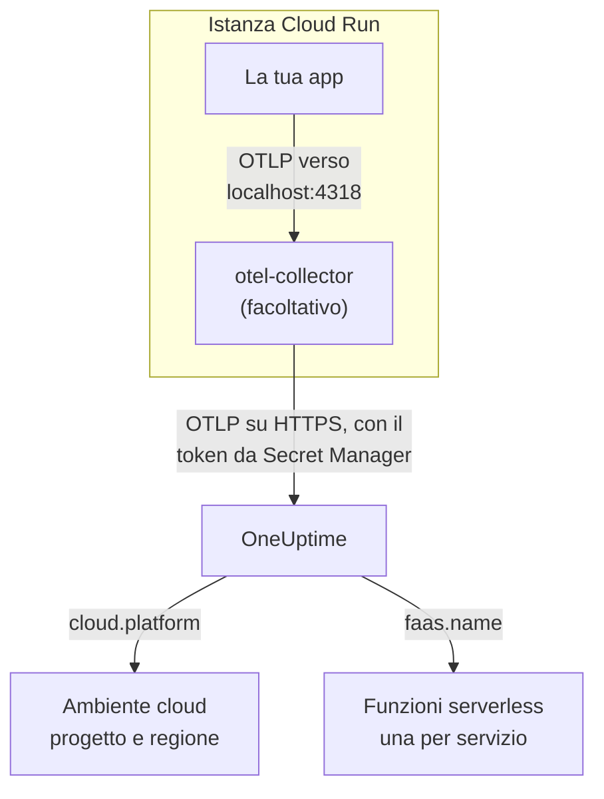

# Google Cloud Run

Invia a OneUptime le tracce, i log e le metriche dei tuoi servizi e job Cloud Run. Tutto ciò che riporta `cloud.platform=gcp_cloud_run` entra in un **Cloud Environment** per progetto Google Cloud e regione, ad esempio _GCP Cloud Run · us-central1 · my-project_, e ogni servizio compare anche in **Funzioni serverless**.

:::cards
- [Come funziona](#come-funziona): Cosa imposta il rilevatore GCP, e perché un servizio compare in due posti.
- [Configurazione](#configurazione): Salvare il token, configurare il servizio, distribuire e verificare.
- [Lo YAML del servizio con un sidecar](#lo-yaml-del-servizio-con-un-sidecar): Un servizio Cloud Run completo con un collector.
- [Risoluzione dei problemi](#risoluzione-dei-problemi): Errori dei segreti, ordine di avvio del sidecar e ambienti mancanti.
:::

## Come funziona



Il rilevatore di risorse GCP di OpenTelemetry legge il server dei metadati e le variabili d'ambiente `K_SERVICE` e `K_REVISION`, e imposta:

| Attributo | Valore su Cloud Run | A cosa serve |
| ------------------ | ------------------------------ | ----------------------------------------------------------------------------------------- |
| `cloud.platform` | `gcp_cloud_run` | Archivia la telemetria in **Ambienti cloud** |
| `cloud.account.id` | l'ID del progetto | Parte della chiave dell'ambiente |
| `cloud.region` | `us-central1` | Parte della chiave dell'ambiente |
| `faas.name` | il nome del servizio (`K_SERVICE`) | Elenca il servizio anche in **Funzioni serverless** |
| `faas.version` | la revisione (`K_REVISION`) | Mostrato nella panoramica della funzione serverless del servizio; l'ambiente non lo usa |
| `faas.instance` | l'ID dell'istanza | Dà il nome a un'istanza in esecuzione: una riga ciascuna in **Istanze** |

> [!NOTE]
> Cloud Run compare in due posti, di proposito. Poiché il rilevatore imposta `faas.name`, ogni servizio è anche una **Funzione serverless**, con le sue invocazioni, il suo tasso di errore e la sua durata. Il **Cloud Environment** raggruppa ogni servizio di quel progetto e di quella regione. Niente viene salvato due volte: la stessa telemetria viene archiviata in entrambi.

La chiave dell'ambiente è `gcp_cloud_run|my-project|us-central1`.

## Prima di iniziare

- **Una chiave di acquisizione.** Crea una chiave **Server** in **Impostazioni del progetto → Telemetria e APM → Chiavi di acquisizione** e copia il suo token.
- **`gcloud`**, con accesso al progetto, con l'API Secret Manager attiva: `gcloud services enable secretmanager.googleapis.com`.
- **La tua applicazione strumentata con un SDK OpenTelemetry** che esporta OTLP.

## Scegliere come la telemetria esce dal servizio

| | SDK direct | Sidecar collector |
| --------------- | ---------------------------------------------------- | ---------------------------------------------------------------------- |
| Container in più | Nessuno | `otel-collector` nel servizio |
| Ideale per | Un servizio, e i job Cloud Run | Più servizi in un progetto, oppure un SDK che non può eseguire un rilevatore |
| Custodisce il token | L'applicazione | Il collector |
| Il segreto | `oneuptime-otlp-headers`, l'intestazione completa | `oneuptime-ingestion-token`, il solo token |

Un job gira fino alla fine, quindi non c'è nulla per cui tenere in vita un sidecar: usa SDK direct. Ogni passaggio qui sotto ha una scheda per ciascuno; scegline una e ogni passaggio la seguirà.

## Configurazione

:::steps
### Salvare il token in Secret Manager

> [!IMPORTANT]
> Il token è un segreto. Mettilo in Secret Manager e fai riferimento a esso dal servizio come variabile d'ambiente basata su un segreto. Una semplice variabile d'ambiente è visibile a ogni visualizzatore del progetto, nella console e in `gcloud run services describe`.

:::tabs
@tab SDK direct
```bash
printf '%s' "x-oneuptime-token=YOUR_TELEMETRY_INGESTION_TOKEN" | gcloud secrets create oneuptime-otlp-headers \
  --data-file=- \
  --replication-policy=automatic

gcloud secrets add-iam-policy-binding oneuptime-otlp-headers \
  --member="serviceAccount:checkout-api@my-project.iam.gserviceaccount.com" \
  --role="roles/secretmanager.secretAccessor"
```

Cloud Run inserisce il valore di un segreto così com'è nella variabile, e `OTEL_EXPORTER_OTLP_HEADERS` ha bisogno della coppia `name=value` completa, quindi questo segreto contiene l'intestazione completa.
@tab Sidecar collector
```bash
printf '%s' "YOUR_TELEMETRY_INGESTION_TOKEN" | gcloud secrets create oneuptime-ingestion-token \
  --data-file=- \
  --replication-policy=automatic

gcloud secrets add-iam-policy-binding oneuptime-ingestion-token \
  --member="serviceAccount:checkout-api@my-project.iam.gserviceaccount.com" \
  --role="roles/secretmanager.secretAccessor"
```

La configurazione del collector aggiunge il nome dell'intestazione, quindi questo segreto contiene solo il token.
:::

Inserisci in `--member` l'account di servizio di runtime del servizio, non il tuo utente. Senza `roles/secretmanager.secretAccessor`, la revisione non si distribuisce e fallisce con `Permission denied on secret`. Se il servizio gira ancora con l'account di servizio Compute predefinito, concedi il ruolo a quell'account, e valuta di dare al servizio un account tutto suo: quello predefinito è condiviso da tutto il progetto.

### Configurare il servizio

:::tabs
@tab SDK direct
1. **Google Cloud console → Cloud Run → click the service → Edit & deploy new revision**.
2. Nella scheda **Containers**, apri il tuo container e vai a **Variables & Secrets**. Aggiungi le variabili qui sotto.
3. Fai clic su **Reference a secret**, scegli `oneuptime-otlp-headers`, la versione `latest`, ed esponilo come variabile d'ambiente `OTEL_EXPORTER_OTLP_HEADERS`.
4. Nella scheda **Security**, controlla che il **Service account** sia quello a cui hai concesso `roles/secretmanager.secretAccessor`.

```bash
OTEL_SERVICE_NAME=checkout-api
OTEL_EXPORTER_OTLP_ENDPOINT=https://oneuptime.com/otlp
OTEL_EXPORTER_OTLP_PROTOCOL=http/protobuf
# Secret-backed (Variables & Secrets → Reference a secret), not typed here.
OTEL_EXPORTER_OTLP_HEADERS=x-oneuptime-token=YOUR_TELEMETRY_INGESTION_TOKEN
```

Poi attiva il rilevatore di risorse GCP del tuo linguaggio:

| Linguaggio | Attivare il rilevatore GCP |
| -------- | ------------------------------------------------------------------------------------------------------------------- |
| Node.js | `OTEL_NODE_RESOURCE_DETECTORS=env,host,os,gcp` (auto-instrumentations-node) |
| Python | `pip install opentelemetry-resourcedetector-gcp`, poi `OTEL_EXPERIMENTAL_RESOURCE_DETECTORS=gcp_resource_detector` |
| Java | `-Dotel.resource.providers.gcp.enabled=true` |
| Go | `import "go.opentelemetry.io/contrib/detectors/gcp"` e passa `gcp.NewDetector()` a `resource.New` |
| .NET | Il pacchetto `OpenTelemetry.Resources.Gcp`: `.ConfigureResource(r => r.AddGcpDetector())` |

Oppure imposta tutto dalla CLI:

```bash
gcloud run services update checkout-api --region us-central1 \
  --set-env-vars "^@^OTEL_SERVICE_NAME=checkout-api@OTEL_EXPORTER_OTLP_ENDPOINT=https://oneuptime.com/otlp@OTEL_EXPORTER_OTLP_PROTOCOL=http/protobuf@OTEL_NODE_RESOURCE_DETECTORS=env,host,os,gcp" \
  --set-secrets "OTEL_EXPORTER_OTLP_HEADERS=oneuptime-otlp-headers:latest"
```

Il prefisso `^@^` fa sì che `gcloud` divida l'elenco di quell'opzione su `@` invece che su `,`. Senza, `gcloud` divide `OTEL_NODE_RESOURCE_DETECTORS=env,host,os,gcp` a ogni virgola e fallisce con `Bad syntax for dict arg [host]`.
@tab Sidecar collector
1. **Google Cloud console → Cloud Run → click the service → Edit & deploy new revision**.
2. Nella scheda **Containers**, apri il tuo container e vai a **Variables & Secrets**. Aggiungi le variabili dell'applicazione qui sotto.
3. Fai clic su **+ Add container**. Imposta l'URL dell'immagine del container su `otel/opentelemetry-collector-contrib:latest`, e in **Container command and arguments** aggiungi l'argomento `--config=env:OTEL_COLLECTOR_CONFIG`.
4. Nella scheda **Variables & Secrets** del nuovo container, **Reference a secret**: `oneuptime-ingestion-token`, come variabile d'ambiente `ONEUPTIME_TOKEN`. Aggiungi la variabile `OTEL_COLLECTOR_CONFIG` con la configurazione del collector di [Lo YAML del servizio con un sidecar](#lo-yaml-del-servizio-con-un-sidecar).
5. Nella scheda **Settings** del collector, aggiungi una **Startup probe** (HTTP, percorso `/`, porta `13133`), e in **Container start-up order** fai dipendere il tuo container da `otel-collector`.
6. Nella scheda **Security**, controlla che il **Service account** sia quello a cui hai concesso `roles/secretmanager.secretAccessor`.

I container di una stessa istanza Cloud Run condividono `localhost`, quindi l'applicazione esporta verso il sidecar lì:

```bash
OTEL_SERVICE_NAME=checkout-api
OTEL_EXPORTER_OTLP_ENDPOINT=http://localhost:4318
OTEL_EXPORTER_OTLP_PROTOCOL=http/protobuf
```

Dalla CLI, il sidecar è lo YAML del servizio qui sotto, distribuito con `gcloud run services replace service.yaml --region us-central1`.
:::

Se ospiti OneUptime in autonomia, usa `https://YOUR-ONEUPTIME-HOST/otlp` come endpoint.

### Distribuire la nuova revisione

Nella console, fai clic su **Deploy**. Cloud Run avvia una nuova revisione con le impostazioni e le invia il traffico appena è pronta. I comandi `gcloud` distribuiscono una nuova revisione da soli.

### Verificare la connessione

```bash
curl -i https://oneuptime.com/otlp/v1/validate \
  -H "x-oneuptime-token: YOUR_TELEMETRY_INGESTION_TOKEN"
```

`200` con `"valid": true` significa che il token è accettato. `401` significa che è sconosciuto, revocato, disattivato o scaduto. Poi invia una richiesta al servizio e cerca nei log del collector in Cloud Logging (filtrando sul container `otel-collector`) `401`, `connection refused` o `context deadline exceeded`. Entro un minuto, l'ambiente compare in **Cloud → All Environments** come _GCP Cloud Run · us-central1 · my-project_, e il servizio in **Funzioni serverless**.
:::

## Lo YAML del servizio con un sidecar

Il collector legge tutta la sua configurazione da `OTEL_COLLECTOR_CONFIG` (`--config=env:OTEL_COLLECTOR_CONFIG`), e il token dal segreto tramite `${env:ONEUPTIME_TOKEN}`. L'annotazione `run.googleapis.com/container-dependencies` fa avviare a Cloud Run prima il collector, e attendere la sua sonda di avvio prima di avviare l'applicazione:

```yaml title="service.yaml"
apiVersion: serving.knative.dev/v1
kind: Service
metadata:
  name: checkout-api
spec:
  template:
    metadata:
      annotations:
        # "app" depends on "otel-collector": the collector starts first and
        # must pass its startup probe before the app container is started.
        run.googleapis.com/container-dependencies: '{"app":["otel-collector"]}'
    spec:
      serviceAccountName: checkout-api@my-project.iam.gserviceaccount.com
      containers:
        - name: app
          image: us-central1-docker.pkg.dev/my-project/apps/checkout-api:1.4.2
          ports:
            - containerPort: 8080
          env:
            - name: OTEL_SERVICE_NAME
              value: checkout-api
            - name: OTEL_EXPORTER_OTLP_ENDPOINT
              value: http://localhost:4318
            - name: OTEL_EXPORTER_OTLP_PROTOCOL
              value: http/protobuf
        - name: otel-collector
          image: otel/opentelemetry-collector-contrib:latest
          args:
            - --config=env:OTEL_COLLECTOR_CONFIG
          env:
            - name: ONEUPTIME_TOKEN
              valueFrom:
                secretKeyRef:
                  name: oneuptime-ingestion-token
                  key: latest
            - name: OTEL_COLLECTOR_CONFIG
              value: |
                receivers:
                  otlp:
                    protocols:
                      http:
                        endpoint: 0.0.0.0:4318
                      grpc:
                        endpoint: 0.0.0.0:4317
                processors:
                  # Stamps cloud.provider, cloud.platform=gcp_cloud_run,
                  # cloud.account.id, cloud.region and faas.* on everything.
                  resourcedetection:
                    detectors: [env, gcp]
                    timeout: 5s
                  batch: {}
                exporters:
                  otlphttp/oneuptime:
                    endpoint: https://oneuptime.com/otlp
                    headers:
                      x-oneuptime-token: ${env:ONEUPTIME_TOKEN}
                extensions:
                  health_check:
                    endpoint: 0.0.0.0:13133
                service:
                  extensions: [health_check]
                  pipelines:
                    traces:
                      receivers: [otlp]
                      processors: [resourcedetection, batch]
                      exporters: [otlphttp/oneuptime]
                    metrics:
                      receivers: [otlp]
                      processors: [resourcedetection, batch]
                      exporters: [otlphttp/oneuptime]
                    logs:
                      receivers: [otlp]
                      processors: [resourcedetection, batch]
                      exporters: [otlphttp/oneuptime]
          startupProbe:
            httpGet:
              path: /
              port: 13133
            periodSeconds: 2
            failureThreshold: 15
          resources:
            limits:
              cpu: 500m
              memory: 256Mi
```

Distribuiscilo:

```bash
gcloud run services replace service.yaml --region us-central1
```

Solo il container che riceve le richieste (`app`) dichiara `ports`; un sidecar non deve farlo.

## Rete

- **Per impostazione predefinita**, un servizio Cloud Run raggiunge Internet direttamente, ed esportare verso `oneuptime.com` non richiede altro.
- **Con VPC egress: All traffic** (`--vpc-egress all-traffic`, tramite Direct VPC egress o un connettore Serverless VPC Access), il traffico in uscita passa dal tuo VPC, che allora ha bisogno di Cloud NAT (o di una route verso un proxy) per raggiungere l'host di OneUptime. Con il valore predefinito `private-ranges-only`, solo gli indirizzi privati usano il VPC e OneUptime viene raggiunto direttamente.
- **Le regole firewall in uscita** del VPC devono consentire TCP 443 verso l'host di OneUptime.
- **Un OneUptime ospitato in autonomia dentro il VPC** è il caso opposto: fai passare il traffico dal VPC (`private-ranges-only` o `all-traffic`), in modo che `https://YOUR-ONEUPTIME-HOST/otlp` venga risolto lì.

## Che cosa ottieni

- **Panoramica**: richieste, tasso di errore e latenza p95 dalle tue tracce.
- **Istanze**: una riga per istanza Cloud Run, con il nome di `faas.instance`. Cloud Run non mostra a un sidecar l'uso delle risorse di un container, quindi i riquadri **CPU** e **Memoria** restano vuoti a meno che tu non invii metriche `container.cpu.utilization` e `container.memory.usage` con lo stesso `faas.instance`. Qui leggi i riquadri delle richieste, e lascia CPU e memoria delle istanze a Cloud Monitoring.
- **Registri**, **Tracce** e **Metriche**, filtrati sull'ambiente.
- Lo stesso servizio in **Funzioni serverless** (per `faas.name`) e in **Servizi** (per `service.name`).

## Risoluzione dei problemi

:::details La revisione fallisce con "Permission denied on secret"
L'account di servizio di runtime non ha `roles/secretmanager.secretAccessor` sul segreto, oppure l'associazione è su un segreto diverso da quello a cui fa riferimento il servizio. Esegui di nuovo il comando `gcloud secrets add-iam-policy-binding` con l'account di servizio di runtime come `--member`.
:::

:::details Cloud Run rifiuta container-dependencies
L'annotazione nomina un container che non esiste, oppure il collector non ha una sonda di avvio, quindi Cloud Run non sa quando è pronto.
:::

:::details Il servizio è in Funzioni serverless, ma non esiste alcun ambiente
La telemetria non ha `cloud.platform`: il rilevatore GCP non è attivo nell'SDK, oppure `gcp` manca dall'elenco `detectors` del collector.
:::

:::details L'ambiente c'è, ma Istanze è vuota
La telemetria non ha né `faas.instance` né `service.instance.id`. La causa è la stessa: il rilevatore non è in esecuzione.
:::

Un ambiente che non compare mai, mostra **Disconnesso** o si divide in due è trattato in [Risoluzione dei problemi cloud](/docs/telemetry/cloud-troubleshooting).

## Prossimi passi

:::cards
- [Ambienti cloud](/docs/telemetry/cloud-environments): Come vengono identificati ambienti e istanze.
- [Funzioni serverless](/docs/telemetry/serverless-functions): La vista per servizio di ogni servizio Cloud Run.
- [Risoluzione dei problemi cloud](/docs/telemetry/cloud-troubleshooting): I guasti comuni a tutte le piattaforme.
- [Risorse cloud (IaaS e PaaS)](/docs/telemetry/cloud-resources): Il tuo Cloud SQL, i load balancer e i bucket, da Cloud Monitoring.
:::
