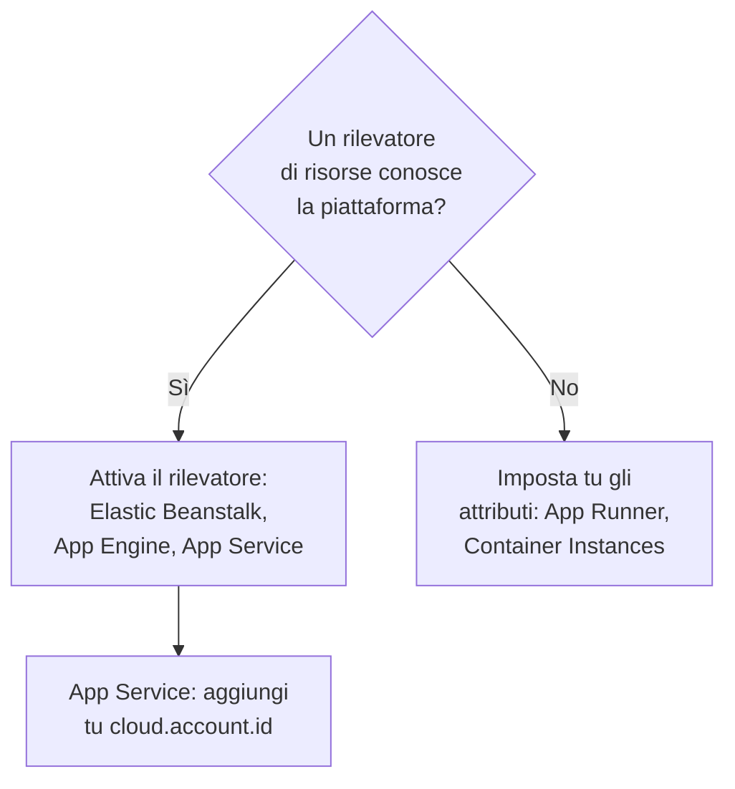

# Altre piattaforme cloud

Configura le piattaforme gestite che non hanno una pagina propria: AWS Elastic Beanstalk, AWS App Runner, Google App Engine, Azure App Service e Azure Container Instances. La regola è quella di ogni piattaforma: la telemetria che porta una `cloud.platform` gestita, con `cloud.account.id` e `cloud.region`, entra in un **Cloud Environment** per piattaforma, account e regione, e un'identità dell'istanza dà a ogni istanza in esecuzione una riga in **Istanze**.

:::cards
- [AWS Elastic Beanstalk](#aws-elastic-beanstalk): Un collector su ogni istanza, con i rilevatori Beanstalk ed EC2.
- [AWS App Runner](#aws-app-runner): Gli attributi impostati a mano, il token da Secrets Manager.
- [Google App Engine](#google-app-engine): Il rilevatore GCP, con le impostazioni in `app.yaml`.
- [Azure App Service](#azure-app-service): I rilevatori Azure, un riferimento a Key Vault e la sottoscrizione a mano.
- [Azure Container Instances](#azure-container-instances): Gli attributi impostati a mano, il token come variabile sicura.
:::

## Di cosa ha bisogno ogni piattaforma

Ciò che cambia tra queste piattaforme è chi imposta gli attributi `cloud.*`, e dove vanno le impostazioni nella console del cloud:



| Piattaforma | `cloud.platform` | `cloud.*` compilati da | Identità dell'istanza |
| ------------------------- | --------------------------- | ------------------------------------------------------------------------------------------ | ----------------------------------------------------------- |
| AWS Elastic Beanstalk | `aws_elastic_beanstalk` | I rilevatori `elastic_beanstalk` ed `ec2` del Collector; `aws` in Node.js | `host.id` (elimina il `service.instance.id` del deployment) |
| AWS App Runner | `aws_app_runner` | Tu (nessun rilevatore) | `host.name` |
| Google App Engine | `gcp_app_engine` | Il rilevatore `gcp` (quello del Collector e di ogni SDK) | `faas.instance` |
| Azure App Service | `azure_app_service` | `azureappservice` del Collector, i rilevatori `azure` di Node.js e .NET; `cloud.account.id` da te | `service.instance.id`, poi `host.id` |
| Azure Container Instances | `azure_container_instances` | Tu (nessun rilevatore) | `host.name` |

Ogni sezione qui sotto ha bisogno di una chiave di acquisizione **Server** da **Impostazioni del progetto → Telemetria e APM → Chiavi di acquisizione**, e di un'applicazione strumentata con un SDK OpenTelemetry. Se ospiti OneUptime in autonomia, sostituisci `https://oneuptime.com/otlp` con `https://YOUR-ONEUPTIME-HOST/otlp`.

> [!IMPORTANT]
> Il token è un segreto su ognuna di queste piattaforme. Ogni sezione indica l'archivio di segreti della piattaforma. Un token digitato in una semplice variabile d'ambiente può essere letto da chiunque possa leggere la configurazione dell'app.

## AWS Elastic Beanstalk

`cloud.platform`: `aws_elastic_beanstalk`. Il rilevatore Beanstalk legge `/var/elasticbeanstalk/xray/environment.conf` sull'istanza e imposta `cloud.platform`, `service.instance.id`, `service.version` e il nome dell'ambiente. Non conosce l'account né la regione, quindi abbinalo al rilevatore EC2, che li conosce e che imposta anche `host.id`.

Esegui un OpenTelemetry Collector su ogni istanza, con questa configurazione:

```yaml title="config.yaml"
receivers:
  otlp:
    protocols:
      http:
        endpoint: 0.0.0.0:4318
      grpc:
        endpoint: 0.0.0.0:4317
processors:
  # elastic_beanstalk sets cloud.platform and service.instance.id; ec2 adds
  # cloud.account.id, cloud.region and host.id. The first detector to set an
  # attribute wins, so elastic_beanstalk comes first.
  resourcedetection:
    detectors: [env, elastic_beanstalk, ec2]
    timeout: 5s
  # The Beanstalk detector's service.instance.id is the deployment ID, shared
  # by every instance of a deployment: drop it, so that ec2's host.id names
  # each instance.
  resource:
    attributes:
      - key: service.instance.id
        action: delete
  batch: {}
exporters:
  otlphttp/oneuptime:
    endpoint: https://oneuptime.com/otlp
    headers:
      x-oneuptime-token: ${env:ONEUPTIME_TOKEN}
service:
  pipelines:
    traces:
      receivers: [otlp]
      processors: [resourcedetection, resource, batch]
      exporters: [otlphttp/oneuptime]
    metrics:
      receivers: [otlp]
      processors: [resourcedetection, resource, batch]
      exporters: [otlphttp/oneuptime]
    logs:
      receivers: [otlp]
      processors: [resourcedetection, resource, batch]
      exporters: [otlphttp/oneuptime]
```

:::steps
1. Salva il token in Secrets Manager: `aws secretsmanager create-secret --name oneuptime/ingestion-token --secret-string "YOUR_TELEMETRY_INGESTION_TOKEN"`. Le proprietà d'ambiente di Beanstalk sono conservate nella configurazione dell'ambiente, non in un archivio di segreti, quindi leggi invece il segreto da un hook di piattaforma, con il profilo dell'istanza. Il profilo dell'istanza ha bisogno di `secretsmanager:GetSecretValue` su di esso.
2. Installa il collector da uno script `.platform/hooks/postdeploy/` (o `.ebextensions`): il pacchetto `otelcol-contrib`, con la configurazione qui sopra e il segreto nel suo ambiente come `ONEUPTIME_TOKEN`.
3. **AWS Console → Elastic Beanstalk → Environments → your environment → Configuration**.
4. Nella categoria **Updates, monitoring, and logging**, fai clic su **Edit** e scorri fino a **Environment properties**. Aggiungi `OTEL_SERVICE_NAME`, `OTEL_EXPORTER_OTLP_ENDPOINT` impostato su `http://localhost:4318`, e `OTEL_EXPORTER_OTLP_PROTOCOL` impostato su `http/protobuf`.
5. Fai clic su **Apply**. Beanstalk riavvia l'applicazione con le nuove proprietà.
:::

Le applicazioni Node.js possono fare a meno del collector: i rilevatori dell'SDK includono Beanstalk ed EC2. Imposta `OTEL_EXPORTER_OTLP_ENDPOINT` su `https://oneuptime.com/otlp`, `OTEL_EXPORTER_OTLP_HEADERS` su `x-oneuptime-token=YOUR_TELEMETRY_INGESTION_TOKEN` e `OTEL_NODE_RESOURCE_DETECTORS=env,host,os,aws`. Il token si trova allora in una proprietà d'ambiente. Controlla poi gli attributi di risorsa di una traccia: se `cloud.platform` vale `aws_ec2`, la tua versione dell'SDK ha fatto vincere il rilevatore EC2, e il collector è la via affidabile.

**Rete:** le istanze in una subnet privata hanno bisogno di un NAT gateway, e il gruppo di sicurezza dell'istanza deve consentire il traffico in uscita su TCP 443 verso l'host di OneUptime.

## AWS App Runner

`cloud.platform`: `aws_app_runner`. Non esiste alcun rilevatore, quindi imposti tu gli attributi. App Runner può inserire un segreto di Secrets Manager (o di SSM Parameter Store) in una variabile d'ambiente.

```bash
OTEL_SERVICE_NAME=checkout-api
OTEL_EXPORTER_OTLP_ENDPOINT=https://oneuptime.com/otlp
OTEL_EXPORTER_OTLP_PROTOCOL=http/protobuf
# From Secrets Manager: the secret holds the whole header.
OTEL_EXPORTER_OTLP_HEADERS=x-oneuptime-token=YOUR_TELEMETRY_INGESTION_TOKEN
OTEL_RESOURCE_ATTRIBUTES=cloud.provider=aws,cloud.platform=aws_app_runner,cloud.region=us-east-1,cloud.account.id=123456789012
OTEL_NODE_RESOURCE_DETECTORS=env,host,os
```

Sostituisci la regione e l'ID dell'account con i tuoi. Il rilevatore `host` fornisce `host.name`, il nome host del container, diverso per ogni istanza di App Runner, e OneUptime dà quel nome all'istanza.

:::steps
1. Salva l'intestazione completa in Secrets Manager: `aws secretsmanager create-secret --name oneuptime/otlp-headers --secret-string "x-oneuptime-token=YOUR_TELEMETRY_INGESTION_TOKEN"`. App Runner inserisce il valore del segreto così com'è nella variabile.
2. **AWS Console → App Runner → Services → your service → Configuration → Configure service** (nella scheda **Configuration**, fai clic su **Edit**).
3. In **Environment variables**, fai clic su **Add environment variable** per ogni valore semplice qui sopra.
4. Aggiungi `OTEL_EXPORTER_OTLP_HEADERS` con **Source: Secrets Manager** e l'ARN del segreto. In **Security → Instance role**, scegli un ruolo con `secretsmanager:GetSecretValue` sul segreto: il ruolo dell'istanza, non il ruolo di accesso che scarica l'immagine.
5. Fai clic su **Save changes**. App Runner distribuisce una nuova versione.
:::

**Rete:** un servizio senza connettore VPC raggiunge Internet direttamente. Con **Outgoing network traffic: Custom VPC**, il traffico in uscita passa dal tuo VPC, che ha bisogno di un NAT gateway e di una regola in uscita del gruppo di sicurezza su TCP 443 verso l'host di OneUptime.

## Google App Engine

`cloud.platform`: `gcp_app_engine`. Il rilevatore GCP riconosce App Engine standard e flessibile da `GAE_SERVICE`, `GAE_VERSION` e `GAE_INSTANCE` e dal server dei metadati. Imposta `cloud.account.id` (il progetto), `cloud.region`, `faas.name`, `faas.version` e `faas.instance`. Come su Cloud Run, `faas.name` fa comparire ogni servizio App Engine anche in **Funzioni serverless**, mentre l'ambiente raggruppa progetto e regione.

| Linguaggio | Attivare il rilevatore GCP |
| -------- | ------------------------------------------------------------------------------------------------------------------- |
| Node.js | `OTEL_NODE_RESOURCE_DETECTORS=env,host,os,gcp` |
| Python | `pip install opentelemetry-resourcedetector-gcp`, poi `OTEL_EXPERIMENTAL_RESOURCE_DETECTORS=gcp_resource_detector` |
| Java | `-Dotel.resource.providers.gcp.enabled=true` |
| Go | `go.opentelemetry.io/contrib/detectors/gcp` → `gcp.NewDetector()` |
| .NET | `OpenTelemetry.Resources.Gcp` → `.AddGcpDetector()` |

App Engine non ha un editor delle variabili d'ambiente nella console: stanno in `app.yaml`.

```yaml title="app.yaml"
runtime: nodejs22
env_variables:
  OTEL_SERVICE_NAME: checkout-api
  OTEL_EXPORTER_OTLP_ENDPOINT: https://oneuptime.com/otlp
  OTEL_EXPORTER_OTLP_PROTOCOL: http/protobuf
  OTEL_NODE_RESOURCE_DETECTORS: env,host,os,gcp
  # Do not commit the real value. Template it in CI, or read the secret at
  # start-up with the Secret Manager client instead.
  OTEL_EXPORTER_OTLP_HEADERS: x-oneuptime-token=YOUR_TELEMETRY_INGESTION_TOKEN
```

:::steps
1. Salva l'intestazione completa in Secret Manager: `printf '%s' "x-oneuptime-token=YOUR_TELEMETRY_INGESTION_TOKEN" | gcloud secrets create oneuptime-otlp-headers --data-file=-`. Concedi all'account di servizio di App Engine (`my-project@appspot.gserviceaccount.com`) `roles/secretmanager.secretAccessor` su di esso.
2. Inserisci il segreto in `app.yaml` nella tua pipeline di deployment, tenendo un segnaposto nel file sotto controllo di versione. Oppure leggi `projects/PROJECT_ID/secrets/oneuptime-otlp-headers/versions/latest` all'avvio e passalo all'opzione `headers` dell'esportatore nel codice.
3. Distribuisci con `gcloud app deploy`. Nella console, **App Engine → Versions** mostra la nuova versione, e **App Engine → Services** il servizio che compare in **Funzioni serverless**.
:::

**Rete:** App Engine standard raggiunge Internet direttamente. Le istanze dell'ambiente flessibile vivono in un VPC: se la subnet non ha IP esterni, hanno bisogno di Cloud NAT, e di una regola firewall in uscita su TCP 443 verso l'host di OneUptime.

## Azure App Service

`cloud.platform`: `azure_app_service`. I rilevatori Azure di Node.js e .NET, e il rilevatore `azureappservice` del Collector, leggono le variabili `WEBSITE_*` che imposta App Service. Compilano `cloud.platform`, `cloud.region`, `service.instance.id` (da `WEBSITE_INSTANCE_ID`), `deployment.environment` (lo slot) e `host.id`. Nessuno di loro imposta `cloud.account.id`: aggiungi tu l'ID della sottoscrizione, altrimenti la chiave dell'ambiente riceve un segmento di account vuoto.

```bash
OTEL_SERVICE_NAME=checkout-api
OTEL_EXPORTER_OTLP_ENDPOINT=https://oneuptime.com/otlp
OTEL_EXPORTER_OTLP_PROTOCOL=http/protobuf
# The Key Vault reference, which resolves to the whole header.
OTEL_EXPORTER_OTLP_HEADERS=@Microsoft.KeyVault(SecretUri=https://my-vault.vault.azure.net/secrets/oneuptime-otlp-headers/)
OTEL_RESOURCE_ATTRIBUTES=cloud.account.id=00000000-0000-0000-0000-000000000000
# Node.js:
OTEL_NODE_RESOURCE_DETECTORS=env,host,os,azure
```

I rilevatori degli SDK scrivono la piattaforma `azure.app_service`, con un punto; OneUptime la riscrive in `azure_app_service` quando la riceve. In .NET, aggiungi `OpenTelemetry.Resources.Azure` e chiama `.ConfigureResource(r => r.AddAzureAppServiceDetector())`. Gli altri linguaggi aggiungono `cloud.provider=azure,cloud.platform=azure_app_service,cloud.region=<region>` a `OTEL_RESOURCE_ATTRIBUTES`, e prendono `service.instance.id` da `WEBSITE_INSTANCE_ID` nel codice.

:::steps
1. Attiva l'identità gestita assegnata dal sistema dell'app (**Settings → Identity**), e concedile **Key Vault Secrets User** sull'insieme di credenziali. Salva l'intestazione completa, `x-oneuptime-token=YOUR_TELEMETRY_INGESTION_TOKEN`, come segreto `oneuptime-otlp-headers`.
2. **Azure portal → App Services → your app → Settings → Environment variables** (**Configuration → Application settings** nei portali meno recenti).
3. **+ Add** per ogni variabile qui sopra. Il valore di `OTEL_EXPORTER_OTLP_HEADERS` è il riferimento a Key Vault.
4. Fai clic su **Apply**, poi su **Confirm**: l'app si riavvia con le nuove impostazioni. Gli slot di distribuzione hanno impostazioni proprie: segna il token come **deployment slot setting** se un solo slot deve inviare telemetria.
:::

**Rete:** App Service raggiunge Internet direttamente, a meno che sia attiva la **VNet integration** con **Route All**. In quel caso la VNet ha bisogno di un NAT gateway, o di una route verso un firewall che consenta TCP 443 verso l'host di OneUptime.

## Azure Container Instances

`cloud.platform`: `azure_container_instances`. Non esiste alcun rilevatore, quindi imposti tu gli attributi. Le variabili d'ambiente di un gruppo di container sono fissate alla creazione: cambiarne una significa ricreare il gruppo. Passa il token con `--secure-environment-variables`, così `az container show` non lo restituisce:

```bash
az container create \
  --resource-group my-rg \
  --name checkout-api \
  --image myregistry.azurecr.io/checkout-api:1.4.2 \
  --location eastus \
  --environment-variables \
    OTEL_SERVICE_NAME=checkout-api \
    OTEL_EXPORTER_OTLP_ENDPOINT=https://oneuptime.com/otlp \
    OTEL_EXPORTER_OTLP_PROTOCOL=http/protobuf \
    "OTEL_RESOURCE_ATTRIBUTES=cloud.provider=azure,cloud.platform=azure_container_instances,cloud.region=eastus,cloud.account.id=00000000-0000-0000-0000-000000000000" \
    OTEL_NODE_RESOURCE_DETECTORS=env,host,os \
  --secure-environment-variables \
    "OTEL_EXPORTER_OTLP_HEADERS=x-oneuptime-token=YOUR_TELEMETRY_INGESTION_TOKEN"
```

Il `host.name` del rilevatore `host`, il nome host del gruppo di container, dà il nome all'istanza. Un collector sidecar funziona anche qui, perché un gruppo di container esegue più container come un task ECS: usa lo schema `detectors: [env]` più `OTEL_RESOURCE_ATTRIBUTES` di [Azure Container Apps](/docs/telemetry/cloud-azure-container-apps). È anche ciò che riempie i riquadri **CPU** e **Memoria**, se invia `container.cpu.utilization` e `container.memory.usage` con l'identità del gruppo.

:::steps
1. **Azure portal → Container Instances → + Create**. Compila la scheda **Basics**: gruppo di risorse, nome, regione e immagine.
2. Nella scheda **Advanced**, in **Environment variables**, aggiungi ogni variabile. Per `OTEL_EXPORTER_OTLP_HEADERS`, imposta **Mark as secure** su **Yes**, così il portale e l'API non ne mostrano il valore.
3. Fai clic su **Review + create**, poi su **Create**. Per cambiare una variabile in seguito, elimina il gruppo e ricrealo.
:::

**Rete:** un gruppo di container con un IP pubblico raggiunge Internet direttamente. Uno in una subnet di una VNet esce solo dalla route della VNet: aggiungi un NAT gateway, oppure consenti TCP 443 verso l'host di OneUptime sul firewall o sull'NSG.

## Verificare la connessione

Qualunque piattaforma tu abbia configurato, verifica prima il token, poi cerca l'ambiente:

```bash
curl -i https://oneuptime.com/otlp/v1/validate \
  -H "x-oneuptime-token: YOUR_TELEMETRY_INGESTION_TOKEN"
```

`200` con `"valid": true` significa che il token è accettato. `401` significa che è sconosciuto, revocato, disattivato o scaduto. Entro un minuto dal primo span, log o metrica, l'ambiente compare in **Cloud → All Environments**, con il nome della piattaforma, della regione e dell'account.

## Risoluzione dei problemi

:::details Le istanze Beanstalk compaiono in Host
Ha vinto il `cloud.platform=aws_ec2` del rilevatore EC2. Vince il primo rilevatore che imposta un attributo, quindi tieni `elastic_beanstalk` prima di `ec2` in `detectors`. Senza collector, anche l'SDK Node.js può favorire il rilevatore EC2: esegui il collector.
:::

:::details Tutte le istanze Beanstalk condividono una riga in Istanze
Il `service.instance.id` del rilevatore Beanstalk è l'ID del deployment, condiviso da tutte le istanze di un deployment, e viene letto prima di `host.id`. Tieni in ogni pipeline il processore `resource` che lo elimina.
:::

:::details Un'app di App Service riceve 401
Il riferimento a Key Vault non è stato risolto, quindi App Service ha passato il testo letterale `@Microsoft.KeyVault(...)` come intestazione. Dai all'identità gestita dell'app **Key Vault Secrets User** sull'insieme di credenziali, e controlla che il segreto contenga l'intestazione completa `x-oneuptime-token=...`.
:::

:::details Un ambiente App Service ha un segmento di account vuoto
Nessuno dei rilevatori di App Service imposta `cloud.account.id`. Aggiungi l'ID della sottoscrizione a `OTEL_RESOURCE_ATTRIBUTES` su ogni app: la telemetria con e senza di esso finisce in due ambienti.
:::

:::details Una variabile di Container Instances modificata non ha effetto
Le variabili d'ambiente di un gruppo di container sono fissate alla creazione. Elimina il gruppo e ricrealo con i nuovi valori.
:::

Vedi [Risoluzione dei problemi cloud](/docs/telemetry/cloud-troubleshooting) per il resto, in particolare un ambiente che compare in **Host**, solo in **Funzioni serverless** (App Engine senza il rilevatore GCP), o due volte (`cloud.account.id` impostato su alcuni deployment e su altri no).

## Prossimi passi

:::cards
- [Ambienti cloud](/docs/telemetry/cloud-environments): Come vengono identificati ambienti e istanze.
- [Risoluzione dei problemi cloud](/docs/telemetry/cloud-troubleshooting): I guasti comuni a tutte le piattaforme.
- [Funzioni serverless](/docs/telemetry/serverless-functions): Lambda, Cloud Functions e Azure Functions.
- [Risorse cloud (IaaS e PaaS)](/docs/telemetry/cloud-resources): Le risorse attorno alle tue app, dal monitoraggio del tuo stesso cloud.
:::
