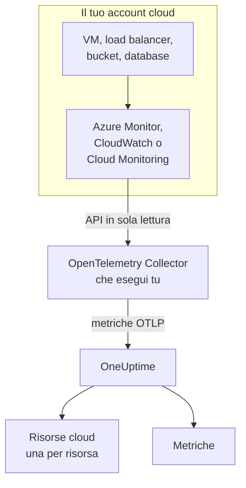
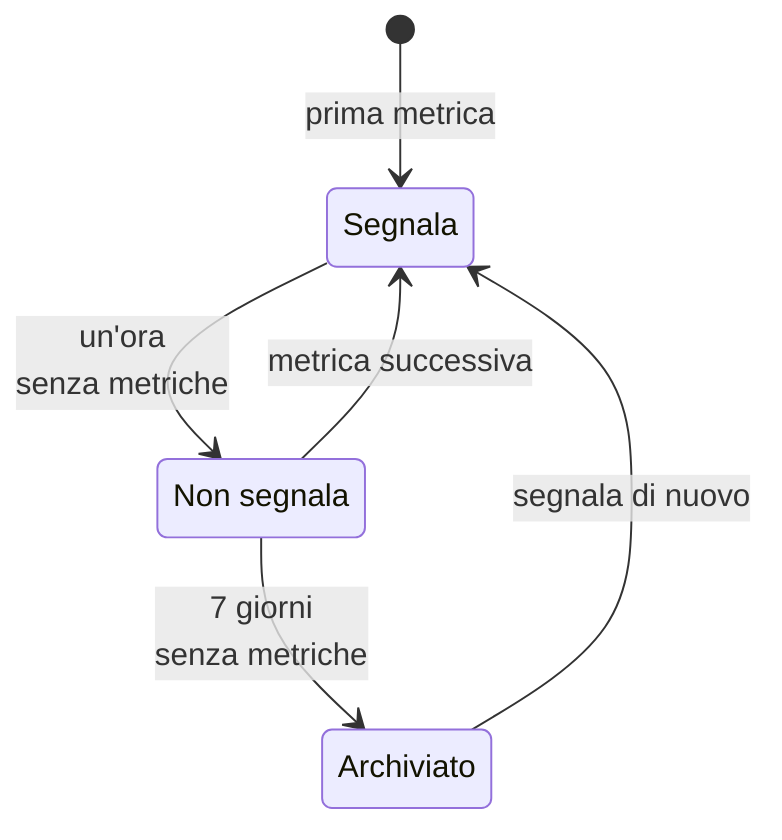

# Risorse cloud (IaaS e PaaS)

**Cloud Resources** elenca le risorse IaaS e PaaS dei tuoi account AWS, Azure e Google Cloud: macchine virtuali, dischi, load balancer, bucket, database gestiti, cache, code, gateway API e il resto. Ognuna ha una pagina propria, con il suo tipo, la regione e l'account, l'ID che le assegna il provider, ogni metrica che il provider pubblica su di essa, e proprietari ed etichette come ogni altra risorsa in OneUptime. Le trovi in **Cloud → Tutte le risorse**.

:::cards
- [Collegare Azure](#collegare-azure): Leggere ogni risorsa di una sottoscrizione da Azure Monitor.
- [Collegare AWS](#collegare-aws): Interrogare CloudWatch, oppure riceverlo in streaming tramite Amazon Data Firehose.
- [Collegare Google Cloud](#collegare-google-cloud): Leggere i servizi di un progetto da Cloud Monitoring.
- [Come viene identificata una risorsa](#come-viene-identificata-una-risorsa): Ogni tipo di risorsa che OneUptime riconosce, per provider.
:::

## Come funziona



- **Il provider misura già le tue risorse.** Azure Monitor, Amazon CloudWatch e Google Cloud Monitoring pubblicano metriche su ogni risorsa che eseguono per te.
- **Un collector che esegui tu le legge.** Un OpenTelemetry Collector con accesso in sola lettura a quel servizio di monitoraggio esporta le metriche verso OneUptime. Sulle risorse non si installa nulla, e OneUptime non custodisce mai le tue credenziali cloud: le custodisce il collector, nel tuo ambiente.
- **Ogni risorsa compare con la sua prima metrica.** OneUptime ricava da ogni punto dati a quale risorsa si riferisce, e crea la risorsa cloud la prima volta che la vede.

Le risorse cloud sono uno dei vari posti in cui compare il tuo cloud:

| Esegui | Dove compare | Come |
| --- | --- | --- |
| Container su ECS, Cloud Run, Container Apps, App Service, … | **Cloud → All Environments** | La telemetria propria dei tuoi carichi di lavoro, in base alla sua `cloud.platform`. Vedi [Ambienti cloud](/docs/telemetry/cloud-environments) |
| Qualsiasi risorsa IaaS o PaaS monitorata dal provider | **Cloud → Tutte le risorse** | L'API di monitoraggio del provider, letta da un collector: questa pagina |
| Macchine virtuali con un OpenTelemetry Collector installato | **Host** | Le metriche e i log propri dell'host. Vedi [Collector OpenTelemetry sull'host](/docs/telemetry/host-otel-collector) |
| Code e topic usati dalle tue applicazioni | **Queues** | Span, e le stesse metriche cloud. Vedi [Code](/docs/telemetry/queues) |

Una risorsa può comparire in più di un posto. Una macchina virtuale con il collector installato è un **Host**, e le sue metriche di piattaforma (crediti CPU, disco e rete come li vede l'hypervisor) la rendono anche una **Risorsa cloud**. Una coda SQS è una **Queue** e una **Risorsa cloud**. Ogni vista mostra ciò che sa la sua fonte.

## Prima di iniziare

- **Una chiave di acquisizione.** Crea una chiave **Server** in **Impostazioni del progetto → Telemetria e APM → Chiavi di acquisizione**. I collector qui sotto la leggono dalla variabile d'ambiente `ONEUPTIME_TOKEN`, mai dal loro file di configurazione.
- **Un posto dove eseguire l'OpenTelemetry Collector**: la distribuzione `otelcol-contrib`, immagine `otel/opentelemetry-collector-contrib`, con accesso in uscita verso il tuo provider cloud e verso OneUptime. Va bene una piccola VM, un container o il tuo cluster Kubernetes, e un collector può leggere più account e provider.
- **Accesso in lettura all'API di monitoraggio del provider.** Il primo passaggio di ogni provider qui sotto lo crea.

> [!TIP]
> Gli stessi passaggi sono nella dashboard, con il tuo token già inserito: in **Cloud → Tutte le risorse** finché non arriva la prima risorsa, e nella scheda **Documentazione** di ogni risorsa, che si apre sul suo provider.

Se ospiti OneUptime in autonomia, sostituisci `https://oneuptime.com/otlp` con `https://YOUR-ONEUPTIME-HOST/otlp`.

## Collegare Azure

Il receiver `azure_monitor` elenca le risorse di una sottoscrizione e ne legge le metriche di piattaforma ogni minuto. Senza un elenco `services` legge ogni tipo di risorsa, quindi ogni risorsa della sottoscrizione diventa una risorsa cloud.

:::steps
### Creare un'entità servizio con Monitoring Reader

**Monitoring Reader** legge le metriche ed elenca le risorse, e non può modificare nulla:

```bash
az ad sp create-for-rbac \
  --name oneuptime-cloud-collector \
  --role "Monitoring Reader" \
  --scopes /subscriptions/<SUBSCRIPTION_ID>
```

Stampa un `appId` (l'ID client), una `password` (il segreto client) e il `tenant`. Dai alla stessa entità servizio il ruolo su altre sottoscrizioni per leggerle con lo stesso collector.

### Configurare il receiver Azure Monitor

Salva questo come `config.yaml`:

```yaml
extensions:
  azure_auth:
    service_principal:
      tenant_id: ${env:AZURE_TENANT_ID}
      client_id: ${env:AZURE_CLIENT_ID}
      client_secret: ${env:AZURE_CLIENT_SECRET}

receivers:
  azure_monitor:
    subscription_ids: ["${env:AZURE_SUBSCRIPTION_ID}"]
    auth:
      authenticator: azure_auth
    collection_interval: 60s
    # No `services` list: every resource type in the subscription.
    # Series Azure returns per metric and resource (default 10).
    maximum_number_of_records_per_resource: 50

processors:
  batch: {}

exporters:
  otlphttp/oneuptime:
    endpoint: https://oneuptime.com/otlp
    headers:
      x-oneuptime-token: ${env:ONEUPTIME_TOKEN}

service:
  extensions: [azure_auth]
  pipelines:
    metrics:
      receivers: [azure_monitor]
      processors: [batch]
      exporters: [otlphttp/oneuptime]
```

### Eseguire il collector Azure

```bash
docker run -d --name oneuptime-cloud-collector --restart unless-stopped \
  -e ONEUPTIME_TOKEN=YOUR_TELEMETRY_INGESTION_TOKEN \
  -e AZURE_TENANT_ID=<TENANT> \
  -e AZURE_CLIENT_ID=<APP_ID> \
  -e AZURE_CLIENT_SECRET=<PASSWORD> \
  -e AZURE_SUBSCRIPTION_ID=<SUBSCRIPTION_ID> \
  -v "$(pwd)/config.yaml:/etc/otelcol-contrib/config.yaml" \
  otel/opentelemetry-collector-contrib:latest
```

Le risorse compaiono in **Cloud → Tutte le risorse** entro pochi minuti.
:::

Opzioni del receiver `azure_monitor`:

| Opzione | Cosa fa |
| --- | --- |
| `resource_groups`, `services`, `resource_tags` | Leggere meno: un elenco di gruppi di risorse, di tipi Resource Manager (`Microsoft.Compute/virtualMachines`), o di tag che una risorsa deve avere |
| `metrics` | Limita ogni tipo di risorsa alle metriche e aggregazioni che elenchi. Una volta elencato un tipo, si leggono solo le sue metriche elencate |
| `discover_subscriptions: true` | Legge ogni sottoscrizione che l'entità servizio può vedere, invece di `subscription_ids` |
| `maximum_number_of_records_per_resource` | Quante serie restituisce Azure per metrica e risorsa (10 per impostazione predefinita). Alzalo quando una metrica si divide per una dimensione con molti valori |
| `use_batch_api: true` | Per le sottoscrizioni grandi. Il receiver fa una chiamata a Resource Manager per risorsa e per lotto di 20 metriche, e Resource Manager consente circa 12.000 letture all'ora; l'API batch legge fino a 50 risorse per chiamata dal piano dati di Azure Monitor, il cui limite è molto più alto |
| `cache_resources` | Ogni quanto, in secondi, il receiver elenca le risorse: una volta al giorno per impostazione predefinita. Una risorsa creata dopo l'avvio del collector può impiegare fino a un giorno a comparire; riavvia il collector per elencarle subito |

## Collegare AWS

Le metriche CloudWatch arrivano in OneUptime in uno di due modi:

| | Polling | Metric Streams |
| --- | --- | --- |
| Come | Il receiver `aws_cloudwatch` del collector interroga CloudWatch | CloudWatch invia tramite Amazon Data Firehose al receiver `awsfirehose` del collector |
| Serve lato AWS | Solo le credenziali | Un flusso Firehose e un metric stream in ogni regione |
| Il collector deve essere raggiungibile da AWS | No | Sì, su HTTPS alla porta 443 |
| Ritardo | Da 10 a 20 minuti | Pochi minuti |
| Adatto a | La maggior parte degli account | Account grandi |

### Polling con il receiver aws_cloudwatch

:::steps
#### Consentire al collector di leggere CloudWatch

Collega questo criterio al ruolo con cui gira il collector (un profilo di istanza EC2, un ruolo di task ECS, un account di servizio EKS), o a un utente IAM di cui gli dai le chiavi di accesso:

```json
{
  "Version": "2012-10-17",
  "Statement": [
    {
      "Effect": "Allow",
      "Action": [
        "cloudwatch:ListMetrics",
        "cloudwatch:GetMetricData",
        "sts:GetCallerIdentity"
      ],
      "Resource": "*"
    }
  ]
}
```

`sts:GetCallerIdentity` permette al receiver di riportare l'ID dell'account, di cui ha bisogno l'ARN di ogni risorsa.

#### Configurare i receiver CloudWatch

Un receiver legge un namespace in una regione, quindi aggiungine uno per ogni namespace e regione che vuoi. Questo esempio legge quelli più comuni; salvalo come `config.yaml`:

```yaml
receivers:
  aws_cloudwatch/ec2:
    region: ${env:AWS_REGION}
    metrics:
      collection_interval: 5m
      period: 5m
      delay: 10m
      discovery:
        filters:
          namespace: AWS/EC2
        # Metrics read per scrape, at most. Each costs 4 GetMetricData queries.
        limit: 1000
  aws_cloudwatch/ebs:
    region: ${env:AWS_REGION}
    metrics:
      collection_interval: 5m
      period: 5m
      delay: 10m
      discovery:
        filters:
          namespace: AWS/EBS
        # Metrics read per scrape, at most. Each costs 4 GetMetricData queries.
        limit: 1000
  aws_cloudwatch/applicationelb:
    region: ${env:AWS_REGION}
    metrics:
      collection_interval: 5m
      period: 5m
      delay: 10m
      discovery:
        filters:
          namespace: AWS/ApplicationELB
        # Metrics read per scrape, at most. Each costs 4 GetMetricData queries.
        limit: 1000
  aws_cloudwatch/rds:
    region: ${env:AWS_REGION}
    metrics:
      collection_interval: 5m
      period: 5m
      delay: 10m
      discovery:
        filters:
          namespace: AWS/RDS
        # Metrics read per scrape, at most. Each costs 4 GetMetricData queries.
        limit: 1000
  aws_cloudwatch/lambda:
    region: ${env:AWS_REGION}
    metrics:
      collection_interval: 5m
      period: 5m
      delay: 10m
      discovery:
        filters:
          namespace: AWS/Lambda
        # Metrics read per scrape, at most. Each costs 4 GetMetricData queries.
        limit: 1000
  aws_cloudwatch/dynamodb:
    region: ${env:AWS_REGION}
    metrics:
      collection_interval: 5m
      period: 5m
      delay: 10m
      discovery:
        filters:
          namespace: AWS/DynamoDB
        # Metrics read per scrape, at most. Each costs 4 GetMetricData queries.
        limit: 1000

processors:
  batch: {}

exporters:
  otlphttp/oneuptime:
    endpoint: https://oneuptime.com/otlp
    headers:
      x-oneuptime-token: ${env:ONEUPTIME_TOKEN}

service:
  pipelines:
    metrics:
      receivers: [aws_cloudwatch/ec2, aws_cloudwatch/ebs, aws_cloudwatch/applicationelb, aws_cloudwatch/rds, aws_cloudwatch/lambda, aws_cloudwatch/dynamodb]
      processors: [batch]
      exporters: [otlphttp/oneuptime]
```

#### Eseguire il collector CloudWatch

```bash
docker run -d --name oneuptime-cloud-collector --restart unless-stopped \
  -e ONEUPTIME_TOKEN=YOUR_TELEMETRY_INGESTION_TOKEN \
  -e AWS_REGION=us-east-1 \
  -e AWS_ACCESS_KEY_ID=<ACCESS_KEY_ID> \
  -e AWS_SECRET_ACCESS_KEY=<SECRET_ACCESS_KEY> \
  -v "$(pwd)/config.yaml:/etc/otelcol-contrib/config.yaml" \
  otel/opentelemetry-collector-contrib:latest
```

Su un'istanza EC2, un task ECS o un pod EKS che ha il ruolo, ometti le due variabili delle chiavi.
:::

- **Lascia `stats` non impostato.** Ogni metrica viene allora letta come un riepilogo per periodo: quattro statistiche, quattro query `GetMetricData`, e AWS fattura `GetMetricData` per metrica richiesta. `discovery.limit` limita le metriche che un receiver legge per raccolta (impostalo: il valore predefinito del receiver è 100), e un `collection_interval` più lungo le legge meno spesso.
- **I dati arrivano in ritardo.** `delay` attende che CloudWatch pubblichi un periodo, quindi i punti dati arrivano da 10 a 20 minuti dopo il momento che misurano, e le risorse compaiono entro una ventina di minuti.

### Streaming con CloudWatch Metric Streams

:::steps
#### Configurare il receiver Firehose

Il collector ha bisogno di un certificato per il suo indirizzo: Firehose consegna solo a `https://` sulla porta 443. Salva questo come `config.yaml`:

```yaml
extensions:
  awscloudwatchmetricstreams_encoding:
    format: opentelemetry1.0

receivers:
  awsfirehose:
    # Firehose delivers to HTTPS on port 443 only: expose this port as
    # 443, for example behind a load balancer.
    endpoint: 0.0.0.0:4433
    encoding: awscloudwatchmetricstreams_encoding
    access_key: ${env:FIREHOSE_ACCESS_KEY}
    tls:
      cert_file: /etc/otelcol-contrib/tls/server.crt
      key_file: /etc/otelcol-contrib/tls/server.key

processors:
  batch: {}

exporters:
  otlphttp/oneuptime:
    endpoint: https://oneuptime.com/otlp
    headers:
      x-oneuptime-token: ${env:ONEUPTIME_TOKEN}

service:
  extensions: [awscloudwatchmetricstreams_encoding]
  pipelines:
    metrics:
      receivers: [awsfirehose]
      processors: [batch]
      exporters: [otlphttp/oneuptime]
```

#### Eseguire il collector Firehose

```bash
docker run -d --name oneuptime-cloud-collector --restart unless-stopped \
  -e ONEUPTIME_TOKEN=YOUR_TELEMETRY_INGESTION_TOKEN \
  -e FIREHOSE_ACCESS_KEY=<A_LONG_RANDOM_SECRET> \
  -p 4433:4433 \
  -v "$(pwd)/tls:/etc/otelcol-contrib/tls:ro" \
  -v "$(pwd)/config.yaml:/etc/otelcol-contrib/config.yaml" \
  otel/opentelemetry-collector-contrib:latest
```

Il certificato e la sua chiave vanno in `tls/`, come `server.crt` e `server.key`. Pubblica la porta 4433 dietro qualcosa che risponde sulla 443, ad esempio un load balancer.

#### Creare il flusso Firehose e il metric stream

1. **Amazon Data Firehose → Create Firehose stream**: origine **Direct PUT**, destinazione **HTTP Endpoint**. L'URL dell'endpoint è l'indirizzo `https://` del collector; la chiave di accesso è `FIREHOSE_ACCESS_KEY`. Scegli o crea un bucket S3 per le consegne non riuscite.
2. **CloudWatch → Metrics → Streams → Create metric stream**: i namespace da includere (o tutti), il flusso Firehose e il formato di output **OpenTelemetry 1.0**.
3. Ripeti in ogni regione: un metric stream trasporta le metriche della propria regione.
:::

AWS fattura un metric stream per ogni aggiornamento di metrica che consegna, più i costi dei dati di Firehose, quindi includi solo i namespace che vuoi. Un flusso nel formato **JSON** (`format: json` sull'estensione di codifica) nomina le stesse risorse, ma scrive anche ogni namespace in `service.name`, quindi ogni namespace compare anche in **Servizi**: preferisci **OpenTelemetry 1.0**.

## Collegare Google Cloud

Il receiver `googlecloudmonitoring` legge i tipi di metrica che nomina il suo `metrics_list`, per un progetto.

:::steps
### Creare un account di servizio con Monitoring Viewer

**Monitoring Viewer** legge le metriche, e non può modificare nulla:

```bash
gcloud iam service-accounts create oneuptime-cloud-collector \
  --project <PROJECT_ID>

gcloud projects add-iam-policy-binding <PROJECT_ID> \
  --member "serviceAccount:oneuptime-cloud-collector@<PROJECT_ID>.iam.gserviceaccount.com" \
  --role roles/monitoring.viewer

gcloud iam service-accounts keys create key.json \
  --iam-account oneuptime-cloud-collector@<PROJECT_ID>.iam.gserviceaccount.com
```

Su Google Cloud stesso, esegui il collector come questo account di servizio invece di creare una chiave.

### Configurare il receiver Cloud Monitoring

Ogni filtro legge tutti i tipi di metrica di un servizio. Salva questo come `config.yaml`:

```yaml
receivers:
  googlecloudmonitoring:
    project_id: ${env:GCP_PROJECT_ID}
    collection_interval: 2m
    # Only the metric types these filters list are read.
    metrics_list:
      - metric_descriptor_filter: 'metric.type = starts_with("compute.googleapis.com/")'
      - metric_descriptor_filter: 'metric.type = starts_with("cloudsql.googleapis.com/")'
      - metric_descriptor_filter: 'metric.type = starts_with("loadbalancing.googleapis.com/")'
      - metric_descriptor_filter: 'metric.type = starts_with("storage.googleapis.com/")'
      - metric_descriptor_filter: 'metric.type = starts_with("redis.googleapis.com/")'
      - metric_descriptor_filter: 'metric.type = starts_with("run.googleapis.com/")'

processors:
  batch: {}

exporters:
  otlphttp/oneuptime:
    endpoint: https://oneuptime.com/otlp
    headers:
      x-oneuptime-token: ${env:ONEUPTIME_TOKEN}

service:
  pipelines:
    metrics:
      receivers: [googlecloudmonitoring]
      processors: [batch]
      exporters: [otlphttp/oneuptime]
```

### Eseguire il collector Google Cloud

```bash
docker run -d --name oneuptime-cloud-collector --restart unless-stopped \
  -e ONEUPTIME_TOKEN=YOUR_TELEMETRY_INGESTION_TOKEN \
  -e GCP_PROJECT_ID=<PROJECT_ID> \
  -e GOOGLE_APPLICATION_CREDENTIALS=/etc/otelcol-contrib/key.json \
  -v "$(pwd)/key.json:/etc/otelcol-contrib/key.json:ro" \
  -v "$(pwd)/config.yaml:/etc/otelcol-contrib/config.yaml" \
  otel/opentelemetry-collector-contrib:latest
```
:::

- **L'elenco viene letto all'avvio del collector:** riavvialo dopo una modifica. `metric_name: compute.googleapis.com/instance/cpu/utilization` legge un solo tipo invece di tutti i tipi di un servizio.
- **Un receiver legge un progetto:** aggiungine uno per progetto.
- **La lettura ha un costo e una quota.** Ogni tipo di metrica è una lettura dell'API Cloud Monitoring per intervallo di raccolta. Leggere le metriche proprie di Google Cloud è gratuito entro la quota mensile dell'API; un `collection_interval` più lungo mantiene un progetto grande entro quella quota, ed entro quella al minuto.

## Tenere la pipeline senza rilevamento delle risorse

> [!WARNING]
> Non aggiungere il processore `resourcedetection` alla pipeline che legge il monitoraggio cloud. Mette `host.name` e `os.type` della macchina stessa del collector su ogni punto dati, e OneUptime archivia allora le metriche del tuo cloud anche sotto quella macchina in **Host**. Un collector che monitora anche il proprio host deve farlo in una pipeline separata.

## Come viene identificata una risorsa

Ogni punto dati di questi receiver nomina una risorsa, e OneUptime associa la risorsa cloud all'identità di quella risorsa, mai al suo nome, che puoi cambiare. L'identità viene confrontata senza distinguere maiuscole e minuscole, quindi una risorsa riportata con due grafie è un'unica risorsa.

### Azure

Ogni punto dati porta l'ID risorsa Azure della sua risorsa (`azuremonitor.resource_id`), quindi ogni risorsa che il receiver legge diventa una risorsa cloud: i tipi qui sotto con un nome leggibile, qualsiasi altro con il suo tipo Resource Manager. L'ID risorsa, la regione, la sottoscrizione e il gruppo di risorse sono tutti mostrati sulla risorsa.

:::details I tipi di risorsa Azure con un nome leggibile
| Tipo di risorsa | Mostrato come | Modello |
| --- | --- | --- |
| `Microsoft.Compute/virtualMachines` | Virtual Machine | IaaS |
| `Microsoft.Compute/virtualMachineScaleSets` | Virtual Machine Scale Set | IaaS |
| `Microsoft.Compute/disks` | Managed Disk | IaaS |
| `Microsoft.Network/loadBalancers` | Load Balancer | IaaS |
| `Microsoft.Network/applicationGateways` | Application Gateway | IaaS |
| `Microsoft.Network/publicIPAddresses` | Public IP Address | IaaS |
| `Microsoft.Network/natGateways` | NAT Gateway | IaaS |
| `Microsoft.Network/virtualNetworkGateways` | Virtual Network Gateway | IaaS |
| `Microsoft.Network/expressRouteCircuits` | ExpressRoute Circuit | IaaS |
| `Microsoft.Network/azureFirewalls` | Azure Firewall | IaaS |
| `Microsoft.Network/frontdoors` | Front Door (classic) | IaaS |
| `Microsoft.Cdn/profiles` | Front Door and CDN Profile | IaaS |
| `Microsoft.Network/trafficmanagerprofiles` | Traffic Manager Profile | IaaS |
| `Microsoft.Network/networkInterfaces` | Network Interface | IaaS |
| `Microsoft.Network/virtualNetworks` | Virtual Network | IaaS |
| `Microsoft.Network/privateEndpoints` | Private Endpoint | IaaS |
| `Microsoft.Network/dnszones` | DNS Zone | IaaS |
| `Microsoft.Network/bastionHosts` | Bastion | IaaS |
| `Microsoft.Storage/storageAccounts` | Storage Account | IaaS |
| `Microsoft.RecoveryServices/vaults` | Recovery Services Vault | PaaS |
| `Microsoft.Web/sites` | App Service or Function App | PaaS |
| `Microsoft.Web/serverfarms` | App Service Plan | PaaS |
| `Microsoft.Web/staticSites` | Static Web App | PaaS |
| `Microsoft.App/containerApps` | Container App | PaaS |
| `Microsoft.App/managedEnvironments` | Container Apps Environment | PaaS |
| `Microsoft.ContainerInstance/containerGroups` | Container Instance | PaaS |
| `Microsoft.ContainerService/managedClusters` | AKS Cluster | PaaS |
| `Microsoft.ContainerRegistry/registries` | Container Registry | PaaS |
| `Microsoft.SignalRService/SignalR` | SignalR Service | PaaS |
| `Microsoft.Sql/servers/databases` | SQL Database | PaaS |
| `Microsoft.Sql/servers/elasticpools` | SQL Elastic Pool | PaaS |
| `Microsoft.Sql/managedInstances` | SQL Managed Instance | PaaS |
| `Microsoft.DBforPostgreSQL/flexibleServers` | PostgreSQL Flexible Server | PaaS |
| `Microsoft.DBforMySQL/flexibleServers` | MySQL Flexible Server | PaaS |
| `Microsoft.DocumentDB/databaseAccounts` | Cosmos DB Account | PaaS |
| `Microsoft.Cache/redis` | Azure Cache for Redis | PaaS |
| `Microsoft.Cache/redisEnterprise` | Azure Managed Redis | PaaS |
| `Microsoft.ServiceBus/namespaces` | Service Bus Namespace | PaaS |
| `Microsoft.EventHub/namespaces` | Event Hubs Namespace | PaaS |
| `Microsoft.EventGrid/topics` | Event Grid Topic | PaaS |
| `Microsoft.EventGrid/systemTopics` | Event Grid System Topic | PaaS |
| `Microsoft.EventGrid/namespaces` | Event Grid Namespace | PaaS |
| `Microsoft.ApiManagement/service` | API Management | PaaS |
| `Microsoft.Logic/workflows` | Logic App | PaaS |
| `Microsoft.DataFactory/factories` | Data Factory | PaaS |
| `Microsoft.Synapse/workspaces` | Synapse Workspace | PaaS |
| `Microsoft.Kusto/clusters` | Data Explorer Cluster | PaaS |
| `Microsoft.StreamAnalytics/streamingjobs` | Stream Analytics Job | PaaS |
| `Microsoft.CognitiveServices/accounts` | Azure AI Services or OpenAI | PaaS |
| `Microsoft.Search/searchServices` | AI Search Service | PaaS |
| `Microsoft.MachineLearningServices/workspaces` | Machine Learning Workspace | PaaS |
| `Microsoft.KeyVault/vaults` | Key Vault | PaaS |
| `Microsoft.Insights/components` | Application Insights | PaaS |
| `Microsoft.OperationalInsights/workspaces` | Log Analytics Workspace | PaaS |
| `Microsoft.Automation/automationAccounts` | Automation Account | PaaS |
| `Microsoft.Devices/IotHubs` | IoT Hub | PaaS |
:::

### AWS

Una metrica CloudWatch nomina la sua risorsa in una dimensione che dipende dal namespace. Un punto dati che porta le dimensioni in **Identificata da** appartiene a quella risorsa, insieme al suo account e alla sua regione; le dimensioni in più restringono la serie, non la risorsa (le serie per gruppo di destinazione di un Application Load Balancer appartengono al load balancer). Un punto dati aggregato su altro (`InstanceType`, `DatabaseClass`, un totale dell'intero account) non nomina alcuna risorsa e non viene scoperto. Né lo è un namespace che non è nell'elenco: le sue metriche arrivano comunque in **Metriche**.

Ogni risorsa è mostrata con il suo ARN quando le sue metriche lo nominano per intero; quando non lo fanno (l'ARN di un gruppo Auto Scaling contiene un UUID che nessuna metrica riporta), con il suo namespace e le sue dimensioni.

:::details I namespace CloudWatch e le dimensioni che identificano una risorsa
| Namespace | Identificata da | Mostrato come | Tipo di risorsa | Modello |
| --- | --- | --- | --- | --- |
| `AWS/EC2` | `InstanceId` | EC2 Instance | `AWS::EC2::Instance` | IaaS |
| `AWS/EC2` | `AutoScalingGroupName` (without `InstanceId`) | Auto Scaling Group | `AWS::AutoScaling::AutoScalingGroup` | IaaS |
| `AWS/AutoScaling` | `AutoScalingGroupName` | Auto Scaling Group | `AWS::AutoScaling::AutoScalingGroup` | IaaS |
| `AWS/EBS` | `VolumeId` | EBS Volume | `AWS::EC2::Volume` | IaaS |
| `AWS/ELB` | `LoadBalancerName` | Classic Load Balancer | `AWS::ElasticLoadBalancing::LoadBalancer` | IaaS |
| `AWS/ApplicationELB` | `LoadBalancer` | Elastic Load Balancer (ALB, NLB, GWLB) | `AWS::ElasticLoadBalancingV2::LoadBalancer` | IaaS |
| `AWS/NetworkELB` | `LoadBalancer` | Elastic Load Balancer (ALB, NLB, GWLB) | `AWS::ElasticLoadBalancingV2::LoadBalancer` | IaaS |
| `AWS/GatewayELB` | `LoadBalancer` | Elastic Load Balancer (ALB, NLB, GWLB) | `AWS::ElasticLoadBalancingV2::LoadBalancer` | IaaS |
| `AWS/NATGateway` | `NatGatewayId` | NAT Gateway | `AWS::EC2::NatGateway` | IaaS |
| `AWS/TransitGateway` | `TransitGateway` | Transit Gateway | `AWS::EC2::TransitGateway` | IaaS |
| `AWS/VPN` | `VpnId` | Site-to-Site VPN Connection | `AWS::EC2::VPNConnection` | IaaS |
| `AWS/DX` | `ConnectionId` | Direct Connect Connection | `AWS::DirectConnect::Connection` | IaaS |
| `AWS/CloudFront` | `DistributionId` | CloudFront Distribution | `AWS::CloudFront::Distribution` | IaaS |
| `AWS/GlobalAccelerator` | `Accelerator` (without `Listener`, `EndpointGroup`) | Global Accelerator | `AWS::GlobalAccelerator::Accelerator` | IaaS |
| `AWS/Route53` | `HealthCheckId` | Route 53 Health Check | `AWS::Route53::HealthCheck` | IaaS |
| `AWS/NetworkFirewall` | `FirewallName` | Network Firewall | `AWS::NetworkFirewall::Firewall` | IaaS |
| `AWS/WAFV2` | `WebACL` (without `Rule`, `RuleGroup`) | WAF Web ACL | `AWS::WAFv2::WebACL` | PaaS |
| `AWS/S3` | `BucketName` | S3 Bucket | `AWS::S3::Bucket` | IaaS |
| `AWS/EFS` | `FileSystemId` | EFS File System | `AWS::EFS::FileSystem` | IaaS |
| `AWS/FSx` | `FileSystemId` | FSx File System | `AWS::FSx::FileSystem` | IaaS |
| `AWS/ECS` | `ClusterName` + `ServiceName` | ECS Service | `AWS::ECS::Service` | PaaS |
| `AWS/ECS` | `ClusterName` (without `ServiceName`) | ECS Cluster | `AWS::ECS::Cluster` | PaaS |
| `AWS/AppRunner` | `ServiceName` | App Runner Service | `AWS::AppRunner::Service` | PaaS |
| `AWS/ElasticBeanstalk` | `EnvironmentName` | Elastic Beanstalk Environment | `AWS::ElasticBeanstalk::Environment` | PaaS |
| `AWS/Lambda` | `FunctionName` | Lambda Function | `AWS::Lambda::Function` | PaaS |
| `AWS/States` | `StateMachineArn` | Step Functions State Machine | `AWS::StepFunctions::StateMachine` | PaaS |
| `AWS/RDS` | `DBInstanceIdentifier` | RDS DB Instance | `AWS::RDS::DBInstance` | PaaS |
| `AWS/RDS` | `DBClusterIdentifier` (without `DBInstanceIdentifier`) | Aurora / RDS DB Cluster | `AWS::RDS::DBCluster` | PaaS |
| `AWS/DocDB` | `DBInstanceIdentifier` | DocumentDB Instance | `AWS::DocDB::DBInstance` | PaaS |
| `AWS/DocDB` | `DBClusterIdentifier` (without `DBInstanceIdentifier`) | DocumentDB Cluster | `AWS::DocDB::DBCluster` | PaaS |
| `AWS/Neptune` | `DBInstanceIdentifier` | Neptune Instance | `AWS::Neptune::DBInstance` | PaaS |
| `AWS/Neptune` | `DBClusterIdentifier` (without `DBInstanceIdentifier`) | Neptune Cluster | `AWS::Neptune::DBCluster` | PaaS |
| `AWS/DynamoDB` | `TableName` | DynamoDB Table | `AWS::DynamoDB::Table` | PaaS |
| `AWS/ElastiCache` | `CacheClusterId` | ElastiCache Cluster | `AWS::ElastiCache::CacheCluster` | PaaS |
| `AWS/ElastiCache` | `ReplicationGroupId` (without `CacheClusterId`) | ElastiCache Replication Group | `AWS::ElastiCache::ReplicationGroup` | PaaS |
| `AWS/ElastiCache` | `clusterId` (without `CacheClusterId`) | ElastiCache Serverless Cache | `AWS::ElastiCache::ServerlessCache` | PaaS |
| `AWS/MemoryDB` | `ClusterName` | MemoryDB Cluster | `AWS::MemoryDB::Cluster` | PaaS |
| `AWS/Redshift` | `ClusterIdentifier` | Redshift Cluster | `AWS::Redshift::Cluster` | PaaS |
| `AWS/ES` | `DomainName` | OpenSearch Domain | `AWS::OpenSearchService::Domain` | PaaS |
| `AWS/SQS` | `QueueName` | SQS Queue | `AWS::SQS::Queue` | PaaS |
| `AWS/SNS` | `TopicName` | SNS Topic | `AWS::SNS::Topic` | PaaS |
| `AWS/Kinesis` | `StreamName` | Kinesis Data Stream | `AWS::Kinesis::Stream` | PaaS |
| `AWS/Firehose` | `DeliveryStreamName` | Data Firehose Stream | `AWS::KinesisFirehose::DeliveryStream` | PaaS |
| `AWS/AmazonMQ` | `Broker` | Amazon MQ Broker | `AWS::AmazonMQ::Broker` | PaaS |
| `AWS/Kafka` | `Cluster Name` | MSK Cluster | `AWS::MSK::Cluster` | PaaS |
| `AWS/Events` | `RuleName` | EventBridge Rule | `AWS::Events::Rule` | PaaS |
| `AWS/ApiGateway` | `ApiName` | API Gateway REST API | `AWS::ApiGateway::RestApi` | PaaS |
| `AWS/ApiGateway` | `ApiId` (without `ApiName`) | API Gateway HTTP or WebSocket API | `AWS::ApiGatewayV2::Api` | PaaS |
| `AWS/AppSync` | `GraphQLAPIId` | AppSync GraphQL API | `AWS::AppSync::GraphQLApi` | PaaS |
| `AWS/CertificateManager` | `CertificateArn` | ACM Certificate | `AWS::CertificateManager::Certificate` | PaaS |
| `AWS/KMS` | `KeyId` | KMS Key | `AWS::KMS::Key` | PaaS |
| `AWS/Cognito` | `UserPool` | Cognito User Pool | `AWS::Cognito::UserPool` | PaaS |
| `AWS/SageMaker` | `EndpointName` | SageMaker Endpoint | `AWS::SageMaker::Endpoint` | PaaS |
| `AWS/Logs` | `LogGroupName` | CloudWatch Log Group | `AWS::Logs::LogGroup` | PaaS |
:::

### Google Cloud

Cloud Monitoring nomina la risorsa monitorata di ogni metrica con un tipo e delle etichette. Un punto dati di un tipo qui sotto appartiene a quella risorsa, identificata dalle etichette elencate; le altre etichette della risorsa, e le sue etichette di metadati, non la dividono mai. I tipi Kubernetes (`k8s_container`, `k8s_pod`, …) sono lasciati al prodotto [Kubernetes](/docs/telemetry/kubernetes-agent).

:::details I tipi di risorsa di Cloud Monitoring e le etichette che li identificano
| Tipo di risorsa monitorata | Identificata da | Mostrato come | Modello |
| --- | --- | --- | --- |
| `gce_instance` | `project_id`, `zone`, `instance_id` | Compute Engine VM Instance | IaaS |
| `instance_group` | `project_id`, `location`, `instance_group_id` | Instance Group | IaaS |
| `gcs_bucket` | `project_id`, `bucket_name` | Cloud Storage Bucket | IaaS |
| `filestore_instance` | `project_id`, `location`, `instance_name` | Filestore Instance | IaaS |
| `https_lb_rule` | `project_id`, `url_map_name` | External Application Load Balancer | IaaS |
| `internal_http_lb_rule` | `project_id`, `region`, `url_map_name` | Internal Application Load Balancer | IaaS |
| `vpn_gateway` | `project_id`, `region`, `gateway_id` | Cloud VPN Gateway | IaaS |
| `nat_gateway` | `project_id`, `region`, `router_id`, `gateway_name` | Cloud NAT Gateway | IaaS |
| `gce_router` | `project_id`, `region`, `router_id` | Cloud Router | IaaS |
| `cloudsql_database` | `project_id`, `database_id` | Cloud SQL Instance | PaaS |
| `alloydb.googleapis.com/Instance` | `resource_container`, `location`, `cluster_id`, `instance_id` | AlloyDB Instance | PaaS |
| `redis_instance` | `project_id`, `region`, `instance_id` | Memorystore for Redis Instance | PaaS |
| `spanner_instance` | `project_id`, `instance_id` | Spanner Instance | PaaS |
| `bigtable_table` | `project_id`, `instance` | Bigtable Instance | PaaS |
| `bigquery_dataset` | `project_id`, `dataset_id` | BigQuery Dataset | PaaS |
| `cloud_function` | `project_id`, `region`, `function_name` | Cloud Run Function | PaaS |
| `cloud_run_revision` | `project_id`, `location`, `service_name` | Cloud Run Service | PaaS |
| `cloud_run_job` | `project_id`, `location`, `job_name` | Cloud Run Job | PaaS |
| `gae_app` | `project_id`, `module_id` | App Engine Service | PaaS |
| `pubsub_topic` | `project_id`, `topic_id` | Pub/Sub Topic | PaaS |
| `pubsub_subscription` | `project_id`, `subscription_id` | Pub/Sub Subscription | PaaS |
| `cloud_tasks_queue` | `project_id`, `location`, `queue_id` | Cloud Tasks Queue | PaaS |
| `cloud_composer_environment` | `project_id`, `location`, `environment_name` | Cloud Composer Environment | PaaS |
| `dataproc_cluster` | `project_id`, `region`, `cluster_name` | Dataproc Cluster | PaaS |
| `aiplatform.googleapis.com/Endpoint` | `resource_container`, `location`, `endpoint_id` | Vertex AI Endpoint | PaaS |
:::

### Nomi

Una risorsa prende il nome con cui la chiama il suo provider (`vm-prod-01`, `checkout`, `orders`). I nomi sono univoci all'interno di un progetto, quelli del provider no: due sottoscrizioni hanno ciascuna un `web-01`, e un piano App Service e la sua app si chiamano entrambi `checkout`. Così una risorsa il cui nome è già preso riceve un nome con il suo tipo, poi il suo gruppo di risorse o la regione, poi il suo account: `web-01 (Virtual Machine, rg-prod)`. Rinomina qualsiasi risorsa nella sua scheda **Impostazioni**: le metriche sono associate in base alla sua identità, non al suo nome.

## Stato, archiviazione e limiti



- **Segnala** significa che il provider ha inviato una metrica sulla risorsa nell'ultima ora; dopo un'ora senza, mostra **Non segnala**. Alcune risorse sono silenziose per natura, come un Key Vault che nessuno ha chiamato o un bucket le cui metriche di archiviazione CloudWatch pubblica una volta al giorno, e tornano con il loro punto dati successivo.
- Una risorsa che non invia **alcuna metrica per 7 giorni** viene archiviata automaticamente: un'istanza sostituita da un gruppo Auto Scaling, un volume eliminato, un bucket che non esiste più. Mantiene etichette, proprietari e cronologia in **Cloud → Avanzato → Archiviato**, e viene ripristinata da sola appena segnala di nuovo. Una risorsa che archivi tu resta archiviata; una che ripristini mentre è silenziosa resta nell'elenco finché non segnala.
- Eliminare una risorsa che il provider continua a segnalare non funziona: viene scoperta di nuovo dalle sue metriche successive. Archiviala invece.
- La scoperta smette di creare risorse quando un progetto ne ha **5.000** attive (non archiviate), e registra un avviso; le risorse archiviate non contano.

Le installazioni ospitate in autonomia possono cambiare questi valori con variabili d'ambiente sull'app:

| Variabile | Predefinito | Significato |
| --- | --- | --- |
| `CLOUD_RESOURCE_AUTO_ARCHIVE_DAYS` | `7` | Giorni senza metriche prima che una risorsa venga archiviata (almeno 1) |
| `CLOUD_RESOURCE_AUTO_CREATE_BUDGET` | `5000` | Risorse attive che un progetto può avere prima che la scoperta smetta di crearne altre (`0` disattiva la scoperta) |

## Avvisi su una risorsa

:::steps
1. Apri la risorsa e la sua scheda **Metriche**, che elenca ogni metrica che il suo provider riporta su di essa.
2. Apri una metrica per rappresentarla nell'esploratore delle metriche, già filtrata sulla risorsa.
3. Fai clic su **Crea monitor da questa vista**: il monitor osserva quella metrica per quella risorsa.
:::

> [!IMPORTANT]
> Il monitoraggio cloud pubblica ogni valore alcuni minuti dopo il momento che misura: da 10 a 20 minuti per CloudWatch interrogato come sopra, pochi minuti per Azure Monitor e Cloud Monitoring. Viene salvato al momento che misura. Dai a un monitor su queste metriche una finestra più lunga di quel ritardo (30 minuti per CloudWatch, 15 per gli altri), altrimenti non vede dati e non scatta mai.

## Inventario e regole

- **Inventario:** le risorse cloud sono elencate nell'[Inventario](/docs/inventory/overview) come elementi di tipo **Risorsa cloud**, con l'ID del provider come `cloud.resource.id` e il tipo come `cloud.resource.type`. Anche gli strumenti delle risorse dell'agente AI le elencano.
- **Regole:** **Cloud → Impostazioni → Regole etichette** e **Regole del proprietario** si applicano a esse come agli ambienti cloud.

## Risoluzione dei problemi

### Non compare nessuna risorsa

1. Verifica il token: `curl -i https://oneuptime.com/otlp/v1/validate -H "x-oneuptime-token: YOUR_TELEMETRY_INGESTION_TOKEN"` deve rispondere `200` con `"valid": true`.
2. Leggi il log del collector (`docker logs oneuptime-cloud-collector`). Un errore di autorizzazione nomina l'autorizzazione mancante: `AuthorizationFailed` (Azure: **Monitoring Reader** sulla sottoscrizione), `AccessDenied` su `cloudwatch:GetMetricData` (AWS: il criterio qui sopra), `PermissionDenied` (Google Cloud: **Monitoring Viewer**).
3. Cerca in **Metriche** le metriche del provider (`azure_…`, `amazonaws.com/aws/…`, `compute.googleapis.com/…`). Se ci sono ma non compare nessuna risorsa, i punti dati non nominano alcuna risorsa che OneUptime riconosce: un namespace AWS o un tipo Google Cloud che non è negli elenchi qui sopra, o un punto dati aggregato su qualcosa che non è una risorsa.
4. Attendi i dati in ritardo: CloudWatch interrogato come sopra è indietro da 10 a 20 minuti.

### Manca una risorsa

- **Azure:** il receiver elenca le risorse una volta al giorno; riavvia il collector per elencare subito quelle nuove. Un tipo di risorsa senza metriche di piattaforma in Azure Monitor non ha nulla da riportare.
- **AWS:** ogni receiver legge un namespace in una regione, e `discovery.limit` limita quante metriche legge: alzalo quando un account ne ha di più.
- **Google Cloud:** `metrics_list` deve nominare il servizio della risorsa.
- **Qualsiasi provider:** un progetto arrivato al limite non crea nuove risorse finché alcune non vengono archiviate. Vedi [Stato, archiviazione e limiti](#stato-archiviazione-e-limiti).

### La stessa risorsa compare due volte

Una risorsa AWS letta una volta con il suo ID account e una volta senza sono due risorse: il receiver di polling riporta l'account solo quando può chiamare `sts:GetCallerIdentity`. Dai quell'autorizzazione a ogni collector, e archivia la copia senza account.

### Le metriche del mio cloud compaiono sotto un host

La pipeline ha un processore `resourcedetection`. Vedi [Tenere la pipeline senza rilevamento delle risorse](#tenere-la-pipeline-senza-rilevamento-delle-risorse).

## Limitazioni

- **Solo metriche.** Le API di monitoraggio dei provider non pubblicano log né tracce su una risorsa. Inviali dai tuoi carichi di lavoro con OpenTelemetry.
- **La scoperta segue le metriche.** Una risorsa su cui il provider non pubblica metriche, o che il collector non legge, non viene scoperta.
- **Nessuna impostazione di conservazione propria.** Le metriche di una risorsa sono conservate quanto le altre metriche che invia il suo collector.
- **Il polling costa** e conta nei limiti delle API cloud: vedi le note di ogni provider qui sopra.

## Prossimi passi

:::cards
- [Ambienti cloud](/docs/telemetry/cloud-environments): I tuoi container su ECS, Cloud Run e Container Apps, dalla loro stessa telemetria.
- [Code](/docs/telemetry/queues): SQS, Service Bus e Pub/Sub, con le stesse metriche cloud.
- [Regole per etichette e proprietari](/docs/configuration/label-and-owner-rules): Etichettare le risorse e assegnare loro i proprietari man mano che vengono scoperte.
- [Inventario](/docs/inventory/overview): Ogni host, dispositivo e risorsa cloud in un unico elenco.
:::
