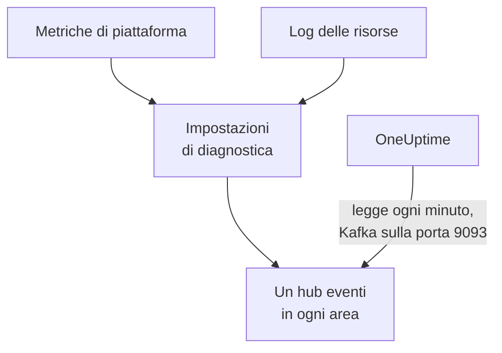

# Trasmettere metriche e log di Azure Monitor

Una sottoscrizione Azure connessa può trasmettere a OneUptime le sue metriche di Azure Monitor e i log delle risorse. Le impostazioni di diagnostica li inviano a hub eventi della tua sottoscrizione, e OneUptime legge gli hub eventi ogni minuto: la maggior parte delle metriche chiave arriva pochi minuti dopo che Azure Monitor le ha, invece di attendere la lettura successiva della connessione, e i log delle risorse arrivano come log di OneUptime, ciascuno archiviato sotto la risorsa a cui si riferisce. Un solo comando in Azure Cloud Shell configura tutto, e non c'è nulla da eseguire.

:::cards
- [Come funziona](#come-funziona): Le impostazioni di diagnostica inviano a un hub eventi in ogni area, e OneUptime li legge.
- [Configurare la trasmissione](#configurare-la-trasmissione): Scegli cosa trasmettere, attiva la lettura ed esegui un comando.
- [Cosa arriva](#cosa-arriva): Le metriche sulle risorse che misurano, e i log sulle risorse da cui provengono.
- [Cosa crea il comando](#cosa-crea-il-comando): Ogni risorsa e ogni autorizzazione che il comando crea nella tua sottoscrizione.
- [Interrompere la trasmissione](#interrompere-la-trasmissione): Interrompi la lettura, poi elimina ciò che il comando ha creato.
:::

## Come funziona



- **Un hub eventi in ogni area.** Un'impostazione di diagnostica invia solo a un hub eventi nell'area della sua risorsa, quindi il comando crea un namespace di Event Hubs in ogni area in cui si trovano le tue risorse, tutti in un unico gruppo di risorse, e indirizza l'impostazione di diagnostica di ogni risorsa a quello della sua area.
- **OneUptime li legge.** Azure Monitor invia solo a un hub eventi, a un account di archiviazione o a un'area di lavoro Log Analytics, mai a un tuo indirizzo: un hub eventi letto da OneUptime è la via che non richiede di eseguire nulla da parte tua. OneUptime accede come app della connessione, che può leggere quegli hub eventi e nient'altro.
- **Le letture lasciano le metriche trasmesse al flusso.** Finché il flusso consegna le metriche chiave di un tipo di risorsa in un'area, le letture della connessione smettono di scrivere quelle che trasporta, così nessun punto dati viene contato due volte, e continuano a scrivere [quelle che non può trasportare](#cosa-arriva). Le letture continuano a trovare le risorse, il loro stato e le loro modifiche, e riprendono le metriche dopo 15 minuti senza eventi.
- **Non si perde nulla mentre OneUptime non può leggere.** Gli eventi attendono negli hub eventi che OneUptime li legga, per tutto il tempo in cui gli hub eventi li conservano, e OneUptime ricorda fin dove ha letto ogni partizione, per riprendere da dove si è fermato.

## Prima di iniziare

- **Una sottoscrizione Azure connessa.** Connettila prima in **Cloud → Collega**: vedi [Collegare un account cloud](/docs/telemetry/cloud-accounts).
- **Un Proprietario del progetto o un Amministratore del progetto.** Solo loro possono attivare la lettura e interrompere la trasmissione.
- **Azure Cloud Shell**, con l'accesso come **Owner** delle sottoscrizioni, o come **Contributor** che sia anche **User Access Administrator**: il comando crea un gruppo di risorse e un'assegnazione di ruolo, e modifica le impostazioni di diagnostica.
- **Per i log di Microsoft Entra ID, un Security Administrator** del tenant che sia anche **Owner** o **Contributor** del gruppo di risorse creato dal comando: solo loro possono inviare i log del tenant a un hub eventi.
- **Una via d'uscita verso Azure, per un OneUptime self-hosted.** OneUptime legge ogni namespace su `<namespace>.servicebus.windows.net` sulla porta 9093, e i namespace accettano connessioni da internet.

## Configurare la trasmissione

:::steps
### Aprire la finestra di trasmissione

Vai su **Cloud → Collega** e, nella riga della sottoscrizione Azure, scegli **Trasmetti metriche e log**.

### Scegliere cosa trasmettere

**Metriche** trasmette le metriche chiave di ogni risorsa, minuto per minuto, le metriche con cui OneUptime traccia i grafici e valuta ogni risorsa, tranne [quelle che un'impostazione di diagnostica non può inviare](#cosa-arriva), che la connessione continua a leggere. **Metriche e log** aggiunge i log propri di ogni risorsa, ogni categoria che Azure conserva per essa, e **Log** trasmette solo i log delle risorse.

Sotto **Per gli Eventi di sicurezza**, **Log attività di ogni sottoscrizione** fa inviare al comando le modifiche, gli avvisi di Defender for Cloud e i rifiuti di Azure Policy di ogni sottoscrizione all'hub eventi della prima area, e **Log di accesso e di audit di Microsoft Entra ID** aggiunge un secondo comando, per un Security Administrator del tuo tenant. [Eventi di sicurezza](/docs/telemetry/security-events#trovare-eventi-di-sicurezza-nei-tuoi-log) li legge entrambi.

### Attivare la lettura

Scegli **Attiva la lettura**. OneUptime cerca gli hub eventi ogni minuto, e li attende finché il comando non li ha creati.

### Eseguire il comando in Azure Cloud Shell

Copia il comando, eseguilo in Azure Cloud Shell e attendi che finisca. Indica ogni area in cui ha creato un hub eventi, quante risorse vi inviano e quali risorse ha escluso, con il motivo dato da Azure.

### Eseguire il comando di Microsoft Entra ID, se l'hai scelto

Quando il primo comando è terminato, un Security Administrator del tenant esegue il secondo in Azure Cloud Shell. Questo assegna al tenant un'impostazione di diagnostica che invia i log di accesso, di audit e di rischio di Microsoft Entra ID all'hub eventi della prima area e, se Azure la rifiuta, dice cosa ha chiesto.

### Attendere i primi eventi

La finestra chiede ogni pochi secondi cosa è arrivato. Azure inizia a inviare pochi minuti dopo la fine del comando; la finestra dice allora cosa è arrivato e da dove, e la riga della connessione dice **In trasmissione**.
:::

**Altri campi** contiene il resto:

| Campo | Cosa fa |
| --- | --- |
| **Sottoscrizioni** | Le sottoscrizioni da cui trasmettere: all'inizio, quelle lette dalla connessione. La prima contiene gli hub eventi, e OneUptime li legge lì. Al massimo 50 |
| **Configuralo in un altro modo** | I nomi usati dal comando, per configurare tutto con Terraform o il portale |

Quando la connessione non ha ancora letto nessuna sottoscrizione, o più di 50, la finestra chiede invece le **Sottoscrizioni** prima dei suoi passaggi.

Quando la prima sottoscrizione non è quella in cui OneUptime legge gli hub eventi, la finestra lo dice: scegli **Leggili lì** prima di eseguire il comando.

## Cosa arriva

| Cosa | Dove arriva |
| --- | --- |
| Metriche chiave | Sulle risorse cloud che misurano, nelle stesse serie scritte dalle letture della connessione |
| Log delle risorse | In Esplora log, sotto il servizio di telemetria della connessione, con la sottoscrizione, l'area e la categoria come attributi |
| Log di una risorsa che OneUptime conosce | Anche su quella risorsa: la sua pagina in Cloud ottiene una scheda **Log** |

Il flusso porta le metriche chiave che la connessione legge minuto per minuto. Le letture continuano a scrivere il resto secondo la loro pianificazione: una metrica che leggono con una granularità più ampia, come lo spazio di archiviazione usato di un registro contenitori, e ogni metrica chiave che un'impostazione di diagnostica non può inviare, che l'elenco delle metriche supportate di Azure Monitor segna come non esportabile nella colonna DS Export:

{{AZURE_STREAM_KEPT_METRICS}}

Un namespace di Service Bus o Event Hubs non trasmette metriche. Le letture leggono le sue metriche chiave per ogni coda, topic e hub eventi, e i totali propri del namespace le sommano, mentre un'impostazione di diagnostica invia solo i totali del namespace, e non invia affatto 4 delle 6 metriche chiave di un namespace di Service Bus, né 2 delle 4 di uno di Event Hubs. Quindi le letture le scrivono tutte, con o senza flusso, e nessun messaggio viene contato due volte.

Un log viene archiviato sotto la sua risorsa in base all'ID ARM della risorsa, portato come `cloud.resource_id`, e conserva categoria, operazione, risultato e proprietà come attributi, ad esempio `azure.category`.

Un record del log attività di categoria `Administrative`, `Security` o `Policy`, e un record di accesso, di audit o di rischio di Microsoft Entra ID, arrivano interi, come corpo del loro log, anche uno su un gruppo di risorse, una sottoscrizione o il tenant anziché su una risorsa. Con [Trova eventi di sicurezza nei tuoi log](/docs/telemetry/security-events#trovare-eventi-di-sicurezza-nei-tuoi-log) attivo, ognuno viene letto come un evento di sicurezza, come uno che arriva da una pipeline di log, e salvato una sola volta, per quante vie raggiunga OneUptime. Con **Log attività di ogni sottoscrizione** attivo, il comando assegna a ogni sottoscrizione un'impostazione di diagnostica che invia il suo log attività all'hub eventi della prima area, e il comando di Microsoft Entra ID ne assegna una al tenant.

Anche i log `AuditEvent` di un Key Vault, `StorageRead`, `StorageWrite` e `StorageDelete` di un account di archiviazione e `SQLSecurityAuditEvents` di un database Azure SQL arrivano interi, ciascuno archiviato sotto la sua risorsa, ed Eventi di sicurezza legge quelli che contano per la sicurezza: vedi [Log di audit propri delle risorse Azure](/docs/telemetry/security-events#log-di-audit-propri-delle-risorse-azure). Un database Azure SQL invia i suoi record di audit solo quando l'audit è attivo, con Azure Monitor come destinazione.

Macchine virtuali, set di scalabilità, dischi, interfacce di rete, reti virtuali, endpoint privati, gateway NAT, zone DNS e piani di App Service non inviano log delle risorse propri, quindi le loro pagine non hanno la scheda **Log**. I log di un'app contenitore sono quelli del suo ambiente.

I log di un account di archiviazione sono quelli dei suoi servizi BLOB, file, code e tabelle: il comando assegna a ogni servizio un'impostazione di diagnostica propria, e i loro log vengono archiviati sotto l'account, nella sua scheda **Log**. Riportano ogni richiesta a cui l'account risponde, quindi un account molto attivo ne invia molti.

## Cosa crea il comando

Il gruppo di risorse si chiama `oneuptime-stream-` seguito dai primi 8 caratteri dell'ID della connessione. Non dà a OneUptime alcun accesso alle tue risorse: l'app della connessione può leggere gli hub eventi, e niente di più.

| Risorsa | Cosa può fare |
| --- | --- |
| Un gruppo di risorse, `oneuptime-stream-<suffix>`, nella prima sottoscrizione | Contiene gli hub eventi, con il tag `oneuptime-connection` che porta l'ID della connessione |
| Un namespace di Event Hubs in ogni area, `oneuptime-<suffix>-<region>`, nel livello Standard con 1 unità elaborata | Riceve ciò che inviano le impostazioni di diagnostica della sua area |
| Un hub eventi in ciascuno, `oneuptime`, con 2 partizioni | Conserva gli eventi finché OneUptime non li legge |
| Il ruolo **Azure Event Hubs Data Receiver** per l'app della connessione, solo sul gruppo di risorse | Permette all'app di leggere gli hub eventi, e nient'altro |
| Un'impostazione di diagnostica su ogni risorsa, `OneUptime-<suffix>` | Invia le metriche, i log o entrambi della risorsa all'hub eventi della sua area |
| Con i log, un'impostazione di diagnostica su ciascuno dei servizi BLOB, file, code e tabelle di un account di archiviazione, `OneUptime-<suffix>` | Invia i log dei servizi all'hub eventi dell'area dell'account |
| Con **Log attività di ogni sottoscrizione**, un'impostazione di diagnostica su ogni sottoscrizione, `OneUptime-<suffix>` | Invia i suoi record `Administrative`, `Security` e `Policy` all'hub eventi della prima area |
| Con il comando di Microsoft Entra ID, l'impostazione di diagnostica del tenant, `OneUptime-<suffix>` | Invia i suoi log di accesso, di audit e di rischio all'hub eventi della prima area |

Una risorsa di un'area globale, come Front Door, invia all'hub eventi della prima area. Una risorsa di cui Azure conserva solo metriche o solo log viene configurata con ciò che ha, e una che ha già 5 impostazioni di diagnostica, il massimo consentito da Azure, viene esclusa. Azure addebita l'unità elaborata di ogni namespace a ore, e gli eventi inviati dalle impostazioni di diagnostica.

## Interrompere la trasmissione

:::steps
### Interrompere la lettura

Nella riga della sottoscrizione in **Cloud → Collega**, scegli **Interrompi la trasmissione**. OneUptime smette subito di leggere gli hub eventi, e la connessione torna a leggere tutte le sue metriche secondo la sua pianificazione. Ciò che è stato letto resta.

### Eliminare ciò che il comando ha creato

Gli hub eventi e le impostazioni di diagnostica restano in Azure, e Azure li addebita, finché non vengono eliminati. La finestra mostra il comando: elimina l'impostazione di diagnostica di ogni risorsa, quelle dei servizi degli account di archiviazione e quella di ogni sottoscrizione, poi il gruppo di risorse, in qualunque sottoscrizione si trovi. Elimina anche l'impostazione di Microsoft Entra ID se ne hai il permesso, e altrimenti dice chi ce l'ha.

```bash
oneuptime_stream_stop() {
  local SUB ID TYPE SERVICE N=0
  for SUB in '11111111-aaaa-4aaa-8aaa-111111111111' '22222222-bbbb-4bbb-8bbb-222222222222'; do
    while IFS=$'\t' read -r ID TYPE; do
      if [ -z "$ID" ]; then continue; fi
      az monitor diagnostic-settings delete --name OneUptime-6f1c3a2e --resource "$ID" --output none 2> /dev/null &
      N=$((N + 1))
      if [ $((N % 4)) -eq 0 ]; then wait; fi
      if [ "${TYPE,,}" = microsoft.storage/storageaccounts ]; then
        for SERVICE in blobServices fileServices queueServices tableServices; do
          az monitor diagnostic-settings delete --name OneUptime-6f1c3a2e --resource "$ID/$SERVICE/default" --output none 2> /dev/null &
          N=$((N + 1))
          if [ $((N % 4)) -eq 0 ]; then wait; fi
        done
      fi
    done < <(az resource list --subscription "$SUB" --query "[].[id, type]" --output tsv)
    az monitor diagnostic-settings subscription delete --subscription "$SUB" --name OneUptime-6f1c3a2e --yes --output none 2> /dev/null
  done
  wait
  if az rest --method get --url "/providers/microsoft.aadiam/diagnosticSettings/OneUptime-6f1c3a2e?api-version=2017-04-01" --output none 2> /dev/null; then
    az rest --method delete --url "/providers/microsoft.aadiam/diagnosticSettings/OneUptime-6f1c3a2e?api-version=2017-04-01" --output none 2> /dev/null && echo "Deleted Microsoft Entra ID's diagnostic setting OneUptime-6f1c3a2e." || echo "Microsoft Entra ID's diagnostic setting OneUptime-6f1c3a2e is left: a Security Administrator of the tenant deletes it, under Diagnostic settings in the Microsoft Entra admin center."
  fi
  for SUB in '11111111-aaaa-4aaa-8aaa-111111111111' '22222222-bbbb-4bbb-8bbb-222222222222'; do
    if [ "$(az group exists --subscription "$SUB" --name oneuptime-stream-6f1c3a2e 2> /dev/null)" = true ]; then
      az group delete --subscription "$SUB" --name oneuptime-stream-6f1c3a2e --yes --no-wait && echo "Deleting oneuptime-stream-6f1c3a2e in $SUB."
    fi
  done
}
oneuptime_stream_stop
```
:::

Per cambiare ciò che viene trasmesso, apri di nuovo **Trasmetti metriche e log**, scegli cosa trasmettere ed esegui il nuovo comando: aggiorna ciò che la prima esecuzione ha creato, e non crea nulla due volte.

## Configuralo in un altro modo

Con Terraform o il portale, crea ciò che crea il comando, con questi nomi:

| Impostazione | Valore |
| --- | --- |
| Gruppo di risorse | `oneuptime-stream-<suffix>`, nella sottoscrizione in cui OneUptime legge gli hub eventi |
| Namespace di Event Hubs | `oneuptime-<suffix>-<region>`, uno in ogni area di una risorsa da trasmettere |
| Hub eventi | `oneuptime`, in ogni namespace |
| Impostazione di diagnostica | `OneUptime-<suffix>` su ogni risorsa, verso l'hub eventi della sua area, con la regola `RootManageSharedAccessKey` del namespace |
| Ruolo | **Azure Event Hubs Data Receiver** per l'app della connessione, sul gruppo di risorse |

Poi attiva la lettura, con quella sottoscrizione per prima in **Sottoscrizioni**.

## Risoluzione dei problemi

:::details La finestra continua ad attendere i primi eventi
Verifica che il comando sia terminato e che abbia detto che l'hub eventi di un'area è pronto: `az eventhubs namespace list --resource-group oneuptime-stream-6f1c3a2e` elenca i namespace. Un'impostazione di diagnostica invia solo ciò che Azure Monitor ha, quindi una risorsa che non fa nulla invia poco. Un nuovo ruolo può richiedere qualche minuto per diventare effettivo: fino ad allora, le letture non vedono gli eventi.
:::

:::details La connessione dice Flusso in errore
La finestra e il tooltip della riga dicono perché. Quando l'app non può leggere gli hub eventi, esegui di nuovo il comando: riassegna all'app il suo ruolo. Quando OneUptime non è riuscito a raggiungerli, verifica che i namespace accettino connessioni da internet, e che un OneUptime self-hosted possa raggiungere la porta 9093.
:::

:::details Il comando ha escluso delle risorse
Le elenca, ciascuna con il motivo dato da Azure. Una risorsa di un tipo senza impostazioni di diagnostica non invia nulla, e per una che ha già 5 impostazioni di diagnostica bisogna prima eliminarne una. Poi esegui di nuovo il comando.
:::

:::details Il log attività o i log di Microsoft Entra ID sono stati esclusi
Il comando dice cosa ha chiesto Azure. L'impostazione di diagnostica di una sottoscrizione richiede `Microsoft.Insights/diagnosticSettings/write` sulla sottoscrizione, un'autorizzazione che hanno il suo Owner, il suo Contributor e il suo Monitoring Contributor, e quella del tenant richiede un Security Administrator del tenant. Entrambe richiedono `Microsoft.EventHub/namespaces/authorizationRules/listKeys/action` sul gruppo di risorse creato dal comando, un'autorizzazione che hanno il suo Owner e il suo Contributor. Poi esegui di nuovo il comando.
:::

## Passaggi successivi

:::cards
- [Collegare un account cloud](/docs/telemetry/cloud-accounts): Cosa legge una connessione, e con quale frequenza.
- [Trasmettere i log di Google Cloud](/docs/telemetry/cloud-streaming-google-cloud): I log di un progetto Google Cloud, inviati tramite Pub/Sub.
- [Trasmettere metriche e log di CloudWatch](/docs/telemetry/cloud-streaming): Quelli di un account AWS, consegnati da Amazon Data Firehose.
- [Esploratore log](/docs/telemetry/logs-explorer): Cerca e filtra ciò che i flussi hanno consegnato.
:::
