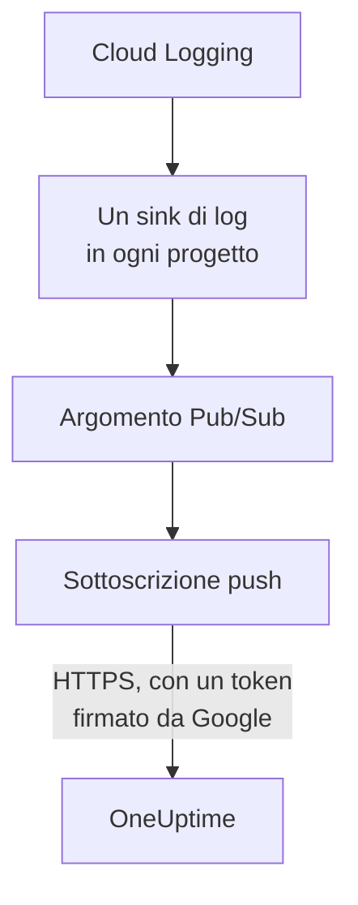

# Trasmettere i log di Google Cloud

Un progetto Google Cloud connesso può trasmettere i suoi log a OneUptime appena vengono scritti. Cloud Logging li instrada tramite un sink di log verso un argomento Pub/Sub, e la sottoscrizione push dell'argomento consegna ogni voce a OneUptime entro un minuto, come log di OneUptime archiviato sotto la risorsa a cui si riferisce. Un solo comando in Google Cloud Shell configura tutto, e non c'è nulla da eseguire. Cloud Monitoring non ha un'esportazione che invii le metriche, quindi la connessione continua a leggere le metriche secondo la sua pianificazione.

:::cards
- [Come funziona](#come-funziona): Un sink di log in ogni progetto, un argomento e la sua sottoscrizione push.
- [Configurare la trasmissione](#configurare-la-trasmissione): Scegli quali log, crea una chiave del flusso ed esegui un comando.
- [Cosa arriva](#cosa-arriva): I log sulle risorse da cui provengono.
- [Cosa crea il comando](#cosa-crea-il-comando): Ogni risorsa e ogni autorizzazione che il comando crea nei tuoi progetti.
- [Interrompere la trasmissione](#interrompere-la-trasmissione): Disattiva le chiavi, poi elimina ciò che il comando ha creato.
:::

## Come funziona



- **Un sink di log in ogni progetto.** Il sink di ogni progetto instrada le voci che corrispondono al suo filtro verso un unico argomento Pub/Sub, nel progetto dell'account di servizio della connessione.
- **Due controlli a ogni push.** Pub/Sub firma un token OpenID Connect per un account di servizio creato solo per i push, e l'audience del token è la chiave del flusso della connessione. OneUptime accetta un push solo quando Google ha firmato il suo token per quell'account di servizio e la chiave è una di quelle della connessione. La chiave indica la connessione, e quindi il progetto: nulla in un push decide dove viene scritto. OneUptime conserva solo lo SHA-256 della chiave.
- **Non si perde nulla mentre OneUptime non può accettarlo.** Pub/Sub invia di nuovo una voce rifiutata, attendendo da 10 secondi fino a 10 minuti tra un tentativo e l'altro, e la conserva per un giorno.

## Prima di iniziare

- **Un progetto Google Cloud connesso.** Connettilo prima in **Cloud → Collega**: vedi [Collegare un account cloud](/docs/telemetry/cloud-accounts).
- **Un proprietario o un amministratore del progetto.** Solo loro possono creare una chiave del flusso e interrompere la trasmissione.
- **Google Cloud Shell**, con l'accesso come **Owner** dei progetti, o come qualcuno che può crearvi account di servizio, argomenti Pub/Sub e sink di log.
- **Un indirizzo HTTPS, per un OneUptime self-hosted.** Pub/Sub invia solo a indirizzi `https://`, con un certificato di cui Google si fida, e l'indirizzo deve essere raggiungibile da Google Cloud.

## Configurare la trasmissione

:::steps
### Aprire la finestra di trasmissione

Vai su **Cloud → Collega** e, nella riga del progetto Google Cloud, scegli **Trasmetti log**.

### Scegliere quali log

**Avvisi ed errori** trasmette ogni voce con gravità `WARNING` o superiore: ciò che è andato storto, non ogni richiesta. **Tutti i log** trasmette ogni voce tranne i log di audit Data Access, che registrano ogni lettura e possono superare tutto il resto che un progetto scrive. **Un filtro tuo** trasmette le voci che corrispondono a una query di Cloud Logging, scritta nel campo **Filtro**.

### Creare una chiave del flusso

Scegli **Crea una chiave del flusso**. La chiave viene mostrata solo questa volta, nel comando: OneUptime ne conserva solo lo SHA-256.

### Eseguire il comando in Google Cloud Shell

Copia il comando, eseguilo in Google Cloud Shell e attendi che finisca. Indica ogni progetto in cui ha configurato un sink, e si ferma al primo passaggio che Google rifiuta, con il motivo dato da Google.

### Attendere il primo push

La finestra chiede ogni pochi secondi cosa è arrivato. Pub/Sub invia una voce entro un minuto da quando un progetto ne scrive una accettata dal filtro; la finestra dice allora cosa è arrivato e da dove, e la riga della connessione dice **In trasmissione**.
:::

**Altri campi** contiene il resto:

| Campo | Cosa fa |
| --- | --- |
| **Progetti** | I progetti di cui trasmettere i log: all'inizio, quelli letti dalla connessione. L'argomento viene creato nel progetto dell'account di servizio della connessione. Al massimo 100 |
| **Configuralo in un altro modo** | L'endpoint push, l'account di servizio push e la chiave, per configurare tutto con Terraform o la console |

## Cosa arriva

| Cosa | Dove arriva |
| --- | --- |
| Log | In Esplora log, sotto il servizio di telemetria della connessione, con il progetto, l'area e il nome del log come attributi |
| Log di una risorsa che OneUptime conosce | Anche su quella risorsa: la sua pagina in Cloud ottiene una scheda **Registri** |

Ogni log conserva l'ora della sua voce al nanosecondo, la sua gravità, la sua traccia e il suo span, e la sua richiesta HTTP con i nomi delle convenzioni semantiche di OpenTelemetry. Viene archiviato sotto una risorsa quando la sua risorsa monitorata è di un tipo di cui OneUptime legge le metriche, come una VM (`gce_instance`), un servizio Cloud Run (`cloud_run_revision`) o un'istanza Cloud SQL (`cloudsql_database`), e porta l'ID della risorsa come `cloud.resource_id`. I log delle richieste di un bilanciatore del carico esterno, scritti sotto `http_load_balancer`, vengono archiviati sotto la sua mappa URL, la `https_lb_rule` su cui arrivano le sue metriche.

I log di un gruppo di istanze sono quelli delle sue VM, quindi la sua pagina non ha la scheda **Registri**. Una voce di un altro tipo viene trasmessa comunque, sotto il suo progetto.

## Cosa crea il comando

Le sue risorse prendono il nome dai primi 8 caratteri dell'ID della connessione. Non dà a OneUptime alcun accesso ai tuoi progetti: le voci escono soltanto.

| Risorsa | Cosa può fare |
| --- | --- |
| Un account di servizio, `oneuptime-push-<suffix>`, nel progetto dell'account di servizio della connessione | Non ha alcun ruolo: Pub/Sub firma per lui i token dei suoi push |
| Il ruolo **Service Account OpenID Connect Identity Token Creator** per l'agente di servizio Pub/Sub, solo su quell'account di servizio | Permette a Pub/Sub di creare quei token, e nient'altro |
| Un argomento Pub/Sub, `oneuptime-stream-<suffix>` | Contiene le voci che i sink instradano |
| La sua sottoscrizione push, `oneuptime-stream-<suffix>-push` | Invia ogni voce a OneUptime, con una scadenza di conferma di 60 secondi, e conserva per un giorno ciò che non è riuscita a inviare |
| Un sink di log in ogni progetto, `oneuptime-stream-<suffix>` | Instrada verso l'argomento le voci che corrispondono al suo filtro |
| Il ruolo **Pub/Sub Publisher** per il writer di ogni sink, solo sull'argomento | Permette al sink di pubblicare nell'argomento, e nient'altro |

Il comando attiva le API di Pub/Sub e di Cloud Logging nel progetto dell'argomento, se sono disattivate. Google addebita Pub/Sub per i log che consegna: trasmetti solo i log che ti servono.

## Interrompere la trasmissione

:::steps
### Disattivare le chiavi

Nella riga del progetto in **Cloud → Collega**, scegli **Interrompi la trasmissione**. Tutte le chiavi del flusso della connessione smettono subito di funzionare, e OneUptime rifiuta ciò che Pub/Sub invia. Ciò che è stato consegnato resta.

### Eliminare ciò che il comando ha creato

I sink, l'argomento e la sua sottoscrizione push restano in Google Cloud, e Pub/Sub continua a inviare, finché non vengono eliminati. La finestra mostra il comando, per i progetti letti dalla connessione:

```bash
for SOURCE in 'acme-prod' 'acme-data'; do
  gcloud logging sinks delete oneuptime-stream-6f1c3a2e --project "$SOURCE" --quiet
done
gcloud pubsub subscriptions delete oneuptime-stream-6f1c3a2e-push --project 'acme-prod' --quiet
gcloud pubsub topics delete oneuptime-stream-6f1c3a2e --project 'acme-prod' --quiet
gcloud iam service-accounts delete 'oneuptime-push-6f1c3a2e@acme-prod.iam.gserviceaccount.com' --project 'acme-prod' --quiet
```
:::

Per cambiare quali log vengono trasmessi, apri di nuovo **Trasmetti log**, scegli **Crea una nuova chiave** ed esegui il nuovo comando. La chiave che sostituisce continua a funzionare per 24 ore, così nessun push viene rifiutato mentre la sottoscrizione si aggiorna. Al massimo 3 chiavi sostituite funzionano contemporaneamente.

## Configuralo in un altro modo

Assegna a un argomento Pub/Sub una sottoscrizione push con questi valori, e consenti all'agente di servizio Pub/Sub di creare token per l'account di servizio push:

| Impostazione | Valore |
| --- | --- |
| Endpoint push | `https://oneuptime.com/telemetry/gcp-pubsub/v1/logs` |
| Autenticazione | Un token OpenID Connect per `oneuptime-push-<suffix>@<project>.iam.gserviceaccount.com` |
| Audience | La chiave del flusso |
| Payload | Incapsulato, come Pub/Sub lo invia salvo indicazione contraria |
| Scadenza di conferma | 60 secondi |
| Conservazione dei messaggi | 1 giorno |

Poi instrada i log di ogni progetto verso l'argomento con un sink di log, e assegna al writer di ogni sink **Pub/Sub Publisher** sull'argomento. Per un OneUptime self-hosted, sostituisci `https://oneuptime.com` con l'indirizzo HTTPS del tuo OneUptime.

OneUptime risponde a ogni push come Pub/Sub si aspetta:

| Risposta | Quando | Cosa fa Pub/Sub |
| --- | --- | --- |
| `204` | La voce è stata accettata, o lo era già stata, o il messaggio non è una voce di log | Prosegue |
| `400` | Non è un push Pub/Sub che OneUptime sa leggere | Lo invia di nuovo, attendendo ogni volta di più, per un giorno |
| `401` | Il token non è stato firmato da Google per l'account di servizio push, o la sua audience non è una chiave della connessione | Lo invia di nuovo, attendendo ogni volta di più, per un giorno |
| `402` | Il progetto non può essere fatturato per la telemetria | Lo invia di nuovo, attendendo ogni volta di più, per un giorno |
| `403` | La connessione è disattivata, o il progetto non può accettare telemetria | Lo invia di nuovo, attendendo ogni volta di più, per un giorno |
| `413` | La richiesta supera 1 MiB, o la sua voce 512 KiB | Lo invia di nuovo, attendendo ogni volta di più, per un giorno |
| `429` | La sottoscrizione della connessione ha inviato più di 12.000 voci in un minuto | Lo invia di nuovo, attendendo ogni volta di più, per un giorno |
| `503` | OneUptime non è riuscito a verificare il token o a mettere la voce in coda in quel momento | Lo invia di nuovo, attendendo ogni volta di più, per un giorno |

## Risoluzione dei problemi

:::details La finestra continua ad attendere il primo push
Verifica che il comando sia terminato senza fermarsi, e che un progetto abbia scritto una voce accettata dal filtro: con **Avvisi ed errori**, un progetto tranquillo non invia nulla. `gcloud pubsub subscriptions describe oneuptime-stream-6f1c3a2e-push --project acme-prod` mostra l'endpoint della sottoscrizione. Per un OneUptime self-hosted, verifica che Google Cloud raggiunga il suo indirizzo in HTTPS.
:::

:::details La connessione dice Flusso rifiutato
La finestra e il tooltip della riga dicono perché. Una chiave sbagliata significa che la sottoscrizione invia con una chiave che non funziona più: crea una nuova chiave ed esegui di nuovo il comando. Un push non firmato per l'account di servizio push significa che la sottoscrizione firma come un altro account, o che Pub/Sub non può firmare per esso: esegui di nuovo il comando.
:::

:::details I log di una risorsa non compaiono sulla sua pagina
La pagina mostra i log che Cloud Logging archivia sotto la risorsa monitorata della risorsa, con le etichette che hanno le sue metriche. I log che un carico di lavoro scrive sotto un'altra risorsa, come quelli di un contenitore, vengono trasmessi solo sotto il loro progetto.
:::

## Passaggi successivi

:::cards
- [Collegare un account cloud](/docs/telemetry/cloud-accounts): Cosa legge una connessione, e con quale frequenza.
- [Trasmettere metriche e log di Azure Monitor](/docs/telemetry/cloud-streaming-azure): Quelli di una sottoscrizione Azure, letti dagli hub eventi.
- [Trasmettere metriche e log di CloudWatch](/docs/telemetry/cloud-streaming): Quelli di un account AWS, consegnati da Amazon Data Firehose.
- [Esploratore log](/docs/telemetry/logs-explorer): Cerca e filtra ciò che i flussi hanno consegnato.
:::
