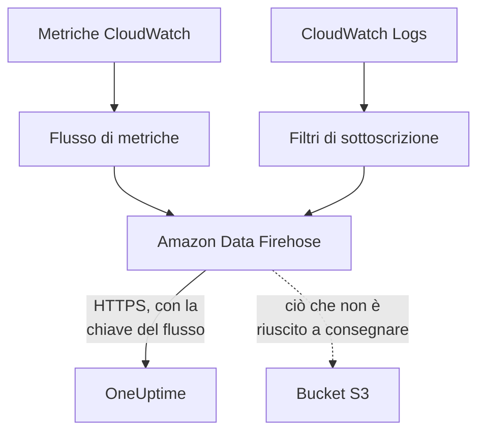

# Trasmettere metriche e log di CloudWatch

Un account AWS collegato può trasmettere le sue metriche e i suoi log di CloudWatch a OneUptime tramite Amazon Data Firehose. Le metriche arrivano allora pochi minuti dopo che CloudWatch le ha, invece che alla lettura successiva della connessione, e CloudWatch Logs arriva come log di OneUptime, ciascuno archiviato sotto la risorsa a cui si riferisce. Un solo comando in AWS CloudShell configura tutto, e non c'è nulla da eseguire.

:::cards
- [Come funziona](#come-funziona): Un flusso di metriche e sottoscrizioni ai log in ogni regione, consegnati da Firehose.
- [Configurare la trasmissione](#configurare-la-trasmissione): Scegli cosa trasmettere, crea una chiave del flusso ed esegui un comando.
- [Cosa arriva](#cosa-arriva): Le metriche sulle risorse che misurano, e i log sulle risorse da cui provengono.
- [Cosa crea lo stack](#cosa-crea-lo-stack): Ogni risorsa e ogni autorizzazione che il comando crea nel tuo account.
- [Interrompere la trasmissione](#interrompere-la-trasmissione): Disattiva le chiavi, poi elimina gli stack.
:::

## Come funziona



- **Uno stack in ogni regione.** Il comando distribuisce uno stack CloudFormation in ogni regione da cui trasmetti. Il suo flusso di metriche e i suoi filtri di sottoscrizione ai log passano tutto a due flussi Firehose, e Firehose lo consegna a OneUptime su HTTPS.
- **La chiave del flusso dice di chi è.** Firehose invia la chiave del flusso della connessione con ogni consegna. La chiave indica la connessione, e quindi il progetto: nulla in una consegna decide dove viene scritta. OneUptime conserva solo lo SHA-256 della chiave.
- **Le letture lasciano al flusso le metriche trasmesse.** Finché un flusso consegna un namespace di una regione, le letture della connessione smettono di scrivere le metriche di quel namespace, così nessun punto dati viene contato due volte. Le letture continuano a trovare le risorse, il loro stato e le loro modifiche, e riprendono un namespace dopo 15 minuti senza consegne.
- **Non si perde nulla mentre OneUptime non può accettarlo.** Firehose invia di nuovo un lotto rifiutato per un'ora al massimo, poi lo conserva per 30 giorni nel bucket S3 dello stack.

## Prima di iniziare

- **Un account AWS collegato.** Collegalo prima in **Cloud → Collega**: vedi [Collegare un account cloud](/docs/telemetry/cloud-accounts).
- **Un proprietario o un amministratore del progetto.** Solo loro possono creare una chiave del flusso e interrompere la trasmissione.
- **AWS CloudShell in quell'account**, con l'accesso di qualcuno che può creare stack CloudFormation e ruoli IAM.
- **Un indirizzo HTTPS, per un OneUptime self-hosted.** Firehose consegna solo a indirizzi `https://` sulla porta 443, con un certificato di cui AWS si fida, e l'indirizzo deve essere raggiungibile da AWS.

## Configurare la trasmissione

:::steps
### Aprire la finestra di trasmissione

Vai in **Cloud → Collega** e, nella riga dell'account AWS, scegli **Trasmetti metriche e log**.

### Scegliere cosa trasmettere

**Metriche** trasmette ogni metrica chiave di ogni risorsa, una volta al minuto: le metriche che OneUptime mostra nei grafici e con cui valuta ogni risorsa. **Metriche e log** aggiunge CloudWatch Logs, e **Registri** trasmette solo CloudWatch Logs.

Per i log, indica i **Gruppi di log** uno per riga, per nome nella **Regione** accanto o per ARN nella loro regione, oppure scegli **Tutti i gruppi di log dell'account, anche quelli nuovi**. Un comando sottoscrive al massimo 50 gruppi di log per nome, in al massimo 10 regioni.

### Creare una chiave del flusso

Scegli **Crea una chiave del flusso**. La chiave viene mostrata solo questa volta, nel comando: OneUptime ne conserva solo lo SHA-256.

### Eseguire il comando in AWS CloudShell

Copia il comando, eseguilo in AWS CloudShell e attendi che finisca. Scrive il modello in `oneuptime-stream.json` e lo distribuisce in ogni regione, con la chiave come parametro che non viene più mostrato.

### Attendere la prima consegna

La finestra chiede ogni pochi secondi cosa è arrivato. Firehose consegna entro pochi minuti dal termine del comando; la finestra dice allora cosa è arrivato e da dove, e la riga della connessione dice **In trasmissione**.
:::

**Altri campi** contiene il resto:

| Campo | Cosa fa |
| --- | --- |
| **Tutte le metriche, non solo quelle chiave** | Trasmette tutte le metriche che CloudWatch ha per l'account, comprese le tue. AWS addebita ogni aggiornamento di metrica che un flusso invia, quindi può costare molte volte di più |
| **Regioni** | Da dove trasmettere: all'inizio, le regioni in cui la connessione ha trovato risorse. Se lasciato vuoto, il comando trasmette dalla regione di AWS CloudShell. Al massimo 30 |
| **Configuralo in un altro modo** | Gli endpoint delle metriche e dei log e la chiave, per configurare i flussi con Terraform o la console |

**Scarica il modello** salva il modello che il comando distribuisce, per distribuirlo a modo tuo.

## Cosa arriva

| Cosa | Dove arriva |
| --- | --- |
| Metriche | Sulle risorse cloud che misurano, con i nomi e gli attributi che danno loro le letture della connessione |
| Log | Nell'esploratore dei log, sotto il servizio di telemetria della connessione, con l'account, la regione e il gruppo di log come attributi |
| Log di un gruppo di log che AWS chiama come una risorsa | Anche su quella risorsa: la sua pagina in Cloud ottiene una scheda **Registri** |

Un gruppo di log viene archiviato sotto una risorsa quando AWS gli ha dato il nome di una:

| Gruppo di log | Tipo di risorsa |
| --- | --- |
| `/aws/lambda/<function>` | `AWS::Lambda::Function` |
| `/aws/rds/instance/<instance>/<log>` | `AWS::RDS::DBInstance` |
| `/aws/rds/cluster/<cluster>/<log>` | `AWS::RDS::DBCluster` |
| `/aws/docdb/<cluster>/<log>` | `AWS::DocDB::DBCluster` |
| `/aws/neptune/<cluster>/<log>` | `AWS::Neptune::DBCluster` |
| `/aws/redshift/cluster/<cluster>/<log>` | `AWS::Redshift::Cluster` |
| `/aws/OpenSearchService/domains/<domain>/<log>` | `AWS::OpenSearchService::Domain` |
| `/aws/aes/domains/<domain>/<log>` | `AWS::OpenSearchService::Domain` |
| `/aws/apprunner/<service>/<service-id>/<log>` | `AWS::AppRunner::Service` |
| `/aws/elasticbeanstalk/<environment>/<log>` | `AWS::ElasticBeanstalk::Environment` |
| `/aws/ecs/containerinsights/<cluster>/performance` | `AWS::ECS::Cluster` |

Ogni log porta l'ID della risorsa come `cloud.resource_id`, e i log di una funzione Lambda portano anche `faas.name`, così compaiono anche sulla funzione in Serverless. Un gruppo di log con un altro nome viene trasmesso lo stesso, sotto il suo account e la sua regione. La gravità di un log è quella che indica il suo messaggio, come la scrive Lambda.

## Cosa crea lo stack

Lo stack si chiama `OneUptimeStream-` seguito dai primi 8 caratteri dell'ID della connessione. Non dà a OneUptime alcun accesso al tuo account: i dati escono soltanto.

| Risorsa | Cosa può fare |
| --- | --- |
| Un flusso di metriche CloudWatch, nel formato OpenTelemetry 1.0 | Scrivere record solo nel flusso Firehose delle metriche |
| Filtri di sottoscrizione ai log, oppure una policy di sottoscrizione a livello di account per ogni gruppo di log | Scrivere record solo nel flusso Firehose dei log |
| Due flussi Firehose, `OneUptime-<suffix>-metrics` e `OneUptime-<suffix>-logs` | Consegnare a OneUptime con GZIP, un buffer di 1 MiB o 60 secondi e un'ora di tentativi, e scrivere nel bucket ciò che non sono riusciti a consegnare |
| Un bucket S3 per ciò che non è stato possibile consegnare | Accesso pubblico bloccato, cifrato, svuotato dopo 30 giorni e conservato quando lo stack viene eliminato |
| Un gruppo di log, `/aws/kinesisfirehose/OneUptime-<suffix>` | Contiene gli errori di consegna di Firehose stesso e non viene mai trasmesso |
| Tre ruoli IAM | Ciascuno si fida di un servizio AWS di questo account e consente solo ciò che dicono le righe sopra |

AWS addebita il flusso di metriche per ogni aggiornamento di metrica che invia, e Firehose per ciò che consegna. Trasmetti solo le metriche e i gruppi di log che ti servono.

## Interrompere la trasmissione

:::steps
### Disattivare le chiavi

Nella riga dell'account in **Cloud → Collega**, scegli **Interrompi la trasmissione**. Tutte le chiavi del flusso della connessione smettono subito di funzionare, OneUptime rifiuta ciò che i flussi consegnano, e la connessione torna a leggere tutte le metriche secondo la sua pianificazione. Ciò che i flussi hanno consegnato resta.

### Eliminare gli stack

I flussi restano in AWS, e AWS li addebita, finché i loro stack non vengono eliminati. La finestra mostra il comando, per le regioni da cui i flussi hanno consegnato e quelle in cui la connessione ha trovato risorse:

```bash
for REGION in us-east-1 eu-west-1; do
  aws cloudformation delete-stack --region "$REGION" --stack-name OneUptimeStream-6f1c3a2e
done
```
:::

Per cambiare ciò che uno stack trasmette, apri di nuovo **Trasmetti metriche e log**, scegli **Crea una nuova chiave** ed esegui il nuovo comando. La chiave che sostituisce continua a funzionare per 24 ore, così nessuna consegna viene rifiutata mentre gli stack si aggiornano. Al massimo 3 chiavi sostituite funzionano contemporaneamente.

## Configuralo in un altro modo

Assegna a ogni flusso Firehose una destinazione endpoint HTTP con questi valori, e al flusso di metriche il formato di output OpenTelemetry 1.0:

| Impostazione | Valore |
| --- | --- |
| Endpoint delle metriche | `https://oneuptime.com/telemetry/aws-firehose/v1/metrics` |
| Endpoint dei log | `https://oneuptime.com/telemetry/aws-firehose/v1/logs` |
| Chiave di accesso | La chiave del flusso, inviata come `X-Amz-Firehose-Access-Key` |
| Codifica dei contenuti | `GZIP` |
| Buffer | 1 MiB o 60 secondi |
| Durata dei tentativi | 3600 secondi, con un bucket S3 per ciò che non è stato possibile consegnare |

Per un OneUptime self-hosted, sostituisci `https://oneuptime.com` con l'indirizzo HTTPS del tuo OneUptime. L'endpoint delle metriche accetta anche un flusso di metriche nel formato JSON.

OneUptime risponde a ogni consegna come Firehose si aspetta:

| Risposta | Quando | Cosa fa Firehose |
| --- | --- | --- |
| `200` | La consegna è stata accettata, o era già stata accettata | Prosegue |
| `400` | Non è una consegna Firehose che OneUptime sa leggere, ad esempio una con più di 10.000 record | La invia di nuovo per un'ora al massimo |
| `401` | La chiave non è una di quelle della connessione | La invia di nuovo per un'ora al massimo |
| `402` | Il progetto non può essere addebitato per la telemetria | La invia di nuovo per un'ora al massimo |
| `403` | La connessione è disattivata, o il progetto non può accettare telemetria | La invia di nuovo per un'ora al massimo |
| `413` | La richiesta supera 4 MiB, o decompressa supera 32 MiB | La conserva nel bucket |
| `429` | I flussi della connessione hanno inviato più di 600 consegne in un minuto | La invia di nuovo più tardi |

## Risoluzione dei problemi

:::details La finestra continua ad attendere la prima consegna
Controlla che il comando sia terminato in ogni regione senza errori: `aws cloudformation describe-stacks --stack-name OneUptimeStream-6f1c3a2e` indica lo stato dello stack. Un flusso di metriche consegna solo le metriche che CloudWatch ha, quindi una regione senza risorse non invia nulla. Per un OneUptime self-hosted, controlla che AWS raggiunga il suo indirizzo su HTTPS sulla porta 443.
:::

:::details La connessione dice Flusso rifiutato
La finestra e il tooltip della riga dicono perché. Una chiave sbagliata significa che gli stack funzionano con una chiave che non funziona più: crea una nuova chiave ed esegui di nuovo il comando. Firehose continua a inviare ciò che conserva, e viene accettato appena la chiave è giusta.
:::

:::details I log di una funzione Lambda non compaiono sulla sua pagina
La pagina mostra i log del gruppo di log che porta il nome della funzione, `/aws/lambda/<function>`. Una funzione che scrive in un gruppo di log con un altro nome trasmette i suoi log solo sotto il suo account e la sua regione.
:::

## Passaggi successivi

:::cards
- [Collegare un account cloud](/docs/telemetry/cloud-accounts): Cosa legge una connessione, e con quale frequenza.
- [Risorse cloud (IaaS e PaaS)](/docs/telemetry/cloud-resources): Ogni tipo di risorsa che OneUptime riconosce.
- [Esploratore log](/docs/telemetry/logs-explorer): Cerca e filtra ciò che i flussi hanno consegnato.
:::
