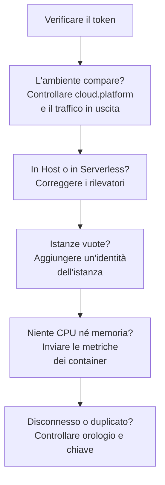

# Risoluzione dei problemi cloud

Scopri perché un ambiente cloud manca, è archiviato nel posto sbagliato, è vuoto o duplicato. Le sezioni seguono l'ordine in cui queste cose si guastano, e ognuna esclude uno strato, quindi procedi dall'alto verso il basso. I guasti che riguardano una sola piattaforma sono alla fine della sua pagina: [AWS ECS / Fargate](/docs/telemetry/cloud-aws-ecs), [Google Cloud Run](/docs/telemetry/cloud-gcp-cloud-run), [Azure Container Apps](/docs/telemetry/cloud-azure-container-apps) e [Altre piattaforme cloud](/docs/telemetry/cloud-other-platforms).



## Verifica prima il token

È il controllo più economico, e niente di ciò che segue funziona senza:

```bash
curl -i https://oneuptime.com/otlp/v1/validate \
  -H "x-oneuptime-token: YOUR_TELEMETRY_INGESTION_TOKEN"
```

| Risposta | Cosa significa |
| ------------------------- | -------------------------------------------------------------------------------------------------------------------------- |
| `200`, `"valid": true` | Il token è accettato. Il suo `keyType` deve essere `Server`: una chiave `Browser` viene rifiutata da un collector o da un servizio backend. |
| `401`, `"valid": false` | Il token manca, è sconosciuto, revocato, disattivato o scaduto, e il `message` della risposta dice quale. Crea una nuova chiave in **Impostazioni del progetto → Telemetria e APM → Chiavi di acquisizione** e distribuiscila di nuovo. |

Se ospiti OneUptime in autonomia, usa `https://YOUR-ONEUPTIME-HOST/otlp/v1/validate`. Esegui il controllo dall'interno del task, dell'istanza o della replica quando puoi (ECS Exec, `az containerapp exec`): dimostra che il carico di lavoro stesso raggiunge OneUptime, non solo il tuo portatile.

## L'ambiente non compare

Niente in **Cloud → All Environments** un minuto dopo la prima richiesta. Controlla questi tre punti, in quest'ordine.

**`cloud.platform` manca, o non è un valore gestito.** OneUptime archivia la telemetria in Ambienti cloud solo quando la risorsa porta uno di questi valori: `aws_ecs`, `aws_elastic_beanstalk`, `aws_app_runner`, `gcp_cloud_run`, `gcp_app_engine`, `azure_container_apps`, `azure_container_instances` o `azure_app_service`. Le cause abituali:

- Il rilevatore di risorse è disattivato nell'SDK (`OTEL_NODE_RESOURCE_DETECTORS`, `OTEL_EXPERIMENTAL_RESOURCE_DETECTORS`, `-Dotel.resource.providers.<cloud>.enabled=true`).
- La pipeline del collector salta il processore `resourcedetection`.
- Su una piattaforma senza rilevatore, `OTEL_RESOURCE_ATTRIBUTES` contiene un errore di battitura.

I rilevatori Azure di Node.js e .NET scrivono `azure.container_apps`, `azure.app_service` e `azure.functions`; OneUptime li riscrive nei valori con il trattino basso, quindi contano. Per vedere cosa porta la tua telemetria, apri il servizio in **Servizi**, apri una delle sue tracce dalla scheda **Tracce** e leggi gli attributi di risorsa. Se `cloud.platform` non c'è, quello è tutto il problema.

**Il token è sbagliato.** Il controllo del token ha risposto `401`. Il collector lo registra come `Permanent error: ... 401`. Un SDK lo registra una volta e smette di riprovare, il che è il comportamento OTLP corretto e passa facilmente inosservato.

**Il traffico in uscita è bloccato.** Il collector registra `connection refused`, `context deadline exceeded`, `i/o timeout` o un errore DNS:

- **ECS e Fargate:** una subnet privata ha bisogno di un NAT gateway o di `assignPublicIp=ENABLED`, e il gruppo di sicurezza deve consentire il traffico in uscita su TCP 443.
- **Cloud Run:** **VPC egress: All traffic** ha bisogno di Cloud NAT.
- **Container Apps:** una route definita dall'utente verso un firewall deve consentire l'host di OneUptime.
- **Ovunque:** un OneUptime ospitato in autonomia dietro un nome DNS privato deve essere risolvibile dalla rete del carico di lavoro.

## Compare invece in Host

La risorsa porta la piattaforma di una macchina virtuale (`aws_ec2`, `gcp_compute_engine` o `azure_vm`), quindi OneUptime la archivia in **Host**: giusto per una macchina virtuale, sbagliato per il calcolo gestito. Il rilevatore di una macchina virtuale ha prevalso su quello gestito: `detectors: [ec2, elastic_beanstalk]` in un collector, dove vince il primo rilevatore che imposta `cloud.platform`, oppure un SDK il cui ordine favorisce il rilevatore EC2. Metti `elastic_beanstalk` per primo, oppure imposta tu `cloud.platform` in `OTEL_RESOURCE_ATTRIBUTES` e tieni solo il rilevatore `env`.

## Compare solo in Funzioni serverless

La risorsa porta `faas.name` ma nessuna `cloud.platform` gestita. Cloud Run e App Engine impostano entrambi quando gira il rilevatore GCP. Se imposti `faas.name` a mano, oppure un collector scarta gli attributi di risorsa impostati dal rilevatore dell'SDK, è soddisfatto solo il lato serverless. Attiva il rilevatore, oppure imposta tu `cloud.platform=gcp_cloud_run` (o `gcp_app_engine`), `cloud.account.id` e `cloud.region`.

> [!NOTE]
> Su Cloud Run e App Engine un servizio deve comparire in entrambi i posti: l'ambiente raggruppa progetto e regione, e **Funzioni serverless** mostra il singolo servizio.

## Istanze è vuota

L'ambiente c'è, ma la sua scheda **Istanze** non elenca nulla: la telemetria non porta alcuna identità dell'istanza. OneUptime dà il nome a un'istanza dal primo di questi attributi di risorsa che trova:

1. `aws.ecs.task.id`
2. `aws.ecs.task.arn` (abbreviato all'ID del task)
3. `faas.instance`
4. `azure.container_app.instance.id`
5. `service.instance.id`
6. `container.id`
7. `host.id`
8. `host.name`

L'identità propria della piattaforma viene prima di `service.instance.id`, così un ID che l'SDK inventa per ogni processo (l'SDK Node.js lo fa per impostazione predefinita) non può separare un task dalla CPU e dalla memoria del suo sidecar. Cosa imposta l'identità su ogni piattaforma:

| Piattaforma | Cosa imposta l'identità |
| ----------------------------------------- | ------------------------------------------------------------------------------------------------------------------------------------------------ |
| ECS | Il rilevatore `ecs` imposta l'ARN del task |
| Cloud Run, App Engine | Il rilevatore `gcp` imposta `faas.instance` |
| Container Apps | Il rilevatore `azurecontainerapps` del Collector imposta l'ID della replica; oppure imposta `service.instance.id` da `CONTAINER_APP_REPLICA_NAME`, o esegui il rilevatore host |
| App Runner, Container Instances | Il `host.name` del rilevatore host |
| App Service, Elastic Beanstalk | Il rilevatore della piattaforma imposta `service.instance.id`; su Beanstalk, eliminalo perché `host.id` dia il nome a ogni istanza |

Un'istanza compare entro un minuto dal primo segnale che porta l'attributo.

## CPU e memoria sono vuote

Le istanze sono elencate, ma i riquadri **CPU** e **Memoria** della panoramica, e le colonne CPU e memoria di **Istanze**, sono vuoti. Vengono da metriche, non da tracce: punti dati `container.cpu.utilization` e `container.memory.usage` (o `container.memory.usage.total`) la cui risorsa porta la stessa identità dell'istanza delle tracce, e `cloud.platform`.

- **Su ECS,** il receiver `awsecscontainermetrics` in un collector sidecar li fornisce come `ecs.task.cpu.utilized` e `ecs.task.memory.utilized`. Tienilo nella pipeline `metrics`, e tieni anche `resourcedetection` in quella pipeline, altrimenti le metriche arrivano senza `cloud.platform` e vengono archiviate altrove.
- **Su Cloud Run, Container Apps e le altre piattaforme,** la piattaforma non mostra a un sidecar l'uso dei container. I riquadri restano vuoti a meno che tu non invii queste metriche: leggi invece i riquadri delle richieste.
- **Con SDK direct,** niente invia metriche dei container, quindi i riquadri vuoti sono normali.

## L'ambiente mostra Disconnesso

Un ambiente mostra **Disconnesso** quando per 15 minuti non è arrivata alcuna telemetria per esso, e lo span, log o metrica successivo lo riporta indietro. Il tempo in cui OneUptime stesso era fermo o stava recuperando non conta. Mentre la telemetria scorre, l'ora dell'ultimo contatto può essere indietro fino a cinque minuti, ed è per questo che la soglia è 15.

- **Un ambiente attivo mostra Disconnesso:** l'esportatore si è fermato. Cerca nei log del collector gli errori `401` e di traffico in uscita descritti sopra.
- **Un ambiente di staging che scala a zero di notte** mostra Disconnesso fino alla prima richiesta del mattino, il che è corretto.

Le istanze seguono due orologi:

- **Stale:** la scheda **Istanze** segna un task, un'istanza o una replica come **Stale** quando non ha segnalato negli ultimi 15 minuti, e la panoramica conta come attive solo le altre.
- **Eliminata:** una pulizia elimina le righe delle istanze non viste da `CLOUD_INSTANCE_STALE_MINUTES` (15 per impostazione predefinita, almeno 10), misurato dall'ultima telemetria dell'ambiente stesso, così un'interruzione del collector ferma quell'orologio invece di cancellare l'ultimo elenco noto dei task. Le funzioni serverless usano `SERVERLESS_INSTANCE_STALE_MINUTES`. Alzare la soglia mantiene le righe più a lungo; non cambia il momento in cui diventano **Stale**.

## Due ambienti dove dovrebbe essercene uno

La chiave dell'ambiente è `cloud.platform|cloud.account.id|cloud.region`, confrontata carattere per carattere. Se alcuni carichi di lavoro impostano `cloud.account.id` e altri no, uno scrive `eastus` e un altro `East US`, oppure un collector esegue il rilevatore `ecs` e un altro no, ottieni `aws_ecs|123456789012|us-east-1` e `aws_ecs||us-east-1` uno accanto all'altro.

Apri la **Panoramica** di ogni ambiente: la sua **Chiave ambiente** mostra quale parte differisce. Correggi il carico di lavoro a cui manca il valore. L'ambiente con la parte vuota smette di ricevere telemetria, e puoi archiviarlo.

## Un ambiente creato a mano non viene mai associato

L'acquisizione associa un ambiente solo in base alla sua chiave, e la chiave deve essere esattamente `platform|account|region`, ad esempio `aws_ecs|123456789012|us-east-1`: lo stesso valore di piattaforma, ID account e regione che porta la telemetria. Il modulo di creazione (**Crea: Risorsa cloud** in **Cloud → All Environments**) costruisce la chiave dai suoi campi **Piattaforma cloud**, **ID account cloud** e **Regione cloud**, quindi questi tre devono corrispondere alla telemetria carattere per carattere. Se non corrispondono, l'acquisizione crea un secondo ambiente con la chiave che ha calcolato, e il tuo resta vuoto. Archivia l'ambiente creato a mano e lascia che l'acquisizione crei quello giusto, oppure ricrealo con i valori corretti.

## Ancora bloccato

Raccogli questi elementi prima di chiedere aiuto:

- Gli attributi di risorsa di un vero span o record di log del carico di lavoro. L'esportatore `debug` del collector li stampa, oppure apri una traccia del servizio in **Servizi**.
- La risposta del controllo `/otlp/v1/validate`, eseguito dall'interno del carico di lavoro.
- Le ultime 50 righe del log del collector, o il log di diagnostica dell'SDK con `OTEL_LOG_LEVEL=debug`.
- La **Chiave ambiente** di ogni ambiente che è comparso.

Poi contatta support@oneuptime.com, o apri una issue su [GitHub](https://github.com/OneUptime/oneuptime).

## Prossimi passi

:::cards
- [Ambienti cloud](/docs/telemetry/cloud-environments): Come vengono identificati ambienti e istanze.
- [AWS ECS / Fargate](/docs/telemetry/cloud-aws-ecs): La configurazione ECS, con una definizione del task completa.
- [OpenTelemetry](/docs/telemetry/open-telemetry): Endpoint, limiti e il significato di ogni risposta.
:::
