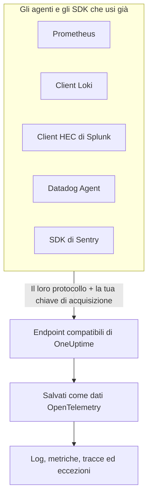

# Prometheus, Loki, Splunk, Datadog & Sentry

Usi già Prometheus, un client Loki, un forwarder Splunk, il Datadog Agent o un SDK di Sentry? Non serve cambiarlo. OneUptime accetta ciò che ognuno di questi strumenti invia, sui percorsi che lo strumento usa già, e lo salva come dati OpenTelemetry. Provare OneUptime significa cambiare URL e chiave, non rifare la strumentazione, e i tuoi filtri di scarto, le regole di mascheramento, le pipeline dei log, la conservazione e i budget di acquisizione valgono per questi dati come per tutti gli altri.

:::cards
- [Prometheus remote write](#prometheus-remote-write): Metriche da Prometheus, Grafana Alloy o qualsiasi mittente remote write.
- [Loki](#loki): Log da Promtail, Grafana Alloy, Fluent Bit o Vector.
- [Splunk HTTP Event Collector](#splunk-http-event-collector): Log ed eventi di metrica da qualsiasi client HEC.
- [Datadog Agent](#datadog-agent): Metriche e log dal Datadog Agent.
- [SDK di Sentry](#sdk-di-sentry): Errori, transazioni e log da qualsiasi SDK di Sentry.
:::

## Come funziona



Ogni endpoint risponde nella lingua del proprio strumento: un `204` per Prometheus e Loki, il `{"text": "Success", "code": 0}` di HEC, il `202` di Datadog, l'ID evento di Sentry. Così lo strumento segnala successi ed errori come ha sempre fatto. I dati vengono poi elaborati esattamente come quelli di un SDK OpenTelemetry.

## Prima di iniziare

- **Un progetto OneUptime**: su OneUptime Cloud la telemetria si paga per GB acquisito, e un progetto con il piano Free ha bisogno di un metodo di pagamento prima di poter inviare telemetria.
- **Chiave di acquisizione della telemetria**: crea una chiave **Server** in **Prodotti → Impostazioni del progetto → Telemetria e APM → Chiavi di acquisizione** e copia la sua **Chiave segreta**. Ogni strumento la invia dove invia la propria credenziale. Il DSN Sentry di un'app nel browser richiede invece una chiave **Browser**, limitata alle origini del tuo sito.
- **Il tuo host**: gli esempi usano `oneuptime.com`. Se ospiti OneUptime in proprio, usa il tuo host.

> [!TIP]
> La scheda Guida alla configurazione di Registri, Metriche, Tracce ed Eccezioni elenca questi strumenti tra i suoi modi di inviare, con il tuo host e una chiave a tua scelta già compilati.

## Endpoint

| Strumento | Dove puntarlo | Dove va la chiave |
| --- | --- | --- |
| Prometheus remote write | `https://oneuptime.com/telemetry/prometheus/api/v1/write` | Un token bearer, oppure l'autenticazione basic con la chiave come password. |
| Loki | `https://oneuptime.com/telemetry/loki/api/v1/push` | L'autenticazione basic con la chiave come password, oppure un token bearer. |
| Splunk HTTP Event Collector | `https://oneuptime.com/telemetry/services/collector` | Il token HEC: `Authorization: Splunk <key>`. |
| Datadog Agent | `https://oneuptime.com/telemetry/datadog` | La chiave API: `DD-API-KEY`. |
| SDK di Sentry | Il DSN `https://<key>@oneuptime.com/telemetry/sentry/1` | La chiave pubblica del DSN. |

Ogni endpoint accetta anche la chiave in un header `x-oneuptime-token`, e un header `x-oneuptime-service-name` indica il servizio a cui appartiene tutto ciò che lo strumento invia. Una chiave si può scrivere come le sue 32 cifre esadecimali senza trattini; nel DSN Sentry e come chiave API di Datadog va scritta così.

## Prometheus remote write

Aggiungi OneUptime come destinazione remote write. Prometheus continua a fare scrape come adesso e invia una copia di ogni campione:

```yaml title="prometheus.yml"
remote_write:
  - url: https://oneuptime.com/telemetry/prometheus/api/v1/write
    authorization:
      credentials: YOUR_TELEMETRY_KEY
```

Con Grafana Alloy, aggiungi un componente `prometheus.remote_write` e inoltragli i tuoi scrape:

```text title="config.alloy"
prometheus.remote_write "oneuptime" {
  endpoint {
    url          = "https://oneuptime.com/telemetry/prometheus/api/v1/write"
    bearer_token = "YOUR_TELEMETRY_KEY"
  }
}
```

Sono accettati sia remote write 1.0 sia 2.0, compressi con snappy come li invia ogni mittente.

### Cosa diventa una serie

- **Nome ed etichette restano.** `http_requests_total{job="checkout", code="500"}` è la metrica `http_requests_total` con gli attributi `job` e `code`, così una query portata da Grafana la trova.
- **Il job è il servizio.** Ogni `job` diventa un servizio, e ogni `instance` la sua istanza di servizio, come li mappano le regole Prometheus di OpenTelemetry.
- **I tipi vengono mantenuti.** I contatori, e i bucket e i conteggi di un istogramma, sono somme cumulative, così i loro tassi compaiono correttamente nei grafici. Il tipo viene dai metadati che il mittente include; senza, un nome che finisce in `_total` è un contatore e un `_bucket` con un'etichetta `le` è un bucket di istogramma.
- **Gli istogrammi nativi** diventano istogrammi esponenziali, e gli istogrammi nativi con bucket personalizzati diventano istogrammi.
- **Non mantenuti:** i marcatori di obsolescenza e gli altri campioni NaN o infiniti, le serie `_created` dei contatori e gli exemplar.

## Loki

OneUptime accetta la push API di Loki sul percorso stesso di Loki, in JSON o come il protobuf compresso con snappy che inviano Promtail e Grafana Alloy. Aggiungilo come client:

```yaml title="promtail.yaml"
clients:
  - url: https://oneuptime.com/telemetry/loki/api/v1/push
    bearer_token: YOUR_TELEMETRY_KEY
```

L'output `loki` di Fluent Bit vuole host e percorso separati:

```text title="fluent-bit.conf"
[OUTPUT]
    Name         loki
    Match        *
    Host         oneuptime.com
    Port         443
    Tls          On
    Uri          /telemetry/loki/api/v1/push
    Http_User    oneuptime
    Http_Passwd  YOUR_TELEMETRY_KEY
    Labels       job=fluent-bit
```

### Cosa diventa un flusso

- **Ogni voce è un log**, con il proprio timestamp al nanosecondo e la sua riga come corpo.
- **Etichette e metadati strutturati diventano attributi**, con i nomi che hanno in Loki.
- **Il servizio** viene dal primo tra `service_name`, `service`, `app`, `application`, `name`, `app_kubernetes_io_name`, `container`, `container_name`, `component`, `workload` e `job` presente in un flusso, come lo determina Loki. Un'etichetta `host` o `hostname` indica l'host.
- **Il livello** viene da un'etichetta o da un metadato `level`, `detected_level` o `severity`, oppure da un `level=` logfmt o dal campo `level` di una riga JSON.
- **Contesto della traccia:** un `trace_id` e uno `span_id` nei metadati strutturati collegano il log alla sua traccia.

## Splunk HTTP Event Collector

Usa OneUptime come HTTP Event Collector, con la tua chiave di acquisizione come token HEC. Il driver di logging Docker di Splunk aggiunge da solo il percorso, quindi vuole solo l'host:

```bash
docker run \
  --log-driver=splunk \
  --log-opt splunk-url=https://oneuptime.com \
  --log-opt splunk-token=YOUR_TELEMETRY_KEY \
  --log-opt splunk-format=json \
  your-image
```

Qualsiasi altro client HEC invia in POST a `/services/collector/event` o `/services/collector/raw`. Per inviare un evento:

```bash
curl https://oneuptime.com/telemetry/services/collector/event \
  -H "Authorization: Splunk YOUR_TELEMETRY_KEY" \
  -d '{"event": "Payment failed for order 42", "sourcetype": "app", "fields": {"service": "checkout"}}'
```

Un `200` con `{"text": "Success", "code": 0}` indica che l'evento è stato accettato. L'endpoint risponde anche con i codici propri di HEC: `No data` (5), `Invalid data format` (6) con il numero dell'evento non valido, ed `Event field is required` (12). Risponde inoltre a `GET /services/collector/health` senza token.

### Cosa diventa un evento

- **Un log**, con il suo `time` come timestamp. Un evento stringa diventa il corpo; per un evento oggetto, il corpo è `message`, `msg`, `log`, `line` o `text`, e gli altri campi sono attributi.
- **I suoi metadati restano:** `host` è l'host, e `source`, `sourcetype` e `index` vengono mantenuti come `com.splunk.source`, `com.splunk.sourcetype` e `com.splunk.index`. `host`, `source`, `sourcetype` e `index` nella query string completano ciò che un evento omette.
- **I suoi campi sono attributi.** Un campo `service.name` indica il servizio, e lo stesso fa il campo `service` di un log.
- **Gli eventi di metrica** (`"event": "metric"`, con `metric_name` e `_value`, oppure campi `metric_name:<name>`) vengono salvati come metriche, mai come log.
- **Non offerto:** la conferma di ricezione dell'indexer. Un client che la chiede non riceve alcun `ackId`.

## Datadog Agent

Punta le metriche e i log dell'Agent a OneUptime, con la tua chiave di acquisizione come chiave API:

```yaml title="datadog.yaml"
api_key: YOUR_TELEMETRY_KEY_WITHOUT_HYPHENS
dd_url: https://oneuptime.com/telemetry/datadog
logs_enabled: true
logs_config:
  use_http: true
  logs_dd_url: oneuptime.com:443
apm_config:
  enabled: false
process_config:
  process_collection:
    enabled: false
```

L'Agent aggiunge i propri percorsi a `dd_url` e invia i log a `/api/v2/logs` sull'host e sulla porta indicati da `logs_dd_url`. Alla radice, OneUptime risponde a quei percorsi solo per una richiesta che porta un header `DD-API-KEY`. Riavvia l'Agent dopo la modifica; `datadog-agent status` mostra la sua chiave API come valida quando OneUptime la accetta.

### Cosa diventano i dati dell'Agent

- **Le metriche** mantengono i loro nomi. I gauge restano gauge, i contatori diventano somme e i tassi diventano gauge del loro valore al secondo.
- **Le distribuzioni** diventano summary con conteggio, somma, minimo e massimo.
- **I service check** diventano una metrica con il nome del check, il cui valore è lo stato del check: 0 OK, 1 avviso, 2 critico, 3 sconosciuto.
- **I log** mantengono messaggio, stato, host e servizio, e il resto dei loro campi come attributi.
- **I tag sono attributi**, e i tag `service`, `env` e `version` indicano il servizio, il suo ambiente e la sua versione.
- **Non ancora letti:** tracce APM, processi, container, dati di rete e profili. Lasciali disattivati in `datadog.yaml`, come sopra.

I client dell'API HTTP di Datadog (una libreria di log che invia in POST a `/api/v2/logs`, uno script che invia serie) possono inviare allo stesso endpoint con l'header `DD-API-KEY`.

## SDK di Sentry

Sostituisci il DSN dove configuri Sentry. Il resto del tuo codice Sentry resta com'è:

```javascript
Sentry.init({
  dsn: "https://YOUR_TELEMETRY_KEY_WITHOUT_HYPHENS@oneuptime.com/telemetry/sentry/1",
  release: "checkout@1.4.2",
  environment: "production",
});
```

```python
sentry_sdk.init(
    dsn="https://YOUR_TELEMETRY_KEY_WITHOUT_HYPHENS@oneuptime.com/telemetry/sentry/1",
    release="checkout@1.4.2",
    environment="production",
)
```

L'`1` alla fine del DSN è richiesto dagli SDK di Sentry e non viene letto. Il DSN di un'app nel browser è pubblico, quindi lì usa una chiave di acquisizione **Browser**, limitata alle origini del tuo sito.

### Cosa diventa una busta

- **Gli errori** compaiono in Eccezioni, con i loro stack trace e le eccezioni che li hanno causati, raggruppati come qualsiasi altra eccezione. Ognuno è uno span nella sua traccia, sotto lo span che era attivo.
- **Le transazioni** e i loro span compaiono in Tracce.
- **I log di Sentry** e i messaggi catturati con `capture_message` compaiono in Registri.
- **Il servizio** è un tag `service`, oppure il nome della release prima della `@`: `checkout@1.4.2` è `checkout`. La release è la versione del servizio, e l'ambiente viene mantenuto.
- **Non mantenuti:** sessioni, replay, allegati, profili e check-in. L'SDK continua a inviarli; OneUptime li accetta e li scarta.

## Limiti e budget di acquisizione

- **Dimensione delle richieste**: l'ingress di OneUptime accetta richieste fino a 4 MB sotto `/telemetry`, e ogni corpo può decomprimersi al massimo in 64 MB.
- **Budget di acquisizione**: Prometheus remote write e Loki vengono confrontati con il budget delle metriche o dei log prima che il loro corpo venga letto, e rifiutati con `403` quando è esaurito. Un batch HEC, un payload Datadog o una busta Sentry possono portare più segnali, quindi ogni segnale viene conteggiato sul proprio budget man mano che viene salvato, e scartato quando quel budget è esaurito.

## Risoluzione dei problemi

### Ogni richiesta viene rifiutata con 401

La chiave non è arrivata dove l'endpoint la cerca, oppure non è una chiave di questo progetto. Confronta l'impostazione delle credenziali dello strumento con la tabella [Endpoint](#endpoint), e verifica che la chiave non sia disattivata o scaduta.

### Un SDK di Sentry dice che il DSN non è valido

Gli SDK di Sentry rifiutano un DSN la cui chiave contiene trattini. Scrivi la chiave come le sue 32 cifre esadecimali, senza i trattini.

### Le metriche Datadog arrivano, ma i log no

Verifica che `logs_config.use_http` sia `true` e che `logs_config.logs_dd_url` sia un host e una porta, non un URL. L'Agent invia i log via TCP quando `use_http` non è impostato.

### Prometheus restituisce 415

Il mittente ha chiesto un protocollo remote write che OneUptime non legge. Invia remote write 1.0 o 2.0.
