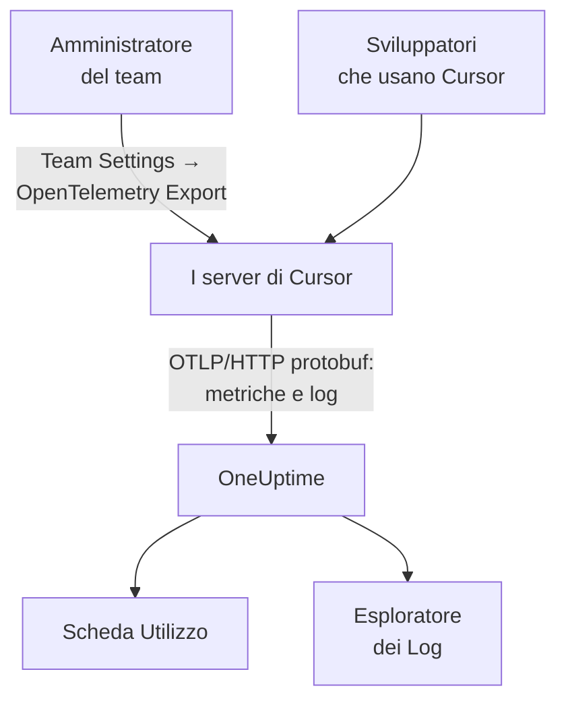

# Cursor

Cursor esporta la telemetria del suo team dai server di Cursor stessi. Un amministratore del team aggiunge OneUptime come destinazione una sola volta, nella dashboard di Cursor, e arrivano i token, il costo stimato e le chiamate a strumenti di tutto il team: niente da installare o impostare sulle macchine degli sviluppatori.

:::cards
- [Configuralo](#configuralo): Crea una chiave in OneUptime e una destinazione in Cursor.
- [Cosa ottieni](#cosa-ottieni-e-cosa-no): Metriche e log; niente tracce.
- [Chi ha speso cosa](#attribuzione-ai-dipendenti): Le persone arrivano come id utente di Cursor.
- [Risoluzione dei problemi](#risoluzione-dei-problemi): Cosa controllare quando non arriva nulla.
:::

## Come funziona



## Prima di iniziare

- **Il piano Enterprise di Cursor.** La schermata OpenTelemetry Export non c'è negli altri piani.
- **Un endpoint che Cursor può raggiungere da internet.** È Cursor a connettersi a te, da un insieme fisso di indirizzi. OneUptime Cloud non ha bisogno d'altro; un OneUptime ospitato in proprio dietro un firewall deve consentire gli indirizzi in uscita che Cursor elenca nella sua pagina [OpenTelemetry Export](https://cursor.com/docs/enterprise/opentelemetry-export).

## Configuralo

:::steps
### Crea una chiave di acquisizione

In OneUptime, apri **Impostazioni del progetto → Telemetria e APM → Chiavi di acquisizione**, fai clic su **Crea chiave di ingestione** e copia la chiave. Il tuo URL di base OTLP è `https://oneuptime.com/otlp`, o `https://YOUR-ONEUPTIME-HOST/otlp` se ospiti OneUptime in proprio.

### Crea la destinazione in Cursor

Nella dashboard web di Cursor, come amministratore del team, apri **Team Settings → OpenTelemetry Export** e crea una destinazione:

| Campo | Valore |
| --- | --- |
| Endpoint (base URL) | `https://oneuptime.com/otlp` |
| Header name | `x-oneuptime-token` |
| Header value | `YOUR_INGESTION_TOKEN` |

Inserisci l'URL di base senza `/v1`: Cursor aggiunge da sé `/v1/metrics` e `/v1/logs`, e `https://oneuptime.com/otlp/v1` invierebbe a `/otlp/v1/v1/metrics`, dove non arriva nulla.

### Prova e attiva

Fai clic su **Test connection** per controllare l'URL e l'header, poi su **Enable**. L'esportazione inizia entro circa un minuto; le modifiche successive all'header richiedono circa 30 secondi.

### Controlla che i dati arrivino

Usa Cursor per un minuto o due, poi apri **Log** in OneUptime e filtra sul nome del servizio `cursor`: i record `cursor.api.request` con i conteggi dei token indicano che la chiave e l'URL sono corretti.
:::

Cursor parla OTLP su HTTP solo con protobuf binario (niente gRPC, niente JSON), che OneUptime accetta così com'è. Salva l'header cifrato, e invia a una sola destinazione per team: per inviare a OneUptime e altrove, metti davanti un collector.

## Cosa ottieni, e cosa no

| Segnale | Da Cursor |
| --- | --- |
| Metriche: token, costo stimato, chiamate a strumenti | Sì, come delta |
| Eventi di log: richieste, errori, correzioni, skill, hook, plugin, agenti cloud | Sì |
| Testo di prompt e risposte | Solo se attivi la famiglia `conversation_content` |
| Tracce | No |
| Qualsiasi cosa precedente all'attivazione della destinazione | No |

Quindi in OneUptime Cursor compare nella scheda **Utilizzo** di **Prodotti → AI / LLM**, da `cursor.token.usage` e `cursor.cost.usage`, ma mai in **Chiamate** o **Conversazioni**, che sono costruite dalle tracce. Il dettaglio per richiesta è l'evento `cursor.api.request` nell'esploratore dei **Log**.

### Famiglie

Ogni segnale, e ogni famiglia di telemetria, ha il proprio interruttore nelle impostazioni di Cursor:

| Famiglia | Copre |
| --- | --- |
| `model_usage` | `cursor.token.usage`, `cursor.cost.usage`, e gli eventi `cursor.api.request`, `cursor.api.error` e `cursor.api.correction` |
| `tool_calls` | `cursor.tool.calls` |
| `skills_hooks_plugins` | Eventi di skill, hook e plugin |
| `cloud_agents` | Eventi `cursor.cloud_agent.*` |
| `grok_bot_agent_actions` | Eventi `cursor.grok_bot.*`; richiede Action Recording |
| `conversation_content` | Il testo dei messaggi e input e output degli strumenti MCP; disattivata per impostazione predefinita |

Tutte le famiglie tranne `conversation_content` partono attive. Anche le famiglie che Cursor aggiungerà in seguito partono attive, a meno che tu non disattivi `auto_enable_new_families`.

## Metriche ed eventi

Tutte e tre le metriche sono somme delta:

| Metrica | Unità | Attributi |
| --- | --- | --- |
| `cursor.token.usage` | `{token}` | `cursor.token.type`: `input`, `output`, `cache_read`, `cache_creation`; `cursor.model.name`; `cursor.api.status`: `success`, `errored`, `aborted`; `cursor.api.billable` |
| `cursor.cost.usage` | `USD` | `cursor.model.name` |
| `cursor.tool.calls` | `{call}` | `cursor.tool.kind`: `builtin`, `mcp`; `cursor.tool.name`; `cursor.tool.status`: `success`, `failure`, `aborted`; `cursor.mcp.server.name` |

I punti dati non portano alcun id di conversazione o di richiesta, quindi il costo per sessione non è nelle metriche. `cursor.model.name` è il modello richiesto, con le scelte instradate accorpate: una suddivisione per modello ha una riga chiamata `Auto` che non si può ripartire tra i modelli verso cui Cursor l'ha instradata.

L'evento di log che userai di più è `cursor.api.request`: uno per richiesta, con i conteggi dei token di input, di output e della cache, il modello e se è stata fatturata. `cursor.api.error` registra una richiesta fallita (senza il messaggio di errore), e `cursor.api.correction` arriva più tardi per dire che una richiesta alla fine non è stata fatturata. Il [riferimento del formato](https://cursor.com/docs/enterprise/opentelemetry-export/wire) di Cursor elenca ogni evento e attributo.

Ogni record porta questi attributi di risorsa:

| Attributo | Cos'è |
| --- | --- |
| `service.name` | Sempre `cursor`: filtra su di esso gli esploratori dei **Log** e delle **Metriche** |
| `cursor.team.id` | Il tuo team, un intero; sempre presente |
| `cursor.user.id` | La persona, un intero valido solo nel team; facoltativo |
| `cursor.surface` | Da dove viene l'attività, come `desktop`, `cli`, `cloud_agent` o `bugbot` |
| `cursor.entrypoint` | Come è iniziata, come `desktop`, `cli`, `web`, `api` o `github_pr` |

## Attribuzione ai dipendenti

**Cursor nomina una persona con `cursor.user.id`, un intero che solo Cursor può trasformare in un nome, e spesso lo omette per gli agenti cloud.** OneUptime lo legge come il dipendente, e `cursor.team.id` come il team, quindi la scheda **Utilizzo** ordina persone e team senza configurazione, ma le persone compaiono come interi.

- Entrambi arrivano come attributi di risorsa (`resource.cursor.user.id`, `resource.cursor.team.id`), che OneUptime legge.
- Cursor può inviare anche `cursor.user.email`, ma OneUptime non lo legge ancora, quindi la colonna dell'email del dipendente resta vuota per Cursor.
- `gen_ai.user`, `llm.user` e gli id degli utenti finali di LiteLLM non vengono mai letti come il dipendente: nominano i tuoi clienti, non il tuo personale. Vedi [Attribuzione a dipendenti e team](/docs/telemetry/ai-coding-assistants#attribuzione-a-dipendenti-e-team).

### Dove compare Cursor nella scheda Utilizzo

Cursor invia metriche e nessuno span GenAI, e le metriche colmano solo i vuoti degli span: **se lo stesso progetto riceve span GenAI con un costo, la spesa di Cursor non compare.** Invia Cursor a un progetto tutto suo. Vedi [Prima gli span, le metriche colmano i vuoti](/docs/telemetry/ai-llm-observability#prima-gli-span-le-metriche-colmano-i-vuoti).

| Suddivisione | Per Cursor |
| --- | --- |
| **Dipendente** | Sì, per `cursor.user.id` |
| **Team** | Sì, per `cursor.team.id` |
| **Modello** | Sì, per `cursor.model.name` |
| **Provider** | No: Cursor non dice mai quale provider ha servito una chiamata |
| **Applicazione / Servizio** | No: le metriche di Cursor non appartengono ad alcun servizio OneUptime |

Una riga di Cursor porta solo il costo: le sue celle di chiamate e token mostrano `—`, perché `cursor.cost.usage` non ha dettagli per chiamata. `cursor.token.usage` alimenta comunque i totali dei token sopra la tabella (i suoi tipi `input` e `output`; i token della cache restano fuori), e puoi rappresentarlo in una dashboard per `cursor.token.type`.

:::details Trasformare un id utente di Cursor in una persona
Nomi e importi fatturati sono nell'Admin API di Cursor, che OneUptime non chiama: interrogala tu se ti serve. È solo per Enterprise, su `https://api.cursor.com`, e accetta una chiave API di amministrazione come nome utente con una password vuota:

```bash
curl -u YOUR_API_KEY: https://api.cursor.com/teams/members
```

`GET /teams/members` elenca l'email e il nome di ogni membro. `POST /teams/filtered-usage-events` restituisce l'utilizzo fatturato per evento; somma i suoi `chargedCents` per la spesa. Il suo `conversationId` corrisponde a `cursor.conversation.id` negli eventi di log di Cursor, il che collega una persona e un importo fatturato a una sessione che già vedi, quando entrambi i lati lo portano. Cursor non documenta che l'intero `cursor.user.id` e gli id utente dell'Admin API siano gli stessi, quindi verificalo sul tuo team prima di addebitare qualcosa a qualcuno su questa base.
:::

## Come consegna Cursor

Queste regole cambiano ciò che vedi nei grafici, quindi conoscile prima di segnalare un buco:

- **Le metriche vengono inviate al massimo una volta.** Un'esportazione fallita non viene ritentata, quindi un breve buco dopo un errore è normale: non far partire chiamate per i buchi nelle metriche di Cursor.
- **I log vengono inviati almeno una volta**, deduplicati su `cursor.event.id`, e ritentati automaticamente per circa 7 giorni.
- **Non c'è un ordine.** Un `cursor.api.correction` arriva dopo la richiesta che corregge: ordina per il timestamp del record, mai per l'arrivo.
- **Niente viene recuperato a ritroso.** Non arriva nulla di precedente all'attivazione della destinazione, e una destinazione lasciata guasta perde ciò che Cursor non è riuscito a inviare.
- **Disattivare o eliminare una destinazione fa perdere i dati in transito.** Per cambiare la chiave di acquisizione, modifica l'header della destinazione invece di eliminarla e ricrearla.

## Il costo è una stima, non una fattura

Cursor documenta `cursor.cost.usage` come una stima al meglio delle possibilità. Non separa l'utilizzo incluso dall'utilizzo fatturato a consumo; con le tue chiavi di modello, riflette solo la tariffa per token di Cursor, non la fattura del tuo provider; e un `cursor.api.correction` successivo può togliere utilizzo già contato. Leggilo come una tendenza. Per una cifra che corrisponda alla fattura, somma i `chargedCents` dell'Admin API di Cursor.

## Risoluzione dei problemi

:::details Non arriva nulla
Esegui di nuovo **Test connection** in Cursor. Controlla che l'URL di base non finisca con `/v1`, che il nome dell'header sia `x-oneuptime-token` e il suo valore esattamente la chiave, e che la famiglia `model_usage` sia attiva. L'esportazione inizia circa un minuto dopo l'attivazione della destinazione.
:::

:::details Non arriva nulla a un OneUptime ospitato in proprio
Cursor si connette dai suoi server: il tuo endpoint OTLP deve essere raggiungibile da internet, con un nome DNS pubblico, e consentire gli indirizzi in uscita di Cursor attraverso il tuo firewall.
:::

:::details I log arrivano, ma la scheda Utilizzo non mostra spesa di Cursor
Il progetto riceve anche span GenAI con un costo, quindi le metriche di Cursor non vengono lette. Invia Cursor a un progetto tutto suo, con la sua chiave di acquisizione.
:::

:::details Le persone compaiono come numeri
È `cursor.user.id`: l'unico id di persona che OneUptime legge oggi da Cursor. Associalo ai nomi con l'Admin API di Cursor.
:::

## Passaggi successivi

:::cards
- [Assistenti di programmazione IA](/docs/telemetry/ai-coding-assistants): Come viene attribuita la spesa per ogni assistente di programmazione.
- [Gateway IA](/docs/telemetry/ai-gateways): Tracce e prompt completi per le chiamate ai modelli delle tue app.
- [Monitor metriche](/docs/monitor/metrics-monitor): Imposta avvisi su `cursor.cost.usage`, `cursor.token.usage` o `cursor.tool.calls`.
:::
