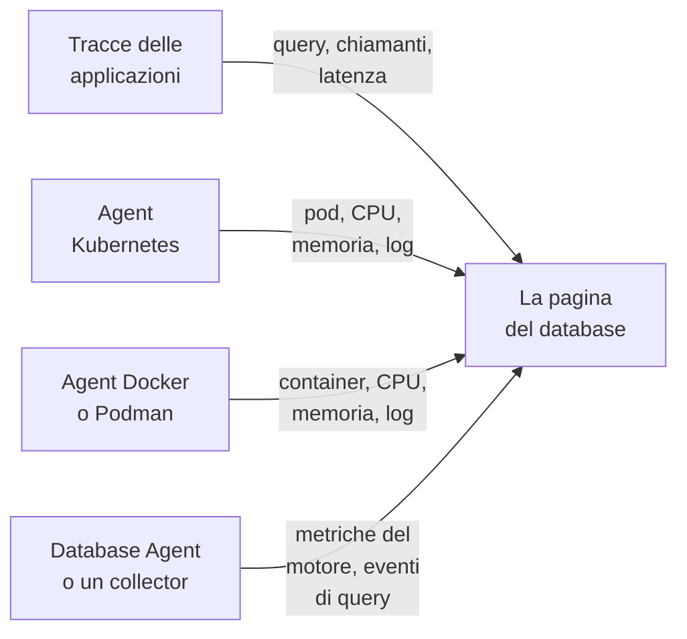

# Database

**Databases** dà a ogni server di database che il tuo progetto esegue o interroga una pagina propria: chi lo chiama e con quale velocità, dove viene eseguito, le metriche di salute proprie del motore, i suoi log e le sue tracce, gli incidenti, gli avvisi e le manutenzioni programmate collegati a esso e i monitor di avviso consigliati per il suo motore. I database hanno etichette, proprietari, regole per etichette e proprietari, conservazione e archiviazione per singolo database, come ogni altra risorsa. Aprili da **Prodotti → Risorse → Database**.

:::cards
- [Il Database Agent](#il-database-agent): Metriche del motore per PostgreSQL, MySQL, SQL Server, Oracle, Redis, MongoDB, Elasticsearch e Memcached.
- [Come vengono rilevati i database](#come-vengono-rilevati-i-database): Da tracce, Kubernetes, Docker, Podman e collector.
- [Avvisi su un database](#avvisi-su-un-database): Monitor consigliati e monitor che costruisci tu.
- [Risoluzione dei problemi](#risoluzione-dei-problemi): Uno script di diagnostica, e i problemi più comuni.
:::

## Come funziona

La maggior parte dei database compare da sola. OneUptime compone ciascuno da un massimo di quattro fonti, e ogni fonte contribuisce con qualcosa di diverso:

| Fonte | Che cosa ti chiede | Che cosa aggiunge alla pagina del database |
| --- | --- | --- |
| **Tracce delle applicazioni** | Applicazioni strumentate (OpenTelemetry) | Query dalle applicazioni: frequenza delle chiamate, errori, latenza e i servizi che lo chiamano |
| **Kubernetes** | L'[agent Kubernetes di OneUptime](/docs/telemetry/kubernetes-agent) | Dove viene eseguito: pod, CPU e memoria, e i log dei pod |
| **Docker / Podman** | L'[agent Docker](/docs/telemetry/docker-host) o l'[agent Podman](/docs/telemetry/podman-host) | Dove viene eseguito: i container, la loro CPU e memoria, e i loro log |
| **Database Agent** (un OpenTelemetry Collector) | Il [Database Agent](#il-database-agent) o il tuo collector | **Engine metrics**: connessioni, throughput, percentuale di hit della cache, lock, ritardo di replica, memoria, per quanto il motore li fornisce (vedi [Che cosa viene raccolto](#che-cosa-viene-raccolto)), più campioni di query facoltativi, top query e il file di log del motore |



Le metriche del motore arrivano solo da un collector che parla con il database stesso (o, per un database cloud gestito, con l'API di monitoraggio del suo provider). Le tracce e gli inventari dei container dicono a OneUptime che un database esiste e come viene usato, ma non come sta all'interno: lo stato **Engine metrics** di ogni database indica se quella parte è collegata.

Puoi anche aggiungere un database a mano: **Databases → Crea: Database** con motore, indirizzo e porta. Per un controllo di salute da una sonda che non richiede alcun agent, vedi il [Monitor stato database](/docs/monitor/database-health-monitor).

## Database supportati

OneUptime conosce per nome i motori della tabella seguente: normalizza ciò che le strumentazioni mettono in `db.system.name` (o nel vecchio `db.system`) al valore della seconda colonna, mostra il nome del motore, applica la sua porta predefinita quando uno span o un indirizzo non ne ha una, riconosce le sue immagini di container e i suoi chart Helm, e sa da dove arrivano le sue metriche del motore. Un motore non elencato funziona comunque ovunque un database sia identificato dal suo indirizzo: compare solo con il nome grezzo riportato dai tuoi span e non viene mai creato dalle sole tracce.

Una **famiglia** è il motore attraverso cui si raggiunge un fork o un motore compatibile a livello di protocollo: le librerie client non distinguono MariaDB da MySQL né Valkey da Redis, quindi uno span dice `mysql` o `redis` mentre un'immagine di container, un chart Helm o il Database Agent nominano il fork. Entrambi finiscono sullo stesso database, e il database mostra il motore più specifico non appena la sua immagine di container, o una fonte almeno forte quanto quella che ha dato il suo motore attuale, lo nomina (vedi [Quale motore mostra un database](#quale-motore-mostra-un-database)).

**Creato dalle tracce** indica se gli span client da soli creano un database di quel motore (vedi [Dalle tracce delle applicazioni](#dalle-tracce-delle-applicazioni)): un servizio gestito raggiunto tramite l'host API condiviso del suo provider e un motore che gira all'interno del processo della tua applicazione non lo fanno mai. **Engine metrics** indica da dove arrivano le metriche di salute proprie del motore: una configurazione del Database Agent, un receiver di collector-contrib che aggiungi al tuo collector, l'endpoint Prometheus proprio del motore (`:port/path`, raccolto con il receiver `prometheus` del collector), l'API di monitoraggio del provider cloud o niente di integrato. La scheda **Documentazione** di ogni database ne ricava una configurazione del collector pronta all'uso per quel database.

| Motore | `db.system.name` | Porta predefinita | Famiglia | Creato dalle tracce | Engine metrics |
| --- | --- | --- | --- | --- | --- |
| Actian Ingres | `actian.ingres` | — | — | Sì | Niente di integrato |
| Actian Zen (Pervasive PSQL) | `pervasive` | 1583 | — | Sì | Niente di integrato |
| Aerospike | `aerospike` | 3000 | — | Sì | receiver `aerospike` |
| Amazon DocumentDB | `aws.documentdb` | 27017 | MongoDB | Sì | receiver `awsfirehose` (monitoraggio cloud) |
| Amazon DynamoDB | `aws.dynamodb` | 443 | — | No (API cloud) | receiver `awsfirehose` (monitoraggio cloud) |
| Amazon Neptune | `aws.neptune` | 8182 | — | Sì | receiver `awsfirehose` (monitoraggio cloud) |
| Amazon Redshift | `aws.redshift` | 5439 | PostgreSQL | Sì | receiver `awsfirehose` (monitoraggio cloud) |
| Apache Derby | `derby` | 1527 | — | No (in-process) | Nessuna (in-process) |
| Apache Doris | `doris` | 9030 | MySQL | Sì | Prometheus, `:8030/metrics` |
| Apache Druid | `druid` | 8888 | — | Sì | Niente di integrato |
| Apache Geode | `geode` | 10334 | — | Sì | Niente di integrato |
| Apache HBase | `hbase` | — | — | Sì | Niente di integrato |
| Apache Hive | `hive` | 10000 | — | Sì | Niente di integrato |
| Apache Ignite | `ignite` | 10800 | — | Sì | Niente di integrato |
| Apache Impala | `impala` | 21050 | — | Sì | Niente di integrato |
| Apache Pinot | `pinot` | 8099 | — | Sì | Niente di integrato |
| Apache Solr | `solr` | 8983 | — | Sì | Niente di integrato |
| ArangoDB | `arangodb` | 8529 | — | Sì | Prometheus, `:8529/_admin/metrics/v2` |
| Azure Cosmos DB | `azure.cosmosdb` | 443 | — | No (API cloud) | receiver `azure_monitor` (monitoraggio cloud) |
| Cassandra | `cassandra` | 9042 | — | Sì | Niente di integrato |
| Chroma | `chroma` | 8000 | — | Sì | Niente di integrato |
| Claris FileMaker | `filemaker` | 2399 | — | Sì | Niente di integrato |
| ClickHouse | `clickhouse` | 9000 | — | Sì | Prometheus, `:9363/metrics` |
| Cloud Bigtable | `gcp.bigtable` | 443 | — | No (API cloud) | receiver `googlecloudmonitoring` (monitoraggio cloud) |
| Cloud Firestore | `gcp.firestore` | 443 | — | No (API cloud) | receiver `googlecloudmonitoring` (monitoraggio cloud) |
| Cloud Spanner | `gcp.spanner` | 443 | — | No (API cloud) | receiver `google_cloud_spanner` |
| CockroachDB | `cockroachdb` | 26257 | PostgreSQL | Sì | Prometheus, `:8080/_status/vars` |
| Couchbase | `couchbase` | 11210 | — | Sì | Prometheus, `:8091/metrics` |
| CouchDB | `couchdb` | 5984 | — | Sì | receiver `couchdb` |
| Databricks | `databricks` | 443 | — | Sì | Niente di integrato |
| Dragonfly | `dragonfly` | 6379 | Redis | Sì | Database Agent (receiver `redis`) |
| DuckDB | `duckdb` | — | — | No (in-process) | Nessuna (in-process) |
| Elasticsearch | `elasticsearch` | 9200 | — | Sì | Database Agent (receiver `elasticsearch`) |
| etcd | `etcd` | 2379 | — | Sì | Prometheus, `:2379/metrics` |
| FerretDB | `ferretdb` | 27017 | MongoDB | Sì | Prometheus, `:8088/debug/metrics` |
| Firebird | `firebirdsql` | 3050 | — | Sì | Niente di integrato |
| FoundationDB | `foundationdb` | 4500 | — | Sì | Niente di integrato |
| Google BigQuery | `bigquery` | 443 | — | No (API cloud) | receiver `googlecloudmonitoring` (monitoraggio cloud) |
| Greenplum | `greenplum` | 5432 | PostgreSQL | Sì | Niente di integrato |
| H2 | `h2database` | 9092 | — | No (in-process) | Nessuna (in-process) |
| Hazelcast | `hazelcast` | 5701 | — | Sì | Niente di integrato |
| HyperSQL | `hsqldb` | 9001 | — | No (in-process) | Nessuna (in-process) |
| IBM Db2 | `ibm.db2` | 50000 | — | Sì | Niente di integrato |
| IBM Informix | `ibm.informix` | 9088 | — | Sì | Niente di integrato |
| IBM Netezza | `ibm.netezza` | 5480 | — | Sì | Niente di integrato |
| InfluxDB | `influxdb` | 8086 | — | Sì | Prometheus, `:8086/metrics` |
| InstantDB | `instantdb` | — | — | No (in-process) | Nessuna (in-process) |
| InterBase | `interbase` | 3050 | Firebird | Sì | Niente di integrato |
| InterSystems IRIS / Caché | `intersystems.cache` | 1972 | — | Sì | Prometheus, `:52773/api/monitor/metrics` |
| KeyDB | `keydb` | 6379 | Redis | Sì | Database Agent (receiver `redis`) |
| MariaDB | `mariadb` | 3306 | MySQL | Sì | Database Agent (receiver `mysql`) |
| Meilisearch | `meilisearch` | 7700 | — | Sì | Prometheus, `:7700/metrics` |
| Memcached | `memcached` | 11211 | — | Sì | Database Agent (receiver `memcached`) |
| Milvus | `milvus` | 19530 | — | Sì | Prometheus, `:9091/metrics` |
| MongoDB | `mongodb` | 27017 | — | Sì | Database Agent (receiver `mongodb`) |
| MySQL | `mysql` | 3306 | — | Sì | Database Agent (receiver `mysql`) |
| Neo4j | `neo4j` | 7687 | — | Sì | Prometheus, `:2004/metrics` |
| OceanBase | `oceanbase` | 2881 | MySQL | Sì | Niente di integrato |
| OpenSearch | `opensearch` | 9200 | Elasticsearch | Sì | Database Agent (receiver `elasticsearch`) |
| Oracle | `oracle.db` | 1521 | — | Sì | Database Agent (receiver `oracledb`) |
| Pinecone | `pinecone` | 443 | — | No (API cloud) | Niente di integrato |
| PostgreSQL | `postgresql` | 5432 | — | Sì | Database Agent (receiver `postgresql`) |
| Presto | `presto` | 8080 | — | Sì | Niente di integrato |
| Progress OpenEdge | `progress` | — | — | Sì | Niente di integrato |
| Qdrant | `qdrant` | 6333 | — | Sì | Prometheus, `:6333/metrics` |
| QuestDB | `questdb` | 8812 | PostgreSQL | Sì | Prometheus, `:9003/metrics` |
| RavenDB | `ravendb` | 8080 | — | Sì | Niente di integrato |
| Redis | `redis` | 6379 | — | Sì | Database Agent (receiver `redis`) |
| Riak KV | `riak` | 8087 | — | Sì | receiver `riak` |
| SAP ASE (Sybase) | `sybase` | 5000 | — | Sì | Niente di integrato |
| SAP HANA | `sap.hana` | 30015 | — | Sì | receiver `saphana` |
| SAP MaxDB | `sap.maxdb` | 7210 | — | Sì | Niente di integrato |
| ScyllaDB | `scylladb` | 9042 | Cassandra | Sì | Prometheus, `:9180/metrics` |
| SingleStore | `singlestore` | 3306 | MySQL | Sì | Prometheus, `:9104/metrics` |
| Snowflake | `snowflake` | 443 | — | Sì | receiver `snowflake` |
| Software AG Adabas | `softwareag.adabas` | — | — | Sì | Niente di integrato |
| SQL Server | `microsoft.sql_server` | 1433 | — | Sì | Database Agent (receiver `sqlserver`) |
| SQLite | `sqlite` | — | — | No (in-process) | Nessuna (in-process) |
| StarRocks | `starrocks` | 9030 | MySQL | Sì | Prometheus, `:8030/metrics` |
| SurrealDB | `surrealdb` | 8000 | — | Sì | Niente di integrato |
| Teradata | `teradata` | 1025 | — | Sì | Niente di integrato |
| TiDB | `tidb` | 4000 | MySQL | Sì | Prometheus, `:10080/metrics` |
| Trino | `trino` | 8080 | — | Sì | Prometheus, `:8080/metrics` |
| Typesense | `typesense` | 8108 | — | Sì | Niente di integrato |
| Valkey | `valkey` | 6379 | Redis | Sì | Database Agent (receiver `redis`) |
| Vertica | `vertica` | 5433 | — | Sì | Niente di integrato |
| Vitess | `vitess` | 3306 | MySQL | Sì | Prometheus, `:15000/metrics` |
| Weaviate | `weaviate` | 8080 | — | Sì | Prometheus, `:2112/metrics` |
| YugabyteDB | `yugabytedb` | 5433 | PostgreSQL | Sì | Prometheus, `:9000/prometheus-metrics` |

Sono accettate anche le altre grafie comuni: `postgres` e `pg`, `mssql` e `sqlserver`, `oracle`, `mongo`, `scylla`, `dragonflydb`, `memsql`, e ogni vecchio valore di `db.system` usato da OpenTelemetry (`db2`, `hanadb`, `cosmosdb`, `dynamodb`, `spanner`, `redshift`, `informix`, `maxdb`, `cache`, `h2`, `firebird`, `edb`, `cloudscape`, …). Un servizio gestito che parla il protocollo di un motore (Amazon RDS e Aurora, Azure Database, Cloud SQL, AlloyDB, Neon, Supabase, PlanetScale, ElastiCache, Memorystore, MongoDB Atlas) è quel motore.

## Come vengono rilevati i database

Ogni database ricorda la fonte che l'ha creato (la colonna **Discovered from**), e il primo elemento del suo **Feed** dice che cosa l'ha trovato: il workload Kubernetes e il suo cluster, il container Docker o Podman (o il servizio Compose o Swarm) e il suo host, l'endpoint chiamato dalle applicazioni, oppure il Database Agent (con la sua versione) o il collector che l'ha segnalato. Le fonti successive si aggiungono allo stesso database invece di crearne un altro, purché descrivano lo stesso endpoint (vedi [Endpoint](#endpoint-e-la-regola-del-proprietario-unico)).

### Dalle tracce delle applicazioni

Ogni 10 minuti OneUptime riassume gli span CLIENT che le tue applicazioni hanno inviato negli ultimi 15 minuti e che riportano `db.system.name` (o il vecchio `db.system`). Il server viene da `server.address` (o dal vecchio `net.peer.name`, poi `network.peer.address` / `net.sock.peer.addr`) e la porta da `server.port` (o `net.peer.port`, `network.peer.port`, `net.sock.peer.port`); quando lo span non ha una porta, si assume la porta predefinita del motore. I nomi dei motori vengono normalizzati (vedi [Database supportati](#database-supportati)), quindi `postgres`, `pg` e `postgresql` sono un solo motore, come `mssql` e `microsoft.sql_server`; `mariadb` e `mysql` sono due motori di una stessa famiglia.

Un database viene **creato** dalle tracce solo quando valgono tutte queste condizioni; tutto il resto conta comunque per un database già esistente, ma non ne crea mai uno:

- l'indirizzo designa un solo server in tutto il progetto: un nome DNS, non un IP letterale e non un nome che si risolve solo su una macchina o all'interno di una rete, a meno che il cluster Kubernetes del chiamante non lo qualifichi (vedi [Endpoint](#endpoint-e-la-regola-del-proprietario-unico));
- la porta è una su cui un server è in ascolto. I sistemi operativi assegnano l'estremità client di una connessione a partire dalla porta 32768 (l'intervallo effimero predefinito di Linux comincia lì; Windows e macOS usano 49152–65535), quindi una porta da 32768 in su non crea mai un database, a meno che non sia la porta predefinita del motore stesso (la 50000 di IBM Db2). La strumentazione eBPF, compresa quella dell'agent Kubernetes, può agganciarsi a una connessione di lunga durata a metà strada e scambiarne le due estremità. Lo span indica allora la porta del client stesso come server, e senza questa regola ogni connessione diventerebbe un database a sé;
- il motore è uno che OneUptime conosce, con un indirizzo proprio: la colonna **Creato dalle tracce** di [Database supportati](#database-supportati). Le API cloud il cui host è condiviso da tutti i clienti (DynamoDB, BigQuery, Spanner, Firestore, Bigtable, Cosmos DB, Pinecone), i motori che girano dentro la tua applicazione (SQLite, DuckDB, H2, HyperSQL, Derby) e i motori che OneUptime non conosce non vengono mai creati dalle tracce: aggiungili a mano;
- l'endpoint ha ricevuto almeno 10 query nella finestra di 15 minuti esaminata da un'esecuzione, così uno script occasionale non crea un database. Gli span di gestione delle connessioni di una libreria client (`pg.connect` e `pg-pool.connect` di node-postgres, `redis-connect`, `connect`, …) non sono query: non contano né qui né nelle **Query** di un database;
- il progetto è sotto il suo [budget di creazione automatica](#il-budget-di-creazione-automatica).

Ogni span CLIENT di database viene anche marcato con il suo endpoint al momento dell'acquisizione, quindi, non appena un database possiede un endpoint, la sezione **Query dalle applicazioni** e la scheda **Tracce** mostrano ogni chiamata verso di esso, comprese quelle fatte prima della creazione del database. Le metriche `db.client.*` (per esempio `db.client.operation.duration`) che riportano un `server.address` vengono marcate allo stesso modo.

**Cluster ed elenchi di host.** Una stringa di connessione che elenca più host (`m1:27017,m2:27017,m3:27017`) è un solo database, in qualunque ordine un client li elenchi. I membri di MongoDB Atlas (`cluster0-shard-00-01.ab1cd.mongodb.net`) diventano un solo database con il nome del loro cluster (`cluster0.ab1cd.mongodb.net`), e ogni membro visto diventa uno dei suoi endpoint. I driver che segnalano separatamente ogni membro di un anello Cassandra, di un Redis Cluster, di un cluster Elasticsearch o i nodi di ElastiCache producono comunque un database per membro: niente in quei nomi host dice a quale cluster appartengono. Tienine uno e [unisci](#endpoint-e-la-regola-del-proprietario-unico) gli altri a esso.

### Da Kubernetes

Ogni 5 minuti OneUptime esamina i pod di ogni cluster Kubernetes collegato e riconosce i workload di database:

1. **Prima le etichette di operator e chart**: CloudNativePG, Zalando (Spilo), Crunchy PGO, i chart Bitnami, ECK, Altinity ClickHouse, cass-operator, Percona, l'operator Oracle MySQL e l'operator Vitess (i suoi pod `vtgate` sono il database; `vttablet`, `vtctld`, `vtorc` e `vtbackup` ne sono parti, non membri). Un cluster di operator diventa un database. Il Service vtgate proprio del cluster Vitess ha un nome con hash, quindi aggiungilo nella scheda **Endpoint** del database se le applicazioni si connettono tramite esso.
2. **Altrimenti le immagini di container**, per nome esatto dell'immagine: le immagini ufficiali, quelle Bitnami (compresi i repository trasferiti `bitnamilegacy` e `bitnamisecure`) e quelle Red Hat / OpenShift di ogni motore di [Database supportati](#database-supportati) che ne distribuisce una (`postgres`, `bitnami/postgresql`, `rhel9/postgresql-16`, `mysql`, `mariadb`, `mssql/server`, `gvenzl/oracle-free`, `redis`, `valkey/valkey`, `mongo`, `cockroachdb/cockroach`, `pingcap/tidb`, `clickhouse/clickhouse-server`, `qdrant/qdrant`, …). Un fork viene riconosciuto come tale: un'immagine `mariadb` è MariaDB, un'immagine `valkey/valkey` è Valkey. Exporter, operator, interfacce di amministrazione, connection pooler (pgbouncer, pgpool, ProxySQL, HAProxy, Cloud SQL Proxy) e strumenti di backup non sono database. Anche un pod che esegue pure un container applicativo non viene trattato come database (un'app con un sidecar di database resta l'app), anche se uno StatefulSet il cui container di database dichiara la porta predefinita del motore può includere un container in più che OneUptime non riconosce (per esempio un log shipper).

Un'immagine di database non fa di un pod un server di database, ma solo una prova positiva lo rende qualcos'altro. Un container il cui programma è uno strumento client o di dump (`psql`, `redis-cli`, `mongosh`, `pg_dump`, `mysql`), un keep-alive (`sleep infinity`, `tail -f /dev/null`) o una shell interattiva (oppure il cui script `sh -c` non esegue altro che tali strumenti, comandi interni della shell e semplici utility come `echo` o `cp`) è un'esecuzione client o di debug, non un database; lo stesso vale per un Sentinel di Redis o Valkey (`redis-sentinel`, `redis-server --sentinel`). Questo vale anche dietro un launcher: `env` (con le sue impostazioni `NAME=value`), `nohup`, `setsid`, `tini`, `dumb-init` e il `docker-entrypoint.sh` di un'immagine vengono attraversati fino al programma che avviano, e così `exec`, `env` e `nohup` dentro uno script; quindi `env PGPASSWORD=… psql` e `tini -- redis-cli` sono esecuzioni client, mentre `tini -- docker-entrypoint.sh postgres` è il server, e lo è anche `docker-entrypoint.sh -c max_connections=200`, il server proprio dell'immagine avviato con un flag. Uno script che poi avvia qualsiasi altra cosa (`sleep 5 && exec redis-server`, `bash -ecx 'exec cockroach start …'`), un file di script (`sh /start.sh`), un wrapper che prende argomenti propri prima del programma (`gosu postgres …`, `timeout 30 …`) o uno script troppo lungo da leggere conta come possibile server. Nemmeno i pod terminati, i job batch e i pod occasionali di `kubectl run` che non dichiarano alcuna porta sono database.

Un database compare non appena uno dei suoi pod è Ready da circa 10 minuti (quando solo un sidecar impedisce al pod di diventare Ready, conta invece un container di database pronto). Un pod in crash loop torna Ready a ogni riavvio, quindi non diventa mai un database, e lo stesso vale per un job di CI o un pod andato in crash dopo un minuto. Una volta creato, un database viene aggiornato a ogni esecuzione.

I pod vengono raggruppati per StatefulSet, Deployment o cluster di operator, quindi uno StatefulSet a tre membri è un database con tre membri. **Istanze** nella sua pagina conta i pod il cui container di database è in esecuzione: non uno in attesa in `CrashLoopBackOff` o `ImagePullBackOff`, né uno terminato, anche se Kubernetes può ancora segnalare un pod del genere come Running; un workload scalato a zero mostra 0 e mantiene la sua pagina finché l'[archiviazione automatica](#ciclo-di-vita-archiviazione-e-conservazione) non lo ritira. Funziona anche il percorso inverso: la pagina dello StatefulSet o del Deployment del workload, e la pagina di ognuno dei suoi pod, nominano il database che esegue con un link **Open database**, anche per uno StatefulSet o un Deployment con un nome diverso da quello del suo database (`shop-redis-master` di Bitnami per `shop-redis`, `cluster1-pxc` di Percona per `cluster1`), mentre un workload di pooler o di backup che un operator etichetta come parte di un cluster indica di far parte del cluster di quel database.

L'agent Kubernetes non segnala gli oggetti Service, quindi i nomi di Service di un database vengono dalle convenzioni seguite da chart e operator: il nome dello StatefulSet o del Deployment proprietario, il Service headless dello StatefulSet (e ogni membro dietro di esso, `<pod>.<headless-service>`), e i Service di proxy e pooler degli operator: HAProxy e ProxySQL di Percona XtraDB Cluster, il router e HAProxy di Percona Server for MySQL, mongos di Percona Server for MongoDB, pgBouncer di Crunchy e i pooler di Zalando e CloudNativePG. Ognuno diventa un endpoint qualificato dal cluster (`postgres.prod.svc.cluster.local:5432@my-cluster`), così lo stesso nome in due cluster resta due database. Finché il progetto ha esattamente un cluster, viene aggiunto anche il nome non qualificato `postgres.prod.svc.cluster.local:5432`, che viene rilasciato circa 2 ore dopo la comparsa di un secondo cluster. Aggiungi un Service con qualsiasi altro nome nella scheda **Endpoint** del database.

Le applicazioni la cui telemetria passa dall'agent Kubernetes riportano il loro namespace e il loro cluster, quindi le loro chiamate vengono lette come le legge il resolver del loro pod: `postgres` (dallo stesso namespace), `postgres.prod` (il Service `postgres` nel namespace `prod`), `postgres.prod.svc` e il nome completo vengono tutti associati al database, e così anche `mongo-0.mongo-headless`, un membro di StatefulSet nel namespace del chiamante.

OneUptime legge i metadati dei pod, le etichette, le immagini, le porte dichiarate e ciò che esegue la riga di comando di un container (il nome del programma, i flag di una shell e quali comandi noti client, di keep-alive e di shell esegue il suo script; ogni altro comando viene solo annotato come non riconosciuto), mai variabili d'ambiente, valori degli argomenti, testo degli script o segreti.

### Da Docker e Podman

Ogni 5 minuti i container di ogni host Docker o Podman collegato vengono classificati per immagine allo stesso modo, poi raggruppati e filtrati in base ai loro nomi e alle loro etichette Compose, Swarm e Testcontainers, mai in base al comando che eseguono (vedi sotto). I container di uno stesso servizio Compose (in base alle etichette di progetto e servizio Compose) o di uno stesso servizio Swarm sono un database con più membri, e il suo workload è quel servizio (`Compose service/<project>-<service>`, `Swarm service/<service>`). Ogni altro container è un database a sé con il suo nome esatto (`Container/<name>`), così `redis-6379` e `redis-6380` restano due. I Testcontainers, le esecuzioni occasionali di `docker compose run`, i container che il kubelet esegue su un nodo Docker (il rilevamento Kubernetes li trova come pod) e i container che restano in esecuzione meno di 10 minuti non diventano mai database. L'età di un container è il suo uptime, quindi uno che è già in esecuzione da così tanto diventa un database alla prima esecuzione dopo l'installazione dell'agent. **Istanze** conta i container in esecuzione, e la pagina di ogni container rimanda al suo database (**Open database**). Un host registrato due volte con lo stesso nome viene letto una volta sola, tramite la registrazione vista più di recente.

L'agent invia queste etichette con le metriche di ogni container non appena il suo `otel-collector-config.yaml` le copia (`container_labels_to_metric_labels`). Un agent Docker o Podman più vecchio non lo fa: aggiornalo, altrimenti ogni container è un database a sé, comprese le esecuzioni di Testcontainers e quelle occasionali.

A differenza di Kubernetes, la riga di comando di un container non viene mai letta (gli agent non la inviano, perché può contenere segreti), quindi un container client o di debug di lunga durata creato da un'immagine di database (`sleep infinity`, un ciclo di `psql` o `redis-cli`) diventa un database dopo 10 minuti di esecuzione. Archivialo per scartarlo: un database archiviato da una persona resta archiviato. Se lo lasci com'è, viene [archiviato automaticamente](#ciclo-di-vita-archiviazione-e-conservazione) 7 giorni dopo l'arresto del container.

I nomi dei container si risolvono solo all'interno di una rete Docker, quindi questi database **non** ottengono endpoint automaticamente; la loro pagina mostra le metriche e i log propri dei container. Per unire le query inviate dalle tue applicazioni, aggiungi l'indirizzo che usano nella scheda [Endpoint](#endpoint-e-la-regola-del-proprietario-unico).

Per le metriche del motore, installa il [Database Agent](#il-database-agent) dalla scheda **Documentazione** del database stesso: il suo comando di installazione e il suo `.env` contengono `DATABASE_SERVER_ID`, già compilato, così i dati dell'agent confluiscono in questo database. Un agent installato senza di esso viene invece associato tramite il suo `DATABASE_SERVER_ADDRESS`, che un database di container non possiede: un nome DNS registra il server come secondo database (una pagina con i container, un'altra con le metriche del motore; vedi [Due database per un server](#due-database-per-un-server)), e un IP privato o un nome di container non si collega a nulla.

### Dal Database Agent o dal tuo collector

Quando metriche o log del motore arrivano da un receiver di database di un collector, OneUptime li associa a un database nel momento in cui vengono acquisiti: direttamente tramite id quando i dati riportano `oneuptime.database.server.id` (il `DATABASE_SERVER_ID` dell'agent), altrimenti tramite l'endpoint indicato dai dati (`server.address` / `server.port`):

- i dati collegati tramite id si collegano a quel database e compaiono nelle sue pagine (e solo lì), qualunque indirizzo riportino: un IP privato, un nome locale al cluster, un indirizzo posseduto da un altro database o nessuno. Un indirizzo riportato che designa un solo server in tutto il progetto e non appartiene ancora a nessun database viene aggiunto al database come endpoint, così anche le tracce delle applicazioni verso quell'indirizzo arrivano lì;
- altrimenti, un endpoint che un database possiede già collega i dati a quel database, chiunque l'abbia creato;
- altrimenti viene **creato** un database, ma solo da un nome che designa un solo server in tutto il progetto (un nome DNS, un IP pubblico, o un nome locale al cluster, `.internal` o `.local` che i dati qualificano con il loro cluster Kubernetes, `k8s.cluster.name`, che il Database Agent non imposta mai) e solo per un motore che può essere creato da solo (la colonna **Creato dalle tracce** di [Database supportati](#database-supportati): mai un'API cloud condivisa, un motore in-process o uno sconosciuto). Gli IP privati e link-local, i nomi a etichetta singola (`db`) e i nomi non qualificati locali al cluster (`postgres.prod.svc.cluster.local`), `.internal` o `.local` possono designare un server diverso in ogni rete; l'IP di un pod cambia a ogni riavvio; e un nome a etichetta singola completato dal namespace del collector può essere un Service o il pod del collector stesso. I dati che nominano uno di questi si uniscono solo a un database che lo ha già come endpoint: il workload rilevato in Kubernetes, per i suoi nomi di Service. Crea quel database a mano (**Databases → Crea: Database**, stesso indirizzo e stessa porta) o collega l'agent a esso con `DATABASE_SERVER_ID`. In un progetto con un cluster Kubernetes, un nome di Service locale al cluster viene rifiutato senza il suo cluster: crea il database come `postgres.prod.svc.cluster.local:5432@my-cluster`, poi aggiungi il nome non qualificato `postgres.prod.svc.cluster.local:5432` (quello che riporta l'agent) nella sua scheda **Endpoint**;
- un batch di receiver che non nomina alcun server viene ignorato (vedi [Usare il tuo OpenTelemetry Collector](#usare-il-tuo-opentelemetry-collector)).

I database creati da un collector contano nel [budget di creazione automatica](#il-budget-di-creazione-automatica) come ogni altro database rilevato; un database che hai creato a mano e collegato con `DATABASE_SERVER_ID` non ha mai bisogno di una creazione. Vedi [Il Database Agent](#il-database-agent).

### Quale motore mostra un database

Quando le fonti non concordano sul motore di un database, vince la prova più forte: un motore impostato da una persona, poi un collector o il Database Agent (il motore che parla di sé), poi un'immagine di container o un chart Helm, poi gli span client; un driver PostgreSQL riporta `postgresql` anche quando parla con CockroachDB. Una fonte sposta un database in un'altra famiglia di motori solo quando la sua prova è più forte di ciò che ha nominato il motore attuale, e un motore impostato da una persona non viene mai cambiato dal rilevamento. All'interno di una famiglia, un fork precisa il motore quando la fonte che lo nomina è forte almeno quanto quella che ha nominato il motore attuale, oppure è un'immagine di container: uno span dice `redis`, l'immagine dice `valkey` e il database mostra Valkey, anche dove il receiver `redis` di un collector ha detto `redis`, dato che non sa distinguere i due. Le sole tracce delle applicazioni non precisano mai un motore determinato da un'immagine o da un collector: un client nomina il protocollo che parla, e MariaDB Connector/J riporta `mariadb` verso un server MySQL. Un collector nomina il fork quando lo imposta in `db.system.name` (il Database Agent lo fa, da `DATABASE_SYSTEM`) o quando il `db.system.version` del batch lo nomina: una stringa di versione che porta il nome del fork (`8.0.11-TiDB-v7.5.1`) o una versione principale che solo il fork ha pubblicato; MySQL non ha una 10.x né una 11.x, quindi `mysql` con `11.4.13`, il semplice numero che il receiver `mysql` riporta per MariaDB 11.4, è MariaDB (vedi [Usare il tuo OpenTelemetry Collector](#usare-il-tuo-opentelemetry-collector)). Un fork viene annullato solo da un'immagine di container che nomina il motore della sua famiglia, e solo quando a nominare il fork sono state soltanto tracce delle applicazioni; un collector o una traccia che nomina la famiglia non ne annulla mai uno. Un workload Kubernetes la cui immagine passa a un fork della stessa famiglia (da `redis` a `valkey`) resta lo stesso database.

### Il budget di creazione automatica

Tracce, Kubernetes, Docker, Podman e collector creano database da soli solo finché il progetto ha meno di 500 database rilevati attivi e non archiviati (`DATABASE_SERVER_AUTO_CREATE_BUDGET`, vedi [Regolazioni per l'installazione self-hosted](#regolazioni-per-linstallazione-self-hosted)). I database che crei a mano non contano mai e non vengono mai bloccati; i database archiviati non contano, quindi l'[archiviazione automatica](#ciclo-di-vita-archiviazione-e-conservazione) libera budget; e i database già esistenti continuano a essere associati e aggiornati. Una volta raggiunto il budget, i dati di collector per un nuovo endpoint non creano nulla (si uniscono solo a database esistenti), e OneUptime registra un avviso al massimo una volta ogni 10 minuti per progetto.

## Il Database Agent

Il Database Agent di OneUptime è un OpenTelemetry Collector preconfigurato per **PostgreSQL**, **MySQL / MariaDB**, **SQL Server**, **Oracle**, **Redis / Valkey / KeyDB / Dragonfly**, **MongoDB**, **Elasticsearch / OpenSearch** e **Memcached**. È solo configurazione: un container `otel/opentelemetry-collector-contrib` standard che esegue il receiver nativo del collector per il tuo motore, con una configurazione che marca ogni batch con l'identità del database e lo invia a OneUptime tramite OTLP. Sul server di database non viene installato nulla. Lo stesso `docker-compose.yml` esegue anche l'[agente IA per database](#agente-ia) accanto al collector, per OneUptime AI. Per gli altri motori di [Database supportati](#database-supportati), vedi [Usare il tuo OpenTelemetry Collector](#usare-il-tuo-opentelemetry-collector): la scheda **Documentazione** di ogni database contiene la configurazione.

**Un agent monitora un server di database.** L'identità viene impressa su tutto ciò che l'agent invia, quindi esegui un agent (una directory di installazione) per server, e uno per replica se vuoi le repliche nelle loro pagine.

L'agent si trova nella [directory DatabaseAgent](https://github.com/OneUptime/oneuptime/tree/master/agents/DatabaseAgent): `docker-compose.yml`, una configurazione del collector per receiver (`configs/postgresql.yaml`, `configs/mysql.yaml`, `configs/sqlserver.yaml`, `configs/oracledb.yaml`, `configs/redis.yaml`, `configs/mongodb.yaml`, `configs/elasticsearch.yaml`, `configs/memcached.yaml`), `install.sh`, `troubleshoot.sh` e una unit systemd. Un fork o un sostituto compatibile esegue la configurazione della sua famiglia e riporta il proprio nome: `DATABASE_SYSTEM=mariadb` esegue `configs/mysql.yaml` e il database compare come MariaDB.

### Prima di iniziare

- Docker Engine 20.10 o successivo con il plugin Docker Compose v2, su una macchina che raggiunge la porta del database (oppure un cluster Kubernetes: vedi [Kubernetes](#kubernetes)).
- Un login sul database che possa creare l'utente di monitoraggio e concedergli i permessi sulle statistiche indicati sotto.
- Una chiave di acquisizione. Creane una in **Impostazioni del progetto → Telemetria e APM → Chiavi di acquisizione** e copiane il valore.

:::steps
### Crea un utente di monitoraggio

Dai all'agent un login proprio con accesso in lettura alle statistiche del motore: mai un amministratore e mai il login di un'applicazione. Se hai già creato un utente di monitoraggio per il [Monitor stato database](/docs/monitor/database-health-monitor#crea-un-utente-di-monitoraggio), i suoi permessi PostgreSQL, MySQL e SQL Server coprono anche l'agent.

:::tabs
@tab PostgreSQL
```sql
CREATE USER oneuptime_monitor WITH PASSWORD 'a-strong-password';
GRANT pg_monitor TO oneuptime_monitor;
```

`pg_monitor` è un ruolo integrato (PostgreSQL 10 e successivi) che concede l'accesso in lettura alle viste di statistiche e monitoraggio e nessun accesso alle tue tabelle. Non è facoltativo: senza di esso `pg_stat_activity` non fallisce, ma restituisce solo la sessione dell'agent stesso, quindi il numero di connessioni indica `1` su un server che in realtà è pieno. Il receiver si connette a ogni database per leggere le statistiche per database, quindi l'utente ha bisogno anche di `CONNECT` su ciascuno (`PUBLIC` lo ha per impostazione predefinita). Il receiver PostgreSQL non si avvia senza password.

Le top query (`DATABASE_QUERY_EVENTS=true`) leggono anche `pg_stat_statements`: caricalo con `shared_preload_libraries = 'pg_stat_statements'` (un riavvio) e crealo in ogni database monitorato:

```sql
CREATE EXTENSION IF NOT EXISTS pg_stat_statements;
```

I piani di esecuzione delle top query richiedono `SELECT` sulle tabelle che le query toccano, che `pg_monitor` non concede: concedilo per schema (`GRANT SELECT ON ALL TABLES IN SCHEMA app TO oneuptime_monitor`) se vuoi i piani. Senza di esso le top query arrivano comunque, con piani vuoti, e il collector registra `failed to explain` per ciascuna; lo script di diagnostica lo segnala come avviso, non come permesso mancante.

Su un servizio gestito in cui `pg_monitor` non è disponibile, `pg_read_all_stats` copre le stesse viste. L'agent salta già i database interni di Amazon RDS, Azure, Cloud SQL e AlloyDB che nessun login cliente può aprire.
@tab MySQL / MariaDB
```sql
CREATE USER 'oneuptime_monitor'@'%' IDENTIFIED BY 'a-strong-password';
GRANT PROCESS, REPLICATION CLIENT ON *.* TO 'oneuptime_monitor'@'%';
GRANT SELECT ON performance_schema.* TO 'oneuptime_monitor'@'%';
```

`PROCESS` e `REPLICATION CLIENT` coprono i contatori di stato globali, lo stato di InnoDB e lo stato delle repliche; `performance_schema` (attivo per impostazione predefinita da MySQL 5.6) viene letto per i campioni di query e le top query. MariaDB 10.5.9 e successivi separano lo stato delle repliche in un privilegio proprio, quindi lì esegui anche `GRANT SLAVE MONITOR ON *.* TO 'oneuptime_monitor'@'%';`. Imposta `DATABASE_SYSTEM=mariadb` per un server MariaDB: la stessa configurazione lo monitora e il database compare come MariaDB. È il modo affidabile. Un agent installato come `mysql` su MariaDB 10 o successivo ci arriva comunque, tramite il numero di versione (`11.4.13`: MySQL non ha mai pubblicato una 10.x né una 11.x), ma un MariaDB 5.5 resta MySQL.
@tab SQL Server
```sql
CREATE LOGIN oneuptime_monitor WITH PASSWORD = 'a-strong-password';
GRANT VIEW SERVER STATE TO oneuptime_monitor;
GRANT VIEW ANY DEFINITION TO oneuptime_monitor;
```

`VIEW SERVER STATE` (su SQL Server 2022 e successivi basta `VIEW SERVER PERFORMANCE STATE`) legge le viste a gestione dinamica da cui proviene ogni metrica e non concede alcun accesso ai tuoi dati. Il receiver inserisce il login in una stringa di connessione senza virgolette, quindi nome utente e password non devono contenere un punto e virgola (`;`) né una virgoletta doppia (`"`), né iniziare o finire con uno spazio: `install.sh` li rifiuta. Il driver negozia la cifratura direttamente con il server, quindi le variabili TLS non si applicano.

Per un'istanza denominata (`sql1.corp\INST01`), punta `DATABASE_ENDPOINT` alla porta TCP propria dell'istanza, mai alla 1433 dell'istanza predefinita, che raggiunge invece l'istanza predefinita. SQL Server Configuration Manager la mostra (il protocollo TCP/IP dell'istanza, IPAll), oppure esegui `SELECT local_tcp_port FROM sys.dm_exec_connections WHERE session_id = @@SPID;` sull'istanza. `install.sh` rifiuta `host\instance` e chiede `host:port`.
@tab Oracle
```sql
-- In the pluggable database the agent connects to, e.g. ALTER SESSION SET CONTAINER = FREEPDB1;
CREATE USER oneuptime_monitor IDENTIFIED BY "a-strong-password";
GRANT CREATE SESSION TO oneuptime_monitor;
GRANT SELECT_CATALOG_ROLE TO oneuptime_monitor;
```

`SELECT_CATALOG_ROLE` legge le viste `V$` e `DBA_` da cui provengono le metriche, i campioni di query e le top query, e non concede alcun accesso alle tue tabelle. `DATABASE_ORACLE_SERVICE` nomina il servizio a cui si connette l'agent (`FREEPDB1`, `ORCLPDB1`, …).
@tab Redis / Valkey / KeyDB / Dragonfly
```text
ACL SETUSER oneuptime_monitor on >a-strong-password -@all +info +ping
```

Il receiver esegue solo `INFO`. Rendi persistente l'utente con `ACL SAVE` (o una riga `user` in `redis.conf` / nel tuo file ACL). Su un server protetto solo da `requirepass`, lascia vuoto `DATABASE_USERNAME` e imposta `DATABASE_PASSWORD`; su un server senza autenticazione, lasciali vuoti entrambi. Imposta `DATABASE_SYSTEM` su `valkey`, `keydb` o `dragonfly` per quei server. Il receiver legge la versione dal `redis_version` di `INFO`, che Valkey mantiene a `7.2.4` (la versione di Redis da cui deriva) e che Dragonfly imposta sulla versione di Redis che emula. OneUptime la ignora per loro, quindi un database Valkey o Dragonfly mostra la versione della sua immagine di container quando lo esegue Kubernetes, Docker o Podman, e nessuna con il solo agent.
@tab MongoDB
```js
db.getSiblingDB("admin").createUser({
  user: "oneuptime_monitor",
  pwd: "a-strong-password",
  roles: [{ role: "clusterMonitor", db: "admin" }],
});
```

`clusterMonitor` copre tutte le metriche. I piani di esecuzione delle top query richiedono in più `{ role: "read", db: "<database>" }` per ogni database monitorato; senza di esso le top query arrivano comunque, con piani vuoti. L'agent si connette esattamente a un membro (`direct_connection`), quindi esegui un agent per ogni membro del replica set.
@tab Elasticsearch / OpenSearch
```text
POST /_security/role/oneuptime_monitor
{ "cluster": ["monitor"], "indices": [{ "names": ["*"], "privileges": ["monitor"] }] }

POST /_security/user/oneuptime_monitor
{ "password": "a-strong-password", "roles": ["oneuptime_monitor"] }
```

I privilegi `monitor` leggono le statistiche di nodi, cluster e indici e nessun documento. Su OpenSearch con il plugin di sicurezza, concedi invece il permesso di cluster `cluster_monitor` e il permesso di indice `indices_monitor` su `*`; su un cluster senza sicurezza, lascia vuoti `DATABASE_USERNAME` e `DATABASE_PASSWORD`. Un agent monitora l'intero cluster tramite un endpoint, un URL (`http://search.internal:9200`, o `https://` per TLS). Imposta `DATABASE_SYSTEM=opensearch` per un cluster OpenSearch.
@tab Memcached
Memcached non ha utenti: il receiver esegue `stats` tramite il protocollo testuale, quindi lascia vuoti `DATABASE_USERNAME` e `DATABASE_PASSWORD`. Un server avviato con l'autenticazione SASL (`-S`) non può essere monitorato in questo modo.
:::

### Installa e avvia l'agent

:::tabs
@tab install.sh
Scarica lo script di installazione ed eseguilo sulla macchina che ospiterà l'agent:

```bash
curl -sSL https://raw.githubusercontent.com/OneUptime/oneuptime/master/agents/DatabaseAgent/install.sh -o install.sh
bash install.sh
```

Lo script chiede il tuo URL di OneUptime e la chiave di acquisizione, il motore, l'endpoint a cui connettersi e le credenziali di monitoraggio (la password viene letta senza eco) e, per un motore supportato dall'[agente IA](#agente-ia), se può applicare correzioni e, in tal caso, un login proprio. Scarica `docker-compose.yml` e il `configs/<receiver>.yaml` corrispondente (salvato come `otel-collector-config.yaml`) in `/opt/oneuptime-database-agent`, scrive un file `.env` con permessi `0600` e avvia l'agent. Quando l'endpoint ha senso solo su questa macchina (`localhost`, `host.docker.internal`), chiede anche il nome host usato dalle tue applicazioni, perché quel nome è l'identità del database; quando quel nome si risolve solo all'interno di una rete (un IP privato o link-local, un nome a etichetta singola, un nome locale al cluster, `.internal` o `.local`), chiede l'id del database in OneUptime (`DATABASE_SERVER_ID`), perché un nome del genere non ne crea mai uno da solo.

A ogni domanda si può rispondere con una variabile esportata con lo stesso nome, e `INSTALL_DIR` sceglie la directory: per esempio `INSTALL_DIR=/opt/oneuptime-database-agent-orders bash install.sh` per un secondo database. Rieseguire lo script riutilizza ogni valore del tuo `.env` esistente (vedi [Aggiornare e disinstallare](#aggiornare-e-disinstallare)).

Nella password va bene qualsiasi carattere, tranne i pochi che la stringa di connessione di SQL Server non può contenere (vedi la scheda SQL Server di [Crea un utente di monitoraggio](#crea-un-utente-di-monitoraggio)). Il collector espande ancora una volta i `$` nei valori che legge (`$$` diventa `$` e `${NAME}` diventa un'altra variabile), quindi lo script scrive raddoppiato ogni `$` di `DATABASE_USERNAME` e `DATABASE_PASSWORD`, oltre a mettere i valori tra virgolette per Docker Compose.
@tab Docker Compose
Scarica `docker-compose.yml` e la configurazione del tuo motore dalla [directory DatabaseAgent](https://github.com/OneUptime/oneuptime/tree/master/agents/DatabaseAgent) in un'unica cartella, salvando la configurazione come `otel-collector-config.yaml`:

```bash
curl -fsSL https://raw.githubusercontent.com/OneUptime/oneuptime/master/agents/DatabaseAgent/docker-compose.yml -o docker-compose.yml
curl -fsSL https://raw.githubusercontent.com/OneUptime/oneuptime/master/agents/DatabaseAgent/configs/postgresql.yaml -o otel-collector-config.yaml
```

Crea un file `.env` accanto a essi (`chmod 600 .env`: contiene una password):

```bash
# DATABASE_USERNAME and DATABASE_PASSWORD are escaped for the collector: every $ is written as $$.
ONEUPTIME_URL=YOUR_ONEUPTIME_URL
ONEUPTIME_TELEMETRY_INGESTION_KEY=YOUR_TELEMETRY_INGESTION_KEY
DATABASE_SYSTEM=postgresql
DATABASE_ENDPOINT=db.example.com:5432
DATABASE_ENDPOINT_HOST=db.example.com
DATABASE_ENDPOINT_PORT=5432
DATABASE_ORACLE_SERVICE=
DATABASE_SERVER_ADDRESS=db.example.com
DATABASE_SERVER_PORT=5432
DATABASE_USERNAME=oneuptime_monitor
DATABASE_PASSWORD='a-strong-password'
DATABASE_TLS_INSECURE=true
DATABASE_TLS_INSECURE_SKIP_VERIFY=false
DATABASE_COLLECTION_INTERVAL=30s
DATABASE_QUERY_EVENTS=false
DATABASE_SERVER_ID=
```

Metti la password tra virgolette singole e scrivi ogni `$` che contiene come `$$`. La prima riga lo dice, con le parole del `.env` che scrive `install.sh`, e `install.sh`, rieseguito su questa cartella (`INSTALL_DIR`), legge il file allo stesso modo. Avvialo:

```bash
docker compose up -d
```
:::

### Trova il database in OneUptime

Dopo la prima raccolta il database compare in **Databases** oppure, se OneUptime lo aveva già rilevato da tracce o container allo stesso indirizzo, il suo stato **Engine metrics** passa a Connesso. Per un IP privato o un nome che si risolve solo all'interno della tua rete (`db.prod.internal`, un nome locale al cluster), crea prima il database o imposta `DATABASE_SERVER_ID` (vedi [Dal Database Agent o dal tuo collector](#dal-database-agent-o-dal-tuo-collector)).
:::

### Variabili d'ambiente

| Variabile | Obbligatoria | Descrizione |
| --- | --- | --- |
| `ONEUPTIME_URL` | Sì | L'URL della tua istanza OneUptime (per esempio `https://oneuptime.com` o il tuo host self-hosted) |
| `ONEUPTIME_TELEMETRY_INGESTION_KEY` | Sì | La chiave di acquisizione da **Impostazioni del progetto → Telemetria e APM → Chiavi di acquisizione** |
| `DATABASE_SYSTEM` | Sì | Il motore, impresso come `db.system.name`: `postgresql`, `mysql`, `mariadb`, `redis`, `valkey`, `keydb`, `dragonfly`, `mongodb`, `microsoft.sql_server`, `oracle.db`, `elasticsearch`, `opensearch` o `memcached`. `install.sh` accetta le grafie comuni e scarica la configurazione corrispondente |
| `DATABASE_ENDPOINT` | Sì | `host:port` a cui si connette l'agent. Usa `host.docker.internal:<port>` quando l'agent gira sulla macchina del database (vedi [Risoluzione dei problemi](#risoluzione-dei-problemi) se viene rifiutato). Per Elasticsearch / OpenSearch un URL: `http://host:9200`, o `https://` per TLS |
| `DATABASE_ENDPOINT_HOST` | SQL Server | L'host di `DATABASE_ENDPOINT` da solo: il receiver SQL Server prende host e porta separatamente. `install.sh` lo scrive |
| `DATABASE_ENDPOINT_PORT` | SQL Server | La porta di `DATABASE_ENDPOINT` da sola. `install.sh` la scrive |
| `DATABASE_ORACLE_SERVICE` | Oracle | Il servizio Oracle a cui connettersi, per esempio `FREEPDB1` o `ORCLPDB1` |
| `DATABASE_SERVER_ADDRESS` | Sì | L'identità del database, impressa come `server.address`: il nome host che le tue **applicazioni** usano per raggiungerlo. Mai `localhost`: OneUptime ignora gli indirizzi che hanno senso solo su una macchina. Un nome che si risolve solo all'interno di una rete (un IP privato, un nome a etichetta singola, un nome locale al cluster, `.internal` o `.local`) si unisce solo a un database che lo ha già come endpoint. Mantienilo stabile; cambiarlo registra un secondo database |
| `DATABASE_SERVER_PORT` | Sì | La porta usata dalle tue applicazioni, impressa come `server.port` |
| `DATABASE_USERNAME` | PostgreSQL, MySQL, SQL Server, Oracle | L'utente di monitoraggio. Facoltativo per i server Redis, MongoDB ed Elasticsearch senza autenticazione; non usato per Memcached |
| `DATABASE_PASSWORD` | PostgreSQL, SQL Server, Oracle | La sua password. Nel `.env`, mettila tra virgolette singole e scrivi ogni `$` come `$$` (`install.sh` fa entrambe le cose per te) |
| `DATABASE_TLS_INSECURE` | No | `true` (predefinito) si connette senza TLS; `false` attiva TLS |
| `DATABASE_TLS_INSECURE_SKIP_VERIFY` | No | `true` accetta un certificato di cui l'immagine del collector non si fida (autofirmato, CA privata). Il valore predefinito è `false` |
| `DATABASE_COLLECTION_INTERVAL` | No | Ogni quanto vengono lette le statistiche del motore. Il valore predefinito è `30s` |
| `DATABASE_QUERY_EVENTS` | No | `true` invia i campioni di query e le top query come log (PostgreSQL, MySQL, MongoDB, SQL Server e Oracle). Contengono il testo delle query. Il valore predefinito è `false` |
| `DATABASE_SERVER_ID` | No | L'id di un database che OneUptime mostra già (la sua scheda **Documentazione** lo riporta, già compilato). I dati confluiscono allora direttamente in quel database e compaiono nelle sue pagine, qualunque indirizzo riportino (o nessuno): è la strada per Kubernetes e per gli IP privati. Deve essere un database del progetto a cui appartiene la chiave di acquisizione |

### Che cosa viene raccolto

| Motore | Receiver | Attivate anche dall'agent (disattivate upstream) | Eventi di query |
| --- | --- | --- | --- |
| PostgreSQL | `postgresql`: connessioni rispetto a `max_connections`, commit e rollback, letture di blocchi, dimensioni di database e tabelle, operazioni sulle righe, ritardo di replica in byte, età del WAL, checkpoint, vacuum | `postgresql.blks_hit` / `postgresql.blks_read` (percentuale di hit della cache), `postgresql.deadlocks`, `postgresql.temp_files`, `postgresql.tup_*` (throughput di righe), `postgresql.database.locks`, `postgresql.wal.delay` (ritardo di replica nel tempo) | campioni di query (`pg_stat_activity`), top query (`pg_stat_statements`) |
| MySQL / MariaDB | `mysql`: thread e connessioni, utilizzo e letture del buffer pool, lock di righe e tabelle, handler, operazioni sulle righe (solo MySQL), uptime | `mysql.query.count`, `mysql.query.slow.count`, `mysql.commands`, `mysql.connection.count`, `mysql.connection.errors`, `mysql.max_used_connections`, `mysql.replica.time_behind_source`, `mysql.client.network.io` | campioni di query, top query (`performance_schema`) |
| SQL Server | `sqlserver`: connessioni utente, richieste batch, compilazioni, percentuale di hit della buffer cache, aspettativa di vita delle pagine, attese di lock | `sqlserver.deadlock.rate`, `sqlserver.processes.blocked`, `sqlserver.memory.grants.pending.count`, `sqlserver.cpu.utilization`, `sqlserver.database.io`, `sqlserver.database.latency`, `sqlserver.availability_group.database_replica.secondary_lag` | campioni di query, top query (viste a gestione dinamica) |
| Oracle | `oracledb`: sessioni, esecuzioni, commit e rollback, parse, letture logiche e fisiche, tempo CPU, PGA, dimensioni dei tablespace (una connessione a un pluggable database non riporta né il numero di processi né i limiti di sessioni o processi) | `oracledb.db.time`, `oracledb.tablespace.utilization`, `oracledb.sga.usage`, `oracledb.sga.limit` | campioni di query, top query (`V$SESSION`, `V$SQL`) |
| Redis / Valkey / KeyDB / Dragonfly | `redis`: client, comandi al secondo, hit e miss del keyspace, memoria, eviction, scadenze, offset di replica, uptime | `redis.maxmemory`, `redis.role`, `redis.replication.replica_offset`, `redis.cmd.latency` | — |
| MongoDB | `mongodb`: connessioni, operazioni e loro durata, operazioni di cache, memoria, dimensioni di dati, storage e indici, cursori, sessioni | `mongodb.uptime`, `mongodb.operation.latency.time`, `mongodb.page_faults`, `mongodb.lock.deadlock.count`, `mongodb.active.reads`, `mongodb.active.writes` | campioni di query (`$currentOp`), top query (profiler o `getLog`) |
| Elasticsearch / OpenSearch | `elasticsearch`: salute del cluster, shard e task in sospeso, documenti per nodo, operazioni e loro durata, thread pool, cache, disco, heap e GC della JVM, dimensioni e operazioni per indice | `jvm.memory.heap.utilization`, `elasticsearch.process.cpu.usage`, `elasticsearch.node.operations.current` | — |
| Memcached | `memcached`: connessioni, comandi, hit e miss, eviction, elementi, byte, rete, thread, CPU (tutte attive per impostazione predefinita) | — | — |

Il feature gate `postgresqlreceiver.preciselagmetrics` del receiver PostgreSQL, attivo per impostazione predefinita, registra il ritardo di replica nel tempo come `postgresql.wal.delay` anziché `postgresql.wal.lag`, e quella metrica è disattivata upstream: ecco perché l'agent la attiva. Ogni configurazione elenca altre metriche facoltative in un commento; attivale allo stesso modo. La sezione **Engine metrics** della panoramica di un database traccia un insieme selezionato per ogni motore di questa tabella (per Elasticsearch / OpenSearch salute del cluster, nodi, shard non assegnati, task in sospeso, heap della JVM, disco libero, ricerche e indicizzazione; per Memcached connessioni, memoria, elementi, hit e miss dei get, comandi ed eviction), e la scheda **Metriche** ha tutto. Lì una metrica tracciata dalla panoramica mostra il valore della panoramica (le sue serie combinate allo stesso modo, un contatore come frequenza al secondo) con una didascalia che dice come (_total of series_, _per second, all series_); ogni altra riga mostra la media delle sue serie, e così fa ogni riga mentre filtri l'elenco per un attributo. MariaDB riporta `mysql.buffer_pool.limit` come numero di pagine del buffer pool invece dei byte dichiarati dal receiver, quindi su un database MariaDB quella riga e il suo grafico si leggono in pagine. MariaDB non ha contatori di stato `Innodb_rows_*`, quindi il receiver non invia `mysql.row_operations` per esso e la panoramica di MariaDB non ha il grafico **Row operations**; **Handler operations** mostra le sue letture e scritture di righe.

La **Versione** del database viene dal receiver, quando ne riporta una: `db.system.version` (MySQL / MariaDB, MongoDB), `redis.version` (Redis, KeyDB), `oracle.db.version` (Oracle) ed `elasticsearch.node.version` (Elasticsearch / OpenSearch). I receiver PostgreSQL, SQL Server e Memcached non ne riportano, quindi con il solo agent quei database non mostrano alcuna versione; uno che gira anche in Kubernetes, Docker o Podman mostra quella della sua immagine di container.

I campioni di query e le top query arrivano nella scheda **Registri** del database, con il testo della query come messaggio. I receiver li inviano con il corpo vuoto e la query in `db.query.text`; il processor `transform/query_event_body` della configurazione la copia nel corpo, mantiene l'attributo e dà a un evento senza testo di query il suo nome di evento (`db.server.query_sample`, `db.server.top_query`).

Ogni batch riporta `db.system.name` (da `DATABASE_SYSTEM`), `server.address`, `server.port`, `oneuptime.database.agent` e `oneuptime.agent.version`, più `oneuptime.database.server.id` quando `DATABASE_SERVER_ID` è impostato. La configurazione elimina `service.name` così i dati non possono mai registrare un Service fantasma, le configurazioni SQL Server e Oracle disattivano l'`host.name` dei loro receiver (il nome della macchina del database), e nessuna configurazione ha un processor `resourcedetection`, quindi nessuna macchina prende mai il posto dell'identità del database.

### Facoltativo: inviare il file di log del database

Le configurazioni PostgreSQL, MySQL, Redis e MongoDB hanno un receiver `filelog` commentato. Decommentalo, aggiungilo alla pipeline `logs` e monta la directory dei log del motore su `/var/log/database` in `docker-compose.yml` (per esempio `- /var/log/postgresql:/var/log/database:ro`). Il collector gira come utente non root, quindi i file devono essere leggibili da esso. Il processor `resource` imprime la stessa identità, così le righe arrivano nella scheda **Registri** del database.

### Eseguirlo come servizio systemd

```bash
sudo cp /opt/oneuptime-database-agent/systemd/oneuptime-database-agent.service /etc/systemd/system/
sudo systemctl daemon-reload
sudo systemctl enable --now oneuptime-database-agent
```

La unit presuppone `/opt/oneuptime-database-agent` (il valore predefinito dello script di installazione). Per un secondo database, copiala con un nuovo nome e cambia `WorkingDirectory`.

### Aggiornare e disinstallare

Riesegui `install.sh`: riutilizza ogni valore del tuo `.env` esistente, sostituisce `docker-compose.yml`, `otel-collector-config.yaml` e la unit systemd con le versioni attuali e ricrea il container dell'agent perché la nuova configurazione abbia effetto. Un file che avevi modificato (`network_mode: host`, un receiver `filelog` e il suo mount, metriche aggiuntive) viene conservato accanto a quello nuovo come `<file>.bak.<timestamp>`, e lo script lo elenca alla fine perché tu possa riapplicare la modifica. Applica ogni modifica a `.env` o a `otel-collector-config.yaml` con `docker compose up -d --force-recreate`: il collector legge la sua configurazione solo all'avvio, e un semplice `docker compose up -d` lascia invariato il container in esecuzione quando è cambiato solo il file di configurazione. Lo script registra ciò che ha installato in `.agent-files.sha256`, così un file che nessuno ha modificato viene sostituito senza copia, per quanto sia cambiata la nuova versione; in una directory senza quel registro (una che hai preparato a mano) viene conservato ogni file che differisce dalla nuova versione, perché potrebbe contenere modifiche. Per rimuovere l'agent: `cd /opt/oneuptime-database-agent && docker compose down`, poi elimina l'utente di monitoraggio (e il login proprio dell'agente IA, se ne hai creato uno).

L'agent riporta come sua **Agent version** la versione del collector fissata dai suoi file. Quando è più vecchia della versione fissata da questa release di OneUptime, accanto a essa compare un segnale di avviso nella **Panoramica** del database. Selezionalo per vedere come aggiornare: con lo script di installazione, con Docker Compose o, per un database in Kubernetes, con il Deployment della guida di configurazione.

## Agente IA

Il `docker-compose.yml` del Database Agent esegue anche l'**Agente IA per database**, il servizio `oneuptime-database-ai-agent` (immagine `oneuptime/resource-ai-agent:release`). Mentre OneUptime AI indaga su un incidente o un avviso di questo database, chiede all'agent delle diagnostiche (`db sessions --limit 20`, `db long-queries --min-seconds 30`, `db locks`, `db replication`, `db settings work_mem`) e, solo se lo consenti, applica una correzione: annullare una query in esecuzione o terminare una sessione. `db` non è SQL: ogni comando è un'operazione di un catalogo fisso che l'agent esegue tramite il driver proprio del motore, in una sessione in sola lettura con un limite di tempo su ogni istruzione. OneUptime AI non scrive mai SQL, un comando Redis o codice della shell di MongoDB, e il testo delle query torna con ogni letterale sostituito da `?`.

- **Le indagini IA sono attive per impostazione predefinita.** Non appena l'agent si connette, OneUptime AI lo usa per indagare su incidenti e avvisi di questo database, e la **Panoramica** del database mostra lo stato dell'agent. Per fermarlo, imposta `ONEUPTIME_AI_INVESTIGATION=false` dove gira l'agent (**Cambia** in **Cosa può fare l'IA** nella pagina dell'agente IA mostra come) oppure non installare l'agent.
- Supporta PostgreSQL, MySQL (oltre a MariaDB e Percona Server), Redis (oltre a Valkey, KeyDB e Dragonfly) e MongoDB. Per SQL Server, Oracle, Elasticsearch / OpenSearch e Memcached non esegue nulla e lo dice nella pagina **IA → Agente IA** del database.
- Si registra come il database riportato dal collector (`DATABASE_SERVER_ID`, oppure `DATABASE_SYSTEM`, `DATABASE_SERVER_ADDRESS` e `DATABASE_SERVER_PORT`) e si connette a `DATABASE_ENDPOINT` con il login di monitoraggio del collector preso dallo stesso `.env`. **Il login è il limite invalicabile**: il login di monitoraggio può leggere e nient'altro.
- È in **sola lettura** a meno che tu non imposti `ONEUPTIME_AI_ALLOW_WRITES=true`. Le correzioni richiedono un login proprio dell'agente IA che possa inviare segnali alle altre sessioni (`pg_signal_backend` su PostgreSQL, il privilegio `CONNECTION_ADMIN` su MySQL 8, `+client|kill` per un utente ACL di Redis, l'azione `killop` su MongoDB), impostato come `ONEUPTIME_AI_DATABASE_USERNAME` / `ONEUPTIME_AI_DATABASE_PASSWORD` nello stesso `.env`, così quello del collector resta in sola lettura (il README dell'agent contiene i permessi, e [Credenziali e privilegio minimo](/docs/ai/infrastructure-ai-agents#credenziali-e-privilegio-minimo) quelli delle altre risorse). Non termina mai la propria sessione. `ONEUPTIME_AI_FIXES` nello stesso `.env` dice come vengono eseguite le correzioni (`ask-for-approval`, in cui una persona approva ciascuna, `automatic` o `bypass-approval`), e la pagina dell'agente IA lo mostra in sola lettura ([Che cosa può fare l'IA, impostato dall'agent](/docs/ai/infrastructure-ai-agents#cosa-può-fare-lia-deciso-dallagente)).
- Gira come UID 1000 senza capabilities. Elimina il servizio `oneuptime-database-ai-agent` da `docker-compose.yml` se non usi OneUptime AI.

Le sue variabili, nello stesso `.env` (il file compose le passa solo all'agente IA; esegui `docker compose up -d` dopo averne cambiata una):

| Variabile | Predefinito | Descrizione |
| --- | --- | --- |
| `ONEUPTIME_AI_INVESTIGATION` | `true` | `false` impedisce a OneUptime AI di eseguire perfino le diagnostiche in sola lettura mentre indaga |
| `ONEUPTIME_AI_FIXES` | `ask-for-approval` con `ONEUPTIME_AI_ALLOW_WRITES=true`, altrimenti `off` | Come vengono eseguite le correzioni: `off`, `ask-for-approval`, `automatic` o `bypass-approval`. Ogni modalità diversa da `off` richiede anche `ONEUPTIME_AI_ALLOW_WRITES=true`. La pagina dell'agente IA del database mostra entrambi in sola lettura |
| `ONEUPTIME_AI_ALLOW_WRITES` | `false` | `true` gli consente di applicare correzioni; qualsiasi altro valore lo mantiene in sola lettura |
| `ONEUPTIME_AI_WRITE_TARGETS` | qualsiasi sessione | Glob `session:<id>` separati da virgole che una correzione può toccare |
| `ONEUPTIME_AI_PROTECTED_TARGETS` | — | Glob `session:<id>` separati da virgole che una correzione non tocca mai |
| `ONEUPTIME_AI_DATABASE_USERNAME` | il login di monitoraggio | Un login proprio dell'agente IA, usato al posto di `DATABASE_USERNAME` / `DATABASE_PASSWORD` quando una delle due variabili è impostata. Scritto così com'è: a differenza del login del collector, i suoi `$` non vengono raddoppiati |
| `ONEUPTIME_AI_DATABASE_PASSWORD` | — | La password di quel login; mettila tra virgolette singole |
| `ONEUPTIME_AI_DATABASE_NAME` | `postgres` / `admin` | PostgreSQL: il database a cui si connette l'agent. MongoDB: il database di autenticazione del login |
| `ONEUPTIME_AI_DATABASE_CA_FILE` | — | Un bundle CA PEM, montato nel container (vedi i `volumes` commentati di `oneuptime-database-ai-agent`), con cui verificare il certificato del server quando `DATABASE_TLS_INSECURE=false` |
| `ONEUPTIME_AI_AGENT_RESOURCE_NAME` | l'identità del collector | Registra l'agente IA come un database diverso da quello del collector: il suo id in OneUptime, oppure `<engine>\|<address>:<port>`. Lascialo vuoto |
| `LOG_LEVEL` | `info` | Il livello di log dell'agente IA: `debug`, `info`, `warn` o `error` |

Che cosa può eseguire, come funzionano le correzioni e come risolvere i problemi: [Infrastructure AI Agents](/docs/ai/infrastructure-ai-agents#server-di-database).

## Kubernetes

I database in esecuzione in un cluster con l'agent Kubernetes di OneUptime vengono [rilevati automaticamente](#da-kubernetes) con i loro pod, l'uso delle risorse e i log. Le metriche del motore richiedono il Database Agent accanto a loro: eseguilo come piccolo Deployment nel namespace del database, collegato al database rilevato tramite il suo id.

La scheda **Documentazione** nell'app di un database rilevato genera questo manifest già compilato per quel database: namespace, motore, indirizzo e id. A mano:

:::steps
### Metti la configurazione e i segreti nel namespace

Metti la configurazione del tuo motore in una ConfigMap e i segreti in un Secret (scrivi ogni `$` della password come `$$`: il collector lo espande):

```bash
curl -fsSL https://raw.githubusercontent.com/OneUptime/oneuptime/master/agents/DatabaseAgent/configs/postgresql.yaml -o config.yaml
kubectl -n prod create configmap oneuptime-database-agent --from-file=config.yaml=config.yaml
kubectl -n prod create secret generic oneuptime-database-agent \
  --from-literal=ONEUPTIME_TELEMETRY_INGESTION_KEY='YOUR_TELEMETRY_INGESTION_KEY' \
  --from-literal=DATABASE_PASSWORD='a-strong-password'
```

### Applica il Deployment

```yaml
apiVersion: apps/v1
kind: Deployment
metadata:
  name: oneuptime-database-agent
  namespace: prod
spec:
  replicas: 1
  selector:
    matchLabels:
      app.kubernetes.io/name: oneuptime-database-agent
  template:
    metadata:
      labels:
        app.kubernetes.io/name: oneuptime-database-agent
    spec:
      containers:
        - name: otel-collector
          image: otel/opentelemetry-collector-contrib:0.161.0
          env:
            - name: ONEUPTIME_URL
              value: "YOUR_ONEUPTIME_URL"
            - name: ONEUPTIME_TELEMETRY_INGESTION_KEY
              valueFrom:
                secretKeyRef:
                  name: oneuptime-database-agent
                  key: ONEUPTIME_TELEMETRY_INGESTION_KEY
            - name: DATABASE_SYSTEM
              value: "postgresql"
            - name: DATABASE_ENDPOINT
              value: "postgres.prod.svc.cluster.local:5432"
            - name: DATABASE_ENDPOINT_HOST
              value: "postgres.prod.svc.cluster.local"
            - name: DATABASE_ENDPOINT_PORT
              value: "5432"
            - name: DATABASE_ORACLE_SERVICE
              value: ""
            - name: DATABASE_SERVER_ADDRESS
              value: "postgres.prod.svc.cluster.local"
            - name: DATABASE_SERVER_PORT
              value: "5432"
            - name: DATABASE_USERNAME
              value: "oneuptime_monitor"
            - name: DATABASE_PASSWORD
              valueFrom:
                secretKeyRef:
                  name: oneuptime-database-agent
                  key: DATABASE_PASSWORD
            - name: DATABASE_TLS_INSECURE
              value: "true"
            - name: DATABASE_TLS_INSECURE_SKIP_VERIFY
              value: "false"
            - name: DATABASE_COLLECTION_INTERVAL
              value: "30s"
            - name: DATABASE_QUERY_EVENTS
              value: "false"
            - name: DATABASE_SERVER_ID
              value: "YOUR_DATABASE_ID"
          volumeMounts:
            - name: config
              mountPath: /etc/otelcol-contrib
              readOnly: true
          resources:
            requests:
              cpu: 50m
              memory: 64Mi
            limits:
              memory: 320Mi
      volumes:
        - name: config
          configMap:
            name: oneuptime-database-agent
```
:::

Due valori collegano le metriche al database che OneUptime ha già rilevato:

- `DATABASE_SERVER_ID`: l'id del database, dalla sua scheda **Documentazione**. Un nome locale al cluster è unico solo all'interno di un cluster, quindi non crea mai un database da solo; l'id collega i dati direttamente al database rilevato, e compaiono nelle pagine di quel database anche quando il progetto ha più cluster. Senza di esso i dati si uniscono solo a un database che ha già come endpoint il semplice `<service>.<namespace>.svc.cluster.local:<port>`, che OneUptime aggiunge automaticamente solo finché il progetto ha esattamente un cluster.
- `DATABASE_SERVER_ADDRESS`: il nome completo del Service, `<service>.<namespace>.svc.cluster.local`, con `DATABASE_ENDPOINT` che punta allo stesso Service. Per metriche per membro, esegui un agent per membro con entrambi impostati sul nome headless di quel pod (`<pod>.<headless-service>.<namespace>.svc.cluster.local`) e lo stesso `DATABASE_SERVER_ID`: le serie dei membri restano così separate da `server.address`.

L'agent non imprime mai `k8s.cluster.name`. OneUptime legge quell'attributo come l'heartbeat dell'agent Kubernetes stesso, quindi il Database Agent farebbe sembrare il cluster collegato, o registrerebbe un nuovo cluster per un errore di battitura.

L'immagine del collector monta la ConfigMap nel percorso che il suo comando predefinito già legge, quindi non servono `args`. Non viene rilevata essa stessa come database: i collector vengono riconosciuti come infrastruttura.

## Usare il tuo OpenTelemetry Collector

Se esegui già dei collector, aggiungi il receiver a uno di essi invece di eseguire l'agent. OneUptime riconosce i dati dei receiver di collector-contrib `postgresql`, `mysql`, `sqlserver`, `oracledb`, `redis`, `mongodb`, `mongodbatlas`, `elasticsearch`, `memcached`, `couchdb`, `riak`, `saphana`, `snowflake`, `aerospike` e `googlecloudspanner` (i collector attuali configurano quelli di Atlas e Spanner come `mongodb_atlas` e `google_cloud_spanner`), e di qualsiasi risorsa che riporti sia `db.system.name` (o il vecchio `db.system`) sia `server.address` (per esempio uno scrape Prometheus dell'endpoint di metriche proprio del motore che marchi tu stesso). La scheda **Documentazione** di ogni database genera la configurazione completa del collector per il suo motore: receiver o scrape Prometheus, marcatura dell'identità, exporter e pipeline. Tre regole:

1. **Ogni batch deve nominare il server.** OneUptime legge `server.address` / `server.port`, poi un `host:port` in `service.instance.id`, poi `mysql.instance.endpoint`, poi `mongodb_atlas.host.name` / `mongodb_atlas.process.port`, poi `saphana.host` (con la porta predefinita di SAP HANA, 30015); i valori che non identificano nulla (`unknown`, un id di container, il nome del pod stesso) contano come assenti. I receiver che non ne riportano nessuno (Redis, a meno che non siano attivati `resource_attributes.server.address` e `server.port`, Memcached, Elasticsearch, CouchDB, Snowflake, Riak, Aerospike e Cloud Spanner) vengono ignorati finché non imprimi `server.address` e `server.port` con un processor `resource`, come fanno le configurazioni dell'agent (o finché non imprimi `oneuptime.database.server.id`). I batch del receiver `saphana` si collegano tramite il nome host proprio di HANA; imprimi comunque `server.address` e `server.port` (o l'id) quando quel nome host è un nome a etichetta singola (che si unisce solo a un database che lo ha già e non ne crea mai uno) o non è l'indirizzo usato dalle tue applicazioni. Un'istanza di receiver per pipeline, altrimenti la marcatura le fonde. Un receiver puntato su un fork riporta la sua famiglia: con le impostazioni predefinite, il receiver `mysql` dice `mysql` per MariaDB e TiDB, e il receiver `redis` dice `redis` per Valkey. Il receiver `mysql` nomina MariaDB da sé non appena il suo `resource_attributes.db.system.name` viene attivato (è disattivato per impostazione predefinita): allora riporta `mariadb`. Un `db.system.version` che contiene la stringa di versione propria del server precisa il motore anche quando nomina MariaDB, TiDB, Vitess o OceanBase (`8.0.11-TiDB-v7.5.1` è TiDB). Il receiver `mysql` vi riporta solo il numero (`11.4.13`, mai `11.4.13-MariaDB`); questo nomina comunque MariaDB 10 e successivi, perché MySQL non ha mai pubblicato una 10.x né una 11.x, ma non un MariaDB 5.5, né TiDB, Vitess o OceanBase, i cui numeri sono quelli di MySQL. Imprimere il nome del fork in `db.system.name` è il modo affidabile per vederlo come tale: il Database Agent lo fa, da `DATABASE_SYSTEM`.
2. **Tieni `service.name` fuori dalla risorsa.** I dati con un `service.name` vengono indirizzati prima a quel Service. Il receiver Prometheus lo imposta sempre (con il nome del job), quindi eliminalo, insieme a `service.instance.id`, la destinazione dello scrape, nel processor `resource`.
3. **Nomina il server usato dalle tue applicazioni.** Un endpoint di loopback (`localhost:5432`) non nomina alcun server. OneUptime ripiega sull'`host.name` della macchina del collector solo per un collector che gira direttamente su una VM o un host bare metal (il detector `system` di `resourcedetection` riporta `os.type`, e nulla lo contrassegna come container, pod o task serverless); in ogni altro caso il batch viene ignorato. Imprimere `server.address` con il nome usato dalle applicazioni è comunque più affidabile, ed è ciò che unisce le metriche del motore alle tracce delle applicazioni. Dai ai receiver di database una pipeline propria, come fanno le configurazioni dell'agent: i dati del receiver appartengono comunque al suo database (vedi [Le metriche finiscono su un host](#le-metriche-finiscono-su-un-host-o-compare-un-nuovo-service)), ma un processor `resource` che imprime l'identità di un database la imprime su ogni risorsa della sua pipeline, comprese le metriche dell'host.

Per collegare un receiver a un database che OneUptime mostra già, qualunque sia il suo indirizzo, imprimi anche `oneuptime.database.server.id` con l'id di quel database (la sua scheda **Documentazione** lo riporta). I valori che il collector legge dall'ambiente vengono espansi ancora una volta, quindi scrivi ogni `$` di una password come `$$`.

Se attivi gli eventi di query di un receiver (`db.server.query_sample`, `db.server.top_query`), copia il testo della query nel corpo del log come fanno le configurazioni dell'agent: i receiver lasciano il corpo vuoto, e la scheda **Registri** mostrerebbe `{}` come messaggio di ogni evento:

```yaml
processors:
  transform/query_event_body:
    error_mode: ignore
    log_statements:
      - set(log.body, log.attributes["db.query.text"]) where (log.body == nil or log.body == "") and log.attributes["db.query.text"] != nil and log.attributes["db.query.text"] != ""
      - set(log.body, log.event_name) where (log.body == nil or log.body == "") and log.event_name != ""
```

Aggiungilo alla pipeline `logs`, prima di `batch`.

## Endpoint e la regola del proprietario unico

Un endpoint è un `host:port` su cui risponde un database. La scheda **Endpoint** di un database li elenca: quello primario (l'endpoint da cui è stato creato il database, che non può essere rimosso) e gli eventuali alias. Tutto ciò che nomina un endpoint (uno span, una metrica `db.client.*`, un batch di receiver, un monitor dello stato del database o di query SQL) viene attribuito al database che lo possiede, quindi sono gli endpoint a unire tracce, Kubernetes, metriche del motore e avvisi in un'unica pagina.

- **Un solo proprietario.** Un endpoint appartiene al massimo a un database in un progetto. L'aggiunta di un alias che un altro database possiede già viene rifiutata, indicando quel database quando puoi vederlo.
- **Aggiungere o rimuovere un alias è una modifica.** Richiede il permesso di modificare quel database (un permesso di modifica limitato per etichetta o per proprietario copre solo i database che raggiunge), e l'endpoint primario non può mai essere rimosso. Ogni alias aggiunto o rimosso in questo modo finisce nel **Feed** del database, con l'endpoint e chi lo ha cambiato; le modifiche agli endpoint fatte dal rilevamento stesso no.
- **Unire due database che sono un solo server.** Annota gli endpoint di quello che non tieni, eliminalo e aggiungi subito quegli endpoint come alias sull'altro. L'eliminazione libera ogni endpoint del database eliminato, compreso quello primario; l'archiviazione no: un database archiviato mantiene i suoi endpoint. Una volta aggiunti gli alias, tutto ciò che li nomina arriva sul database che hai tenuto, quindi quello eliminato non ritorna.
- **Forme canoniche.** Gli endpoint vengono salvati in minuscolo con una porta (quella predefinita del motore quando non ne viene indicata una), con l'IPv6 tra parentesi quadre. I nomi Kubernetes vengono espansi in `<service>.<namespace>.svc.cluster.local`, e i nomi che si risolvono solo all'interno di una rete ricevono il cluster come suffisso (`postgres.prod.svc.cluster.local:5432@my-cluster`) ogni volta che il cluster è noto. Una stringa di connessione che elenca più host è un solo endpoint, in qualunque ordine li elenchi.
- **Istanze denominate di SQL Server.** Due istanze denominate sullo stesso host sono due database. Un indirizzo che nomina un'istanza e nessuna porta (`sql1.corp\INST01`, oppure il `db.mssql.instance_name` di uno span o la parte istanza di un `db.namespace` nella forma `instance|database`) diventa l'endpoint `sql1.corp\inst01`, senza porta. Una porta nota identifica già l'istanza, quindi `sql1.corp:14330` non ha bisogno di un nome di istanza, e `MSSQLSERVER`, l'istanza predefinita, non è affatto un'istanza. Se alcune applicazioni nominano un'istanza e altre la sua porta, unisci i due database come sopra.
- **I nomi solo locali non identificano mai un database.** `localhost`, `127.0.0.1`, `::1`, `host.docker.internal`, `host.containers.internal`, ogni altro nome `*.docker.internal` e i nomi `host.<tool>.internal` di minikube, k3d, Lima, OrbStack e Rancher Desktop puntano a un posto diverso per ogni chiamante, di solito a un proxy sidecar come il Cloud SQL Auth Proxy o pgbouncer su localhost. Le chiamate verso di essi non vengono attribuite ad alcun database e non possono essere aggiunti come alias.
- **I nomi che si risolvono solo all'interno di una rete** (un nome a etichetta singola come `postgres`, un nome locale al cluster, un nome `.internal`, `.local`, `.home.arpa` o `.localdomain`, un IP privato come `10/8`, `172.16/12`, `192.168/16`, `100.64/10` o `fc00::/7`) vengono qualificati con il cluster del chiamante quando il chiamante gira in Kubernetes. Senza un cluster (una chiamata da una VM, da un portatile, da una funzione serverless o dal Database Agent) vengono registrati negli span e nei dati dei receiver ma non creano mai un database: si collegano solo a un database che ha già esattamente quell'endpoint, uno che hai creato con quell'indirizzo o uno a cui l'hai aggiunto come alias perché il nome è davvero unico nel tuo progetto. Gli indirizzi link-local (`169.254/16`, `fe80::/10`) non creano mai un database, nemmeno da un pod: ogni collegamento di rete ha i suoi.
- **Le chiamate da Kubernetes portano il loro cluster.** Un'applicazione la cui telemetria passa dall'agent Kubernetes riporta il suo namespace e il suo cluster, quindi le sue chiamate vengono lette come le legge il resolver del suo pod (`postgres` come il Service nel suo namespace, `postgres.prod` come il Service `postgres` nel namespace `prod`), e i nomi che si risolvono solo all'interno del cluster vengono registrati con il cluster associato. Un nome in due parti chiamato da una VM è un normale nome DNS.
- **Indicare il cluster da sé.** Quando digiti un endpoint (l'indirizzo di un database che crei o un alias nella sua scheda Endpoint), scrivi il cluster dopo una `@` per un nome che si risolve solo all'interno di un cluster o di una rete: `postgres.prod.svc.cluster.local:5432@my-cluster` o `postgres.prod:5432@my-cluster`, con il nome del cluster con cui è stato installato il tuo agent Kubernetes; altrimenti le chiamate da quel cluster non corrisponderanno. Su un database rilevato in Kubernetes, un nome digitato senza cluster prende quello del database. Il qualificatore viene rifiutato su un nome che si risolve allo stesso modo ovunque (`db.example.com@prod`), un nome a etichetta singola ha prima bisogno del suo namespace (`postgres.prod@prod`, non `postgres@prod`), e `user@host` (`admin@10.0.0.5:5432`) viene rifiutato: l'utente del database non ha posto in un endpoint.
- **Indipendenti dal motore.** Gli endpoint non portano alcun motore, quindi i motori compatibili a livello di protocollo si uniscono: un cluster CockroachDB o YugabyteDB che le applicazioni raggiungono con un driver PostgreSQL, un server MariaDB che raggiungono con un driver MySQL o un cluster OpenSearch che i client riportano come Elasticsearch arriva comunque al suo database, che mostra il motore specifico non appena un'immagine, un chart o l'agent lo nomina.
- **Gli endpoint rilevati si spostano.** La colonna **Added by** indica se un endpoint è stato aggiunto da una persona o dal rilevamento. Il rilevamento gestisce i propri: un nome di Service Kubernetes viene rilasciato circa 2 ore dopo che il workload smette di produrlo (un Service rinominato, o la forma non qualificata non appena il progetto ha un secondo cluster), e quando un workload viene sostituito (un Deployment diventato StatefulSet, un'immagine riconosciuta come un altro motore) gli endpoint del vecchio database passano al nuovo non appena il vecchio workload non viene visto da un'ora. Si spostano anche da un duplicato intatto creato dalle tracce delle applicazioni prima che il workload venisse rilevato, uno che negli ultimi 30 giorni nessuno ha rinominato, descritto, etichettato, assegnato a un proprietario, collegato a un incidente, a un avviso o a una manutenzione programmata, a cui nessuno ha aggiunto un endpoint, cambiato la conservazione o che nessuno ha ripristinato dall'archivio. Gli endpoint aggiunti da una persona non vengono mai spostati né rilasciati. **Last Matched** viene aggiornato al massimo una volta all'ora; per un nome di Service Kubernetes è il momento in cui il workload lo ha prodotto per l'ultima volta.

Il nome predefinito di un database è il motore e il suo endpoint (`PostgreSQL db.example.com:5432`) oppure, per un database rilevato dai suoi container, il motore e il suo workload: `<namespace>/<workload>` in Kubernetes (`PostgreSQL data/postgres`), e su Docker o Podman il nome del container, il suo servizio Compose (`<project>-<service>`) o il suo servizio Swarm. Può essere rinominato liberamente; il nome non è l'identità. Questo valore predefinito semplifica le regole per etichette e proprietari basate sul nome: un pattern di nome `^PostgreSQL` corrisponde a ogni database PostgreSQL, e `^MariaDB` a ogni database MariaDB.

## Avvisi su un database

Le schede **Avvisi** e **Incidenti** di un database mostrano ciò che hanno aperto i monitor che lo nominano. Mentre il database si trova in una finestra di manutenzione programmata in corso, quei monitor non aprono nuovi incidenti né nuovi avvisi, a meno che non nominino anche una risorsa che è fuori dalla finestra. Il loro stato continua ad aggiornarsi, e ciò che hanno aperto prima della finestra si risolve comunque. I database possono anche essere collegati a mano a incidenti, avvisi e manutenzioni programmate, come qualsiasi altra risorsa: crearne uno dalla scheda **Incidenti**, **Avvisi** o **Manutenzione programmata** del database stesso parte con il database già selezionato.

### Monitor consigliati

La scheda **Raccomandazioni** del database offre monitor di metriche pronti per il suo motore (connessioni vicine al limite, ritardo di replica, pressione su memoria e cache, sessioni bloccate, tablespace pieni, salute del cluster, riavvii e un controllo **Engine Metrics Stopped** che scatta quando le metriche del motore smettono di arrivare) per questi motori: PostgreSQL, MySQL, MariaDB, SQL Server, Oracle, Redis, Valkey, KeyDB, Dragonfly, Memcached, MongoDB, CouchDB, Elasticsearch e OpenSearch. Leggono le metriche riportate dal receiver del motore nel collector, quindi vengono offerti non appena una di quelle metriche è arrivata marcata con l'`oneuptime.database.server.id` del database negli ultimi 30 giorni (i suoi log, un altro receiver, come il receiver `mongodbatlas` di un cluster MongoDB Atlas, o un exporter non contano, e fino ad allora la scheda spiega perché è vuota), e ognuno filtra sull'`oneuptime.database.server.id` del database. Il badge accanto alla scheda conta quelli non ancora creati.

La documentazione di un receiver elenca ciò che può riportare, non ciò che arriva da ogni configurazione, quindi i monitor di SQL Server e Oracle leggono solo metriche viste arrivare dalle configurazioni del Database Agent stesso. Per questo SQL Server non ha un monitor per il log delle transazioni né per il tempo di attesa dei lock (li riportano solo i contatori delle prestazioni di Windows, e l'agent si connette direttamente) e Oracle nessuno sul limite di sessioni o processi (una connessione a un pluggable database non li riporta).

### Monitor che costruisci tu

Un monitor che costruisci collega i suoi avvisi e incidenti a un database quando nomina il database:

- **Tramite id.** Un monitor **Metriche** su una metrica del motore, o un monitor **Registri** sui suoi eventi di query e sul suo file di log, che filtra su `oneuptime.database.server.id`, l'id nella scheda **Documentazione** del database. Per sorvegliare molti database con un solo monitor, raggruppa invece la query per `oneuptime.database.server.id`: ogni serie si collega allora al proprio database ed è silenziata solo dalla manutenzione programmata di quel database.
- **Tramite endpoint.** I monitor **Database Health** e **SQL Query** si collegano al database i cui endpoint includono l'host e la porta a cui si connettono (per un'istanza denominata di SQL Server, `host\instance`, il suo host e la sua istanza: il driver ignora la porta per un'istanza denominata e chiede a SQL Browser quella dell'istanza), e lo stesso fanno i monitor di metriche e **Tracce** che filtrano `server.address`, con `server.port` oppure con la porta predefinita del motore nominato da un filtro `db.system.name` o da una metrica di receiver (`postgresql.backends`). Un monitor delle tracce sulle chiamate non riuscite verso `orders-db.example.com` appartiene a quel database. L'indirizzo viene letto come quello di uno span, quindi un filtro `k8s.namespace.name` o `k8s.cluster.name` accanto a un nome locale al cluster lo completa e lo qualifica; una sonda non porta alcun cluster, quindi corrisponde a un nome che si risolve solo all'interno di un cluster solo finché il database lo ha anche in forma non qualificata (un progetto con un solo cluster Kubernetes).

Il modo più rapido per costruirne uno è dal grafico stesso: un grafico aperto dalla scheda **Metriche** del database ha **Crea monitor**, che apre un nuovo monitor di metriche su quella metrica (con l'aggregazione, i filtri sugli attributi e l'intervallo di tempo del grafico) filtrato sull'`oneuptime.database.server.id` del database, così appartiene al database fin dall'inizio. Un gauge selezionato che il grafico somma su più serie (connessioni per database, un agent per membro del replica set) diventa un monitor che avvisa su ogni serie (un monitor non può sommare le serie), e uno il cui grafico mostra il massimo o il minimo delle sue serie viene letto con Max o Min; una riga sotto il pulsante lo indica. Il pulsante è disattivato, e spiega perché, per un contatore cumulativo (il grafico mostra la sua frequenza, e un monitor non ha frequenza) e per una metrica che non porta l'id del database: le metriche `db.client.*` delle applicazioni che lo chiamano, o la CPU e la memoria dei pod e dei container con cui gira. Costruisci quelli dall'esploratore delle metriche.

Raggruppare per `server.address` non collega nulla: raggruppa per `oneuptime.database.server.id`. I grafici sovrappongono gli incidenti e gli avvisi di un database quando sono filtrati per `oneuptime.database.server.id`, mai per `oneuptime.database.server.name`, che è un nome visualizzato ricavato dai dati e non il nome proprio del database.

### Su che cosa impostare gli avvisi

Gauge a soglia (connessioni rispetto al limite, memoria, ritardo di replica, percentuale di hit della cache, sessioni bloccate) o un rapporto tra due gauge dello stesso scrape. Un contatore cumulativo (query lente, deadlock, connessioni rifiutate, eviction) può solo crescere e i monitor non hanno una funzione di frequenza, quindi una soglia sul suo valore grezzo scatta una volta e non rientra mai; la scheda **Metriche** lo traccia comunque come frequenza. Per impostare un avviso su uno di essi, trasformalo in delta nel collector con un processor `cumulativetodelta`: ogni punto diventa l'aumento rispetto al precedente, e una somma sulla finestra del monitor gli applica la soglia. Nell'`otel-collector-config.yaml` dell'agent, aggiungi il processor e mettilo nella pipeline `metrics` prima di `batch`:

```yaml
processors:
  cumulativetodelta/alerting:
    include:
      metrics:
        - postgresql.deadlocks
        - postgresql.rollbacks
      match_type: strict

service:
  pipelines:
    metrics:
      processors: [memory_limiter, resource, transform/optional_identity, cumulativetodelta/alerting, batch]
```

Elenca solo i contatori su cui imposti avvisi: da quel momento i grafici del database mostrano quelle metriche per intervallo. Un aggiornamento sostituisce la configurazione e conserva accanto la tua copia modificata (vedi [Aggiornare e disinstallare](#aggiornare-e-disinstallare)), quindi riapplica la modifica dopo.

Le metriche `sqlserver.*.rate` di SQL Server (richieste batch, compilazioni, attese di lock, deadlock) sono contatori travestiti: tramite la connessione diretta dell'agent riportano il totale del contatore dall'avvio del server invece di una frequenza al secondo (solo i contatori delle prestazioni di Windows riportano la frequenza), e `cumulativetodelta` le lascia invariate perché il receiver le riporta come gauge. Imposta invece gli avvisi sui valori istantanei di SQL Server: sessioni bloccate, concessioni di memoria in sospeso, aspettativa di vita delle pagine, percentuale di hit della buffer cache.

Per una sonda che controlla un database senza alcun agent, vedi il [Monitor stato database](/docs/monitor/database-health-monitor).

## Ciclo di vita, archiviazione e conservazione

- **Ultima volta visto** viene aggiornato da ogni fonte, e la pillola nell'intestazione di un database lo legge: _Visto di recente_ finché qualche fonte ha visto il database negli ultimi 30 minuti, _Non visto di recente_ dopo, e _Mai visto_ prima che una qualsiasi fonte lo abbia visto. Non dice nulla delle metriche del motore, che hanno un loro stato.
- **Engine metrics** indica _Connesso_ finché continuano ad arrivare dati del collector, _Disconnesso_ quando un collector che inviava dati si ferma per 15 minuti, e _Non connesso_ quando nessun Database Agent o collector ha mai inviato dati. I 15 minuti sono un minimo: OneUptime registra l'heartbeat di un collector solo ogni 5 minuti circa mentre i dati scorrono, quindi attende altri 7 minuti, contati dall'ultimo heartbeat registrato, e controlla ogni 5 minuti; un collector che si ferma indica _Disconnesso_ tra 15 e circa 27 minuti dopo il suo ultimo punto dati. Il filtro **Engine metrics** dell'elenco offre tutti e tre gli stati.
- **Archiviare per scartare.** Eliminare un database rilevato lo rimuove solo finché una fonte non lo vede di nuovo: lo span o il pod successivo lo riporta come nuovo database. Per scartarne uno definitivamente, **archivialo**: un database archiviato mantiene i suoi endpoint, quindi tutto ciò che corrisponde a essi resta collegato al database archiviato invece di crearne uno nuovo.
- **Database creati per la porta di un client.** Un database che le tracce delle applicazioni hanno creato per una porta da 32768 in su (diversa da quella predefinita del suo motore) viene eliminato, non archiviato, se nessuno ci ha investito, lo ha rinominato, descritto, archiviato o ripristinato. Il rilevamento non ne crea più (vedi [Un database per connessione](#un-database-per-connessione-ciascuno-su-una-porta-alta-diversa)), e uno eliminato non ritorna.
- **Archiviazione automatica.** Un database rilevato che nessuna fonte ha visto per 7 giorni viene archiviato automaticamente, a meno che qualcuno non ci abbia investito: etichette o proprietari aggiunti da una persona, un incidente, un avviso o una manutenzione programmata, un endpoint aggiunto da una persona o un'impostazione di conservazione. Le etichette e i proprietari aggiunti da sé da regole per etichette o proprietari, o da attributi `oneuptime.label.*`, non contano (altrimenti una regola generica terrebbe ogni database per sempre) finché una persona non li salva sul database. I database di un cluster Kubernetes o di un host Docker o Podman che si è zittito a sua volta non vengono archiviati finché resta muto: un database conta come non visto solo se ha smesso di essere visto ben prima del suo cluster o host.
- **Ripristino.** Un database archiviato automaticamente viene ripristinato automaticamente non appena una fonte lo vede di nuovo, tranne il database di un workload Kubernetes, Docker o Podman, che solo il suo workload o un collector riporta indietro: le tracce delle applicazioni che nominano ancora il suo Service non lo ripristinano né contano come averlo visto (il suo **Ultima volta visto** non si muove). I database che hai creato tu, e quelli archiviati da una persona, non vengono mai archiviati né ripristinati dal rilevamento. Un database ripristinato da una persona resta ripristinato per 30 giorni (o per la finestra di archiviazione, se più lunga) anche se nulla lo vede; dal suo avvistamento successivo torna a valere la regola dei 7 giorni.
- **Conservazione.** L'impostazione di conservazione nella scheda **Impostazioni** di un database si applica alla telemetria raccolta dal database stesso da un collector o dall'agent: metriche del motore, eventi di query e il suo file di log, compresi i dati di un receiver di database che condivide un collector con metriche di host o di Kubernetes. Senza un'impostazione si applica il valore predefinito del progetto. Le tracce delle applicazioni seguono la conservazione del servizio che le ha inviate, e i log e le metriche dei container quella del loro cluster o host.

## Regolazioni per l'installazione self-hosted

Le installazioni self-hosted possono regolare il rilevamento con queste variabili d'ambiente sull'app OneUptime:

| Variabile | Predefinito | Che cosa controlla |
| --- | --- | --- |
| `DATABASE_SERVER_MIN_CALLS` | `10` | Le query di cui un endpoint ha bisogno nella finestra di 15 minuti esaminata da ogni esecuzione di 10 minuti prima che le tracce creino un database per esso (gli span di connessione come `pg.connect` non contano) |
| `DATABASE_SERVER_AUTO_CREATE_BUDGET` | `500` | I database rilevati attivi e non archiviati che un progetto può avere prima che tracce, Kubernetes, Docker, Podman e collector smettano di crearne di nuovi. Sono esenti solo i database creati a mano; `0` disattiva la creazione automatica |
| `DATABASE_SERVER_AUTO_ARCHIVE_DAYS` | `7` | I giorni senza avvistamenti prima che un database rilevato intatto venga archiviato (minimo 1) |
| `DATABASE_SERVER_COLLECTOR_STALE_MINUTES` | `15` | I minuti di silenzio del collector prima che Engine metrics indichi Disconnesso (minimo 10): almeno questo tempo dopo gli ultimi dati, e fino a circa 12 minuti in più (vedi [Ciclo di vita](#ciclo-di-vita-archiviazione-e-conservazione)) |

## Risoluzione dei problemi

### Esegui prima lo script di diagnostica

```bash
curl -sSL https://raw.githubusercontent.com/OneUptime/oneuptime/master/agents/DatabaseAgent/troubleshoot.sh -o troubleshoot.sh
bash troubleshoot.sh    # add -d <dir> if you installed outside /opt/oneuptime-database-agent
```

Controlla il container, l'identità in `.env`, la raggiungibilità TCP del database dalla rete dell'agent stesso, gli errori di login, di permessi e TLS nel log del collector (e nomina ogni altro errore di receiver che vi trova), e la chiave di acquisizione. Il controllo della chiave è importante: gli endpoint OTLP di OneUptime rifiutano una chiave errata con `401` (`422` per una chiave disattivata o una chiave del browser), e il collector scarta ogni batch che non riesce a consegnare, registrando per ogni batch una riga `Exporting failed` facile da perdere nell'output del receiver. Lo script chiama `GET <url>/otlp/v1/validate`, che risponde direttamente `200` o `401`. Esegue le sue sonde da un'immagine curl fissata e le passa la chiave su stdin, mai su una riga di comando.

### L'agent è in esecuzione ma non compare alcun database

- `DATABASE_SERVER_ADDRESS` è `localhost`, `127.0.0.1` o `host.docker.internal`: gli indirizzi solo locali vengono ignorati. Usa il nome usato dalle tue applicazioni.
- È un IP privato, un nome a etichetta singola o un nome locale al cluster (`*.svc.cluster.local`): nomi del genere non creano mai un database da soli. Crea il database a mano con quell'indirizzo e quella porta, oppure imposta `DATABASE_SERVER_ID`. In un progetto con un cluster Kubernetes, crea un nome di Service locale al cluster con il suo cluster (`postgres.prod.svc.cluster.local:5432@my-cluster`), perché lì il nome non qualificato viene rifiutato, poi aggiungi il nome non qualificato riportato dall'agent nella scheda **Endpoint** del database.
- `DATABASE_SERVER_ID` non è l'id di un database del progetto a cui appartiene la chiave di acquisizione.
- La chiave di acquisizione è errata: esegui lo script di diagnostica.
- Il tuo collector invia batch di receiver senza `server.address`: **i batch di receiver che non nominano il loro server vengono ignorati**. Attiva `resource_attributes.server.address` / `server.port` (Redis) oppure imprimi entrambi con un processor `resource` (Memcached, Elasticsearch, CouchDB, Snowflake, Riak, Aerospike, Cloud Spanner). Una risorsa che marchi tu stesso ha bisogno di `db.system.name` (o del vecchio `db.system`) accanto a `server.address`.
- I batch del tuo collector nominano un server solo con un nome a etichetta singola (per esempio il nome host proprio di SAP HANA), che non crea mai un database. Imprimi `server.address` / `server.port` con il nome usato dalle applicazioni, oppure `oneuptime.database.server.id`.

### Il collector non riesce a connettersi al database

Nel container dell'agent, `localhost` è il container stesso. Usa `host.docker.internal:<port>` (il file compose lo associa alla macchina anche su Linux) con il database in ascolto anche sull'indirizzo del bridge Docker, oppure decommenta `network_mode: host` in `docker-compose.yml` e usa `localhost:<port>`. Per i server remoti controlla DNS, firewall e la lista di indirizzi consentiti del server stesso (`pg_hba.conf`, `bind-address`, `bind`, `net.bindIp`).

### Errori di login, di permessi o TLS nel log del collector

- `password authentication failed`, `Access denied for user`, `Login failed for user`, `ORA-01017`, `WRONGPASS`, `Authentication failed`: controlla le credenziali. Il collector vi espande ancora una volta i `$`, quindi ogni `$` deve essere scritto come `$$` nel `.env` o in un Secret Kubernetes (`install.sh` lo fa). Metti tra virgolette nel `.env` una password che contiene `#`, spazi o virgolette. Su SQL Server un login che contiene `;` o `"`, o con spazi intorno, fallisce sempre: la sua stringa di connessione non può contenerli (vedi la scheda SQL Server di [Crea un utente di monitoraggio](#crea-un-utente-di-monitoraggio)).
- Connessioni sempre a `1`, `permission denied`, `Access denied; you need … privilege(s)` (errore MySQL / MariaDB 1227: `PROCESS`, o `SLAVE MONITOR` su MariaDB 10.5.9 e successivi), `NOPERM`, `not authorized`, `VIEW SERVER STATE`, `ORA-00942`: all'utente di monitoraggio manca il suo permesso; vedi [Crea un utente di monitoraggio](#crea-un-utente-di-monitoraggio).
- `ORA-12514` o `ORA-12505`: il listener Oracle risponde (quindi il controllo della connessione passa), ma non conosce il servizio nominato da `DATABASE_ORACLE_SERVICE`; `lsnrctl services` sull'host del database elenca quelli che conosce.
- `ORA-28000` o `ORA-28001`: l'utente di monitoraggio Oracle è bloccato o la sua password è scaduta.
- `failed to explain` sulle top query di PostgreSQL non è un permesso mancante: i piani di esecuzione richiedono `SELECT` sulle tue tabelle, che `pg_monitor` di proposito non concede. Metriche e top query non ne risentono; restano vuoti solo i piani.
- `SSL is not enabled on the server`: imposta `DATABASE_TLS_INSECURE=true`. Un server che richiede TLS: `DATABASE_TLS_INSECURE=false`, più `DATABASE_TLS_INSECURE_SKIP_VERIFY=true` per un certificato di cui l'immagine non si fida. Per Elasticsearch / OpenSearch decide l'`http://` o l'`https://` di `DATABASE_ENDPOINT`.
- Errori di `pg_stat_statements`: crea l'estensione oppure imposta `DATABASE_QUERY_EVENTS=false`.
- Per qualsiasi altro errore del receiver, lo script di diagnostica mostra quello più frequente, così come lo ha formulato il driver del database (con la password oscurata).

### Le metriche finiscono su un host, o compare un nuovo Service

OneUptime attribuisce un batch a un database solo quando il batch nomina il server del database o porta il suo `oneuptime.database.server.id`. Un batch che non lo fa viene attribuito in base agli altri attributi: all'host del collector quando `resourcedetection` ha aggiunto `host.name`, oppure a un Service quando porta `service.name`, che prevale perfino sull'identità di un database. Imprimi `server.address` / `server.port` (vedi [Usare il tuo OpenTelemetry Collector](#usare-il-tuo-opentelemetry-collector)) ed elimina `service.name` nel processor `resource`.

I dati di un receiver di database appartengono al database anche quando il receiver condivide un collector (e una pipeline) con metriche di host o di Kubernetes: ogni receiver emette la propria risorsa, quindi un receiver PostgreSQL aggiunto a una pipeline di metriche dell'host o dell'agent Kubernetes viene attribuito al suo database, non all'host né al cluster, e non registra un host di inventario né ne tiene in vita uno con un heartbeat. Resta un host solo una singola risorsa che porta essa stessa anche metriche `system.*` o `process.*`. I collector configurati così prima che il database esistesse ora inviano quei dati al database (creato automaticamente quando il suo indirizzo lo consente), quindi:

- a essi si applica la conservazione del database (impostala nella scheda **Impostazioni** del database) e, finché non ne imposti una, quella predefinita del progetto, non quella dell'host né del cluster;
- le loro righe portano `oneuptime.database.server.id` invece di `oneuptime.host.id`: un monitor o una dashboard che raggruppava tali metriche per `oneuptime.host.id` dovrebbe filtrare o raggruppare invece per `oneuptime.database.server.id`.

### Due database per un server

Le fonti lo hanno nominato in modo diverso: un IP in un posto e un nome DNS in un altro, due nomi DNS, un'istanza di SQL Server nominata dalla sua istanza in un posto e dalla sua porta in un altro, o un membro di un cluster che un driver ha riportato separatamente (Cassandra, Redis Cluster, Elasticsearch, ElastiCache). Elimina quello che non tieni e aggiungi i suoi endpoint come alias sull'altro (vedi [Endpoint](#endpoint-e-la-regola-del-proprietario-unico)). Puntare l'agent al database con `DATABASE_SERVER_ID` evita il problema per le metriche del motore, in particolare per un database rilevato dai suoi container Docker o Podman, che non ha alcun endpoint a cui l'indirizzo dell'agent possa corrispondere: installa l'agent dalla scheda **Documentazione** di quel database, dove l'id è già compilato.

### Un database per connessione, ciascuno su una porta alta diversa

Molti database con lo stesso host e porte diverse da 32768 in su, come `Redis my-worker.default.svc.cluster.local:46600`, `…:46482` e `…:60538`, tutti trovati da **Tracce delle applicazioni**, non sono database. Sono l'estremità client stessa di ogni connessione. Una strumentazione eBPF che si è agganciata alle connessioni a metà strada ne ha scambiato le due estremità, così ogni span ha indicato come server il workload chiamante e la sua porta effimera. Il rilevamento non crea più un database per una porta del genere (vedi [Dalle tracce delle applicazioni](#dalle-tracce-delle-applicazioni)). Quelli creati prima vengono eliminati entro 5 minuti, a meno che qualcuno non ne abbia rinominato, descritto, etichettato, assegnato a un proprietario, archiviato o ripristinato uno, lo abbia collegato a un incidente, a un avviso o a una manutenzione programmata, gli abbia aggiunto un endpoint o ne abbia cambiato la conservazione. Elimina tu quelli.

### Un database usato dalle mie applicazioni non è stato creato

Probabilmente era fuori dalla [regola di creazione](#dalle-tracce-delle-applicazioni): un indirizzo IP, un nome solo locale o a etichetta singola, un nome che si risolve solo all'interno di una rete (un nome `.internal` o `.local`, un nome locale al cluster) chiamato dall'esterno di Kubernetes, una porta da 32768 in su che non è quella predefinita del motore (per esempio una porta Docker pubblicata a caso), meno di 10 query negli ultimi 15 minuti (gli span di connessione come `pg.connect` e `pg-pool.connect` non contano), un motore che non viene mai creato dalle tracce (un'API cloud condivisa, un motore in-process o uno che OneUptime non conosce) o il [budget di creazione automatica](#il-budget-di-creazione-automatica) del progetto. Crealo a mano con l'indirizzo usato dalle tue applicazioni: la sua sezione **Query dalle applicazioni** si riempie dagli span già memorizzati.

### Un database Kubernetes non è stato rilevato

Il cluster deve essere collegato (con l'agent Kubernetes in esecuzione), e uno dei pod del database deve essere Ready da circa 10 minuti; un pod in `CrashLoopBackOff` torna Ready a ogni riavvio. Un pod che esegue anche un container applicativo, un'esecuzione client o di debug di un'immagine di database (direttamente, tramite `sh -c` o dietro `env`, `nohup`, `tini`, `dumb-init` o `docker-entrypoint.sh`), un pod `kubectl run` che non dichiara alcuna porta, un'immagine che OneUptime non riconosce o un connection pooler non è un database. Crealo a mano e aggiungi i suoi nomi di Service come endpoint con il cluster associato (`postgres.prod.svc.cluster.local:5432@my-cluster`), così le chiamate delle applicazioni nel cluster corrispondono.

### La sezione Query dalle applicazioni è vuota

Agli span manca `db.system.name` / `db.system` o `server.address`, oppure usano un indirizzo che non è uno degli endpoint del database: confronta la scheda **Endpoint** con il `server.address` di uno span nell'esploratore **Tracce** e aggiungi l'alias mancante.

### Engine metrics indica Disconnesso o Non connesso

_Non connesso_: nessun Database Agent o collector ha mai inviato dati per questo database; installa l'agent dalla sua scheda **Documentazione**. _Disconnesso_: uno lo ha fatto e non ha inviato nulla da almeno 15 minuti (vedi [Ciclo di vita](#ciclo-di-vita-archiviazione-e-conservazione)); esegui lo [script di diagnostica](#esegui-prima-lo-script-di-diagnostica) dove gira. I monitor consigliati compaiono nella scheda **Raccomandazioni** non appena sono arrivate le metriche proprie del receiver del motore.

### Gli avvisi di un monitor non compaiono sul database

Il monitor non nomina il database. Filtra o raggruppa un monitor di metriche o di log per `oneuptime.database.server.id`, oppure controlla che l'host e la porta nominati da un monitor dello stato del database, di query SQL, di metriche o di tracce siano uno degli endpoint del database, esattamente come li elenca la scheda **Endpoint** (vedi [Monitor che costruisci tu](#monitor-che-costruisci-tu)).

## Passaggi successivi

:::cards
- [Monitor metriche](/docs/monitor/metrics-monitor): Ricevi avvisi sulle metriche del motore di un database, filtrate sul suo `oneuptime.database.server.id`.
- [Monitor stato database](/docs/monitor/database-health-monitor): Controlla PostgreSQL, MySQL o SQL Server da una sonda, senza agent.
- [OpenTelemetry](/docs/telemetry/open-telemetry): Strumenta le tue applicazioni, così le loro chiamate al database riempiono **Query dalle applicazioni**.
- [Infrastructure AI Agents](/docs/ai/infrastructure-ai-agents): Che cosa può eseguire l'agente IA per database e come funzionano le correzioni.
:::
